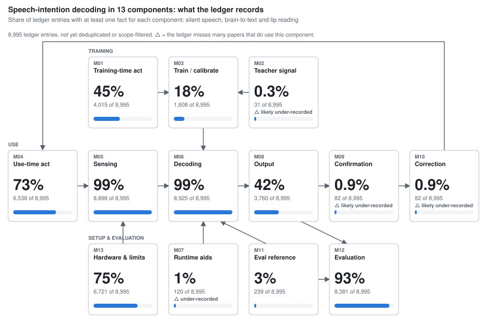
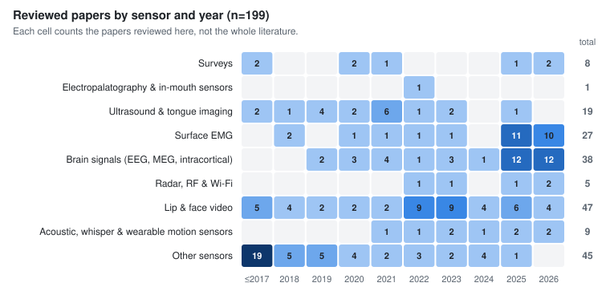

# Silent Speech Interface Review

Reviews of **153 silent speech interface (SSI) papers** (2010–2026), each with the conditions its results were measured under. Maintained by [Naoki Kimura](https://nao-ki-mura.com/) ([ORCID 0000-0001-9167-1923](https://orcid.org/0000-0001-9167-1923)). Last updated 2026-11-23.

Silent speech interfaces turn articulation without audible voice into text or speech, using lip video, ultrasound tongue imaging, EMG, EEG, electropalatography, radar, acoustic sensing and more. Accuracies in this field are hard to compare: one paper recognizes 10 words from one speaker in one session, another decodes open sentences from new speakers on a later day. This review puts those conditions next to every headline number.

Topics covered: silent speech recognition, lip reading and visual speech recognition (VSR), lip-to-speech and video-to-speech synthesis, EMG-to-speech, ultrasound tongue imaging, imagined and inner speech decoding from EEG and MEG, brain-to-text and speech neuroprostheses, radar and Wi-Fi sensing, and wearable silent speech text entry.

**Sections:** [Surveys](#surveys) (8) · [Electropalatography & in-mouth sensors](#electropalatography--in-mouth-sensors) (1) · [Ultrasound & tongue imaging](#ultrasound--tongue-imaging) (18) · [Surface EMG](#surface-emg) (27) · [Brain signals (EEG, MEG, intracortical)](#brain-signals-eeg-meg-intracortical) (37) · [Radar, RF & Wi-Fi](#radar-rf--wi-fi) (5) · [Lip & face video](#lip--face-video) (47) · [Acoustic, whisper & wearable motion sensors](#acoustic-whisper--wearable-motion-sensors) (9) · [Other sensors](#other-sensors) (1)

## Component reviews

Each paper judged component by component against the usual approach and the current state of the art. The remaining papers have itemized summaries in the earlier format ([all reviews](reviews/README.md)).

- [A First Exploration of Neuromorphic OT-CFM for Multi-Speaker VSR](reviews/lipsflow-a-first-exploration-of-neuromorphic-ot-cfm-for-multi-speaker-vsr/) (2026). Event input and a two-step OT-CFM decoder are standard; the DVS-Lip evaluation is behind: WER on an isolated-word set with no split details or seeds, and baselines that do not match their sources.
- [A cross-species neural foundation model for end-to-end speech decoding](reviews/a-cross-species-neural-foundation-model-for-end-to-end-speech-decoding/) (2026). Cascaded decoding with the pretrained encoder is a strong standard result; the end-to-end audio-LLM path beats the prior end-to-end entry but trails RNN cascades, and the cross-species gain is small.
- [AVSRBench: A Multi-Condition AVSR Benchmark](reviews/avsrbench-a-multi-condition-avsr-benchmark/) (2026). Zero-shot cross-corpus AVSR testing (M12) and a video-call test set (M11) are standard after WildVSR; each condition mixes several shifts, without repeated runs.
- [Affect Decoding in Phonated and Silent Speech Production from Surface EMG](reviews/affect-decoding-in-phonated-and-silent-speech-production-from-surface-emg/) (2026). Affect decoded from silent-articulation EMG, a design absent from 99 ledger studies (M08, ahead); it works within subject, nears chance across speakers, and is not separated from facial expression.
- [Brain-to-Speech: Prosody Feature Engineering and Transformer-Based Reconstruction](reviews/brain-to-speech-prosody-feature-engineering-and-transformer-based-reconstruction/) (2026). Same three parts and same Table 1 values as MiSTR (2025, same first two authors), not cited. Features (M06) and phase vocoder (M08) standard, unablated; no listener test (M12, behind).
- [Brain2Speech-Net: Fast and Intelligible Brain-to-Speech Synthesis Without Text Decoding](reviews/brain2speech-net-intelligible-real-time-brain-to-speech-synthesis-without-text-decoding/) (2026). Text-free synthesis is shown, but its real time is throughput, not causal synthesis, unseen-sentence WER is 2.3 times the cascade, and intelligibility rests on ratings and ASR.
- [Comparison of sEMG Encoding Accuracy Across Speech Modes Using Articulatory and Phoneme Features](reviews/comparison-of-semg-encoding-accuracy-across-speech-modes-using-articulatory-and-phoneme-features/) (2026). Applies an ECoG articulatory-versus-phoneme encoding comparison (Chartier 2018) to sEMG in three speech modes; the gain is small, mode contrasts are confounded, and no decoder is tested.
- [Cross-Modal Masking for Robust Silent Speech Synthesis Using sEMG and Lipreading](reviews/cross-modal-masking-for-robust-silent-speech-synthesis-using-semg-and-lipreading/) (2026). Speech synthesis from fused sEMG and lip video is new to the ledger (M05, ahead); span masking (M03) adds a non-significant clean gain; seen speakers only (M12, behind).
- [Do EEG Foundation Models Transfer to Speech? A Benchmark on Overt and Imagined Speech Decoding](reviews/do-eeg-foundation-models-transfer-to-speech-a-benchmark-on-overt-and-imagined-speech-decoding/) (2026). Benchmark (M03) confirms earlier reports that LaBraM gains nothing on speech EEG; decoders (M06) sit far below same-corpus results; test-subject early stopping (M12).
- [EEG-Based Imagined Speech Decoding Using a Hybrid CNN-SNN Architecture](reviews/eeg-based-imagined-speech-decoding-using-a-hybrid-cnn-snn-architecture/) (2026). CNN-to-LIF decoder (M06) is standard: a 2024 SNN-CNN inner-speech decoder precedes it; 80.13% on the validation subset is not comparable with the 82.6% competition test score (M12); no SNN ablation.
- [EMG-to-Speech with Fewer Channels](reviews/emg-to-speech-with-fewer-channels/) (2026). Halving EMG electrodes costs synthesis the same ~35% relative WER known from recognition; initialization helps, channel dropout does not, and a weak unrepeated baseline undercuts the ranking.
- [Lip-Siri: Contactless Open-Sentence Silent Speech with Wi-Fi Backscatter](reviews/lip-siri-contactless-open-sentence-silent-speech-with-wi-fi-backscatter/) (2026). Wi-Fi backscatter lip sensing (M05) and subword sentence output (M08) are standard; open-sentence decoding is untested, with no sentence-disjoint split and 36.87% WER.
- [LipSody: Lip-to-Speech Synthesis with Enhanced Prosody Consistency](reviews/lipsody-lip-to-speech-synthesis-with-enhanced-prosody-consistency/) (2026). Pitch and energy predicted from lips, face and emotion (M06) is standard: Faces-to-Voices did it in 2025. Prosody metrics improve, WER does not; normalization change unablated.
- [Mechanistic Interpretability of Brain-to-Speech Models Across Speech Modes](reviews/mechanistic-interpretability-of-brain-to-speech-models-across-speech-modes/) (2026). Patching shows the decoder depends on donor activations, not that transfer runs through a compact subspace: kept regions score below the unpatched decoder, with no null and no held-out split.
- [Multi-Subject Pretraining Enables Short-Calibration Personalization for Closed-Corpus Surface EMG Speech Decoding](reviews/multi-subject-pretraining-enables-short-calibration-personalization-for-closed-corpus-surface-emg-speech-decoding/) (2026). Standard training recipe (M03) at larger scale: pretrain on 26, calibrate 3 min. The closed corpus carries the result: unseen sentences give 99.9% WER (M12, behind).
- [NasoVoce: A Nose-Mounted Low-Audibility Speech Interface for Always-Available Speech Interaction](reviews/nasovoce/) (2026). Nose-pad mic plus vibration sensor (M05) and dual-input fusion (M06) are standard; noise is added to the mic only, so the robustness claim is untested in real noise (M12, behind).
- [Physiological Noise Augmentation Improves Non-Invasive Brain-to-Speech](reviews/physiological-noise-augmentation-improves-non-invasive-brain-to-speech/) (2026). Artifact-remix augmentation repeats 2024 reference-signal mixing, gains 3.3 points (not 4.7) only with 10-trial averaging, barely beats white noise, and does not directly test the claimed invariance.
- [Relating the Neural Representations of Vocalized, Mimed, and Imagined Speech](reviews/relating-the-neural-representations-of-vocalized-mimed-and-imagined-speech/) (2026). Cross-mode transfer and rank scoring are standard tests; one participant, unstated alignment to vocalized targets and mismatched nulls leave the hierarchy and linear-better claims unsupported.
- [SilentWear: an Ultra-Low Power Wearable System for EMG-based Silent Speech Recognition](reviews/silentwear-an-ultra-low-power-wearable-system-for-emg-based-silent-speech-recognition/) (2026). Neckband EMG with on-body inference at 20.5 mW (M13) but no on-device accuracy; repositioning recovery by labeled fine-tuning is standard (M03); sensor reused from 2025.
- [Toward Practical BCI: A Real-time Wireless Imagined Speech EEG Decoding System](reviews/toward-practical-bci-a-real-time-wireless-imagined-speech-eeg-decoding-system/) (2026). Not ahead on any component: consumer headsets and imagined-speech user identification predate it; no online accuracy, latency or split, so the real-time practical claim is unsupported.
- [Transfer Learning from ImageNet for MEG-Based Decoding of Imagined Speech](reviews/transfer-learning-from-imagenet-for-meg-based-decoding-of-imagined-speech/) (2026). ImageNet transfer on MEG scalograms (M03) and the learned sensor projection (M06) are standard; the ablation is new; rest and reading-order confounds limit the binary tasks (M12).
- [Zero-Shot Imagined Speech Decoding via Imagined-to-Listened MEG Mapping](reviews/zero-shot-imagined-speech-decoding-via-imagined-to-listened-meg-mapping/) (2026). New pipeline (imagined MEG mapped to listened MEG, then a listened-trained word decoder), but no no-mapping or null-mapping word control, and a shared closed poem set confounds word decoding.
- [iPhoneme: Brain-to-Text Communication for ALS Using ConformerXL Decoding](reviews/iphoneme-brain-to-text-communication-for-als-using-conformerxl-decoding/) (2026). Behind: 26.61% WER is four times the 6.67% holdout baseline on the same recordings; the T15 best-result claim fails, the scoring split is unnamed and the gaze interface is untested.
- [A Convolutional Framework for Mapping Imagined Auditory MEG into Listened Brain Responses](reviews/a-convolutional-framework-for-mapping-imagined-auditory-meg-into-listened-brain-responses/) (2025). Mapping imagined onto listened MEG (M06) is ahead in design, but the subject-calibrated CNN gain is unproven: no ablation, a channel-shuffling null, and r 0.0113 against 0.0063.
- [A Silent Speech Decoding System from EEG and EMG with Heterogenous Electrode Configurations](reviews/a-silent-speech-decoding-system-from-eeg-and-emg-with-heterogenous-electrode-configurations/) (2025). Pooled EEG/EMG pretraining lifts 64-word accuracy, but each test subject's training sessions, the patient's included, are in pretraining; the coordinate kernel is neither new nor best.
- [An instantaneous voice-synthesis neuroprosthesis](reviews/an-instantaneous-voice-synthesis-neuroprosthesis/) (2025). Closed-loop sentence voice from intracortical arrays holds for one participant; the design is standard, forced-choice and proxy-target metrics overstate intelligibility.
- [Articulatory Feature Prediction from Surface EMG during Speech Production](reviews/articulatory-feature-prediction-from-surface-emg-during-speech-production/) (2025). Articulatory route works on vocalized EMG but trails the mel baseline on WER; it exists for ECoG since 2019, and the electrode subset is never tested against equal-size alternatives.
- [Brain-to-Text Decoding: A Non-invasive Approach via Typing](reviews/brain-to-text-decoding-a-non-invasive-approach-via-typing/) (2025). Executed typing as the decoded action (M04) was ahead for MEG/EEG in 2025; keystroke-locked decoding (M06) and an n-gram LM (M07) are standard, and decoding needs known keystroke times.
- [Confidence-Based Self-Training for EMG-to-Speech: Leveraging Synthetic EMG for Robust Modeling](reviews/confidence-based-self-training-for-emg-to-speech-leveraging-synthetic-emg-for-robust-modeling/) (2025). Synthetic EMG with confidence filtering (M03, standard) gives a small real-EMG gain, 23.30% to 21.87% WER on one speaker; large gains appear only on synthetic test EMG.
- [Conformer-based Ultrasound-to-Speech Conversion](reviews/conformer-based-ultrasound-to-speech-conversion/) (2025). Behind on M06: the Conformer reads beam lines of one frame, missing the multi-frame context mappers have used since 2020, with no objective gain; a small naturalness gain, no intelligibility test.
- [EEG-to-Voice Decoding of Spoken and Imagined speech Using Non-Invasive EEG](reviews/eeg-to-voice-decoding-of-spoken-and-imagined-speech-using-non-invasive-eeg/) (2025). Drops DTW from an EEG-to-Mel generator (M06, standard) but tests only the ten trained classes (M12, behind); one frozen ASR both trains and scores it, and EEG output beats recorded-speech WER.
- [From Silent Signals to Natural Language: A Dual-Stage Transformer-LLM Approach](reviews/from-silent-signals-to-natural-language-a-dual-stage-transformer-llm-approach/) (2025). GPT-2 correction of one ASR transcript is neither first nor near the field: LLM correction of silent-EMG hypotheses already reached 12.2% WER on this benchmark; here 30% on ~100 utterances, one run.
- [Landmark Guided Visual Feature Extractor for Visual Speech Recognition with Limited Resource](reviews/landmark-guided-visual-feature-extractor-for-visual-speech-recognition-with-limited-resource/) (2025). Lip-landmark graph plus pixel fusion is a standard design (2020 precedent); the 0.90-point low-data gain comes from one unseeded run, and LRW 91.69% stays below 95.0%.
- [MultiDiffNet: A Multi-Objective Diffusion Framework for Generalizable Brain Decoding](reviews/multidiffnet-a-multi-objective-diffusion-framework-for-generalizable-brain-decoding/) (2025). Diff-E-style decoder (M06) whose own ablation does not show diffusion helping; 1.01-point imagined-speech gain over EEGNet on two held-out subjects, normalized on scored trials (M03).
- [Non-invasive electromyographic speech neuroprosthesis: a geometric perspective](reviews/non-invasive-electromyographic-speech-neuroprosthesis-a-geometric-perspective/) (2025). Silent-EMG-to-text without vocalized pairing and SPD inputs are both standard: subvocal-only label training predates it, and 73.53% WER from one person is tested only against a near-chance baseline.
- [Pretraining Large Brain Language Model for Active BCI: Silent Speech](reviews/pretraining-large-brain-language-model-for-active-bci-silent-speech/) (2025). In-domain EEG pretraining adds 4.3 points on 24 mouthed words (35.3% to 39.6%), one session, no seeds; Du-IN showed this earlier. Muscle artefact and new users remain untested.
- [Reconstructing Unseen Sentences from Speech-related Biosignals for Open-vocabulary Neural Communication](reviews/reconstructing-unseen-sentences-from-speech-related-biosignals-for-open-vocabulary-neural-commun/) (2025). EEG+EMG fusion (M05) and overt-audio DTW targets (M02) are standard; the unseen-sentence claim lacks a cohort WER (M12), and no EMG-only arm or EMG regression is reported.
- [Speaking Without Sound: Multi-speaker Silent Speech Voicing with Facial Inputs Only](reviews/speaking-without-sound-multi-speaker-silent-speech-voicing-with-facial-inputs-only/) (2025). Face voices (M08) extend 2020 TTS and 2023 lip-to-speech designs to EMG; the pitch-flattening gain (M02) is within seed noise; silent WER 38.91% has no external baseline.
- [Transfer Learning for Covert Speech Classification Using EEG Hilbert Envelope and Temporal Fine Structure](reviews/transfer-learning-for-covert-speech-classification-using-eeg-hilbert-envelope-and-temporal-fine-/) (2025). Overt-to-covert EEG transfer (M04) is not new, even on this dataset; the overt-only control is missing, the from-scratch baseline is unmatched, and 79.82% is tied to no fine-tuning fraction.
- [Wireless Silent Speech Interface Using Multi-Channel Textile EMG Sensors Integrated into Headphones](reviews/wireless-silent-speech-interface-using-multi-channel-textile-emg-sensors-integrated-into-headpho/) (2025). Headphone-integrated textile EMG (M05) is standard, after a dry-electrode necklace; 96% on ten words is one random sample split over four people, speaker separation not stated.
- [AKVSR: Audio Knowledge Empowered Visual Speech Recognition by Compressing Audio Knowledge of a Pretrained Model](reviews/akvsr-audio-knowledge-empowered-visual-speech-recognition-by-compressing-audio-knowledge-of-a-pretrained-model/) (2024). The quantized audio memory (M02) is a standard memory-recall design; its gains repeat over a no-memory baseline, but the LRS3 state-of-the-art claim and the edge over distillation do not hold.
- [An Accurate and Rapidly Calibrating Speech Neuroprosthesis](reviews/an-accurate-and-rapidly-calibrating-speech-neuroprosthesis/) (2024). Reaches 2.5% online large-vocabulary WER and 248 h of home use in one participant; rapid calibration is a cross-study claim and the 97.5% conversation accuracy matches the Copy Task figure.
- [Let There Be Sound: Reconstructing High Quality Speech from Silent Videos](reviews/let-there-be-sound-reconstructing-high-quality-speech-from-silent-videos/) (2024). HuBERT-unit, pitch and energy targets (M02) and flow post-net (M06) are standard, after ReVISE and VCVTS; GRID WER 17.07% vs 17.62%; seen-speaker tests only (M12 behind).
- [Ultrasensitive Textile Strain Sensors Redefine Wearable Silent Speech Interfaces with High Machine Learning Efficiency](reviews/ultrasensitive-textile-strain-sensors-redefine-wearable-silent-speech-interfaces-with-high-machine-learning-efficiency/) (2024). Standard sensor (M05) and decoder (M06): one throat strain channel, small CNN. 95.25% on 20 words, with split grouping and production mode unstated, does not show silent, session-independent decoding.
- [A high-performance neuroprosthesis for speech decoding and avatar control](reviews/a-high-performance-neuroprosthesis-for-speech-decoding-and-avatar-control/) (2023). Text, voice and avatar from ECoG in one participant hold as a demonstration; sensor and decoder are standard, and an LM trained on the test pool inflates the text result.
- [A high-performance speech neuroprosthesis](reviews/a-high-performance-speech-neuroprosthesis/) (2023). Large-vocabulary attempted-speech decoding in one participant holds; sensor, decoder and LM were already in the field, and the resolution attribution and cross-study ratios outrun the evidence.
- [Adaptation of Tongue Ultrasound-Based Silent Speech Interfaces Using Spatial Transformer Networks](reviews/adaptation-of-tongue-ultrasound-based-silent-speech-interfaces-using-spatial-transformer-networks/) (2023). STN-only adaptation (M03) closes 75-76% of the retraining gap, not the 88% the abstract states; untested against lower-layer adaptation; dev-set MSE only (M12 behind).
- [Audio-visual video-to-speech synthesis with synthesized input audio](reviews/audio-visual-video-to-speech-synthesis-with-synthesized-input-audio/) (2023). A second synthesis pass on first-pass speech (M06) and modality dropout (M03) are standard; gains are small and inconsistent, earlier systems keep lower WER, and no equal-training control exists.
- [Decoding speech perception from non-invasive brain recordings](reviews/decoding-speech-perception-from-non-invasive-brain-recordings/) (2023). Contrastive M/EEG decoding (M06) and subject-layer pooling (M03) were ahead in 2022 and are now standard; tests reuse training participants, and EEG headline and EEG zero-shot claims outrun the data.
- [IR-UWB Radar-Based Contactless Silent Speech Recognition of Vowels, Consonants, Words, and Phrases](reviews/ir-uwb-radar-based-contactless-silent-speech-recognition-of-vowels-consonants-words-and-phrases/) (2023). FERASEC is a standard engineered radar front end with a large gain over 2016 features; phoneme novelty holds only for consonant syllables, and evaluation is within-speaker.
- [Improving the Gap in Visual Speech Recognition Between Normal and Silent Speech Based on Metric Learning](reviews/improving-the-gap-in-visual-speech-recognition-between-normal-and-silent-speech-based-on-metric-learning/) (2023). Joint normal-silent training does most of the gap closing; the viseme KL terms add 0.93 WER points with no run count reported, so the metric-learning gain is not established.
- [Intelligible Lip-to-Speech Synthesis with Speech Units](reviews/intelligible-lip-to-speech-synthesis-with-speech-units/) (2023). Unit target (M02) and unit-conditioned vocoder (M06) are standard; units cut LRS3 WER 21.8 points, AV-HuBERT 20.4 more, the vocoder 0.3; unit gain untested on AV-HuBERT, single runs.
- [Large-scale unsupervised audio pre-training for video-to-speech synthesis](reviews/large-scale-unsupervised-audio-pre-training-for-video-to-speech-synthesis/) (2023). Audio-only decoder pre-training (M03) is standard after TTS decoder transfer; it lowers WER in 7 of 16 pairs, earlier systems keep lower WER, and no equal-training control or listener test exists.
- [WESPER: Zero-shot and Realtime Whisper to Normal Voice Conversion for Whisper-based Speech Interactions](reviews/wesper-zero-shot-and-realtime-whisper-to-normal-voice-conversion-for-whisper-based-speech-interactions/) (2023). WESPER trains a whisper-to-normal converter with no paired data (M02, ahead); its unit route (M06) is untested against baselines, and its ASR gain trails a recognizer fine-tuned on labelled whisper.
- [Learning Audio-Visual Speech Representation by Masked Multimodal Cluster Prediction](reviews/learning-audio-visual-speech-representation-by-masked-multimodal-cluster-prediction/) (2022). AV-HuBERT's masked audio-visual cluster pre-training (M03) was a large step past distillation, but its LRS3 gains lack repeated runs and later work beats it at matched budgets.
- [Lip-to-Speech Synthesis for Arbitrary Speakers in the Wild](reviews/lip-to-speech-synthesis-for-arbitrary-speakers-in-the-wild/) (2022). VAE-GAN lip-to-speech with a reference-audio voice: a standard design whose gains are in distribution and sync metrics; no WER is reported, behind its own lineage on evaluation.
- [Sequence-to-Sequence Voice Reconstruction for Silent Speech in a Tonal Language](reviews/sequence-to-sequence-voice-reconstruction-for-silent-speech-in-a-tonal-language/) (2022). Duration-regulated seq2seq with toneme loss voices silent Mandarin EMG; gains rest on the auxiliary loss, not the architecture, and prompt grouping in the utterance split is unreported.
- [Sub-word Level Lip Reading With Visual Attention](reviews/sub-word-level-lip-reading-with-visual-attention/) (2022). Attention pooling of the lip map (M06) was ahead in 2021 but not the route to later SOTA; WordPiece output (M08) was preceded by BPE in 2020; the SOTA table mixes data budgets.
- [Visual Speech Recognition for Multiple Languages in the Wild](reviews/visual-speech-recognition-for-multiple-languages-in-the-wild/) (2022). Joint distillation losses are a standard idea worth 1.5-2.0 LRS3 points, less than recipe and masking; LRS3 31.5% trails 16.9% from public data; 4 of 6 languages lack external baselines.
- [An Improved Model for Voicing Silent Speech](reviews/an-improved-model-for-voicing-silent-speech/) (2021). Conv-plus-Transformer EMG encoder (M06) is reused by the 2026 state of the art; the phoneme loss (M02) follows 2018 ultrasound work. Single runs; ablations explain 16.3 of 25.8 points.
- [EMA2S: An End-to-End Multimodal Articulatory-to-Speech System](reviews/ema2s-an-end-to-end-multimodal-articulatory-to-speech-system/) (2021). Speech-latent target (M02) has a 2017 precedent and small, mixed single-run gains; spectrogram-loss-only end-to-end loses to WORLD (M06); a preference test replaces listener transcription (M12).
- [End-to-End Silent Speech Recognition with Acoustic Sensing](reviews/end-to-end-silent-speech-recognition-with-acoustic-sensing/) (2021). Standard on sensing and decoding: phone-sonar phase features and an attention decoder work on 54 mouthed sentences of 29 words; the cross-user claim rests on tuning data that include the test users.
- [Improving Neural Silent Speech Interface Models by Adversarial Training](reviews/improving-neural-silent-speech-interface-models-by-adversarial-training/) (2021). Standard on the adversarial loss (M02): it predates the paper in video-to-speech and its gains are small, with no variance reported; behind on evaluation (M12): no listening test.
- [Multi-modality Associative Bridging through Memory: Speech Sound Recollected from Face Video](reviews/multi-modality-associative-bridging-through-memory-speech-sound-recollected-from-face-video/) (2021). Audio memory recall (M02) is ahead as a design, but the LRW state-of-the-art claim misses a prior 87.9% model, the edge over distillation is one run, and GRID gains are small.
- [Neural Speaker Embeddings for Ultrasound-based Silent Speech Interfaces](reviews/neural-speaker-embeddings-for-ultrasound-based-silent-speech-interfaces/) (2021). Standard on embedding conditioning (2.4% relative MSE gain on seen speakers); behind on speaker recognition, which never separates speaker from recording session.
- [Neuroprosthesis for decoding speech in a paralyzed person with anarthria](reviews/neuroprosthesis-for-decoding-speech-in-a-paralyzed-person-with-anarthria/) (2021). Sentence decoding from a person who cannot speak holds for 50 words and one participant; the decoder is standard for 2021, and an LM restricted to the test vocabulary drives the gain.
- [Silent versus modal multi-speaker speech recognition from ultrasound and video](reviews/silent-versus-modal-multi-speaker-speech-recognition-from-ultrasound-and-video/) (2021). Standard on both changed components: modal-to-silent loss and fMLLR were known; later work narrows the absolute gap but not the fMLLR ratio, and adaptation gains rest on single runs.
- [Speaker disentanglement in video-to-speech conversion](reviews/speaker-disentanglement-in-video-to-speech-conversion/) (2021). Speaker-conditioned video-to-speech with adversarial identity removal: both standard (gradient reversal on GRID lips dates from 2017); EER uses the training embedding network; one run.
- [3D Convolutional Neural Networks for Ultrasound-Based Silent Speech Interfaces](reviews/3d-convolutional-neural-networks-for-ultrasound-based-silent-speech-interfaces/) (2020). (2+1)D front end (M06) is standard: established in lip reading, ported to ultrasound; a 6.3% MSE edge over CNN+LSTM, one speaker, one run; MSE-only evaluation (M12 behind).
- [Brain2Char: a deep architecture for decoding text from brain recordings](reviews/brain2char-a-deep-architecture-for-decoding-text-from-brain-recordings/) (2020). Character CTC decoding from ECoG; all changes are standard. The 7.0-10.6% WER relies on repeated sentences, as the authors concede, and unseen sentences average 80% WER.
- [Continuous Silent Speech Recognition using EEG](reviews/continuous-silent-speech-recognition-using-eeg/) (2020). Standard on silent reading (M04) and CTC decoding (M06); 83% WER on 30 sentences repeated in training, with an undisclosed 4-gram LM and no chance baseline, does not show EEG decoding.
- [Digital Voicing of Silent Speech](reviews/digital-voicing-of-silent-speech/) (2020). Silent-EMG target transfer (M02) extends a 2016 DTW recipe; the open corpus scored by WER (M12) became the shared test bed. Headline 94% gain is closed-vocabulary, 20 clips, one evaluator.
- [Vocoder-Based Speech Synthesis from Silent Videos](reviews/vocoder-based-speech-synthesis-from-silent-videos/) (2020). WORLD features (M06) beat the 2019 GAN on seen GRID speakers; on unseen ones PESQ ties and ESTOI is higher. The CTC text loss (M02) adds under 0.015 ESTOI; the WER is the text head's.
- [Autoencoder-Based Articulatory-to-Acoustic Mapping for Ultrasound Silent Speech Interfaces](reviews/autoencoder-based-articulatory-to-acoustic-mapping-for-ultrasound-silent-speech-interfaces/) (2019). Standard on the encoder: autoencoder features predate it and it is never compared with PCA or DCT; behind on F0, which is copied from the recording, so the listening test is not of a silent system.
- [Speech synthesis from neural decoding of spoken sentences](reviews/speech-synthesis-from-neural-decoding-of-spoken-sentences/) (2019). Listener-tested sentence synthesis from ECoG, alongside concurrent work; its articulatory-intermediate gain is not isolated from extra supervision, and intelligibility rests on closed word pools.
- [Ultrasound-based Silent Speech Interface Built on a Continuous Vocoder](reviews/ultrasound-based-silent-speech-interface-built-on-a-continuous-vocoder/) (2019). Continuous F0 targets from articulation were prior work; MVF carrying voicing instead of a flag is new but unproven: the F0 RMSE gain uses different reference contours and naturalness is not better.
- [Video-Driven Speech Reconstruction using Generative Adversarial Networks](reviews/video-driven-speech-reconstruction-using-generative-adversarial-networks/) (2019). Direct-waveform GAN (M06) and speech-encoder perceptual loss (M02) are early but standard; the perceptual loss carries the words. Unseen-speaker WER 40.5% (successor 16%); no listener test.
- [Deep Audio-Visual Speech Recognition](reviews/deep-audio-visual-speech-recognition/) (2018). LRS2-BBC outlasts the models: the CTC vs seq2seq comparison is confounded, the 22-point gain is not attributable to the new architecture, and test speaker overlap is unreported.
- [Harnessing AI for Speech Reconstruction using Multi-view Silent Video Feed](reviews/harnessing-ai-for-speech-reconstruction-using-multi-view-silent-video-feed/) (2018). Multi-view input (M05) is new for video-to-speech but standard on its evidence: 2 speakers, gains overstated (11.4% in Table 1, 26% in text); PESQ only, no listener test (M12).
- [Lip2AudSpec: Speech Reconstruction from Silent Lip Movements Video](reviews/lip2audspec-speech-reconstruction-from-silent-lip-movements-video/) (2018). Bottleneck target (M02) and auditory-spectrogram route (M06) are standard; gains rest on one speaker, a re-implemented baseline and a vocabulary-cued test on four seen GRID speakers.
- [Updating the Silent Speech Challenge benchmark with deep learning](reviews/updating-the-silent-speech-challenge-benchmark-with-deep-learning/) (2018). Kaldi DNN-HMM cuts SSC WER from 17.4% to 6.45% (M06, M12: standard), but with the same bigram its own GMM gives 12.71%, so the DNN halves WER; one speaker, single runs.
- [Visual-Only Recognition of Normal, Whispered and Silent Speech](reviews/visual-only-recognition-of-normal-whispered-and-silent-speech/) (2018). Ahead on data: the first public three-mode lip-video corpus. Standard on transfer: the silent drop was known, and most of it is test-mode difficulty, not the training mode.
- [Improved Speech Reconstruction from Silent Video](reviews/improved-speech-reconstruction-from-silent-video/) (2017). Optical-flow tower (M05) and mel-to-linear post-net (M06) are standard: no flow gain in Table 5; trails Le Cornu on S3; no listener test (M12); Lip2Wav's re-run: 27.83% vs 14.08% WER.
- [Lip Reading Sentences in the Wild](reviews/lip-reading-sentences-in-the-wild/) (2017). Made sentence lipreading measurable with LRS, but its decoder and curriculum gains are confounded with data and augmentation, and the beats-a-lipreader claim is on unequal terms.

## The field in 13 components

<picture><source media="(prefers-color-scheme: dark)" srcset="figures/field/components-dark.svg"></picture>

Every speech-intention decoder, whatever its sensor, can be described by the same 13 components: what the user does in training and in use, what is sensed, how it is decoded, what comes out, how the user confirms or corrects it, and how it is evaluated. Shares measure what the maintainer's normalized ledger (spec v2.1) has recorded. Runtime aids (M07) are under-recorded: of 3,245 decoding papers, 78 have M07 recorded, while about 440 mention a language model, beam search or lexicon in their methods and roughly half of those use one. Training-only supervision (M02) is also under-recorded: an estimated 250 or more papers use it (paired audio is often stored under M03 instead), against 31 recorded. Confirmation (M09) and correction (M10) are genuinely rare: 65 papers describe them (17 more ledger entries state "none"), and a full-text check found only a dozen or so missed, mostly text-entry BCIs and input systems.

<picture><source media="(prefers-color-scheme: dark)" srcset="figures/field-map-dark.svg"></picture>

## Start here

1. [Silent Speech Interfaces in the Era of Large Language Models: A Comprehensive Taxonomy and Systematic Review](reviews/silent-speech-interfaces-in-the-era-of-large-language-models-a-comprehensive-taxonomy-and-system/) (2026). Taxonomy and review of silent speech interfaces in the LLM era across neural, EMG, magnetic, ultrasound, optical, acoustic and RF sensing, with benchmark and dataset tables.
2. [Silent Speech Interfaces for Speech Restoration: A Review](reviews/silent-speech-interfaces-for-speech-restoration-a-review/) (2020). Review of SSI modalities for speech restoration, focusing on deployment bottlenecks such as latency, scarce patient data and modality trade-offs; cites ideal latency of about 50 ms, acceptable up to 100 ms.
3. [Digital Voicing of Silent Speech](reviews/digital-voicing-of-silent-speech/) (2020). Silent-EMG target transfer (M02) extends a 2016 DTW recipe; the open corpus scored by WER (M12) became the shared test bed. Headline 94% gain is closed-vocabulary, 20 clips, one evaluator.
4. [SottoVoce: An Ultrasound Imaging-Based Silent Speech Interaction Using Deep Neural Networks](reviews/sottovoce/) (2019). SottoVoce reconstructs speech audio from under-jaw ultrasound images with two DNNs to control unmodified smart speakers; command success rose from 42.5% to 65.0% with the second network, versus 90.0% for real audio.
5. [SilentSpeller: Towards mobile, hands-free, silent speech text entry using electropalatography](reviews/silentspeller/) (2022). SilentSpeller enables silent spelling text entry with an in-mouth electropalatography retainer, reaching 37 wpm at 87% accuracy in live entry and comparable accuracy while walking.
6. [LipLearner: Customizable Silent Speech Interactions on Mobile Devices](reviews/liplearner-customizable-silent-speech-interactions-on-mobile-devices/) (2023). LipLearner enables customizable few-shot silent speech commands on smartphones with on-device keyword spotting and incremental learning; reaches 98.8% five-shot accuracy on 30 commands in a live study.
7. [AESSI: An Around-Ear Silent Speech Interface for Cross-Day Online Reuse without Test-Day Calibration](reviews/aessi-an-around-ear-silent-speech-interface-for-cross-day-online-reuse-without-test-day-calibrat/) (2026). Around-ear cEEGrid system recognizing 25 fixed Mandarin sentences from silent articulation without test-day calibration; 92.24% mean accuracy on held-out later-day sessions and 98.00% in 250 live trials 21+ days later.
8. [Reconstructing Unseen Sentences from Speech-related Biosignals for Open-vocabulary Neural Communication](reviews/reconstructing-unseen-sentences-from-speech-related-biosignals-for-open-vocabulary-neural-commun/) (2025). EEG+EMG fusion (M05) and overt-audio DTW targets (M02) are standard; the unseen-sentence claim lacks a cohort WER (M12), and no EMG-only arm or EMG regression is reported.
9. [Updating the Silent Speech Challenge benchmark with deep learning](reviews/updating-the-silent-speech-challenge-benchmark-with-deep-learning/) (2018). Kaldi DNN-HMM cuts SSC WER from 17.4% to 6.45% (M06, M12: standard), but with the same bigram its own GMM gives 12.71%, so the DNN halves WER; one speaker, single runs.

## Datasets and benchmarks

- [A 1000-hour EEG-EMG-audio dataset of Japanese speech production](reviews/a-1000-hour-eeg-emg-audio-dataset-of-japanese-speech-production/) (2026). A 1020-hour EEG-EMG-audio dataset of Japanese overt speech from three participants, with signal-quality and physiological validation but no decoding benchmarks.
- [AVSRBench: A Multi-Condition AVSR Benchmark](reviews/avsrbench-a-multi-condition-avsr-benchmark/) (2026). Zero-shot cross-corpus AVSR testing (M12) and a video-call test set (M11) are standard after WildVSR; each condition mixes several shifts, without repeated runs.
- [Do EEG Foundation Models Transfer to Speech? A Benchmark on Overt and Imagined Speech Decoding](reviews/do-eeg-foundation-models-transfer-to-speech-a-benchmark-on-overt-and-imagined-speech-decoding/) (2026). Benchmark (M03) confirms earlier reports that LaBraM gains nothing on speech EEG; decoders (M06) sit far below same-corpus results; test-subject early stopping (M12).
- [SoniSpeech: A Large-Scale Open-Vocabulary Tri-Modal Dataset for Wearable Silent Speech Interfaces](reviews/sonispeech-a-large-scale-open-vocabulary-tri-modal-dataset-for-wearable-silent-speech-interfaces/) (2026). Single-speaker open-vocabulary dataset (ultrasound echoes, audio, video) from eyeglass-mounted sensors; an echo-only baseline trained on mixed voiced/silent data reaches 26.3% WER on silent speech.
- [Advancing NAM-to-Speech Conversion with Novel Methods and the MultiNAM Dataset](reviews/advancing-nam-to-speech-conversion-with-novel-methods-and-the-multinam-dataset/) (2024). Compares ways to create target speech for converting non-audible murmur (NAM) to speech and releases the 7.96-hour MultiNAM dataset. Diff-NAM gives final WER 32.39%/38.94% for two speakers, below Lipvoicer but behind MFA-TTS (26.38%/32.61%).
- [A Novel Task-Oriented Text Corpus in Silent Speech Recognition and its Natural Language Generation Construction Method](reviews/a-novel-task-oriented-text-corpus-in-silent-speech-recognition-and-its-natural-language-generation-construction-method/) (2019). Proposes a task-oriented text corpus and a hybrid natural language generation method for building EEG silent speech recognition datasets; claims gains over template and neural NLG but gives no numeric benchmark.
- [Updating the Silent Speech Challenge benchmark with deep learning](reviews/updating-the-silent-speech-challenge-benchmark-with-deep-learning/) (2018). Kaldi DNN-HMM cuts SSC WER from 17.4% to 6.45% (M06, M12: standard), but with the same bigram its own GMM gives 12.71%, so the DNN halves WER; one speaker, single runs.

## How to read the tables

- **Vocabulary**: the size of the set the system chooses from. A closed set of 10 commands is much easier than open sentences.
- **Speaker**: *Speaker-dependent* means the model was trained and tested on the same person; *Speaker-independent* means it was tested on people not seen in training; *Both* means both were reported.
- **Session**: *Same session* tests on data recorded in the same sitting; *Cross-session* and *Cross-day* test after the sensor was taken off and put back on, which is closer to real use.
- **Online**: whether the system ran live with a user, or was evaluated offline on recorded data.
- **Not stated** means the paper does not say. Each paper's page lists its limitations and a full review (in English or Japanese).

## Surveys

- [Silent Speech Interfaces in the Era of Large Language Models: A Comprehensive Taxonomy and Systematic Review](reviews/silent-speech-interfaces-in-the-era-of-large-language-models-a-comprehensive-taxonomy-and-system/) (2026). Taxonomy and review of silent speech interfaces in the LLM era across neural, EMG, magnetic, ultrasound, optical, acoustic and RF sensing, with benchmark and dataset tables.
- [Toward Robust, Reproducible, and Widely Accessible Intracranial Language Brain-Computer Interfaces: A Comprehensive Review of Neural Mechanisms, Hardware, Algorithms, Evaluation, Clinical Pathways and Future Directions](reviews/toward-robust-reproducible-and-widely-accessible-intracranial-language-brain-computer-interfaces/) (2026). Review of intracranial language BCIs covering neural mechanisms, hardware, algorithms, evaluation and clinical pathways, proposing a composite weighted benchmark.
- [An Introduction to Silent Paralinguistics](reviews/an-introduction-to-silent-paralinguistics/) (2025). Survey introducing silent paralinguistics: conveying emotion and speaking style, not only content, in silent speech, reviewing biosignal sensing modalities and open research problems without new experiments.
- [Advances and Challenges in Deep Lip Reading](reviews/advances-and-challenges-in-deep-lip-reading/) (2021). Survey of deep lip reading covering datasets, pipeline modules, challenges and evaluation metrics; contributes no new model or experiments.
- [An Overview of Deep-Learning-Based Audio-Visual Speech Enhancement and Separation](reviews/an-overview-of-deep-learning-based-audio-visual-speech-enhancement-and-separation/) (2020). Survey of deep-learning audio-visual speech enhancement and separation, mapping design choices and noting the lack of standardized audio-visual evaluation.
- [Silent Speech Interfaces for Speech Restoration: A Review](reviews/silent-speech-interfaces-for-speech-restoration-a-review/) (2020). Review of SSI modalities for speech restoration, focusing on deployment bottlenecks such as latency, scarce patient data and modality trade-offs; cites ideal latency of about 50 ms, acceptable up to 100 ms.
- [Biosignal-Based Spoken Communication: A Survey](reviews/biosignal-based-spoken-communication-a-survey/) (2017). Survey that frames silent speech within biosignal-based spoken communication, spanning articulatory, muscular and neural signals for communication devices, rehabilitation and speech science.
- [Silent speech interfaces](reviews/silent-speech-interfaces/) (2010). Founding review that defines silent speech interfaces, surveys seven sensing technologies from EMA to intracortical implants, and scores them on six practical criteria; concludes no technology meets all of them.

## Electropalatography & in-mouth sensors

| Year | Paper | Task | Vocabulary | Speaker | Session | Online | Key result |
| --- | --- | --- | --- | --- | --- | --- | --- |
| 2022 | [SilentSpeller: Towards mobile, hands-free, silent speech text entry using electropalatography](reviews/silentspeller/) | Text entry by silent spelling | 1164-word dictionary offline; 321 words live | Speaker-dependent | Not stated | Both | Live entry 37 wpm at 87% accuracy (best 53 wpm, 91%); 92% word accuracy offline |

## Ultrasound & tongue imaging

| Year | Paper | Task | Vocabulary | Speaker | Session | Online | Key result |
| --- | --- | --- | --- | --- | --- | --- | --- |
| 2025 | [Conformer-based Ultrasound-to-Speech Conversion](reviews/conformer-based-ultrasound-to-speech-conversion/) | Ultrasound-to-speech synthesis: ultrasound frames to 80-band mel spectrogram, waveform by a pre-trained HiFi-GAN | Read TaL sentences; shared sentences 005-014 held out | Speaker-dependent, four TaL80 speakers (two female, two male) | Single session per speaker; train/development split 9:1 per speaker | Offline; audible (modal) speech | Against a single-frame 2D-CNN, neither Conformer variant improves MSE or MCD (Conformer Base has higher MCD for all four speakers, significantly for three); MUSHRA naturalness 32 for Conformer with bi-LSTM against 28 for the baseline (p = 0.037), natural speech 96. |
| 2023 | [Adaptation of Tongue Ultrasound-Based Silent Speech Interfaces Using Spatial Transformer Networks](reviews/adaptation-of-tongue-ultrasound-based-silent-speech-interfaces-using-spatial-transformer-networks/) | Speech synthesis from tongue ultrasound | Read Hungarian sentences | Both | Cross-session | Offline | STN-only adaptation closes 75-76% of the gap between no adaptation and full retraining (2D CNN, MSE); adding the output layer closes 88% (three speakers) and 92% (four sessions of one speaker); development or unnamed split, single runs |
| 2023 | [Speech Reconstruction from Silent Tongue and Lip Articulation By Pseudo Target Generation and Domain Adversarial Training](reviews/speech-reconstruction-from-silent-tongue-and-lip-articulation-by-pseudo-target-generation-and-domain-adversarial-training/) | Speech synthesis from silent articulation | Not stated | Not stated | Not stated | Offline | Silent mode: 43.1% WER, STOI 0.517, MOS 3.33 on TaL corpus |
| 2022 | [Improved Processing of Ultrasound Tongue Videos by Combining ConvLSTM and 3D Convolutional Networks](reviews/improved-processing-of-ultrasound-tongue-videos-by-combining-convlstm-and-3d-convolutional-networks/) | Speech synthesis from tongue ultrasound | Not stated | Speaker-dependent | Not stated | Offline | MSE ~0.276, mean R2 ~0.73 on mel-spectrogram regression |
| 2021 | [Convolutional Neural Network-Based Age Estimation Using B-Mode Ultrasound Tongue Image](reviews/convolutional-neural-network-based-age-estimation-using-b-mode-ultrasound-tongue-image/) | Age estimation from ultrasound | Not applicable | Not stated | Not applicable | Offline | Validation MSE 2.03 on UXTD (baseline 3.64); 4.87 on UPX (baseline 5.35) |
| 2021 | [Improving Neural Silent Speech Interface Models by Adversarial Training](reviews/improving-neural-silent-speech-interface-models-by-adversarial-training/) | Ultrasound-to-mel-spectrogram mapping with a 3D CNN, WaveGlow synthesis; MSE-only versus MSE plus Patch-GAN adversarial loss | Read sentences (Hungarian; English TaL1), vocalized; vocabulary not stated | One speaker per corpus (Hungarian female; TaL1 English); train and test from the same speaker | Not stated; split procedure not given (counts only), no held-out session reported | Offline | Test STOI 0.7050 to 0.7067 (Hungarian) and 0.612 to 0.623 (English); MCD 4.627 to 4.558 and 3.38 to 3.229 dB; no variance reported, no listening test. |
| 2021 | [Neural Speaker Embeddings for Ultrasound-based Silent Speech Interfaces](reviews/neural-speaker-embeddings-for-ultrasound-based-silent-speech-interfaces/) | Speaker recognition from ultrasound (x-vector) and multi-speaker ultrasound-to-mel-spectrum estimation conditioned on it | Read TaL prompts (vocalized) | x-vector trained on 50 speakers, scored on 31 held-out speakers; SSI trained and tested on the same 31 speakers | About one TaL80 recording session per speaker (inferred from corpus totals); speaker and session not separated | Offline | 0.70% 1-NN speaker error on 31 held-out speakers (pooled segments); x-vector input lowers multi-speaker test MSE from 0.669 to 0.653, 2.4% relative, one reported run. |
| 2021 | [Silent versus modal multi-speaker speech recognition from ultrasound and video](reviews/silent-versus-modal-multi-speaker-speech-recognition-from-ultrasound-and-video/) | Sentence recognition from articulatory images: modal-trained, tested on modal, silent and whispered speech | Read TaL prompts; in-domain bigram LM on a superset of the corpus prompts | Multi-speaker (82 speakers, test speakers seen in training) and speaker-dependent (TaL1) | TaL1: per-session fMLLR; test sessions not stated | Offline | Modal-trained recognition: TaL80 silent WER 70.21 vs modal 39.79 with fMLLR (30.42 points, about 76% higher); unsupervised adaptation adds at most 3.36 silent points and raises modal WER; a later system on TaL narrows the absolute gap to 20.28 points but keeps the fMLLR ratio near 1.75. |
| 2021 | [Speech Synthesis from Text and Ultrasound Tongue Image-based Articulatory Input](reviews/speech-synthesis-from-text-and-ultrasound-tongue-image-based-articulatory-input/) | Speech synthesis from text plus ultrasound | Not applicable | Speaker-dependent | Not stated | Offline | Test MCD 5.442 (text+ultrasound) vs 5.652 (text-only) vs 7.153 (ultrasound-only), speaker 03mn |
| 2021 | [Voice Activity Detection for Ultrasound-based Silent Speech Interfaces using Convolutional Neural Networks](reviews/voice-activity-detection-for-ultrasound-based-silent-speech-interfaces-using-convolutional-neural-networks/) | Speech/silence detection for ultrasound SSI | 2 classes (speech/silence) | Speaker-dependent | Not stated | Offline | 85.2% test accuracy, F1 0.9, ROC AUC 0.859, single speaker |
| 2020 | [3D Convolutional Neural Networks for Ultrasound-Based Silent Speech Interfaces](reviews/3d-convolutional-neural-networks-for-ultrasound-based-silent-speech-interfaces/) | Vocoder parameter regression from ultrasound | Not applicable | Speaker-dependent | Not stated | Offline | Test MSE of 13 standardized vocoder parameters: 3D (2+1)D CNN 0.315 vs retrained CNN+LSTM 0.336, 2D CNN 0.366, FCN 0.400; mean R2 0.683 vs 0.661, 0.633, 0.598; one speaker, single runs |
| 2020 | [Ultra2Speech -- A Deep Learning Framework for Formant Frequency Estimation and Tracking from Ultrasound Tongue Images](reviews/ultra2speech-a-deep-learning-framework-for-formant-frequency-estimation-and-tracking-from-ultrasound-tongue-images/) | Formant estimation from ultrasound | Not applicable | Not stated | Not stated | Offline | Mean R2 99.96 on joint f1-f2 prediction vs 90.01 baseline |
| 2019 | [Autoencoder-Based Articulatory-to-Acoustic Mapping for Ultrasound Silent Speech Interfaces](reviews/autoencoder-based-articulatory-to-acoustic-mapping-for-ultrasound-silent-speech-interfaces/) | Ultrasound-to-spectrum estimation (25 MGC-LSP plus gain) for direct synthesis, with autoencoder bottleneck features as input | Read Hungarian sentences (vocalized); vocabulary not stated | One female speaker; train, development and test from the same speaker | Not stated; session-disjoint splits not reported | Offline | Test NMSE 0.534 (pixels, 1 frame) to 0.377 (autoencoder N=256, 13 frames); MUSHRA naturalness 16.58 to 40.98 against 75.16 for vocoded speech, with original F0. |
| 2019 | [Denoising convolutional autoencoder based B-mode ultrasound tongue image feature extraction](reviews/denoising-convolutional-autoencoder-based-b-mode-ultrasound-tongue-image-feature-extraction/) | Silent speech recognition (feature extraction) | Not stated | Speaker-dependent | Not stated | Offline | WER 6.17% with DCAE features, single-speaker Silent Speech Challenge data |
| 2019 | [SottoVoce: An Ultrasound Imaging-Based Silent Speech Interaction Using Deep Neural Networks](reviews/sottovoce/) | Speech synthesis from ultrasound for voice-assistant control | ~500 training commands; 4 Alexa commands in end-to-end test | Speaker-dependent | Not stated | Offline | 65.0% smart speaker command success (4 commands x5, two networks) vs 90.0% ground-truth audio |
| 2019 | [Ultrasound-based Silent Speech Interface Built on a Continuous Vocoder](reviews/ultrasound-based-silent-speech-interface-built-on-a-continuous-vocoder/) | Ultrasound-to-speech synthesis with a continuous vocoder (continuous F0, maximum voiced frequency, MGC-LSP) | Not stated | Speaker-dependent | Not stated | Offline | ContF0 RMSE 30.56 Hz vs 65.34 Hz for discontinuous F0, measured against different reference contours; MUSHRA naturalness 43.45 vs 40.87 with predicted excitation and original spectra, not significant; four speakers, 9 test sentences each |
| 2018 | [Updating the Silent Speech Challenge benchmark with deep learning](reviews/updating-the-silent-speech-challenge-benchmark-with-deep-learning/) | Continuous silent speech recognition | WSJ0 5000-word lexicon | Speaker-dependent | Not stated | Offline | 6.45% WER on the SSC test (Kaldi DNN-HMM, 30 DCT features, closed WSJ 5k bigram) vs the 17.4% benchmark; with the same bigram the paper's own triphone2b GMM-HMM gives 12.71%, and the less task-specific CSR 5k bigram gives 11.44%. |
| 2016 | [Contour-based 3d tongue motion visualization using ultrasound image sequences](reviews/contour-based-3d-tongue-motion-visualization-using-ultrasound-image-sequences/) | 3D tongue motion visualization | Not applicable | Not stated | Not applicable | Offline | Not reported (about 1.2 s average to associate a frame with the 3D model) |

## Surface EMG

| Year | Paper | Task | Vocabulary | Speaker | Session | Online | Key result |
| --- | --- | --- | --- | --- | --- | --- | --- |
| 2026 | [A 1000-hour EEG-EMG-audio dataset of Japanese speech production](reviews/a-1000-hour-eeg-emg-audio-dataset-of-japanese-speech-production/) | Dataset | Open vocabulary | Not stated | Not applicable | Not applicable | Not reported |
| 2026 | [AESSI: An Around-Ear Silent Speech Interface for Cross-Day Online Reuse without Test-Day Calibration](reviews/aessi-an-around-ear-silent-speech-interface-for-cross-day-online-reuse-without-test-day-calibrat/) | Closed-set sentence recognition | 25 fixed Mandarin sentences | Both | Cross-day | Both | 92.24% accuracy, cross-day held-out sessions, no test-day calibration, chance 4%; 98.00% live (245/250) |
| 2026 | [Affect Decoding in Phonated and Silent Speech Production from Surface EMG](reviews/affect-decoding-in-phonated-and-silent-speech-production-from-surface-emg/) | Affect classification | Binary affect labels (polite/frustrated) | Both | Not stated | Offline | Silent-only within-subject AUC 0.829; held-out-speaker EMG AUC 0.567-0.574 |
| 2026 | [Comparison of sEMG Encoding Accuracy Across Speech Modes Using Articulatory and Phoneme Features](reviews/comparison-of-semg-encoding-accuracy-across-speech-modes-using-articulatory-and-phoneme-features/) | Forward encoding of sEMG from speech features | 50 sentence prompts per participant | Speaker-dependent | Not stated | Offline | Gaddy replication voiced r 0.455 (SPARC) vs 0.443 (phoneme); main results plotted, not tabulated |
| 2026 | [Cross-Modal Masking for Robust Silent Speech Synthesis Using sEMG and Lipreading](reviews/cross-modal-masking-for-robust-silent-speech-synthesis-using-semg-and-lipreading/) | Speech synthesis from sEMG and video | Spanish sentences; about 30 phoneme classes | Not stated | Not stated | Offline | Not reported |
| 2026 | [CS-ETS: Chaos-Inspired Samba-Based EMG-To-Speech Synthesis with Nonlinear Chaotic Losses](reviews/cs-ets-chaos-inspired-samba-based-emg-to-speech-synthesis-with-nonlinear-chaotic-losses/) | Speech synthesis from EMG | Open-vocabulary EMG corpus; size not specified | Speaker-dependent | Not stated | Offline | 41.26% WER vs 42.20% baseline; 32.03M parameters |
| 2026 | [EMG-to-Speech with Fewer Channels](reviews/emg-to-speech-with-fewer-channels/) | Speech synthesis from EMG | Open vocabulary; size not reported | Speaker-dependent | Not stated | Offline | 47.2% WER, best 4-channel subset (full-channel ~35%) |
| 2026 | [Multi-Subject Pretraining Enables Short-Calibration Personalization for Closed-Corpus Surface EMG Speech Decoding](reviews/multi-subject-pretraining-enables-short-calibration-personalization-for-closed-corpus-surface-emg-speech-decoding/) | Closed-corpus sEMG-to-text decoding | 50 closed TIMIT-based sentences | Both | Not stated | Offline | 21.7% CER / 31.9% WER, pretrain + fine-tune, closed 50 sentences; 78.6% CER on unseen sentences |
| 2026 | [SilentWear: an Ultra-Low Power Wearable System for EMG-based Silent Speech Recognition](reviews/silentwear-an-ultra-low-power-wearable-system-for-emg-based-silent-speech-recognition/) | Closed-set command recognition | 8 commands plus rest | Speaker-dependent | Cross-day | Offline | 59.3% silent balanced accuracy on held-out days (77.5% pooled-day), 9 classes; 2.47 ms inference |
| 2026 | [Soft Active Electromyography Interface for Machine Learning-Enabled Silent Speech Recognition](reviews/soft-active-electromyography-interface-for-machine-learning-enabled-silent-speech-recognition/) | Closed-vocabulary word/command recognition | 30 words (4-command drone subset) | Speaker-dependent | Not stated | Both | 97.2% mean participant-dependent accuracy, 30 words, 3 participants; combined model 92.1% |
| 2025 | [A Parallel Ultra-Low Power Silent Speech Interface based on a Wearable, Fully-dry EMG Neckband](reviews/a-parallel-ultra-low-power-silent-speech-interface-based-on-a-wearable-fully-dry-emg-neckband/) | Closed-set command word classification | 8 commands | Speaker-dependent | Cross-session | Not stated | Silent 68% (pooled 5-fold), 54% leave-one-session-out, chance 12.5% |
| 2025 | [A Silent Speech Decoding System from EEG and EMG with Heterogenous Electrode Configurations](reviews/a-silent-speech-decoding-system-from-eeg-and-emg-with-heterogenous-electrode-configurations/) | Closed-set silent word classification (64 Japanese words); English phoneme decoding as a transfer test | 64 Japanese words; English transfer set with a 9,828-word vocabulary | Eight healthy participants and one patient; per-participant session split; one novel healthy participant for calibration | Sessions 1-16 train, 17-18 validation, 19-20 test per participant; patient new-day data over three days | Offline | 64-word accuracy 95.3% healthy (vs 70.1% individual-data baseline) and 54.5% patient (vs 13.2%; chance 1.6%) with the subject-specific tokenizer pretrained on 220 h |
| 2025 | [Articulatory Feature Prediction from Surface EMG during Speech Production](reviews/articulatory-feature-prediction-from-surface-emg-during-speech-production/) | Articulatory feature prediction (12-dim pseudo-EMA, pitch, loudness) from vocalized-speech EMG and speech synthesis from the predicted features | Open vocabulary, vocalized continuous English sentences (size not stated) | One male American English speaker; speaker-dependent | Gaddy corpus split: 200 validation and 99 test utterances | Offline | WER 15.5% and SpeechBERTScore 84.4 against 12.6% and 77.9 for the Gaddy mel-spectrogram baseline; four electrodes give 22.9% WER |
| 2025 | [CAT-Net: A Cross-Attention Tone Network for Cross-Subject EEG-EMG Fusion Tone Decoding](reviews/cat-net-a-cross-attention-tone-network-for-cross-subject-eeg-emg-fusion-tone-decoding/) | Mandarin tone classification | 4 tone classes (120 characters as stimuli) | Both | Not stated | Offline | 85.10% leave-one-subject-out (silent, 4 classes); 88.08% 5-fold |
| 2025 | [Confidence-Based Self-Training for EMG-to-Speech: Leveraging Synthetic EMG for Robust Modeling](reviews/confidence-based-self-training-for-emg-to-speech-leveraging-synthetic-emg-for-robust-modeling/) | Speech synthesis from vocalized EMG | English sentences; size not stated | Not stated | Not stated | Offline | WER 21.87% vs 23.30% baseline, real single-speaker vocalized EMG |
| 2025 | [emg2speech: Synthesizing speech from electromyography using self-supervised speech models](reviews/emg2speech-synthesizing-speech-from-electromyography-using-self-supervised-speech-models/) | Speech synthesis from EMG | ~300 words (ALS); ~6,800 words (healthy) | Speaker-dependent | Not stated | Offline | Human-transcribed WER 50.82% (ALS, silent), 62.55% (healthy), unseen sentences |
| 2025 | [From Silent Signals to Natural Language: A Dual-Stage Transformer-LLM Approach](reviews/from-silent-signals-to-natural-language-a-dual-stage-transformer-llm-approach/) | Text from speech synthesized out of silent EMG, transcribed by a Transformer ASR and rewritten by GPT-2 | Open-vocabulary read sentences of the Gaddy corpus; vocabulary size not stated | Not stated (corpus described as multi-speaker; test speakers not given) | Not stated; session embeddings used, session split not described | Offline | WER 36% (DeepSpeech) to 32.5% (Transformer ASR) to 30% (plus GPT-2) on about 100 test utterances, one run |
| 2025 | [Non-invasive electromyographic speech neuroprosthesis: a geometric perspective](reviews/non-invasive-electromyographic-speech-neuroprosthesis-a-geometric-perspective/) | Silent-articulation sentence decoding to phonemes and English words without vocalized recordings; appendix closed-vocabulary date sentences, NATO-code spelling, and wrist-EMG typing (EMG2QWERTY) | Over 6,500 unique words in about 11,000 sentences; 4-gram LM and lexicon from LibriSpeech-100 transcripts; appendix 67-word and 26-code tasks | One healthy participant for the main corpus; four for NATO codes; eight EMG2QWERTY users with personalized models | Sentence-disjoint split 8,000 / 1,000 / 1,970 by corpus order; session separation not stated | Offline; bidirectional GRU, no streaming | PER 48.47% and WER 73.53% on 1,970 held-out sentences, against 89.25% / 100% for a spectrogram input to the same GRU (chance PER 97.5%) |
| 2025 | [Reconstructing Unseen Sentences from Speech-related Biosignals for Open-vocabulary Neural Communication](reviews/reconstructing-unseen-sentences-from-speech-related-biosignals-for-open-vocabulary-neural-commun/) | Held-out sentence reconstruction (audio and phonemes) | 474 cued English sentences; 39 phonemes plus silence | Speaker-dependent | Not stated | Offline | Overt phoneme accuracy 48.58% EEG+EMG, 36.83% EEG, held-out sentences, baseline 11% |
| 2025 | [Speaking Without Sound: Multi-speaker Silent Speech Voicing with Facial Inputs Only](reviews/speaking-without-sound-multi-speaker-silent-speech-voicing-with-facial-inputs-only/) | Speech synthesis from EMG | Not stated | Speaker-dependent | Not stated | Offline | Silent WER 38.91% with pitch flattening vs 40.12% without |
| 2025 | [Wireless Silent Speech Interface Using Multi-Channel Textile EMG Sensors Integrated into Headphones](reviews/wireless-silent-speech-interface-using-multi-channel-textile-emg-sensors-integrated-into-headpho/) | Silent command word classification | 10 English commands | Speaker-dependent | Not stated | Offline | 96% accuracy, 10 words, 4 participants, random sample-level 80/20 split (76.5% without filtering) |
| 2023 | [Knowledge Distilled Ensemble Model for sEMG-based Silent Speech Interface](reviews/knowledge-distilled-ensemble-model-for-semg-based-silent-speech-interface/) | Spelling via NATO alphabet classification | 26 NATO phonetic alphabet words | Speaker-dependent | Not stated | Offline | 85.9% accuracy, 26-class NATO alphabet, fixed 4:1:1 split; model 21.1 MB, 0.12 ms per sample |
| 2022 | [Sequence-to-Sequence Voice Reconstruction for Silent Speech in a Tonal Language](reviews/sequence-to-sequence-voice-reconstruction-for-silent-speech-in-a-tonal-language/) | Speech synthesis from silent EMG (Mandarin) | Mandarin read sentences (2260 words / 1373 characters) | Speaker-dependent (six speakers, one model each) | Not stated | Offline | 21.99% objective ASR CER (MASR, mean of six speakers), stated as 24.63% better than the Gaddy-Klein 2020 baseline (absolute or relative not stated); 6.41% listener CER; single runs, utterance-level split with five repetitions per prompt and no stated prompt grouping |
| 2021 | [An Improved Model for Voicing Silent Speech](reviews/an-improved-model-for-voicing-silent-speech/) | Speech synthesis from silent EMG | Open vocabulary | Speaker-dependent | Not stated | Offline | 42.2% automatic WER (DeepSpeech) from 68.0%, single runs; 32.3% mean human WER from two listeners on 40 samples; a later rerun of the model scores 25.74% under Whisper; one speaker, open vocabulary |
| 2020 | [Digital Voicing of Silent Speech](reviews/digital-voicing-of-silent-speech/) | Speech synthesis from silent EMG | Closed dates/times set; open vocabulary of 9828 words | Speaker-dependent | Not stated | Offline | 3.6% human WER closed vocabulary; 74.8% human WER open vocabulary |
| 2018 | [AlterEgo: A Personalized Wearable Silent Speech Interface](reviews/alterego-a-personalized-wearable-silent-speech-interface/) | Closed-vocabulary silent word/command recognition | Small task vocabularies (about 20 words per application, per MIT News) | Speaker-dependent | Not stated | Not stated | 92% median word accuracy in user studies (abstract) |
| 2018 | [Development of sEMG sensors and algorithms for silent speech recognition](reviews/development-of-semg-sensors-and-algorithms-for-silent-speech-recognition/) | Silent speech recognition to text | 2,200-word vocabulary, 1,200+ phrases | Not stated | Not stated | Not stated | 8.9% WER (91.1% recognition rate), 2,200-word vocabulary |

## Brain signals (EEG, MEG, intracortical)

| Year | Paper | Task | Vocabulary | Speaker | Session | Online | Key result |
| --- | --- | --- | --- | --- | --- | --- | --- |
| 2026 | [A cross-species neural foundation model for end-to-end speech decoding](reviews/a-cross-species-neural-foundation-model-for-end-to-end-speech-decoding/) | Sentence decoding from attempted speech (Brain-to-Text '24 and '25 holdouts) and imagined speech (50-word set) | Large-vocabulary attempted-speech sentences; 50 words for imagined speech | Two participants (T12, T15); pretraining also on other human and monkey recordings | T12: 25 sessions over four months; T15: 45 sessions over 20 months | Offline | Cascaded decoding with the pretrained encoder reaches 6.35% (Brain-to-Text '24) and 4.06% ('25) holdout WER as single models, below every non-ensembled entry, and 5.10% and 1.76% with LLM-merged ensembles. The single end-to-end audio-LLM model reaches 15.67% and 11.06%: better than the prior end-to-end entry (24.69%) but behind the RNN baselines (9.76%, 6.67%); the headline 24.69% to 10.22% uses a 10-model ensemble. |
| 2026 | [Brain-to-Speech: Prosody Feature Engineering and Transformer-Based Reconstruction](reviews/brain-to-speech-prosody-feature-engineering-and-transformer-based-reconstruction/) | Speech synthesis from intracranial signals | Not stated | Not stated | Not stated | Offline | PC 0.91, MCD 3.92, STOI 0.73, HNR 12.7 dB, tenfold cross-validation |
| 2026 | [Brain2Speech-Net: Fast and Intelligible Brain-to-Speech Synthesis Without Text Decoding](reviews/brain2speech-net-intelligible-real-time-brain-to-speech-synthesis-without-text-decoding/) | Speech synthesis from attempted speech without text decoding (offline) | Large-vocabulary prompted sentences; no lexicon or language model in the proposed model (cascade baselines use a 125k-word 5-gram LM) | One participant with ALS (Willett et al. 2023 dataset) | Recording sessions of the public dataset; session count not stated in the paper | Offline | Unseen-sentence Whisper WER 0.472 and PER 0.373 at RTF 0.532, against 0.206-0.229 WER at RTF above 1.8 for text cascades and 1.054 WER for a direct speech-unit baseline; MOS 3.34 on a 1-5 intelligibility rating; seen training sentences 0.068 WER. |
| 2026 | [Do EEG Foundation Models Transfer to Speech? A Benchmark on Overt and Imagined Speech Decoding](reviews/do-eeg-foundation-models-transfer-to-speech-a-benchmark-on-overt-and-imagined-speech-decoding/) | Speech-related EEG classification | 60 Spanish words/categories (UGR); 5 words/phrases (BCIC) | Both | Not stated | Offline | BCIC2020-T3 within-subject balanced accuracy 25.7-30.2% (best EEGConformer 30.2%; LaBraM 27.7%; chance 20%); LOSO 18.9-20.2%, all at chance. UGR-MINDVOICE speech mode EEGNet 61.3% vs LaBraM 57.3%, EEGMamba 56.6% (chance 33.3%); 60-word identity at most 2.9% (chance 1.7%). |
| 2026 | [EEG-Based Imagined Speech Decoding Using a Hybrid CNN-SNN Architecture](reviews/eeg-based-imagined-speech-decoding-using-a-hybrid-cnn-snn-architecture/) | Imagined speech command classification | 5 words/phrases (Hello, Help me, Stop, Thank you, Yes) | Speaker-dependent | Not stated | Offline | 80.13% five-class accuracy and 80.14% F1 on the public validation subset (750 trials, 15 subjects, subject-dependent), one run; competition winner 82.6% on the test trials |
| 2026 | [iPhoneme: Brain-to-Text Communication for ALS Using ConformerXL Decoding](reviews/iphoneme-brain-to-text-communication-for-als-using-conformerxl-decoding/) | Brain-to-text decoding | 42 phoneme classes; word vocabulary not reported | Speaker-dependent | Not stated | Offline | 26.61% WER, 7.86% PER on an unnamed split (offline) |
| 2026 | [Mechanistic Interpretability of Brain-to-Speech Models Across Speech Modes](reviews/mechanistic-interpretability-of-brain-to-speech-models-across-speech-modes/) | Interpretability of a speech-reconstruction decoder across vocalized, mimed and imagined speech (activation patching, interpolation, causal scrubbing) | Paired sentences across three speech modes; 200 sentences per condition in the winner analysis; acoustic output, no lexicon or language model | One participant (speaker-dependent) | Not stated | Offline | Unpatched PCC 0.725 imagined, 0.752 vocalized, 0.569 mimed; full vocalized-to-imagined patch 0.954; kept convolutional subspace 0.666 against 0.564 for matched random blocks, below the unpatched imagined decoder |
| 2026 | [Physiological Noise Augmentation Improves Non-Invasive Brain-to-Speech](reviews/physiological-noise-augmentation-improves-non-invasive-brain-to-speech/) | Imagined digit classification | 10 digits | Speaker-dependent | One subject; session assignment not stated | Offline | EEGNet accuracy 73.0% to 76.3% with PNA and 10-trial averaging, 10 classes |
| 2026 | [Relating the Neural Representations of Vocalized, Mimed, and Imagined Speech](reviews/relating-the-neural-representations-of-vocalized-mimed-and-imagined-speech/) | Cross-mode spectrogram reconstruction from vocalized, mimed and imagined Mandarin speech with linear (ridge) and CNN-RNN decoders | 100 prompted sentences, two repetitions per mode; acoustic output, no lexicon or language model | One participant (speaker-dependent) | Not stated | Offline | Rank AUC above chance: linear 0.32 and nonlinear 0.59 for vocalized-trained on vocalized; linear mimed-to-imagined -0.01; all envelope correlations above shuffled or shifted nulls |
| 2026 | [Toward Practical BCI: A Real-time Wireless Imagined Speech EEG Decoding System](reviews/toward-practical-bci-a-real-time-wireless-imagined-speech-eeg-decoding-system/) | Imagined-speech command classification with user identification and per-user fine-tuning | 4 commands (help me, tell me, bored, tired) | Speaker-dependent (per-user models), three participants | Not stated | Real-time application described; Table I not labelled online or offline | 62.00% wired and 46.67% wireless four-class accuracy (chance 25%), three participants, split not stated; no identification accuracy, latency or online accuracy |
| 2026 | [Transfer Learning from ImageNet for MEG-Based Decoding of Imagined Speech](reviews/transfer-learning-from-imagenet-for-meg-based-decoding-of-imagined-speech/) | Closed-set imagined speech condition and vowel classification | 3 vowel classes; 18 syllable items | Both | Not stated | Offline | ResNet-18 full-window balanced accuracy: imagery vs silence 90.4% pooled / 77.5% LOSO; imagery vs silent reading 81.0% / 72.2%; three vowels 60.6% / 51.7% (chance 33%). Removing ImageNet weights costs 5.7-8.9 points. |
| 2026 | [Zero-Shot Imagined Speech Decoding via Imagined-to-Listened MEG Mapping](reviews/zero-shot-imagined-speech-decoding-via-imagined-to-listened-meg-mapping/) | Imagined word decoding | 76 content words from poems | Speaker-independent | Not stated | Offline | Recall@1 up to ~9.1% (combined embeddings), 76 words, leave-one-subject-out |
| 2025 | [A Convolutional Framework for Mapping Imagined Auditory MEG into Listened Brain Responses](reviews/a-convolutional-framework-for-mapping-imagined-auditory-meg-into-listened-brain-responses/) | Mapping imagined to listened auditory MEG | 4 stimuli (2 melodies, 2 poems) | Both | Not stated | Offline | 8-condition accuracy 50.7% (chance 12.5%); CNN mean r 0.0113 vs control 0.0063 |
| 2025 | [An instantaneous voice-synthesis neuroprosthesis](reviews/an-instantaneous-voice-synthesis-neuroprosthesis/) | Real-time brain-to-voice synthesis with intonation and pitch control | Unconstrained synthesis; 956 cued sentences evaluated | Speaker-dependent | Cross-session | Online | Closed-set intelligibility 94.34%; question intonation 90.5%; emphasis 95.7%; ~60% open word intelligibility (press release) |
| 2025 | [Brain-to-Text Decoding: A Non-invasive Approach via Typing](reviews/brain-to-text-decoding-a-non-invasive-approach-via-typing/) | Brain-to-text decoding of typed sentences | Spanish sentences of 5-8 words; 128 per session | Not stated | Not stated | Offline | CER 32% MEG average (19% best), 67% EEG |
| 2025 | [Distinct Theta Synchrony across Speech Modes: Perceived, Spoken, Whispered, and Imagined](reviews/distinct-theta-synchrony-across-speech-modes-perceived-spoken-whispered-and-imagined/) | Functional connectivity analysis across speech modes | Not stated | Not stated | Not applicable | Offline | Not reported |
| 2025 | [EEG-to-Voice Decoding of Spoken and Imagined speech Using Non-Invasive EEG](reviews/eeg-to-voice-decoding-of-spoken-and-imagined-speech-using-non-invasive-eeg/) | Speech synthesis and text from EEG | 10 closed classes per condition (words and sentences) | Speaker-dependent | Not stated | Offline | Imagined WER 47.48% at 2 s, 43.46% at 4 s, closed classes, before correction |
| 2025 | [Lightweight Diffusion-based Framework for Online Imagined Speech Decoding in Aphasia](reviews/lightweight-diffusion-based-framework-for-online-imagined-speech-decoding-in-aphasia/) | Online imagined word classification | 3 Korean words plus rest (4 classes) | Speaker-dependent | Not stated | Online | 65% top-1, 70% top-2 accuracy, 20 online trials, 4 classes |
| 2025 | [MultiDiffNet: A Multi-Objective Diffusion Framework for Generalizable Brain Decoding](reviews/multidiffnet-a-multi-objective-diffusion-framework-for-generalizable-brain-decoding/) | Closed-set imagined speech classification | 11 classes | Both | Not stated | Offline | Unseen-subject accuracy 11.62% vs EEGNet 10.61% (12.12% with Mixup), 11-class imagined speech |
| 2025 | [NeuroTTT: Bridging Pretraining-Downstream Task Misalignment in EEG Foundation Models via Test-Time Training](reviews/neurottt-bridging-pretraining-downstream-task-misalignment-in-eeg-foundation-models-via-test-tim/) | Closed-set imagined speech classification | 5 phrases (hello, help me, stop, thank you, yes) | Speaker-dependent | Not stated | Offline | Balanced accuracy 58.98% (CBraMod, TTT with Tent), within-subject, 5 classes |
| 2025 | [Pretraining Large Brain Language Model for Active BCI: Silent Speech](reviews/pretraining-large-brain-language-model-for-active-bci-silent-speech/) | Closed-set classification of silently articulated (mouthed) words from scalp EEG | 24 fixed English words; also 6 semantic groups | Speaker-dependent (per-participant fine-tuning; no unseen participant) | Cross-session: one held-out validation and one held-out test session per participant | Offline | 24-word accuracy 39.6% with pretraining vs 35.3% for the same model from scratch and 32.3% for TCNet (Table 1); 6-group accuracy 47.0% vs 42.2% (Table 2); one test session per participant, no seed count reported. |
| 2025 | [Subject-Independent Imagined Speech Detection via Cross-Subject Generalization and Calibration](reviews/subject-independent-imagined-speech-detection-via-cross-subject-generalization-and-calibration/) | Imagined speech state detection (binary) | 2 classes (speech state vs rest); no words | Both | Not stated | Not stated | 78.1% accuracy with 10% self-calibration vs 67.0% strict LOSO, binary |
| 2025 | [Towards Unified Neural Decoding with Brain Functional Network Modeling](reviews/towards-unified-neural-decoding-with-brain-functional-network-modeling/) | Closed-set initial-sound classification | 23 classes (21 consonants plus i, u) | Both | Not stated | Both | Shared training gains of 5.10% / 4.97% (silent offline, participants 10/11) |
| 2025 | [Transfer Learning for Covert Speech Classification Using EEG Hilbert Envelope and Temporal Fine Structure](reviews/transfer-learning-for-covert-speech-classification-using-eeg-hilbert-envelope-and-temporal-fine-/) | Covert speech command classification with overt-speech pretraining | 5 commands (LEFT, RIGHT, UP, PICK, PUSH) | Speaker-dependent | Within-session random split (session boundary not stated) | Offline | 79.82% five-class covert accuracy after overt pretraining and output-layer fine-tuning on 15-30% covert data (fraction behind the mean not stated), against 66.94% from scratch; overt 86.44%; 15 participants, subject-specific |
| 2024 | [An Accurate and Rapidly Calibrating Speech Neuroprosthesis](reviews/an-accurate-and-rapidly-calibrating-speech-neuroprosthesis/) | Attempted speech to text with personalized TTS output | 50 words and 125,000-word English vocabulary | Speaker-dependent | Cross-day | Online | Copy-task WER 2.5% at 31.6 wpm (125k words); conversation WER 3.7% |
| 2023 | [A high-performance neuroprosthesis for speech decoding and avatar control](reviews/a-high-performance-neuroprosthesis-for-speech-decoding-and-avatar-control/) | Silent attempted speech to text, speech synthesis and avatar | 1,024-word general set; 529- and 50-phrase AAC sets | Speaker-dependent | Cross-day | Both | Real-time median WER 25.5%, PER 18.5%, 78.3 wpm; 50-phrase set WER 4.92% (offline) |
| 2023 | [A high-performance speech neuroprosthesis](reviews/a-high-performance-speech-neuroprosthesis/) | Attempted-speech (vocalized and mouthed) sentence decoding to text | 50 words and 125,000-word English vocabulary | Speaker-dependent | Cross-day | Online | Real-time WER 23.8% (vocalized) / 24.7% (silent) at 125k words; 9.1% / 11.2% at 50 words; 62 wpm |
| 2023 | [Decoding speech perception from non-invasive brain recordings](reviews/decoding-speech-perception-from-non-invasive-brain-recordings/) | Speech perception decoding (segment retrieval) | Natural stories and sentences; 190-1,842 candidate segments | Not stated | Not stated | Offline | MEG top-1 up to 41.3% average; top-10 up to 70.7%; EEG top-10 17.7-25.7% |
| 2022 | [Towards Neural Decoding of Imagined Speech based on Spoken Speech](reviews/towards-neural-decoding-of-imagined-speech-based-on-spoken-speech/) | Closed-set imagined word classification | 5 words | Speaker-dependent | Same session | Offline | 26.8% accuracy (transfer) vs 30.5% direct, 5 classes, 7 subjects, p=0.098 |
| 2021 | [EMA2S: An End-to-End Multimodal Articulatory-to-Speech System](reviews/ema2s-an-end-to-end-multimodal-articulatory-to-speech-system/) | Speech synthesis from EMA | Not applicable | Not stated | Not stated | Offline | Not reported |
| 2021 | [Neuroprosthesis for decoding speech in a paralyzed person with anarthria](reviews/neuroprosthesis-for-decoding-speech-in-a-paralyzed-person-with-anarthria/) | Attempted word and sentence decoding to text | 50 words | Speaker-dependent | Cross-session | Both | Median WER 25.6% with LM (60.5% without), 15.2 wpm; isolated words 47.1% (chance 2%) |
| 2021 | [Silent Speech and Emotion Recognition from Vocal Tract Shape Dynamics in Real-Time MRI](reviews/silent-speech-and-emotion-recognition-from-vocal-tract-shape-dynamics-in-real-time-mri/) | Sentence-level speech recognition from rtMRI | Sentence transcription (size not stated) | Not stated | Not stated | Offline | 40.6% PER on USC-TIMIT unseen data with language model |
| 2020 | [A comparison of oscillatory characteristics in covert speech and speech perception](reviews/a-comparison-of-oscillatory-characteristics-in-covert-speech-and-speech-perception/) | Covert speech EEG analysis | Small fixed lexicon of 1-2 syllable words | Not stated | Not stated | Offline | Not reported |
| 2020 | [Brain2Char: a deep architecture for decoding text from brain recordings](reviews/brain2char-a-deep-architecture-for-decoding-text-from-brain-recordings/) | Sentence-level text decoding from brain signals | 1200-1900 words (English sentences) | Speaker-dependent | Not stated | Offline | WER 7.0-10.6% for three participants on repeated sentences (1200-1900 word vocabularies); unseen sentences average 80% WER |
| 2020 | [Continuous Silent Speech Recognition using EEG](reviews/continuous-silent-speech-recognition-using-eeg/) | Continuous character-level CTC recognition of silently read sentences from EEG, with beam search and an external 4-gram language model | First 30 USC-TIMIT sentences; test subsets of 5 to 30 unique sentences, all repeated in training | Four male participants (three non-native English speakers); one train-on-three, test-on-fourth run | Three repetitions of the 30 sentences per participant; session boundaries not stated | Offline | 83.34% WER on 72 test recordings covering all 30 sentences (74.86% to 84.08% across subsets); 92.55% WER on a held-out subject. |
| 2019 | [A Novel Task-Oriented Text Corpus in Silent Speech Recognition and its Natural Language Generation Construction Method](reviews/a-novel-task-oriented-text-corpus-in-silent-speech-recognition-and-its-natural-language-generation-construction-method/) | Corpus construction for EEG silent speech recognition | Narrow task-oriented domain (size not stated) | Not stated | Not applicable | Not applicable | Not reported |
| 2019 | [Speech synthesis from neural decoding of spoken sentences](reviews/speech-synthesis-from-neural-decoding-of-spoken-sentences/) | Sentence-level speech synthesis from neural signals | Read sentences (MOCHA-TIMIT and others); closed 25/50-word pools for listener transcription | Speaker-dependent | Cross-session | Offline | Median MCD 5.14-6.58 dB; 0.54 dB better than direct decoding (P1); listener median WER 31% (25-word pool) and 53% (50-word pool) |

## Radar, RF & Wi-Fi

| Year | Paper | Task | Vocabulary | Speaker | Session | Online | Key result |
| --- | --- | --- | --- | --- | --- | --- | --- |
| 2026 | [Articulatory movements influence electromagnetic wave transmission through the vocal tract](reviews/articulatory-movements-influence-electromagnetic-wave-transmission-through-the-vocal-tract/) | Physical modeling of articulatory RF sensing | 3 sustained vowels (/a/, /i/, /u/) | Not stated | Not applicable | Not applicable | Between-vowel transmission differences up to 15 dB near 1.5 GHz; repetition variation ~5-10 dB |
| 2026 | [Lip-Siri: Contactless Open-Sentence Silent Speech with Wi-Fi Backscatter](reviews/lip-siri-contactless-open-sentence-silent-speech-with-wi-fi-backscatter/) | Lexicon-constrained sentence recognition | 340 handbook sentences, 3,398 reported words; lexicon-composed | Both | Not stated | Offline | 85.61% word accuracy, 36.87% sentence WER, random 80/20 split; new users 81.5-85.5% |
| 2025 | [IR-UWB Radar-Based Contactless Silent Speech Recognition with Attention-Enhanced Temporal Convolutional Networks](reviews/ir-uwb-radar-based-contactless-silent-speech-recognition-with-attention-enhanced-temporal-convol/) | Isolated word recognition | 50 English words | Speaker-dependent | Cross-session | Not stated | 91.1% mean accuracy, 50 words, leave-one-session-out (baseline 74.0%) |
| 2023 | [IR-UWB Radar-Based Contactless Silent Speech Recognition of Vowels, Consonants, Words, and Phrases](reviews/ir-uwb-radar-based-contactless-silent-speech-recognition-of-vowels-consonants-words-and-phrases/) | Contactless silent speech recognition | 56 items: 8 vowels, 11 consonants, 25 words, 12 phrases | Within-speaker; 20 participants for syllables, 4 for words and phrases | Not stated | Silent articulation | 86.47% vowels, 81.59% consonants, 88.95% words, 96.88% phrases (leave-one-out CV, upper radar) |
| 2022 | [Movement Detection of Tongue and Related Body Parts Using IR-UWB Radar](reviews/movement-detection-of-tongue-and-related-body-parts-using-ir-uwb-radar/) | Binary tongue-movement classification | 2 classes | Speaker-dependent | Not stated | Offline | >=90% accuracy per participant, 2 tongue states, 4 participants |

## Lip & face video

| Year | Paper | Task | Vocabulary | Speaker | Session | Online | Key result |
| --- | --- | --- | --- | --- | --- | --- | --- |
| 2026 | [A First Exploration of Neuromorphic OT-CFM for Multi-Speaker VSR](reviews/lipsflow-a-first-exploration-of-neuromorphic-ot-cfm-for-multi-speaker-vsr/) | Visual speech recognition; multi-speaker scenes cut into single-speaker clips | Not stated; DVS-Lip has 100 isolated words | Not stated (DVS-Lip has 40 speakers; official protocol cited without split details) | Not stated | Offline | 22.3 WER on DVS-Lip with 2-step OT-CFM vs 22.5 for 50-step diffusion at 25x lower latency; one run |
| 2026 | [AVSRBench: A Multi-Condition AVSR Benchmark](reviews/avsrbench-a-multi-condition-avsr-benchmark/) | Audio-visual speech recognition benchmark | Dataset-dependent; continuous open vocabulary (GRID fixed grammar) | Not stated | Not applicable | Offline | 0.79% AV WER on LRS3 (Llama-AVSR); visual-only WER 110.07% on RoomReader-AV (Auto-AVSR) |
| 2026 | [LipSody: Lip-to-Speech Synthesis with Enhanced Prosody Consistency](reviews/lipsody-lip-to-speech-synthesis-with-enhanced-prosody-consistency/) | Lip-to-speech synthesis | Continuous speech; size not reported | Speaker-independent | Not stated | Offline | 54.22% ABX preference; WER 22.5% vs 22.1% baseline, unseen-speaker LRS3 |
| 2026 | [SLD-L2S: Hierarchical Subspace Latent Diffusion for High-Fidelity Lip to Speech Synthesis](reviews/sld-l2s-hierarchical-subspace-latent-diffusion-for-high-fidelity-lip-to-speech-synthesis/) | Lip-to-speech synthesis | Continuous speech; size not reported | Not stated | Not stated | Offline | LRS3 WER 30.22%, UTMOS 4.21; listener naturalness 4.17 vs 3.88 (V2SFlow) |
| 2025 | [Landmark Guided Visual Feature Extractor for Visual Speech Recognition with Limited Resource](reviews/landmark-guided-visual-feature-extractor-for-visual-speech-recognition-with-limited-resource/) | Isolated-word visual speech recognition (lip reading) with a landmark-graph stream fused into a pixel front-end | 500 English words (closed set) | LRW-ID: 20 held-out test speakers disjoint from training; following earlier LRW-ID settings they also form the validation set | Not stated (broadcast clips) | Offline | LRW-ID one-third training: 86.65% vs 85.75% DC-TCN (one run); LRW 91.69%, below 93.2% / 95.0% (word boundary) of earlier LRW-only work |
| 2025 | [LipDiffuser: Lip-to-Speech Generation with Conditional Diffusion Models](reviews/lipdiffuser-lip-to-speech-generation-with-conditional-diffusion-models/) | Speech synthesis from lip video | Open vocabulary English continuous speech (size not stated) | Not stated | Not stated | Offline | WER 38%, NISQA 4.57, speaker similarity 0.63 on LRS3-CHiME3 at -10 dB (1321 test files) |
| 2025 | [LTA-L2S: Lexical Tone-Aware Lip-to-Speech Synthesis for Mandarin with Cross-Lingual Transfer Learning](reviews/lta-l2s-lexical-tone-aware-lip-to-speech-synthesis-for-mandarin-with-cross-lingual-transfer-lear/) | Lip-to-speech synthesis | Mandarin continuous speech; size not stated | Speaker-independent | Not stated | Offline | CER 61.2%, TER 40.9% on CN-CVS unseen-speaker split |
| 2025 | [NaturalL2S: End-to-End High-quality Multispeaker Lip-to-Speech Synthesis with Differential Digital Signal Processing](reviews/naturall2s-end-to-end-high-quality-multispeaker-lip-to-speech-synthesis-with-differential-digita/) | Speech synthesis from lip video | Open vocabulary English continuous speech (size not stated) | Not stated | Not stated | Offline | WER 30.4% on LRS3 and 36.5% on LRS2 vs 27.7%/33.5% for Lip2Speech Unit |
| 2025 | [RESOUND: Speech Reconstruction from Silent Videos via Acoustic-Semantic Decomposed Modeling](reviews/resound-speech-reconstruction-from-silent-videos-via-acoustic-semantic-decomposed-modeling/) | Speech reconstruction from silent video | English continuous speech; LRS3 over 50,000 words | Not stated | Not stated | Offline | WER 20.06% (LRS3), 28.55% (LRS2); UTMOS 3.002 (LRS3) |
| 2025 | [VSpeechLM: A Visual Speech Language Model for Visual Text-to-Speech Task](reviews/vspeechlm-a-visual-speech-language-model-for-visual-text-to-speech-task/) | Visual text-to-speech (video dubbing) | Not stated (text-conditioned English) | Not stated | Not stated | Offline | WER 12.5% (Chem), 18.3% (GRID) on generated speech |
| 2024 | [Advancing NAM-to-Speech Conversion with Novel Methods and the MultiNAM Dataset](reviews/advancing-nam-to-speech-conversion-with-novel-methods-and-the-multinam-dataset/) | NAM-to-speech conversion; dataset | Read sentences from LJSpeech (size not stated) | Speaker-dependent | Not stated | Offline | Final WER 32.39%/38.94% (two speakers) for Diff-NAM vs 26.38%/32.61% for MFA-TTS |
| 2024 | [AKVSR: Audio Knowledge Empowered Visual Speech Recognition by Compressing Audio Knowledge of a Pretrained Model](reviews/akvsr-audio-knowledge-empowered-visual-speech-recognition-by-compressing-audio-knowledge-of-a-pretrained-model/) | Visual speech recognition (lip reading) | Open vocabulary sentences (LRS2/LRS3) | Not stated | Not stated | Offline | LRS3 WER 41.6% vs 46.1% no-memory baseline (BASE, 30 h) and 43.6% for distillation; LARGE 23.6% with 1,326 h pseudo-labels, behind SynthVSR Large at 18.2% without a language model on 3,068 h plus 3,652 h synthetic |
| 2024 | [Let There Be Sound: Reconstructing High Quality Speech from Silent Videos](reviews/let-there-be-sound-reconstructing-high-quality-speech-from-silent-videos/) | Speech synthesis from lip video | GRID 51 words; Lip2Wav large vocabulary | Seen speakers only (GRID 33, Lip2Wav 2) | Not stated | Offline | GRID WER 17.07% vs 17.62% for VCA-GAN (scorer 12.20% on real speech) but MOS 4.46 vs 3.46 naturalness and 4.63 vs 4.10 intelligibility; two-speaker Lip2Wav WER 34.71% vs 48.73%; later LRS3 re-runs (a dataset the paper did not use, different scorers): 79.7% and 84.08% WER on unseen speakers |
| 2023 | [Audio-visual video-to-speech synthesis with synthesized input audio](reviews/audio-visual-video-to-speech-synthesis-with-synthesized-input-audio/) | Speech synthesis from lip video | GRID fixed 51-word vocabulary; TCD-TIMIT and LRW larger vocabularies | Both | Not stated | Offline | Best WER 3.67% on GRID 4 seen speakers; 17.69% on GRID unseen speakers against 16.05% for an earlier end-to-end system; 14.24% on LRW against 12.90% for SVTS |
| 2023 | [Auto-AVSR: Audio-Visual Speech Recognition with Automatic Labels](reviews/auto-avsr-audio-visual-speech-recognition-with-automatic-labels/) | Visual, audio and audio-visual speech recognition | Open-vocabulary English (LRS2/LRS3) | Speaker-independent | Not applicable | Offline | LRS3 WER: VSR 19.1%, ASR 1.0%, AV-ASR 0.9%; LRS2 VSR 14.6% |
| 2023 | [High-Quality Automatic Voice Over with Accurate Alignment: Supervision through Self-Supervised Discrete Speech Units](reviews/high-quality-automatic-voice-over-with-accurate-alignment-supervision-through-self-supervised-discrete-speech-units/) | Automatic voice-over (dubbing) | Not stated | Speaker-dependent | Not stated | Offline | WER 24.7%, LSE-C 6.81, LSE-D 7.56, MOS 3.98 on single-speaker Chem dataset |
| 2023 | [Improving the Gap in Visual Speech Recognition Between Normal and Silent Speech Based on Metric Learning](reviews/improving-the-gap-in-visual-speech-recognition-between-normal-and-silent-speech-based-on-metric-learning/) | Closed-set phrase recognition from silent and normal lip video | 10 fixed phrases | Held-out speakers (20/8/11 split; disjointness not stated) | Not stated | Offline | Silent WER 9.97% vs 12.91% two-mode baseline and 22.55% normal-only; run count not reported |
| 2023 | [Intelligible Lip-to-Speech Synthesis with Speech Units](reviews/intelligible-lip-to-speech-synthesis-with-speech-units/) | Speech synthesis from lip video | Open vocabulary (LRS2/LRS3) | Speaker-independent on LRS3 (unseen-speaker split); LRS2 overlap unknown | Not stated | Offline | LRS3 ASR WER 29.8% with the AV-HuBERT encoder (50.2% with ResNet-18); speech units cut WER from 72.5% to 50.7% (21.8 points) and AV-HuBERT a further 20.4 points; single runs |
| 2023 | [Large-scale unsupervised audio pre-training for video-to-speech synthesis](reviews/large-scale-unsupervised-audio-pre-training-for-video-to-speech-synthesis/) | Speech synthesis from lip video | Not stated | Both | Not stated | Offline | Paper's models: PESQ 1.30-2.07, STOI 0.478-0.720, WER 2.66%-41.00% across GRID, TCD-TIMIT and LRW; audio pre-training lowers WER in 7 of 16 model and split pairs; earlier systems keep lower WER on all four WER splits. |
| 2023 | [LipLearner: Customizable Silent Speech Interactions on Mobile Devices](reviews/liplearner-customizable-silent-speech-interactions-on-mobile-devices/) | Command recognition | User-defined commands, 25-30 tested | Speaker-dependent | Not stated | Both | 98.8% five-shot (81.7% one-shot) accuracy, 30 commands, mobile app; ~422 ms on-device latency |
| 2023 | [LipVoicer: Generating Speech from Silent Videos Guided by Lip Reading](reviews/lipvoicer-generating-speech-from-silent-videos-guided-by-lip-reading/) | Speech synthesis from lip video | Open vocabulary (LRS2/LRS3) | Not stated | Not stated | Offline | WER 21.4% on LRS3 test (86.2% without ASR guidance) |
| 2023 | [RobustL2S: Speaker-Specific Lip-to-Speech Synthesis exploiting Self-Supervised Representations](reviews/robustl2s-speaker-specific-lip-to-speech-synthesis-exploiting-self-supervised-representations/) | Speech synthesis from lip video | GRID 51 words; TCD-TIMIT 375 sentences per speaker; Lip2Wav over 5000 words | Speaker-dependent | Not stated | Offline | STOI 0.596, ESTOI 0.452, WER 29.03 on TCD-TIMIT-3S |
| 2023 | [Zero-shot personalized lip-to-speech synthesis with face image based voice control](reviews/zero-shot-personalized-lip-to-speech-synthesis-with-face-image-based-voice-control/) | Speech synthesis from lip video | Constrained GRID grammar, 6-word sentences | Speaker-independent | Not stated | Offline | Not reported |
| 2022 | [FastLTS: Non-Autoregressive End-to-End Unconstrained Lip-to-Speech Synthesis](reviews/fastlts-non-autoregressive-end-to-end-unconstrained-lip-to-speech-synthesis/) | Speech synthesis from lip video | Lip2Wav 5000+ words; GRID 51 words | Not stated | Not stated | Offline | Not reported |
| 2022 | [Learning Audio-Visual Speech Representation by Masked Multimodal Cluster Prediction](reviews/learning-audio-visual-speech-representation-by-masked-multimodal-cluster-prediction/) | Lipreading (visual speech recognition) and ASR | Open vocabulary (LRS3) | Speaker-independent | Not applicable | Offline | 32.5% WER (30 h labels), 26.9% WER (433 h + self-training) on LRS3 lipreading |
| 2022 | [Lip-to-Speech Synthesis for Arbitrary Speakers in the Wild](reviews/lip-to-speech-synthesis-for-arbitrary-speakers-in-the-wild/) | Speech synthesis from lip video | Open vocabulary (LRW 500 words; LRS2 59k) | Speaker-independent | Not stated | Offline | LRS2 FDSD 1.273 (lip-to-text plus TTS 0.984) and LSE-C 2.507; PESQ/STOI 0.60/0.34, below the sequence-to-sequence baseline (0.97/0.43); no WER reported |
| 2022 | [Sub-word Level Lip Reading With Visual Attention](reviews/sub-word-level-lip-reading-with-visual-attention/) | Lip reading (visual speech recognition) | Open vocabulary, 30522 WordPiece tokens | Not stated | Not stated | Offline | 22.6% WER on LRS2, 30.7% on LRS3 (extended training); 28.9%/40.6% public data only |
| 2022 | [SVTS: Scalable Video-to-Speech Synthesis](reviews/svts-scalable-video-to-speech-synthesis/) | Speech synthesis from lip video | GRID 51, LRW 500, LRS3 >50,000 words | Both | Not stated | Offline | Not reported |
| 2022 | [VCVTS: Multi-speaker Video-to-Speech synthesis via cross-modal knowledge transfer from voice conversion](reviews/vcvts-multi-speaker-video-to-speech-synthesis-via-cross-modal-knowledge-transfer-from-voice-conversion/) | Speech synthesis from lip video | GRID 52 words; LRW 500+ words | Both | Not stated | Offline | Not reported |
| 2022 | [VisageSynTalk: Unseen Speaker Video-to-Speech Synthesis via Speech-Visage Feature Selection](reviews/visagesyntalk-unseen-speaker-video-to-speech-synthesis-via-speech-visage-feature-selection/) | Speech synthesis from face video | Not stated | Both | Not stated | Offline | Not reported |
| 2022 | [Visual Speech Recognition for Multiple Languages in the Wild](reviews/visual-speech-recognition-for-multiple-languages-in-the-wild/) | Visual speech recognition (lipreading) | Open vocabulary; English, Mandarin, Spanish, Italian, Portuguese, French | Speaker-independent | Not applicable | Offline | 25.5% WER LRS2, 31.5% WER LRS3, 8.0% CER CMLR (best of ten runs) |
| 2022 | [VisualTTS: TTS with Accurate Lip-Speech Synchronization for Automatic Voice Over](reviews/visualtts-tts-with-accurate-lip-speech-synchronization-for-automatic-voice-over/) | Automatic voice-over (lip-synced TTS) | GRID fixed-grammar sentences, 33 speakers | Not stated | Not stated | Offline | LSE-C 5.87, LSE-D 8.45, MOS 4.17 on GRID test set |
| 2021 | [Multi-modality Associative Bridging through Memory: Speech Sound Recollected from Face Video](reviews/multi-modality-associative-bridging-through-memory-speech-sound-recollected-from-face-video/) | Lip reading and speech synthesis from video | LRW/LRW-1000 words; GRID phrase set | Speaker-dependent | Not stated | Offline | LRW 85.41% (+1.27 over baseline, +0.91 over distillation), below a prior 87.9% single model; LRW-1000 50.82% (+5.89), 2.8 above the best prior model without word boundaries; GRID seen speakers STOI 0.738 vs 0.731 (Lip2Wav), no WER |
| 2021 | [Speaker disentanglement in video-to-speech conversion](reviews/speaker-disentanglement-in-video-to-speech-conversion/) | Video-to-speech synthesis with speaker control | GRID fixed sentence grammar, 52 words | Both | Not stated | Offline | About 38.9% WER, 11.9% EER (gradient reversal), unseen speaker identity control, GRID |
| 2020 | [Speech Prediction in Silent Videos using Variational Autoencoders](reviews/speech-prediction-in-silent-videos-using-variational-autoencoders/) | Speech synthesis from silent video | Not stated | Not stated | Not stated | Offline | STOI 0.724, ESTOI 0.540, PESQ 1.932 on GRID |
| 2020 | [Vocoder-Based Speech Synthesis from Silent Videos](reviews/vocoder-based-speech-synthesis-from-silent-videos/) | Speech synthesis from silent video | GRID closed vocabulary, fixed 6-word sentences | Both | Not stated | Offline | Seen GRID speakers: PESQ 1.90, ESTOI 0.455 against 0.329 for the 2019 GAN; unseen speakers: ESTOI 0.227 against 0.198 with PESQ tied (1.23 against 1.24). WER 15.1% (seen) and 51.6% (unseen) is from the CTC text head, not ASR on the speech. |
| 2019 | [Lipper: Synthesizing Thy Speech using Multi-View Lipreading](reviews/lipper-synthesizing-thy-speech-using-multi-view-lipreading/) | Speech synthesis from multi-view lip video | OuluVS2 phrases, including OOV phrase tests | Both | Not stated | Both | PESQ 2.315 (0 deg+45 deg+60 deg views), 0.169 s delay; user study 80.25% audio-only accuracy |
| 2019 | [Video-Driven Speech Reconstruction using Generative Adversarial Networks](reviews/video-driven-speech-reconstruction-using-generative-adversarial-networks/) | Speech synthesis from silent video | GRID corpus | Both | Not stated | Offline | Seen GRID speakers: ASR WER 26.6%, STOI 0.518 (Lip2AudSpec 32.5%, 0.446), PESQ 1.71 below Lip2AudSpec 1.82; without the perceptual loss WER 83.3%. Unseen speakers: WER 40.5%, STOI 0.445, PESQ 1.24. |
| 2018 | [Deep Audio-Visual Speech Recognition](reviews/deep-audio-visual-speech-recognition/) | Sentence-level lip reading and audio-visual speech recognition | Open vocabulary; 1,693-word LRS2-BBC test vocabulary | Not stated | Not applicable | Offline | 48.3% WER video-only (LRS2-BBC, +LM); 8.2% audio-visual clean; 23.6% audio-visual in 0 dB babble |
| 2018 | [Harnessing AI for Speech Reconstruction using Multi-view Silent Video Feed](reviews/harnessing-ai-for-speech-reconstruction-using-multi-view-silent-video-feed/) | Speech waveform reconstruction from multi-view silent video | OuluVS2 phrases, digit sequences and TIMIT sentences | Two reported speakers (1 and 10); training split not stated | Not stated | Offline | PESQ 1.9683 / 1.9978 for 0+30 deg against 1.7674 / 1.7812 for 0 deg (Table 1) |
| 2018 | [Lip2AudSpec: Speech Reconstruction from Silent Lip Movements Video](reviews/lip2audspec-speech-reconstruction-from-silent-lip-movements-video/) | Speech synthesis from silent lip video | 51 words (GRID closed vocabulary) | Not stated | Not stated | Offline | Human word accuracy 55.8% vs 50.9% baseline; STMI 0.80 vs 0.52, four GRID speakers |
| 2018 | [Visual-Only Recognition of Normal, Whispered and Silent Speech](reviews/visual-only-recognition-of-normal-whispered-and-silent-speech/) | Closed-set visual-only utterance classification across normal, whispered and silent speech | 10 English digits and 10 OuluVS2 phrases | Speaker-independent (digits 30/10/13, phrases 20/8/11 train/validation/test speakers) | Not stated | Offline | Normal-trained: 68.0 to 59.7% (digits) and 69.7 to 61.2% (phrases) from normal to silent test; on the silent test, silent training gains only 2.5 and 3.2 points over normal training, and whispered training is best for silent phrases (65.1%). |
| 2017 | [Improved Speech Reconstruction from Silent Video](reviews/improved-speech-reconstruction-from-silent-video/) | Speech synthesis from silent video | 51-word GRID grammar plus unseen words in TCD-TIMIT | Speaker-dependent | Not stated | Offline | GRID S4 STOI 0.700 vs 0.584 for Vid2speech, but behind Le Cornu and Milner on S3 ESTOI (0.398 vs 0.437) and PESQ; in Lip2Wav's re-run of the method, 27.83% GRID WER vs 14.08% for Lip2Wav |
| 2017 | [Lip Reading Sentences in the Wild](reviews/lip-reading-sentences-in-the-wild/) | Sentence-level lip reading and audio-visual speech recognition | Open vocabulary; 17,428 words (LRS) | Not stated | Not applicable | Offline | 50.2% lips-only WER on LRS (professional lipreader 73.8% on 200 clips); 13.9% audio-visual WER clean vs 17.7% audio-only; 3.0% WER on GRID (overlapped-speaker split) |
| 2017 | [Seeing Through Noise: Visually Driven Speaker Separation and Enhancement](reviews/seeing-through-noise-visually-driven-speaker-separation-and-enhancement/) | Audiovisual speech separation and enhancement | Not applicable | Speaker-dependent | Not stated | Offline | GRID separation SDR 5.62, PESQ 2.6 vs audio-only 1.74, 1.85 |
| 2017 | [Vid2speech: Speech Reconstruction from Silent Video](reviews/vid2speech-speech-reconstruction-from-silent-video/) | Speech synthesis from silent video | 51 words (GRID grammar) | Speaker-dependent | Not stated | Offline | 82.6% audio-only intelligibility (S4) vs 40.0% prior work; OOV 51.6% vs 10% chance |
| 2016 | [LipNet: End-to-End Sentence-level Lipreading](reviews/lipnet-end-to-end-sentence-level-lipreading/) | Sentence-level lipreading | GRID closed grammar (64,000 possible sentences) | Both | Not stated | Offline | 4.8% WER overlapped speakers, 11.4% WER unseen speakers on GRID |

## Acoustic, whisper & wearable motion sensors

| Year | Paper | Task | Vocabulary | Speaker | Session | Online | Key result |
| --- | --- | --- | --- | --- | --- | --- | --- |
| 2026 | [NasoVoce: A Nose-Mounted Low-Audibility Speech Interface for Always-Available Speech Interaction](reviews/nasovoce/) | Low-audibility speech enhancement and recognition | Open vocabulary (via an off-the-shelf recognizer) | Not stated | Not stated | Not stated | Not reported |
| 2026 | [SoniSpeech: A Large-Scale Open-Vocabulary Tri-Modal Dataset for Wearable Silent Speech Interfaces](reviews/sonispeech-a-large-scale-open-vocabulary-tri-modal-dataset-for-wearable-silent-speech-interfaces/) | Dataset; silent speech recognition | Open vocabulary, 5,356 word types | Speaker-dependent | Not stated | Offline | 26.3% silent WER with mixed voiced/silent training (78.4% voiced-only training) |
| 2025 | [Poster: Recognizing Hidden-in-the-Ear Private Key for Reliable Silent Speech Interface Using Multi-Task Learning](reviews/poster-recognizing-hidden-in-the-ear-private-key-for-reliable-silent-speech-interface-using-mult/) | Spelling-based text entry and user authentication | 50 English words spelled with 26 letters | Speaker-dependent | Cross-session | Not stated | 67.3% Top-1 word accuracy across 11 users; authentication TPR 81.76%, FPR 3.2% |
| 2025 | [Silent Speech Sentence Recognition with Six-Axis Accelerometers using Conformer and CTC Algorithm](reviews/silent-speech-sentence-recognition-with-six-axis-accelerometers-using-conformer-and-ctc-algorith/) | Silent word and sentence recognition | 16 English words, 2 English sentences, 8 Mandarin phrases | Both | Not stated | Offline | 97.17% word-level accuracy (correct words / total words), 4 participants; not sentence-level accuracy |
| 2024 | [Unvoiced: Designing an LLM-assisted Unvoiced User Interface using Earables](reviews/unvoiced-designing-an-llm-assisted-unvoiced-user-interface-using-earables/) | Unvoiced command and phrase recognition via spectrogram generation | Task phrases, 20 commands, digits, 30 general phrases, 50 unseen words | Speaker-dependent | Not stated | Not stated | 93.1-98.6% task completion; WER 0.07 (seen phrases), 0.14 (unseen words); 19 participants |
| 2023 | [EchoSpeech: Continuous Silent Speech Recognition on Minimally-obtrusive Eyewear Powered by Acoustic Sensing](reviews/echospeech-continuous-silent-speech-recognition-on-minimally-obtrusive-eyewear-powered-by-acoustic/) | Silent command and connected-digit recognition | 31 commands; connected 3-6 digit numbers | Speaker-dependent | Cross-session | Both | WER 4.5% commands, 6.1% digits; 16.8% walking without mobile data |
| 2023 | [WESPER: Zero-shot and Realtime Whisper to Normal Voice Conversion for Whisper-based Speech Interactions](reviews/wesper-zero-shot-and-realtime-whisper-to-normal-voice-conversion-for-whisper-based-speech-interactions/) | Whisper-to-normal voice conversion | Not stated | Speaker-independent | Not stated | Online | WER 44.70 to 26.68 (CER 28.38 to 12.70) on wTIMIT whispers, Google ASR |
| 2022 | [EarCommand: "Hearing" Your Silent Speech Commands In Ear](reviews/earcommand-hearing-your-silent-speech-commands-in-ear/) | Silent command recognition | 32 word-level and 25 sentence-level commands | Not stated | Not stated | Not stated | WER 10.02% (word commands), 12.33% (sentence commands) |
| 2021 | [End-to-End Silent Speech Recognition with Acoustic Sensing](reviews/end-to-end-silent-speech-recognition-with-acoustic-sensing/) | Silent sentence recognition from lip movements (active acoustic sensing) | 54 fixed Standard Chinese sentences built from 29 words | 10 volunteers; random split, leave-one-domain-out (user and position) and leave-one-sentence-out tests | 5 sessions per volunteer on different days; split across sessions not stated | Offline | WER 2.6% (random split), 8.4% (leave-one-domain-out), 8.1% (leave-one-sentence-out); attention beats CTC by 0.7 to 2.1 points. |

## Other sensors

| Year | Paper | Task | Vocabulary | Speaker | Session | Online | Key result |
| --- | --- | --- | --- | --- | --- | --- | --- |
| 2024 | [Ultrasensitive Textile Strain Sensors Redefine Wearable Silent Speech Interfaces with High Machine Learning Efficiency](reviews/ultrasensitive-textile-strain-sensors-redefine-wearable-silent-speech-interfaces-with-high-machine-learning-efficiency/) | Isolated word classification from 3-s single-channel strain windows with a 1D residual CNN | 20 frequent English words; 10 confusable words; 5 long words at three reading speeds | Three participants pooled; one further participant for few-shot transfer | Not stated; 100 samples per word split 80/20 without stated session grouping | Offline; production mode (mouthed or voiced) not stated | 95.25% on 20 words, 93% on 10 confusable words, 96% on 5 long words; 80% with 15-20 and 90% with 30 fine-tuning samples per class on a new user or new words. |

## Data

| File | Contents |
| --- | --- |
| [`data/papers.csv`](data/papers.csv) | One row per paper with the English evaluation fields, links and tags. |
| [`data/reviews.jsonl`](data/reviews.jsonl) | Bibliographic data, classification and English summary fields for every paper, plus the older itemized reviews. |
| [`reviews/`](reviews/) | One folder per paper: the readable page, and for component reviews the review text, references, per-component verdicts, figures, and the independent evaluation with its triage. |
| [`components/`](components/) | The 13 components (M01–M13): for each topic searched across the field, every candidate paper with its include/exclude decision and reason. |
| [`docs/STRUCTURE.md`](docs/STRUCTURE.md) | Where every file lives and which files are generated. |

## How the reviews are made

Each review is written from the paper's full text where available (the `review_basis` field says which). The English summary fields are condensed from each full review. Numbers are the authors' reported results under the stated conditions, not a re-run.

## Contributing

- Suggest a paper: [open an issue](https://github.com/supernaiter/silent-speech-review/issues/new?template=add-paper.yml).
- Report an error in a review: [open an issue](https://github.com/supernaiter/silent-speech-review/issues/new?template=correction.yml).
- Send a pull request: see [CONTRIBUTING.md](CONTRIBUTING.md). Edits go to `data/reviews.jsonl`; `python3 scripts/build.py` regenerates everything else.

## Citation

If you use this review, please cite it using [`CITATION.cff`](CITATION.cff) (GitHub's "Cite this repository" button).

## License

Review text and data: [CC BY 4.0](LICENSE). Paper titles, authors and metadata belong to their respective publishers.
