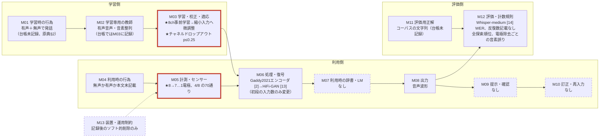
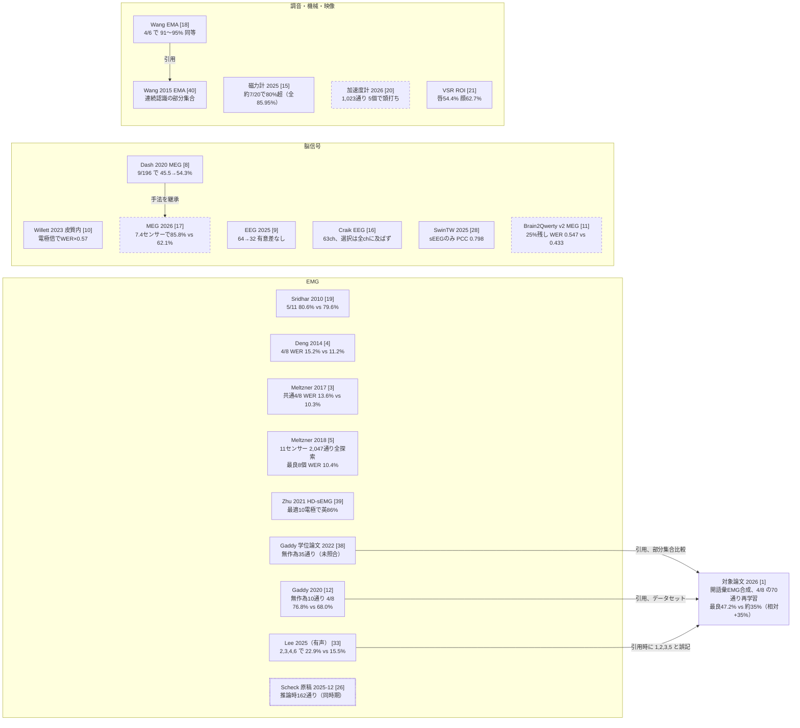

# EMG-to-Speech with Fewer Channels（Hwang, Lee, Lee, arXiv:2602.06460v1, 2026）専門査読：構成要素別の全分野比較

対象：Hwang ら [[1]](#ref-1)（固定版 v1、PDF SHA-256 `c8f0ba7e…f6707ef5`、全5ページ）。
wiki の台帳（仕様 v2.1.0）の 13 構成要素（M01〜M13）ごとに、信号を問わず同じ要素を扱った論文と比べた。走査は 8,995 台帳フォルダ（版の重複を含む）、候補は台帳への正規表現で出し、原典か台帳を読んで確認した。
件数は「枠記録」「文字列一致」（目安）「確認済み」を区別し、数値の出所は「本文確認」「台帳のみ」「図読み」（PDF 描画からの概算、±0.3 ポイント程度）で示す。
**状態**：下書き（`review_confidence: medium`）。採否と判定は LLM 一人の読みで、人間の確認と著者への事実確認は未実施。「他に見つからない」はすべて wiki 内の検索（台帳への正規表現、再現率未測定）の範囲の話である。2026-11-11 の独立評価を受けて改訂し、同日の外部点検（ChatGPT）の指摘も原典で照合して確認できたものだけ反映した。

---

## 要点

変えたのは **M05 計測・センサー**（8 電極を 7〜1 に減らし、4 電極は 70 通りすべてを再学習して評価）と **M03 学習・校正・適応**（縮小入力を 8 電極事前学習から初期化、チャネルドロップアウト p ∈ {0, 0.125, 0.25}）で、**M12 評価**は付随的に変わり、残りはエンコーダ構成を Gaddy and Klein 2021 [[2]](#ref-2) から継ぐ（ただし音響特徴は [[2]](#ref-2) の MFCC からメルスペクトログラムへ、ボコーダは WaveNet から HiFi-GAN へ替わっている。[[2]](#ref-2) §2、対象 §4.1–4.2、本文確認）。

8 → 4 電極の悪化は相対 +35%（約 35% → 47.2%）で、EMG 連続認識の先行例（Meltzner 2017 [[3]](#ref-3) +32%、Deng 2014 [[4]](#ref-4) +36%）とほぼ同じである（査読者の計算）。
EMG の部分集合の全探索も Meltzner 2018 [[5]](#ref-5)（11 センサーの 2,047 通り）が行っている。
この論文の寄与は、既知の代価が開語彙の音声合成でも同程度に出ることを再学習つき全探索で確かめた点で、新しい現象の発見ではない。
絶対差「約 12 ポイント」は、8 電極基準（約 35%）が同じ研究室の後続研究（Interspeech 2026、2026年9月）の報告値（25.12% [[6]](#ref-6)、26.75 ± 0.99% [[7]](#ref-7)）より 8〜10 ポイント弱いことに依存する。
分類課題の「半数で同等」（MEG [[8]](#ref-8)、EEG [[9]](#ref-9) など）は 64〜203 チャネルの冗長なアレイからの削減が多く、選び済みの 8 電極からの削減とは出発点が違うので、課題の差の証拠にはならない。

M03 の全電極モデルからの初期化は 5、6 電極で効く（反復回数・シードの記載なし）。チャネルドロップアウトは著者自身が「広く使われる戦略」として引いており、§5.4 で 6 と 4 電極では p=0 が最良だったと報告している（要旨は最良の設定がチャネル数に依存するとだけ書く）。言い過ぎなのは、事前学習時のドロップアウトが縮小条件で「追加の利得」をもたらすとする §1 の記述である。結論節と貢献の「4〜6 チャネルで一貫して改善」はスクラッチ学習との比較で図3と整合するが、効いたのが初期化かドロップアウトかを区別していない。
M12 は反復回数・シードの記載も分散の報告もないまま上位 10 集合の差 2.4 ポイントを順位づけており、反復を入れた比較例（[[10]](#ref-10) は各点 10 個の RNN、[[11]](#ref-11) はセンサー選択の乱数種 4・モデル乱数種固定）に後れる。

## 何をしたか

Gaddy and Klein の公開コーパス（単一話者、8 チャネル単極の表面 EMG）の開語彙部分を使う。対象 §4.1 は開語彙を約 16 時間と書くが、コーパス原典 [[12]](#ref-12) 表2 では開語彙は計 18.6 時間（無声 3.6、有声並行 3.9、有声非並行 11.2 時間）で、原典間で一致しない（いずれも本文確認。記録の詳細は [[12]](#ref-12) §2.3）。
電極は 1 左頬口上、2 顎先の左端（left corner of chin）、3 顎下 3 cm 後方、4 喉頭左、5 右顎中央、6 右頬口下、7 右頬鼻横、8 右頬後部耳前（対象 図1、本文確認）。
モデルは Gaddy and Klein 2021 [[2]](#ref-2) のエンコーダ、ボコーダは HiFi-GAN [[13]](#ref-13)、WER は Whisper medium [[14]](#ref-14) で測り、削減時は初段畳み込みの入力数だけを変える（対象 §4.2、本文確認）。
実験は後退消去（図2）、4 チャネル 70 通りの全探索（表1、表2）、1 本ずつ外した音素カテゴリ別誤り（表3）、事前学習からの微調整（図3）である。
テストの無声／有声、テスト集合の大きさ、選抜データ、乱数種の数、Whisper の正規化、重み移植の方法は書かれていない（公開コードは未確認）。

| 対象論文の主要数値 | 値 | 出所 |
|---|---|---|
| 8 電極基準 WER | 約 35% | 図2 の 8 電極の点、図3 の破線（図読み） |
| 4 電極最良（1,3,5,6） | 47.2% | 表1（本文確認） |
| 4 電極上位10位 | 47.2–49.6% | 表1（本文確認） |
| 後退消去で選ばれた 4 電極（1,2,3,4） | 約 50.6% | 図2（図読み） |
| 3 電極、2 電極の最良 | 約 59%、約 75% | 図2（図読み） |
| 1 電極 | 100% 超 | §5.1（本文確認） |
| 各チャネルを含む 4 電極集合の平均 WER | 51.4%（ch3）〜54.8%（ch8） | 表2（本文確認） |
| 音素誤り率（8 電極／最悪の 7 電極） | 16.0% ／ 17.1%（ch8 除去） | 表3（本文確認） |
| 図3 7電極（初期化なし／p=0／0.125／0.25） | 36.5／35.8／37.6／36.7 | 図3（図読み） |
| 図3 6電極 | 42.9／39.2／40.3／39.4 | 図3（図読み） |
| 図3 5電極 | 43.4／39.5／39.0／38.1 | 図3（図読み） |
| 図3 4電極 | 47.2／44.6／44.6／46.5 | 図3（図読み、p=0 と 0.125 は重なる） |

### 13 の構成要素で見た対象論文の処理系

太枠は論文が変えた枠、点線はオフライン研究では扱わないのが普通の枠（M01、M02 は台帳未記録のため原典から補った）。

## それまでの到達点

「後続」は対象論文（2026年2月6日 arXiv）より後、「同時期」は前後 6 か月以内で著者が読めなかった可能性が高いもので、どちらも比較相手として扱う。

### M05 計測・センサー：センサー数の削減と部分集合選択（深掘り）

文字列一致 224 件から、台帳経由で 50 件、独立評価の原典全文検索で 3 件 [[5]](#ref-5)、[[15]](#ref-15)、[[16]](#ref-16) を確認し、計 **53 件**（付録A1、網羅ではない）。

**(a) 分類課題では少数センサーで全数に並ぶ例が多いが、多くは冗長なアレイからの削減である。**
MEG 196 → 9 センサーで 45.46% → 54.34%（[[8]](#ref-8)）、同グループの後続は選択を学習集合だけで行い 7.4 ± 4.6 センサーで 85.8%（全 203 で 62.1%、[[17]](#ref-17)、後続）、EEG 64 → 32 で有意差なし（[[9]](#ref-9)）、EMA 6 → 4 で 91〜95% と同等（[[18]](#ref-18)）、EMG 11 → 5 で 80.6% 対 79.6%（[[19]](#ref-19)）、装着型磁力計 20 → 約 7 で 80% 超（全数 85.95%、選択は学習側の分割内、[[15]](#ref-15)）、加速度計 1,023 通りの全探索で 5 個で頭打ち（[[20]](#ref-20)、後続）。いずれも本文確認。
反例として、63 チャネル EEG の離散分類では文献・CSP によるチャネル選択がほぼすべての条件で全チャネルに及ばなかった（[[16]](#ref-16)、本文確認）。

**(b) 連続認識では代価がはっきり見える。**
皮質内では電極を倍にすると WER ×0.57（各点 10 RNN、[[10]](#ref-10)）。
EMG では Meltzner 2017 が 8 センサー 10.3% に対し全被験者共通の最良 4 センサー {2,5,6,8} で 13.6%、被験者ごとの最良 4 センサーで 12.2%（[[3]](#ref-3) 表1・表2）、Deng 2014 が 8 センサー 11.2% に対し最良 4 センサー 15.2%（[[4]](#ref-4) 表6・表7）。
同グループの Meltzner 2018 は 11 センサーの全 2,047 部分集合を話者依存の連続認識 WER で網羅評価し、最良は 8 センサーの 10.4%（[[5]](#ref-5)、本文確認）、最良 4 センサーは約 16%（同 図6A、図読み）。
MEG の文デコードは 25% 残しで WER 0.433 → 0.547（[[11]](#ref-11)、後続）。以上は図読みを除き本文確認。

**(c) 最適な組合せは個別順位と一致しないことがあるが、一致する系もある。**
口唇映像では唇単独 54.4% より顔全体 62.7%（[[21]](#ref-21)）、Gaddy 2020 は上位 3 集合で 5、7、8 を外す（[[12]](#ref-12) §4.3.2）が、加速度計の最適 5 個は個別上位 5 個と一致した（[[20]](#ref-20)）。いずれも本文確認。

### M03 学習・校正・適応：チャネルマスキングと、センサー構成をまたぐ転移（深掘り）

文字列一致 150 件から、センサー単位のマスキング・欠損を扱った 9 件、構成をまたぐ転移 14 件（版の重複を除く）を確認した（付録A2）。全電極で事前学習して部分集合に微調整する比較は、この検索では他に見つからなかった。
チャネル単位のドロップアウト自体は対象論文が他分野の先行例として引く（対象 §3.2）。音声デコードでは、MoDAl が locked channel dropout を外すと WER 21.6% → 26.4%（[[22]](#ref-22)、本文確認、後続）、ほかに皮質内・MEG・EMG＋口唇映像の系も使う（[[23]](#ref-23)、[[24]](#ref-24)、[[11]](#ref-11)、[[25]](#ref-25)、台帳のみ、いずれも後続）。
EMG では Scheck の学位論文に収められた未刊行原稿（2025年12月11日提出の版、同時期）が、最大 50% のチャネルマスクで学習し、1〜4 本を落とした 162 通りを再学習なしで評価し、非因果モデルではチャネルドロップ拡張が多くの条件でわずかに了解度を下げたと書いている（[[26]](#ref-26)、本文確認）。対象論文の結果と同じ向きである。
sEEG では 10、30、50% の無作為チャネル除去を、学習・評価分割を 20 乱数種で繰り返して評価した例がある（[[27]](#ref-27)、本文確認、後続。20 はチャネル集合だけの抽選回数ではない）。
転移では皮質内の日別入力層（[[10]](#ref-10)）、3 次元位置を使う SwinTW（[[28]](#ref-28)）、異なる電極配置を混ぜる EEG/EMG 事前学習（[[29]](#ref-29)）があり（本文確認）、対象論文の「初段の入力数だけを変える」構成は日別入力層の最小形にあたる。

### M12 評価・結果・計数規則：センサー削減の評価設計（深掘り）

学習反復の文字列一致は 114 件、音声出力 425 件では 1 件で、音声合成では反復の明記がまれである。
センサー削減で反復か選抜の分離を入れた例（本文確認）：Willett 2023 [[10]](#ref-10)（10 RNN）、Brain2Qwerty v2 [[11]](#ref-11)（選択乱数種 4、モデル乱数種固定、後続）、sEEG [[27]](#ref-27)（分割の 20 乱数種、後続）、中国語 ECoG [[30]](#ref-30) と MEG 2026 [[17]](#ref-17)（選択を評価から分離）、同研究室の SVRA [[7]](#ref-7)（10 シード 26.75 ± 0.99%、後続）。人間の聴取で了解度を測る系もある（[[31]](#ref-31)、15 名、本文確認）。

### その他の構成要素（M01、M02、M04、M06〜M11、M13）

M01（有声併用で学習、[[12]](#ref-12)）、M02（有声音声と音素整列）、M06（Gaddy 2021 型＋HiFi-GAN、同研究室の後続研究 [[32]](#ref-32)、[[7]](#ref-7)、[[6]](#ref-6) と同じ）、M08、M11 は標準。
M04 は、比較例（[[10]](#ref-10)、[[12]](#ref-12)、[[26]](#ref-26)、[[33]](#ref-33)）が無声と有声を分けて報告するのに対し、テストの別が未記載である。
M07 は合成では言語モデルを置かないのが通例（文字列化では Willett 2023 の trigram [[10]](#ref-10)、MONA LISA の LLM 補正 [[34]](#ref-34)）だが、評価の Whisper [[14]](#ref-14) の内部言語モデルが削減の影響を補っている可能性がある（査読者の仮説）。
M09、M10、M13 はオフライン研究では扱わないのが普通である。ただし先行研究の部分集合解析で 11 から 8 に減らした配置で新たに記録した例（[[3]](#ref-3)。その 4 センサーの結果は 8 センサー同時記録データ上の部分集合評価、本文確認）、首の装置試作（[[35]](#ref-35)）、65,536 電極から 1,024 チャネルを選ぶ装置（[[36]](#ref-36)、台帳のみ）があり、装置設計の指針を語るには仮想削減だけでは足りない。

## 何が変わったか

### M05：対象論文が加えたもの

全通りの探索は、確認した 53 件では Meltzner 2018 の EMG 2,047 通り（連続認識、2018 年）、加速度計 1,023 通り（分類、後続）、Scheck の 162 通り（合成、再学習なし、同時期）と対象論文である。
対象論文に固有なのは、再学習つき全探索を開語彙の合成 WER で行った点に限られる（検索の範囲で）。Meltzner 2017、2018、Deng 2014 は引用されていない。
8 → 4 の相対悪化 +35% は Meltzner 2017 の +32%、Deng 2014 の +36% と同水準で、Meltzner 2018 の最良 8 個 10.4% → 最良 4 個約 16%（約 +54%、図6A の図読み値に依存）よりは小さい。合成に特有の大きな代価を示したものではなく、反復回数・シードの記載がないため傾きの不確かさも示されていない。
個別順位と最良組合せの不一致（最初に捨てた ch6 が最良集合に入る）を電極番号で示したことは確かな寄与だが、加速度計 [[20]](#ref-20) では一致しており、配置ごとの経験的結果である。

### M03：対象論文が加えたもの

縮小入力を 8 電極モデルから初期化する効果は、同じ p=0 同士で比べると 6、5、4 電極で約 3.7、3.9、2.6 ポイントの改善である（図3、図読み、査読者の計算。5 電極の約 5.3 ポイントは p=0.25 の値で、ドロップアウトの効果を含む）。SVRA が 8 電極基準で報告したシード標準偏差（約 1 ポイント）の約 4 倍だが、別実験の参考値との比較にとどまり、縮小条件での分散は報告されていない（反復回数・シードの記載なし）。基準が弱いため、収束不足のモデルに学習を足した効果とも区別しにくい。
ドロップアウトについては、図3の p=0 と p>0 の比較が微調整後の性能に対する除去比較にあたる（利得は 5 電極のみ）が、反復や条件統制の記載が不足しており、再学習なしの欠損頑健性（[[26]](#ref-26)、[[27]](#ref-27)）は測っていない。

### M12：対象論文が加えたもの

電極を 1 本外すごとの音素カテゴリ別誤り（表3）は Gaddy コーパスでは新しいが、無音込みのフレーム誤りと推定され（下記）、編集距離の PER とは比べられない。

### EMG 内の条件一致比較（Gaddy コーパス）

| 論文 | 年 | 条件 | 電極 | 指標 | 値 | 出所 |
|---|---|---|---|---|---|---|
| 対象論文 8 電極基準 | 2026 | 無声と推定、本文未記載、反復数記載なし | 8 | WER（Whisper medium、HiFi-GAN） | 約 35% | [[1]](#ref-1) 図2/図3（図読み） |
| TAP-ETS 論文中の Gaddy 基準 | 2026（後続） | 無声テスト 98 発話、検証 198 で選抜 | 8 | WER（Whisper-medium、HiFi-GAN） | 25.12% | [[6]](#ref-6) 表1（本文確認） |
| SVRA 論文中の Gaddy 基準 | 2026（後続） | 無声テスト 98 発話、10 シード平均 | 8 | WER（Whisper medium、HiFi-GAN） | 26.75 ± 0.99% | [[7]](#ref-7) 表1（本文確認） |
| GETS 論文中の Gaddy and Klein | 2026（後続） | 無声テスト | 8 | WER（Whisper） | 25.74% | [[32]](#ref-32) 表1（本文確認） |
| Diff-ETS のエンコーダ単体 | 2024 | Gaddy 2020 と同じ分割 | 8 | WER（Whisper medium.en） | 30.0% | [[37]](#ref-37) 表I（本文確認） |
| Gaddy and Klein 2020 | 2020 | 無声テスト 100 発話、検証損失で選抜 | 4（1,2,3,6）／8 | WER（DeepSpeech） | 76.8%／68.0% | [[12]](#ref-12) §4.3.2（本文確認） |
| Lee ら 2025 | 2025 | 有声のみ、テスト 99 発話 | 4（2,3,4,6）／8 | WER（Whisper-large-v3） | 22.9%／15.5% | [[33]](#ref-33) 表3（本文確認） |

対象論文の約 35% は、SVRA の 10 シード平均 26.75%（標準偏差 0.99）より約 8.3 標準偏差分高い（(35−26.75)/0.99、査読者の計算）。対象のテスト集合、正規化、学習条件が書かれていないので条件一致は確認できず、別実験の標準偏差を使った記述的比較にとどまるが、学習の打ち切り、テスト集合、正規化、Whisper の版のいずれかが違う可能性が高い。
対象論文は Lee ら [[33]](#ref-33) の 4 電極を (1,2,3,5) として 5 位（48.4%）と書くが、原典の選択は 2,3,4,6 で（arXiv 版 §4.4・表3、本文確認）、2,3,4,6 は上位10位に無い。48.4% は実測値だが帰属が誤っており、Lee らとの比較にはなっていない。
部分集合比較の出典は Gaddy の学位論文 [[38]](#ref-38)（無作為 35 通り、最良 (1,2,3,8) が 4 位）で、wiki に無く照合できない。Gaddy 2020 はデータセットの出典として引かれ、その最良 (1,2,3,6) は表1で 7 位（48.8%）にあたる。

## 分野での位置づけ

### 13 構成要素の総括表

判定は 5 値（標準、先行、後れ、未記載、対象外）。「他になし」は wiki 内の検索（再現率未測定）の範囲での話である。

| 枠 | 対象論文の選択 | 分野の通例（走査数／一致数） | 判定 |
|---|---|---|---|
| M01 学習時の行為 | 有声＋無声 EMG を学習に使用（Gaddy コーパス） | 学習時に有声を併用し無声で使う（8,995／枠記録 4,014） | 標準 |
| M02 学習専用の教師 | 有声音声のメル、音素整列 | 対音声・テキスト・音素ラベル（8,995／対音声 258、テキスト 128、音素 90） | 標準 |
| M03 学習・校正・適応 | 8ch 事前学習→部分集合へ微調整、ドロップアウト p≤0.25、反復回数・シードの記載なし | マスキングは既存（確認 9）、構成間転移は日別入力層・位置埋め込み（確認 14、版の重複を除く）、全→部分の微調整比較は検索内で他に見当たらず | 標準（初期化の比較は検索内で他例なし、反復の記載なし。ドロップアウトは新規性なし） |
| M04 利用時の行為 | 無声か有声か未記載 | 有声・無声を分けて報告（8,995／無声系文字列一致 1,024） | 未記載 |
| M05 計測・センサー | 8→1 電極の後退消去、4/8 の 70 通り全探索 | 部分集合研究は EEG・MEG・EMA・加速度・磁力計・映像・EMG に既存、EMG の全探索（2,047 通り）も既存（8,995／候補 224、確認 53） | 標準（再学習つき全探索を開語彙合成で行った例は検索内で他になし） |
| M06 処理・復号 | Gaddy 2021 エンコーダ＋HiFi-GAN、初段入力数のみ変更 | 同系列の標準構成（8,995／ボコーダ一致 240） | 標準 |
| M07 利用時の辞書・LM | なし（評価の Whisper に暗黙の LM） | 文字列化では LM 標準、合成ではなし（8,995／原典語出現 2,262、上限） | 標準 |
| M08 出力 | 音声波形 | 音声出力 425 件 | 標準 |
| M09 提示・確認 | なし | オンライン BCI で確定操作（8,995／枠記録 82、原典語出現 314） | 対象外 |
| M10 訂正・再入力 | なし | 同上 | 対象外 |
| M11 評価用正解 | コーパス文字列、正規化未記載 | 文字列正解＋ASR、または人間聴取（8,995／枠記録 239） | 標準 |
| M12 評価・計数規則 | 反復回数・シードの記載なし、CI なし、選抜データ未記載、基準が同研究室の後続報告より 8〜10 ポイント悪い | 削減評価は乱数種反復と選抜の分離が先行例にあり（8,995／反復一致 114、音声出力では 1） | 後れ（最良の比較例に対して。音声合成分野の通例並みに弱い） |
| M13 装置・運用制約 | 記録後のソフト的削除のみ | 削減した配置での新規記録（[[3]](#ref-3) の 11→8）、装置試作の例あり（8,995／実時間・装置一致 337） | 対象外（装置設計の指針を語る範囲では不足） |

### M05 の分野横断地図

矢印は原典で引用または手法の継承を確認した関係だけで、破線枠は後続、点線の太枠は同時期の研究である。

対象論文の位置は「再学習つき全探索を開語彙の合成で行った」点に限られ、相対的な代価は EMG 連続認識の先行例と同水準である。他の信号の研究も EMG 認識の部分集合研究も引用していない。

## 主張の範囲

### 証拠が支える主張

個別重要度の順位と最良の組合せが一致しないことは 70 通りの全探索で裏付けられ、後退消去の 4 電極（約 50.6%、図読み）より良い集合が少なくとも 10 個ある。表1の採用回数（ch3 が 9 回、ch1 と ch2 が 7 回、ch8 が 1 回）は数え直して一致した。
8 電極事前学習からの微調整は 5、6 電極で効く。4 電極の利得（約 2.6 ポイント）は反復回数・シードの記載がなく断定しにくい。

### 証拠を超えている主張

**ドロップアウトの効果**：p>0 が p=0 を上回るのは 5 電極の 1 点（38.1% 対 39.5%、図読み）だけで、4 電極では p=0.25 が約 1.9 ポイント悪い。著者も §5.4 でこれを正直に報告している（要旨は最良の設定がチャネル数に依存するとだけ書く）。言い過ぎは §1 の「事前学習時のドロップアウトが縮小条件で追加の利得をもたらす」で、結論節と貢献の「4〜6 チャネルで一貫して改善」はスクラッチ学習との比較としては図3と整合するが、利得をドロップアウトつきの微調整全体に帰している。p=0 でも 4〜6 電極でスクラッチを上回り（図読み）、効いたのは主に初期化である。
**順位の解像度**：上位10集合は 2.4 ポイント幅で、SVRA のシード標準偏差約 1 ポイントと同程度。約 100 発話なら 1 ポイントはおよそ 16 語（[[12]](#ref-12) 表2 の平均 16 語／発話からの査読者の概算）。微調整に使った (1,3,5,6) の選抜データは書かれていない。
**本文と表2の不一致**：§5.2 は順位を「3, 2, 5, 1, 6, 4, 7, 8」と書くが、表2の値（ch1 52.6%、ch5 52.8%）からは「3, 2, 1, 5, …」になる（本文確認）。
**解剖学的な帰属**：ch3（顎下）を胸骨舌骨筋の近くとするが、Lee ら 2025 は ch3 をオトガイ舌筋に近いと解釈する（[[33]](#ref-33) §4.2、本文確認）。胸骨舌骨筋は舌骨より下の筋で、配置記述と合わない（査読者の判断）。
**表3の「PER」**：全体 16.0% が母音 22.6%、子音 20.9% の両方より低いので、誤り 4.5% の無音を含むフレーム単位の平均と推定される（査読者の推論。集計単位は書かれていない）。同じコーパスで、EMG-to-speech&phones（finetuned）表現への線形プロービングによる音素分類正解率は無音込み 84.68%、無音抜き 52.74% と大きく違う（[[41]](#ref-41) 表1、本文確認、後続。対象論文の音素出力ヘッドの値とは別の指標で、無音の扱いでフレーム単位の値が大きく変わる例として挙げる）。
**無声か有声か（M04）**：喉の ch4 は有声発話の音高・音量予測で最強（[[33]](#ref-33)）、有声から無声へ移す基準法では喉電極を外すと人手 WER が 88.8% → 64.6% に改善（[[12]](#ref-12)、閉語彙）、無声のほうが欠損の影響が小さい（[[26]](#ref-26)）（いずれも本文確認）。表2で ch4 が 6 位なのはテストの別によって意味が変わる。

## 実用上の意味

使えるのは「8 → 4 に減らすなら組合せで選ぶ、顎下（ch3）は外さない、縮小モデルは全電極モデルから初期化する」までで、8 → 4 で相対 3 割強の悪化は EMG 認識の先行例と合わせた見積もりの目安になる。
すべて仮想削減で、実際に減らした配置での記録（[[3]](#ref-3) は 11→8 の削減配置で記録。4 センサーは同時記録データ上の評価）や、貼り直しを含む複数セッション（[[12]](#ref-12) §2.2、本文確認）ごとの順位は扱っていない。

## 前進、未解決、後退した軸

**前進**：開語彙 EMG 音声合成の 4/8 全部分集合 WER 地図と、個別順位と組合せの不一致の電極番号での提示。全電極モデルからの初期化が 5、6 電極で効くこと（反復回数・シードの記載なし）。
**未解決**：シード反復と信頼区間、選抜と評価の分離、無声／有声の区別、基準線 35% と 25〜27% の差の原因、重み移植の方法と再学習なしの評価、実際に電極を減らした記録、Whisper の言語モデルの影響。
**後退**：8 電極基準が同系統の後続報告（同一コーパス、同研究室、Interspeech 2026）より弱い。Lee ら [[33]](#ref-33) の電極集合の帰属を誤り、比較になっていない。EMG の部分集合研究（Deng 2014、Meltzner 2017、2018）を引用していない。

## 限界

**技術・評価**：WER はエンコーダ、HiFi-GAN、Whisper の誤りを合算する。重みの移し方が未記載で（図1は 8 入力のままマスクする構成にも読める）、マスクは 1/(1−p) の再スケールなし（§3.2 の式）。単一話者、反復回数・シードの記載なし、統計検定なし。
**運用・範囲**：仮想削減のみで、装着性、遅延、電力、再装着時の頑健性は測っていない。既存の単一話者、開語彙、オフライン合成。
**本査読**：候補は台帳への正規表現で、再現率は測っていない。独立評価の別の全文検索で 3 件の取りこぼし（うち 1 件は EMG の全探索）が見つかったので、53 件も網羅ではない。採否と判定は LLM 一人の読みで、第二判定者も人間の確認もない。対象論文のコードは読んでいない。

## 残る問い

1. 70 通りを 5〜10 シードで再学習し、モデルとセンサー集合の分散を分け（[[11]](#ref-11) の設計）、検証集合で選んだ集合をテストで一度だけ評価する。
2. 70 通りの WER にチャネル別の加法モデルを当てはめ、Scheck [[26]](#ref-26) の R² ≈ 0.87 と同程度なら「相補性」の主張は弱まる。
3. 8 電極基準を 25〜27% まで戻し、学習量をそろえて微調整の利得と、8 → 4 の相対悪化（EMG 認識では +32〜36%）を測り直す。
4. ドロップアウト事前学習モデルを再学習なしで縮小入力に適用し、除去実験（[[22]](#ref-22)）と合わせて寄与を測る。
5. 同じ部分集合を無声と有声の両テストで評価し、喉の ch4 の役割の食い違いを検証する。
6. 電極数に対する WER の傾きを推定し、[[10]](#ref-10)、[[5]](#ref-5)、[[11]](#ref-11) と比べる。
7. 音素認識や人間聴取など、Whisper の言語モデルに頼らない評価でも順位が保たれるかを確かめる。
8. 実際に 4 電極だけを貼って記録する。

---

## 付録A　検討した論文

### A0　走査の手順と件数

- 読込対象：`papers/*/ledger.json` と `views.json` の両方を読めた 8,995 フォルダ（版の重複を含む。ディレクトリ 9,072、読込不能 77）。走査対象は各台帳の 13 枠の facts と観測値の source_label。M07、M09、M10 は原典本文（`papers/*/source/*text*.txt`）も走査した。走査時点の repo の commit SHA は記録していない。
- 信号別の内訳（台帳の modalities、重複あり）：口唇映像 2,964、音響 2,739、EEG 1,868、MEG/fNIRS/fMRI 1,163、皮質内 1,052、ECoG/sEEG 925、EMA/PMA 264、EMG 255、超音波 192、加速度・ひずみ・振動 86、レーダー・能動音響 53、その他 694。
- 枠記録と文字列一致はフォルダ単位の数で版の重複を含む。確認済みは文献単位で、版の重複を除いた。

| 枠 | 枠記録 | 主題の候補（文字列一致） | 確認済み |
|---|---|---|---|
| M05 センサー数・部分集合 | 8,898 | 224（EEG 67、音響 56、ECoG/sEEG 52、EMG 30、映像 22、MEG 等 18、皮質内 15、EMA 7、超音波 2、加速度 1、レーダー 1） | 53（EMG 16、EEG 14、ECoG/sEEG 7、MEG 5、映像 4、皮質内 2、EMA 2、加速度 1、磁力計 1、マイク 1）。うち 3 件は独立評価の原典全文検索による追加 |
| M03 チャネルマスキング・欠損 | 1,607 | 150（映像遮蔽 70、モダリティドロップアウト 22、不良チャネル補間のみ 43 を含む） | 9（EMG 3、皮質内 3、sEEG 1、MEG 1、頭蓋内脳波 1）＋モダリティドロップアウト 22（版の重複を含む文字列一致） |
| M03 構成間転移 | 1,607 | 43 | 14（版の重複を除く。旧版の 16 は Inoue ら 2025 [[29]](#ref-29) の 2 版と SwinTW の bioRxiv 版 [[42]](#ref-42)・JNE 版 [[28]](#ref-28) を別に数えていた） |
| M12 不確かさ／検定／選抜分離／反復 | 8,380 | 470／809／247／114（音声出力 425 件中 45／57／23／1） | 例示 6 件を本文確認 |
| M01 | 4,014 | — | 例示 2 件 |
| M02 | 31 | 対音声 258、テキスト 128、音素 90（M03 の supervision_kind） | — |
| M04 | 6,538 | 無声系 1,024（EMG 84） | 例示 4 件 |
| M06 | 8,924 | ボコーダ 240（音声出力 119） | 例示 2 件 |
| M07 | 120 | 台帳 549、原典本文 2,262（上限） | 例示 2 件 |
| M08 | 3,760 | 音声出力 425 | — |
| M09/M10 | 82 | 原典本文 314（上限） | 例示 1 件 |
| M11 | 239 | — | — |
| M13 | 6,720 | 実時間・装置 337（EMG 19） | 例示 3 件 |

### A1　M05 で確認した 53 件

EMG（16）：[[1]](#ref-1)（対象）、[[12]](#ref-12)、[[33]](#ref-33)、[[19]](#ref-19)、[[39]](#ref-39)、[[3]](#ref-3)、[[4]](#ref-4)、[[5]](#ref-5)（11 センサーの 2,047 部分集合、独立評価で追加、本文確認）、[[35]](#ref-35)、[[43]](#ref-43)（20 電極から 9 チャネル、台帳のみ）、[[44]](#ref-44)（音響と融合した 2〜5 チャネル部分集合、台帳のみ）、[[45]](#ref-45)（台帳のみ）、[[26]](#ref-26)（同時期）、[[46]](#ref-46)（単一チャネル除去、台帳のみ）、[[47]](#ref-47)（台帳のみ）、[[48]](#ref-48)（EEG＋EMG、台帳のみ）。

EEG（14）：[[9]](#ref-9)、[[16]](#ref-16)（63 チャネル、チャネル選択は全チャネルに及ばず、独立評価で追加、本文確認）、[[49]](#ref-49)（9 チャネル最適、台帳のみ）、[[50]](#ref-50)（64 → 42 チャネルの選択だけで +4.7／+10.1 ポイント［38.15 vs 33.48%、40.69 vs 30.63%、2 データセット、被験者独立］。+18〜28 ポイントは選択後に周波数帯分解を加えた別モデルの効果、本文確認）、[[51]](#ref-51)、[[52]](#ref-52)、[[53]](#ref-53)、[[54]](#ref-54)、[[55]](#ref-55)、[[56]](#ref-56)（耳内・耳周り・頭皮の比較、台帳のみ）、[[57]](#ref-57)、[[58]](#ref-58)、[[59]](#ref-59)、[[60]](#ref-60)。

ECoG/sEEG（7）：[[61]](#ref-61)、[[27]](#ref-27)、[[62]](#ref-62)、[[28]](#ref-28)、[[30]](#ref-30)、[[63]](#ref-63)、[[64]](#ref-64)。

MEG（5）：[[8]](#ref-8)、[[17]](#ref-17)、[[11]](#ref-11)、[[65]](#ref-65)、[[66]](#ref-66)。

皮質内（2）：[[10]](#ref-10)、[[67]](#ref-67)。EMA（2）：[[18]](#ref-18)、[[40]](#ref-40)。

加速度計（1）：[[20]](#ref-20)。磁力計（1）：[[15]](#ref-15)（20 センサー、前向き選択、独立評価で追加、本文確認）。マイクロホンアレイ（1）：[[68]](#ref-68)。

口唇映像（4、領域・視点の比較）：[[21]](#ref-21)、[[69]](#ref-69)、[[70]](#ref-70)、[[71]](#ref-71)。

### A2　M03 で確認した論文

マスキング・欠損（9）：[[1]](#ref-1)、[[26]](#ref-26)、[[25]](#ref-25)、[[22]](#ref-22)、[[23]](#ref-23)、[[24]](#ref-24)、[[27]](#ref-27)、[[11]](#ref-11)、[[72]](#ref-72)。

モダリティドロップアウト（文字列一致 22 件のうち代表、版の重複を含む）：[[73]](#ref-73)（arXiv 版・ASRU 版）、[[74]](#ref-74)、[[75]](#ref-75)、[[76]](#ref-76)、[[77]](#ref-77)、[[78]](#ref-78)、[[79]](#ref-79)、[[80]](#ref-80)（arXiv 版・CVPR 版）、[[81]](#ref-81)、[[82]](#ref-82)、[[83]](#ref-83)、[[84]](#ref-84)、[[85]](#ref-85)、[[86]](#ref-86)、[[87]](#ref-87)、[[88]](#ref-88)（いずれも台帳のみ）。

構成間転移（14、版の重複を除く）：[[28]](#ref-28)（bioRxiv 版 [[42]](#ref-42) と同一研究、1 件と数える）、[[29]](#ref-29)（arXiv 版・Interspeech 版、1 件）、[[89]](#ref-89)、[[90]](#ref-90)、[[91]](#ref-91)、[[10]](#ref-10)、[[22]](#ref-22)、[[92]](#ref-92)、[[93]](#ref-93)、[[94]](#ref-94)、[[72]](#ref-72)、[[61]](#ref-61)、[[95]](#ref-95)、[[96]](#ref-96)。

### A3　Gaddy コーパスの条件一致比較で原典を読んだ論文

[[12]](#ref-12)、[[2]](#ref-2)、[[6]](#ref-6)、[[7]](#ref-7)、[[32]](#ref-32)、[[37]](#ref-37)、[[97]](#ref-97)、[[33]](#ref-33)（arXiv 版。Interspeech 版は台帳）、[[34]](#ref-34)、[[41]](#ref-41)。

## 付録B　数値の出所

**本文確認**：
対象論文の表1–3と §5 の全数値、§5.2 の順位記述と表2の不一致。
Gaddy 2020 [[12]](#ref-12) の 68.0、76.8、88.8、64.6、100 発話、平均 16 語／発話、開語彙 18.6 時間（3.6／3.9／11.2 時間、表2）。
TAP-ETS [[6]](#ref-6) の 25.12 と 98 発話、SVRA [[7]](#ref-7) の 26.75 ± 0.99 と 10 シード、GETS [[32]](#ref-32) の 25.74、Diff-ETS [[37]](#ref-37) の 30.0、Lee 2025 [[33]](#ref-33) の 2,3,4,6 と 22.9、15.5、99 発話、MONA LISA [[34]](#ref-34) の 12.2、Toussaint [[41]](#ref-41) の 84.68 と 52.74。
Scheck [[26]](#ref-26) の 162 通り、最大 50% マスク、非因果モデルでのチャネルドロップ拡張のわずかな悪化、原稿の提出日 2025年12月11日。
Sridhar [[19]](#ref-19) の 80.6 と 79.6、Zhu 2021 [[39]](#ref-39) の 86%／94% と 40 電極、Meltzner 2017 [[3]](#ref-3) の 10.3、13.6（共通部分集合 {2,5,6,8}）、12.2（被験者別最良）、n=7、Deng 2014 [[4]](#ref-4) の 11.2 と 15.2、Meltzner 2018 [[5]](#ref-5) の 11 センサー、2,047 部分集合、最良 8 センサー 10.4%、EMA [[18]](#ref-18) の 91〜95%。
Dash 2020 MEG [[8]](#ref-8) の 45.46 と 54.34、MEG 2026 [[17]](#ref-17) の 7.4 ± 4.6、85.8、62.1、磁力計 [[15]](#ref-15) の 20 センサー、85.95%、約 7 センサーで 80% 超、Craik [[16]](#ref-16) の 63 チャネルと上位 11 チャネル選択、EEG 2025 [[9]](#ref-9) の 64 → 32、加速度計 [[20]](#ref-20) の 1,023 通りと 5 センサー。
Willett 2023 [[10]](#ref-10) の係数 0.57、10 個の RNN、日別入力層、12.5 万語 LM と 23.8%、ボタン確定。Brain2Qwerty v2 [[11]](#ref-11) の 0.433、0.467、0.490、0.547、乱数種 4、SEM ≤ 1。sEEG [[27]](#ref-27) の 10／30／50% 除去と学習・評価分割の 20 乱数種。MoDAl [[22]](#ref-22) の 21.6 と 26.4。SwinTW [[28]](#ref-28) の 0.817 と 0.798。VSR ROI [[21]](#ref-21) の 54.4、62.7、60.5、37.0。中国語 ECoG [[30]](#ref-30) の選択と評価の分離。Wairagkar 2024 [[31]](#ref-31) の 15 名の聴取者。

**図読み**：対象論文の 8 電極基準約 35%、図2の 7〜2 電極の最良値、図3の 16 点。Meltzner 2018 [[5]](#ref-5) 図6A の最良 4 センサー約 16%、11 センサー約 11%。

**台帳のみ**：付録A1・A2 で「台帳のみ」と記した論文の内容。とくに Duraisamy 2025 [[50]](#ref-50) の +18〜28 ポイント、BISC [[36]](#ref-36) の 65,536 電極と 1,024 チャネル、Brain2Qwerty v2 [[11]](#ref-11) の幅 400 のチャネルマスク。

**照合できなかったもの**：Gaddy の学位論文 [[38]](#ref-38)。Dash 2020 MEG [[8]](#ref-8) で選択と評価が同じ交差検証かどうか。sEEG [[27]](#ref-27) のチャネル除去が再学習つきか。Meltzner 2018 [[5]](#ref-5) の部分集合解析に使ったコーパスと、部分集合ごとの再学習の詳細（本文に明記なし）。対象論文のコード（GitHub の SS_by_Channel）。

**査読者の計算・推論**：相対悪化率（対象 12.2/35.0、Meltzner 2017 13.6/10.3、Deng 2014 15.2/11.2、Meltzner 2018 約 16/10.4 は図読み値による）、表1の採用回数の検算、1 WER ポイント当たり約 16 語の概算、図3の利得（初期化の効果は p=0 同士で比較）、SVRA の標準偏差に対する約 8.3 倍、MoDAl [[22]](#ref-22) の差 4.8 ポイント、表3が無音込みのフレーム単位であるという推定。

## 参考文献

番号は本文での初出順。各項目の BibTeX は同じ番号順・同じキーで [emg-to-speech-with-fewer-channels.bib](emg-to-speech-with-fewer-channels.bib) にある。末尾の「wiki: …」は根拠追跡用の wiki 内論文 ID、「レビュー」は公開レビューのページである。刊行版がある文献は刊行版の書誌を先に示し、wiki が保持する版を併記した。

1. Hwang, I., Lee, J., Lee, K. “EMG-to-Speech with Fewer Channels.” arXiv preprint, 2026. arXiv:[2602.06460v1](https://arxiv.org/abs/2602.06460v1). 本査読の対象論文。 [レビュー](https://github.com/supernaiter/silent-speech-review/blob/main/reviews/emg-to-speech-with-fewer-channels.md) [wiki: arxiv-2602.06460](https://github.com/supernaiter/deep-research-wiki-for-silent-speech/blob/main/papers/arxiv-2602.06460/article.md)
2. Gaddy, D., Klein, D. “An Improved Model for Voicing Silent Speech.” *Proc. ACL-IJCNLP 2021 (Short Papers)*, 2021, pp. 175–181. doi:[10.18653/v1/2021.acl-short.23](https://doi.org/10.18653/v1/2021.acl-short.23). arXiv:[2106.01933v2](https://arxiv.org/abs/2106.01933v2). 刊行版と arXiv 版の 2 版。 [レビュー](https://github.com/supernaiter/silent-speech-review/blob/main/reviews/an-improved-model-for-voicing-silent-speech.md) [wiki: doi-10.18653-v1-2021.acl-short.23](https://github.com/supernaiter/deep-research-wiki-for-silent-speech/blob/main/papers/doi-10.18653-v1-2021.acl-short.23/article.md) [wiki: arxiv-2106.01933](https://github.com/supernaiter/deep-research-wiki-for-silent-speech/blob/main/papers/arxiv-2106.01933/article.md)
3. Meltzner, G. S., Heaton, J. T., Deng, Y., De Luca, G., Roy, S. H., Kline, J. C. “Silent Speech Recognition as an Alternative Communication Device for Persons with Laryngectomy.” *IEEE/ACM Transactions on Audio, Speech, and Language Processing*, 2017, 25(12), 2386–2398. doi:[10.1109/TASLP.2017.2740000](https://doi.org/10.1109/TASLP.2017.2740000). [wiki: doi-10.1109-taslp.2017.2740000](https://github.com/supernaiter/deep-research-wiki-for-silent-speech/blob/main/papers/doi-10.1109-taslp.2017.2740000/article.md)
4. Deng, Y., Heaton, J. T., Meltzner, G. S. “Towards a Practical Silent Speech Recognition System.” *Proc. Interspeech 2014*, 2014, pp. 1164–1168. doi:[10.21437/Interspeech.2014-296](https://doi.org/10.21437/Interspeech.2014-296). [wiki: isca-deng14b_interspeech](https://github.com/supernaiter/deep-research-wiki-for-silent-speech/blob/main/papers/isca-deng14b_interspeech/article.md)
5. Meltzner, G. S., Heaton, J. T., Deng, Y., De Luca, G., Roy, S. H., Kline, J. C. “Development of sEMG sensors and algorithms for silent speech recognition.” *Journal of Neural Engineering*, 2018, 15(4), 046031. doi:[10.1088/1741-2552/aac965](https://doi.org/10.1088/1741-2552/aac965). wiki は PMC の著者受理稿（PMC6168082）。 [wiki: doi-10.1088-1741-2552-aac965](https://github.com/supernaiter/deep-research-wiki-for-silent-speech/blob/main/papers/doi-10.1088-1741-2552-aac965/article.md)
6. Han, D., Hwang, I., Lee, J., Lee, J., Lee, K. “TAP-ETS: Time Aligned Phoneme Guiding for EMG-to-Speech Synthesis.” *Proc. Interspeech 2026*, 2026, pp. 3610–3614. doi:[10.21437/Interspeech.2026-3485](https://doi.org/10.21437/Interspeech.2026-3485). [wiki: isca-han26f-tapets](https://github.com/supernaiter/deep-research-wiki-for-silent-speech/blob/main/papers/isca-han26f-tapets/article.md)
7. Lee, J., Hwang, I., Lee, J., Kim, E., Han, D., Lee, K. “Enhancing EMG-to-Speech via Silent-Voiced Representation Alignment.” *Proc. Interspeech 2026*, 2026, pp. 5419–5423. doi:[10.21437/Interspeech.2026-2931](https://doi.org/10.21437/Interspeech.2026-2931). 本文中の呼称は SVRA。 [wiki: isca-lee26v_interspeech](https://github.com/supernaiter/deep-research-wiki-for-silent-speech/blob/main/papers/isca-lee26v_interspeech/article.md)
8. Dash, D., Wisler, A., Ferrari, P., Davenport, E. M., Maldjian, J., Wang, J. “MEG Sensor Selection for Neural Speech Decoding.” *IEEE Access*, 2020, 8, 182320–182337. doi:[10.1109/ACCESS.2020.3028831](https://doi.org/10.1109/ACCESS.2020.3028831). [wiki: doi-10.1109-access.2020.3028831](https://github.com/supernaiter/deep-research-wiki-for-silent-speech/blob/main/papers/doi-10.1109-access.2020.3028831/article.md)
9. Rekrut, M., Ihl, J., Jungbluth, T., Krüger, A. “How low can you go: evaluating electrode reduction methods for EEG-based speech imagery BCIs.” *Frontiers in Neuroergonomics*, 2025, 6, 1578586. doi:[10.3389/fnrgo.2025.1578586](https://doi.org/10.3389/fnrgo.2025.1578586). [wiki: pmc-12263900-electrode](https://github.com/supernaiter/deep-research-wiki-for-silent-speech/blob/main/papers/pmc-12263900-electrode/article.md)
10. Willett, F. R., Kunz, E. M., Fan, C., Avansino, D. T., Wilson, G. H., Choi, E. Y., et al. “A high-performance speech neuroprosthesis.” *Nature*, 2023, 620(7976), 1031–1036. doi:[10.1038/s41586-023-06377-x](https://doi.org/10.1038/s41586-023-06377-x). [レビュー](https://github.com/supernaiter/silent-speech-review/blob/main/reviews/a-high-performance-speech-neuroprosthesis.md) [wiki: doi-10.1038-s41586-023-06377-x](https://github.com/supernaiter/deep-research-wiki-for-silent-speech/blob/main/papers/doi-10.1038-s41586-023-06377-x/article.md)
11. Zhang, M., Lévy, J., Rommel, C., Rapin, J., Bel, C., Bonnaire, J., et al. “Accurate Decoding of Natural Sentences from Non-Invasive Brain Recordings.” arXiv preprint, 2026. arXiv:[2608.18114v1](https://arxiv.org/abs/2608.18114v1). 本文中の呼称は Brain2Qwerty v2。 [wiki: arxiv-2608.18114](https://github.com/supernaiter/deep-research-wiki-for-silent-speech/blob/main/papers/arxiv-2608.18114/article.md)
12. Gaddy, D., Klein, D. “Digital Voicing of Silent Speech.” *Proc. 2020 Conference on Empirical Methods in Natural Language Processing (EMNLP)*, 2020, pp. 5521–5530. doi:[10.18653/v1/2020.emnlp-main.445](https://doi.org/10.18653/v1/2020.emnlp-main.445). arXiv:[2010.02960v1](https://arxiv.org/abs/2010.02960v1). 本文中の節・表番号は arXiv 版（本文確認）による。 [レビュー](https://github.com/supernaiter/silent-speech-review/blob/main/reviews/digital-voicing-of-silent-speech.md) [wiki: doi-10.18653-v1-2020.emnlp-main.445](https://github.com/supernaiter/deep-research-wiki-for-silent-speech/blob/main/papers/doi-10.18653-v1-2020.emnlp-main.445/article.md) [wiki: arxiv-2010.02960](https://github.com/supernaiter/deep-research-wiki-for-silent-speech/blob/main/papers/arxiv-2010.02960/article.md)
13. Kong, J., Kim, J., Bae, J. “HiFi-GAN: Generative Adversarial Networks for Efficient and High Fidelity Speech Synthesis.” *Advances in Neural Information Processing Systems*, 2020, vol. 33, pp. 17022–17033. wiki 未収録・未照合。書誌は対象論文 [[1]](#ref-1) の文献リスト 16 番の記載による。
14. Radford, A., Kim, J. W., Xu, T., Brockman, G., McLeavey, C., Sutskever, I. “Robust Speech Recognition via Large-Scale Weak Supervision.” *Proc. International Conference on Machine Learning (ICML), PMLR*, 2023, pp. 28492–28518. wiki 未収録・未照合。書誌は対象論文 [[1]](#ref-1) の文献リスト 17 番の記載による。
15. Dash, D., Kittle, E., Gerrard, I., Csaky, R., Gonzalez, G., Taylor, D., et al. “Silent Speech Recognition with Wearable Magnetometers.” *bioRxiv (preprint)*, 2025. doi:[10.1101/2025.08.04.668236](https://doi.org/10.1101/2025.08.04.668236). [wiki: doi-10.1101-2025.08.04.668236](https://github.com/supernaiter/deep-research-wiki-for-silent-speech/blob/main/papers/doi-10.1101-2025.08.04.668236/article.md)
16. Craik, A., Dial, H., Contreras-Vidal, J. L. “Continuous and discrete decoding of overt speech with scalp electroencephalography (EEG).” *Journal of Neural Engineering*, 2025. doi:[10.1088/1741-2552/ad8d0a](https://doi.org/10.1088/1741-2552/ad8d0a). wiki は bioRxiv 版（v1、2024年5月23日、doi:10.1101/2024.05.23.595510、題名 “…with electroencephalography”）で、刊行版の巻号と頁は未照合。 [wiki: doi-10.1088-1741-2552-ad8d0a](https://github.com/supernaiter/deep-research-wiki-for-silent-speech/blob/main/papers/doi-10.1088-1741-2552-ad8d0a/article.md)
17. Alba Diaz, P. A., Kwon, J., Berstis, K., Weed, M., Ferrari, P., Wang, J. “Optimal sensor set for MEG-based spontaneous and intended speech decoding toward practical communication.” *Frontiers in Human Neuroscience*, 2026, 20, 1925703. doi:[10.3389/fnhum.2026.1925703](https://doi.org/10.3389/fnhum.2026.1925703). [wiki: pmc-13642280-megopt](https://github.com/supernaiter/deep-research-wiki-for-silent-speech/blob/main/papers/pmc-13642280-megopt/article.md)
18. Wang, J., Samal, A., Rong, P., Green, J. R. “An Optimal Set of Flesh Points on Tongue and Lips for Speech-Movement Classification.” *Journal of Speech, Language, and Hearing Research*, 2016, 59(1), 15–26. doi:[10.1044/2015_JSLHR-S-14-0112](https://doi.org/10.1044/2015_JSLHR-S-14-0112). [wiki: doi-10.1044-2015_jslhr-s-14-0112](https://github.com/supernaiter/deep-research-wiki-for-silent-speech/blob/main/papers/doi-10.1044-2015_jslhr-s-14-0112/article.md)
19. Rangarajan Sridhar, V. K., Prasad, R., Natarajan, P. “Mutual Information Analysis for Feature and Sensor Subset Selection in Surface Electromyography Based Speech Recognition.” *Proc. Interspeech 2010*, 2010, pp. 1205–1208. doi:[10.21437/Interspeech.2010-377](https://doi.org/10.21437/Interspeech.2010-377). [wiki: isca-sridhar10_interspeech](https://github.com/supernaiter/deep-research-wiki-for-silent-speech/blob/main/papers/isca-sridhar10_interspeech/article.md)
20. Choi, H., Jung, S., Sohn, J., Im, C.-H. “Efficient Sensor Configuration for Accelerometer-based Silent Speech Interfaces: Regionally Distributed Sensor Placement Strategy Considering Articulatory Dynamics.” *Research Square (preprint, v1)*, 2026. doi:[10.21203/rs.3.rs-10442598/v1](https://doi.org/10.21203/rs.3.rs-10442598/v1). [wiki: rs-10442598-accssi](https://github.com/supernaiter/deep-research-wiki-for-silent-speech/blob/main/papers/rs-10442598-accssi/article.md)
21. Pouthier, B., Pilati, L., Valenti, G., Bouveyron, C., Precioso, F. “Another Point of View on Visual Speech Recognition.” *Proc. Interspeech 2023*, 2023, pp. 4089–4093. doi:[10.21437/Interspeech.2023-969](https://doi.org/10.21437/Interspeech.2023-969). [wiki: isca-pouthier23_interspeech](https://github.com/supernaiter/deep-research-wiki-for-silent-speech/blob/main/papers/isca-pouthier23_interspeech/article.md)
22. Chen, Y., Chin, P. “MoDAl: Self-Supervised Neural Modality Discovery via Decorrelation for Speech Neuroprosthesis.” arXiv preprint, 2026. arXiv:[2605.00025v3](https://arxiv.org/abs/2605.00025v3). [wiki: arxiv-2605.00025](https://github.com/supernaiter/deep-research-wiki-for-silent-speech/blob/main/papers/arxiv-2605.00025/article.md)
23. Olak, M., Boccato, T., Ferrante, M. “Decoding the decoder: Contextual sequence-to-sequence modeling for intracortical speech decoding.” arXiv preprint, 2026. arXiv:[2603.20246v1](https://arxiv.org/abs/2603.20246v1). [wiki: arxiv-2603.20246](https://github.com/supernaiter/deep-research-wiki-for-silent-speech/blob/main/papers/arxiv-2603.20246/article.md)
24. Fogg, Z. M., Card, N. S., Wairagkar, M., Srinivasan, A., Singer-Clark, T., Hou, X., et al. “A generalizable speech neuroprosthesis.” *bioRxiv (preprint, v1)*, 2026. doi:[10.64898/2026.07.23.739430](https://doi.org/10.64898/2026.07.23.739430). [wiki: doi-10.64898-2026.07.23.739430](https://github.com/supernaiter/deep-research-wiki-for-silent-speech/blob/main/papers/doi-10.64898-2026.07.23.739430/article.md)
25. del Blanco, E., Gimeno-Gómez, D., Navas, E., Martínez-Hinarejos, C.-D., Hernáez, I. “Cross-Modal Masking for Robust Silent Speech Synthesis Using sEMG and Lipreading.” arXiv preprint, 2026. arXiv:[2606.09667v1](https://arxiv.org/abs/2606.09667v1). [レビュー](https://github.com/supernaiter/silent-speech-review/blob/main/reviews/cross-modal-masking-for-robust-silent-speech-synthesis-using-semg-and-lipreading.md) [wiki: arxiv-2606-09667-xmask](https://github.com/supernaiter/deep-research-wiki-for-silent-speech/blob/main/papers/arxiv-2606-09667-xmask/article.md)
26. Scheck, K. “Personalizing Myoelectric Silent Speech Interfaces via Cross-Speaker Training and Voice Timbre Control.” Doctoral dissertation, University of Bremen, 2026. doi:[10.26092/elib/5498](https://doi.org/10.26092/elib/5498). 博士論文（提出 2025年12月11日、口頭試問 2026年1月30日）。 [wiki: doi-10.26092-elib.5498](https://github.com/supernaiter/deep-research-wiki-for-silent-speech/blob/main/papers/doi-10.26092-elib.5498/article.md)
27. Feng, C., Zhang, E., Jia, Y., Zhu, Z., Zhu, J., Wu, D., et al. “Distributed cortico-subcortical networks enable robust speech state detection from sparse intracranial recordings.” *Frontiers in Neuroscience*, 2026, 20, 1816455. doi:[10.3389/fnins.2026.1816455](https://doi.org/10.3389/fnins.2026.1816455). [wiki: doi-10.3389-fnins.2026.1816455](https://github.com/supernaiter/deep-research-wiki-for-silent-speech/blob/main/papers/doi-10.3389-fnins.2026.1816455/article.md)
28. Chen, J., Chen, X., Wang, R., Le, C., Khalilian-Gourtani, A., Jensen, E., et al. “Transformer-based neural speech decoding from surface and depth electrode signals.” *Journal of Neural Engineering*, 2025, 22(1), 016017. doi:[10.1088/1741-2552/adab21](https://doi.org/10.1088/1741-2552/adab21). 本文中の呼称は SwinTW。 [wiki: doi-10.1088-1741-2552-adab21](https://github.com/supernaiter/deep-research-wiki-for-silent-speech/blob/main/papers/doi-10.1088-1741-2552-adab21/article.md)
29. Inoue, M., Sato, M., Tomeoka, K., Nah, N., Hatakeyama, E., Arulkumaran, K., et al. “A Silent Speech Decoding System from EEG and EMG with Heterogenous Electrode Configurations.” *Proc. Interspeech 2025*, 2025, pp. 5603–5607. doi:[10.21437/Interspeech.2025-1183](https://doi.org/10.21437/Interspeech.2025-1183). arXiv:[2506.13835v1](https://arxiv.org/abs/2506.13835v1). [レビュー](https://github.com/supernaiter/silent-speech-review/blob/main/reviews/a-silent-speech-decoding-system-from-eeg-and-emg-with-heterogenous-electrode-configurations.md) [wiki: arxiv-2506.13835](https://github.com/supernaiter/deep-research-wiki-for-silent-speech/blob/main/papers/arxiv-2506.13835/article.md) [wiki: isca-inoue25b_interspeech](https://github.com/supernaiter/deep-research-wiki-for-silent-speech/blob/main/papers/isca-inoue25b_interspeech/article.md)
30. Zhang, D., Wang, Z., Qian, Y., Zhao, Z., Liu, Y., Hao, X., et al. “A brain-to-text framework for decoding natural tonal sentences.” *Cell Reports*, 2024, 43, 114924. doi:[10.1016/j.celrep.2024.114924](https://doi.org/10.1016/j.celrep.2024.114924). [wiki: doi-10.1016-j.celrep.2024.114924](https://github.com/supernaiter/deep-research-wiki-for-silent-speech/blob/main/papers/doi-10.1016-j.celrep.2024.114924/article.md)
31. Wairagkar, M., Card, N. S., Singer-Clark, T., Hou, X., Iacobacci, C., Miller, L. M., Hochberg, L. R., Brandman, D. M., Stavisky, S. D. “An instantaneous voice-synthesis neuroprosthesis.” *Nature*, 2025, 644(8075), 145–152. doi:[10.1038/s41586-025-09127-3](https://doi.org/10.1038/s41586-025-09127-3). 刊行版の巻号・頁・著者は wiki が保持する著者稿（PMC12369848）による（著者稿の題名はハイフンなし）。本文で引く数値（聴取者 15 名など）は wiki の bioRxiv 版 v1（2024、doi:[10.1101/2024.08.14.607690](https://doi.org/10.1101/2024.08.14.607690)、著者に Miller, L. M. を含まない）による。 [レビュー](https://github.com/supernaiter/silent-speech-review/blob/main/reviews/an-instantaneous-voice-synthesis-neuroprosthesis.md) [wiki: doi-10.1101-2024.08.14.607690](https://github.com/supernaiter/deep-research-wiki-for-silent-speech/blob/main/papers/doi-10.1101-2024.08.14.607690/article.md) [wiki: doi-10.1038-s41586-025-09127-3](https://github.com/supernaiter/deep-research-wiki-for-silent-speech/blob/main/papers/doi-10.1038-s41586-025-09127-3/article.md)
32. Lee, J., Lee, J., Lee, K. “GETS: Guiding EMG-to-Speech Synthesis via Silent Speech Recognition.” *Proc. Interspeech 2026*, 2026, pp. 5414–5418. doi:[10.21437/Interspeech.2026-1938](https://doi.org/10.21437/Interspeech.2026-1938). [wiki: isca-lee26r_interspeech](https://github.com/supernaiter/deep-research-wiki-for-silent-speech/blob/main/papers/isca-lee26r_interspeech/article.md)
33. Lee, J., Huang, K., Avramidis, K., Pistrosch, S., Gonzalez-Machorro, M., Lee, Y., et al. “Articulatory Feature Prediction from Surface EMG during Speech Production.” *Proc. Interspeech 2025*, 2025, pp. 320–324. doi:[10.21437/Interspeech.2025-565](https://doi.org/10.21437/Interspeech.2025-565). arXiv:[2505.13814v2](https://arxiv.org/abs/2505.13814v2). arXiv 版（本文確認）と Interspeech 版（台帳のみ）の 2 版。 [レビュー](https://github.com/supernaiter/silent-speech-review/blob/main/reviews/articulatory-feature-prediction-from-surface-emg-during-speech-production.md) [wiki: arxiv-2505.13814](https://github.com/supernaiter/deep-research-wiki-for-silent-speech/blob/main/papers/arxiv-2505.13814/article.md) [wiki: isca-lee25d_interspeech](https://github.com/supernaiter/deep-research-wiki-for-silent-speech/blob/main/papers/isca-lee25d_interspeech/article.md)
34. Benster, T., Wilson, G., Elisha, R., Willett, F. R., Druckmann, S. “A Cross-Modal Approach to Silent Speech with LLM-Enhanced Recognition.” arXiv preprint, 2024. arXiv:[2403.05583v1](https://arxiv.org/abs/2403.05583v1). 本文中の呼称は MONA LISA。 [wiki: arxiv-2403.05583](https://github.com/supernaiter/deep-research-wiki-for-silent-speech/blob/main/papers/arxiv-2403.05583/article.md)
35. Wu, P., Kaveh, R., Nautiyal, R., Zhang, C., Guo, A., Kachinthaya, A., et al. “Towards EMG-to-Speech with a Necklace Form Factor.” arXiv preprint, 2024. arXiv:[2407.21345v1](https://arxiv.org/abs/2407.21345v1). [wiki: arxiv-2407.21345](https://github.com/supernaiter/deep-research-wiki-for-silent-speech/blob/main/papers/arxiv-2407.21345/article.md)
36. Jung, T., Zeng, N., Fabbri, J. D., Eichler, G., Li, Z., Zabeh, E., et al. “A wireless subdural-contained brain–computer interface with 65,536 electrodes and 1,024 channels.” *Nature Electronics*, 2025, 8(12), 1272–1288. doi:[10.1038/s41928-025-01509-9](https://doi.org/10.1038/s41928-025-01509-9). 本文中の呼称は BISC。 [wiki: pmc-13327737-bisc](https://github.com/supernaiter/deep-research-wiki-for-silent-speech/blob/main/papers/pmc-13327737-bisc/article.md)
37. Ren, Z., Scheck, K., Hou, Q., van Gogh, S., Wand, M., Schultz, T. “Diff-ETS: Learning a Diffusion Probabilistic Model for Electromyography-to-Speech Conversion.” *Proc. 46th Annual International Conference of the IEEE Engineering in Medicine and Biology Society (EMBC)*, 2024, pp. 1–4. arXiv:[2405.08021v1](https://arxiv.org/abs/2405.08021v1). 刊行情報と頁は対象論文 [[1]](#ref-1) の文献リスト 8 番による。wiki は arXiv 版のみで、刊行版の DOI は未照合。 [wiki: arxiv-2405.08021](https://github.com/supernaiter/deep-research-wiki-for-silent-speech/blob/main/papers/arxiv-2405.08021/article.md)
38. Gaddy, D. M. “Voicing silent speech.” Thesis, University of California, Berkeley, 2022. wiki 未収録・未照合。書誌は対象論文 [[1]](#ref-1) の文献リスト 1 番の記載による。
39. Zhu, M., Zhang, H., Wang, X., Wang, X., Yang, Z., Wang, C., et al. “Towards optimizing electrode configurations for silent speech recognition based on high-density surface electromyography.” *Journal of Neural Engineering*, 2021, 18, 016005. doi:[10.1088/1741-2552/abca14](https://doi.org/10.1088/1741-2552/abca14). [wiki: doi-10.1088-1741-2552-abca14](https://github.com/supernaiter/deep-research-wiki-for-silent-speech/blob/main/papers/doi-10.1088-1741-2552-abca14/article.md)
40. Wang, J., Hahm, S., Mau, T. “Determining an Optimal Set of Flesh Points on Tongue, Lips, and Jaw for Continuous Silent Speech Recognition.” *Proc. SLPAT 2015: 6th Workshop on Speech and Language Processing for Assistive Technologies*, 2015, pp. 79–85. doi:[10.18653/v1/W15-5114](https://doi.org/10.18653/v1/W15-5114). [wiki: doi-10.18653-v1-w15-5114](https://github.com/supernaiter/deep-research-wiki-for-silent-speech/blob/main/papers/doi-10.18653-v1-w15-5114/article.md)
41. Toussaint, G., Pereg, D., Scheck, K., Schultz, T., Schmidhuber, J., Wand, M. “Emergence of Phonetic Representations in EMG-based Silent Speech Interfaces.” *Proc. Interspeech 2026*, 2026, pp. 4837–4841. doi:[10.21437/Interspeech.2026-2499](https://doi.org/10.21437/Interspeech.2026-2499). [wiki: isca-toussaint26_interspeech](https://github.com/supernaiter/deep-research-wiki-for-silent-speech/blob/main/papers/isca-toussaint26_interspeech/article.md)
42. Chen, J., Chen, X., Wang, R., Le, C., Khalilian-Gourtani, A., Jensen, E., et al. “Subject-Agnostic Transformer-Based Neural Speech Decoding from Surface and Depth Electrode Signals.” *bioRxiv (preprint)*, 2024. doi:[10.1101/2024.03.11.584533](https://doi.org/10.1101/2024.03.11.584533). [wiki: pmc-10980022-satrans-decode](https://github.com/supernaiter/deep-research-wiki-for-silent-speech/blob/main/papers/pmc-10980022-satrans-decode/article.md)
43. Kaushal, N. K., Comstock, D. C., Belafsky, P. C., Ramirez-Aristizabal, A., Miller, L. M. “Noninvasive Speech Restoration After Total Laryngectomy Using Surface Electromyography: Pilot Study.” *Laryngoscope Investigative Otolaryngology*, 2026, 11(5), e70559. doi:[10.1002/lio2.70559](https://doi.org/10.1002/lio2.70559). [wiki: pmc-13537912-semg-larynx](https://github.com/supernaiter/deep-research-wiki-for-silent-speech/blob/main/papers/pmc-13537912-semg-larynx/article.md)
44. Sae Jong, N., García Seco de Herrera, A., Phukpattaranont, P. “Multimodal Data Fusion of Electromyography and Acoustic Signals for Thai Syllable Recognition.” *IEEE Journal of Biomedical and Health Informatics*, 2020. doi:[10.1109/JBHI.2020.3034158](https://doi.org/10.1109/JBHI.2020.3034158). wiki は著者受理版。 [wiki: doi-10.1109-jbhi.2020.3034158](https://github.com/supernaiter/deep-research-wiki-for-silent-speech/blob/main/papers/doi-10.1109-jbhi.2020.3034158/article.md)
45. Salomons, I., del Blanco, E., Navas, E., Hernáez, I. “Electrode Setup for Electromyography-Based Silent Speech Interfaces: A Pilot Study.” *Sensors*, 2025, 25(3), 781. doi:[10.3390/s25030781](https://doi.org/10.3390/s25030781). [wiki: pmc-11821129-emgelectrode](https://github.com/supernaiter/deep-research-wiki-for-silent-speech/blob/main/papers/pmc-11821129-emgelectrode/article.md)
46. Tang, C., Mallah, J., Kazieczko, D., Yi, W., Kandukuri, T. R., Occhipinti, E., et al. “Wireless Silent Speech Interface Using Multichannel Textile EMG Sensors Integrated into Headphones.” *IEEE Transactions on Instrumentation and Measurement*, 2025. doi:[10.1109/TIM.2025.3583386](https://doi.org/10.1109/TIM.2025.3583386). arXiv:[2504.13921v1](https://arxiv.org/abs/2504.13921v1)（arXiv 版の題名は “…Multi-Channel…”）。刊行版の誌名・DOI・題名は wiki manifest（doi-10.1109-tim.2025.3583386）による。巻と頁は未照合。wiki が保持する本文は arXiv 版。 [レビュー](https://github.com/supernaiter/silent-speech-review/blob/main/reviews/wireless-silent-speech-interface-using-multi-channel-textile-emg-sensors-integrated-into-headpho.md) [wiki: arxiv-2504.13921](https://github.com/supernaiter/deep-research-wiki-for-silent-speech/blob/main/papers/arxiv-2504.13921/article.md) [wiki: doi-10.1109-tim.2025.3583386](https://github.com/supernaiter/deep-research-wiki-for-silent-speech/blob/main/papers/doi-10.1109-tim.2025.3583386/article.md)
47. Liu, H., Dong, W., Li, Y., Li, F., Geng, J., Zhu, M., et al. “An epidermal sEMG tattoo-like patch as a new human–machine interface for patients with loss of voice.” *Microsystems & Nanoengineering*, 2020, 6, 16. doi:[10.1038/s41378-019-0127-5](https://doi.org/10.1038/s41378-019-0127-5). [wiki: doi-10.1038-s41378-019-0127-5](https://github.com/supernaiter/deep-research-wiki-for-silent-speech/blob/main/papers/doi-10.1038-s41378-019-0127-5/article.md)
48. Zhuang, Y., Huang, C., Yu, Z., Zou, Y., Ju, J. “CAT-Net: A Cross-Attention Tone Network for Cross-Subject EEG-EMG Fusion Tone Decoding.” arXiv preprint, 2025. arXiv:[2511.10935v1](https://arxiv.org/abs/2511.10935v1). [レビュー](https://github.com/supernaiter/silent-speech-review/blob/main/reviews/cat-net-a-cross-attention-tone-network-for-cross-subject-eeg-emg-fusion-tone-decoding.md) [wiki: arxiv-2511.10935](https://github.com/supernaiter/deep-research-wiki-for-silent-speech/blob/main/papers/arxiv-2511.10935/article.md)
49. Panachakel, J. T., Ramakrishnan, A. G., Ananthapadmanabha, T. V. “A Novel Deep Learning Architecture for Decoding Imagined Speech from EEG.” arXiv preprint, 2020. arXiv:[2003.09374v1](https://arxiv.org/abs/2003.09374v1). [wiki: arxiv-2003.09374](https://github.com/supernaiter/deep-research-wiki-for-silent-speech/blob/main/papers/arxiv-2003.09374/article.md)
50. Duraisamy, S., Rekrut, M., Leiva, L. A. “Functional Connectivity and Hilbert-Based Features for Covert Speech EEG Variability Analysis and Classification.” *Proc. Interspeech 2025*, 2025, pp. 2915–2919. doi:[10.21437/Interspeech.2025-1986](https://doi.org/10.21437/Interspeech.2025-1986). [wiki: isca-duraisamy25_interspeech](https://github.com/supernaiter/deep-research-wiki-for-silent-speech/blob/main/papers/isca-duraisamy25_interspeech/article.md)
51. Steiner, A. “A Novel Machine Learning Model for Non-Invasive EEG-Based Inner-Speech Translation in ALS.” *OSF Preprints (v2)*, 2026. doi:[10.31234/osf.io/g34v7_v2](https://doi.org/10.31234/osf.io/g34v7_v2). [wiki: osf-g34v7-istals](https://github.com/supernaiter/deep-research-wiki-for-silent-speech/blob/main/papers/osf-g34v7-istals/article.md)
52. Olivares, C. Y., Schettini, N. “A high-precision synchronization and centroid-based framework for single-trial decoding of perceived natural speech.” *Frontiers in Computational Neuroscience*, 2026, 20, 1947069. doi:[10.3389/fncom.2026.1947069](https://doi.org/10.3389/fncom.2026.1947069). [wiki: pmc-13642302-stvowel](https://github.com/supernaiter/deep-research-wiki-for-silent-speech/blob/main/papers/pmc-13642302-stvowel/article.md)
53. Vaishnavi, K., Sadasivam, G. S. “Decoding imagined speech: role of electrode localization and subject-specific classification.” *Scientific Reports*, 2026. doi:[10.1038/s41598-026-66298-3](https://doi.org/10.1038/s41598-026-66298-3). Article in Press 版。 [wiki: srep-66298-electrode-is](https://github.com/supernaiter/deep-research-wiki-for-silent-speech/blob/main/papers/srep-66298-electrode-is/article.md)
54. Li, H., Chen, F. “Classify Imaginary Mandarin Tones with Cortical EEG Signals.” *Proc. Interspeech 2020*, 2020, pp. 4896–4900. doi:[10.21437/Interspeech.2020-1248](https://doi.org/10.21437/Interspeech.2020-1248). [wiki: isca-li20ma_interspeech](https://github.com/supernaiter/deep-research-wiki-for-silent-speech/blob/main/papers/isca-li20ma_interspeech/article.md)
55. Wang, H., Zhang, G., Xie, X., Qin, Y., Zheng, T., Zhou, C., et al. “Decoding Chinese speech across multiple neural conditions via EEG: dataset construction and interpretability driven spatial optimization.” *Frontiers in Psychology*, 2026, 17, 1833448. doi:[10.3389/fpsyg.2026.1833448](https://doi.org/10.3389/fpsyg.2026.1833448). [wiki: pmc-13453738-chineeg](https://github.com/supernaiter/deep-research-wiki-for-silent-speech/blob/main/papers/pmc-13453738-chineeg/article.md)
56. Geirnaert, S., Kappel, S. L., Kidmose, P. “A direct comparison of simultaneously recorded scalp, around-ear and in-ear EEG for neural selective auditory attention decoding to speech.” *Scientific Reports*, 2025, 15, 41655. doi:[10.1038/s41598-025-25576-2](https://doi.org/10.1038/s41598-025-25576-2). [wiki: doi-10.1038-s41598-025-25576-2](https://github.com/supernaiter/deep-research-wiki-for-silent-speech/blob/main/papers/doi-10.1038-s41598-025-25576-2/article.md)
57. Marquardt, I., Alchanat, A., Jain, P. “Decoding silent reading from non-invasive EEG.” arXiv preprint, 2026. arXiv:[2608.20186v1](https://arxiv.org/abs/2608.20186v1). [wiki: arxiv-2608.20186](https://github.com/supernaiter/deep-research-wiki-for-silent-speech/blob/main/papers/arxiv-2608.20186/article.md)
58. Li, P., Chen, F., Wu, X. “EEG-based Speech Decoding Based on Multi-mode Joint Modeling.” *Proc. Interspeech 2025*, 2025, pp. 5598–5602. doi:[10.21437/Interspeech.2025-769](https://doi.org/10.21437/Interspeech.2025-769). [wiki: isca-li25j_interspeech](https://github.com/supernaiter/deep-research-wiki-for-silent-speech/blob/main/papers/isca-li25j_interspeech/article.md)
59. Gasparini, F., Cazzaniga, E., Saibene, A. “Inner speech recognition through electroencephalographic signals.” arXiv preprint, 2022. arXiv:[2210.06472v1](https://arxiv.org/abs/2210.06472v1). [wiki: arxiv-2210.06472](https://github.com/supernaiter/deep-research-wiki-for-silent-speech/blob/main/papers/arxiv-2210.06472/article.md)
60. Lara-Arellano, E., Takacs, A., Tovar-Arriaga, S., Rodríguez-Reséndiz, J. “Feature Generation with Genetic Algorithms for Imagined Speech Electroencephalogram Signal Classification.” *Eng*, 2025, 6, 75. doi:[10.3390/eng6040075](https://doi.org/10.3390/eng6040075). [wiki: doi-10.3390-eng6040075](https://github.com/supernaiter/deep-research-wiki-for-silent-speech/blob/main/papers/doi-10.3390-eng6040075/article.md)
61. Zheng, H., Wang, H.-T., Jing, Y.-T., Lin, P.-Y., Zhao, H.-Q., Chen, W., et al. “BrainStratify: Coarse-to-Fine Disentanglement of Intracranial Neural Dynamics.” arXiv preprint, 2025. arXiv:[2505.20480v1](https://arxiv.org/abs/2505.20480v1). [wiki: arxiv-2505.20480](https://github.com/supernaiter/deep-research-wiki-for-silent-speech/blob/main/papers/arxiv-2505.20480/article.md)
62. Verwoert, M., Ottenhoff, M. C., Tousseyn, S., van Dijk, J. P., Kubben, P. L., Herff, C. “Moving beyond the motor cortex: A brain-wide evaluation of target locations for intracranial speech neuroprostheses.” *Cell Reports*, 2025, 44(7), 116241. doi:[10.1016/j.celrep.2025.116241](https://doi.org/10.1016/j.celrep.2025.116241). wiki は同一研究のプレプリント版。巻号・論文番号は wiki manifest の記載による。 [wiki: doi-10.1016-j.celrep.2025.116241](https://github.com/supernaiter/deep-research-wiki-for-silent-speech/blob/main/papers/doi-10.1016-j.celrep.2025.116241/article.md)
63. Heger, D., Herff, C., de Pesters, A., Telaar, D., Brunner, P., Schalk, G., et al. “Continuous Speech Recognition from ECoG.” *Proc. Interspeech 2015*, 2015, pp. 1131–1135. doi:[10.21437/Interspeech.2015-296](https://doi.org/10.21437/Interspeech.2015-296). [wiki: isca-heger15_interspeech](https://github.com/supernaiter/deep-research-wiki-for-silent-speech/blob/main/papers/isca-heger15_interspeech/article.md)
64. Salari, E., Freudenburg, Z. V., Branco, M. P., Aarnoutse, E. J., Vansteensel, M. J., Ramsey, N. F. “Classification of Articulator Movements and Movement Direction from Sensorimotor Cortex Activity.” *Scientific Reports*, 2019, 9, 14165. doi:[10.1038/s41598-019-50834-5](https://doi.org/10.1038/s41598-019-50834-5). [wiki: pmc-6775133-smcartic](https://github.com/supernaiter/deep-research-wiki-for-silent-speech/blob/main/papers/pmc-6775133-smcartic/article.md)
65. Tang, C., Gao, T., Wang, G., Chen, B. “Coherence-based channel selection and Riemannian geometry features for magnetoencephalography decoding.” *Cognitive Neurodynamics*, 2024, 18(6), 3535–3548. doi:[10.1007/s11571-024-10085-1](https://doi.org/10.1007/s11571-024-10085-1). [wiki: pmc-11655792-cohmeg](https://github.com/supernaiter/deep-research-wiki-for-silent-speech/blob/main/papers/pmc-11655792-cohmeg/article.md)
66. Patashov, D., Liu, L., Tominaga, J., Nakajima, K., Miyanaga, H., Tsunematsu, S., et al. “MEG Neural Decoding Pipeline: The Issues Residing Within The Data and Methods to Improve Your Decoding Accuracy.” *Annals of Biomedical Engineering*, 2026, 54(8), 2450–2468. doi:[10.1007/s10439-026-04093-x](https://doi.org/10.1007/s10439-026-04093-x). [wiki: pmc-13391774-megdecode](https://github.com/supernaiter/deep-research-wiki-for-silent-speech/blob/main/papers/pmc-13391774-megdecode/article.md)
67. Foli, C., Conlan, E. C., Memberg, W. D., Bhat, P., Graczyk, E. L., Johnson, T. R., et al. “Neural Mechanisms of Mixed Speech and Grasp Representation in Sensorimotor Cortices.” *bioRxiv (preprint, v1)*, 2026. doi:[10.64898/2026.01.02.697428](https://doi.org/10.64898/2026.01.02.697428). [wiki: doi-10.64898-2026.01.02.697428-speechgrasp](https://github.com/supernaiter/deep-research-wiki-for-silent-speech/blob/main/papers/doi-10.64898-2026.01.02.697428-speechgrasp/article.md)
68. Wolf, M., Nadeu, C. “On the Potential of Channel Selection for Recognition of Reverberated Speech with Multiple Microphones.” *Proc. Interspeech 2010*, 2010, pp. 574–577. doi:[10.21437/Interspeech.2010-226](https://doi.org/10.21437/Interspeech.2010-226). [wiki: isca-wolf10_interspeech](https://github.com/supernaiter/deep-research-wiki-for-silent-speech/blob/main/papers/isca-wolf10_interspeech/article.md)
69. Zhang, J.-X., Mao, T., Guo, L., Li, J., Zhang, L. “Target Speaker Lipreading by Audio-Visual Self-Distillation Pretraining and Speaker Adaptation.” arXiv preprint, 2025. arXiv:[2502.05758v1](https://arxiv.org/abs/2502.05758v1). [wiki: arxiv-2502.05758](https://github.com/supernaiter/deep-research-wiki-for-silent-speech/blob/main/papers/arxiv-2502.05758/article.md)
70. Pham, D. N., Rahne, T. “Entwicklung und Evaluation eines Deep-Learning-Algorithmus für die Worterkennung aus Lippenbewegungen für die deutsche Sprache [Development and evaluation of a deep learning algorithm for German word recognition from lip movements].” *HNO*, 2022, 70(6), 456–465. doi:[10.1007/s00106-021-01143-9](https://doi.org/10.1007/s00106-021-01143-9). [wiki: doi-10.1007-s00106-021-01143-9](https://github.com/supernaiter/deep-research-wiki-for-silent-speech/blob/main/papers/doi-10.1007-s00106-021-01143-9/article.md)
71. Jeon, S., Kim, M. S. “End-to-End Sentence-Level Multi-View Lipreading Architecture with Spatial Attention Module Integrated Multiple CNNs and Cascaded Local Self-Attention-CTC.” *Sensors*, 2022, 22(9), 3597. doi:[10.3390/s22093597](https://doi.org/10.3390/s22093597). [wiki: doi-10.3390-s22093597](https://github.com/supernaiter/deep-research-wiki-for-silent-speech/blob/main/papers/doi-10.3390-s22093597/article.md)
72. Oganesian, L. L., Hashemi, S., Shanechi, M. M. “BaRISTA: Brain Scale Informed Spatiotemporal Representation of Human Intracranial Neural Activity.” *Advances in Neural Information Processing Systems*, 2025, vol. 38, pp. 185289–185322. [https://pmc.ncbi.nlm.nih.gov/articles/PMC13521586/](https://pmc.ncbi.nlm.nih.gov/articles/PMC13521586/). [wiki: pmc-13521586-barista](https://github.com/supernaiter/deep-research-wiki-for-silent-speech/blob/main/papers/pmc-13521586-barista/article.md)
73. Makino, T., Liao, H., Assael, Y., Shillingford, B., Garcia, B., Braga, O., et al. “Recurrent Neural Network Transducer for Audio-Visual Speech Recognition.” *Proc. IEEE Automatic Speech Recognition and Understanding Workshop (ASRU)*, 2019. doi:[10.1109/ASRU46091.2019.9004036](https://doi.org/10.1109/ASRU46091.2019.9004036). arXiv:[1911.04890v1](https://arxiv.org/abs/1911.04890v1). [wiki: arxiv-1911.04890](https://github.com/supernaiter/deep-research-wiki-for-silent-speech/blob/main/papers/arxiv-1911.04890/article.md) [wiki: doi-10.1109-asru46091.2019.9004036](https://github.com/supernaiter/deep-research-wiki-for-silent-speech/blob/main/papers/doi-10.1109-asru46091.2019.9004036/article.md)
74. Hsu, W.-N., Shi, B. “A Single Self-Supervised Model for Many Speech Modalities Enables Zero-Shot Modality Transfer.” arXiv preprint, 2022. arXiv:[2207.07036v1](https://arxiv.org/abs/2207.07036v1). [wiki: arxiv-2207.07036](https://github.com/supernaiter/deep-research-wiki-for-silent-speech/blob/main/papers/arxiv-2207.07036/article.md)
75. Zhu, Q., Zhou, L., Zhang, Z., Liu, S., Jiao, B., Zhang, J., et al. “VATLM: Visual-Audio-Text Pre-Training with Unified Masked Prediction for Speech Representation Learning.” arXiv preprint, 2022. arXiv:[2211.11275v2](https://arxiv.org/abs/2211.11275v2). [wiki: arxiv-2211.11275](https://github.com/supernaiter/deep-research-wiki-for-silent-speech/blob/main/papers/arxiv-2211.11275/article.md)
76. Zhang, J.-X., Wan, G., Ling, Z.-H., Pan, J., Gao, J., Liu, C. “Self-Supervised Audio-Visual Speech Representations Learning by Multimodal Self-Distillation.” arXiv preprint, 2022. arXiv:[2212.02782v1](https://arxiv.org/abs/2212.02782v1). [wiki: arxiv-2212.02782](https://github.com/supernaiter/deep-research-wiki-for-silent-speech/blob/main/papers/arxiv-2212.02782/article.md)
77. Lian, J., Baevski, A., Hsu, W.-N., Auli, M. “AV-data2vec: Self-supervised Learning of Audio-Visual Speech Representations with Contextualized Target Representations.” arXiv preprint, 2023. arXiv:[2302.06419v2](https://arxiv.org/abs/2302.06419v2). [wiki: arxiv-2302.06419](https://github.com/supernaiter/deep-research-wiki-for-silent-speech/blob/main/papers/arxiv-2302.06419/article.md)
78. Yu, C., Chen, P., Tian, J., Liu, J., Dai, J., Wang, X., et al. “A Unified Framework for Modality-Agnostic Deepfakes Detection.” arXiv preprint, 2023. arXiv:[2307.14491v2](https://arxiv.org/abs/2307.14491v2). [wiki: arxiv-2307.14491](https://github.com/supernaiter/deep-research-wiki-for-silent-speech/blob/main/papers/arxiv-2307.14491/article.md)
79. Rouditchenko, A., Collobert, R., Likhomanenko, T. “AV-CPL: Continuous Pseudo-Labeling for Audio-Visual Speech Recognition.” arXiv preprint, 2023. arXiv:[2309.17395v1](https://arxiv.org/abs/2309.17395v1). [wiki: arxiv-2309.17395](https://github.com/supernaiter/deep-research-wiki-for-silent-speech/blob/main/papers/arxiv-2309.17395/article.md)
80. Choi, J., Park, S. J., Kim, M., Ro, Y. M. “AV2AV: Direct Audio-Visual Speech to Audio-Visual Speech Translation with Unified Audio-Visual Speech Representation.” *Proc. IEEE/CVF Conference on Computer Vision and Pattern Recognition (CVPR)*, 2024. doi:[10.1109/CVPR52733.2024.02571](https://doi.org/10.1109/CVPR52733.2024.02571). arXiv:[2312.02512](https://arxiv.org/abs/2312.02512). [wiki: arxiv-2312.02512](https://github.com/supernaiter/deep-research-wiki-for-silent-speech/blob/main/papers/arxiv-2312.02512/article.md) [wiki: cvf24-choi_av2av](https://github.com/supernaiter/deep-research-wiki-for-silent-speech/blob/main/papers/cvf24-choi_av2av/article.md)
81. Han, H., Anwar, M., Pino, J., Hsu, W.-N., Carpuat, M., Shi, B., et al. “XLAVS-R: Cross-Lingual Audio-Visual Speech Representation Learning for Noise-Robust Speech Perception.” arXiv preprint, 2024. arXiv:[2403.14402v2](https://arxiv.org/abs/2403.14402v2). [wiki: arxiv-2403.14402](https://github.com/supernaiter/deep-research-wiki-for-silent-speech/blob/main/papers/arxiv-2403.14402/article.md)
82. Burchi, M., Puvvada, K. C., Balam, J., Ginsburg, B., Timofte, R. “Multilingual Audio-Visual Speech Recognition with Hybrid CTC/RNN-T Fast Conformer.” arXiv preprint, 2024. arXiv:[2405.12983v1](https://arxiv.org/abs/2405.12983v1). [wiki: arxiv-2405.12983](https://github.com/supernaiter/deep-research-wiki-for-silent-speech/blob/main/papers/arxiv-2405.12983/article.md)
83. Rouditchenko, A., Thomas, S., Kuehne, H., Feris, R., Glass, J. “mWhisper-Flamingo for Multilingual Audio-Visual Noise-Robust Speech Recognition.” arXiv preprint, 2025. arXiv:[2502.01547v3](https://arxiv.org/abs/2502.01547v3). [wiki: arxiv-2502.01547](https://github.com/supernaiter/deep-research-wiki-for-silent-speech/blob/main/papers/arxiv-2502.01547/article.md)
84. Yeo, J. H., Rha, H., Park, S., Won, J., Ro, Y. M. “Towards Inclusive Communication: A Unified Framework for Generating Spoken Language from Sign, Lip, and Audio.” arXiv preprint, 2025. arXiv:[2508.20476v4](https://arxiv.org/abs/2508.20476v4). [wiki: arxiv-2508.20476](https://github.com/supernaiter/deep-research-wiki-for-silent-speech/blob/main/papers/arxiv-2508.20476/article.md)
85. Zhang, J.-X., Wan, G., Li, J., Gao, J., Zhao, D., Ling, Z.-H. “Adapting Speech Foundation Models for Unified Multimodal Speech Recognition with Large Language Models.” arXiv preprint, 2025. arXiv:[2510.22961v2](https://arxiv.org/abs/2510.22961v2). [wiki: arxiv-2510.22961](https://github.com/supernaiter/deep-research-wiki-for-silent-speech/blob/main/papers/arxiv-2510.22961/article.md)
86. Mohapatra, P., Likhite, S., Biswas, S., Islam, B., Zhu, Q. “Missingness-resilient Video-enhanced Multimodal Disfluency Detection.” *Proc. Interspeech 2024*, 2024, pp. 5093–5097. doi:[10.21437/Interspeech.2024-1458](https://doi.org/10.21437/Interspeech.2024-1458). [wiki: in24-disfluency-av](https://github.com/supernaiter/deep-research-wiki-for-silent-speech/blob/main/papers/in24-disfluency-av/article.md)
87. Yang, X., Cheng, X., Duan, J., Qiu, H., Hong, M., Fang, M., et al. “AudioVSR: Enhancing Video Speech Recognition with Audio Data.” *Proc. 2024 Conference on Empirical Methods in Natural Language Processing (EMNLP)*, 2024, pp. 15352–15361. doi:[10.18653/v1/2024.emnlp-main.858](https://doi.org/10.18653/v1/2024.emnlp-main.858). [wiki: acl-2024emnlp858-audiovsr](https://github.com/supernaiter/deep-research-wiki-for-silent-speech/blob/main/papers/acl-2024emnlp858-audiovsr/article.md)
88. Liang, Y., Yu, M., Li, G., Jiang, J., Li, B., Yu, F., et al. “SpeechForensics: Audio-Visual Speech Representation Learning for Face Forgery Detection.” arXiv preprint, 2025. arXiv:[2508.09913v1](https://arxiv.org/abs/2508.09913v1). [wiki: arxiv-2508.09913](https://github.com/supernaiter/deep-research-wiki-for-silent-speech/blob/main/papers/arxiv-2508.09913/article.md)
89. Jayalath, D., Landau, G., Parker Jones, O. “Unlocking Non-Invasive Brain-to-Text.” arXiv preprint, 2025. arXiv:[2505.13446v1](https://arxiv.org/abs/2505.13446v1). [wiki: arxiv-2505.13446](https://github.com/supernaiter/deep-research-wiki-for-silent-speech/blob/main/papers/arxiv-2505.13446/article.md)
90. Zhang, A., Wang, B., Wu, X., Cheng, H., Chen, J. “Cross-Subject Generalization in Decoding Perceived Speech from Non-Invasive Brain Recordings.” arXiv preprint, 2026. arXiv:[2608.22420v1](https://arxiv.org/abs/2608.22420v1). [wiki: arxiv-2608.22420](https://github.com/supernaiter/deep-research-wiki-for-silent-speech/blob/main/papers/arxiv-2608.22420/article.md)
91. Zhang, X., Liu, S., Lu, R., Woolgar, A., Wang, L. “What Are We Actually Decoding? Source Attribution for Non-Invasive Brain-to-Language Retrieval.” arXiv preprint, 2026. arXiv:[2605.24524v1](https://arxiv.org/abs/2605.24524v1). [wiki: arxiv-2605.24524](https://github.com/supernaiter/deep-research-wiki-for-silent-speech/blob/main/papers/arxiv-2605.24524/article.md)
92. Nason-Tomaszewski, S. R., Deevi, P. I., Rabbani, Q., Jacques, B. G., Pritchard, A. L., Wimalasena, L. N., et al. “Restoring brain-to-text communication in a person with dysarthria from pontine stroke using an intracortical brain-computer interface.” *medRxiv (preprint, v1)*, 2026. doi:[10.64898/2026.02.19.26346583](https://doi.org/10.64898/2026.02.19.26346583). [wiki: doi-10.64898-2026.02.19.26346583](https://github.com/supernaiter/deep-research-wiki-for-silent-speech/blob/main/papers/doi-10.64898-2026.02.19.26346583/article.md)
93. Levin, A. D., Avansino, D. T., Kamdar, F. B., Card, N. S., Wairagkar, M., Jacques, B. G., et al. “Cross-brain transfer of high-performance intracortical speech and handwriting BCIs.” *bioRxiv (preprint, v1)*, 2026. doi:[10.64898/2026.01.12.699110](https://doi.org/10.64898/2026.01.12.699110). [wiki: pmc-12871243-xbrain](https://github.com/supernaiter/deep-research-wiki-for-silent-speech/blob/main/papers/pmc-12871243-xbrain/article.md)
94. Chen, X., Gao, X., Quoy, M., Pitti, A., Chen, N. F. “Confidence-Based Self-Training for EMG-to-Speech: Leveraging Synthetic EMG for Robust Modeling.” arXiv preprint, 2025. arXiv:[2506.11862v2](https://arxiv.org/abs/2506.11862v2). [レビュー](https://github.com/supernaiter/silent-speech-review/blob/main/reviews/confidence-based-self-training-for-emg-to-speech-leveraging-synthetic-emg-for-robust-modeling.md) [wiki: arxiv-2506.11862](https://github.com/supernaiter/deep-research-wiki-for-silent-speech/blob/main/papers/arxiv-2506.11862/article.md)
95. Khanday, O. M., Ben Ticha, M. B., Belfrouh, S., Ouellet, M., Gonzalez-Lopez, J. A. “Do EEG Foundation Models Transfer to Speech? A Benchmark on Overt and Imagined Speech Decoding.” arXiv preprint, 2026. arXiv:[2607.27268v2](https://arxiv.org/abs/2607.27268v2). [レビュー](https://github.com/supernaiter/silent-speech-review/blob/main/reviews/do-eeg-foundation-models-transfer-to-speech-a-benchmark-on-overt-and-imagined-speech-decoding.md) [wiki: arxiv-2607.27268](https://github.com/supernaiter/deep-research-wiki-for-silent-speech/blob/main/papers/arxiv-2607.27268/article.md)
96. Wang, S., Deng, Y., Bao, Z., Zhan, X., Duan, Y. “NeuroTTT: Bridging Pretrain–Downstream Task Misalignment in EEG Foundation Models via Test-Time Training.” arXiv preprint, 2025. arXiv:[2509.26301v2](https://arxiv.org/abs/2509.26301v2). [レビュー](https://github.com/supernaiter/silent-speech-review/blob/main/reviews/neurottt-bridging-pretraining-downstream-task-misalignment-in-eeg-foundation-models-via-test-tim.md) [wiki: arxiv-2509.26301](https://github.com/supernaiter/deep-research-wiki-for-silent-speech/blob/main/papers/arxiv-2509.26301/article.md)
97. Lee, J., Oh, Y., Lee, K. “Speaking Without Sound: Multi-speaker Silent Speech Voicing with Facial Inputs Only.” *Proc. IEEE International Conference on Acoustics, Speech and Signal Processing (ICASSP)*, 2025, pp. 1–5. arXiv:[2602.01879v1](https://arxiv.org/abs/2602.01879v1). 刊行情報は arXiv 版本文の注記（“This paper was presented at ICASSP 2025”）と対象論文 [[1]](#ref-1) の文献リスト 4 番（頁もこれによる）による。wiki は arXiv 版のみで、刊行版の DOI は未照合。 [レビュー](https://github.com/supernaiter/silent-speech-review/blob/main/reviews/speaking-without-sound-multi-speaker-silent-speech-voicing-with-facial-inputs-only.md) [wiki: arxiv-2602.01879](https://github.com/supernaiter/deep-research-wiki-for-silent-speech/blob/main/papers/arxiv-2602.01879/article.md)
