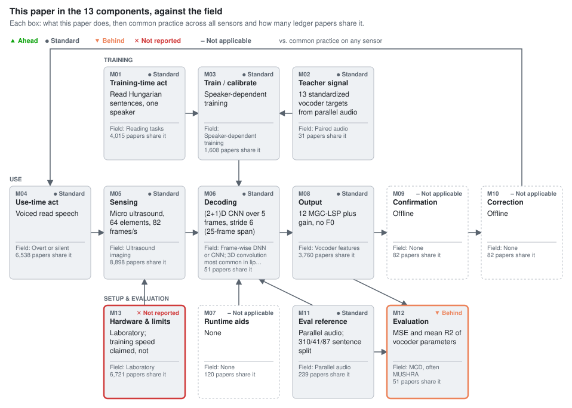

# 3D Convolutional Neural Networks for Ultrasound-Based Silent Speech Interfaces

Tóth L, Honarmandi Shandiz A. Artificial Intelligence and Soft Computing (ICAISC 2020), LNCS 12415, 2020. [doi:10.1007/978-3-030-61401-0_16](https://doi.org/10.1007/978-3-030-61401-0_16) · [arXiv:2104.11532](https://arxiv.org/abs/2104.11532)

**Section:** [Ultrasound & tongue imaging](../../README.md#ultrasound--tongue-imaging)

## Figures

### This paper in the 13 components, against the field

<picture><source media="(prefers-color-scheme: dark)" srcset="figures/components-dark.svg"></picture>

Verdicts compare the paper's choice for each component with common practice across 8,995 ledger entries on any sensor (silent speech, brain-to-text, lip reading).

Data

| Component | This paper | Common practice | Papers with this practice | Verdict |
| --- | --- | --- | --- | --- |
| M01 Training-time act | Read Hungarian sentences, one speaker | Reading tasks | 4,015 of 8,995 | ● Standard (Inherited corpus design [@csapo2017dnn].) |
| M02 Teacher signal | 13 standardized vocoder targets from parallel audio | Paired audio | 31 of 8,995 | ● Standard (Inherited from the group's earlier work.) |
| M03 Train / calibrate | Speaker-dependent training | Speaker-dependent training | 1,608 of 8,995 | ● Standard (No adaptation or held-out speaker.) |
| M04 Use-time act | Voiced read speech | Overt or silent | 6,538 of 8,995 | ● Standard (No silent articulation tested.) |
| M05 Sensing | Micro ultrasound, 64 elements, 82 frames/s | Ultrasound imaging | 8,898 of 8,995 | ● Standard (Inherited hardware.) |
| M06 Decoding | (2+1)D CNN over 5 frames, stride 6 (25-frame span) | Frame-wise DNN or CNN; 3D convolution most common in lip reading | 51 of 8,995 | ● Standard (Lip-reading front end, credited by the authors to action recognition; [concurrent] ultrasound 3D CNN; one speaker, one run.) |
| M07 Runtime aids | None | None | 120 of 8,995 | – Not applicable (Direct parameter regression.) |
| M08 Output | 12 MGC-LSP plus gain, no F0 | Vocoder features | 3,760 of 8,995 | ● Standard (No waveform evaluated.) |
| M09 Confirmation | Offline | None | 82 of 8,995 | – Not applicable (Offline study.) |
| M10 Correction | Offline | None | 82 of 8,995 | – Not applicable (Offline study.) |
| M11 Eval reference | Parallel audio; 310/41/87 sentence split | Parallel audio | 239 of 8,995 | ● Standard (Same split as [@grosz2018f0]; session structure unstated.) |
| M12 Evaluation | MSE and mean R2 of vocoder parameters | MCD, often MUSHRA | 51 of 8,995 | ▼ Behind (Behind the group's own MUSHRA studies of the same data; no listening, intelligibility or ASR test; no seeds or variance.) |
| M13 Hardware & limits | Laboratory; training speed claimed, not measured | Laboratory | 6,721 of 8,995 | ✕ Not reported (No training time, inference time or look-ahead reported.) |

## Verdict

The paper [[1]](#ref-1) changes the image front end (M06): a (2+1)D convolution over five ultrasound frames sampled with stride 6, a 25-frame span that the authors put at about 300 ms. The authors credit video action recognition and earlier 3D CNNs (Sec. 1–2). M06 is standard, not ahead: spatiotemporal convolution was established in lip reading by 2017 [[2]](#ref-2), [[3]](#ref-3), and a [concurrent] ultrasound-to-formant network split part of its 3D convolution into parallel 2D spatial and 1D temporal branches [[4]](#ref-4). The headline win over CNN+LSTM is small and unrepeated: test MSE 0.336 to 0.315, 6.3% relative (inference), one speaker, one run, against a baseline the authors retrained with changed input and output sizes. The original CNN+LSTM took 32-frame chunks (Sec. 5), so context width confounds only the gains over the one-frame FCN and 2D CNN (Sec. 4). Evaluation (M12) is behind the best comparable work: MSE and R² of 13 vocoder parameters only, while the group's own earlier studies of the same speaker ran MUSHRA listening tests [[5]](#ref-5), [[6]](#ref-6).

## Against the field, component by component

### M06 Processing: temporal context in the image front end

**Usual approach:** Ultrasound-to-speech mapping is mostly frame-wise, with a fully connected DNN (37) or a CNN (31) among 51 unique studies (pattern match, Appendix); the target's lineage fed one frame, or five consecutive frames [[5]](#ref-5). Across articulator video, 3D convolution is the most common front end: 380 of 1,342 unique studies, against 255 with a CNN followed by a recurrent layer; before 2020-04, 63 and 75 of 576 (pattern match, Appendix). The paper moves ultrasound onto this design.

**State of the art:** Tongue2Speech (2026, [later]) pairs a 3D CNN front end with a Transformer and reaches 15.93% WER of ASR on synthesized single-speaker speech; its strongest baseline, a 3D-CNN+BiLSTM, gives 24.15% [[7]](#ref-7). Corpus, language and metric differ, so this is no direct comparison.

Among 140 ultrasound studies of the front-end topic, none uses 3D convolution before 2020-04 (pattern match, Appendix); the earliest are [concurrent] Ultra2Speech [[4]](#ref-4) and the target, which itself cites a 3D CNN for ultrasound tongue-motion prediction (Sec. 1). On the same speaker, development MSE falls from 0.380 for the 2017 five-frame input to 0.321, 15.5% relative (inference) [[5]](#ref-5), but the 2017 network was four times larger and beat the target's own single-frame FCN (0.384 against 0.408; Sec. 5), so this is not a matched comparison. Stacking five frames had gained only 1% over one frame (0.384 to 0.380; inference), as the authors note (Sec. 5), but those consecutive frames spanned about 61 ms at 82 frames/s (inference, frame periods, as in the paper's 300 ms), and Fig. 3 varies the span only for the 3D model. Verdict: standard: not new to video speech decoding, and shown without repetition across speakers or seeds.

### M12 Evaluation: output measure

**Usual approach:** Mel-cepstral distortion (MCD) in 21 of 51 unique studies, often with MUSHRA naturalness tests (14; pattern match, Appendix). Before 2020-04, 4 of 18 dated studies ran MUSHRA, two of them on this speaker: 23 listeners [[5]](#ref-5) and 24 listeners on the same 310/41/87 split [[6]](#ref-6).

**State of the art:** ASR WER on synthesized speech (2026, [later]), 15.93% single-speaker and 31.64% multi-speaker; its authors call MSE a weak indicator of lexical accuracy [[7]](#ref-7).

The target omits F0 (Sec. 3) and plays nothing to listeners, conceding that its scores do not perfectly track perceived quality (Sec. 4). Verdict: behind the best comparable work, the group's own earlier studies of the same data; listening tests were not yet typical (4 of 18).

## The 13 components

| Component | This paper | Usual approach (count) | State of the art | Verdict |
|---|---|---|---|---|
| M01 Training-time action | Read Hungarian sentences, one speaker | Reading tasks (slot-filled 4,015) | – | standard |
| M02 Training-only supervision | 13 standardized vocoder targets from parallel audio | Paired audio (slot-filled 31) | – | standard |
| M03 Training and adaptation | Speaker-dependent training | Speaker-dependent training (slot-filled 1,608) | – | standard |
| M04 Use-time action | Voiced read speech | Overt or silent (slot-filled 6,538) | – | standard |
| M05 Sensors | Micro ultrasound, 64 elements, 82 frames/s | Ultrasound imaging (slot-filled 8,898) | – | standard |
| M06 Processing and decoding | (2+1)D CNN over 5 frames, stride 6 (25-frame span) | Frame-wise DNN or CNN; 3D convolution most common in lip reading (pattern match 51) | 15.93% WER [[7]](#ref-7) | standard |
| M07 Lexicon and LM | None | None (slot-filled 120) | – | not applicable |
| M08 Output | 12 MGC-LSP plus gain, no F0 | Vocoder features (slot-filled 3,760) | – | standard |
| M09 Confirmation | Offline | None (slot-filled 82) | – | not applicable |
| M10 Correction | Offline | None (slot-filled 82) | – | not applicable |
| M11 Reference construction | Parallel audio; 310/41/87 sentence split | Parallel audio (slot-filled 239) | – | standard |
| M12 Evaluation | MSE and mean R2 of vocoder parameters | MCD, often MUSHRA (pattern match 51) | 31.64% WER, multi-speaker [[7]](#ref-7) | behind |
| M13 Device and cost | Laboratory; training speed claimed, not measured | Laboratory (slot-filled 6,721) | – | not reported |

## Where the claims outrun the evidence

- Abstract, "outperforms the CNN+LSTM model": test MSE 0.336 against 0.315 and R² 0.661 against 0.683 (Table 2), single runs without variance; the CNN+LSTM was retrained with changed input and output sizes and an unstated span, and its original study reported no MSE (Sec. 5). The conclusion (Sec. 6) concedes that superiority needs more thorough comparison; the abstract does not.
- "14% absolute" R² gain (Sec. 5): Table 2 gives +0.085 (0.598 to 0.683), about 14% relative (inference). The "about 21%" MSE reduction (Sec. 5) is against the FCN; against the 2D CNN it is 13.9% (inference).
- Repetition: no seeds, run counts or checkpoint selection appear anywhere in the paper; the stride was chosen on 41 development sentences (Sec. 5).
- "Smaller and faster to train" (Sec. 6): no training or inference time is reported (M13).

## What the field needs next

- M06: a matched-context ablation (2D CNN on 25 stacked frames, CNN+LSTM over the same 25 frames, (2+1)D network) at equal size, over several seeds.
- M12: ASR WER or listener transcription of synthesized speech, plus MUSHRA as in [[5]](#ref-5), [[6]](#ref-6).
- M03: train on several speakers; test on held-out speakers and sessions.
- M13: state the look-ahead of the 25-frame window and test a causal variant for real-time use.

## Questions for the authors

- How many training runs were made, and what is the spread of test MSE?
- Is the 25-frame window centred on the target frame, and what look-ahead does it imply?
- Were the normalization statistics fitted on training data only?
- Do the 87 test sentences come from recording sessions separate from training?
- Is the raw scan line 946 or 964 samples long?

## Appendix: literature search

- M06 ultrasound-to-speech-network-architecture (published table, reused). Inclusion rule: studies that map ultrasound tongue images to acoustic features or a waveform with a trained network and name the architecture; recognition-only, contour tracking and reviews excluded; versions counted once. Ledger counts: slot-filled 7,345 unique studies (M06); pattern match 51 unique studies (70 folders). Design counts (pattern match): fully connected DNN 37, CNN 31, recurrent 25, 3D CNN 19, transformer 9, conformer 3. Read in full: [[5]](#ref-5) (prior), [[4]](#ref-4) ([concurrent]), [[7]](#ref-7) (state of the art). Known-item recall 1.0 (3 seeds).
- M06 articulator-video-spatiotemporal-front-end (new). Inclusion rule: studies that decode text, speech or acoustic features from video of the articulators (lip or face camera, ultrasound) with a trained network, classified by how temporal context enters the image front end; reviews and contour tracking remain as pattern matches (upper bound); versions counted once. Ledger counts: slot-filled 7,345 unique studies (M06); pattern match 1,342 unique studies (1,811 folders). Design counts (pattern match, full text, a study can match several): 3D convolution 380, CNN followed by a recurrent layer 255, temporal convolution network 146, factorized (2+1)D or pseudo-3D 29, ConvLSTM 25. Dated before 2020-04: 576 unique studies, 3D convolution 63, CNN followed by a recurrent layer 75. Ultrasound subset: 140 unique studies, 3D convolution 18, none dated before 2020-04 (earliest 2020-06). Prior cutoff 2020-04: six months before the target's first public date, 2020-10. Read in full: [[2]](#ref-2), [[3]](#ref-3), [[5]](#ref-5) (prior), [[4]](#ref-4) ([concurrent]), [[7]](#ref-7) (state of the art). Known-item recall 1.0 (4 seeds).
- M12 ultrasound-to-speech-output-evaluation (published table, reused). Inclusion rule: studies that synthesize speech or acoustic features from ultrasound tongue images and evaluate the output, classified by output measure. Ledger counts: slot-filled 6,960 unique studies (M12); pattern match 51 unique studies. Design counts (pattern match): MCD 21, MUSHRA 14, listener intelligibility 5, MOS 4, ASR on output 3; dated before 2020-04: 18 unique studies, MUSHRA 4. Read in full: [[5]](#ref-5), [[6]](#ref-6) (prior), [[7]](#ref-7) (state of the art).

## References

Numbered by first citation. BibTeX in the same order and keys: [refs.bib](refs.bib).

1. Tóth, L., Honarmandi Shandiz, A. “3D Convolutional Neural Networks for Ultrasound-Based Silent Speech Interfaces.” *Artificial Intelligence and Soft Computing (ICAISC 2020), Lecture Notes in Computer Science 12415*, 2020. doi:[10.1007/978-3-030-61401-0_16](https://doi.org/10.1007/978-3-030-61401-0_16). arXiv:[2104.11532](https://arxiv.org/abs/2104.11532). Target. arXiv:2104.11532 v1 (2021-04-23) read. [review](https://github.com/supernaiter/silent-speech-review/tree/main/reviews/3d-convolutional-neural-networks-for-ultrasound-based-silent-speech-interfaces) [wiki: arxiv-2104.11532](https://github.com/supernaiter/deep-research-wiki-for-silent-speech/blob/main/papers/arxiv-2104.11532/article.md)
2. Assael, Y. M., Shillingford, B., Whiteson, S., de Freitas, N. “LipNet: End-to-End Sentence-level Lipreading.” *arXiv preprint*, 2016. arXiv:[1611.01599](https://arxiv.org/abs/1611.01599). [review](https://github.com/supernaiter/silent-speech-review/tree/main/reviews/lipnet-end-to-end-sentence-level-lipreading) [wiki: arxiv-1611.01599](https://github.com/supernaiter/deep-research-wiki-for-silent-speech/blob/main/papers/arxiv-1611.01599/article.md)
3. Stafylakis, T., Tzimiropoulos, G. “Combining Residual Networks with LSTMs for Lipreading.” *Proc. Interspeech 2017*, 2017. doi:[10.21437/Interspeech.2017-85](https://doi.org/10.21437/Interspeech.2017-85). arXiv:[1703.04105](https://arxiv.org/abs/1703.04105). [wiki: arxiv-1703.04105](https://github.com/supernaiter/deep-research-wiki-for-silent-speech/blob/main/papers/arxiv-1703.04105/article.md) [wiki: isca-stafylakis17-resnetlstm](https://github.com/supernaiter/deep-research-wiki-for-silent-speech/blob/main/papers/isca-stafylakis17-resnetlstm/article.md) [wiki: isca-stafylakis17_interspeech](https://github.com/supernaiter/deep-research-wiki-for-silent-speech/blob/main/papers/isca-stafylakis17_interspeech/article.md) [wiki: isca-stafylakis17_lipread](https://github.com/supernaiter/deep-research-wiki-for-silent-speech/blob/main/papers/isca-stafylakis17_lipread/article.md)
4. Saha, P., Liu, Y., Gick, B., Fels, S. “Ultra2Speech - A Deep Learning Framework for Formant Frequency Estimation and Tracking from Ultrasound Tongue Images.” *arXiv preprint*, 2020. arXiv:[2006.16367](https://arxiv.org/abs/2006.16367). [concurrent] [review](https://github.com/supernaiter/silent-speech-review/tree/main/reviews/ultra2speech-a-deep-learning-framework-for-formant-frequency-estimation-and-tracking-from-ultrasound-tongue-images) [wiki: arxiv-2006.16367](https://github.com/supernaiter/deep-research-wiki-for-silent-speech/blob/main/papers/arxiv-2006.16367/article.md)
5. Csapó, T. G., Grósz, T., Gosztolya, G., Tóth, L., Markó, A. “DNN-Based Ultrasound-to-Speech Conversion for a Silent Speech Interface.” *Proc. Interspeech 2017*, 2017, 3672–3676. doi:[10.21437/Interspeech.2017-939](https://doi.org/10.21437/Interspeech.2017-939). [wiki: isca-csapo17-us2speech](https://github.com/supernaiter/deep-research-wiki-for-silent-speech/blob/main/papers/isca-csapo17-us2speech/article.md) [wiki: isca-csapo17_interspeech](https://github.com/supernaiter/deep-research-wiki-for-silent-speech/blob/main/papers/isca-csapo17_interspeech/article.md) [wiki: isca-csapo17_ussynth](https://github.com/supernaiter/deep-research-wiki-for-silent-speech/blob/main/papers/isca-csapo17_ussynth/article.md) [wiki: isca-csapo17_ustospeech](https://github.com/supernaiter/deep-research-wiki-for-silent-speech/blob/main/papers/isca-csapo17_ustospeech/article.md)
6. Grósz, T., Gosztolya, G., Tóth, L., Csapó, T. G., Markó, A. “F0 Estimation for DNN-Based Ultrasound Silent Speech Interfaces.” *Proc. IEEE ICASSP 2018*, 2018, 291–295. doi:[10.1109/ICASSP.2018.8461732](https://doi.org/10.1109/ICASSP.2018.8461732). [wiki: doi-10-1109-icassp-2018-8461732](https://github.com/supernaiter/deep-research-wiki-for-silent-speech/blob/main/papers/doi-10-1109-icassp-2018-8461732/article.md)
7. Sonkar, Y., Kilaru, Y., Yelimeli, S., Shah, N., Gandhi, V. “Tongue2Speech: Real-Time Speech Synthesis from Tongue Ultrasound Videos via Spatiotemporal Transformers.” *Proc. Interspeech 2026*, 2026, 6856–6860. doi:[10.21437/Interspeech.2026-3023](https://doi.org/10.21437/Interspeech.2026-3023). [later] [wiki: isca-sonkar26_interspeech](https://github.com/supernaiter/deep-research-wiki-for-silent-speech/blob/main/papers/isca-sonkar26_interspeech/article.md)

## Materials

Data behind this review. Full texts of the papers are not included.

- [`review.md`](review.md): the review text (source)
- [`refs.bib`](refs.bib): references (BibTeX)
- [`slots.json`](slots.json): for each of the 13 components: this paper's choice, field practice, number of matching papers, verdict
- [`figures.json`](figures.json): figure definitions
- [`evaluation.md`](evaluation.md): independent evaluation by a second reviewer
- [`triage.md`](triage.md): how each evaluation finding was checked against the sources and resolved
- [`components/M06/articulator-video-spatiotemporal-front-end.csv`](../../components/M06/articulator-video-spatiotemporal-front-end.csv): M06 topic "articulator-video-spatiotemporal-front-end", every candidate paper with its decision (7345 slot-filled, 1342 pattern match, usual design in 380, 5 read in full)
- [`components/M06/ultrasound-to-speech-network-architecture.csv`](../../components/M06/ultrasound-to-speech-network-architecture.csv): M06 topic "ultrasound-to-speech-network-architecture", every candidate paper with its decision (7345 slot-filled, 51 pattern match, usual design in 37, 4 read in full)
- [`components/M12/ultrasound-to-speech-output-evaluation.csv`](../../components/M12/ultrasound-to-speech-output-evaluation.csv): M12 topic "ultrasound-to-speech-output-evaluation", every candidate paper with its decision (6960 slot-filled, 51 pattern match, usual design in 21, 3 read in full)

## More reviews in Ultrasound & tongue imaging

- [Ultra2Speech -- A Deep Learning Framework for Formant Frequency Estimation and Tracking from Ultrasound Tongue Images](../ultra2speech-a-deep-learning-framework-for-formant-frequency-estimation-and-tracking-from-ultrasound-tongue-images/) (2020). Estimates and tracks formant frequencies from ultrasound tongue image sequences for speech synthesis; best U2F configuration reaches mean R2 99.96 on joint f1-f2 prediction versus 90.01 for a Conv-BiLSTM baseline.
- [Convolutional Neural Network-Based Age Estimation Using B-Mode Ultrasound Tongue Image](../convolutional-neural-network-based-age-estimation-using-b-mode-ultrasound-tongue-image/) (2021). Exploratory CNN regression of child age from tongue ultrasound images, reaching validation MSE 2.03 on UXTD versus 3.64 for a mean-age baseline.
- [Improving Neural Silent Speech Interface Models by Adversarial Training](../improving-neural-silent-speech-interface-models-by-adversarial-training/) (2021). Standard on the adversarial loss (M02): it predates the paper in video-to-speech and its gains are small, with no variance reported; behind on evaluation (M12): no listening test.
- [Neural Speaker Embeddings for Ultrasound-based Silent Speech Interfaces](../neural-speaker-embeddings-for-ultrasound-based-silent-speech-interfaces/) (2021). Standard on embedding conditioning (2.4% relative MSE gain on seen speakers); behind on speaker recognition, which never separates speaker from recording session.
- [Silent versus modal multi-speaker speech recognition from ultrasound and video](../silent-versus-modal-multi-speaker-speech-recognition-from-ultrasound-and-video/) (2021). Standard on both changed components: modal-to-silent loss and fMLLR were known; later work narrows the absolute gap but not the fMLLR ratio, and adaptation gains rest on single runs.
- [Speech Synthesis from Text and Ultrasound Tongue Image-based Articulatory Input](../speech-synthesis-from-text-and-ultrasound-tongue-image-based-articulatory-input/) (2021). Limited-data TTS augmented with ultrasound tongue images; combined text plus ultrasound gives the lowest test MCD for all 8 speakers, while ultrasound-only input remains far worse.

---

Part of the [Silent Speech Interface Review](https://github.com/supernaiter/silent-speech-review). Found an error? [Open an issue](https://github.com/supernaiter/silent-speech-review/issues/new?template=correction.yml).
