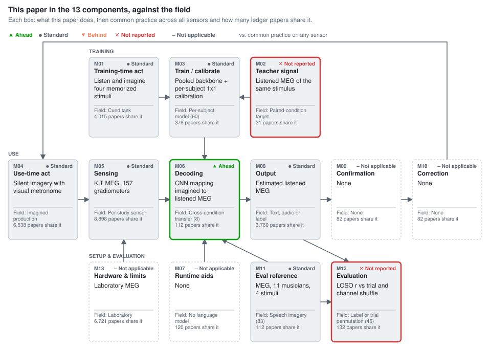

# A Convolutional Framework for Mapping Imagined Auditory MEG into Listened Brain Responses

Maryam Maghsoudi, Mohsen Rezaeizadeh, Shihab Shamma · 2025 59th Asilomar Conference on Signals, Systems, and Computers, 2025 · [DOI](https://doi.org/10.1109/IEEECONF67917.2025.11443775) · [arXiv:2512.03458](https://arxiv.org/abs/2512.03458)

**Section:** [Brain signals (EEG, MEG, intracortical)](../../README.md#brain-signals-eeg-meg-intracortical)

## Figures

### This paper in the 13 components, against the field

<picture><source media="(prefers-color-scheme: dark)" srcset="figures/components-dark.svg"></picture>

Verdicts compare the paper's choice for each component with common practice across 8,995 ledger entries on any sensor (silent speech, brain-to-text, lip reading).

Data

| Component | This paper | Common practice | Papers with this practice | Verdict |
| --- | --- | --- | --- | --- |
| M01 Training-time act | Listen and imagine four memorized stimuli | Cued task | 4,015 of 8,995 | ● Standard (Inherited.) |
| M02 Teacher signal | Listened MEG of the same stimulus | Paired-condition target | 31 of 8,995 | ✕ Not reported (Which listened repeat is each imagined trial's target is unstated (Sec. V-A).) |
| M03 Train / calibrate | Pooled backbone + per-subject 1x1 calibration | Per-subject model (90) | 379 of 8,995 | ● Standard (Subject layer of [@defossez2023decoding]; calibration size unstated.) |
| M04 Use-time act | Silent imagery with visual metronome | Imagined production | 6,538 of 8,995 | ● Standard (Inherited.) |
| M05 Sensing | KIT MEG, 157 gradiometers | Per-study sensor | 8,898 of 8,995 | ● Standard (Inherited; 155 channels in CNN, removal count unstated.) |
| M06 Decoding | CNN mapping imagined to listened MEG | Cross-condition transfer (8) | 112 of 8,995 | ▲ Ahead (No prior mapping (Appendix).) |
| M07 Runtime aids | None | No language model | 120 of 8,995 | – Not applicable (Neural output.) |
| M08 Output | Estimated listened MEG | Text, audio or label | 3,760 of 8,995 | ● Standard (Inherited.) |
| M09 Confirmation | None | None | 82 of 8,995 | – Not applicable (Offline study.) |
| M10 Correction | None | None | 82 of 8,995 | – Not applicable (Offline study.) |
| M11 Eval reference | MEG, 11 musicians, 4 stimuli | Speech imagery (83) | 112 of 8,995 | ● Standard (Music 9, MEG 26 (pattern match).) |
| M12 Evaluation | LOSO r vs trial and channel shuffle | Label or trial permutation (45) | 132 of 8,995 | ✕ Not reported (Shuffles, seeds, r axes unstated.) |
| M13 Hardware & limits | Laboratory MEG | Laboratory | 6,721 of 8,995 | – Not applicable (No deployment.) |

## Verdict

The paper [[1]](#ref-1) is ahead on its decoding target, imagined-to-listened MEG mapping (M06), and standard on pooled training (M03) and on its recording (M11). Its central claim, that a subject-calibrated CNN transfers to unseen subjects where linear mappings fail, is not supported: the held-out subject's own data train the calibration layer and no ablation isolates that layer (§V-B), and the cross-subject linear result has no number (§V-A). The strongest confound is a null that shuffles channels as well as trials, so r = 0.0113 against 0.0063 mixes spatial structure with stimulus pairing (§V-B). On the same paradigm with 17 participants, the authors' [later] study finds a linear mapping beating a pairing-only null on unseen subjects without calibration [[2]](#ref-2), contradicting the premise that linear mappings fail; its RNN separates more strongly (t = 9.59 against 5.63), which supports a nonlinear mapping but not the calibration layer. Nothing is decoded from the predicted listened MEG (Fig. 5).

## Against the field, component by component

### M06 Decoding target: imagined-to-listened mapping

**Usual approach:** transfer a decoder between conditions: cross-condition generalization (8 of 112 unique studies, pattern match) or training on perception and applying to imagery (6), as in MEG melody classifiers trained on imagery and tested on listening [[3]](#ref-3) or an overt-speech ECoG Transformer applied to covert speech [[4]](#ref-4).

**State of the art:** the [later] follow-up (2026) keeps all six mapping models above a pairing-only null on unseen subjects without held-out-subject data; the leave-one-subject-out paired t is 9.59 (RNN) and 5.63 (linear) (Table 2 of [[2]](#ref-2)). This paper is superseded by its own successor.

None of the 112 pattern-match studies maps imagined into perceived neural responses before this paper (Appendix); the other hits are [later] or [concurrent], the [concurrent] one mapping fMRI visual imagery into a decoder's conditioning space [[5]](#ref-5). An earlier overt-trained ECoG decoder aligns covert reconstructions to overt audio by time warping, not to neural responses [[6]](#ref-6), so it does not decide the claim. Verdict: ahead on design, repeated over held-out subjects (all but two above null); the effect is small and the null lenient (M12).

### M03 Training: pooled backbone, per-subject calibration

**Usual approach:** one model per participant (90 of 379 unique studies, pattern match, Appendix). The calibration layer, a kernel-size-1 convolution mixing channels (Sec. V-B), is the per-subject 1x1 subject layer of [[7]](#ref-7), cited but not related to the design.

**State of the art:** other-subject pre-training plus target-subject fine-tuning reaches 61.3% Top-10 of a 1024-segment retrieval set on 3-subject Armeni 2022 MEG (2026, [later]; Tables I, III of [[8]](#ref-8)).

Verdict: standard. Refitting on the held-out subject is calibration, not generalization; subset size and separation from test trials are unreported (Sec. V-B).

### M11 Recording: paired listened and imagined MEG

**Usual approach:** paired imagery-perception recordings mostly use speech (83 of 112, pattern match); music appears in 9, MEG in 26.

**State of the art:** listened and imagined melodies were recorded with MEG in 71 participants (2023, prior) [[3]](#ref-3), against 11 here.

Verdict: standard; four stimuli cap decoding at four classes.

### M12 Evaluation: null model

**Usual approach:** permute labels or trial pairings (45 of 132 unique studies, pattern match); channel shuffling appears in 10. The paper adds a channel shuffle, which weakens the null.

**State of the art:** no stronger null exists in this line: the [later] follow-up (2026) returns to the usual pairing-only shuffle, channels intact, across six models [[2]](#ref-2).

Verdict: not reported: shuffle count, seeds, calibration size and correlation axes are missing (Sec. V-B).

## The 13 components

| Component | This paper | Usual approach (count) | State of the art | Verdict |
|---|---|---|---|---|
| M01 Training-time action | Listen and imagine four memorized stimuli | Cued task (slot-filled 4,015) | – | standard |
| M02 Training-only supervision | Listened MEG of the same stimulus | Paired-condition target (slot-filled 31) | – | not reported |
| M03 Training and adaptation | Pooled backbone + per-subject 1x1 calibration | Per-subject model (90) (pattern match 379) | 61.3% Top-10 of 1024, MEG, fine-tuned [[8]](#ref-8) | standard |
| M04 Use-time action | Silent imagery with visual metronome | Imagined production (slot-filled 6,538) | – | standard |
| M05 Sensors | KIT MEG, 157 gradiometers | Per-study sensor (slot-filled 8,898) | – | standard |
| M06 Processing and decoding | CNN mapping imagined to listened MEG | Cross-condition transfer (8) (pattern match 112) | Six mappings above null, no calibration (LOSO t 9.59 RNN, 5.63 linear) [[2]](#ref-2) | ahead |
| M07 Lexicon and LM | None | No language model (slot-filled 120) | – | not applicable |
| M08 Output | Estimated listened MEG | Text, audio or label (slot-filled 3,760) | – | standard |
| M09 Confirmation | None | None (slot-filled 82) | – | not applicable |
| M10 Correction | None | None (slot-filled 82) | – | not applicable |
| M11 Reference construction | MEG, 11 musicians, 4 stimuli | Speech imagery (83) (pattern match 112) | 71 participants, MEG [[3]](#ref-3) | standard |
| M12 Evaluation | LOSO r vs trial and channel shuffle | Label or trial permutation (45) (pattern match 132) | Usual pairing-only null, six models [[2]](#ref-2) | not reported |
| M13 Device and cost | Laboratory MEG | Laboratory (slot-filled 6,721) | – | not applicable |

## Where the claims outrun the evidence

- "Substantially improving prediction performance on unseen subjects" (Sec. I) has no linear or uncalibrated number to improve on (Fig. 3, 7).
- The null destroys channel structure that the channel-mixing calibration layer can exploit (Sec. V-B); a pairing-only null [[2]](#ref-2) isolates the stimulus mapping.
- With one true/null pair per held-out subject (Sec. V-B), 11 subjects and two below null, an exact two-sided Wilcoxon p is at least 5/1024 ≈ 0.0049 (inference): "p ≪ 0.01" is loose rather than false (Fig. 7).
- The CNN takes 155 of 157 recorded channels; Sec. III removes faulty channels without a count (Sec. II, Fig. 5).

## What the field needs next

- M12: rerun the CNN against a pairing-only null with intact channels, repeated over shuffles and seeds.
- M03: ablate calibration (none, held-out subject, linear plus calibration) at fixed size.
- M06: decode stimulus identity from predicted responses on held-out subjects, as the follow-up does over 76 words [[2]](#ref-2).

## Questions for the authors

- How many trials form the calibration subset; are they disjoint from test trials?
- Is the 80-20 split by trial, subject or condition; how many seeds and null shuffles were run?
- What cross-subject r did the linear mapping and uncalibrated CNN reach?
- Over which axes is Pearson r computed before the Fisher transform?
- How are imagined and listened repeats paired as input and target?

## Appendix: literature search

- M06, perception-imagery-cross-condition-model. Inclusion rule: neural studies that use perception (listening or overt production) responses to model, decode or transform imagery or covert-speech responses of the same material (cross-condition training and testing, joint training, or mapping imagined into perceived responses); descriptive comparisons, reviews and model-free datasets excluded. Ledger: 7345 slot-filled; 112 unique studies by pattern match. Designs (pattern match): cross-condition generalization 8, train on perception and apply to imagery 6, imagery-to-perception mapping 5 (this paper, [concurrent] and [later] work), joint training 0. Read in full: [[3]](#ref-3), [[4]](#ref-4) and [[6]](#ref-6) (deciding priors), [[2]](#ref-2) (state of the art). Known-item recall 1.0.
- M03, cross-subject-pooled-training (published topic table, appended). Inclusion rule: decoders trained on data pooled across participants, with or without participant-specific layers; per-participant models averaged over participants excluded. Ledger: 1526 slot-filled; 370 unique studies by ledger pattern match; 379 once full-text subject-layer hits are added, the population for the design counts. Usual design: per-subject model, 90 of 379 (pattern match). Read in full: [[7]](#ref-7), [[8]](#ref-8) (state of the art). Known-item recall 1.0.
- M11, paired-imagery-perception-neural-recordings. Inclusion rule: recordings in which the same participants perceive and imagine the same speech or music stimuli in matched trials; imagery-only, perception-only and overt-versus-covert-only recordings excluded. Ledger: 234 slot-filled; 112 unique studies by pattern match. Designs (pattern match): speech imagery 83, MEG recording 26, music imagery 9. Read in full: [[3]](#ref-3) (state of the art), [[2]](#ref-2).
- M12, null-model-construction-neural-decoding. Inclusion rule: studies that test against an empirical null built by shuffling or permuting labels, trials, time or channels; studies with theoretical chance only excluded. Ledger: 6960 slot-filled; 132 unique studies by pattern match. Designs (pattern match): label or trial permutation 45, time shift or phase randomization 17, channel shuffle 10. Read in full: [[2]](#ref-2) (state of the art).

## References

Numbered by first citation. BibTeX in the same order and keys: [refs.bib](refs.bib).

1. Maghsoudi, M., Rezaeizadeh, M., Shamma, S. “A Convolutional Framework for Mapping Imagined Auditory MEG into Listened Brain Responses.” *2025 59th Asilomar Conference on Signals, Systems, and Computers*, 2025, 1582–1586. doi:[10.1109/IEEECONF67917.2025.11443775](https://doi.org/10.1109/IEEECONF67917.2025.11443775). arXiv:[2512.03458](https://arxiv.org/abs/2512.03458). Target. Read as arXiv 2512.03458v1; venue and pages from the IEEE record. [review](https://github.com/supernaiter/silent-speech-review/tree/main/reviews/a-convolutional-framework-for-mapping-imagined-auditory-meg-into-listened-brain-responses) [wiki: arxiv-2512.03458](https://github.com/supernaiter/deep-research-wiki-for-silent-speech/blob/main/papers/arxiv-2512.03458/article.md) [wiki: arxiv-2512.03458-imaud](https://github.com/supernaiter/deep-research-wiki-for-silent-speech/blob/main/papers/arxiv-2512.03458-imaud/article.md)
2. Maghsoudi, M., Shamma, S. “Zero-Shot Imagined Speech Decoding via Imagined-to-Listened MEG Mapping.” *arXiv preprint*, 2026. arXiv:[2605.08075](https://arxiv.org/abs/2605.08075). [later] [review](https://github.com/supernaiter/silent-speech-review/tree/main/reviews/zero-shot-imagined-speech-decoding-via-imagined-to-listened-meg-mapping) [wiki: arxiv-2605.08075](https://github.com/supernaiter/deep-research-wiki-for-silent-speech/blob/main/papers/arxiv-2605.08075/article.md) [wiki: arxiv-2605-08075-zeromeg](https://github.com/supernaiter/deep-research-wiki-for-silent-speech/blob/main/papers/arxiv-2605-08075-zeromeg/article.md) [wiki: arxiv-2605.08075-i2lmeg](https://github.com/supernaiter/deep-research-wiki-for-silent-speech/blob/main/papers/arxiv-2605.08075-i2lmeg/article.md)
3. Quiroga Martinez, D. R., Fernández Rubio, G., Bonetti, L., Achyutuni, K. G., Tzovara, A., Knight, R. T., et al. “Decoding reveals the neural representation of perceived and imagined musical sounds.” *bioRxiv*, 2023. doi:[10.1101/2023.08.15.553456](https://doi.org/10.1101/2023.08.15.553456). [wiki: pmc-10462096-imaginedmusic](https://github.com/supernaiter/deep-research-wiki-for-silent-speech/blob/main/papers/pmc-10462096-imaginedmusic/article.md)
4. Komeiji, S., Mitsuhashi, T., Iimura, Y., Suzuki, H., Sugano, H., Shinoda, K., et al. “Feasibility of decoding covert speech in ECoG with a Transformer trained on overt speech.” *Scientific Reports*, 2024, 14, 11491. doi:[10.1038/s41598-024-62230-9](https://doi.org/10.1038/s41598-024-62230-9). [wiki: doi-10.1101-2024.02.05.578911](https://github.com/supernaiter/deep-research-wiki-for-silent-speech/blob/main/papers/doi-10.1101-2024.02.05.578911/article.md)
5. Spera, F., Boccato, T., Olak, M., Toschi, N., Ferrante, M. “Seeing the imagined: latent functional alignment in visual imagery decoding from fMRI data.” *arXiv preprint*, 2026. arXiv:[2604.15374](https://arxiv.org/abs/2604.15374). [concurrent] [wiki: arxiv-2604.15374-lfa](https://github.com/supernaiter/deep-research-wiki-for-silent-speech/blob/main/papers/arxiv-2604.15374-lfa/article.md)
6. Martin, S., Brunner, P., Holdgraf, C., Heinze, H., Crone, N. E., Rieger, J., et al. “Decoding spectrotemporal features of overt and covert speech from the human cortex.” *Frontiers in Neuroengineering*, 2014, 7, 14. doi:[10.3389/fneng.2014.00014](https://doi.org/10.3389/fneng.2014.00014). [wiki: pmc-4034498-spectemp](https://github.com/supernaiter/deep-research-wiki-for-silent-speech/blob/main/papers/pmc-4034498-spectemp/article.md)
7. Défossez, A., Caucheteux, C., Rapin, J., Kabeli, O., King, J. “Decoding speech perception from non-invasive brain recordings.” *Nature Machine Intelligence*, 2023, 5, 1097–1107. doi:[10.1038/s42256-023-00714-5](https://doi.org/10.1038/s42256-023-00714-5). arXiv:[2208.12266](https://arxiv.org/abs/2208.12266). [review](https://github.com/supernaiter/silent-speech-review/tree/main/reviews/decoding-speech-perception-from-non-invasive-brain-recordings) [wiki: arxiv-2208.12266-natmi](https://github.com/supernaiter/deep-research-wiki-for-silent-speech/blob/main/papers/arxiv-2208.12266-natmi/article.md)
8. Zhang, A., Wang, B., Wu, X., Cheng, H., Chen, J. “Cross-Subject Generalization in Decoding Perceived Speech from Non-Invasive Brain Recordings.” *arXiv preprint*, 2026. arXiv:[2608.22420](https://arxiv.org/abs/2608.22420). [later] [wiki: arxiv-2608.22420](https://github.com/supernaiter/deep-research-wiki-for-silent-speech/blob/main/papers/arxiv-2608.22420/article.md)

## Materials

Data behind this review. Full texts of the papers are not included.

- [`review.md`](review.md): the review text (source)
- [`refs.bib`](refs.bib): references (BibTeX)
- [`slots.json`](slots.json): for each of the 13 components: this paper's choice, field practice, number of matching papers, verdict
- [`figures.json`](figures.json): figure definitions
- [`evaluation.md`](evaluation.md): independent evaluation by a second reviewer
- [`triage.md`](triage.md): how each evaluation finding was checked against the sources and resolved
- [`components/M03/cross-subject-pooled-training.csv`](../../components/M03/cross-subject-pooled-training.csv): M03 topic "cross-subject-pooled-training", every candidate paper with its decision (1526 slot-filled, 370 pattern match, usual design in 90, 4 read in full)
- [`components/M06/perception-imagery-cross-condition-model.csv`](../../components/M06/perception-imagery-cross-condition-model.csv): M06 topic "perception-imagery-cross-condition-model", every candidate paper with its decision (7345 slot-filled, 112 pattern match, usual design in 8, 5 read in full)
- [`components/M11/paired-imagery-perception-neural-recordings.csv`](../../components/M11/paired-imagery-perception-neural-recordings.csv): M11 topic "paired-imagery-perception-neural-recordings", every candidate paper with its decision (234 slot-filled, 112 pattern match, usual design in 83, 3 read in full)
- [`components/M12/null-model-construction-neural-decoding.csv`](../../components/M12/null-model-construction-neural-decoding.csv): M12 topic "null-model-construction-neural-decoding", every candidate paper with its decision (6960 slot-filled, 132 pattern match, usual design in 45, 2 read in full)

## More reviews in Brain signals (EEG, MEG, intracortical)

- [An instantaneous voice-synthesis neuroprosthesis](../an-instantaneous-voice-synthesis-neuroprosthesis/) (2025). Closed-loop sentence voice from intracortical arrays holds for one participant; the design is standard, forced-choice and proxy-target metrics overstate intelligibility.
- [Brain-to-Text Decoding: A Non-invasive Approach via Typing](../brain-to-text-decoding-a-non-invasive-approach-via-typing/) (2025). Executed typing as the decoded action (M04) was ahead for MEG/EEG in 2025; keystroke-locked decoding (M06) and an n-gram LM (M07) are standard, and decoding needs known keystroke times.
- [Distinct Theta Synchrony across Speech Modes: Perceived, Spoken, Whispered, and Imagined](../distinct-theta-synchrony-across-speech-modes-perceived-spoken-whispered-and-imagined/) (2025). Exploratory comparison of EEG theta-band functional connectivity across perceived, spoken, whispered and imagined speech in ten healthy subjects; no recognition performance is measured.
- [EEG-to-Voice Decoding of Spoken and Imagined speech Using Non-Invasive EEG](../eeg-to-voice-decoding-of-spoken-and-imagined-speech-using-non-invasive-eeg/) (2025). Reconstructs cued overt and imagined speech audio and text from 130-channel wet EEG with subject-specific models; imagined-speech WER is 47.48% (2 s) and 43.46% (4 s) before language correction.
- [Lightweight Diffusion-based Framework for Online Imagined Speech Decoding in Aphasia](../lightweight-diffusion-based-framework-for-online-imagined-speech-decoding-in-aphasia/) (2025). Real-time diffusion-based EEG decoder for one person with aphasia classifying three imagined Korean words plus rest, reporting 65% top-1 and 70% top-2 accuracy over 20 online trials.
- [MultiDiffNet: A Multi-Objective Diffusion Framework for Generalizable Brain Decoding](../multidiffnet-a-multi-objective-diffusion-framework-for-generalizable-brain-decoding/) (2025). MultiDiffNet applies multi-objective diffusion learning to EEG decoding; for 11-class imagined speech, unseen-subject accuracy is 12.12% versus 10.61% for EEGNet, a small gain requiring per-user calibration.

---

Part of the [Silent Speech Interface Review](https://github.com/supernaiter/silent-speech-review). Found an error? [Open an issue](https://github.com/supernaiter/silent-speech-review/issues/new?template=correction.yml).
