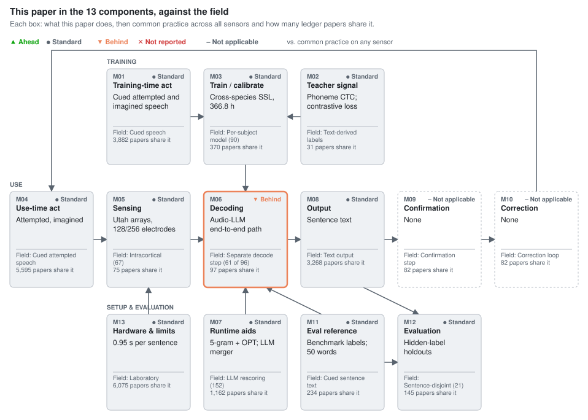

# A cross-species neural foundation model for end-to-end speech decoding

Zhang, He, Fan, Liu, Yu, Le, Li, Linderman, Duncker, Willett, Mesgarani, Paninski. ICLR 2026 (first public 2025). [arXiv:2511.21740](https://arxiv.org/abs/2511.21740)

**Section:** [Brain signals (EEG, MEG, intracortical)](../../README.md#brain-signals-eeg-meg-intracortical)

## Figures

### This paper in the 13 components, against the field

<picture><source media="(prefers-color-scheme: dark)" srcset="figures/components-dark.svg"></picture>

Verdicts compare the paper's choice for each component with common practice across 8,995 ledger entries on any sensor (silent speech, brain-to-text, lip reading).

Data

| Component | This paper | Common practice | Papers with this practice | Verdict |
| --- | --- | --- | --- | --- |
| M01 Training-time act | Cued attempted and imagined speech | Cued speech | 3,882 of 8,995 | ● Standard (Inherited.) |
| M02 Teacher signal | Phoneme CTC; contrastive loss | Text-derived labels | 31 of 8,995 | ● Standard (See M06.) |
| M03 Train / calibrate | Cross-species SSL, 366.8 h | Per-subject model (90) | 370 of 8,995 | ● Standard (Monkey gain small, no seeds.) |
| M04 Use-time act | Attempted, imagined | Cued attempted speech | 5,595 of 8,995 | ● Standard (Inherited.) |
| M05 Sensing | Utah arrays, 128/256 electrodes | Intracortical (67) | 75 of 8,995 | ● Standard (Inherited.) |
| M06 Decoding | Audio-LLM end-to-end path | Separate decode step (61 of 96) | 97 of 8,995 | ▼ Behind (15.67% vs 9.76% RNN.) |
| M07 Runtime aids | 5-gram + OPT; LLM merger | LLM rescoring (152) | 1,162 of 8,995 | ● Standard (Ensembles LLM-merged.) |
| M08 Output | Sentence text | Text output | 3,268 of 8,995 | ● Standard (Inherited.) |
| M09 Confirmation | None | Confirmation step | 82 of 8,995 | – Not applicable (Offline.) |
| M10 Correction | None | Correction loop | 82 of 8,995 | – Not applicable (Offline.) |
| M11 Eval reference | Benchmark labels; 50 words | Cued sentence text | 234 of 8,995 | ● Standard (Test counts missing.) |
| M12 Evaluation | Hidden-label holdouts | Sentence-disjoint (21) | 145 of 8,995 | ● Standard (Holdout data in pretraining.) |
| M13 Hardware & limits | 0.95 s per sentence | Laboratory | 6,075 of 8,995 | ● Standard (Not online; 0.95 s vs 0.24 s cascaded.) |

## Verdict

The paper [[1]](#ref-1) changes three components: cross-species self-supervised pretraining (M03), an audio-LLM end-to-end decoder (M06) and a cascade feeding the new encoder into the field's 5-gram plus LLM-rescoring decoder (M07). The cascaded claim holds: single-model holdout WER of 6.35% and 4.06% is below every non-ensembled entry in Tables 1 and 2 (previous best 7.98%, Sec. 5.1). M03 is standard because the cross-species gain is small and unseeded, M07 because the cascade is the usual design. The end-to-end decoder improves on the prior one [[2]](#ref-2) but is behind cascades: 15.67% and 11.06% against the RNN baselines on the same holdouts [[3]](#ref-3), [[4]](#ref-4). The abstract's 24.69% to 10.22% sets an LLM-merged ensemble against a non-ensembled prior entry.

## Against the field, component by component

### M03 Training: cross-species self-supervised pretraining

**Usual approach:** one model per participant; of 370 unique studies on pooled training (pattern match), 90 train per-subject models. The paper pretrains on 366.8 hours of human and monkey data, then fine-tunes per participant.
**State of the art:** the [concurrent] BrainWhisperer (2026) pools three intracortical datasets; on the Card competition split, pooling cuts its end-to-end WER from 10.2% to 8.7% and its 5-gram WER from 5.9% to 5.2% [[5]](#ref-5), 15% and 12% relative (inference).

Pretraining helps most for imagined speech, 39–45% lower WER than training from scratch (Sec. 5.1). Monkey data add little: validation PER moves from 15.95% to 14.39% (T12) and from 7.61% to 7.12% (T15), one value per cell without seeds (Table 4), and Sec. 6 credits human data. With the same T12 human data, label-free and supervised cross-task pretraining tie on imagined speech (12.67% against 12.53%, cascaded; Table 9). Verdict: standard.

### M06 Decoding: audio-LLM end-to-end decoder

**Usual approach:** a CTC phoneme decoder plus a language model; 61 of the 96 slot-filled designs among 97 unique studies (pattern match) use a separate decode step. The paper adds an end-to-end path into Aero1-Audio 1.5B with neural-text contrastive alignment.
**State of the art:** cascaded, 2.5% online WER with a 125,000-word vocabulary (2024) [[4]](#ref-4); end-to-end, BrainWhisperer (2026) at 8.7%, where it lists BIT at 11.1% [[5]](#ref-5).

The earlier end-to-end decoder [[2]](#ref-2) reached 26.3%, which its authors call on par with the 23.8% cascade of [[3]](#ref-3); on the '24 holdout BIT's single model cuts Feng et al.'s 24.69% to 15.67%, 37% relative (inference). Against cascades on the same holdouts it is behind: 15.67% against the 9.76% RNN baseline [[3]](#ref-3), 11.06% against 6.67% [[4]](#ref-4), and its ensemble (10.22%) trails Li et al.'s 5.77% [[6]](#ref-6). The authors concede a remaining gap to cascades (Sec. 5.1). Verdict: behind cascades on the same holdouts (best comparable work), though it improves on the prior end-to-end decoder [[2]](#ref-2).

### M07 Language model: rescoring and LLM merging

**Usual approach:** LLM rescoring, 152 of 1,162 unique studies, n-gram LM in 134 (pattern match; sparse slot). The cascade is exactly this: 5-gram n-best lists rescored by OPT 6.7B (Appendix D).
**State of the art:** 2.5% online WER, 125,000 words (2024) [[4]](#ref-4).

The headline ensembles let a fine-tuned GPT-3.5 ('24, 10 models) or GPT-4 ('25, 29 models) pick the final sentence (Appendix H), so the 1.76% (Sec. 5.1) is an offline 29-model figure, not comparable to Card et al.'s online single decoder. Verdict: standard.

### M12 Evaluation: hidden-label holdouts

**Usual approach:** of 145 neural text-decoding studies, 21 name a sentence-disjoint test and 10 repeated sentences (pattern match). The paper scores attempted speech on hidden-label holdouts (Sec. 5.1).
**State of the art:** 23.8% online WER at 125,000 words on sentences never duplicated in training (2023) [[3]](#ref-3); the 2.5% of [[4]](#ref-4) is a Copy Task average.

Pretraining can include the benchmark validation and holdout recordings (Appendix A.4). Removing the fine-tuning participants' speech data from pretraining (Appendix P) raises cascaded WER from 6.35% to 7.24% (T12) and from 4.06% to 4.36% (T15) (Table 8a), 14% and 7% relative (inference); both stay below the RNN baselines (9.76%, 6.67%). Verdict: standard.

## The 13 components

| Component | This paper | Usual approach (count) | State of the art | Verdict |
|---|---|---|---|---|
| M01 Training-time action | Cued attempted and imagined speech | Cued speech (slot-filled 3,882) | – | standard |
| M02 Training-only supervision | Phoneme CTC; contrastive loss | Text-derived labels (slot-filled 31) | – | standard |
| M03 Training and adaptation | Cross-species SSL, 366.8 h | Per-subject model (90) (pattern match 370) | 8.7% end-to-end [[5]](#ref-5) | standard |
| M04 Use-time action | Attempted, imagined | Cued attempted speech (slot-filled 5,595) | – | standard |
| M05 Sensors | Utah arrays, 128/256 electrodes | Intracortical (67) (pattern match 75) | – | standard |
| M06 Processing and decoding | Audio-LLM end-to-end path | Separate decode step (61 of 96) (pattern match 97) | 8.7% end-to-end [[5]](#ref-5) | behind |
| M07 Lexicon and LM | 5-gram + OPT; LLM merger | LLM rescoring (152) (pattern match 1,162) | 2.5% online [[4]](#ref-4) | standard |
| M08 Output | Sentence text | Text output (slot-filled 3,268) | – | standard |
| M09 Confirmation | None | Confirmation step (slot-filled 82) | – | not applicable |
| M10 Correction | None | Correction loop (slot-filled 82) | – | not applicable |
| M11 Reference construction | Benchmark labels; 50 words | Cued sentence text (slot-filled 234) | – | standard |
| M12 Evaluation | Hidden-label holdouts | Sentence-disjoint (21) (pattern match 145) | 23.8% online [[3]](#ref-3) | standard |
| M13 Device and cost | 0.95 s per sentence | Laboratory (slot-filled 6,075) | – | standard |

## Where the claims outrun the evidence

- "Cross-species" in the title rests on PER gains of 0.49 to 1.56 points without seeds, Table 4 (inference).
- The abstract's 24.69% to 10.22% uses a 10-model ensemble (Appendix H); the matched single model is 15.67% (Table 1).
- Ablations give one value per condition, with no seeds or intervals (Table 3, Table 4, Table 6, Table 8, Table 9).
- Imagined speech is a 50-word task with no chance baseline or test count (Fig. 2).
- End-to-end decoding takes 0.95 s per sentence (cascaded 0.24 s) with a bidirectional encoder unsuitable for online decoding (Sec. 6).

## What the field needs next

1. M03: a seeded cross-species ablation at fixed human-data budget.
2. M12: benchmark rules that keep holdout recordings out of pretraining.
3. M06: a causal end-to-end decoder run online against a single-model cascade.
4. M07: leaderboards that rank single decoders apart from LLM-merged ensembles.

## Questions for the authors

- How many imagined-speech test trials, and what is chance on the 50-word set?
- Which participant does each Table 8b row report, and why does pretraining without the fine-tuning data lower end-to-end WER (15.67% to 15.34%)?
- Which vocabulary condition do the Table 1 and Table 2 holdouts use?

## Appendix: literature search

Ledger at wiki commit 730b0b4: 7,388 unique studies.

**M03, cross-subject-pooled-training.** Inclusion rule: speech or language decoders from neural or other biosignals that train one model on data pooled across participants, with or without participant-specific layers or embeddings; a per-participant model that only reports averaged results is excluded; transfer by fine-tuning from another participant counts; versions of one study count once. Ledger counts: 1,526 slot-filled unique studies; 370 pattern match (unique studies). Usual design: per-subject model 90, leave-one-subject-out 75, subject-specific layer 34 (pattern match). Read in full: [[5]](#ref-5) ([concurrent]). Known-item recall: 1.0 (1 of 1 seed).

**M06, phoneme-rnn-ctc-lm-decoding.** Inclusion rule: neural or articulatory speech decoders that emit phoneme or character probabilities with a recurrent or CTC-trained network and convert them to words with an n-gram or neural language model; sEMG, EEG, ECoG and intracortical, online or offline; closed-set word classifiers and direct audio synthesis are excluded. Ledger counts: 7,345 slot-filled unique studies; 97 pattern match (unique studies). Usual design: separate decode step, 61 of the 96 pattern-match studies with a slot-filled design (slot-filled). Read in full: [[4]](#ref-4) (state of the art), [[2]](#ref-2) (prior), [[5]](#ref-5) ([concurrent]). Known-item recall: 0.5 (1 of 2 seeds).

**M07, large-vocabulary-lm-for-neural-speech.** Inclusion rule: neural speech decoders that constrain output with a vocabulary of at least 1,000 words through an n-gram or neural language model at use time; 50-word or command sets count as small vocabulary; LLM rescoring counts. Ledger counts: 119 slot-filled unique studies (sparse slot); 1,162 pattern match (unique studies). Usual design: LLM rescoring 152, n-gram LM 134 (pattern match). Read in full: [[4]](#ref-4) (state of the art). Known-item recall: 1.0 (2 of 2 seeds).

**M12, neural-text-unseen-sentence-test.** Inclusion rule: neural text decoders; the design compared is whether WER is measured on sentences absent from training (sentence-disjoint) or on repeats of training sentences; a paper counts under each protocol its text names. Ledger counts: 6,960 slot-filled unique studies; 145 pattern match (unique studies). Usual design: sentence-disjoint test 21, repeated training sentences 10 (pattern match). Read in full: [[3]](#ref-3) (state of the art). Known-item recall: 0.8 (4 of 5 seeds).

**Inherited slots (M01, M02, M04, M05, M08–M11, M13).** Table counts are slot-filled ledger values at the same commit; M05 uses the intracortical-speech-decoding topic table (75 pattern match, unique studies; intracortical in 67, slot-filled). The paper's arrays: 128 electrodes for T12 and 256 for T15 (Sec. 3.1).

## References

Numbered by first citation. BibTeX in the same order and keys: [refs.bib](refs.bib).

1. Zhang, Y., He, L., Fan, C., Liu, T., Yu, H., Le, T., et al. “A cross-species neural foundation model for end-to-end speech decoding.” *International Conference on Learning Representations (ICLR 2026)*, 2026. arXiv:[2511.21740](https://arxiv.org/abs/2511.21740). arXiv v5 [review](https://github.com/supernaiter/silent-speech-review/tree/main/reviews/a-cross-species-neural-foundation-model-for-end-to-end-speech-decoding) [wiki: arxiv-2511.21740](https://github.com/supernaiter/deep-research-wiki-for-silent-speech/blob/main/papers/arxiv-2511.21740/article.md)
2. Feng, S., Liu, H., Wang, Y., Wang, Y. “Towards an end-to-end framework for invasive brain signal decoding with large language models.” *Interspeech 2024*, 2024, 1495-1499. doi:[10.21437/Interspeech.2024-382](https://doi.org/10.21437/Interspeech.2024-382). arXiv:[2406.11568](https://arxiv.org/abs/2406.11568). [wiki: arxiv-2406.11568](https://github.com/supernaiter/deep-research-wiki-for-silent-speech/blob/main/papers/arxiv-2406.11568/article.md) [wiki: isca-feng24-invasive](https://github.com/supernaiter/deep-research-wiki-for-silent-speech/blob/main/papers/isca-feng24-invasive/article.md) [wiki: isca-feng24-ibrainllm](https://github.com/supernaiter/deep-research-wiki-for-silent-speech/blob/main/papers/isca-feng24-ibrainllm/article.md)
3. Willett, F. R., Kunz, E. M., Fan, C., Avansino, D. T., Wilson, G. H., Choi, E. Y., et al. “A high-performance speech neuroprosthesis.” *Nature*, 2023, 620(7976), 1031-1036. doi:[10.1038/s41586-023-06377-x](https://doi.org/10.1038/s41586-023-06377-x). [review](https://github.com/supernaiter/silent-speech-review/tree/main/reviews/a-high-performance-speech-neuroprosthesis) [wiki: doi-10.1038-s41586-023-06377-x](https://github.com/supernaiter/deep-research-wiki-for-silent-speech/blob/main/papers/doi-10.1038-s41586-023-06377-x/article.md)
4. Card, N. S., Wairagkar, M., Iacobacci, C., Hou, X., Singer-Clark, T., Willett, F. R., et al. “An accurate and rapidly calibrating speech neuroprosthesis.” *New England Journal of Medicine*, 2024, 391(7), 609-618. doi:[10.1056/NEJMoa2314132](https://doi.org/10.1056/NEJMoa2314132). [review](https://github.com/supernaiter/silent-speech-review/tree/main/reviews/an-accurate-and-rapidly-calibrating-speech-neuroprosthesis) [wiki: doi-10.1056-nejmoa2314132](https://github.com/supernaiter/deep-research-wiki-for-silent-speech/blob/main/papers/doi-10.1056-nejmoa2314132/article.md) [wiki: pmc-11328962-rapidcal](https://github.com/supernaiter/deep-research-wiki-for-silent-speech/blob/main/papers/pmc-11328962-rapidcal/article.md)
5. Boccato, T., Olak, M., Ferrante, M. “BrainWhisperer: Leveraging large-scale ASR models for neural speech decoding.” *arXiv*, 2026. arXiv:[2603.13321](https://arxiv.org/abs/2603.13321). [concurrent] [wiki: arxiv-2603.13321](https://github.com/supernaiter/deep-research-wiki-for-silent-speech/blob/main/papers/arxiv-2603.13321/article.md)
6. Li, J., Le, T., Fan, C., Chen, M., Shlizerman, E. “Brain-to-text decoding with context-aware neural representations and large language models.” *arXiv*, 2024. arXiv:[2411.10657](https://arxiv.org/abs/2411.10657). [wiki: arxiv-2411.10657](https://github.com/supernaiter/deep-research-wiki-for-silent-speech/blob/main/papers/arxiv-2411.10657/article.md)

## Materials

Data behind this review. Full texts of the papers are not included.

- [`review.md`](review.md): the review text (source)
- [`refs.bib`](refs.bib): references (BibTeX)
- [`slots.json`](slots.json): for each of the 13 components: this paper's choice, field practice, number of matching papers, verdict
- [`figures.json`](figures.json): figure definitions
- [`evaluation.md`](evaluation.md): independent evaluation by a second reviewer
- [`triage.md`](triage.md): how each evaluation finding was checked against the sources and resolved
- [`components/M03/cross-subject-pooled-training.csv`](../../components/M03/cross-subject-pooled-training.csv): M03 topic "cross-subject-pooled-training", every candidate paper with its decision (1526 slot-filled, 370 pattern match, usual design in 90, 4 read in full)
- [`components/M06/phoneme-rnn-ctc-lm-decoding.csv`](../../components/M06/phoneme-rnn-ctc-lm-decoding.csv): M06 topic "phoneme-rnn-ctc-lm-decoding", every candidate paper with its decision (7345 slot-filled, 97 pattern match, usual design in 61, 5 read in full)
- [`components/M07/large-vocabulary-lm-for-neural-speech.csv`](../../components/M07/large-vocabulary-lm-for-neural-speech.csv): M07 topic "large-vocabulary-lm-for-neural-speech", every candidate paper with its decision (119 slot-filled, 1162 pattern match, usual design in 152, 4 read in full)
- [`components/M12/neural-text-unseen-sentence-test.csv`](../../components/M12/neural-text-unseen-sentence-test.csv): M12 topic "neural-text-unseen-sentence-test", every candidate paper with its decision (6960 slot-filled, 145 pattern match, usual design in 21, 4 read in full)

## More reviews in Brain signals (EEG, MEG, intracortical)

- [Brain-to-Speech: Prosody Feature Engineering and Transformer-Based Reconstruction](../brain-to-speech-prosody-feature-engineering-and-transformer-based-reconstruction/) (2026). Same three parts and same Table 1 values as MiSTR (2025, same first two authors), not cited. Features (M06) and phase vocoder (M08) standard, unablated; no listener test (M12, behind).
- [Brain2Speech-Net: Fast and Intelligible Brain-to-Speech Synthesis Without Text Decoding](../brain2speech-net-intelligible-real-time-brain-to-speech-synthesis-without-text-decoding/) (2026). Text-free synthesis is shown, but its real time is throughput, not causal synthesis, unseen-sentence WER is 2.3 times the cascade, and intelligibility rests on ratings and ASR.
- [Do EEG Foundation Models Transfer to Speech? A Benchmark on Overt and Imagined Speech Decoding](../do-eeg-foundation-models-transfer-to-speech-a-benchmark-on-overt-and-imagined-speech-decoding/) (2026). Benchmark of EEG foundation models versus conventional models for overt and imagined speech decoding on two datasets; general EEG pretraining shows no consistent advantage and word decoding stays near chance.
- [EEG-Based Imagined Speech Decoding Using a Hybrid CNN-SNN Architecture](../eeg-based-imagined-speech-decoding-using-a-hybrid-cnn-snn-architecture/) (2026). Hybrid CNN-SNN classifier for five-class EEG imagined speech; reports 80.13% accuracy and 80.14% F1 in offline subject-dependent evaluation, about 98 ms GPU prediction time per trial.
- [iPhoneme: Brain-to-Text Communication for ALS Using ConformerXL Decoding](../iphoneme-brain-to-text-communication-for-als-using-conformerxl-decoding/) (2026). ConformerXL-based intracortical brain-to-text decoding for ALS with a proposed gaze-confirmation interface; WFST decoding reaches 7.86% phoneme error rate retrospectively in one participant.
- [Mechanistic Interpretability of Brain-to-Speech Models Across Speech Modes](../mechanistic-interpretability-of-brain-to-speech-models-across-speech-modes/) (2026). Applies activation interventions to a stereotactic EEG brain-to-speech decoder across vocalized, mimed and imagined speech; baseline PCC is 0.75/0.73/0.57, but internal inconsistencies leave strong causal conclusions unestablished.

---

Part of the [Silent Speech Interface Review](https://github.com/supernaiter/silent-speech-review). Found an error? [Open an issue](https://github.com/supernaiter/silent-speech-review/issues/new?template=correction.yml).
