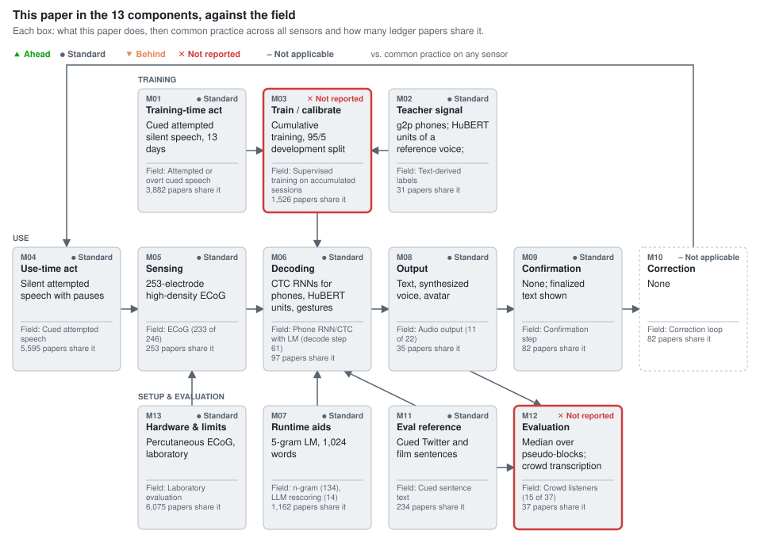

# A high-performance neuroprosthesis for speech decoding and avatar control

Metzger, Littlejohn, Silva, Moses, Seaton, Wang, Dougherty, Liu, Wu, Berger, Zhuravleva, Tu-Chan, Ganguly, Anumanchipalli, Chang. Nature 620, 1037–1046 (2023). [doi:10.1038/s41586-023-06443-4](https://doi.org/10.1038/s41586-023-06443-4)

**Section:** [Brain signals (EEG, MEG, intracortical)](../../README.md#brain-signals-eeg-meg-intracortical)

## Figures

### This paper in the 13 components, against the field

<picture><source media="(prefers-color-scheme: dark)" srcset="figures/components-dark.svg"></picture>

Verdicts compare the paper's choice for each component with common practice across 8,995 ledger entries on any sensor (silent speech, brain-to-text, lip reading).

Data

| Component | This paper | Common practice | Papers with this practice | Verdict |
| --- | --- | --- | --- | --- |
| M01 Training-time act | Cued attempted silent speech, 13 days | Attempted or overt cued speech | 3,882 of 8,995 | ● Standard (Inherited from the prior system.) |
| M02 Teacher signal | g2p phones; HuBERT units of a reference voice; gesture codes | Text-derived labels | 31 of 8,995 | ● Standard (No participant audio; targets from another voice.) |
| M03 Train / calibrate | Cumulative training, 95/5 development split | Supervised training on accumulated sessions | 1,526 of 8,995 | ✕ Not reported (Selection data and search space not stated.) |
| M04 Use-time act | Silent attempted speech with pauses | Cued attempted speech | 5,595 of 8,995 | ● Standard (Inherited.) |
| M05 Sensing | 253-electrode high-density ECoG | ECoG (233 of 246) | 253 of 8,995 | ● Standard (Density tested offline in one participant.) |
| M06 Decoding | CTC RNNs for phones, HuBERT units, gestures | Phone RNN/CTC with LM (decode step 61) | 97 of 8,995 | ● Standard (No ablation of the shared recipe.) |
| M07 Runtime aids | 5-gram LM, 1,024 words | n-gram (134), LLM rescoring (14) | 1,162 of 8,995 | ● Standard (LM pool contains the test sentences.) |
| M08 Output | Text, synthesized voice, avatar | Audio output (11 of 22) | 35 of 8,995 | ● Standard (Avatar driven by decoded audio in real time.) |
| M09 Confirmation | None; finalized text shown | Confirmation step | 82 of 8,995 | ● Standard (Inherited.) |
| M10 Correction | None | Correction loop | 82 of 8,995 | – Not applicable (Closed-loop feedback named as future work.) |
| M11 Eval reference | Cued Twitter and film sentences | Cued sentence text | 234 of 8,995 | ● Standard (Set size stated two ways (9,655 vs 13,463).) |
| M12 Evaluation | Median over pseudo-blocks; crowd transcription | Crowd listeners (15 of 37) | 37 of 8,995 | ✕ Not reported (No seeds, chance values or listener criteria.) |
| M13 Hardware & limits | Percutaneous ECoG, laboratory | Laboratory evaluation | 6,075 of 8,995 | ● Standard (One participant; proof of concept.) |

## Verdict

The paper changed the sensor (M05, 253-electrode high-density ECoG), the decoders (M06, CTC recurrent networks for phones, HuBERT units and gestures) and the output (M08, text, synthesized voice and avatar). M05 and M06 are standard, and the text result trails the [concurrent] intracortical system, which reached a similar error on a vocabulary about 120 times larger [[1]](#ref-1) (inference). M08 is the real departure but the weakest evidence: listeners got 54.4% of words wrong on the 1,024-word set, and the real-time avatar is animated from decoded audio. The strongest confound is the language model (M07), trained on the sentence pool that contains the test sentences. Speed, synthesis and personalised-voice claims rest on one participant, one model and comparisons across vocabularies and reference voices.

## Against the field, component by component

### M05 Sensors: high-density ECoG

**Usual approach:** Of 253 studies decoding speech from ECoG (pattern match, unique studies), 233 record ECoG (slot-filled), 90 mention high-density grids (pattern match). The departure is density.

**State of the art:** 2.5% online WER at 125,000 words, intracortical, 2024 [[2]](#ref-2) ([later]); 23.8% at 125,000 words [[1]](#ref-1) ([concurrent]). The paper's 25.5% at 1,024 words [[3]](#ref-3) matches the error at two orders of magnitude less vocabulary (inference).

The density benefit rests on an offline low-density simulation in the same participant (Supplementary Figs. 10–11). Verdict: standard.

### M06 Decoding: CTC recurrent decoders

**Usual approach:** Phone networks with CTC and an LM are the default for open sentences (97 studies, pattern match; decode step in 61, slot-filled). The paper extends the recipe to HuBERT units (8 studies, pattern match) and gesture codes.

**State of the art:** In 2024 the same family reached 2.5% WER at 125,000 words [[2]](#ref-2) ([later]), about tenfold lower error (inference).

Verdict: standard; no ablation tests the shared recipe.

### M07 Language model: test sentences in the training pool

**Usual approach:** n-gram LMs (134 studies) or LLM rescoring (14; both pattern match) trained on text outside the test set. Here the 5-gram LM was trained on the full 18,284-sentence pool that holds the 249 test sentences, and the 39,378-word simulation on all in-vocabulary corpus sentences.

**State of the art:** 2.5% WER at 125,000 words in 2024 [[2]](#ref-2) ([later]); earlier ECoG work had 25.6% on 50 words, 60.5% without the LM [[4]](#ref-4).

Removing the LM and vocabulary raises phone error from 18.5% to 29.4%, 59% relative (inference). Verdict: standard in design; the WER understates error on sentences outside the pool (inference).

### M08 Output: voice and avatar

**Usual approach:** Synthesis outputs audio (11 of 22, slot-filled), from speakers who could talk: listener WER 31% (25-word pool) and 53% (50-word pool) [[5]](#ref-5). The paper moves synthesis to anarthria and adds an avatar (11 studies, pattern match).

**State of the art:** Continuous intracortical synthesis (2025) at 43.75% median listener WER [[6]](#ref-6) ([later]); the paper's 54.4% is 10.7 points worse, on different sentences and vocalized attempts there (inference), with trial-level output.

Verdict: standard; one participant and one model cannot carry ahead.

### M12 Evaluation

**Usual approach:** Crowd transcription (15 of 37 studies, pattern match); the paper uses 12 workers per trial without listener criteria.

**State of the art:** Open transcription plus a six-way closed set (2025) [[6]](#ref-6) ([later]); the avatar test here is two-way (74.3% at 50% chance).

Verdict: not reported: no seeds, chance values or variance; the released code normalises over training and test trials.

## The 13 components

| Component | This paper | Usual approach (count) | State of the art | Verdict |
|---|---|---|---|---|
| M01 Training-time action | Cued attempted silent speech, 13 days | Attempted or overt cued speech (slot-filled 3,882) | – | standard |
| M02 Training-only supervision | g2p phones; HuBERT units of a reference voice; gesture codes | Text-derived labels (slot-filled 31) | – | standard |
| M03 Training and adaptation | Cumulative training, 95/5 development split | Supervised training on accumulated sessions (slot-filled 1,526) | 30 min calibration [[2]](#ref-2) | not reported |
| M04 Use-time action | Silent attempted speech with pauses | Cued attempted speech (slot-filled 5,595) | – | standard |
| M05 Sensors | 253-electrode high-density ECoG | ECoG (233 of 246) (pattern match 253) | 2.5% WER, intracortical [[2]](#ref-2) | standard |
| M06 Processing and decoding | CTC RNNs for phones, HuBERT units, gestures | Phone RNN/CTC with LM (decode step 61) (pattern match 97) | Same family [[2]](#ref-2) | standard |
| M07 Lexicon and LM | 5-gram LM, 1,024 words | n-gram (134), LLM rescoring (14) (pattern match 1,162) | 2.5% WER at 125,000 words [[2]](#ref-2) | standard |
| M08 Output | Text, synthesized voice, avatar | Audio output (11 of 22) (pattern match 35) | 43.75% listener WER [[6]](#ref-6) | standard |
| M09 Confirmation | None; finalized text shown | Confirmation step (slot-filled 82) | – | standard |
| M10 Correction | None | Correction loop (slot-filled 82) | – | not applicable |
| M11 Reference construction | Cued Twitter and film sentences | Cued sentence text (slot-filled 234) | – | standard |
| M12 Evaluation | Median over pseudo-blocks; crowd transcription | Crowd listeners (15 of 37) (pattern match 37) | Open and closed-set tests [[6]](#ref-6) | not reported |
| M13 Device and cost | Percutaneous ECoG, laboratory | Laboratory evaluation (slot-filled 6,075) | – | standard |

## Where the claims outrun the evidence

- MCD "better than" earlier synthesis: 5.21 dB on 1,024 words lies inside the earlier 5.14–6.58 dB [[5]](#ref-5), against a TTS or another speaker's reference (Methods, Speech synthesis).
- The personalised voice is not what Fig. 3 measures; its MCDs are higher in all sets (Extended Data Fig. 5).
- Real-time "avatar control" is animation from decoded audio; neural-to-gesture decoding was offline (Fig. 4).
- The fourfold speed claim sets 78.3 WPM on 1,024 words against 14.2 WPM head tracking and 50-word systems [[4]](#ref-4) (Discussion).
- The sentence set has 9,655 sentences in the overview and 13,463 in Methods (§ Sentence sets); 256 electrodes are analysed on a 253-electrode array.

## What the field needs next

- M07: rerun the 1,024- and 39,378-word results with an LM that excludes every test sentence.
- M08: score ECoG and intracortical synthesis with one listener protocol, sentence set and reference voice.
- M05: an electrode-count ladder across participants.
- M12: several seeds per decoder; normalisation fit on training data only.

## Questions for the authors

- What is the WER with the 249 test sentences removed from the LM text?
- How many sessions produced the test trials and pseudo-blocks?
- Which data selected hyperparameters and the final model?
- Were normalisation statistics fit on test trials in real time?
- What are the absolute chance values for WER, MCD and avatar accuracy?

## Appendix: literature search

Ledger at wiki commit 730b0b4: 7,388 unique studies.

**M05, ecog-speech-decoding.** Inclusion rule: papers that decode speech units, words, sentences or acoustics from ECoG in humans during produced, attempted, mimed or imagined speech; clinical and high-density grids, micro-ECoG, online or offline are included; intracortical, sEEG-only and listening-only studies are excluded. Ledger counts: 7,329 slot-filled unique studies; 253 pattern match (unique studies). Usual design: modalities = ECoG, 233 (slot-filled) of 246 studies with a sensor record; high-density 90, micro-ECoG 24 (pattern match, full text). Read in full: [[2]](#ref-2) (state of the art), [[4]](#ref-4) (prior). Known-item recall: 1.0 (1 of 1 seed).

**M06, phoneme-rnn-ctc-lm-decoding.** Inclusion rule: neural or articulatory speech decoders that emit phoneme or character probabilities with a recurrent or CTC-trained network and convert them to words with an n-gram or neural LM; sEMG, EEG, ECoG and intracortical, online or offline; closed-set word classifiers and direct audio synthesis are excluded. Ledger counts: 7,345 slot-filled unique studies; 97 pattern match (unique studies). Usual design: decode step, 61 (slot-filled). Read in full: [[2]](#ref-2) (state of the art). Known-item recall: 0.5 (1 of 2 seeds).

**M07, large-vocabulary-lm-for-neural-speech.** Inclusion rule: neural speech decoders that constrain output with a vocabulary of at least 1,000 words via an n-gram or neural LM at use time; 50-word or command sets count as small vocabulary; LLM rescoring counts. Ledger counts: 119 slot-filled unique studies (sparse slot); 1,162 pattern match (unique studies). Usual design (published topic table): neural LLM rescoring, 152 (pattern match); this run's regex: n-gram LM 134, LLM rescoring 14 (pattern match). Read in full: [[2]](#ref-2) (state of the art), [[4]](#ref-4) (prior). Known-item recall: 1.0.

**M08, neural-speech-synthesis.** Inclusion rule: studies that decode continuous acoustic representations from non-acoustic neural signals during produced, attempted, mimed or imagined speech and output them as speech or in a convertible form; heard-speech reconstruction, text read aloud by a standard TTS and synthesizers driven by non-speech control are excluded. Ledger counts: 3,268 slot-filled unique studies; 35 pattern match (unique studies); 15 confirmed in the published topic table. Usual design: output type audio, 11 of 22 (slot-filled); synthesis in paralysis 27, avatar 11, HuBERT units 8 (pattern match, full text). Read in full: [[6]](#ref-6) (state of the art), [[5]](#ref-5) (prior). Known-item recall: 1.0.

**M12, listener-intelligibility-test.** Inclusion rule: studies that evaluate speech synthesized from non-acoustic signals with listeners who transcribe it or pick it from a set, reporting accuracy or WER; naturalness-only ratings and acoustic-input conversion are excluded. Ledger counts: 6,960 slot-filled unique studies; 37 pattern match (unique studies); 29 confirmed in the published topic table. Usual design: crowd workers 15, closed-set identification 13, open transcription 10 (pattern match, full text). Read in full: [[6]](#ref-6) (state of the art), [[5]](#ref-5) (prior). Known-item recall: 1.0.

## References

Numbered by first citation. BibTeX in the same order and keys: [refs.bib](refs.bib).

1. Willett, F. R., Kunz, E. M., Fan, C., Avansino, D. T., Wilson, G. H., Choi, E. Y., et al. “A high-performance speech neuroprosthesis.” *Nature*, 2023, 620, 1031–1036. doi:[10.1038/s41586-023-06377-x](https://doi.org/10.1038/s41586-023-06377-x). [review](https://github.com/supernaiter/silent-speech-review/tree/main/reviews/a-high-performance-speech-neuroprosthesis) [wiki: doi-10.1038-s41586-023-06377-x](https://github.com/supernaiter/deep-research-wiki-for-silent-speech/blob/main/papers/doi-10.1038-s41586-023-06377-x/article.md) [wiki: pmc-10468393-neuroprosthesis](https://github.com/supernaiter/deep-research-wiki-for-silent-speech/blob/main/papers/pmc-10468393-neuroprosthesis/article.md)
2. Card, N. S., Wairagkar, M., Iacobacci, C., Hou, X., Singer-Clark, T., Willett, F. R., et al. “An accurate and rapidly calibrating speech neuroprosthesis.” *New England Journal of Medicine*, 2024, 391(7), 609–618. doi:[10.1056/NEJMoa2314132](https://doi.org/10.1056/NEJMoa2314132). [later] [review](https://github.com/supernaiter/silent-speech-review/tree/main/reviews/an-accurate-and-rapidly-calibrating-speech-neuroprosthesis) [wiki: doi-10.1056-nejmoa2314132](https://github.com/supernaiter/deep-research-wiki-for-silent-speech/blob/main/papers/doi-10.1056-nejmoa2314132/article.md) [wiki: doi-10.1056-NEJMoa2314132](https://github.com/supernaiter/deep-research-wiki-for-silent-speech/blob/main/papers/doi-10.1056-NEJMoa2314132/article.md) [wiki: pmc-11328962-rapidcal](https://github.com/supernaiter/deep-research-wiki-for-silent-speech/blob/main/papers/pmc-11328962-rapidcal/article.md)
3. Metzger, S. L., Littlejohn, K. T., Silva, A. B., Moses, D. A., Seaton, M. P., Wang, R., et al. “A high-performance neuroprosthesis for speech decoding and avatar control.” *Nature*, 2023, 620, 1037–1046. doi:[10.1038/s41586-023-06443-4](https://doi.org/10.1038/s41586-023-06443-4). [concurrent] [review](https://github.com/supernaiter/silent-speech-review/tree/main/reviews/a-high-performance-neuroprosthesis-for-speech-decoding-and-avatar-control) [wiki: doi-10.1038-s41586-023-06443-4](https://github.com/supernaiter/deep-research-wiki-for-silent-speech/blob/main/papers/doi-10.1038-s41586-023-06443-4/article.md) [wiki: pmc-10826467-avatarnp](https://github.com/supernaiter/deep-research-wiki-for-silent-speech/blob/main/papers/pmc-10826467-avatarnp/article.md)
4. Moses, D. A., Metzger, S. L., Liu, J. R., Anumanchipalli, G. K., Makin, J. G., Sun, P. F., et al. “Neuroprosthesis for decoding speech in a paralyzed person with anarthria.” *New England Journal of Medicine*, 2021, 385(3), 217–227. doi:[10.1056/NEJMoa2027540](https://doi.org/10.1056/NEJMoa2027540). [review](https://github.com/supernaiter/silent-speech-review/tree/main/reviews/neuroprosthesis-for-decoding-speech-in-a-paralyzed-person-with-anarthria) [wiki: doi-10.1056-nejmoa2027540](https://github.com/supernaiter/deep-research-wiki-for-silent-speech/blob/main/papers/doi-10.1056-nejmoa2027540/article.md) [wiki: pmc-8972947-nejmspeech](https://github.com/supernaiter/deep-research-wiki-for-silent-speech/blob/main/papers/pmc-8972947-nejmspeech/article.md)
5. Anumanchipalli, G. K., Chartier, J., Chang, E. F. “Speech synthesis from neural decoding of spoken sentences.” *Nature*, 2019, 568(7753), 493–498. doi:[10.1038/s41586-019-1119-1](https://doi.org/10.1038/s41586-019-1119-1). [review](https://github.com/supernaiter/silent-speech-review/tree/main/reviews/speech-synthesis-from-neural-decoding-of-spoken-sentences) [wiki: doi-10.1038-s41586-019-1119-1](https://github.com/supernaiter/deep-research-wiki-for-silent-speech/blob/main/papers/doi-10.1038-s41586-019-1119-1/article.md) [wiki: pmc-9714519-speechsynth](https://github.com/supernaiter/deep-research-wiki-for-silent-speech/blob/main/papers/pmc-9714519-speechsynth/article.md)
6. Wairagkar, M., Card, N. S., Singer-Clark, T., Hou, X., Iacobacci, C., Miller, L. M., et al. “An instantaneous voice-synthesis neuroprosthesis.” *Nature*, 2025. doi:[10.1038/s41586-025-09127-3](https://doi.org/10.1038/s41586-025-09127-3). [later] [review](https://github.com/supernaiter/silent-speech-review/tree/main/reviews/an-instantaneous-voice-synthesis-neuroprosthesis) [wiki: doi-10.1038-s41586-025-09127-3](https://github.com/supernaiter/deep-research-wiki-for-silent-speech/blob/main/papers/doi-10.1038-s41586-025-09127-3/article.md) [wiki: doi-10.1101-2024.08.14.607690](https://github.com/supernaiter/deep-research-wiki-for-silent-speech/blob/main/papers/doi-10.1101-2024.08.14.607690/article.md) [wiki: pmc-12369848-voicesynth](https://github.com/supernaiter/deep-research-wiki-for-silent-speech/blob/main/papers/pmc-12369848-voicesynth/article.md) [wiki: pmc-12369848-voice-synth-np](https://github.com/supernaiter/deep-research-wiki-for-silent-speech/blob/main/papers/pmc-12369848-voice-synth-np/article.md) [wiki: pmc-11370360-instvoice](https://github.com/supernaiter/deep-research-wiki-for-silent-speech/blob/main/papers/pmc-11370360-instvoice/article.md)

## Materials

Data behind this review. Full texts of the papers are not included.

- [`review.md`](review.md): the review text (source)
- [`refs.bib`](refs.bib): references (BibTeX)
- [`slots.json`](slots.json): for each of the 13 components: this paper's choice, field practice, number of matching papers, verdict
- [`figures.json`](figures.json): figure definitions
- [`evaluation.md`](evaluation.md): independent evaluation by a second reviewer
- [`triage.md`](triage.md): how each evaluation finding was checked against the sources and resolved
- [`components/M05/ecog-speech-decoding.csv`](../../components/M05/ecog-speech-decoding.csv): M05 topic "ecog-speech-decoding", every candidate paper with its decision (7329 slot-filled, 253 pattern match, usual design in 233, 2 read in full)
- [`components/M06/phoneme-rnn-ctc-lm-decoding.csv`](../../components/M06/phoneme-rnn-ctc-lm-decoding.csv): M06 topic "phoneme-rnn-ctc-lm-decoding", every candidate paper with its decision (7345 slot-filled, 97 pattern match, usual design in 61, 3 read in full)
- [`components/M07/large-vocabulary-lm-for-neural-speech.csv`](../../components/M07/large-vocabulary-lm-for-neural-speech.csv): M07 topic "large-vocabulary-lm-for-neural-speech", every candidate paper with its decision (119 slot-filled, 1162 pattern match, usual design in 152, 4 read in full)
- [`components/M08/neural-speech-synthesis.csv`](../../components/M08/neural-speech-synthesis.csv): M08 topic "neural-speech-synthesis", every candidate paper with its decision (3268 slot-filled, 35 pattern match, usual design in 11, 2 read in full)
- [`components/M12/listener-intelligibility-test.csv`](../../components/M12/listener-intelligibility-test.csv): M12 topic "listener-intelligibility-test", every candidate paper with its decision (6960 slot-filled, 37 pattern match, usual design in 15, 2 read in full)

## More reviews in Brain signals (EEG, MEG, intracortical)

- [A high-performance speech neuroprosthesis](../a-high-performance-speech-neuroprosthesis/) (2023). Large-vocabulary attempted-speech decoding in one participant holds; sensor, decoder and LM are now field standard, but the spiking attribution and cross-study ratios outrun the evidence.
- [Decoding speech perception from non-invasive brain recordings](../decoding-speech-perception-from-non-invasive-brain-recordings/) (2023). Contrastive deep model identifies heard 3 s speech segments from MEG/EEG across 175 participants; MEG top-1 up to 41% (best participants above 80%) among 1,000+ candidates, EEG much lower.
- [An Accurate and Rapidly Calibrating Speech Neuroprosthesis](../an-accurate-and-rapidly-calibrating-speech-neuroprosthesis/) (2024). Intracortical speech BCI in a man with ALS reaches 9.8% WER on a 125,000-word vocabulary on day 2 and about 2.5% later, and was used for 248 hours of self-paced conversation over 8.4 months.
- [Towards Neural Decoding of Imagined Speech based on Spoken Speech](../towards-neural-decoding-of-imagined-speech-based-on-spoken-speech/) (2022). Transfers CSP+SVM models trained on spoken-speech EEG to imagined speech decoding; accuracy is slightly lower but not significantly different from direct training in a 5-class, 7-subject offline task.
- [A Convolutional Framework for Mapping Imagined Auditory MEG into Listened Brain Responses](../a-convolutional-framework-for-mapping-imagined-auditory-meg-into-listened-brain-responses/) (2025). Maps imagined auditory MEG (melodies and poems) to listened-response MEG; 8-condition classification reaches 50.7% (chance 12.5%), and calibrated cross-subject CNN beats shuffled controls, but correlations are small.
- [A cross-species neural foundation model for end-to-end speech decoding](../a-cross-species-neural-foundation-model-for-end-to-end-speech-decoding/) (2025). Introduces a cross-species self-supervised transformer encoder for Utah-array spiking data combined with audio-LLM end-to-end decoding, reporting state-of-the-art Brain-to-Text benchmark accuracy and imagined speech decoding.

---

Part of the [Silent Speech Interface Review](https://github.com/supernaiter/silent-speech-review). Found an error? [Open an issue](https://github.com/supernaiter/silent-speech-review/issues/new?template=correction.yml).
