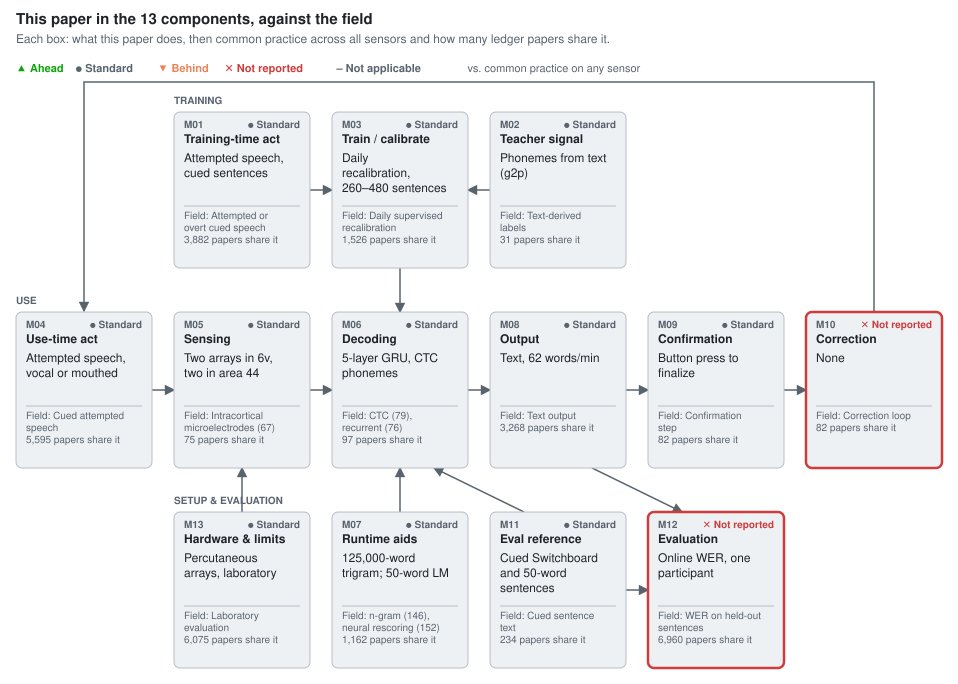

# A high-performance speech neuroprosthesis

Willett, Kunz, Fan, Avansino, Wilson, Choi, Kamdar, Glasser, Hochberg, Druckmann, Shenoy, Henderson. Nature 620, 1031–1036 (2023). [doi:10.1038/s41586-023-06377-x](https://doi.org/10.1038/s41586-023-06377-x)

**Section:** [Brain signals (EEG, MEG, intracortical)](../../README.md#brain-signals-eeg-meg-intracortical)

## Figures

### This paper in the 13 components, against the field

<picture><source media="(prefers-color-scheme: dark)" srcset="figures/components-dark.svg"></picture>

Verdicts compare the paper's choice for each component with common practice across 8,995 ledger entries on any sensor (silent speech, brain-to-text, lip reading).

Data

| Component | This paper | Common practice | Papers with this practice | Verdict |
| --- | --- | --- | --- | --- |
| M01 Training-time act | Attempted speech, cued sentences | Attempted or overt cued speech | 3,882 of 8,995 | ● Standard (Inherited.) |
| M02 Teacher signal | Phonemes from text (g2p) | Text-derived labels | 31 of 8,995 | ● Standard (No audio; CTC aligns.) |
| M03 Train / calibrate | Daily recalibration, 260–480 sentences | Daily supervised recalibration | 1,526 of 8,995 | ● Standard (About 140 min per day.) |
| M04 Use-time act | Attempted speech, vocal or mouthed | Cued attempted speech | 5,595 of 8,995 | ● Standard (Inherited.) |
| M05 Sensing | Two arrays in 6v, two in area 44 | Intracortical microelectrodes (67) | 75 of 8,995 | ● Standard (0.57x WER per electrode doubling.) |
| M06 Decoding | 5-layer GRU, CTC phonemes | CTC (79), recurrent (76) | 97 of 8,995 | ● Standard (Handwriting-BCI design.) |
| M07 Runtime aids | 125,000-word trigram; 50-word LM | n-gram (146), neural rescoring (152) | 1,162 of 8,995 | ● Standard (Better LM: 23.8 to 17.4% offline.) |
| M08 Output | Text, 62 words/min | Text output | 3,268 of 8,995 | ● Standard (Latency not reported.) |
| M09 Confirmation | Button press to finalize | Confirmation step | 82 of 8,995 | ● Standard (Inherited.) |
| M10 Correction | None | Correction loop | 82 of 8,995 | ✕ Not reported (No edit rate.) |
| M11 Eval reference | Cued Switchboard and 50-word sentences | Cued sentence text | 234 of 8,995 | ● Standard (Per-day test counts not stated.) |
| M12 Evaluation | Online WER, one participant | WER on held-out sentences | 6,960 of 8,995 | ✕ Not reported (No seeds or selection data.) |
| M13 Hardware & limits | Percutaneous arrays, laboratory | Laboratory evaluation | 6,075 of 8,995 | ● Standard (Proof of concept.) |

## Verdict

The paper [[1]](#ref-1) changed three components: intracortical arrays in area 6v as the speech sensor (M05), a GRU phoneme decoder trained with CTC (M06), and an online 125,000-word language model (M07). All three are standard against today's ledger because the field adopted them, and a [later] system on the same design reached 2.5% WER on the same vocabulary [[2]](#ref-2). The main claim holds as a single-participant demonstration: 23.8% online WER at 62 words per minute on a large vocabulary was new for attempted speech. Crediting spiking resolution for the gain is overreach, since a [concurrent] ECoG system reached a similar error at a higher rate [[3]](#ref-3). The 2.7x and 3.4x margins are untested ratios across participants, sensors and tasks, and the online numbers carry no seeds or stated selection data.

## Against the field, component by component

### M05 Sensors: intracortical arrays for speech

**Usual approach:** 67 of 75 unique studies linking intracortical recording to speech record microelectrodes (slot-filled within pattern match); 20 are dated 2022 or earlier and 37 from 2024 (Appendix). Before this paper, sentence decoding from cortex was an ECoG result [[4]](#ref-4), [[5]](#ref-5).
**State of the art:** 2.5% WER on 125,000 words in 2024 with 256 electrodes in precentral gyrus [[2]](#ref-2), about a tenth of this paper's 23.8% (inference), but at 31.6 words per minute, half of this paper's 62.

The sensor case rests on internal evidence: the dorsal 6v array cut offline WER from 32% to 21%, and WER fell by a factor of 0.57 per electrode doubling over ten seeds (Fig. 4b). The comparison with ECoG is the weak point: the [concurrent] 253-channel ECoG decoder reported 25% median WER on 1,024 words at 78 words per minute [[3]](#ref-3). With vocabularies two orders of magnitude apart, neither paper ranks the sensors. Verdict: standard.

### M06 Decoding: RNN phoneme decoder with CTC

**Usual approach:** of 97 unique studies pairing phoneme or CTC output with a language model (pattern match), 79 use CTC and 76 a recurrent network; the GRU with day-specific input layers comes from the handwriting BCI [[6]](#ref-6).
**State of the art:** the same family holds the 2024 best result [[2]](#ref-2); the gap is data and sensors, not architecture.

What matters is how much the language model carries. Raw phoneme error was 19.7% for 125,000 words and 21.4% for 50 words, yet word error was 23.8% and 9.1% (Table 1): the same neural evidence gives a 2.6-fold difference in word error from the vocabulary alone (inference). The claim that decoding is "not overly reliant" on the model (Sec. 3) rests on readable phoneme strings, not on a measured no-model word error, which the ECoG predecessor reported (60.5% without, 25.6% with [[4]](#ref-4)). Verdict: standard.

### M07 Language model: 125,000 words online

**Usual approach:** among 1,162 unique studies naming a vocabulary or language model (pattern match), n-gram models (146) and neural rescoring (152) dominate; earlier neural BCIs used 50 words [[4]](#ref-4) or about 250 words [[5]](#ref-5).
**State of the art:** online 125,000-word decoding at 2.5% WER with neural rescoring in 2024 [[2]](#ref-2).

The online 125,000-word vocabulary was the real advance of 2023, and the trigram model was far from its limit: an improved model alone cut offline WER from 23.8% to 17.4%, a 27% relative reduction (inference), and testing nearer to training reached 11.8% (Table 1). Verdict: standard.

### M03 and M12: calibration and evaluation

**Usual approach:** daily supervised recalibration on the participant's own sentences, as in the handwriting BCI [[6]](#ref-6).
**State of the art:** in 2024, 30 minutes of data on day one and accuracy held through session 84 [[2]](#ref-2).

Each day began with 260–480 sentences (Sec. 3; 260–440 in Sec. 4) and about 140 min of collection and training; without same-day data offline WER was 30% (Fig. 4c), a burden the authors call unsolved. One participant, no online seeds and no stated selection data leave the headline numbers as single realisations. Verdicts: M03 standard, M12 not reported.

## The 13 components

| Component | This paper | Usual approach (count) | State of the art | Verdict |
|---|---|---|---|---|
| M01 Training-time action | Attempted speech, cued sentences | Attempted or overt cued speech (slot-filled 3,882) | – | standard |
| M02 Training-only supervision | Phonemes from text (g2p) | Text-derived labels (slot-filled 31) | – | standard |
| M03 Training and adaptation | Daily recalibration, 260–480 sentences | Daily supervised recalibration (slot-filled 1,526) | 30 min calibration [[2]](#ref-2) | standard |
| M04 Use-time action | Attempted speech, vocal or mouthed | Cued attempted speech (slot-filled 5,595) | – | standard |
| M05 Sensors | Two arrays in 6v, two in area 44 | Intracortical microelectrodes (67) (pattern match 75) | 2.5% WER [[2]](#ref-2) | standard |
| M06 Processing and decoding | 5-layer GRU, CTC phonemes | CTC (79), recurrent (76) (pattern match 97) | Same family [[2]](#ref-2) | standard |
| M07 Lexicon and LM | 125,000-word trigram; 50-word LM | n-gram (146), neural rescoring (152) (pattern match 1,162) | 2.5% WER [[2]](#ref-2) | standard |
| M08 Output | Text, 62 words/min | Text output (slot-filled 3,268) | 78 words/min [[3]](#ref-3) | standard |
| M09 Confirmation | Button press to finalize | Confirmation step (slot-filled 82) | – | standard |
| M10 Correction | None | Correction loop (slot-filled 82) | – | not reported |
| M11 Reference construction | Cued Switchboard and 50-word sentences | Cued sentence text (slot-filled 234) | – | standard |
| M12 Evaluation | Online WER, one participant | WER on held-out sentences (slot-filled 6,960) | – | not reported |
| M13 Device and cost | Percutaneous arrays, laboratory | Laboratory evaluation (slot-filled 6,075) | – | standard |

## Where the claims outrun the evidence

- Spiking resolution as the cause (Abstract) has no within-study sensor control, and the [concurrent] ECoG result sits in the same error band [[3]](#ref-3).
- The 2.7x error reduction compares with another participant and sensor [[4]](#ref-4); the 3.4x rate compares speech with handwriting [[6]](#ref-6). Neither is tested (Abstract).
- The released code keeps the checkpoint with the lowest error on the partition named "test", the split behind its own offline WER (neuralSequenceDecoder.py); the paper does not say which data selected the online decoders (Sec. 3).

## What the field needs next

- M05: spiking versus field-potential features on the same arrays, beyond 128 channels.
- M07: word error with and without the language model at each vocabulary size.
- M03: a fixed daily calibration budget reported as an operating point.
- M12: online results over seeds and a second participant, with selection data kept apart from test blocks.

## Questions for the authors

- Which data selected the online checkpoints and hyperparameters?
- Were mouthed days trained on vocal data, mouthed data, or both?
- What corpus trained the 125,000-word trigram model, and what is the "improved" model?
- What is the online word error rate without the language model?

## Appendix: literature search

Ledger at wiki commit 730b0b4: 7,388 unique studies.

**M05, intracortical-speech-decoding.** Inclusion rule: papers that decode speech units (phonemes, words, sentences, sound) from intracortical microelectrode recordings in humans; attempted, imagined or overt speech and any array count are included; hand, arm or handwriting decoding only, ECoG and sEEG are excluded. Ledger counts: 7,329 slot-filled unique studies; 75 pattern match (unique studies). Usual design: modalities = intracortical microelectrode, 67 (slot-filled). Ledger years of the 75: 20 in 2022 or earlier, 4 in 2023, 37 in 2024 or later, 14 date unresolved. Read in full: [[2]](#ref-2) (state of the art), [[4]](#ref-4), [[6]](#ref-6) (prior). Known-item recall: 0.33 (1 of 3 seeds).

**M06, phoneme-rnn-ctc-lm-decoding.** Inclusion rule: neural or articulatory speech decoders that emit phoneme or character probabilities with a recurrent or CTC-trained network and convert them to words with an n-gram or neural language model; sEMG, EEG, ECoG and intracortical, online or offline; closed-set word classifiers and direct audio synthesis are excluded. Ledger counts: 7,345 slot-filled unique studies; 97 pattern match (unique studies). Usual design: CTC 79, recurrent network 76, transformer 61, attention sequence-to-sequence 43 (pattern match). Read in full: [[2]](#ref-2), [[3]](#ref-3) ([concurrent]). Known-item recall: 1.0 (2 of 2 seeds).

**M07, large-vocabulary-lm-for-neural-speech.** Inclusion rule: neural speech decoders that constrain output with a vocabulary of at least 1,000 words through an n-gram or neural language model at use time; 50-word or command sets count as small vocabulary; LLM rescoring counts. Ledger counts: 119 slot-filled unique studies (sparse slot); 1,162 pattern match (unique studies). Usual design: neural rescoring 152, n-gram 146, 50-word closed set 55, vocabulary of 1,000 words or more 45 (pattern match, full text). Read in full: [[5]](#ref-5), [[4]](#ref-4) (prior), [[3]](#ref-3) ([concurrent]), [[2]](#ref-2) ([later]).

## References

Numbered by first citation. BibTeX in the same order and keys: [refs.bib](refs.bib).

1. Willett, F. R., Kunz, E. M., Fan, C., Avansino, D. T., Wilson, G. H., Choi, E. Y., et al. “A high-performance speech neuroprosthesis.” *Nature*, 2023, 620, 1031–1036. doi:[10.1038/s41586-023-06377-x](https://doi.org/10.1038/s41586-023-06377-x). [review](https://github.com/supernaiter/silent-speech-review/tree/main/reviews/a-high-performance-speech-neuroprosthesis) [wiki: doi-10.1038-s41586-023-06377-x](https://github.com/supernaiter/deep-research-wiki-for-silent-speech/blob/main/papers/doi-10.1038-s41586-023-06377-x/article.md) [wiki: pmc-10468393-neuroprosthesis](https://github.com/supernaiter/deep-research-wiki-for-silent-speech/blob/main/papers/pmc-10468393-neuroprosthesis/article.md)
2. Card, N. S., Wairagkar, M., Iacobacci, C., Hou, X., Singer-Clark, T., Willett, F. R., et al. “An accurate and rapidly calibrating speech neuroprosthesis.” *New England Journal of Medicine*, 2024, 391(7), 609–618. doi:[10.1056/NEJMoa2314132](https://doi.org/10.1056/NEJMoa2314132). [later] [review](https://github.com/supernaiter/silent-speech-review/tree/main/reviews/an-accurate-and-rapidly-calibrating-speech-neuroprosthesis) [wiki: doi-10.1056-nejmoa2314132](https://github.com/supernaiter/deep-research-wiki-for-silent-speech/blob/main/papers/doi-10.1056-nejmoa2314132/article.md) [wiki: doi-10.1056-NEJMoa2314132](https://github.com/supernaiter/deep-research-wiki-for-silent-speech/blob/main/papers/doi-10.1056-NEJMoa2314132/article.md) [wiki: pmc-11328962-rapidcal](https://github.com/supernaiter/deep-research-wiki-for-silent-speech/blob/main/papers/pmc-11328962-rapidcal/article.md)
3. Metzger, S. L., Littlejohn, K. T., Silva, A. B., Moses, D. A., Seaton, M. P., Wang, R., et al. “A high-performance neuroprosthesis for speech decoding and avatar control.” *Nature*, 2023, 620, 1037–1046. doi:[10.1038/s41586-023-06443-4](https://doi.org/10.1038/s41586-023-06443-4). [concurrent] [review](https://github.com/supernaiter/silent-speech-review/tree/main/reviews/a-high-performance-neuroprosthesis-for-speech-decoding-and-avatar-control) [wiki: doi-10.1038-s41586-023-06443-4](https://github.com/supernaiter/deep-research-wiki-for-silent-speech/blob/main/papers/doi-10.1038-s41586-023-06443-4/article.md) [wiki: pmc-10826467-avatarnp](https://github.com/supernaiter/deep-research-wiki-for-silent-speech/blob/main/papers/pmc-10826467-avatarnp/article.md)
4. Moses, D. A., Metzger, S. L., Liu, J. R., Anumanchipalli, G. K., Makin, J. G., Sun, P. F., et al. “Neuroprosthesis for decoding speech in a paralyzed person with anarthria.” *New England Journal of Medicine*, 2021, 385(3), 217–227. doi:[10.1056/NEJMoa2027540](https://doi.org/10.1056/NEJMoa2027540). [review](https://github.com/supernaiter/silent-speech-review/tree/main/reviews/neuroprosthesis-for-decoding-speech-in-a-paralyzed-person-with-anarthria) [wiki: doi-10.1056-nejmoa2027540](https://github.com/supernaiter/deep-research-wiki-for-silent-speech/blob/main/papers/doi-10.1056-nejmoa2027540/article.md) [wiki: pmc-8972947-nejmspeech](https://github.com/supernaiter/deep-research-wiki-for-silent-speech/blob/main/papers/pmc-8972947-nejmspeech/article.md)
5. Makin, J. G., Moses, D. A., Chang, E. F. “Machine translation of cortical activity to text with an encoder-decoder framework.” *Nature Neuroscience*, 2020, 23, 575–582. doi:[10.1038/s41593-020-0608-8](https://doi.org/10.1038/s41593-020-0608-8). [wiki: doi-10.1038-s41593-020-0608-8](https://github.com/supernaiter/deep-research-wiki-for-silent-speech/blob/main/papers/doi-10.1038-s41593-020-0608-8/article.md) [wiki: pmc-10560395-makin](https://github.com/supernaiter/deep-research-wiki-for-silent-speech/blob/main/papers/pmc-10560395-makin/article.md)
6. Willett, F. R., Avansino, D. T., Hochberg, L. R., Henderson, J. M., Shenoy, K. V. “High-performance brain-to-text communication via handwriting.” *Nature*, 2021, 593, 249–254. doi:[10.1038/s41586-021-03506-2](https://doi.org/10.1038/s41586-021-03506-2). [wiki: doi-10.1038-s41586-021-03506-2](https://github.com/supernaiter/deep-research-wiki-for-silent-speech/blob/main/papers/doi-10.1038-s41586-021-03506-2/article.md) [wiki: pmc-8163299-b2thand](https://github.com/supernaiter/deep-research-wiki-for-silent-speech/blob/main/papers/pmc-8163299-b2thand/article.md)

## Materials

Data behind this review. Full texts of the papers are not included.

- [`review.md`](review.md): the review text (source)
- [`refs.bib`](refs.bib): references (BibTeX)
- [`slots.json`](slots.json): for each of the 13 components: this paper's choice, field practice, number of matching papers, verdict
- [`figures.json`](figures.json): figure definitions
- [`evaluation.md`](evaluation.md): independent evaluation by a second reviewer
- [`triage.md`](triage.md): how each evaluation finding was checked against the sources and resolved
- [`components/M05/intracortical-speech-decoding.csv`](../../components/M05/intracortical-speech-decoding.csv): M05 topic "intracortical-speech-decoding", every candidate paper with its decision (7329 slot-filled, 75 pattern match, usual design in 67, 3 read in full)
- [`components/M06/phoneme-rnn-ctc-lm-decoding.csv`](../../components/M06/phoneme-rnn-ctc-lm-decoding.csv): M06 topic "phoneme-rnn-ctc-lm-decoding", every candidate paper with its decision (7345 slot-filled, 97 pattern match, usual design in 61, 3 read in full)
- [`components/M07/large-vocabulary-lm-for-neural-speech.csv`](../../components/M07/large-vocabulary-lm-for-neural-speech.csv): M07 topic "large-vocabulary-lm-for-neural-speech", every candidate paper with its decision (119 slot-filled, 1162 pattern match, usual design in 152, 4 read in full)

## More reviews in Brain signals (EEG, MEG, intracortical)

- [A high-performance neuroprosthesis for speech decoding and avatar control](../a-high-performance-neuroprosthesis-for-speech-decoding-and-avatar-control/) (2023). 253-channel ECoG neuroprosthesis decodes silently attempted speech into text, synthesized voice and avatar movements; real-time median WER 25.5% at 78 wpm on a 1,024-word sentence set in one person with anarthria.
- [Decoding speech perception from non-invasive brain recordings](../decoding-speech-perception-from-non-invasive-brain-recordings/) (2023). Contrastive deep model identifies heard 3 s speech segments from MEG/EEG across 175 participants; MEG top-1 up to 41% (best participants above 80%) among 1,000+ candidates, EEG much lower.
- [An Accurate and Rapidly Calibrating Speech Neuroprosthesis](../an-accurate-and-rapidly-calibrating-speech-neuroprosthesis/) (2024). Intracortical speech BCI in a man with ALS reaches 9.8% WER on a 125,000-word vocabulary on day 2 and about 2.5% later, and was used for 248 hours of self-paced conversation over 8.4 months.
- [Towards Neural Decoding of Imagined Speech based on Spoken Speech](../towards-neural-decoding-of-imagined-speech-based-on-spoken-speech/) (2022). Transfers CSP+SVM models trained on spoken-speech EEG to imagined speech decoding; accuracy is slightly lower but not significantly different from direct training in a 5-class, 7-subject offline task.
- [A Convolutional Framework for Mapping Imagined Auditory MEG into Listened Brain Responses](../a-convolutional-framework-for-mapping-imagined-auditory-meg-into-listened-brain-responses/) (2025). Maps imagined auditory MEG (melodies and poems) to listened-response MEG; 8-condition classification reaches 50.7% (chance 12.5%), and calibrated cross-subject CNN beats shuffled controls, but correlations are small.
- [A cross-species neural foundation model for end-to-end speech decoding](../a-cross-species-neural-foundation-model-for-end-to-end-speech-decoding/) (2025). Introduces a cross-species self-supervised transformer encoder for Utah-array spiking data combined with audio-LLM end-to-end decoding, reporting state-of-the-art Brain-to-Text benchmark accuracy and imagined speech decoding.

---

Part of the [Silent Speech Interface Review](https://github.com/supernaiter/silent-speech-review). Found an error? [Open an issue](https://github.com/supernaiter/silent-speech-review/issues/new?template=correction.yml).
