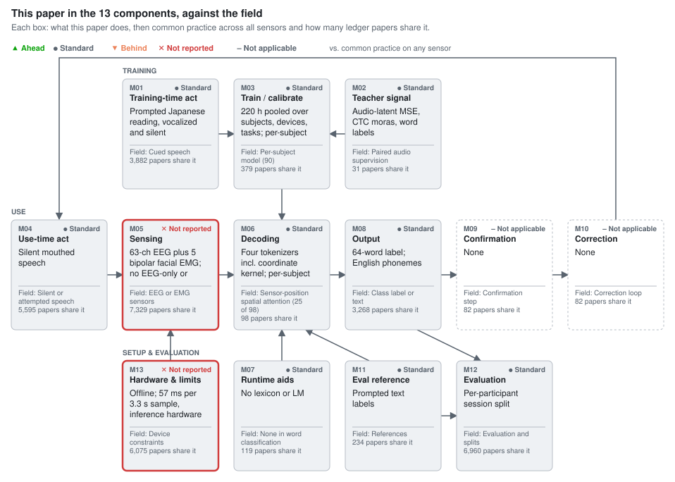

# A Silent Speech Decoding System from EEG and EMG with Heterogenous Electrode Configurations

Inoue, Sato, Tomeoka, Nah, Hatakeyama, Arulkumaran, Horiguchi, Sasai. Interspeech 2025. [doi:10.21437/Interspeech.2025-1183](https://doi.org/10.21437/Interspeech.2025-1183) · [arXiv:2506.13835](https://arxiv.org/abs/2506.13835)

**Section:** [Surface EMG](../../README.md#surface-emg)

## Figures

### This paper in the 13 components, against the field

<picture><source media="(prefers-color-scheme: dark)" srcset="figures/components-dark.svg"></picture>

Verdicts compare the paper's choice for each component with common practice across 8,995 ledger entries on any sensor (silent speech, brain-to-text, lip reading).

Data

| Component | This paper | Common practice | Papers with this practice | Verdict |
| --- | --- | --- | --- | --- |
| M01 Training-time act | Prompted Japanese reading, vocalized and silent | Cued speech | 3,882 of 8,995 | ● Standard (Inherited.) |
| M02 Teacher signal | Audio-latent MSE, CTC moras, word labels | Paired audio supervision | 31 of 8,995 | ● Standard (Inherited lineage.) |
| M03 Train / calibrate | 220 h pooled over subjects, devices, tasks; per-subject layers | Per-subject model (90) | 379 of 8,995 | ● Standard (Test subjects' training sessions in pretraining.) |
| M04 Use-time act | Silent mouthed speech | Silent or attempted speech | 5,595 of 8,995 | ● Standard (Inherited.) |
| M05 Sensing | 63-ch EEG plus 5 bipolar facial EMG; no EEG-only or EMG-only result | EEG or EMG sensors | 7,329 of 8,995 | ✕ Not reported (No single-modality result.) |
| M06 Decoding | Four tokenizers incl. coordinate kernel; per-subject layer best | Sensor-position spatial attention (25 of 98) | 98 of 8,995 | ● Standard (Coordinate mapping predates it.) |
| M07 Runtime aids | No lexicon or LM | None in word classification | 119 of 8,995 | ● Standard (Closed 64-word set.) |
| M08 Output | 64-word label; English phonemes | Class label or text | 3,268 of 8,995 | ● Standard (Inherited.) |
| M09 Confirmation | None | Confirmation step | 82 of 8,995 | – Not applicable (Offline.) |
| M10 Correction | None | Correction loop | 82 of 8,995 | – Not applicable (Offline.) |
| M11 Eval reference | Prompted text labels | References | 234 of 8,995 | ● Standard (Prompt labels.) |
| M12 Evaluation | Per-participant session split | Evaluation and splits | 6,960 of 8,995 | ● Standard (Test subjects' training sessions in pretraining.) |
| M13 Hardware & limits | Offline; 57 ms per 3.3 s sample, inference hardware unstated | Device constraints | 6,075 of 8,995 | ✕ Not reported (Hardware unstated.) |

## Verdict

The paper [[1]](#ref-1) changes the input layer for EEG and EMG from five electrode configurations (M06) and pools subjects, devices and tasks in pretraining (M03). Both are standard: input layers conditioned on sensor coordinates predate it [[2]](#ref-2), [[3]](#ref-3), and its coordinate kernel loses to a fixed per-subject layer (Sec. 4.1). The gain from 70.1% to 95.3% word accuracy (eight healthy) and from 13.2% to 54.5% (one patient; Sec. 4.1) holds inside the paper but is not transfer from healthy data: pretraining contains every subject's word-task training sessions, the patient's 16 included (Sec. 3.2, 3.3). Volume grows with devices and tasks, and no single-modality model is reported, so neither the source of the gain nor the role of EEG is shown. Other patients are untested (Sec. 5).

## Against the field, component by component

### M06 Processing: one input layer for heterogeneous electrode layouts

**Usual approach:** Of 98 decoders that train across differing channel layouts (pattern match, unique studies; Appendix), the most frequent design is spatial attention over sensor positions (25), as in [[2]](#ref-2), which remaps M/EEG onto 270 virtual channels before a per-subject layer; per-subject or per-dataset input layers come next (12). The paper's 3D-coordinate kernel (Sec. 2.4) is a variant of that mapping.

**State of the art:** Chen et al. (2024) attend over MNI electrode coordinates, so any layout fits; trained on 8x8 ECoG grids of 15 participants, it reaches mean PCC 0.765 on left-out participants [[3]](#ref-3). This invasive spectrogram regression is not comparable in value with EEG/EMG word accuracy; it is the yardstick only for an unseen layout and user, where the paper's best tokenizer needs a per-subject layer and cannot run before calibration.

Ablating spatial attention in [[2]](#ref-2) cost 2.5 top-10 points and ablating the subject layer 14.4 (Table 3), one at a time; the paper compares alternative tokenizers, and its subject-specific layer also wins (Sec. 4.1). In English transfer the kernel is also worse: 55.8% PER against 49.5% and 50.0% (Table 2). Verdict: standard.

### M03 Training: pooled pretraining across subjects, devices and tasks

**Usual approach:** Among 379 decoders in the pooled-training topic (pattern match with full-text hits, unique studies; Appendix), a model per subject is most common (90). The paper pools 220 h across five configurations.

**State of the art:** [later] (2026) multi-subject EMG pretraining, leave-one-subject-out over 27 participants, reaches 20.5% CER after three minutes of calibration against 49.3% without [[4]](#ref-4); cross-subject pretraining for perceived speech reaches 61.3% top-10 [[5]](#ref-5). Both keep the test subject out of pretraining; the paper does not.

The gains are 25.2 points (36% relative) for healthy participants and 4.1-fold for the patient (inference). But "word all" holds all word-task data from all subjects (Sec. 3.2), and patient calibration adds new-day sessions to the 16 used in pretraining (Sec. 3.3), so "pretrained on large-scale data from healthy participants" (Sec. 5) overstates the design. Test sessions appear excluded (16.1 h is close to eight 1.9 h splits plus the patient's 1 h; inference), so the issue is within-subject pretraining, not leakage. The pretraining sets also change device and task (Table 1), so Fig. 2 is not a pure volume effect. A [later] study found no benefit from a subject-specific adapter [[4]](#ref-4); here it scores highest (Sec. 4.1), with no seed count. Verdict: standard.

## The 13 components

| Component | This paper | Usual approach (count) | State of the art | Verdict |
|---|---|---|---|---|
| M01 Training-time action | Prompted Japanese reading, vocalized and silent | Cued speech (slot-filled 3,882) | – | standard |
| M02 Training-only supervision | Audio-latent MSE, CTC moras, word labels | Paired audio supervision (slot-filled 31) | – | standard |
| M03 Training and adaptation | 220 h pooled over subjects, devices, tasks; per-subject layers | Per-subject model (90) (pattern match 379) | 20.5% CER, LOSO, 3 min calibration [[4]](#ref-4) | standard |
| M04 Use-time action | Silent mouthed speech | Silent or attempted speech (slot-filled 5,595) | – | standard |
| M05 Sensors | 63-ch EEG plus 5 bipolar facial EMG; no EEG-only or EMG-only result | EEG or EMG sensors (slot-filled 7,329) | – | not reported |
| M06 Processing and decoding | Four tokenizers incl. coordinate kernel; per-subject layer best | Sensor-position spatial attention (25 of 98) (pattern match 98) | PCC 0.765 on unseen participants [[3]](#ref-3) | standard |
| M07 Lexicon and LM | No lexicon or LM | None in word classification (slot-filled 119) | – | standard |
| M08 Output | 64-word label; English phonemes | Class label or text (slot-filled 3,268) | – | standard |
| M09 Confirmation | None | Confirmation step (slot-filled 82) | – | not applicable |
| M10 Correction | None | Correction loop (slot-filled 82) | – | not applicable |
| M11 Reference construction | Prompted text labels | References (slot-filled 234) | – | standard |
| M12 Evaluation | Per-participant session split | Evaluation and splits (slot-filled 6,960) | – | standard |
| M13 Device and cost | Offline; 57 ms per 3.3 s sample, inference hardware unstated | Device constraints (slot-filled 6,075) | – | not reported |

## Where the claims outrun the evidence

- **Patient transfer.** The patient's training sessions are in "word all" and "all" (Sec. 3.2, 3.3); no pretraining set without the patient is reported, and the cohort is one patient (Sec. 2.1).
- **EEG contribution.** The group earlier removed the EMG-predicted part of EEG as contamination [[6]](#ref-6); here the signals are fused with no single-modality model, so EEG is not shown to add anything.
- **Tokenizer claim.** The kernel is presented as the new element (Sec. 1), but coordinate-conditioned mapping exists [[2]](#ref-2), [[3]](#ref-3) and the kernel is best on neither task (Sec. 4.1, Table 2).
- **Cross-language transfer.** "Language-independent processing" (Sec. 4.2) rests on one English speaker, with no reported split or uncertainty (Sec. 3.4); GAP scores 100% PER (Table 2); the data are EMG only, so it says nothing about EEG.
- **Inconsistency.** "eego all" is 76.9 hours (Sec. 3.2), but its Table 1 rows sum to 78.9 (inference).

## What the field needs next

- M03: leave-one-subject-out pretraining that excludes the patient, at zero and a few minutes of calibration, as [[4]](#ref-4) does for EMG.
- M05: EEG-only, EMG-only and fused models on the same splits, with EMG regressed out of EEG as in [[6]](#ref-6).
- M06: kernel, per-subject layer and spatial attention [[2]](#ref-2) over several seeds on an unseen configuration.

## Questions for the authors

- Were sessions 17–20, and the vocalized sessions recorded with them, excluded from every pretraining set? Is the new healthy participant absent from all of them?
- How many seeds or runs, and what does ±17.1 denote?
- What is the accuracy at each calibration-session count in Fig. 3?
- How was the English dataset split and scored?

## Appendix: literature search

- **M06 heterogeneous-electrode-configuration-input.** Inclusion rule: speech or language decoders from neural or muscle signals that train one model on recordings whose channel count or electrode layout differs across participants, devices or datasets, by mapping channels into a shared space; one-montage models, channel-subset selection within one array, and non-speech EEG models are excluded. Ledger: 7,345 slot-filled; 98 pattern match (unique studies). Usual design: sensor-position spatial attention, 25 (pattern match); per-subject or per-dataset input layer, 12; graph model, 6. Read in full: [[2]](#ref-2) (prior), [[3]](#ref-3) (prior; state of the art). Known-item recall 0.5 (2 seeds).
- **M03 cross-subject-pooled-training** (published table, appended). Inclusion rule: speech or language decoders from neural or other biosignals that train one model on data pooled across participants, with or without participant-specific layers; per-participant models averaged over participants are excluded. Ledger: 1,526 slot-filled; 370 pattern match plus 15 full-text-only folders, 379 unique studies in the design tally. Usual design: per-subject model, 90 of 379 (pattern match). Read in full: [[6]](#ref-6), [[4]](#ref-4), [[5]](#ref-5) (state of the art in the table).

## References

Numbered by first citation. BibTeX in the same order and keys: [refs.bib](refs.bib).

1. Inoue, M., Sato, M., Tomeoka, K., Nah, N., Hatakeyama, E., Arulkumaran, K., et al. “A Silent Speech Decoding System from EEG and EMG with Heterogenous Electrode Configurations.” *Proc. Interspeech 2025*, 2025, 5603–5607. doi:[10.21437/Interspeech.2025-1183](https://doi.org/10.21437/Interspeech.2025-1183). arXiv:[2506.13835](https://arxiv.org/abs/2506.13835). arXiv v1 read; venue confirmed in Crossref [review](https://github.com/supernaiter/silent-speech-review/tree/main/reviews/a-silent-speech-decoding-system-from-eeg-and-emg-with-heterogenous-electrode-configurations) [wiki: arxiv-2506.13835](https://github.com/supernaiter/deep-research-wiki-for-silent-speech/blob/main/papers/arxiv-2506.13835/article.md) [wiki: isca-inoue25b-eegemg](https://github.com/supernaiter/deep-research-wiki-for-silent-speech/blob/main/papers/isca-inoue25b-eegemg/article.md) [wiki: isca-inoue25b_interspeech](https://github.com/supernaiter/deep-research-wiki-for-silent-speech/blob/main/papers/isca-inoue25b_interspeech/article.md)
2. Défossez, A., Caucheteux, C., Rapin, J., Kabeli, O., King, J. “Decoding speech perception from non-invasive brain recordings.” *Nature Machine Intelligence*, 2023, 5(10), 1097–1107. doi:[10.1038/s42256-023-00714-5](https://doi.org/10.1038/s42256-023-00714-5). arXiv:[2208.12266](https://arxiv.org/abs/2208.12266). [review](https://github.com/supernaiter/silent-speech-review/tree/main/reviews/decoding-speech-perception-from-non-invasive-brain-recordings) [wiki: arxiv-2208.12266-natmi](https://github.com/supernaiter/deep-research-wiki-for-silent-speech/blob/main/papers/arxiv-2208.12266-natmi/article.md)
3. Chen, J., Chen, X., Wang, R., Le, C., Khalilian-Gourtani, A., Jensen, E., et al. “Subject-Agnostic Transformer-Based Neural Speech Decoding from Surface and Depth Electrode Signals.” *bioRxiv*, 2024. doi:[10.1101/2024.03.11.584533](https://doi.org/10.1101/2024.03.11.584533). [wiki: doi-10.1101-2024.03.11.584533](https://github.com/supernaiter/deep-research-wiki-for-silent-speech/blob/main/papers/doi-10.1101-2024.03.11.584533/article.md)
4. Le, C., Fumagalli, B., Esmaeili, Y., Chen, X., He, T., Emami, N., et al. “Multi-Subject Pretraining Enables Short-Calibration Personalization for Closed-Corpus Surface EMG Speech Decoding.” *arXiv preprint*, 2026. arXiv:[2609.21288](https://arxiv.org/abs/2609.21288). [later] [review](https://github.com/supernaiter/silent-speech-review/tree/main/reviews/multi-subject-pretraining-enables-short-calibration-personalization-for-closed-corpus-surface-emg-speech-decoding) [wiki: arxiv-2609.21288](https://github.com/supernaiter/deep-research-wiki-for-silent-speech/blob/main/papers/arxiv-2609.21288/article.md)
5. Zhang, A., Wang, B., Wu, X., Cheng, H., Chen, J. “Cross-Subject Generalization in Decoding Perceived Speech from Non-Invasive Brain Recordings.” *arXiv preprint*, 2026. arXiv:[2608.22420](https://arxiv.org/abs/2608.22420). [later] [wiki: arxiv-2608.22420](https://github.com/supernaiter/deep-research-wiki-for-silent-speech/blob/main/papers/arxiv-2608.22420/article.md)
6. Sato, M., Tomeoka, K., Horiguchi, I., Arulkumaran, K., Kanai, R., Sasai, S. “Scaling Law in Neural Data: Non-Invasive Speech Decoding with 175 Hours of EEG Data.” *arXiv preprint*, 2024. arXiv:[2407.07595](https://arxiv.org/abs/2407.07595). [wiki: arxiv-2407.07595](https://github.com/supernaiter/deep-research-wiki-for-silent-speech/blob/main/papers/arxiv-2407.07595/article.md)

## Materials

Data behind this review. Full texts of the papers are not included.

- [`review.md`](review.md): the review text (source)
- [`refs.bib`](refs.bib): references (BibTeX)
- [`slots.json`](slots.json): for each of the 13 components: this paper's choice, field practice, number of matching papers, verdict
- [`figures.json`](figures.json): figure definitions
- [`evaluation.md`](evaluation.md): independent evaluation by a second reviewer
- [`triage.md`](triage.md): how each evaluation finding was checked against the sources and resolved
- [`components/M03/cross-subject-pooled-training.csv`](../../components/M03/cross-subject-pooled-training.csv): M03 topic "cross-subject-pooled-training", every candidate paper with its decision (1526 slot-filled, 370 pattern match, usual design in 90, 4 read in full)
- [`components/M06/heterogeneous-electrode-configuration-input.csv`](../../components/M06/heterogeneous-electrode-configuration-input.csv): M06 topic "heterogeneous-electrode-configuration-input", every candidate paper with its decision (7345 slot-filled, 98 pattern match, usual design in 25, 2 read in full)

## More reviews in Surface EMG

- [A Parallel Ultra-Low Power Silent Speech Interface based on a Wearable, Fully-dry EMG Neckband](../a-parallel-ultra-low-power-silent-speech-interface-based-on-a-wearable-fully-dry-emg-neckband/) (2025). A fully dry wearable EMG neckband with ultra-low-power BioGAP-Ultra classifies 8 silently articulated words for one healthy user at 68% accuracy, dropping to 54% on an unseen re-wearing session; acquisition plus BLE uses 22.2 mW.
- [Articulatory Feature Prediction from Surface EMG during Speech Production](../articulatory-feature-prediction-from-surface-emg-during-speech-production/) (2025). Articulatory route works on vocalized EMG but trails the mel baseline on WER; it exists for ECoG since 2019, and the electrode subset is never tested against equal-size alternatives.
- [CAT-Net: A Cross-Attention Tone Network for Cross-Subject EEG-EMG Fusion Tone Decoding](../cat-net-a-cross-attention-tone-network-for-cross-subject-eeg-emg-fusion-tone-decoding/) (2025). CAT-Net fuses EEG and surface EMG with cross-attention to classify Mandarin lexical tones in silent articulation, reporting 85.10% leave-one-subject-out accuracy over 4 tones.
- [Confidence-Based Self-Training for EMG-to-Speech: Leveraging Synthetic EMG for Robust Modeling](../confidence-based-self-training-for-emg-to-speech-leveraging-synthetic-emg-for-robust-modeling/) (2025). Uses confidence-filtered synthetic EMG generated from speech, mixed with real data, for EMG-to-speech; on real vocalized EMG from one speaker, WER falls from 23.30% to 21.87%.
- [emg2speech: Synthesizing speech from electromyography using self-supervised speech models](../emg2speech-synthesizing-speech-from-electromyography-using-self-supervised-speech-models/) (2025). emg2speech synthesizes speech from face and neck surface EMG via HuBERT units without the user's own recordings; silent speech from one ALS participant gives 50.82% human-transcribed WER.
- [From Silent Signals to Natural Language: A Dual-Stage Transformer-LLM Approach](../from-silent-signals-to-natural-language-a-dual-stage-transformer-llm-approach/) (2025). Corrects transcripts of speech synthesized from silent EMG (Digital Voicing data) with a Transformer recognizer and GPT-2, reducing WER from 36% to 30% on about 100 utterances.

---

Part of the [Silent Speech Interface Review](https://github.com/supernaiter/silent-speech-review). Found an error? [Open an issue](https://github.com/supernaiter/silent-speech-review/issues/new?template=correction.yml).
