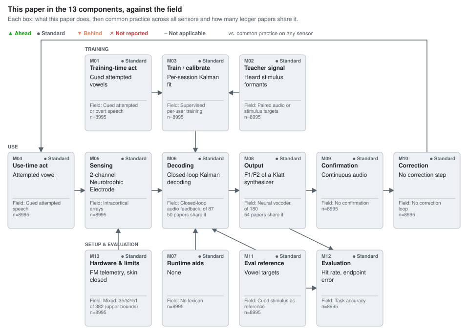

# A Wireless Brain-Machine Interface for Real-Time Speech Synthesis

Guenther, F. H., Brumberg, J. S., Wright, E. J., Nieto-Castanon, A., Tourville, J. A., et al. · PLoS ONE 4(12), e8218 · 2009 · [doi:10.1371/journal.pone.0008218](https://doi.org/10.1371/journal.pone.0008218)

**Section:** [Other sensors](../../README.md#other-sensors)

## Figures

### This paper in the 13 components, against the field

<picture><source media="(prefers-color-scheme: dark)" srcset="figures/components-dark.svg"></picture>

Verdicts compare the paper's choice for each component with common practice across 8,995 ledger entries on any sensor (silent speech, brain-to-text, lip reading).

Data

| Component | This paper | Common practice | Papers with this practice | Verdict |
| --- | --- | --- | --- | --- |
| M01 Training-time act | Cued attempted vowels | Cued attempted or overt speech | 8995 | ● Standard (Inherited.) |
| M02 Teacher signal | Heard stimulus formants | Paired audio or stimulus targets | 8995 | ● Standard (Inherited; participant is mute.) |
| M03 Train / calibrate | Per-session Kalman fit | Supervised per-user training | 8995 | ● Standard (Units kept per session not stated.) |
| M04 Use-time act | Attempted vowel | Cued attempted speech | 8995 | ● Standard (Inherited.) |
| M05 Sensing | 2-channel Neurotrophic Electrode | Intracortical arrays | 8995 | ● Standard (Inherited (Kennedy lineage).) |
| M06 Decoding | Closed-loop Kalman decoding | Closed-loop audio feedback, of 87 | 50 of 87 | ● Standard (Earliest in ledger; one participant.) |
| M07 Runtime aids | None | No lexicon | 8995 | ● Standard (Inherited.) |
| M08 Output | F1/F2 of a Klatt synthesizer | Neural vocoder, of 180 | 54 of 180 | ● Standard (Vowels only.) |
| M09 Confirmation | Continuous audio | No confirmation | 8995 | ● Standard (Online; no confirmation step.) |
| M10 Correction | No correction step | No correction loop | 8995 | ● Standard (Online; steering within a 6 s trial only.) |
| M11 Eval reference | Vowel targets | Cued stimulus as reference | 8995 | ● Standard (Inherited.) |
| M12 Evaluation | Hit rate, endpoint error | Task accuracy | 8995 | ● Standard (No chance level or listener test.) |
| M13 Hardware & limits | FM telemetry, skin closed | Mixed: 35/52/51 of 382 (upper bounds) | 8995 | ● Standard (Skin closed; priority over refs. 32, 33 unresolved; one participant.) |

## Verdict

The paper [[1]](#ref-1) closed the loop from motor cortex to sound (M06, Kalman filter to formants, audio 30–70 ms after neural firing) through two formants of a Klatt synthesizer (M08), and reports a transcutaneous telemetric implant (M13) whose priority over the group's earlier implants is unresolved. All three are standard: real-time control of a formant synthesizer from a non-acoustic signal predates it in hand-gesture systems [[2]](#ref-2), the neural source is the new part, and one participant with one electrode gives no repetition. The main claim, that a locked-in user learns to steer vowels, holds. Its measure is weak: the 45% to 70% hit rate from opening to closing block (Discussion) is helped by an attractor force and has no chance level or decoder-off control (Methods). Nothing measures speech, so "near-conversational" output (Abstract) is a projection; it is the protocol ancestor of the [later] sentence closed loop at a median 43.75% open-transcription WER [[3]](#ref-3), not a performance reference.

## Against the field, component by component

### M06 Decoding: closed-loop formant decoding

**Usual approach:** Of 87 studies matching a real-time or causal synthesis pattern (pattern match, unique studies, not filtered by the rule; Appendix), 50 name closed-loop audio feedback, 24 offline whole-utterance decoding and 9 causal frame-level models (upper bounds). Outside them, GloveTalkII-based systems synthesize in real time from hand gestures [[2]](#ref-2); the paper swaps the hand for motor cortex.

**State of the art:** Brain2voice 2.0 (2026, [later]): 5.24% listener WER, offline with simulated real-time inference [[4]](#ref-4); in closed loop, causal sentence synthesis within 10 ms at a median 43.75% open-transcription WER (2025, [later]) [[3]](#ref-3). The paper has no intelligibility score; its 50 ms (neural firing to audio) and the 25 ms audio-feedback latency given for the 2025 system [[4]](#ref-4) are measured differently.

The decoder is refit each session on one minute of mimicking four heard vowels, the stimulus serving as intended formants (Results). The [later] sEEG closed loop on imagined speech gave audio its authors call not yet intelligible [[5]](#ref-5). The attractor runs in every session (Methods), so the decoder's share of hits is not isolated. Verdict: standard.

### M08 Output: two formants of a Klatt synthesizer

**Usual approach:** Of 180 intracranial speech-synthesis studies (pattern match, unique studies, one run; Appendix), 54 name a neural vocoder and 9 a formant synthesizer; in the ledger the formant designs driven by brain signals are this paper and same-group work (Appendix). The paper steers 2 of 63 synthesizer parameters, F1 and F2 (Methods).

**State of the art:** 5.24% listener WER from continuous and tokenized acoustic features (2026, [later], offline) [[4]](#ref-4).

One 3-wire electrode sufficed for two dimensions (Discussion), which cap the output: with 61 parameters fixed (Methods), no consonant, voicing or pitch change is possible; the authors concede only the vowel limit. The gesture prior already mapped finger movements to consonant formants [[2]](#ref-2). The field uses vocoder features (54 of 180, Appendix). Verdict: standard.

### M13 Device: transcutaneous telemetry

**Usual approach:** Of 382 implanted-sensor speech or communication studies (pattern match, unique studies; Appendix), 35 name a percutaneous connector, 52 wireless telemetry and 51 a fully implanted system, all upper bounds. The paper's FM link with inductive power needs no wires or connectors through the skin (Discussion); the paper does not say how refs. 32 and 33 differ.

**State of the art:** A fully implanted ECoG interface with a subcutaneous transmitter gave home spelling at two letters per minute (2016, [later]) [[6]](#ref-6); the [later] speech system used at home for 19 months still records through percutaneous wired connections and names wireless or fully implantable systems as future work [[7]](#ref-7).

The skin-closed link carried 2 recording channels (Methods), and one participant gives no repetition. Verdict: standard.

## The 13 components

| Component | This paper | Usual approach (count) | State of the art | Verdict |
|---|---|---|---|---|
| M01 Training-time action | Cued attempted vowels | Cued attempted or overt speech | – | standard |
| M02 Training-only supervision | Heard stimulus formants | Paired audio or stimulus targets | – | standard |
| M03 Training and adaptation | Per-session Kalman fit | Supervised per-user training | – | standard |
| M04 Use-time action | Attempted vowel | Cued attempted speech | – | standard |
| M05 Sensors | 2-channel Neurotrophic Electrode | Intracortical arrays | – | standard |
| M06 Processing and decoding | Closed-loop Kalman decoding | Closed-loop audio feedback, of 87 (pattern match 50) | [[4]](#ref-4) (2026): WER 5.24% | standard |
| M07 Lexicon and LM | None | No lexicon | – | standard |
| M08 Output | F1/F2 of a Klatt synthesizer | Neural vocoder, of 180 (pattern match 54) | [[4]](#ref-4) (2026): WER 5.24% | standard |
| M09 Confirmation | Continuous audio | No confirmation | – | standard |
| M10 Correction | No correction step | No correction loop | – | standard |
| M11 Reference construction | Vowel targets | Cued stimulus as reference | – | standard |
| M12 Evaluation | Hit rate, endpoint error | Task accuracy | – | standard |
| M13 Device and cost | FM telemetry, skin closed | Mixed: 35/52/51 of 382 (upper bounds) | [[6]](#ref-6) (2016): fully implanted | standard |

## Where the claims outrun the evidence

- No floor for hit rate: three targets at the corners of the F1/F2 space, a 500 ms stay inside regions of about 150 by 300 Hz with an attractor force, and no chance level, shuffled or decoder-off block (Methods; Fig. 7).
- Block position is confounded: sessions had 1–4 blocks (Results), so a one-block session gives the same block as first and last, and later positions average fewer sessions (Fig. 7).
- The Abstract's "25% improvement" is 25 percentage points, 56% relative (inference); 89% is the single best block (Discussion; Fig. 7).
- "No difference" with the cursor (last 15 of 25 sessions) has no statistic and is confounded with practice; Fig. 7 pools both.
- "Decode and synthesize intended words" (Discussion) rests on three vowels heard before each attempt (Methods; Fig. 7), with no listener test.

## What the field needs next

- M12: chance-calibrated hit rates (shuffled or decoder-off blocks) and listener identification of the vowels.
- M06: attractor-on and attractor-off blocks within sessions.
- M08: closed-loop output spaces between F1/F2 and vocoder features, with listeners.
- M13: closed-loop speech synthesis through a fully implanted link [[6]](#ref-6).

## Questions for the authors

- How many trials enter each block position in Fig. 7?
- What hit rate does a shuffled decoder reach with the attractor on?
- How many units passed the F-test per session?
- How does the "first telemetric implant" claim relate to the computer control in refs. 32 and 33?

## Appendix: literature search

- M06, causal-closed-loop-speech-synthesis (published table, reused). Inclusion rule: studies that synthesize speech acoustics from a non-acoustic signal (neural, EMG, articulography, ultrasound, video) online, with the audio played back while or right after the user speaks; offline studies only when they simulate causal frame-level inference; offline acausal reconstruction, text decoding read out by TTS and conversion from acoustic input excluded; versions count once. Ledger: 7,345 unique studies slot-filled for M06; 87 unique studies pattern match (pattern population, not filtered by the rule). Usual design: ProcessingStep role "generate" 24 of 84, linear model 12 of 84 (slot-filled); closed-loop audio feedback 50, offline whole-utterance 24, causal frame-level 9 of 87 (pattern match, published counts, upper bounds). Chronology of the 87: 5 before 2009 (talking-head, lip-parameter and MRI titles), 3 in 2009 (this paper, the same group's [concurrent] Interspeech paper, one acoustic-to-articulatory inversion study), 1 in 2010, 61 from 2011, 17 date unresolved. Deciding prior outside the ledger population: [[2]](#ref-2). Read in full: [[4]](#ref-4) (state of the art), [[3]](#ref-3), [[5]](#ref-5), [[2]](#ref-2). Known-item recall 1.0 (4 seeds).
- M08, intracranial-synthesis-waveform-generation (published table, reused). Inclusion rule as published: speech acoustics reconstructed from intracranial recordings during produced, attempted or imagined speech; heard speech and text-only decoding excluded. Ledger: 3,268 unique studies slot-filled for M08; 180 unique studies pattern match. This review's run over the 180: neural vocoder 54, formant synthesizer 9 (pattern match); the brain-driven formant designs are this paper, the same group's 2010 and 2011 reviews and its 2018 EEG version (ledger titles). Published usual design from an earlier run: pretrained neural vocoder 51. Read in full: [[4]](#ref-4), [[2]](#ref-2). Known-item recall 1.0.
- M13, wireless-implanted-speech-bci (new). Inclusion rule: speech or communication studies with implanted neural sensors (intracortical, ECoG, sEEG, depth), classified by how the signal leaves the body: percutaneous connector or pedestal, wireless telemetry (including a transmitter on a pedestal), or a fully implanted system; reviews and related-work mentions inflate full-text counts (upper bounds); wearable EMG or EEG devices excluded by the ledger modality filter. Ledger: 6,075 unique studies slot-filled for M13; 382 unique studies pattern match. Usual design: system implemented and evaluated 216 of the 296 candidates with M13 recorded (slot-filled); wireless telemetry 52, fully implanted 51, percutaneous connector 35 of 382 (pattern match, upper bounds). Read in full: [[6]](#ref-6) (state of the art), [[7]](#ref-7). Known-item recall 1.0 (3 seeds).

## References

Numbered by first citation. BibTeX in the same order and keys: [refs.bib](refs.bib).

1. Guenther, F. H., Brumberg, J. S., Wright, E. J., Nieto-Castanon, A., Tourville, J. A., Panko, M., et al. “A Wireless Brain-Machine Interface for Real-Time Speech Synthesis.” *PLoS ONE*, 2009, 4(12), e8218. doi:[10.1371/journal.pone.0008218](https://doi.org/10.1371/journal.pone.0008218). [wiki: pmc-2784218-wireless](https://github.com/supernaiter/deep-research-wiki-for-silent-speech/blob/main/papers/pmc-2784218-wireless/article.md) [wiki: pmc-2784218-wirelesssynth](https://github.com/supernaiter/deep-research-wiki-for-silent-speech/blob/main/papers/pmc-2784218-wirelesssynth/article.md) [wiki: doi-10.1371-journal.pone.0008218](https://github.com/supernaiter/deep-research-wiki-for-silent-speech/blob/main/papers/doi-10.1371-journal.pone.0008218/article.md)
2. Fels, S., Pritchard, R., Vatikiotis-Bateson, E. “Building a Portable Gesture-to-Audio/Visual Speech System.” *Proc. Auditory-Visual Speech Processing (AVSP 2008)*, 2008. doi:[10.21437/avsp.2008-5](https://doi.org/10.21437/avsp.2008-5). [wiki: isca-fels08_avsp](https://github.com/supernaiter/deep-research-wiki-for-silent-speech/blob/main/papers/isca-fels08_avsp/article.md) [wiki: avsp-fels08_divas](https://github.com/supernaiter/deep-research-wiki-for-silent-speech/blob/main/papers/avsp-fels08_divas/article.md)
3. Wairagkar, M., Card, N. S., Singer-Clark, T., Hou, X., Iacobacci, C., Miller, L. M., et al. “An instantaneous voice-synthesis neuroprosthesis.” *Nature*, 2025, 644(8075), 145–152. doi:[10.1038/s41586-025-09127-3](https://doi.org/10.1038/s41586-025-09127-3). [later] [review](https://github.com/supernaiter/silent-speech-review/tree/main/reviews/an-instantaneous-voice-synthesis-neuroprosthesis) [wiki: doi-10.1038-s41586-025-09127-3](https://github.com/supernaiter/deep-research-wiki-for-silent-speech/blob/main/papers/doi-10.1038-s41586-025-09127-3/article.md) [wiki: doi-10.1101-2024.08.14.607690](https://github.com/supernaiter/deep-research-wiki-for-silent-speech/blob/main/papers/doi-10.1101-2024.08.14.607690/article.md) [wiki: pmc-12369848-voicesynth](https://github.com/supernaiter/deep-research-wiki-for-silent-speech/blob/main/papers/pmc-12369848-voicesynth/article.md) [wiki: pmc-12369848-voice-synth-np](https://github.com/supernaiter/deep-research-wiki-for-silent-speech/blob/main/papers/pmc-12369848-voice-synth-np/article.md) [wiki: pmc-11370360-instvoice](https://github.com/supernaiter/deep-research-wiki-for-silent-speech/blob/main/papers/pmc-11370360-instvoice/article.md)
4. Wairagkar, M., Srinivasan, A., Card, N. S., Singer-Clark, T., Hou, X., Iacobacci, C., et al. “Brain2voice 2.0: High-performance voice synthesis brain-computer interface.” *bioRxiv*, 2026. doi:[10.64898/2026.06.30.735633](https://doi.org/10.64898/2026.06.30.735633). [later] [wiki: doi-10.64898-2026.06.30.735633](https://github.com/supernaiter/deep-research-wiki-for-silent-speech/blob/main/papers/doi-10.64898-2026.06.30.735633/article.md)
5. Angrick, M., Ottenhoff, M. C., Diener, L., Ivucic, D., Ivucic, G., Goulis, S., et al. “Real-time synthesis of imagined speech processes from minimally invasive recordings of neural activity.” *Communications Biology*, 2021, 4, 1055. doi:[10.1038/s42003-021-02578-0](https://doi.org/10.1038/s42003-021-02578-0). [later] [wiki: doi-10.1038-s42003-021-02578-0](https://github.com/supernaiter/deep-research-wiki-for-silent-speech/blob/main/papers/doi-10.1038-s42003-021-02578-0/article.md) [wiki: pmc-8460739-realtimesynth](https://github.com/supernaiter/deep-research-wiki-for-silent-speech/blob/main/papers/pmc-8460739-realtimesynth/article.md)
6. Vansteensel, M. J., Pels, E. G. M., Bleichner, M. G., Branco, M. P., Denison, T., Freudenburg, Z. V., et al. “Fully Implanted Brain-Computer Interface in a Locked-In Patient with ALS.” *New England Journal of Medicine*, 2016, 375(21), 2060–2066. doi:[10.1056/NEJMoa1608085](https://doi.org/10.1056/NEJMoa1608085). [later] [wiki: pmc-5326682-als-implant-bci](https://github.com/supernaiter/deep-research-wiki-for-silent-speech/blob/main/papers/pmc-5326682-als-implant-bci/article.md)
7. Card, N. S., Singer-Clark, T., Peracha, H., Iacobacci, C., Hou, X., Wairagkar, M., et al. “Long-term independent use of an intracortical brain-computer interface for speech and cursor control.” *Nature Medicine*, 2026, 32(7), 2504–2510. doi:[10.1038/s41591-026-04414-6](https://doi.org/10.1038/s41591-026-04414-6). [later] [wiki: pmc-13375540-ltbci](https://github.com/supernaiter/deep-research-wiki-for-silent-speech/blob/main/papers/pmc-13375540-ltbci/article.md) [wiki: pmc-13375540-ibciterm](https://github.com/supernaiter/deep-research-wiki-for-silent-speech/blob/main/papers/pmc-13375540-ibciterm/article.md) [wiki: pmc-13375540-ltc-speechbci](https://github.com/supernaiter/deep-research-wiki-for-silent-speech/blob/main/papers/pmc-13375540-ltc-speechbci/article.md)

## Materials

Data behind this review. Full texts of the papers are not included.

- [`review.md`](review.md): the review text (source)
- [`refs.bib`](refs.bib): references (BibTeX)
- [`slots.json`](slots.json): for each of the 13 components: this paper's choice, field practice, number of matching papers, verdict
- [`figures.json`](figures.json): figure definitions
- [`evaluation.md`](evaluation.md): independent evaluation by a second reviewer
- [`triage.md`](triage.md): how each evaluation finding was checked against the sources and resolved
- [`process/log.json`](process/log.json): process record: each step, who did it (reader, script, writer, evaluator), when, the checks run and the input versions
- [`process/notes.json`](process/notes.json): reading notes on the target and comparator papers: claims, numbers, conditions and what is not stated, with locations
- [`process/plan.json`](process/plan.json): plan: which components the paper changes and the topics it is compared on
- [`process/draft.md`](process/draft.md): the review as first written, before the independent evaluation
- [`process/claims-draft.md`](process/claims-draft.md): claim table of the draft: every claim mapped to a note or a count
- [`process/claims.md`](process/claims.md): claim table of the published review
- [`components/M06/causal-closed-loop-speech-synthesis.csv`](../../components/M06/causal-closed-loop-speech-synthesis.csv): M06 topic "causal-closed-loop-speech-synthesis", every candidate paper with its decision (7345 slot-filled, 87 pattern match, usual design in 24, 3 read in full)
- [`components/M08/intracranial-synthesis-waveform-generation.csv`](../../components/M08/intracranial-synthesis-waveform-generation.csv): M08 topic "intracranial-synthesis-waveform-generation", every candidate paper with its decision (3268 slot-filled, 180 pattern match, usual design in 51, 2 read in full)
- [`components/M13/wireless-implanted-speech-bci.csv`](../../components/M13/wireless-implanted-speech-bci.csv): M13 topic "wireless-implanted-speech-bci", every candidate paper with its decision (6075 slot-filled, 382 pattern match, usual design in 216, 3 read in full)

## More reviews in Other sensors

- [Brain-to-text: decoding spoken phrases from phone representations in the brain](../brain-to-text-decoding-spoken-phrases-from-phone-representations-in-the-brain/) (2015). Phone-model decoder (M06) is the EMG recognizer moved to ECoG: standard. 25% WER uses per-phrase dictionaries holding the spoken words (M07); the time-shift null (M12) is sound.
- [End-to-End Audiovisual Speech Recognition](../end-to-end-audiovisual-speech-recognition/) (2018). Raw-waveform front end and BGRU fusion (M06) depart from the usual approach but are standard: they tie MFCC in clean LRW audio (97.7%); noise gains lack repeated runs and use matched babble.
- [Speech Synthesis from ECoG using Densely Connected 3D Convolutional Neural Networks](../speech-synthesis-from-ecog-using-densely-connected-3d-convolutional-neural-networks/) (2019). 3D DenseNet regressor (M06) and LJ-Speech WaveNet (M08) are standard: no in-paper baseline, mixed later head-to-heads, and no listener test behind the quality claims.
- [Machine translation of cortical activity to text with an encoder-decoder framework](../machine-translation-of-cortical-activity-to-text-with-an-encoder-decoder-framework/) (2020). Word-level ECoG encoder-decoder; all changed components standard. 3% WER is on repeats of 50 sentences; unseen sentences and participants were never tested.
- [End-to-End Audio-Visual Speech Recognition with Conformers](../end-to-end-audio-visual-speech-recognition-with-conformers/) (2021). Conformer back-end on raw inputs (M06) and Transformer LM (M07) are standard: raw-input AVSR predates it, and the Conformer gain is one unrepeated step confounded with a decoder swap.
- [Ultrasensitive Textile Strain Sensors Redefine Wearable Silent Speech Interfaces with High Machine Learning Efficiency](../ultrasensitive-textile-strain-sensors-redefine-wearable-silent-speech-interfaces-with-high-machine-learning-efficiency/) (2024). Standard sensor (M05) and decoder (M06): one throat strain channel, small CNN. 95.25% on 20 words, with split grouping and production mode unstated, does not show silent, session-independent decoding.

---

Part of the [Silent Speech Interface Review](https://github.com/supernaiter/silent-speech-review). Found an error? [Open an issue](https://github.com/supernaiter/silent-speech-review/issues/new?template=correction.yml).
