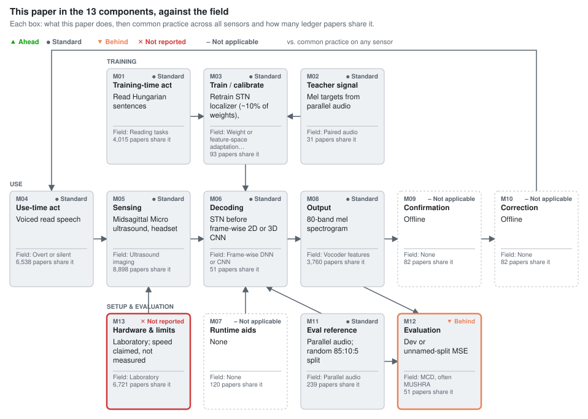

# Adaptation of Tongue Ultrasound-Based Silent Speech Interfaces Using Spatial Transformer Networks

Tóth L, Shandiz AH, Gosztolya G, Csapó TG. Interspeech 2023. [doi:10.21437/Interspeech.2023-1607](https://doi.org/10.21437/Interspeech.2023-1607) · [arXiv:2305.19130](https://arxiv.org/abs/2305.19130)

**Section:** [Ultrasound & tongue imaging](../../README.md#ultrasound--tongue-imaging)

## Figures

### This paper in the 13 components, against the field

<picture><source media="(prefers-color-scheme: dark)" srcset="figures/components-dark.svg"></picture>

Verdicts compare the paper's choice for each component with common practice across 8,995 ledger entries on any sensor (silent speech, brain-to-text, lip reading).

Data

| Component | This paper | Common practice | Papers with this practice | Verdict |
| --- | --- | --- | --- | --- |
| M01 Training-time act | Read Hungarian sentences | Reading tasks | 4,015 of 8,995 | ● Standard (Inherited corpus design.) |
| M02 Teacher signal | Mel targets from parallel audio | Paired audio | 31 of 8,995 | ● Standard (Inherited from earlier work of the group.) |
| M03 Train / calibrate | Retrain STN localizer (~10% of weights), optionally output layer | Weight or feature-space adaptation [@gosztolya2020applying] | 93 of 8,995 | ● Standard (New design; STN-only closes 75-76% of the gap; not compared with lower-layer adaptation; adaptation data per run not stated.) |
| M04 Use-time act | Voiced read speech | Overt or silent | 6,538 of 8,995 | ● Standard (No silent articulation tested.) |
| M05 Sensing | Midsagittal Micro ultrasound, headset | Ultrasound imaging | 8,898 of 8,995 | ● Standard (Inherited hardware; remounting is the adaptation target.) |
| M06 Decoding | STN before frame-wise 2D or 3D CNN | Frame-wise DNN or CNN | 51 of 8,995 | ● Standard (STN changes matched-condition MSE by at most 0.021 (inference).) |
| M07 Runtime aids | None | None | 120 of 8,995 | – Not applicable (Direct spectral regression.) |
| M08 Output | 80-band mel spectrogram | Vocoder features | 3,760 of 8,995 | ● Standard (No waveform evaluated.) |
| M09 Confirmation | Offline | None | 82 of 8,995 | – Not applicable (Offline study.) |
| M10 Correction | Offline | None | 82 of 8,995 | – Not applicable (Offline study.) |
| M11 Eval reference | Parallel audio; random 85:10:5 split | Parallel audio | 239 of 8,995 | ● Standard (Split unit unstated.) |
| M12 Evaluation | Dev or unnamed-split MSE | MCD, often MUSHRA | 51 of 8,995 | ▼ Behind (No held-out test, listening or intelligibility score, seeds or variance.) |
| M13 Hardware & limits | Laboratory; speed claimed, not measured | Laboratory | 6,721 of 8,995 | ✕ Not reported (Adaptation time and data needed are not measured; the prior reported about 15 s.) |

## Verdict

The paper [[1]](#ref-1) changes speaker and session adaptation (M03) by retraining only a learned affine transform of the input image (a spatial transformer, STN) placed before the usual CNN regressor (M06). The design is new for articulatory-to-speech adaptation (Appendix), but M03 is standard: the obvious baseline, the same group's lower-layer adaptation [[2]](#ref-2), is never run. M06 is standard: in matched conditions the STN moves development MSE by at most 0.021 (session 5: 0.504 without, 0.483 with; Table 1; inference). M12 is behind: one regression error on an unnamed split, without the held-out passage and listening test of the prior study. The abstract overstates: it credits "adapting just the STN module" with 88%, which in Table 2 is the average of the "STN + out" column and a share of the no-adaptation-to-full-retraining gap, not an MSE reduction; the STN alone closes 75–76%.

## Against the field, component by component

### M03 Adaptation: what is adapted to a new speaker or session

**Usual approach:** Among 93 unique studies adapting articulatory or visual speech models to a new speaker or session (pattern match, Appendix), 17 match feature- or input-space transforms (fMLLR, Procrustes), 10 speaker prompts, padding or embeddings, 5 layer subsets. For ultrasound the prior adapts lower layers: 10 sentences (about 20–25 s) gave roughly the same averaged correlation as 20 sentences of training from scratch after remounting [[2]](#ref-2). The target instead retrains a per-frame affine localizer holding about 10% of the weights.

**State of the art:** In lip reading (preprint 2024, AAAI 2025, [later]), 0.74M trainable parameters reach 40.9% WER against 47.3% unadapted and 39.6% after full fine-tuning over 20 speakers [[3]](#ref-3), about 83% of the full-tuning gain (inference), not comparable with an MSE gap.

None of the 93 adaptation studies (pattern match, Appendix) other than the target's own versions learns an image-space transform for adaptation; probe misalignment was documented without an automatic fix [[4]](#ref-4). Frozen-backbone, input-side adaptation already existed in lip reading, where user-dependent padding cut GRID WER from 11.12% to 6.80% with 1 min of data [[5]](#ref-5). Gaps remain: for speaker 049, STN-only MSE is 0.588 against 0.400 after full adaptation, 47% higher; for session 2, 0.646 against 0.503, 28% higher (inference). A mean θ per target closes only 35% (speakers) and 26% (sessions) on average, 11–42% per target (Table 2). Verdict: standard.

### M06 Processing: spatial transformer front end

**Usual approach:** Frame-wise regression from ultrasound to vocoder or mel features, fully connected DNN (37) or CNN (31) among 51 unique studies (pattern match, Appendix). The target keeps 2D and 3D CNNs and adds the STN.

**State of the art:** A 3D CNN plus Transformer (2026, [later]) reaches 15.93% ASR WER on synthesized speech for one TaL speaker [[6]](#ref-6), the setting that matches the target's per-speaker models; the target reports no recognition or intelligibility score.

The authors find no significant STN benefit in matched conditions (§5); the 3D model gives 0.275 with and 0.278 without it. Verdict: standard.

### M12 Evaluation: output measure and test split

**Usual approach:** Spectral distance (MCD, 21 of 51 unique studies, pattern match, Appendix), often with MUSHRA (14). The prior session study used a held-out passage, 1 to 50 adaptation sentences and MUSHRA [[2]](#ref-2).

**State of the art:** ASR WER on synthesized speech, 31.64% on TaL80 multi-speaker (2026) [[6]](#ref-6), the multi-speaker setting closest to cross-speaker use.

The target reports mel-spectrogram MSE only, on a development set (Table 1) or an unnamed partition (Tables 2–3), without seeds or variance. Verdict: behind, measured against typical practice (MUSHRA in 14 and MCD in 21 of 51 studies, pattern match, Appendix) and against the group's own prior.

## The 13 components

| Component | This paper | Usual approach (count) | State of the art | Verdict |
|---|---|---|---|---|
| M01 Training-time action | Read Hungarian sentences | Reading tasks (slot-filled 4,015) | – | standard |
| M02 Training-only supervision | Mel targets from parallel audio | Paired audio (slot-filled 31) | – | standard |
| M03 Training and adaptation | Retrain STN localizer (~10% of weights), optionally output layer | Weight or feature-space adaptation [[2]](#ref-2) (pattern match 93) | 40.9% WER, lip reading [[3]](#ref-3) | standard |
| M04 Use-time action | Voiced read speech | Overt or silent (slot-filled 6,538) | – | standard |
| M05 Sensors | Midsagittal Micro ultrasound, headset | Ultrasound imaging (slot-filled 8,898) | – | standard |
| M06 Processing and decoding | STN before frame-wise 2D or 3D CNN | Frame-wise DNN or CNN (pattern match 51) | 15.93% WER [[6]](#ref-6) | standard |
| M07 Lexicon and LM | None | None (slot-filled 120) | – | not applicable |
| M08 Output | 80-band mel spectrogram | Vocoder features (slot-filled 3,760) | – | standard |
| M09 Confirmation | Offline | None (slot-filled 82) | – | not applicable |
| M10 Correction | Offline | None (slot-filled 82) | – | not applicable |
| M11 Reference construction | Parallel audio; random 85:10:5 split | Parallel audio (slot-filled 239) | – | standard |
| M12 Evaluation | Dev or unnamed-split MSE | MCD, often MUSHRA (pattern match 51) | 31.64% WER, TaL80 [[6]](#ref-6) | behind |
| M13 Device and cost | Laboratory; speed claimed, not measured | Laboratory (slot-filled 6,721) | – | not reported |

## Where the claims outrun the evidence

- Headline (Abstract, Table 2, §5): 88% belongs to STN plus output layer and is gap closure, not MSE reduction.
- Missing baseline: no lower-layer adaptation at a similar weight share, the group's own earlier method [[2]](#ref-2).
- Adaptation data: the amount per run is not stated; it is only implied by the random 85:10:5 split of 3.5 min sessions and about 15 min speaker recordings (§4.1).
- Confound: the authors note that the extra sessions last 3.5 min against 15 min and blame the weaker session baselines on it (§5). Their reading that an affine fixes misalignment, not anatomy (§5), does not separate this, one speaker and remounting.
- Split: random 85:10:5 with unstated unit can put neighbouring frames in both partitions (§4.1).
- Scope: voiced read speech only (§4.1); no synthesized speech is evaluated (§5).

## What the field needs next

- M03: STN-only against lower-layer adaptation at equal parameter counts and 1 to 50 adaptation sentences, from several base speakers.
- M12: a held-out passage, MCD and ASR WER or listener transcription of vocoded output, with seeds.
- M05: test whether θ tracks probe displacement measured as in [[4]](#ref-4).
- M04: adaptation under silent articulation.

## Questions for the authors

- Which partition produced Tables 2 and 3?
- What unit was randomized in the split?
- How many sentences did each adaptation run use?
- What MSE did the randomly initialized network give?
- Were normalization statistics computed on training data only?

## Appendix: literature search

- M03 articulatory-speech-model-speaker-session-adaptation. Inclusion rule: models that map a non-acoustic speech signal (ultrasound, EMA or PMA, EMG, lip video, other wearable sensors) to speech, text or articulatory output and adapt a trained model to a new speaker or session with target data, reporting an unadapted or full-retraining comparison; acoustic-only systems, speaker-independent training without an adaptation step, neural-recording calibration, contour tracking and reviews excluded; versions counted once. Ledger counts: slot-filled 1,526 unique studies (M03); pattern match 93 unique studies (104 folders). Design counts (pattern match, full text, a study can match several): input- or feature-space transform 17, prompt, padding or embedding 10, layer-subset update 5, domain-adversarial 5, whole-network fine-tuning 3; a learned image-space transform appears only in the target's three versions. Read in full: [[2]](#ref-2) (prior), [[4]](#ref-4) (prior), [[5]](#ref-5) (prior), [[3]](#ref-3) (state of the art, [later]). Known-item recall 1.0 (3 seeds).
- M06 ultrasound-to-speech-network-architecture (published table, reused). Inclusion rule: studies that map ultrasound tongue images to acoustic features or a waveform with a trained network and name the architecture; recognition-only, contour tracking and reviews excluded. Ledger counts: slot-filled 7,345 unique studies (M06); pattern match 51 unique studies. Design counts (pattern match): fully connected DNN 37, CNN 31, recurrent 25, 3D CNN 19, transformer 9, conformer 3. Read in full: [[6]](#ref-6) (state of the art) and three earlier comparators of the published table. Known-item recall 1.0.
- M12 ultrasound-to-speech-output-evaluation (published table, reused). Inclusion rule: studies that synthesize speech or acoustic features from ultrasound tongue images and evaluate the output, classified by output measure. Ledger counts: slot-filled 6,960 unique studies (M12); pattern match 51 unique studies. Design counts (pattern match): MCD 21, MUSHRA 14, listener intelligibility 5, MOS 4, ASR on output 3. Read in full: [[6]](#ref-6) (state of the art) and two earlier comparators of the published table; [[2]](#ref-2) read for M03.

## References

Numbered by first citation. BibTeX in the same order and keys: [refs.bib](refs.bib).

1. Tóth, L., Shandiz, A. H., Gosztolya, G., Csapó, T. G. “Adaptation of Tongue Ultrasound-Based Silent Speech Interfaces Using Spatial Transformer Networks.” *Proc. Interspeech 2023*, 2023. doi:[10.21437/Interspeech.2023-1607](https://doi.org/10.21437/Interspeech.2023-1607). arXiv:[2305.19130](https://arxiv.org/abs/2305.19130). Target. arXiv:2305.19130 v3 (2023-10-17) read; Interspeech 2023 version. [review](https://github.com/supernaiter/silent-speech-review/tree/main/reviews/adaptation-of-tongue-ultrasound-based-silent-speech-interfaces-using-spatial-transformer-networks) [wiki: arxiv-2305.19130](https://github.com/supernaiter/deep-research-wiki-for-silent-speech/blob/main/papers/arxiv-2305.19130/article.md) [wiki: isca-toth23_interspeech](https://github.com/supernaiter/deep-research-wiki-for-silent-speech/blob/main/papers/isca-toth23_interspeech/article.md) [wiki: isca-toth23-usadapt](https://github.com/supernaiter/deep-research-wiki-for-silent-speech/blob/main/papers/isca-toth23-usadapt/article.md)
2. Gosztolya, G., Grósz, T., Tóth, L., Markó, A., Csapó, T. G. “Applying DNN Adaptation to Reduce the Session Dependency of Ultrasound Tongue Imaging-based Silent Speech Interfaces.” *Acta Polytechnica Hungarica*, 2020, 17(7), 109–124. doi:[10.12700/aph.17.7.2020.7.6](https://doi.org/10.12700/aph.17.7.2020.7.6). [wiki: doi-10.12700-aph.17.7.2020.7.6](https://github.com/supernaiter/deep-research-wiki-for-silent-speech/blob/main/papers/doi-10.12700-aph.17.7.2020.7.6/article.md)
3. Yeo, J. H., Kim, C. W., Kim, H., Rha, H., Han, S., Cheng, W., et al. “Personalized Lip Reading: Adapting to Your Unique Lip Movements with Vision and Language.” *Proceedings of the AAAI Conference on Artificial Intelligence*, 2025. arXiv:[2409.00986](https://arxiv.org/abs/2409.00986). [later] [wiki: arxiv-2409.00986](https://github.com/supernaiter/deep-research-wiki-for-silent-speech/blob/main/papers/arxiv-2409.00986/article.md)
4. Csapó, T. G., Xu, K. “Quantification of Transducer Misalignment in Ultrasound Tongue Imaging.” *Proc. Interspeech 2020*, 2020, 3735–3739. doi:[10.21437/Interspeech.2020-1672](https://doi.org/10.21437/Interspeech.2020-1672). [wiki: isca-csapo20d-usmisalign](https://github.com/supernaiter/deep-research-wiki-for-silent-speech/blob/main/papers/isca-csapo20d-usmisalign/article.md)
5. Kim, M., Kim, H., Ro, Y. M. “Speaker-adaptive Lip Reading with User-dependent Padding.” *Computer Vision – ECCV 2022*, 2022. doi:[10.1007/978-3-031-20059-5_33](https://doi.org/10.1007/978-3-031-20059-5_33). arXiv:[2208.04498](https://arxiv.org/abs/2208.04498). [wiki: ecva-kim22-udp](https://github.com/supernaiter/deep-research-wiki-for-silent-speech/blob/main/papers/ecva-kim22-udp/article.md) [wiki: arxiv-2208.04498](https://github.com/supernaiter/deep-research-wiki-for-silent-speech/blob/main/papers/arxiv-2208.04498/article.md)
6. Sonkar, Y., Kilaru, Y., Yelimeli, S., Shah, N., Gandhi, V. “Tongue2Speech: Real-Time Speech Synthesis from Tongue Ultrasound Videos via Spatiotemporal Transformers.” *Proc. Interspeech 2026*, 2026, 6856–6860. doi:[10.21437/Interspeech.2026-3023](https://doi.org/10.21437/Interspeech.2026-3023). [later] [wiki: isca-sonkar26_interspeech](https://github.com/supernaiter/deep-research-wiki-for-silent-speech/blob/main/papers/isca-sonkar26_interspeech/article.md)

## Materials

Data behind this review. Full texts of the papers are not included.

- [`review.md`](review.md): the review text (source)
- [`refs.bib`](refs.bib): references (BibTeX)
- [`slots.json`](slots.json): for each of the 13 components: this paper's choice, field practice, number of matching papers, verdict
- [`figures.json`](figures.json): figure definitions
- [`evaluation.md`](evaluation.md): independent evaluation by a second reviewer
- [`triage.md`](triage.md): how each evaluation finding was checked against the sources and resolved
- [`components/M03/articulatory-speech-model-speaker-session-adaptation.csv`](../../components/M03/articulatory-speech-model-speaker-session-adaptation.csv): M03 topic "articulatory-speech-model-speaker-session-adaptation", every candidate paper with its decision (1526 slot-filled, 93 pattern match, usual design in 17, 5 read in full)
- [`components/M06/ultrasound-to-speech-network-architecture.csv`](../../components/M06/ultrasound-to-speech-network-architecture.csv): M06 topic "ultrasound-to-speech-network-architecture", every candidate paper with its decision (7345 slot-filled, 51 pattern match, usual design in 37, 4 read in full)
- [`components/M12/ultrasound-to-speech-output-evaluation.csv`](../../components/M12/ultrasound-to-speech-output-evaluation.csv): M12 topic "ultrasound-to-speech-output-evaluation", every candidate paper with its decision (6960 slot-filled, 51 pattern match, usual design in 21, 3 read in full)

## More reviews in Ultrasound & tongue imaging

- [Speech Reconstruction from Silent Tongue and Lip Articulation By Pseudo Target Generation and Domain Adversarial Training](../speech-reconstruction-from-silent-tongue-and-lip-articulation-by-pseudo-target-generation-and-domain-adversarial-training/) (2023). DTW pseudo targets (M02) follow prior EMG target transfer; the mode discriminator (M03) is untested by its ablation; silent MCD/STOI use self-made references and 18 speakers are dropped.
- [Improved Processing of Ultrasound Tongue Videos by Combining ConvLSTM and 3D Convolutional Networks](../improved-processing-of-ultrasound-tongue-videos-by-combining-convlstm-and-3d-convolutional-networks/) (2022). ConvLSTM top layer (M06) is standard: new to ultrasound-to-speech, but a 2.1% MSE edge over BiLSTM, one speaker, one run; later work dropped it. No MCD or listener test (M12 behind).
- [Conformer-based Ultrasound-to-Speech Conversion](../conformer-based-ultrasound-to-speech-conversion/) (2025). Behind on M06: the Conformer reads beam lines of one frame, missing the multi-frame context mappers have used since 2020, with no objective gain; a small naturalness gain, no intelligibility test.
- [Convolutional Neural Network-Based Age Estimation Using B-Mode Ultrasound Tongue Image](../convolutional-neural-network-based-age-estimation-using-b-mode-ultrasound-tongue-image/) (2021). Age output from tongue ultrasound (M08) is new but unproven: the random frame split shares children between training and validation (M12), so speaker identity can explain the gain.
- [Improving Neural Silent Speech Interface Models by Adversarial Training](../improving-neural-silent-speech-interface-models-by-adversarial-training/) (2021). Standard on the adversarial loss (M02): it predates the paper in video-to-speech and its gains are small, with no variance reported; behind on evaluation (M12): no listening test.
- [Neural Speaker Embeddings for Ultrasound-based Silent Speech Interfaces](../neural-speaker-embeddings-for-ultrasound-based-silent-speech-interfaces/) (2021). Standard on embedding conditioning (2.4% relative MSE gain on seen speakers); behind on speaker recognition, which never separates speaker from recording session.

---

Part of the [Silent Speech Interface Review](https://github.com/supernaiter/silent-speech-review). Found an error? [Open an issue](https://github.com/supernaiter/silent-speech-review/issues/new?template=correction.yml).
