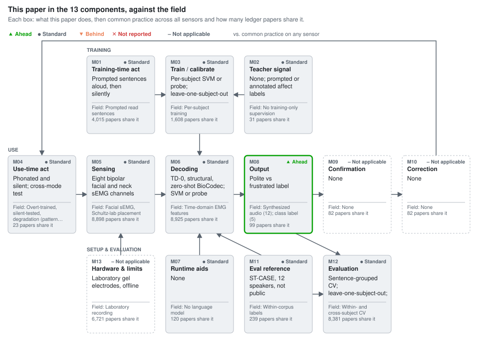

# Affect Decoding in Phonated and Silent Speech Production from Surface EMG

Simon Pistrosch, Kleanthis Avramidis, Zhao Ren, Tiantian Feng, Jihwan Lee, Monica Gonzalez-Machorro, Anton Batliner, Tanja Schultz, Shrikanth Narayanan, Björn W. Schuller. arXiv preprint (eess.AS), 2026. [arXiv:2603.11715](https://arxiv.org/abs/2603.11715)

**Section:** [Surface EMG](../../README.md#surface-emg)

## Figures

### This paper in the 13 components, against the field

<picture><source media="(prefers-color-scheme: dark)" srcset="figures/components-dark.svg"></picture>

Verdicts compare the paper's choice for each component with common practice across 8,995 ledger entries on any sensor (silent speech, brain-to-text, lip reading).

Data

| Component | This paper | Common practice | Papers with this practice | Verdict |
| --- | --- | --- | --- | --- |
| M01 Training-time act | Prompted sentences aloud, then silently | Prompted read sentences | 4,015 of 8,995 | ● Standard (Fixed phonated-then-silent order (§3.2).) |
| M02 Teacher signal | None; prompted or annotated affect labels | No training-only supervision | 31 of 8,995 | ● Standard (Inherited.) |
| M03 Train / calibrate | Per-subject SVM or probe; leave-one-subject-out | Per-subject training | 1,608 of 8,995 | ● Standard (Inherited.) |
| M04 Use-time act | Phonated and silent; cross-mode test | Overt-trained, silent-tested, degradation (pattern match 33) | 23 of 8,995 | ● Standard (BioCodec loses 3.7% (inference).) |
| M05 Sensing | Eight bipolar facial and neck sEMG channels | Facial sEMG, Schultz-lab placement | 8,898 of 8,995 | ● Standard (Brow site E6 most prominent (§6.1).) |
| M06 Decoding | TD-0, structural, zero-shot BioCodec; SVM or probe | Time-domain EMG features | 8,925 of 8,995 | ● Standard (Inherited.) |
| M07 Runtime aids | None | No language model | 120 of 8,995 | ● Standard (Inherited.) |
| M08 Output | Polite vs frustrated label | Synthesized audio (12); class label (5) | 99 of 8,995 | ▲ Ahead (No prior affect label from silent articulation (Appendix).) |
| M09 Confirmation | None | None | 82 of 8,995 | – Not applicable (Offline study.) |
| M10 Correction | None | None | 82 of 8,995 | – Not applicable (Offline study.) |
| M11 Eval reference | ST-CASE, 12 speakers, not public | Within-corpus labels | 239 of 8,995 | ● Standard (Data not public (§3.1).) |
| M12 Evaluation | Sentence-grouped CV; leave-one-subject-out; AUC, BAC | Within- and cross-subject CV | 8,381 of 8,995 | ● Standard (No chance-level test.) |
| M13 Hardware & limits | Laboratory gel electrodes, offline | Laboratory recording | 6,721 of 8,995 | – Not applicable (Offline study.) |

## Verdict

The paper [[1]](#ref-1) changes one component, the output (M08): an affect label decoded from facial and neck EMG during silent articulation. That design is ahead: none of the 99 ledger studies on paralinguistic output from speech-production signals decodes affect from silent articulation (Appendix); the closest priors decode speaker identity and speaking mode [[2]](#ref-2), describe emotional articulation without an emotion classifier [[3]](#ref-3), or decode emotion in a silent-speech wearable from carotid pulse rather than articulation [[4]](#ref-4). The cross-mode test (M04) is standard. The claim that affect rides on speech-motor activity is not established: the authors name a brow electrode as the most prominent site and concede that facial expression cannot be separated from articulation (§6.1, §7). Decoding works within subject (AUC 0.845); for unseen speakers EMG AUC is 0.567 to 0.574, close to chance with no chance-level test, and spontaneous affect is decoded better from audio.

## Against the field, component by component

### M08 Output: affect label from silent articulation

**Usual approach:** Of 99 unique studies reporting a paralinguistic property from a non-acoustic speech-production signal (pattern match, Appendix), the most common recorded output is synthesized audio (12, slot-filled); 5 output a class label. In full text, 28 mention affect or emotion, 23 pitch or prosody, 17 speaker identity and 17 speaking mode (pattern match). Emotion work on these signals analyses phonated articulation [[3]](#ref-3) or uses facial EMG without speech, as the 2025 survey by overlapping authors lists [[5]](#ref-5).

**State of the art:** The best earlier affect decoding in a silent-speech system (2024) reaches 83.2% three-class accuracy from carotid pulse, not from the speech-muscle channel [[4]](#ref-4). The best earlier paralinguistic decoding from speech EMG is speaker identification on held-out sessions (2020): 73% UAR against 12.5% chance [[2]](#ref-2).

The effect repeats within subject over 12 speakers (§3.4) and two recording blocks (Tables 5 and 8); across speakers EMG AUC is 0.567 to 0.574 (Table 5). Verdict: ahead, for the output only; features and classifiers are inherited.

### M04 Use-time action: phonated-to-silent transfer

**Usual approach:** Of 33 unique studies on overt-to-silent transfer (pattern match; 23 confirmed, Appendix), the usual design trains on overt speech, tests on silent speech without retraining and reports a degradation. The paper does this within subject in both directions (Table 8).

**State of the art:** In EMG-to-speech (2020), a vocalized-trained model applied to silent EMG gives 88.8% transcription WER, 64.6% without the throat electrode, against 3.6% when trained on silent EMG [[6]](#ref-6); earlier, MCD rose from 5.54 to 6.81 (2017) [[7]](#ref-7).

Structural features drop from 0.829 (silent to silent) to 0.707 (phonated to silent), 14.7% relative and 37% of the margin above chance; BioCodec drops from 0.792 to 0.763, 3.7% relative and 10% of the margin (inference). Metric and starting points differ from both, so the smaller loss is no evidence that affect transfers better than speech content. Verdict: standard.

## The 13 components

| Component | This paper | Usual approach (count) | State of the art | Verdict |
|---|---|---|---|---|
| M01 Training-time action | Prompted sentences aloud, then silently | Prompted read sentences (slot-filled 4,015) | – | standard |
| M02 Training-only supervision | None; prompted or annotated affect labels | No training-only supervision (slot-filled 31) | – | standard |
| M03 Training and adaptation | Per-subject SVM or probe; leave-one-subject-out | Per-subject training (slot-filled 1,608) | – | standard |
| M04 Use-time action | Phonated and silent; cross-mode test | Overt-trained, silent-tested, degradation (pattern match 33) (confirmed 23) | WER 64.6% direct transfer vs 3.6% silent-trained [[6]](#ref-6) | standard |
| M05 Sensors | Eight bipolar facial and neck sEMG channels | Facial sEMG, Schultz-lab placement (slot-filled 8,898) | – | standard |
| M06 Processing and decoding | TD-0, structural, zero-shot BioCodec; SVM or probe | Time-domain EMG features (slot-filled 8,925) | – | standard |
| M07 Lexicon and LM | None | No language model (slot-filled 120) | – | standard |
| M08 Output | Polite vs frustrated label | Synthesized audio (12); class label (5) (pattern match 99) | Emotion 83.2% from carotid pulse [[4]](#ref-4); speaker ID 73% UAR [[2]](#ref-2) | ahead |
| M09 Confirmation | None | None (slot-filled 82) | – | not applicable |
| M10 Correction | None | None (slot-filled 82) | – | not applicable |
| M11 Reference construction | ST-CASE, 12 speakers, not public | Within-corpus labels (slot-filled 239) | – | standard |
| M12 Evaluation | Sentence-grouped CV; leave-one-subject-out; AUC, BAC | Within- and cross-subject CV (slot-filled 8,381) | – | standard |
| M13 Device and cost | Laboratory gel electrodes, offline | Laboratory recording (slot-filled 6,721) | – | not applicable |

## Where the claims outrun the evidence

- Facial expression, not speech production. The authors themselves attribute EMG's advantage to "paralinguistic channels and facial expressions rather than core speech production elements" (§6.1), name E6 over depressor supercilii as the most prominent site (Table 3; Figs. 4 and 5), and concede the two cannot be disentangled (§7); the paper's framing of affect in speech production goes beyond this.
- Lexical confound. Vox-Profile falls from 0.889 on single-label sentences to 0.469 on repeated sentences (Table 6), so wording drives part of every single-label score; EMG structural features fall from 0.856 to 0.720.
- Order and practice. Silent trials always follow their phonated twin (§3.2), and inter-subject structural AUC rises from 0.527 in Task 1 to 0.613 in Task 3 (p = 0.038, Table 7).
- Inconsistency. §5.3 trains the Task 2 models on Tasks 1 to 3, §6.3 on Tasks 1 and 3 only.
- Spontaneous transfer. On Task 2, Vox-Profile reaches AUC 0.743 against 0.630 for the best EMG model (Table 9).
- Chance level. Values are called near chance (§6.1), and the paper reports no permutation or binomial test.

## What the field needs next

- M05: brow sites alone versus perioral and neck sites on silent trials with posed expression held constant.
- M04: counterbalanced mode order with silent-first blocks.
- M12: inter-subject tests with permutation chance levels on repeated sentences only.
- M08: affect labels on natural silent speech; Task 2 is phonated only.

## Questions for the authors

- Were phonated and silent trials pooled for Table 5, and in what balance per fold?
- Which data selected the SVM and probe hyperparameters, over what search space?
- How were held-out speakers aggregated in Table 9, and what does its standard deviation measure?
- How do within-subject results change with E6 removed?
- Were random seeds or repeated cross-validation runs used?

## Appendix: literature search

- M08, paralinguistic-output-from-production-signals. Inclusion rule: studies that infer a paralinguistic property (affect or emotion, speaker identity, speaking mode, prosody, intonation or pitch) from a non-acoustic speech-production signal recorded while speaking (EMG, EMA, ultrasound, real-time MRI, electropalatography, strain sensors, ECoG or intracortical); acoustic-only and face-video emotion recognition, and facial EMG or EEG emotion recognition without speech production, excluded; surveys are pattern matches only; versions counted once. Ledger counts: M08 slot-filled 3,268 unique studies; pattern match 99 unique studies (plus 13 full-text-only folders). Usual design: synthesized audio output, 12 (slot-filled, of 71 with M08 recorded); class label 5 (slot-filled). Full-text design counts: affect_emotion 28, pitch_prosody 23, speaker_identity 17, speaking_mode 17 (pattern match). Full-text recall sample (affect near silent articulation): 13 snippets, none with affect decoded from silent articulation; one is the journal version of [[4]](#ref-4). Read in full: [[2]](#ref-2), [[3]](#ref-3), [[5]](#ref-5), [[4]](#ref-4). Known-item recall 1.0 (5 of 5).
- M04, overt-to-silent-transfer (reused topic table, appended). Inclusion rule: studies applying a decoder trained only on overt speech to silent, mouthed, inner or imagined speech without retraining, any signal. Ledger counts: M04 slot-filled 5,595 unique studies; pattern match 33 unique studies; 23 confirmed. Usual design: overt-trained decoder tested on silent speech, reported as a degradation, 23 (confirmed). Read: [[7]](#ref-7), [[6]](#ref-6). Known-item recall 1.0.

## References

Numbered by first citation. BibTeX in the same order and keys: [refs.bib](refs.bib).

1. Pistrosch, S., Avramidis, K., Ren, Z., Feng, T., Lee, J., Gonzalez-Machorro, M., et al. “Affect Decoding in Phonated and Silent Speech Production from Surface EMG.” *arXiv preprint (eess.AS)*, 2026. arXiv:[2603.11715](https://arxiv.org/abs/2603.11715). Target. Read as arXiv v2. [review](https://github.com/supernaiter/silent-speech-review/tree/main/reviews/affect-decoding-in-phonated-and-silent-speech-production-from-surface-emg) [wiki: arxiv-2603.11715](https://github.com/supernaiter/deep-research-wiki-for-silent-speech/blob/main/papers/arxiv-2603.11715/article.md)
2. Diener, L., Amiriparian, S., Botelho, C., Scheck, K., Küster, D., Trancoso, I., et al. “Towards Silent Paralinguistics: Deriving Speaking Mode and Speaker ID from Electromyographic Signals.” *Proc. Interspeech 2020*, 2020, 3117-3121. doi:[10.21437/Interspeech.2020-2848](https://doi.org/10.21437/Interspeech.2020-2848). Second wiki copy: isca-diener20_interspeech. [wiki: isca-diener20-emgmode](https://github.com/supernaiter/deep-research-wiki-for-silent-speech/blob/main/papers/isca-diener20-emgmode/article.md)
3. Pandey, L., Arif, A. S. “Silent Speech and Emotion Recognition from Vocal Tract Shape Dynamics in Real-Time MRI.” *arXiv preprint*, 2021. arXiv:[2106.08706](https://arxiv.org/abs/2106.08706). First page carries the header "SIGGRAPH 2021, August 9-13, 2021, Virtual"; no proceedings DOI found. [review](https://github.com/supernaiter/silent-speech-review/tree/main/reviews/silent-speech-and-emotion-recognition-from-vocal-tract-shape-dynamics-in-real-time-mri) [wiki: arxiv-2106.08706](https://github.com/supernaiter/deep-research-wiki-for-silent-speech/blob/main/papers/arxiv-2106.08706/article.md)
4. Tang, C., Gao, S., Li, C., Yi, W., Jin, Y., Zhai, X., et al. “Wearable intelligent throat enables natural speech in stroke patients with dysarthria.” *arXiv preprint; journal version in Nature Communications*, 2024. doi:[10.1038/s41467-025-68228-9](https://doi.org/10.1038/s41467-025-68228-9). arXiv:[2411.18266](https://arxiv.org/abs/2411.18266). Read as arXiv v3. Journal version also in the wiki as doi-10.1038-s41467-025-68228-9 and pmc-12816716-intelligent-throat. [wiki: arxiv-2411.18266](https://github.com/supernaiter/deep-research-wiki-for-silent-speech/blob/main/papers/arxiv-2411.18266/article.md)
5. Ren, Z., Pistrosch, S., Coşkun, B., Scheck, K., Batliner, A., Schuller, B. W., et al. “An Introduction to Silent Paralinguistics.” *arXiv preprint*, 2025. arXiv:[2508.18127](https://arxiv.org/abs/2508.18127). [review](https://github.com/supernaiter/silent-speech-review/tree/main/reviews/an-introduction-to-silent-paralinguistics) [wiki: arxiv-2508.18127](https://github.com/supernaiter/deep-research-wiki-for-silent-speech/blob/main/papers/arxiv-2508.18127/article.md)
6. Gaddy, D., Klein, D. “Digital Voicing of Silent Speech.” *Proc. 2020 Conference on Empirical Methods in Natural Language Processing (EMNLP)*, 2020, 5521-5530. doi:[10.18653/v1/2020.emnlp-main.445](https://doi.org/10.18653/v1/2020.emnlp-main.445). arXiv:[2010.02960](https://arxiv.org/abs/2010.02960). [review](https://github.com/supernaiter/silent-speech-review/tree/main/reviews/digital-voicing-of-silent-speech) [wiki: arxiv-2010.02960](https://github.com/supernaiter/deep-research-wiki-for-silent-speech/blob/main/papers/arxiv-2010.02960/article.md) [wiki: doi-10.18653-v1-2020.emnlp-main.445](https://github.com/supernaiter/deep-research-wiki-for-silent-speech/blob/main/papers/doi-10.18653-v1-2020.emnlp-main.445/article.md)
7. Janke, M., Diener, L. “EMG-to-Speech: Direct Generation of Speech From Facial Electromyographic Signals.” *IEEE/ACM Transactions on Audio, Speech, and Language Processing*, 2017, 25(12), 2375-2385. doi:[10.1109/TASLP.2017.2738568](https://doi.org/10.1109/TASLP.2017.2738568). [wiki: doi-10.1109-taslp-2017-2738568](https://github.com/supernaiter/deep-research-wiki-for-silent-speech/blob/main/papers/doi-10.1109-taslp-2017-2738568/article.md)

## Materials

Data behind this review. Full texts of the papers are not included.

- [`review.md`](review.md): the review text (source)
- [`refs.bib`](refs.bib): references (BibTeX)
- [`slots.json`](slots.json): for each of the 13 components: this paper's choice, field practice, number of matching papers, verdict
- [`figures.json`](figures.json): figure definitions
- [`evaluation.md`](evaluation.md): independent evaluation by a second reviewer
- [`triage.md`](triage.md): how each evaluation finding was checked against the sources and resolved
- [`components/M04/overt-to-silent-transfer.csv`](../../components/M04/overt-to-silent-transfer.csv): M04 topic "overt-to-silent-transfer", every candidate paper with its decision (23 confirmed, 104 candidates read, 0 unread)
- [`components/M08/paralinguistic-output-from-production-signals.csv`](../../components/M08/paralinguistic-output-from-production-signals.csv): M08 topic "paralinguistic-output-from-production-signals", every candidate paper with its decision (3268 slot-filled, 99 pattern match, usual design in 12, 4 read in full)

## More reviews in Surface EMG

- [A 1000-hour EEG-EMG-audio dataset of Japanese speech production](../a-1000-hour-eeg-emg-audio-dataset-of-japanese-speech-production/) (2026). A 1020-hour EEG-EMG-audio dataset of Japanese overt speech from three participants, with signal-quality and physiological validation but no decoding benchmarks.
- [AESSI: An Around-Ear Silent Speech Interface for Cross-Day Online Reuse without Test-Day Calibration](../aessi-an-around-ear-silent-speech-interface-for-cross-day-online-reuse-without-test-day-calibrat/) (2026). Around-ear cEEGrid system recognizing 25 fixed Mandarin sentences from silent articulation without test-day calibration; 92.24% mean accuracy on held-out later-day sessions and 98.00% in 250 live trials 21+ days later.
- [Comparison of sEMG Encoding Accuracy Across Speech Modes Using Articulatory and Phoneme Features](../comparison-of-semg-encoding-accuracy-across-speech-modes-using-articulatory-and-phoneme-features/) (2026). Applies an ECoG articulatory-versus-phoneme encoding comparison (Chartier 2018) to sEMG in three speech modes; the gain is small, mode contrasts are confounded, and no decoder is tested.
- [Cross-Modal Masking for Robust Silent Speech Synthesis Using sEMG and Lipreading](../cross-modal-masking-for-robust-silent-speech-synthesis-using-semg-and-lipreading/) (2026). Speech synthesis from fused sEMG and lip video is new to the ledger (M05, ahead); span masking (M03) adds a non-significant clean gain; seen speakers only (M12, behind).
- [CS-ETS: Chaos-Inspired Samba-Based EMG-To-Speech Synthesis with Nonlinear Chaotic Losses](../cs-ets-chaos-inspired-samba-based-emg-to-speech-synthesis-with-nonlinear-chaotic-losses/) (2026). Smaller chaos-inspired Samba-based EMG-to-speech model with nonlinear losses; WER improves modestly from 42.20% to 41.26% while parameters drop from 54.10M to 32.03M.
- [EMG-to-Speech with Fewer Channels](../emg-to-speech-with-fewer-channels/) (2026). Halving EMG electrodes costs synthesis the same ~35% relative WER known from recognition; initialization helps, channel dropout does not, and a weak unrepeated baseline undercuts the ranking.

---

Part of the [Silent Speech Interface Review](https://github.com/supernaiter/silent-speech-review). Found an error? [Open an issue](https://github.com/supernaiter/silent-speech-review/issues/new?template=correction.yml).
