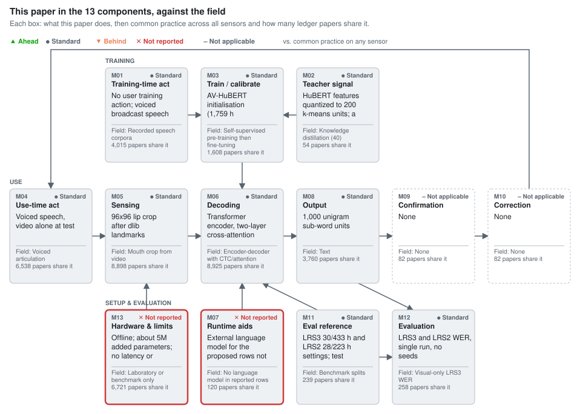

# AKVSR: Audio Knowledge Empowered Visual Speech Recognition by Compressing Audio Knowledge of a Pretrained Model

Jeong Hun Yeo, Minsu Kim, Jeongsoo Choi, Dae Hoe Kim, Yong Man Ro. IEEE Transactions on Multimedia, 2024. [doi:10.1109/TMM.2024.3352388](https://doi.org/10.1109/TMM.2024.3352388) [arXiv:2308.07593](https://arxiv.org/abs/2308.07593)

**Section:** [Lip & face video](../../README.md#lip--face-video)

## Figures

### This paper in the 13 components, against the field

<picture><source media="(prefers-color-scheme: dark)" srcset="figures/components-dark.svg"></picture>

Verdicts compare the paper's choice for each component with common practice across 8,995 ledger entries on any sensor (silent speech, brain-to-text, lip reading).

Data

| Component | This paper | Common practice | Papers with this practice | Verdict |
| --- | --- | --- | --- | --- |
| M01 Training-time act | No user training action; voiced broadcast speech (LRS2, LRS3, VoxCeleb2) | Recorded speech corpora | 4,015 of 8,995 | ● Standard (Inherited.) |
| M02 Teacher signal | HuBERT features quantized to 200 k-means units; a memory per unit trained by ASR on 656 h paired audio-text, recalled from video by cross-attention | Knowledge distillation (40) | 54 of 8,995 | ● Standard (Memory recall is prior work from the same group; 2.0 points over distillation, one run, memory trained on 656 h of transcripts.) |
| M03 Train / calibrate | AV-HuBERT initialisation (1,759 h unlabelled), fine-tuned; memory built beforehand | Self-supervised pre-training then fine-tuning | 1,608 of 8,995 | ● Standard (Inherited from AV-HuBERT.) |
| M04 Use-time act | Voiced speech, video alone at test | Voiced articulation | 6,538 of 8,995 | ● Standard (Inherited.) |
| M05 Sensing | 96x96 lip crop after dlib landmarks | Mouth crop from video | 8,898 of 8,995 | ● Standard (AV-HuBERT pipeline.) |
| M06 Decoding | Transformer encoder, two-layer cross-attention bridge (4.7M parameters), Transformer decoder, hybrid CTC/attention | Encoder-decoder with CTC/attention | 8,925 of 8,995 | ● Standard (Bridge placement is part of M02.) |
| M07 Runtime aids | External language model for the proposed rows not stated | No language model in reported rows | 120 of 8,995 | ✕ Not reported (Comparator rows are stated as LM-free; the proposed rows are not.) |
| M08 Output | 1,000 unigram sub-word units | Text | 3,760 of 8,995 | ● Standard (Inherited.) |
| M09 Confirmation | None | None | 82 of 8,995 | – Not applicable (Offline study.) |
| M10 Correction | None | None | 82 of 8,995 | – Not applicable (Offline study.) |
| M11 Eval reference | LRS3 30/433 h and LRS2 28/223 h settings; test partition not named | Benchmark splits | 239 of 8,995 | ● Standard (Inherited from AV-HuBERT.) |
| M12 Evaluation | LRS3 and LRS2 WER, single run, no seeds | Visual-only LRS3 WER | 258 of 8,995 | ● Standard (State-of-the-art claim does not hold against the cited SynthVSR Large row, which trains on more data; the proposed rows' LM use is unstated.) |
| M13 Hardware & limits | Offline; about 5M added parameters; no latency or compute | Laboratory or benchmark only | 6,721 of 8,995 | ✕ Not reported (Memory construction adds training time (Sec. VII).) |

## Verdict

The paper [[1]](#ref-1) changes training-only supervision (M02): HuBERT features are quantized into a 200-slot memory recalled from video, so lip-reader training needs no audio. Recalling an audio memory from video is the same group's earlier design [[2]](#ref-2), [[3]](#ref-3), so the verdict is standard. Its gain over the no-memory AV-HuBERT baseline repeats across LRS3, LRS2, two model sizes and a second backbone. Its edge over distillation is 2.0 points from one LRS3 run, and the memory carries transcripts of 656 h, 22 times the labels of the 30 h comparators (inference). The abstract's unqualified LRS3 state-of-the-art claim fails against a cited work: SynthVSR Large reaches 18.2% without a language model [[4]](#ref-4) [concurrent], 5.4 points below the paper's 23.6% (inference), though with more training data and an unstated language-model condition.

## Against the field, component by component

### M02 Training-only supervision: quantized audio memory

**Usual approach:** Of 54 unique studies that bring audio into a video-only lip reader (pattern match, Appendix), 40 use knowledge distillation, as in [[5]](#ref-5), and 12 memory recall. The memory priors recall stored audio features from video [[2]](#ref-2), [[3]](#ref-3) but need paired audio while the lip reader trains. The paper instead indexes slots by k-means units of HuBERT features and trains the memory once by ASR on paired audio-text (§III-B).

**State of the art:** At 30 h labelled LRS3 (Large), the paper's 29.1% led AV-HuBERT [[6]](#ref-6) (2022) and RAVEn [[7]](#ref-7) (2023), both at 32.5%, by 3.4 points (inference). In 2026 pseudo-labelling without an audio memory reaches 23.7% in that setting (Large, 30 h labelled, LRS3+VoxCeleb2 unlabelled) [[8]](#ref-8) [later], 5.4 points lower (inference); its teacher sees audio in training.

The gain over the no-memory baseline holds: 46.1% to 41.6% on LRS3 (Table III), 32.2% to 28.7% on LRS2 at 28 h (Table II), 59.9% to 54.5% with TM-seq2seq (Table VI). Against distillation on the same student the gain is 43.6% to 41.6% (Table IV), 4.6% relative, one run (inference). The memory's training data alone moves WER from 44.7% (LRS2, 223 h) to 43.3% (LRS3, 433 h) and 41.5% (both, 656 h) (Table IX), a spread larger than that edge, and the larger sets add in-domain LRS3 audio. Verdict: standard; quantization is not shown to beat distillation with matched labels and repetition.

### M12 Evaluation: LRS3 visual-only WER

**Usual approach:** The 258 unique studies on the topic (pattern match, Appendix) report LRS3 visual-only test WER; 141 have the training slot recorded (slot-filled), mostly without a supervision kind (text 18, paired audio 17, self-supervised 6). The paper reports single runs without seeds (Tables I to IX).

**State of the art:** At release (2023) the paper's 23.6% (433 h plus 1,326 h pseudo-labelled) trailed SynthVSR Large at 18.2% without a language model on 3,068 h plus 3,652 h synthetic [[4]](#ref-4) [concurrent], and Auto-AVSR at 19.1% with a language model on 3,448 h [[9]](#ref-9) [concurrent]. Both lead with more data. On public data the best today is 16.9% with a language model [[4]](#ref-4); USR 2.0 Huge reaches 17.6%, its decoding naming no language model [[8]](#ref-8) [later]. Verdict: standard.

## The 13 components

| Component | This paper | Usual approach (count) | State of the art | Verdict |
|---|---|---|---|---|
| M01 Training-time action | No user training action; voiced broadcast speech (LRS2, LRS3, VoxCeleb2) | Recorded speech corpora (slot-filled 4,015) | – | standard |
| M02 Training-only supervision | HuBERT features quantized to 200 k-means units; a memory per unit trained by ASR on 656 h paired audio-text, recalled from video by cross-attention | Knowledge distillation (40) (pattern match 54) | LRS3 30 h, Large: 23.7% WER [[8]](#ref-8) | standard |
| M03 Training and adaptation | AV-HuBERT initialisation (1,759 h unlabelled), fine-tuned; memory built beforehand | Self-supervised pre-training then fine-tuning (slot-filled 1,608) | – | standard |
| M04 Use-time action | Voiced speech, video alone at test | Voiced articulation (slot-filled 6,538) | – | standard |
| M05 Sensors | 96x96 lip crop after dlib landmarks | Mouth crop from video (slot-filled 8,898) | – | standard |
| M06 Processing and decoding | Transformer encoder, two-layer cross-attention bridge (4.7M parameters), Transformer decoder, hybrid CTC/attention | Encoder-decoder with CTC/attention (slot-filled 8,925) | – | standard |
| M07 Lexicon and LM | External language model for the proposed rows not stated | No language model in reported rows (slot-filled 120) | – | not reported |
| M08 Output | 1,000 unigram sub-word units | Text (slot-filled 3,760) | – | standard |
| M09 Confirmation | None | None (slot-filled 82) | – | not applicable |
| M10 Correction | None | None (slot-filled 82) | – | not applicable |
| M11 Reference construction | LRS3 30/433 h and LRS2 28/223 h settings; test partition not named | Benchmark splits (slot-filled 239) | – | standard |
| M12 Evaluation | LRS3 and LRS2 WER, single run, no seeds | Visual-only LRS3 WER (pattern match 258) | LRS3, public data: 16.9% WER with LM, 18.2% without [[4]](#ref-4) | standard |
| M13 Device and cost | Offline; about 5M added parameters; no latency or compute | Laboratory or benchmark only (slot-filled 6,721) | – | not reported |

## Where the claims outrun the evidence

- "New state-of-the-art performances" on LRS3 (Abstract): Table I lists only the Base rows of [[4]](#ref-4) (27.9% at 433 h), not its Large row. The lead over RAVEn's 24.4% is 0.8 points from one run (inference).
- The 656 h memory is "applied to the VSR model in other experiments" (§V-H), so the 30 h and 28 h rows use transcripts the AV-HuBERT and RAVEn rows lack.
- Comparator rows use no language model (§V-A); the proposed rows do not say.
- The memory is said to serve "any VSR model" (§II); two backbones are tested.
- Ablation gaps of 0.2 to 0.5 points pick layers, clusters and memory size (§V-D to §V-G) without seeds or a validation rule (inference).
- Inconsistencies: 54.5% in Table VI against 54.1% in §V-E; 41.5% for the default memory in Tables VIII and IX against 41.6% in Tables III and IV; §V-G swaps the 512- and 1024-dimension WERs of Table VIII; Large adds 122M parameters (§V-A) against 325M minus 103M, 222M, in §IV-B (inference).

## What the field needs next

- M02: memory built from the 30 h transcripts only, against distillation from a teacher trained on the same 656 h, several seeds.
- M02/M03: the memory added to a pseudo-labelling recipe like [[8]](#ref-8), to test whether its gain survives a stronger baseline.
- M07/M12: proposed rows with and without a language model.

## Questions for the authors

- Do the proposed rows in Tables I and II use an external language model, and what beam width and CTC weight are used at decoding?
- On what data was the distillation teacher in Table IV trained?
- Which single-speaker corpus fits the k-means model, and is it disjoint from the LRS2 and LRS3 test speakers?
- What is the run-to-run spread of the main and ablation WERs?

## Appendix: literature search

- M02 audio-knowledge-transfer-to-video (published topic table, appended). Inclusion rule: lip-reading and video-to-speech studies that take only lip or face video at test and use paired audio or a speech model during training to enrich the visual model, by knowledge distillation, audio-feature regression or a learned memory of audio representations; audio-visual models needing audio at test and talking-head generation excluded; versions counted once. Slot-filled 31 unique studies; pattern match 54 unique studies (67 folders). Usual design: knowledge distillation, 40 (pattern match, full text, mentions included). Design counts: knowledge distillation 40, memory recall 12, audio-feature regression 1. Read in full for this review: [[3]](#ref-3), [[2]](#ref-2), target. Known-item recall 1.0 (4 of 4 seeds).
- M12 lrs3-visual-only-wer (published topic table, appended). Inclusion rule: studies that report visual-only word error rate on the LRS3 test set, any training regime; audio-only and audio-visual rows, LRS2, LRW or GRID-only results and numbers quoted without new training excluded; versions counted once. Slot-filled 6,960 unique studies; pattern match 258 unique studies (368 folders). Training slot recorded for 141 (slot-filled); supervision kinds named: text 18, paired audio 17, self-supervised 6, phoneme labels 5, other 4. Read in full for this review: [[4]](#ref-4) [concurrent], [[9]](#ref-9) [concurrent], [[8]](#ref-8) [later], target. Known-item recall 1.0 (3 of 3 seeds).

## References

Numbered by first citation. BibTeX in the same order and keys: [refs.bib](refs.bib).

1. Yeo, J. H., Kim, M., Choi, J., Kim, D. H., Ro, Y. M. “AKVSR: Audio Knowledge Empowered Visual Speech Recognition by Compressing Audio Knowledge of a Pretrained Model.” *IEEE Transactions on Multimedia*, 2024, 26, 6462-6474. doi:[10.1109/TMM.2024.3352388](https://doi.org/10.1109/TMM.2024.3352388). arXiv:[2308.07593](https://arxiv.org/abs/2308.07593). Target. Read as arXiv v2 (January 2024). [review](https://github.com/supernaiter/silent-speech-review/tree/main/reviews/akvsr-audio-knowledge-empowered-visual-speech-recognition-by-compressing-audio-knowledge-of-a-pretrained-model) [wiki: arxiv-2308.07593](https://github.com/supernaiter/deep-research-wiki-for-silent-speech/blob/main/papers/arxiv-2308.07593/article.md)
2. Kim, M., Hong, J., Park, S. J., Ro, Y. M. “Multi-modality Associative Bridging through Memory: Speech Sound Recollected from Face Video.” *Proceedings of the IEEE/CVF International Conference on Computer Vision (ICCV)*, 2021. arXiv:[2204.01265](https://arxiv.org/abs/2204.01265). [review](https://github.com/supernaiter/silent-speech-review/tree/main/reviews/multi-modality-associative-bridging-through-memory-speech-sound-recollected-from-face-video) [wiki: arxiv-2204.01265](https://github.com/supernaiter/deep-research-wiki-for-silent-speech/blob/main/papers/arxiv-2204.01265/article.md) [wiki: cvf-kim21-mabm](https://github.com/supernaiter/deep-research-wiki-for-silent-speech/blob/main/papers/cvf-kim21-mabm/article.md)
3. Kim, M., Yeo, J. H., Ro, Y. M. “Distinguishing Homophenes Using Multi-Head Visual-Audio Memory for Lip Reading.” *Proceedings of the AAAI Conference on Artificial Intelligence*, 2022. arXiv:[2204.01725](https://arxiv.org/abs/2204.01725). [wiki: arxiv-2204.01725](https://github.com/supernaiter/deep-research-wiki-for-silent-speech/blob/main/papers/arxiv-2204.01725/article.md)
4. Liu, X., Lakomkin, E., Vougioukas, K., Ma, P., Chen, H., Xie, R., et al. “SynthVSR: Scaling Up Visual Speech Recognition With Synthetic Supervision.” *IEEE/CVF Conference on Computer Vision and Pattern Recognition (CVPR)*, 2023. doi:[10.1109/CVPR52729.2023.01806](https://doi.org/10.1109/CVPR52729.2023.01806). arXiv:[2303.17200](https://arxiv.org/abs/2303.17200). [concurrent] [wiki: arxiv-2303.17200](https://github.com/supernaiter/deep-research-wiki-for-silent-speech/blob/main/papers/arxiv-2303.17200/article.md) [wiki: cvf23-liu_synthvsr](https://github.com/supernaiter/deep-research-wiki-for-silent-speech/blob/main/papers/cvf23-liu_synthvsr/article.md)
5. Afouras, T., Chung, J. S., Zisserman, A. “ASR is all you need: cross-modal distillation for lip reading.” *IEEE International Conference on Acoustics, Speech and Signal Processing (ICASSP)*, 2020. arXiv:[1911.12747](https://arxiv.org/abs/1911.12747). [wiki: arxiv-1911.12747](https://github.com/supernaiter/deep-research-wiki-for-silent-speech/blob/main/papers/arxiv-1911.12747/article.md)
6. Shi, B., Hsu, W., Lakhotia, K., Mohamed, A. “Learning Audio-Visual Speech Representation by Masked Multimodal Cluster Prediction.” *International Conference on Learning Representations (ICLR)*, 2022. arXiv:[2201.02184](https://arxiv.org/abs/2201.02184). [review](https://github.com/supernaiter/silent-speech-review/tree/main/reviews/learning-audio-visual-speech-representation-by-masked-multimodal-cluster-prediction) [wiki: arxiv-2201.02184](https://github.com/supernaiter/deep-research-wiki-for-silent-speech/blob/main/papers/arxiv-2201.02184/article.md)
7. Haliassos, A., Ma, P., Mira, R., Petridis, S., Pantic, M. “Jointly Learning Visual and Auditory Speech Representations from Raw Data.” *International Conference on Learning Representations (ICLR)*, 2023. arXiv:[2212.06246](https://arxiv.org/abs/2212.06246). [wiki: arxiv-2212.06246](https://github.com/supernaiter/deep-research-wiki-for-silent-speech/blob/main/papers/arxiv-2212.06246/article.md)
8. Haliassos, A., Mira, R., Petridis, S. “Pay Attention to CTC: Fast and Robust Pseudo-Labelling for Unified Speech Recognition.” *International Conference on Learning Representations (ICLR)*, 2026. arXiv:[2602.19316](https://arxiv.org/abs/2602.19316). [later] [wiki: arxiv-2602.19316](https://github.com/supernaiter/deep-research-wiki-for-silent-speech/blob/main/papers/arxiv-2602.19316/article.md)
9. Ma, P., Haliassos, A., Fernandez-Lopez, A., Chen, H., Petridis, S., Pantic, M. “Auto-AVSR: Audio-Visual Speech Recognition with Automatic Labels.” *IEEE International Conference on Acoustics, Speech and Signal Processing (ICASSP)*, 2023. doi:[10.1109/ICASSP49357.2023.10096889](https://doi.org/10.1109/ICASSP49357.2023.10096889). arXiv:[2303.14307](https://arxiv.org/abs/2303.14307). [concurrent] [review](https://github.com/supernaiter/silent-speech-review/tree/main/reviews/auto-avsr-audio-visual-speech-recognition-with-automatic-labels) [wiki: arxiv-2303.14307](https://github.com/supernaiter/deep-research-wiki-for-silent-speech/blob/main/papers/arxiv-2303.14307/article.md)

## Materials

Data behind this review. Full texts of the papers are not included.

- [`review.md`](review.md): the review text (source)
- [`refs.bib`](refs.bib): references (BibTeX)
- [`slots.json`](slots.json): for each of the 13 components: this paper's choice, field practice, number of matching papers, verdict
- [`figures.json`](figures.json): figure definitions
- [`evaluation.md`](evaluation.md): independent evaluation by a second reviewer
- [`triage.md`](triage.md): how each evaluation finding was checked against the sources and resolved
- [`components/M02/audio-knowledge-transfer-to-video.csv`](../../components/M02/audio-knowledge-transfer-to-video.csv): M02 topic "audio-knowledge-transfer-to-video", every candidate paper with its decision (31 slot-filled, 54 pattern match, usual design in 40, 8 read in full)
- [`components/M12/lrs3-visual-only-wer.csv`](../../components/M12/lrs3-visual-only-wer.csv): M12 topic "lrs3-visual-only-wer", every candidate paper with its decision (6960 slot-filled, 258 pattern match, usual design in 18, 1 read in full)

## More reviews in Lip & face video

- [Advancing NAM-to-Speech Conversion with Novel Methods and the MultiNAM Dataset](../advancing-nam-to-speech-conversion-with-novel-methods-and-the-multinam-dataset/) (2024). Compares ways to create target speech for converting non-audible murmur (NAM) to speech and releases the 7.96-hour MultiNAM dataset. Diff-NAM gives final WER 32.39%/38.94% for two speakers, below Lipvoicer but behind MFA-TTS (26.38%/32.61%).
- [Let There Be Sound: Reconstructing High Quality Speech from Silent Videos](../let-there-be-sound-reconstructing-high-quality-speech-from-silent-videos/) (2024). HuBERT-unit, pitch and energy targets (M02) and flow post-net (M06) are standard, after ReVISE and VCVTS; GRID WER 17.07% vs 17.62%; seen-speaker tests only (M12 behind).
- [Landmark Guided Visual Feature Extractor for Visual Speech Recognition with Limited Resource](../landmark-guided-visual-feature-extractor-for-visual-speech-recognition-with-limited-resource/) (2025). Lip-landmark graph plus pixel fusion is a standard design (2020 precedent); the 0.90-point low-data gain comes from one unseeded run, and LRW 91.69% stays below 95.0%.
- [LipDiffuser: Lip-to-Speech Generation with Conditional Diffusion Models](../lipdiffuser-lip-to-speech-generation-with-conditional-diffusion-models/) (2025). Diffusion decoder with per-frame MP-FiLM (M06) and audio-only pretraining (M02) are standard; quality and speaker-similarity leads rest on enhanced targets and a clean-reference enrollment.
- [LTA-L2S: Lexical Tone-Aware Lip-to-Speech Synthesis for Mandarin with Cross-Lingual Transfer Learning](../lta-l2s-lexical-tone-aware-lip-to-speech-synthesis-for-mandarin-with-cross-lingual-transfer-lear/) (2025). Mandarin lip-to-speech whose gain over Intelligible matches its English-initialization ablation; the tone components move CER little with no repeats reported, and pitch removal leaves TER at 40.9%.
- [NaturalL2S: End-to-End High-quality Multispeaker Lip-to-Speech Synthesis with Differential Digital Signal Processing](../naturall2s-end-to-end-high-quality-multispeaker-lip-to-speech-synthesis-with-differential-digita/) (2025). NaturalL2S synthesizes speech from mouth video without a reference audio of the speaker, using differentiable DSP. It improves quality and naturalness, but WER is worse than the comparison (30.4% vs 27.7% on LRS3).

---

Part of the [Silent Speech Interface Review](https://github.com/supernaiter/silent-speech-review). Found an error? [Open an issue](https://github.com/supernaiter/silent-speech-review/issues/new?template=correction.yml).
