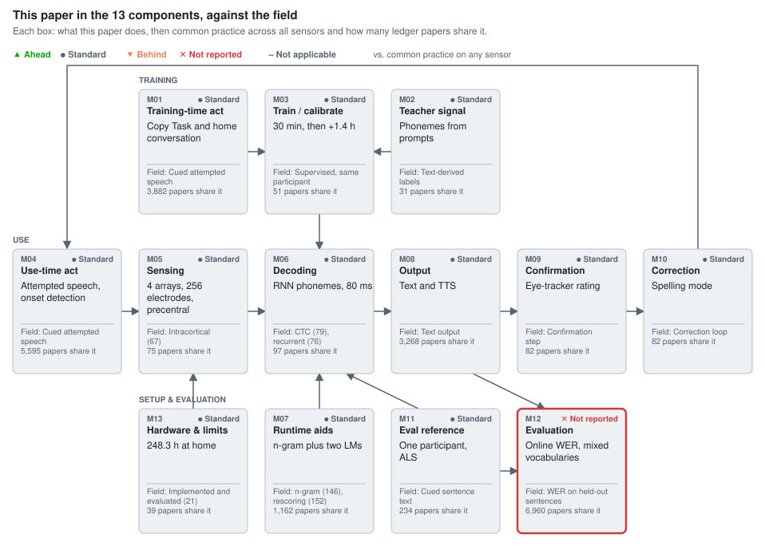

# An Accurate and Rapidly Calibrating Speech Neuroprosthesis

Card NS, Wairagkar M, Iacobacci C, et al. New England Journal of Medicine, 2024. [doi:10.1056/NEJMoa2314132](https://doi.org/10.1056/NEJMoa2314132)

**Section:** [Brain signals (EEG, MEG, intracortical)](../../README.md#brain-signals-eeg-meg-intracortical)

## Figures

### This paper in the 13 components, against the field

<picture><source media="(prefers-color-scheme: dark)" srcset="figures/components-dark.svg"></picture>

Verdicts compare the paper's choice for each component with common practice across 8,995 ledger entries on any sensor (silent speech, brain-to-text, lip reading).

Data

| Component | This paper | Common practice | Papers with this practice | Verdict |
| --- | --- | --- | --- | --- |
| M01 Training-time act | Copy Task and home conversation | Cued attempted speech | 3,882 of 8,995 | ● Standard (Adds Conversation Mode.) |
| M02 Teacher signal | Phonemes from prompts | Text-derived labels | 31 of 8,995 | ● Standard (Inherited.) |
| M03 Train / calibrate | 30 min, then +1.4 h | Supervised, same participant | 51 of 8,995 | ● Standard (Cross-study gain.) |
| M04 Use-time act | Attempted speech, onset detection | Cued attempted speech | 5,595 of 8,995 | ● Standard (False onsets under 1%.) |
| M05 Sensing | 4 arrays, 256 electrodes, precentral | Intracortical (67) | 75 of 8,995 | ● Standard (Placement untested.) |
| M06 Decoding | RNN phonemes, 80 ms | CTC (79), recurrent (76) | 97 of 8,995 | ● Standard (Inherited.) |
| M07 Runtime aids | n-gram plus two LMs | n-gram (146), rescoring (152) | 1,162 of 8,995 | ● Standard (LMs unnamed.) |
| M08 Output | Text and TTS | Text output | 3,268 of 8,995 | ● Standard (Inherited.) |
| M09 Confirmation | Eye-tracker rating | Confirmation step | 82 of 8,995 | ● Standard (Self-reported.) |
| M10 Correction | Spelling mode | Correction loop | 82 of 8,995 | ● Standard (Use rate missing.) |
| M11 Eval reference | One participant, ALS | Cued sentence text | 234 of 8,995 | ● Standard (n = 1.) |
| M12 Evaluation | Online WER, mixed vocabularies | WER on held-out sentences | 6,960 of 8,995 | ✕ Not reported (Session selection unstated.) |
| M13 Hardware & limits | 248.3 h at home | Implemented and evaluated (21) | 39 of 8,995 | ● Standard (Researcher launches.) |

## Verdict

The paper [[1]](#ref-1) changes calibration data (M03), array placement (M05) and sustained home use (M13); each is standard by the verdict rules (one participant, no within-participant ablation). Its final Copy Task sessions reach 2.5% online WER on 125,000 words, the lowest online large-vocabulary WER among the topic's ledger candidates (Appendix), against 23.8% for T12 [[2]](#ref-2); the gap crosses participant, placement, language models and months of accumulated data (2.5% by session 15). Rapid calibration holds only as a description: 9.8% WER after about 473 sentences, within one T12 day (inference), is a lower WER at a similar quantity, not less data. The strongest overreach is the abstract's 97.5% accuracy for conversations, which equals 100 minus the Copy Task 2.5% (inference); measured conversational WER is 3.7% in selected sessions. Home use over 8.4 months is the real advance; other users remain untested, as the authors concede.

## Against the field, component by component

### M03 Training: calibration data per participant

**Usual approach:** Of 51 unique studies describing speech-BCI calibration (pattern match, Appendix), the default is supervised same-participant training with daily recalibration on accumulated data: 260–480 sentences per day and 10,850 by the last day for T12 [[2]](#ref-2), about 1.6 h per day over 13 days for ECoG [[3]](#ref-3). This paper uses 213 sentences (30 min), then 260 more (1.4 h), within one T12 day's range.

**State of the art:** This paper (2024): 9.8% WER (95% CI 4.1–16.0) in session 2 against 23.8% for T12 [[2]](#ref-2), 59% lower (inference); later recalibrations took 7.5 minutes and 20 sentences. [concurrent] work recalibrated a handwriting iBCI from pseudo-labels over 403 days [[4]](#ref-4) and ran six ECoG commands 3 months without it [[5]](#ref-5).

The authors' "reduction in the quantity of training data required" (Discussion) is cross-study: participant, placement and language models (M07) differ. Verdict: standard.

### M05 Sensors: array count and placement

**Usual approach:** The topic is intracortical by inclusion (75 unique studies, pattern match; 67 of 72 slot-filled studies with a recorded modality, Appendix), so placement is the informative design: T12 had two arrays in 6v and two in area 44 [[2]](#ref-2). This paper puts all four arrays (256 electrodes) on precentral gyrus, one each in area 4 and 55b.

**State of the art:** The 2.5% online WER (2024) remains the lowest large-vocabulary value among the topic's ledger candidates (Appendix). A [later] ensemble decoder (2026) lowers offline WER on T15 data, this paper's participant (inference), by 35.0% relative across seeds [[6]](#ref-6); untested in real time, it does not rank against the online 2.5%.

Placement as a driver of the gain over T12 is untested within the participant. Verdict: standard.

### M13 Deployment: sustained home use

**Usual approach:** Of 39 unique studies on sustained or home use (pattern match, Appendix), of the 31 with a recorded design, 21 are implemented and evaluated and 2 deployed. This paper logs 248.3 hours over 8.4 months.

**State of the art:** For open-vocabulary home use, this paper (2024); the closest speech case is [concurrent] (2023): six ECoG commands at 90.59% median accuracy, 3 months without recalibration [[5]](#ref-5). This paper extends vocabulary and duration, not recalibration-free use (three recalibrations, M03), and a researcher had to launch the system (Discussion).

Verdict: standard by rule, yet this is the main advance.

### M12 Evaluation: what the headline numbers measure

**Usual approach:** Online WER on prompted held-out sentences [[2]](#ref-2), [[3]](#ref-3), which the Copy Task follows.

**State of the art:** [later] work on the same data (2026) reports WER across training seeds [[6]](#ref-6); the main text reports no training seeds.

The day-1 99.6% accuracy is a 50-word result, to set against T12's 9.1% WER at 50 words [[2]](#ref-2). Verdict: not reported, for the rule that selects Conversation sessions.

## The 13 components

| Component | This paper | Usual approach (count) | State of the art | Verdict |
|---|---|---|---|---|
| M01 Training-time action | Copy Task and home conversation | Cued attempted speech (slot-filled 3,882) | – | standard |
| M02 Training-only supervision | Phonemes from prompts | Text-derived labels (slot-filled 31) | – | standard |
| M03 Training and adaptation | 30 min, then +1.4 h | Supervised, same participant (pattern match 51) | 9.8% WER, session 2 [[1]](#ref-1) | standard |
| M04 Use-time action | Attempted speech, onset detection | Cued attempted speech (slot-filled 5,595) | – | standard |
| M05 Sensors | 4 arrays, 256 electrodes, precentral | Intracortical (67) (pattern match 75) | 2.5% WER [[1]](#ref-1) | standard |
| M06 Processing and decoding | RNN phonemes, 80 ms | CTC (79), recurrent (76) (pattern match 97) | Ensembles over seeds [[6]](#ref-6) | standard |
| M07 Lexicon and LM | n-gram plus two LMs | n-gram (146), rescoring (152) (pattern match 1,162) | – | standard |
| M08 Output | Text and TTS | Text output (slot-filled 3,268) | – | standard |
| M09 Confirmation | Eye-tracker rating | Confirmation step (slot-filled 82) | – | standard |
| M10 Correction | Spelling mode | Correction loop (slot-filled 82) | – | standard |
| M11 Reference construction | One participant, ALS | Cued sentence text (slot-filled 234) | – | standard |
| M12 Evaluation | Online WER, mixed vocabularies | WER on held-out sentences (slot-filled 6,960) | – | not reported |
| M13 Device and cost | 248.3 h at home | Implemented and evaluated (21) (pattern match 39) | 248.3 h open vocabulary [[1]](#ref-1); 3 months without recalibration, six commands [[5]](#ref-5) | standard |

## Where the claims outrun the evidence

- The 97.5% conversational accuracy (Abstract) is not the conversational measurement: 3.7% WER covers "selected" sessions, and the participant rated 52.9% of Conversation sentences correct and 32.3% mostly correct (§ Results).
- Conversational references partly come from "asking the participant after the session what he meant to say" (§ Methods, Evaluation); this can bias conversational WER downward (inference).
- Comparisons with about 5% WER for commercial recognisers and 1–2% for able-bodied reading cross tasks (§ Discussion).
- The authors caution that one participant's results may not recur (§ Discussion); the abstract's conclusion credits "brief training", yet its 97.5% came "with further training data".

## What the field needs next

- M03: a within-participant learning curve at fixed vocabulary and language model, in a second participant.
- M12: conversational references fixed before output is shown, and the session-selection rule stated.
- M05: array-wise dropout on this dataset to attribute the gain to area 4, 55b or 6v.
- M13: start-up without a researcher and self-recalibration for open-vocabulary speech [[4]](#ref-4).

## Questions for the authors

- How many sentences entered each evaluation block, and by what rule were Conversation sessions selected?
- Were decoders trained with several seeds, and how much does WER vary?

## Appendix: literature search

- M03 speech-bci-calibration-data. Inclusion rule: neural speech-decoding studies stating how much same-participant calibration data the decoder needs or how it is recalibrated across days; perception-only recalibration and non-speech BCIs excluded. Slot-filled 1,526 unique studies; pattern match 51 unique studies. Usual design: supervision_kind=phoneme_label, 4 of 15 (slot-filled). Full-text pattern counts within the topic: unsupervised or no recalibration 14, daily recalibration 5, cross-session accumulation 5, cross-subject pretraining 5 (pattern match). Read in full: [[2]](#ref-2), [[3]](#ref-3), target [[1]](#ref-1). Known-item recall 0.0 (4 seeds).
- M05 intracortical-speech-decoding (published table, appended). Inclusion rule: speech units decoded from human intracortical microelectrode recordings; hand or handwriting only and ECoG/sEEG excluded. Slot-filled 7,329; pattern match 75 unique studies. Usual design: intracortical microelectrode, 67 of 72 (slot-filled). Read in full: [[2]](#ref-2), [[6]](#ref-6), target [[1]](#ref-1), plus the priors already in the table. Known-item recall 0.33.
- M13 long-term-home-use. Inclusion rule: neural communication BCIs in home, personal or three-month-plus use; offline re-analysis excluded. Slot-filled 6,075; pattern match 39 unique studies. Usual design: implemented and evaluated, 21 of 31 (slot-filled); deployed 2. Full-text pattern counts: months of follow-up 23, home use 12, lab only 1 (pattern match). Read in full: [[5]](#ref-5), [[4]](#ref-4), target [[1]](#ref-1). Known-item recall 0.0 (2 seeds).

## References

Numbered by first citation. BibTeX in the same order and keys: [refs.bib](refs.bib).

1. Card, N. S., Wairagkar, M., Iacobacci, C., Hou, X., Singer-Clark, T., Willett, F. R., et al. “An Accurate and Rapidly Calibrating Speech Neuroprosthesis.” *New England Journal of Medicine*, 2024, 391(7), 609–618. doi:[10.1056/NEJMoa2314132](https://doi.org/10.1056/NEJMoa2314132). medRxiv preprint posted 2024-04-10; NEJM 2024 Aug 15 [review](https://github.com/supernaiter/silent-speech-review/tree/main/reviews/an-accurate-and-rapidly-calibrating-speech-neuroprosthesis) [wiki: doi-10.1056-nejmoa2314132](https://github.com/supernaiter/deep-research-wiki-for-silent-speech/blob/main/papers/doi-10.1056-nejmoa2314132/article.md) [wiki: doi-10.1056-NEJMoa2314132](https://github.com/supernaiter/deep-research-wiki-for-silent-speech/blob/main/papers/doi-10.1056-NEJMoa2314132/article.md) [wiki: pmc-11328962-rapidcal](https://github.com/supernaiter/deep-research-wiki-for-silent-speech/blob/main/papers/pmc-11328962-rapidcal/article.md)
2. Willett, F. R., Kunz, E. M., Fan, C., Avansino, D. T., Wilson, G. H., Choi, E. Y., et al. “A high-performance speech neuroprosthesis.” *Nature*, 2023, 620, 1031–1036. doi:[10.1038/s41586-023-06377-x](https://doi.org/10.1038/s41586-023-06377-x). [review](https://github.com/supernaiter/silent-speech-review/tree/main/reviews/a-high-performance-speech-neuroprosthesis) [wiki: doi-10.1038-s41586-023-06377-x](https://github.com/supernaiter/deep-research-wiki-for-silent-speech/blob/main/papers/doi-10.1038-s41586-023-06377-x/article.md) [wiki: pmc-10468393-neuroprosthesis](https://github.com/supernaiter/deep-research-wiki-for-silent-speech/blob/main/papers/pmc-10468393-neuroprosthesis/article.md)
3. Metzger, S. L., Littlejohn, K. T., Silva, A. B., Moses, D. A., Seaton, M. P., Wang, R., et al. “A high-performance neuroprosthesis for speech decoding and avatar control.” *Nature*, 2023, 620, 1037–1046. doi:[10.1038/s41586-023-06443-4](https://doi.org/10.1038/s41586-023-06443-4). [review](https://github.com/supernaiter/silent-speech-review/tree/main/reviews/a-high-performance-neuroprosthesis-for-speech-decoding-and-avatar-control) [wiki: doi-10.1038-s41586-023-06443-4](https://github.com/supernaiter/deep-research-wiki-for-silent-speech/blob/main/papers/doi-10.1038-s41586-023-06443-4/article.md) [wiki: pmc-10826467-avatarnp](https://github.com/supernaiter/deep-research-wiki-for-silent-speech/blob/main/papers/pmc-10826467-avatarnp/article.md)
4. Fan, C., Hahn, N., Kamdar, F., Avansino, D., Wilson, G. H., Hochberg, L., et al. “Plug-and-Play Stability for Intracortical Brain-Computer Interfaces: A One-Year Demonstration of Seamless Brain-to-Text Communication.” *Advances in Neural Information Processing Systems*, 2023, 36. arXiv:[2311.03611](https://arxiv.org/abs/2311.03611). [concurrent] [wiki: pmc-11086983-plugplay](https://github.com/supernaiter/deep-research-wiki-for-silent-speech/blob/main/papers/pmc-11086983-plugplay/article.md) [wiki: arxiv-2311.03611](https://github.com/supernaiter/deep-research-wiki-for-silent-speech/blob/main/papers/arxiv-2311.03611/article.md) [wiki: pmc-pmc11086983](https://github.com/supernaiter/deep-research-wiki-for-silent-speech/blob/main/papers/pmc-pmc11086983/article.md)
5. Luo, S., Angrick, M., Coogan, C., Candrea, D. N., Wyse-Sookoo, K., Shah, S., et al. “Stable Decoding from a Speech BCI Enables Control for an Individual with ALS without Recalibration for 3 Months.” *Advanced Science*, 2023, 10(35), e2304853. doi:[10.1002/advs.202304853](https://doi.org/10.1002/advs.202304853). [concurrent] [wiki: pmc-10724434-stablebci](https://github.com/supernaiter/deep-research-wiki-for-silent-speech/blob/main/papers/pmc-10724434-stablebci/article.md) [wiki: doi-10.1002-advs.202304853](https://github.com/supernaiter/deep-research-wiki-for-silent-speech/blob/main/papers/doi-10.1002-advs.202304853/article.md)
6. Yoon, S., Avansino, D. T., Madugula, S., Levin, A. D., Fan, C., Krasa, B. A., et al. “Neural decoding of speech using deep neural ensembles.” *bioRxiv*, 2026. doi:[10.64898/2026.06.02.729705](https://doi.org/10.64898/2026.06.02.729705). [later] [wiki: doi-10.64898-2026.06.02.729705](https://github.com/supernaiter/deep-research-wiki-for-silent-speech/blob/main/papers/doi-10.64898-2026.06.02.729705/article.md)

## Materials

Data behind this review. Full texts of the papers are not included.

- [`review.md`](review.md): the review text (source)
- [`refs.bib`](refs.bib): references (BibTeX)
- [`slots.json`](slots.json): for each of the 13 components: this paper's choice, field practice, number of matching papers, verdict
- [`figures.json`](figures.json): figure definitions
- [`evaluation.md`](evaluation.md): independent evaluation by a second reviewer
- [`triage.md`](triage.md): how each evaluation finding was checked against the sources and resolved
- [`components/M03/speech-bci-calibration-data.csv`](../../components/M03/speech-bci-calibration-data.csv): M03 topic "speech-bci-calibration-data", every candidate paper with its decision (1526 slot-filled, 51 pattern match, usual design in 4, 3 read in full)
- [`components/M05/intracortical-speech-decoding.csv`](../../components/M05/intracortical-speech-decoding.csv): M05 topic "intracortical-speech-decoding", every candidate paper with its decision (7329 slot-filled, 75 pattern match, usual design in 67, 5 read in full)
- [`components/M13/long-term-home-use.csv`](../../components/M13/long-term-home-use.csv): M13 topic "long-term-home-use", every candidate paper with its decision (6075 slot-filled, 39 pattern match, usual design in 21, 3 read in full)

## More reviews in Brain signals (EEG, MEG, intracortical)

- [A Convolutional Framework for Mapping Imagined Auditory MEG into Listened Brain Responses](../a-convolutional-framework-for-mapping-imagined-auditory-meg-into-listened-brain-responses/) (2025). Mapping imagined onto listened MEG (M06) is ahead in design, but the subject-calibrated CNN gain is unproven: no ablation, a channel-shuffling null, and r 0.0113 against 0.0063.
- [An instantaneous voice-synthesis neuroprosthesis](../an-instantaneous-voice-synthesis-neuroprosthesis/) (2025). Closed-loop sentence voice from intracortical arrays holds for one participant; the design is standard, forced-choice and proxy-target metrics overstate intelligibility.
- [Brain-to-Text Decoding: A Non-invasive Approach via Typing](../brain-to-text-decoding-a-non-invasive-approach-via-typing/) (2025). Executed typing as the decoded action (M04) was ahead for MEG/EEG in 2025; keystroke-locked decoding (M06) and an n-gram LM (M07) are standard, and decoding needs known keystroke times.
- [Distinct Theta Synchrony across Speech Modes: Perceived, Spoken, Whispered, and Imagined](../distinct-theta-synchrony-across-speech-modes-perceived-spoken-whispered-and-imagined/) (2025). Exploratory comparison of EEG theta-band functional connectivity across perceived, spoken, whispered and imagined speech in ten healthy subjects; no recognition performance is measured.
- [EEG-to-Voice Decoding of Spoken and Imagined speech Using Non-Invasive EEG](../eeg-to-voice-decoding-of-spoken-and-imagined-speech-using-non-invasive-eeg/) (2025). Reconstructs cued overt and imagined speech audio and text from 130-channel wet EEG with subject-specific models; imagined-speech WER is 47.48% (2 s) and 43.46% (4 s) before language correction.
- [Lightweight Diffusion-based Framework for Online Imagined Speech Decoding in Aphasia](../lightweight-diffusion-based-framework-for-online-imagined-speech-decoding-in-aphasia/) (2025). Real-time diffusion-based EEG decoder for one person with aphasia classifying three imagined Korean words plus rest, reporting 65% top-1 and 70% top-2 accuracy over 20 online trials.

---

Part of the [Silent Speech Interface Review](https://github.com/supernaiter/silent-speech-review). Found an error? [Open an issue](https://github.com/supernaiter/silent-speech-review/issues/new?template=correction.yml).
