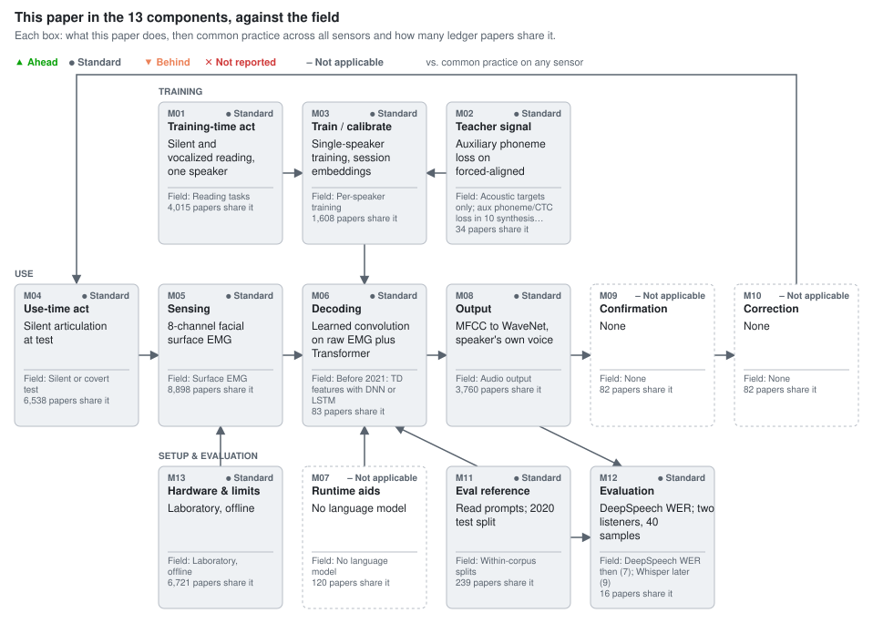

# An Improved Model for Voicing Silent Speech

Gaddy D, Klein D. ACL-IJCNLP 2021. [doi:10.18653/v1/2021.acl-short.23](https://doi.org/10.18653/v1/2021.acl-short.23) · [arXiv:2106.01933](https://arxiv.org/abs/2106.01933)

**Section:** [Surface EMG](../../README.md#surface-emg)

## Figures

### This paper in the 13 components, against the field

<picture><source media="(prefers-color-scheme: dark)" srcset="figures/components-dark.svg"></picture>

Verdicts compare the paper's choice for each component with common practice across 8,995 ledger entries on any sensor (silent speech, brain-to-text, lip reading).

Data

| Component | This paper | Common practice | Papers with this practice | Verdict |
| --- | --- | --- | --- | --- |
| M01 Training-time act | Silent and vocalized reading, one speaker | Reading tasks | 4,015 of 8,995 | ● Standard (Inherited 2020 corpus.) |
| M02 Teacher signal | Auxiliary phoneme loss on forced-aligned labels | Acoustic targets only; aux phoneme/CTC loss in 10 synthesis studies | 34 of 8,995 | ● Standard (Prior ultrasound design [@toth2018multitask]; single run.) |
| M03 Train / calibrate | Single-speaker training, session embeddings | Per-speaker training | 1,608 of 8,995 | ● Standard (Batching regularizer not ablated.) |
| M04 Use-time act | Silent articulation at test | Silent or covert test | 6,538 of 8,995 | ● Standard (Inherited.) |
| M05 Sensing | 8-channel facial surface EMG | Surface EMG | 8,898 of 8,995 | ● Standard (Inherited hardware.) |
| M06 Decoding | Learned convolution on raw EMG plus Transformer | Before 2021: TD features with DNN or LSTM | 83 of 8,995 | ● Standard (Single-run ablations; encoder reused by later work.) |
| M07 Runtime aids | No language model | No language model | 120 of 8,995 | – Not applicable (Synthesis uses no lexicon.) |
| M08 Output | MFCC to WaveNet, speaker's own voice | Audio output | 3,760 of 8,995 | ● Standard (Inherited vocoder.) |
| M09 Confirmation | None | None | 82 of 8,995 | – Not applicable (Offline study.) |
| M10 Correction | None | None | 82 of 8,995 | – Not applicable (Offline study.) |
| M11 Eval reference | Read prompts; 2020 test split | Within-corpus splits | 239 of 8,995 | ● Standard (Split inherited from 2020; no held-out session.) |
| M12 Evaluation | DeepSpeech WER; two listeners, 40 samples | DeepSpeech WER then (7); Whisper later (9) | 16 of 8,995 | ● Standard (No seeds; recognizer and rerun shift.) |
| M13 Hardware & limits | Laboratory, offline | Laboratory, offline | 6,721 of 8,995 | ● Standard (No latency or wearable result.) |

## Verdict

The paper [[1]](#ref-1) changes two components of the 2020 EMG voicing system [[2]](#ref-2): a learned convolution-plus-Transformer encoder over minimally filtered EMG (M06) and an auxiliary phoneme loss (M02). M06 departs from the feature-plus-recurrent designs of its time but is standard, not ahead, as every comparison is a single run; it lasted: the 2026 state of the art [later] initializes its encoder from it [[3]](#ref-3). M02 is standard: phone-state multi-task training for synthesis was already shown on ultrasound [[4]](#ref-4) (credited in §1), though here it gives the largest ablation effect (51.7% against 42.2%, Table 1). Crediting the drop from 68.0% to 42.2% to the three changes outruns the evidence: if their effects add, the ablations account for 16.3 of the 25.8 points (inference), and a modified alignment and a new batching regularizer are never ablated (§2.3). A later Whisper rerun scores 25.74% [[3]](#ref-3): recognizer and run move the score more than any ablation (inference).

## Against the field, component by component

### M06 Processing: EMG input representation and sequence model

**Usual approach:** Before 2021, surface-EMG decoders fed hand-crafted time-domain (TD) features to feed-forward or recurrent nets: DNNs and LSTMs in Janke's EMG-to-speech work [[5]](#ref-5), a bidirectional LSTM in 2020 (§3) [[2]](#ref-2). Among 83 unique surface-EMG speech studies (pattern match, Appendix), 18 mention TD features and 18 LSTMs or GRUs; the 26 with Transformer or Conformer encoders date from 2021 on (inference).

**State of the art:** GETS (2026) reaches 11.89% WER with Whisper and 21.32% with DeepSpeech on the same test split, against 42.2% here, with an encoder initialized from this model [[3]](#ref-3). The gap rests on use-time text guidance (an 8.93%-WER recognizer refined by GPT-4, Sec. 3): without it GETS scores 32.78% (Table 4), worse than this model's 25.74%.

Against the ablated models, hand-designed features cost 3.0 points (45.2%, 7% relative) and the LSTM 3.8 (46.0%, 8%), one run each (inference). Ablated model sizes are not given. Verdict: standard (not ahead: single runs, capacity unmatched).

### M02 Training-only supervision: auxiliary phoneme loss

**Usual approach:** Synthesis is usually trained on acoustic targets alone; 34 unique studies match an auxiliary phoneme, phone-state or CTC loss (pattern match, Appendix), 10 of them for synthesis. The prior design [[4]](#ref-4) trained an ultrasound-to-vocoder network jointly on forced-aligned phone states, half an hour from one speaker reading aloud, for about 7% relative gain with no listening test.

**State of the art:** A 2026 silent-voiced alignment loss on this model gives 25.14 ± 0.90 against 26.75 ± 0.99 WER over 10 seeds (Whisper) [[6]](#ref-6).

On the same base, the phoneme loss is worth 9.5 points, 18% relative to 51.7% (inference), against about 7% for the ultrasound prior; from different starting points (19 hours of silent EMG scored by WER, half an hour of vocalized ultrasound by correlation) this does not show that EMG benefits more. Verdict: standard (not ahead: the ultrasound prior has the design).

### M12 Evaluation: recognizer-scored WER

**Usual approach:** At the time, DeepSpeech WER, as here; Whisper, which postdates this paper, came later. Of 16 unique studies on Gaddy silent-EMG voicing (pattern match, Appendix), 9 score with Whisper, 7 with DeepSpeech and 3 with listeners, some with several. The paper adds two listeners on 40 samples (§3.1).

**State of the art:** 11.89% WER with Whisper (2026) [[3]](#ref-3).

Later reruns score 25.74% [[3]](#ref-3) and 26.75 ± 0.99 over 10 seeds [[6]](#ref-6) under Whisper, against 42.2% under DeepSpeech here: recognizer and run together shift about 16 points (inference). Verdict: standard.

## The 13 components

| Component | This paper | Usual approach (count) | State of the art | Verdict |
|---|---|---|---|---|
| M01 Training-time action | Silent and vocalized reading, one speaker | Reading tasks (slot-filled 4,015) | – | standard |
| M02 Training-only supervision | Auxiliary phoneme loss on forced-aligned labels | Acoustic targets only; aux phoneme/CTC loss in 10 synthesis studies (pattern match 34) | 25.14 ± 0.90% WER, 10 seeds [[6]](#ref-6) | standard |
| M03 Training and adaptation | Single-speaker training, session embeddings | Per-speaker training (slot-filled 1,608) | – | standard |
| M04 Use-time action | Silent articulation at test | Silent or covert test (slot-filled 6,538) | – | standard |
| M05 Sensors | 8-channel facial surface EMG | Surface EMG (slot-filled 8,898) | – | standard |
| M06 Processing and decoding | Learned convolution on raw EMG plus Transformer | Before 2021: TD features with DNN or LSTM (pattern match 83) | 11.89% WER, encoder from this model [[3]](#ref-3) | standard |
| M07 Lexicon and LM | No language model | No language model (slot-filled 120) | – | not applicable |
| M08 Output | MFCC to WaveNet, speaker's own voice | Audio output (slot-filled 3,760) | – | standard |
| M09 Confirmation | None | None (slot-filled 82) | – | not applicable |
| M10 Correction | None | None (slot-filled 82) | – | not applicable |
| M11 Reference construction | Read prompts; 2020 test split | Within-corpus splits (slot-filled 239) | – | standard |
| M12 Evaluation | DeepSpeech WER; two listeners, 40 samples | DeepSpeech WER then (7); Whisper later (9) (pattern match 16) | 11.89% WER, Whisper [[3]](#ref-3) | standard |
| M13 Device and cost | Laboratory, offline | Laboratory, offline (slot-filled 6,721) | – | standard |

## Where the claims outrun the evidence

- Attribution (§1, Table 1): the three ablation effects sum to 16.3 of the 25.8 points only if they add (inference); the alignment with "minor aspects improved" and the batching that "acts as a form of dropout regularization" (§2.3) are never ablated.
- Repetition: no seed or rerun is reported (Appendix D). The only seed spread, 0.99 points SD under Whisper [[6]](#ref-6), is on another scale than the DeepSpeech ablations, so it cannot show that the 3.0-point effect exceeds run noise.
- Model selection: hyperparameters were tuned on validation WER (Appendix D); the reported model is the last epoch, as the code overwrites and reloads model.pt (transduction_model.py:258-262).
- Human evaluation: 32.3% is read as confirmation (§3.1) but averages two transcribers at 36.1% and 28.5%, 7.6 points apart (inference), as the authors concede.
- Split: the test split, inherited from [[2]](#ref-2), selects sentences across all sessions (read_emg.py:172-205); the session embeddings (§2.1) are never tested on new sessions.

## What the field needs next

- M06: learned convolution against TD features at matched size, several seeds and speakers.
- M02: phoneme, CTC and alignment losses [[6]](#ref-6) under shared seeds.
- M12: results under both a named DeepSpeech model and Whisper.
- M11: a held-out-session Gaddy test split.

## Questions for the authors

- How many test utterances are there?
- Which DeepSpeech model and scorer produced Table 1?
- What is the seed spread of 42.2% and of each ablation?
- How were the 40 human samples chosen?

## Appendix: literature search

- M06 emg-speech-encoder-input-and-sequence-model. Inclusion rule: surface-EMG speech decoders (synthesis or recognition) classified by input representation (hand-crafted time-domain features or learned convolution over minimally filtered EMG) and sequence model (feed-forward, recurrent, Transformer or Conformer); EMG used only as an auxiliary channel, gesture or non-speech EMG and reviews excluded; versions counted once. Ledger counts: slot-filled 7,345 unique studies (M06); pattern match 83 unique studies; design counts (pattern match, full text; a study can match several): Transformer or Conformer 26, hand-crafted TD features 18, LSTM or GRU 18, learned convolution on raw EMG 2. Read in full: [[5]](#ref-5) (prior), [[3]](#ref-3). Known-item recall 0.5 (the target was missed by the pattern).
- M02 auxiliary-phoneme-loss-in-speech-synthesis. Inclusion rule: speech synthesis from a non-acoustic signal whose training adds a phoneme, phone-state, CTC or text classification loss on a shared encoder that is discarded or used only as guidance at synthesis time; recognition-only models, recognize-then-TTS cascades and regression-only auxiliary targets excluded; versions counted once. Ledger counts: slot-filled 31 unique studies (M02); pattern match 34 unique studies, 10 of them synthesis by ledger text. Read in full: [[4]](#ref-4) (prior), [[6]](#ref-6). Known-item recall 1.0.
- M12 silent-emg-voicing-benchmark (published table, reused). Inclusion rule: speech synthesized from silently articulated surface EMG on the Gaddy open-vocabulary corpus, scored by ASR or listener transcription; recognition-only studies, other corpora and voiced-only results excluded; versions counted once. Ledger counts: slot-filled 6,960 unique studies; pattern match 16 unique studies; design counts (pattern match, full text): Whisper 9, DeepSpeech 7, listener transcription 3. Read in full: [[3]](#ref-3). Known-item recall 1.0.

## References

Numbered by first citation. BibTeX in the same order and keys: [refs.bib](refs.bib).

1. Gaddy, D., Klein, D. “An Improved Model for Voicing Silent Speech.” *Proceedings of the 59th Annual Meeting of the Association for Computational Linguistics and the 11th International Joint Conference on Natural Language Processing (Volume 2: Short Papers)*, 2021. doi:[10.18653/v1/2021.acl-short.23](https://doi.org/10.18653/v1/2021.acl-short.23). arXiv:[2106.01933](https://arxiv.org/abs/2106.01933). Target. arXiv:2106.01933 v2 read; ACL-IJCNLP 2021 short paper. [review](https://github.com/supernaiter/silent-speech-review/tree/main/reviews/an-improved-model-for-voicing-silent-speech) [wiki: arxiv-2106.01933](https://github.com/supernaiter/deep-research-wiki-for-silent-speech/blob/main/papers/arxiv-2106.01933/article.md) [wiki: doi-10.18653-v1-2021.acl-short.23](https://github.com/supernaiter/deep-research-wiki-for-silent-speech/blob/main/papers/doi-10.18653-v1-2021.acl-short.23/article.md)
2. Gaddy, D., Klein, D. “Digital Voicing of Silent Speech.” *Proceedings of the 2020 Conference on Empirical Methods in Natural Language Processing (EMNLP)*, 2020, 5521–5530. doi:[10.18653/v1/2020.emnlp-main.445](https://doi.org/10.18653/v1/2020.emnlp-main.445). arXiv:[2010.02960](https://arxiv.org/abs/2010.02960). [review](https://github.com/supernaiter/silent-speech-review/tree/main/reviews/digital-voicing-of-silent-speech) [wiki: doi-10.18653-v1-2020.emnlp-main.445](https://github.com/supernaiter/deep-research-wiki-for-silent-speech/blob/main/papers/doi-10.18653-v1-2020.emnlp-main.445/article.md) [wiki: arxiv-2010.02960](https://github.com/supernaiter/deep-research-wiki-for-silent-speech/blob/main/papers/arxiv-2010.02960/article.md)
3. Lee, J., Lee, J., Lee, K. “GETS: Guiding EMG-to-Speech Synthesis via Silent Speech Recognition.” *Proc. Interspeech 2026*, 2026. doi:[10.21437/Interspeech.2026-1938](https://doi.org/10.21437/Interspeech.2026-1938). [later] [wiki: isca-lee26r_interspeech](https://github.com/supernaiter/deep-research-wiki-for-silent-speech/blob/main/papers/isca-lee26r_interspeech/article.md)
4. Tóth, L., Gosztolya, G., Grósz, T., Markó, A., Csapó, T. G. “Multi-Task Learning of Speech Recognition and Speech Synthesis Parameters for Ultrasound-based Silent Speech Interfaces.” *Proc. Interspeech 2018*, 2018, 3172–3176. doi:[10.21437/Interspeech.2018-1078](https://doi.org/10.21437/Interspeech.2018-1078). [wiki: isca-toth18-multitask](https://github.com/supernaiter/deep-research-wiki-for-silent-speech/blob/main/papers/isca-toth18-multitask/article.md) [wiki: isca-toth18_interspeech](https://github.com/supernaiter/deep-research-wiki-for-silent-speech/blob/main/papers/isca-toth18_interspeech/article.md) [wiki: isca-toth18_mtlussi](https://github.com/supernaiter/deep-research-wiki-for-silent-speech/blob/main/papers/isca-toth18_mtlussi/article.md)
5. Janke, M. “EMG-to-Speech: Direct Generation of Speech from Facial Electromyographic Signals.” *Dissertation, Karlsruhe Institute of Technology (KIT)*, 2016. <https://publikationen.bibliothek.kit.edu/1000054490> Dissertation (oral examination 2016-04-22); the wiki entry is filed under the related journal article, Janke and Diener, IEEE/ACM TASLP 25(12), 2017, doi:10.1109/TASLP.2017.2738568. [wiki: doi-10.1109-taslp-2017-2738568](https://github.com/supernaiter/deep-research-wiki-for-silent-speech/blob/main/papers/doi-10.1109-taslp-2017-2738568/article.md)
6. Lee, J., Hwang, I., Lee, J., Kim, E., Han, D., Lee, K. “Enhancing EMG-to-Speech via Silent-Voiced Representation Alignment.” *Proc. Interspeech 2026*, 2026. doi:[10.21437/Interspeech.2026-2931](https://doi.org/10.21437/Interspeech.2026-2931). [later] [wiki: isca-lee26v_interspeech](https://github.com/supernaiter/deep-research-wiki-for-silent-speech/blob/main/papers/isca-lee26v_interspeech/article.md)

## Materials

Data behind this review. Full texts of the papers are not included.

- [`review.md`](review.md): the review text (source)
- [`refs.bib`](refs.bib): references (BibTeX)
- [`slots.json`](slots.json): for each of the 13 components: this paper's choice, field practice, number of matching papers, verdict
- [`figures.json`](figures.json): figure definitions
- [`evaluation.md`](evaluation.md): independent evaluation by a second reviewer
- [`triage.md`](triage.md): how each evaluation finding was checked against the sources and resolved
- [`components/M02/auxiliary-phoneme-loss-in-speech-synthesis.csv`](../../components/M02/auxiliary-phoneme-loss-in-speech-synthesis.csv): M02 topic "auxiliary-phoneme-loss-in-speech-synthesis", every candidate paper with its decision (31 slot-filled, 34 pattern match, usual design in 10, 3 read in full)
- [`components/M06/emg-speech-encoder-input-and-sequence-model.csv`](../../components/M06/emg-speech-encoder-input-and-sequence-model.csv): M06 topic "emg-speech-encoder-input-and-sequence-model", every candidate paper with its decision (7345 slot-filled, 83 pattern match, usual design in 18, 3 read in full)
- [`components/M12/silent-emg-voicing-benchmark.csv`](../../components/M12/silent-emg-voicing-benchmark.csv): M12 topic "silent-emg-voicing-benchmark", every candidate paper with its decision (6960 slot-filled, 16 pattern match, usual design in 9, 4 read in full)

## More reviews in Surface EMG

- [Sequence-to-Sequence Voice Reconstruction for Silent Speech in a Tonal Language](../sequence-to-sequence-voice-reconstruction-for-silent-speech-in-a-tonal-language/) (2022). Duration-regulated seq2seq with toneme loss voices silent Mandarin EMG; gains rest on the auxiliary loss, not the architecture, and prompt grouping in the utterance split is unreported.
- [Digital Voicing of Silent Speech](../digital-voicing-of-silent-speech/) (2020). Silent-EMG target transfer (M02) extends a 2016 DTW recipe; the open corpus scored by WER (M12) became the shared test bed. Headline 94% gain is closed-vocabulary, 20 clips, one evaluator.
- [Knowledge Distilled Ensemble Model for sEMG-based Silent Speech Interface](../knowledge-distilled-ensemble-model-for-semg-based-silent-speech-interface/) (2023). Ensemble-to-student distillation (M02, M06, M13) is standard: same-modality distillation predates it; 85.9% is one unseeded split of unstated unit, and 7x smaller is against six models.
- [AlterEgo: A Personalized Wearable Silent Speech Interface](../alterego-a-personalized-wearable-silent-speech-interface/) (2018). Wearable headset that recognizes silently articulated words from face and jaw neuromuscular signals and answers through bone-conduction audio; abstract reports 92% median word accuracy in user studies.
- [Development of sEMG sensors and algorithms for silent speech recognition](../development-of-semg-sensors-and-algorithms-for-silent-speech-recognition/) (2018). Face- and neck-worn sEMG sensors with staged recognition algorithms decode silently mouthed phrases; abstract reports 8.9% WER on 1,200+ phrases from a 2,200-word vocabulary.
- [A Parallel Ultra-Low Power Silent Speech Interface based on a Wearable, Fully-dry EMG Neckband](../a-parallel-ultra-low-power-silent-speech-interface-based-on-a-wearable-fully-dry-emg-neckband/) (2025). A fully dry wearable EMG neckband with ultra-low-power BioGAP-Ultra classifies 8 silently articulated words for one healthy user at 68% accuracy, dropping to 54% on an unseen re-wearing session; acquisition plus BLE uses 22.2 mW.

---

Part of the [Silent Speech Interface Review](https://github.com/supernaiter/silent-speech-review). Found an error? [Open an issue](https://github.com/supernaiter/silent-speech-review/issues/new?template=correction.yml).
