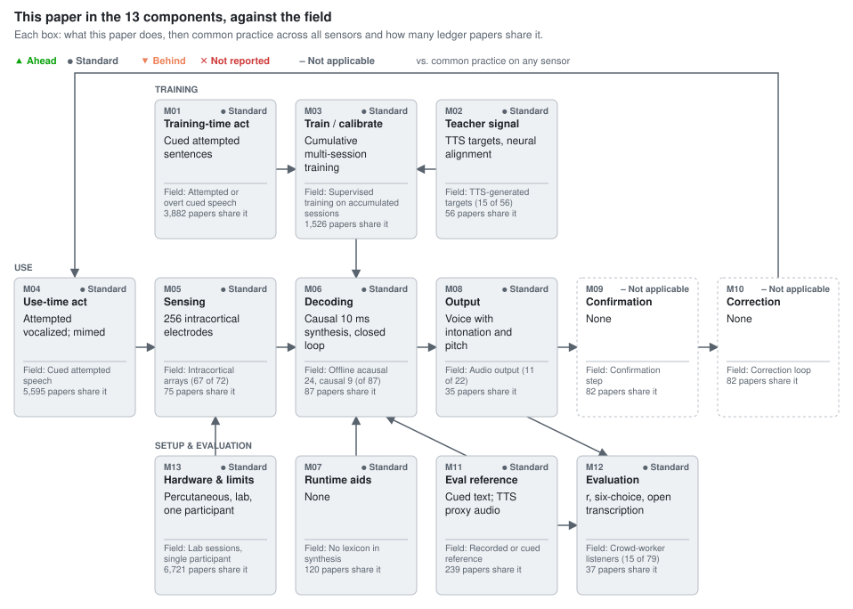

# An instantaneous voice-synthesis neuroprosthesis

Wairagkar, Card, Singer-Clark, Hou, Iacobacci, Miller, Hochberg, Brandman, Stavisky. Nature 644, 145–152 (2025); first public on bioRxiv 2024. [doi:10.1038/s41586-025-09127-3](https://doi.org/10.1038/s41586-025-09127-3)

**Section:** [Brain signals (EEG, MEG, intracortical)](../../README.md#brain-signals-eeg-meg-intracortical)

## Figures

### This paper in the 13 components, against the field

<picture><source media="(prefers-color-scheme: dark)" srcset="figures/components-dark.svg"></picture>

Verdicts compare the paper's choice for each component with common practice across 8,995 ledger entries on any sensor (silent speech, brain-to-text, lip reading).

Data

| Component | This paper | Common practice | Papers with this practice | Verdict |
| --- | --- | --- | --- | --- |
| M01 Training-time act | Cued attempted sentences | Attempted or overt cued speech | 3,882 of 8,995 | ● Standard (Inherited.) |
| M02 Teacher signal | TTS targets, neural alignment | TTS-generated targets (15 of 56) | 56 of 8,995 | ● Standard (No alignment ablation.) |
| M03 Train / calibrate | Cumulative multi-session training | Supervised training on accumulated sessions | 1,526 of 8,995 | ● Standard (Matches usual; seeds and selection data unstated.) |
| M04 Use-time act | Attempted vocalized; mimed | Cued attempted speech | 5,595 of 8,995 | ● Standard (Mimed scored by r only.) |
| M05 Sensing | 256 intracortical electrodes | Intracortical arrays (67 of 72) | 75 of 8,995 | ● Standard (Same implant as [concurrent] [@card2024].) |
| M06 Decoding | Causal 10 ms synthesis, closed loop | Offline acausal 24, causal 9 (of 87) | 87 of 8,995 | ● Standard (Closed loop existed.) |
| M07 Runtime aids | None | No lexicon in synthesis | 120 of 8,995 | ● Standard (Allows pseudo-words.) |
| M08 Output | Voice with intonation and pitch | Audio output (11 of 22) | 35 of 8,995 | ● Standard (Template-triggered intonation.) |
| M09 Confirmation | None | Confirmation step | 82 of 8,995 | – Not applicable (No commit step.) |
| M10 Correction | None | Correction loop | 82 of 8,995 | – Not applicable (No correction step.) |
| M11 Eval reference | Cued text; TTS proxy audio | Recorded or cued reference | 239 of 8,995 | ● Standard (Proxy shapes r.) |
| M12 Evaluation | r, six-choice, open transcription | Crowd-worker listeners (15 of 79) | 37 of 8,995 | ● Standard (No chance levels.) |
| M13 Hardware & limits | Percutaneous, lab, one participant | Lab sessions, single participant | 6,721 of 8,995 | ● Standard (Inherited.) |

## Verdict

The paper [[1]](#ref-1) changed the training targets (M02, TTS audio aligned to neurally inferred boundaries), the decoder (M06, causal closed-loop synthesis) and the output (M08, voice with intonation and pitch). All three are standard: closed-loop synthesis existed for vowels and unintelligible words, and all results are from one participant. The main claim holds: sentence-level voice from intracortical signals, heard as the user attempts to speak, with acoustic leakage ruled out. Intelligibility is weaker than the headline: 94.34% six-choice matching (chance about 17%, inference) sits beside a 43.75% median open-transcription WER that the authors also report (Fig. 2l). The same group's [later] causal model reaches 5.24% listener WER on this paper's benchmark, offline with simulated real-time inference [[2]](#ref-2), so this paper is the closed-loop proof, not the quality benchmark.

## Against the field, component by component

### M06 Decoding: causal closed-loop synthesis

**Usual approach:** Of 87 studies pairing synthesis with real-time or causal operation (pattern match, unique studies), 24 describe offline or acausal decoding and 9 causal frame-level models (upper bounds); the paper is causal at 10 ms.

**State of the art:** Earlier closed loops gave vowel formants within 50 ms (2009) [[3]](#ref-3) or unintelligible imagined words (2021) [[4]](#ref-4); [concurrent] ECoG work output a six-word vocabulary seconds after overt speech (2024) [[5]](#ref-5). Today: 5.24% listener WER on the same benchmark, offline (2026) [[2]](#ref-2) ([later]), 88% below this paper's closed-loop 43.75% (inference).

Neither deciding prior synthesizes open sentences (Appendix), but both are closed loops; verdict: standard. "Instantaneous" means acquisition-to-synthesis processing within 10 ms; the playback driver added the largest delay (Extended Data Fig. 1c), with no end-to-end figure in the text. The follow-up puts this system at 25 ms [[2]](#ref-2), versus 30–70 ms in 2009 [[3]](#ref-3).

### M02 Training targets: TTS aligned by the decoder

**Usual approach:** Paired audio is the largest named kind (7 of 32 slot-filled; 8 "other"); without it, 15 of 56 studies (pattern match, unique studies) use TTS targets and 2 a reference speaker; the closest prior trained reference-speaker or TTS units with CTC, needing no alignment (2023) [[6]](#ref-6).

**State of the art:** The [later] follow-up keeps time-aligned synthetic targets, reaching 5.24% WER (2026) [[2]](#ref-2).

3 of the 56 match the neural-alignment pattern (pattern match, upper bound; Appendix): this paper and two [later] works, Brain2Speech-Net (2026) [[7]](#ref-7), which aligns neural frames to TTS phonemes, and MindVoice (2026) [[8]](#ref-8), which aligns embeddings, not timing. Verdict: standard; no alternative alignment is tested, so its benefit is not shown.

### M08 Output: voice with prosody

**Usual approach:** Audio output in 11 of 22 neural-synthesis studies (slot-filled). Earlier sentence synthesis scored 31% listener WER from a 25-word pool in speakers who could talk (2019) [[9]](#ref-9) and 54.4% on 1,024 words in anarthria (2023) [[6]](#ref-6).

**State of the art:** 5.24% listener WER, same participant (2026) [[2]](#ref-2) ([later]).

The 10.65-point gain over ECoG crosses participants, sensors and sentences (inference). Question and emphasis contours are predefined profiles triggered by binary decoders (Methods): classified, not synthesized; only the three singing pitch levels are decoded continuously (Fig. 3). Verdict: standard.

### M12 Evaluation: listener tests

**Usual approach:** Crowd-worker transcription is the commonest named protocol (15 of 79 topic-table studies, pattern match); the paper leads with Pearson r and six-choice matching.

**State of the art:** Open transcription, 7 listeners per trial, here and in the follow-up (2026) [[2]](#ref-2).

The contamination control is strong: 3.03% of 627 trials were acoustically correlated, and on 30 matched offline 50-word trials stethoscope decoding gave 100% WER against 43.60% for neural synthesis (Methods). Verdict: standard.

## The 13 components

| Component | This paper | Usual approach (count) | State of the art | Verdict |
|---|---|---|---|---|
| M01 Training-time action | Cued attempted sentences | Attempted or overt cued speech (slot-filled 3,882) | – | standard |
| M02 Training-only supervision | TTS targets, neural alignment | TTS-generated targets (15 of 56) (pattern match 56) | 5.24% listener WER, offline causal [[2]](#ref-2) | standard |
| M03 Training and adaptation | Cumulative multi-session training | Supervised training on accumulated sessions (slot-filled 1,526) | – | standard |
| M04 Use-time action | Attempted vocalized; mimed | Cued attempted speech (slot-filled 5,595) | – | standard |
| M05 Sensors | 256 intracortical electrodes | Intracortical arrays (67 of 72) (pattern match 75) | [concurrent] 256 electrodes, 2.5% text WER [[10]](#ref-10) | standard |
| M06 Processing and decoding | Causal 10 ms synthesis, closed loop | Offline acausal 24, causal 9 (of 87) (pattern match 87) | 5.24% listener WER, offline causal [[2]](#ref-2) | standard |
| M07 Lexicon and LM | None | No lexicon in synthesis (slot-filled 120) | – | standard |
| M08 Output | Voice with intonation and pitch | Audio output (11 of 22) (pattern match 35) | 5.24% listener WER, offline causal [[2]](#ref-2) | standard |
| M09 Confirmation | None | Confirmation step (slot-filled 82) | – | not applicable |
| M10 Correction | None | Correction loop (slot-filled 82) | – | not applicable |
| M11 Reference construction | Cued text; TTS proxy audio | Recorded or cued reference (slot-filled 239) | – | standard |
| M12 Evaluation | r, six-choice, open transcription | Crowd-worker listeners (15 of 79) (pattern match 37) | Open transcription, 7 listeners [[2]](#ref-2) | standard |
| M13 Device and cost | Percutaneous, lab, one participant | Lab sessions, single participant (slot-filled 6,721) | – | standard |

## Where the claims outrun the evidence

- Proxy target (§ Automated evaluation metrics): r is computed against TTS audio aligned by the previous decoder, so mimed r = 0.82 versus 0.83 shows timing consistency, not intelligibility; mimed trials get no open transcription of their own.
- Residual speech (Fig. 2l): 96.43% to 43.75% WER is fair within one participant, on only 20 residual-speech trials.
- Intonation (Fig. 3): 90.5% and 95.7% lack trial counts and intervals; pitch pairs at 73.02% face 50% chance (inference).
- Generality (§ Limitations): one participant, one model per session, no seeds.

## What the field needs next

- M06: closed-loop tests of the [later] causal model.
- M02: neural versus acoustic target alignment, scored by open transcription.
- M12: open transcription of mimed and own-voice trials, with chance.
- M08: continuous pitch decoding scored against intended contours.

## Questions for the authors

- How many training runs and seeds underlie each session model?
- Which data selected hyperparameters and checkpoints (the released code draws 50 unseeded validation trials)?
- How many trials underlie the 90.5%, 95.7% and 80.0% intonation accuracies?

## Appendix: literature search

- M06 causal-closed-loop-speech-synthesis. Inclusion rule: studies that synthesize speech acoustics from a non-acoustic signal (neural, EMG, articulography, ultrasound, video) online, in real time, with the audio played back to the user while or right after they speak; offline studies only when they simulate causal frame-level inference; excluded: offline acausal reconstruction, text decoding read out by TTS, conversion from acoustic input. Ledger counts: 7,345 slot-filled; 87 pattern match (unique studies). Usual design: decoding step role "generate", 24 (slot-filled); full-text patterns: closed-loop or real-time synthesis 50, offline or acausal decoding 24, causal frame-level model 9 (pattern match, upper bounds). Read in full: [[2]](#ref-2) (state of the art), [[3]](#ref-3), [[4]](#ref-4) (deciding priors). Known-item recall 1.0 (4 seeds).
- M02 synthetic-speech-target. Inclusion rule: studies that train a decoder of speech acoustics or units from a non-acoustic signal on target speech the user did not produce (TTS, a reference speaker, a voice-converted or pre-injury voice); excluded: same-user paired audio, DTW target transfer, text-only targets. Ledger counts: 31 slot-filled (sparse slot); 56 pattern match (unique studies). Usual design from M03 supervision kind: other 8, paired audio 7 (slot-filled, of 32); full-text patterns: TTS-generated target 15, neurally aligned target 3 (this paper, [[7]](#ref-7), [[8]](#ref-8)), reference-speaker recording 2 (pattern match). Read in full: [[6]](#ref-6) (deciding prior), [[2]](#ref-2) (state of the art). Known-item recall 0.0 (2 seeds).
- M08 neural-speech-synthesis (reused topic table). Inclusion rule as published. Ledger counts: 3,268 slot-filled; 35 pattern match (unique studies). Usual design: audio output, 11 of 22 (slot-filled). Read in full: [[9]](#ref-9). Known-item recall 1.0.
- M12 listener-intelligibility-test (reused topic table). Inclusion rule as published. Ledger counts: 6,960 slot-filled; 37 pattern match (unique studies); 79 unique studies in the topic table with full-text matches added. Usual design: crowd-worker listeners, 15 of 79 (pattern match). Read in full: [[9]](#ref-9), [[11]](#ref-11), [[12]](#ref-12), [[13]](#ref-13). Known-item recall 1.0.

## References

Numbered by first citation. BibTeX in the same order and keys: [refs.bib](refs.bib).

1. Wairagkar, M., Card, N. S., Singer-Clark, T., Hou, X., Iacobacci, C., Miller, L. M., et al. “An instantaneous voice-synthesis neuroprosthesis.” *Nature*, 2025, 644(8075), 145–152. doi:[10.1038/s41586-025-09127-3](https://doi.org/10.1038/s41586-025-09127-3). [review](https://github.com/supernaiter/silent-speech-review/tree/main/reviews/an-instantaneous-voice-synthesis-neuroprosthesis) [wiki: doi-10.1038-s41586-025-09127-3](https://github.com/supernaiter/deep-research-wiki-for-silent-speech/blob/main/papers/doi-10.1038-s41586-025-09127-3/article.md) [wiki: doi-10.1101-2024.08.14.607690](https://github.com/supernaiter/deep-research-wiki-for-silent-speech/blob/main/papers/doi-10.1101-2024.08.14.607690/article.md) [wiki: pmc-12369848-voicesynth](https://github.com/supernaiter/deep-research-wiki-for-silent-speech/blob/main/papers/pmc-12369848-voicesynth/article.md) [wiki: pmc-12369848-voice-synth-np](https://github.com/supernaiter/deep-research-wiki-for-silent-speech/blob/main/papers/pmc-12369848-voice-synth-np/article.md) [wiki: pmc-11370360-instvoice](https://github.com/supernaiter/deep-research-wiki-for-silent-speech/blob/main/papers/pmc-11370360-instvoice/article.md)
2. Wairagkar, M., Srinivasan, A., Card, N. S., Singer-Clark, T., Hou, X., Iacobacci, C., et al. “Brain2voice 2.0: High-performance voice synthesis brain-computer interface.” *bioRxiv*, 2026. doi:[10.64898/2026.06.30.735633](https://doi.org/10.64898/2026.06.30.735633). [later] [wiki: doi-10.64898-2026.06.30.735633](https://github.com/supernaiter/deep-research-wiki-for-silent-speech/blob/main/papers/doi-10.64898-2026.06.30.735633/article.md)
3. Guenther, F. H., Brumberg, J. S., Wright, E. J., Nieto-Castanon, A., Tourville, J. A., Panko, M., et al. “A Wireless Brain-Machine Interface for Real-Time Speech Synthesis.” *PLoS ONE*, 2009, 4(12), e8218. doi:[10.1371/journal.pone.0008218](https://doi.org/10.1371/journal.pone.0008218). [wiki: pmc-2784218-wireless](https://github.com/supernaiter/deep-research-wiki-for-silent-speech/blob/main/papers/pmc-2784218-wireless/article.md) [wiki: pmc-2784218-wirelesssynth](https://github.com/supernaiter/deep-research-wiki-for-silent-speech/blob/main/papers/pmc-2784218-wirelesssynth/article.md) [wiki: doi-10.1371-journal.pone.0008218](https://github.com/supernaiter/deep-research-wiki-for-silent-speech/blob/main/papers/doi-10.1371-journal.pone.0008218/article.md)
4. Angrick, M., Ottenhoff, M. C., Diener, L., Ivucic, D., Ivucic, G., Goulis, S., et al. “Real-time synthesis of imagined speech processes from minimally invasive recordings of neural activity.” *Communications Biology*, 2021, 4, 1055. doi:[10.1038/s42003-021-02578-0](https://doi.org/10.1038/s42003-021-02578-0). [wiki: doi-10.1038-s42003-021-02578-0](https://github.com/supernaiter/deep-research-wiki-for-silent-speech/blob/main/papers/doi-10.1038-s42003-021-02578-0/article.md) [wiki: pmc-8460739-realtimesynth](https://github.com/supernaiter/deep-research-wiki-for-silent-speech/blob/main/papers/pmc-8460739-realtimesynth/article.md)
5. Angrick, M., Luo, S., Rabbani, Q., Candrea, D. N., Shah, S., Milsap, G. W., et al. “Online speech synthesis using a chronically implanted brain-computer interface in an individual with ALS.” *Scientific Reports*, 2024, 14, 9617. doi:[10.1038/s41598-024-60277-2](https://doi.org/10.1038/s41598-024-60277-2). [concurrent] [wiki: doi-10.1038-s41598-024-60277-2](https://github.com/supernaiter/deep-research-wiki-for-silent-speech/blob/main/papers/doi-10.1038-s41598-024-60277-2/article.md) [wiki: pmc-11053081-als-ecog-synth](https://github.com/supernaiter/deep-research-wiki-for-silent-speech/blob/main/papers/pmc-11053081-als-ecog-synth/article.md) [wiki: pmc-11053081-onlinesyn](https://github.com/supernaiter/deep-research-wiki-for-silent-speech/blob/main/papers/pmc-11053081-onlinesyn/article.md)
6. Metzger, S. L., Littlejohn, K. T., Silva, A. B., Moses, D. A., Seaton, M. P., Wang, R., et al. “A high-performance neuroprosthesis for speech decoding and avatar control.” *Nature*, 2023, 620, 1037–1046. doi:[10.1038/s41586-023-06443-4](https://doi.org/10.1038/s41586-023-06443-4). [review](https://github.com/supernaiter/silent-speech-review/tree/main/reviews/a-high-performance-neuroprosthesis-for-speech-decoding-and-avatar-control) [wiki: doi-10.1038-s41586-023-06443-4](https://github.com/supernaiter/deep-research-wiki-for-silent-speech/blob/main/papers/doi-10.1038-s41586-023-06443-4/article.md) [wiki: pmc-10826467-avatarnp](https://github.com/supernaiter/deep-research-wiki-for-silent-speech/blob/main/papers/pmc-10826467-avatarnp/article.md)
7. Suresh Chandra, S., Cai, Z., Tsao, Y., King, S., Sisman, B. “Brain2Speech-Net: Fast and Intelligible Brain-to-Speech Synthesis Without Text Decoding.” *arXiv preprint*, 2026. arXiv:[2609.04455](https://arxiv.org/abs/2609.04455). [later] [review](https://github.com/supernaiter/silent-speech-review/tree/main/reviews/brain2speech-net-intelligible-real-time-brain-to-speech-synthesis-without-text-decoding) [wiki: arxiv-2609-04455-b2snet](https://github.com/supernaiter/deep-research-wiki-for-silent-speech/blob/main/papers/arxiv-2609-04455-b2snet/article.md)
8. Bao, G., Zeng, T., Feng, J., Xue, X. “MindVoice: Reconstructing Intelligible Speech from Non-invasive Neural Signals with Pretrained Priors.” *arXiv preprint*, 2026. arXiv:[2605.31173](https://arxiv.org/abs/2605.31173). [later] [wiki: arxiv-2605-31173-mindvoice](https://github.com/supernaiter/deep-research-wiki-for-silent-speech/blob/main/papers/arxiv-2605-31173-mindvoice/article.md)
9. Anumanchipalli, G. K., Chartier, J., Chang, E. F. “Speech synthesis from neural decoding of spoken sentences.” *Nature*, 2019, 568(7753), 493–498. doi:[10.1038/s41586-019-1119-1](https://doi.org/10.1038/s41586-019-1119-1). [review](https://github.com/supernaiter/silent-speech-review/tree/main/reviews/speech-synthesis-from-neural-decoding-of-spoken-sentences) [wiki: doi-10.1038-s41586-019-1119-1](https://github.com/supernaiter/deep-research-wiki-for-silent-speech/blob/main/papers/doi-10.1038-s41586-019-1119-1/article.md) [wiki: pmc-9714519-speechsynth](https://github.com/supernaiter/deep-research-wiki-for-silent-speech/blob/main/papers/pmc-9714519-speechsynth/article.md)
10. Card, N. S., Wairagkar, M., Iacobacci, C., Hou, X., Singer-Clark, T., Willett, F. R., et al. “An accurate and rapidly calibrating speech neuroprosthesis.” *New England Journal of Medicine*, 2024, 391(7), 609–618. doi:[10.1056/NEJMoa2314132](https://doi.org/10.1056/NEJMoa2314132). [concurrent] [review](https://github.com/supernaiter/silent-speech-review/tree/main/reviews/an-accurate-and-rapidly-calibrating-speech-neuroprosthesis) [wiki: doi-10.1056-nejmoa2314132](https://github.com/supernaiter/deep-research-wiki-for-silent-speech/blob/main/papers/doi-10.1056-nejmoa2314132/article.md) [wiki: doi-10.1056-NEJMoa2314132](https://github.com/supernaiter/deep-research-wiki-for-silent-speech/blob/main/papers/doi-10.1056-NEJMoa2314132/article.md) [wiki: pmc-11328962-rapidcal](https://github.com/supernaiter/deep-research-wiki-for-silent-speech/blob/main/papers/pmc-11328962-rapidcal/article.md)
11. Taguchi, F., Kaburagi, T. “Articulatory-to-Speech Conversion Using Bi-directional Long Short-term Memory.” *Interspeech*, 2018. doi:[10.21437/Interspeech.2018-999](https://doi.org/10.21437/Interspeech.2018-999). [wiki: isca-taguchi18_interspeech](https://github.com/supernaiter/deep-research-wiki-for-silent-speech/blob/main/papers/isca-taguchi18_interspeech/article.md)
12. Wu, P., Watanabe, S., Goldstein, L., Black, A. W., Anumanchipalli, G. K. “Deep Speech Synthesis from Articulatory Representations.” *Interspeech 2022*, 2022, 779-783. doi:[10.21437/Interspeech.2022-10892](https://doi.org/10.21437/Interspeech.2022-10892). arXiv:[2209.06337](https://arxiv.org/abs/2209.06337). [wiki: arxiv-2209.06337](https://github.com/supernaiter/deep-research-wiki-for-silent-speech/blob/main/papers/arxiv-2209.06337/article.md)
13. Kohler, J., Ottenhoff, M. C., Goulis, S., Angrick, M., Colon, A. J., Wagner, L., et al. “Synthesizing Speech from Intracranial Depth Electrodes using an Encoder-Decoder Framework.” *arXiv preprint (Neurons, Behavior, Data analysis, and Theory)*, 2022. arXiv:[2111.01457](https://arxiv.org/abs/2111.01457). [wiki: arxiv-2111.01457](https://github.com/supernaiter/deep-research-wiki-for-silent-speech/blob/main/papers/arxiv-2111.01457/article.md)

## Materials

Data behind this review. Full texts of the papers are not included.

- [`review.md`](review.md): the review text (source)
- [`refs.bib`](refs.bib): references (BibTeX)
- [`slots.json`](slots.json): for each of the 13 components: this paper's choice, field practice, number of matching papers, verdict
- [`figures.json`](figures.json): figure definitions
- [`evaluation.md`](evaluation.md): independent evaluation by a second reviewer
- [`triage.md`](triage.md): how each evaluation finding was checked against the sources and resolved
- [`components/M02/synthetic-speech-target.csv`](../../components/M02/synthetic-speech-target.csv): M02 topic "synthetic-speech-target", every candidate paper with its decision (31 slot-filled, 56 pattern match, usual design in 8, 2 read in full)
- [`components/M06/causal-closed-loop-speech-synthesis.csv`](../../components/M06/causal-closed-loop-speech-synthesis.csv): M06 topic "causal-closed-loop-speech-synthesis", every candidate paper with its decision (7345 slot-filled, 87 pattern match, usual design in 24, 3 read in full)
- [`components/M08/neural-speech-synthesis.csv`](../../components/M08/neural-speech-synthesis.csv): M08 topic "neural-speech-synthesis", every candidate paper with its decision (3268 slot-filled, 35 pattern match, usual design in 11, 2 read in full)
- [`components/M12/listener-intelligibility-test.csv`](../../components/M12/listener-intelligibility-test.csv): M12 topic "listener-intelligibility-test", every candidate paper with its decision (6960 slot-filled, 37 pattern match, usual design in 15, 5 read in full)

## More reviews in Brain signals (EEG, MEG, intracortical)

- [A Convolutional Framework for Mapping Imagined Auditory MEG into Listened Brain Responses](../a-convolutional-framework-for-mapping-imagined-auditory-meg-into-listened-brain-responses/) (2025). Maps imagined auditory MEG (melodies and poems) to listened-response MEG; 8-condition classification reaches 50.7% (chance 12.5%), and calibrated cross-subject CNN beats shuffled controls, but correlations are small.
- [A cross-species neural foundation model for end-to-end speech decoding](../a-cross-species-neural-foundation-model-for-end-to-end-speech-decoding/) (2025). Introduces a cross-species self-supervised transformer encoder for Utah-array spiking data combined with audio-LLM end-to-end decoding, reporting state-of-the-art Brain-to-Text benchmark accuracy and imagined speech decoding.
- [Brain-to-Text Decoding: A Non-invasive Approach via Typing](../brain-to-text-decoding-a-non-invasive-approach-via-typing/) (2025). Executed typing as the decoded action (M04) was ahead for MEG/EEG in 2025; keystroke-locked decoding (M06) and an n-gram LM (M07) are standard, and decoding needs known keystroke times.
- [Distinct Theta Synchrony across Speech Modes: Perceived, Spoken, Whispered, and Imagined](../distinct-theta-synchrony-across-speech-modes-perceived-spoken-whispered-and-imagined/) (2025). Exploratory comparison of EEG theta-band functional connectivity across perceived, spoken, whispered and imagined speech in ten healthy subjects; no recognition performance is measured.
- [EEG-to-Voice Decoding of Spoken and Imagined speech Using Non-Invasive EEG](../eeg-to-voice-decoding-of-spoken-and-imagined-speech-using-non-invasive-eeg/) (2025). Reconstructs cued overt and imagined speech audio and text from 130-channel wet EEG with subject-specific models; imagined-speech WER is 47.48% (2 s) and 43.46% (4 s) before language correction.
- [Lightweight Diffusion-based Framework for Online Imagined Speech Decoding in Aphasia](../lightweight-diffusion-based-framework-for-online-imagined-speech-decoding-in-aphasia/) (2025). Real-time diffusion-based EEG decoder for one person with aphasia classifying three imagined Korean words plus rest, reporting 65% top-1 and 70% top-2 accuracy over 20 online trials.

---

Part of the [Silent Speech Interface Review](https://github.com/supernaiter/silent-speech-review). Found an error? [Open an issue](https://github.com/supernaiter/silent-speech-review/issues/new?template=correction.yml).
