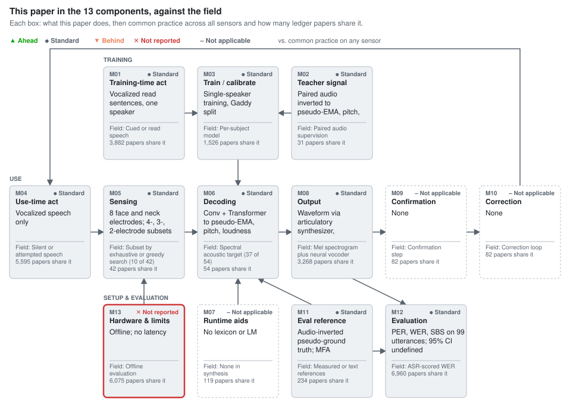

# Articulatory Feature Prediction from Surface EMG during Speech Production

Lee, Huang, Avramidis, Pistrosch, Gonzalez-Machorro, Lee, Schuller, Goldstein, Narayanan. Interspeech 2025. [doi:10.21437/Interspeech.2025-565](https://doi.org/10.21437/Interspeech.2025-565) · [arXiv:2505.13814](https://arxiv.org/abs/2505.13814)

**Section:** [Surface EMG](../../README.md#surface-emg)

## Figures

### This paper in the 13 components, against the field

<picture><source media="(prefers-color-scheme: dark)" srcset="figures/components-dark.svg"></picture>

Verdicts compare the paper's choice for each component with common practice across 8,995 ledger entries on any sensor (silent speech, brain-to-text, lip reading).

Data

| Component | This paper | Common practice | Papers with this practice | Verdict |
| --- | --- | --- | --- | --- |
| M01 Training-time act | Vocalized read sentences, one speaker | Cued or read speech | 3,882 of 8,995 | ● Standard (Inherited corpus.) |
| M02 Teacher signal | Paired audio inverted to pseudo-EMA, pitch, loudness | Paired audio supervision | 31 of 8,995 | ● Standard (Audio-inferred kinematics as in [@anumanchipalli2019].) |
| M03 Train / calibrate | Single-speaker training, Gaddy split | Per-subject model | 1,526 of 8,995 | ● Standard (Inherited encoder and split.) |
| M04 Use-time act | Vocalized speech only | Silent or attempted speech | 5,595 of 8,995 | ● Standard (Silent subset unused.) |
| M05 Sensing | 8 face and neck electrodes; 4-, 3-, 2-electrode subsets | Subset by exhaustive or greedy search (10 of 42) | 42 of 8,995 | ● Standard (No equal-size comparison.) |
| M06 Decoding | Conv + Transformer to pseudo-EMA, pitch, loudness | Spectral acoustic target (37 of 54) | 54 of 8,995 | ● Standard (Route exists for ECoG since 2019.) |
| M07 Runtime aids | No lexicon or LM | None in synthesis | 119 of 8,995 | – Not applicable (Synthesis task.) |
| M08 Output | Waveform via articulatory synthesizer, external speaker embedding | Mel spectrogram plus neural vocoder | 3,268 of 8,995 | ● Standard (Vocoder differs from baseline.) |
| M09 Confirmation | None | Confirmation step | 82 of 8,995 | – Not applicable (Offline.) |
| M10 Correction | None | Correction loop | 82 of 8,995 | – Not applicable (Offline.) |
| M11 Eval reference | Audio-inverted pseudo-ground truth; MFA transcripts | Measured or text references | 234 of 8,995 | ● Standard (No measured EMA.) |
| M12 Evaluation | PER, WER, SBS on 99 utterances; 95% CI undefined | ASR-scored WER | 6,960 of 8,995 | ● Standard (No seeds or reruns.) |
| M13 Hardware & limits | Offline; no latency | Offline evaluation | 6,075 of 8,995 | ✕ Not reported (No latency or online test.) |

## Verdict

The paper [[1]](#ref-1) changes the intermediate target of EMG-to-speech synthesis (M06) and proposes an electrode subset from feature associations (M05); both are standard. The articulatory route works on vocalized EMG but trails the mel baseline: WER 15.5% against 12.6% (Table 2). Its one gain, SpeechBERTScore 84.4 against 77.9, comes with a different synthesizer (HiFi-GAN for the baseline; Sec. 4.3, 4.5), so the representation is not isolated from the vocoder. The average correlation of 0.9 (EMA and loudness; pitch close to 0.6, Sec. 4.1) is measured against features inverted from the same audio, not measured articulation (Sec. 3.1, 4.5). The electrode subset is never compared with equal-size alternatives; a later exhaustive test ranks it 5th of 70 [[2]](#ref-2).

## Against the field, component by component

### M06 Processing: articulatory features as the EMG-to-speech intermediate

**Usual approach:** Of 54 surface-EMG synthesis studies (pattern match, unique studies; Appendix), 37 predict spectral acoustic features (mel, MFCC or vocoder parameters), as Gaddy and Klein do with the conv + Transformer encoder this paper reuses [[3]](#ref-3). The paper predicts 12-dimensional pseudo-EMA, pitch and loudness instead.

**State of the art:** On the same corpus, GETS [later] (2026) reaches 11.89% WER on silent EMG, a task not comparable with the vocalized results here [[4]](#ref-4). Against the paper's own re-scored Gaddy et al. baseline (12.6% WER, Table 2), the paper is 2.9 points (23% relative) behind (inference).

Decoding through an articulatory intermediate is not new: Anumanchipalli et al. decoded ECoG into kinematics inferred from audio and then into acoustics, and the step beat a direct decoder on the same data by 0.54 dB MCD [[5]](#ref-5). Of the 4 confirmed studies in the articulatory-intermediate topic, two use ECoG and none before this one uses surface EMG (Appendix), which confirms the authors' priority claim, stated for surface EMG (Abstract). Wu et al. [concurrent] estimated EMA from the audio of the same corpus for multimodal pre-training, with HuBERT-Soft speech units as the intermediate [[6]](#ref-6). The paper lacks that control (same encoder, acoustic target, same synthesizer), so its SBS gain is a vocoder comparison. Verdict: standard.

### M05 Sensors: choosing an electrode subset

**Usual approach:** Of 42 surface-EMG speech studies that report subsets or rankings (pattern match, unique studies; Appendix), 10 search over trained models, as Zhu et al. do with sequential forward selection over 120 electrodes [[7]](#ref-7). A priori selection predates it too: Sridhar et al. chose 5 of 11 sensors by mutual information and matched the full set (80.6% vs 79.6%) [[8]](#ref-8).

**State of the art:** Hwang et al. [later] (2026) evaluated all 70 four-channel subsets of this array (mel target, HiFi-GAN, medium-size ASR scorer). The best reached 47.2% WER; this paper's subset, listed there as (1, 2, 3, 5), the zero-based code indices of electrodes 2, 3, 4, 6 (inference), ranked 5th at 48.4% [[2]](#ref-2). The paper's own 22.9% uses another synthesizer and ASR scorer, so only the ranking transfers.

The paper's four electrodes raise WER from 15.5% to 22.9% and two electrodes to 46.9% (Table 3). That is 7.4 points, or 48% relative, for halving the array (inference). The authors call the choice an informed alternative to random search (Sec. 4.4) but test no equal-size alternative; Sec. 3.1–3.2, 4.1–4.4 and the table captions do not state which partition selected it. Verdict: standard.

## The 13 components

| Component | This paper | Usual approach (count) | State of the art | Verdict |
|---|---|---|---|---|
| M01 Training-time action | Vocalized read sentences, one speaker | Cued or read speech (slot-filled 3,882) | – | standard |
| M02 Training-only supervision | Paired audio inverted to pseudo-EMA, pitch, loudness | Paired audio supervision (slot-filled 31) | – | standard |
| M03 Training and adaptation | Single-speaker training, Gaddy split | Per-subject model (slot-filled 1,526) | – | standard |
| M04 Use-time action | Vocalized speech only | Silent or attempted speech (slot-filled 5,595) | – | standard |
| M05 Sensors | 8 face and neck electrodes; 4-, 3-, 2-electrode subsets | Subset by exhaustive or greedy search (10 of 42) (pattern match 42) | Best four-channel subset 47.2% WER; this subset 48.4%, 5th of 70 [[2]](#ref-2) | standard |
| M06 Processing and decoding | Conv + Transformer to pseudo-EMA, pitch, loudness | Spectral acoustic target (37 of 54) (pattern match 54) | 11.89% WER on silent EMG, not comparable with vocalized results [[4]](#ref-4) | standard |
| M07 Lexicon and LM | No lexicon or LM | None in synthesis (slot-filled 119) | – | not applicable |
| M08 Output | Waveform via articulatory synthesizer, external speaker embedding | Mel spectrogram plus neural vocoder (slot-filled 3,268) | – | standard |
| M09 Confirmation | None | Confirmation step (slot-filled 82) | – | not applicable |
| M10 Correction | None | Correction loop (slot-filled 82) | – | not applicable |
| M11 Reference construction | Audio-inverted pseudo-ground truth; MFA transcripts | Measured or text references (slot-filled 234) | – | standard |
| M12 Evaluation | PER, WER, SBS on 99 utterances; 95% CI undefined | ASR-scored WER (slot-filled 6,960) | – | standard |
| M13 Device and cost | Offline; no latency | Offline evaluation (slot-filled 6,075) | – | not reported |

## Where the claims outrun the evidence

- **Correlation as articulation.** EMA, pitch and loudness targets come from an inversion model applied to the paired audio (Sec. 3.1); the authors concede this (Sec. 4.5). The average correlation of 0.9 for EMA and loudness measures agreement with that model; lips over tongue (Sec. 4.2) describes the pseudo-labels.
- **Comparable intelligibility.** The authors call it comparable, "though slightly worse" (Sec. 4.3); PER 36.0 vs 33.9 and WER 15.5 vs 12.6 favour the baseline (Table 2), whose vocoder also differs (Sec. 4.3).
- **Silent speech.** All results are vocalized EMG of one speaker (Sec. 3.1); the silent subset of the corpus, where Gaddy and Klein report 42.2% WER [[3]](#ref-3), is unused.
- **Uncertainty.** Table captions and Sec. 3.2, 4.1–4.4 give no construction for the 95% intervals and no seeds or reruns.

## What the field needs next

- M06: the same encoder trained on mel targets and on articulatory targets, both voiced by one synthesizer, over several seeds, as in the direct-decoder control of [[5]](#ref-5).
- M04: the articulatory route on silent EMG, scored against [[4]](#ref-4).
- M05: the feature-association subset against exhaustive four-channel results [[2]](#ref-2), selected on validation data only.

## Questions for the authors

- Which partition produced Fig. 4 and Tables 2 and 3, and was the electrode subset chosen without test data?
- How were the 95% intervals computed, and how many training runs stand behind each value?
- Was the Gaddy baseline retrained on your split, and with which speaker conditioning?
- How do predicted features correlate with measured EMA?

## Appendix: literature search

- **M06 emg-to-speech-intermediate-target.** Inclusion rule: surface-EMG speech synthesis or voicing studies, classified by the intermediate the EMG model predicts before the waveform (spectral acoustic features, self-supervised speech units, articulatory features, text or phonemes); recognition-only, auxiliary-EMG, non-speech EMG and reviews excluded; versions once. Ledger: 7,345 slot-filled; 54 pattern match (unique studies). Usual design: spectral acoustic target, 37 (pattern match); text or phoneme 26; articulatory features or EMA 22 (upper bound: any mention); speech units 19. Read in full: [[3]](#ref-3), [[4]](#ref-4) (state of the art), [[6]](#ref-6). Known-item recall 1.0 (3 seeds).
- **M06 articulatory-intermediate** (published table, appended). Inclusion rule: pathways that first decode an explicit articulatory representation from a non-acoustic signal and then convert it to acoustics, waveforms or symbols; articulatory-measurement inputs, acoustic inversion, auxiliary-loss-only uses and reviews excluded. Ledger: 7,345 slot-filled; 12 pattern match plus 32 full-text-only folders; 4 confirmed unique studies (ECoG 2, EEG 1, surface EMG 1, the target). Read in full: [[5]](#ref-5) (prior; state of the art), [[6]](#ref-6) (excluded). Known-item recall 1.0.
- **M05 emg-speech-electrode-subset.** Inclusion rule: surface-EMG speech studies that evaluate a reduced electrode subset or rank electrodes, classified by selection method (exhaustive or greedy search, single-channel ranking, random subsets, attribution or association); fixed-array-only, hardware-only, non-speech and EEG-only studies excluded. Ledger: 7,329 slot-filled; 42 pattern match (unique studies). Usual design: exhaustive or greedy search, 10 (pattern match); attribution or association wording 21 (upper bound); single-channel ranking 5; random subsets 3. Read in full: [[8]](#ref-8), [[7]](#ref-7) (prior), [[2]](#ref-2) (state of the art).

## References

Numbered by first citation. BibTeX in the same order and keys: [refs.bib](refs.bib).

1. Lee, J., Huang, K., Avramidis, K., Pistrosch, S., Gonzalez-Machorro, M., Lee, Y., et al. “Articulatory Feature Prediction from Surface EMG during Speech Production.” *Proc. Interspeech 2025*, 2025, 320–324. doi:[10.21437/Interspeech.2025-565](https://doi.org/10.21437/Interspeech.2025-565). arXiv:[2505.13814](https://arxiv.org/abs/2505.13814). arXiv v2 read; venue confirmed in Crossref [review](https://github.com/supernaiter/silent-speech-review/tree/main/reviews/articulatory-feature-prediction-from-surface-emg-during-speech-production) [wiki: arxiv-2505.13814](https://github.com/supernaiter/deep-research-wiki-for-silent-speech/blob/main/papers/arxiv-2505.13814/article.md) [wiki: isca-lee25d_interspeech](https://github.com/supernaiter/deep-research-wiki-for-silent-speech/blob/main/papers/isca-lee25d_interspeech/article.md)
2. Hwang, I., Lee, J., Lee, K. “EMG-to-Speech with Fewer Channels.” *arXiv preprint*, 2026. arXiv:[2602.06460](https://arxiv.org/abs/2602.06460). [later] [review](https://github.com/supernaiter/silent-speech-review/tree/main/reviews/emg-to-speech-with-fewer-channels) [wiki: arxiv-2602.06460](https://github.com/supernaiter/deep-research-wiki-for-silent-speech/blob/main/papers/arxiv-2602.06460/article.md)
3. Gaddy, D., Klein, D. “An Improved Model for Voicing Silent Speech.” *Proc. ACL-IJCNLP 2021 (Volume 2: Short Papers)*, 2021, 175–181. doi:[10.18653/v1/2021.acl-short.23](https://doi.org/10.18653/v1/2021.acl-short.23). arXiv:[2106.01933](https://arxiv.org/abs/2106.01933). [review](https://github.com/supernaiter/silent-speech-review/tree/main/reviews/an-improved-model-for-voicing-silent-speech) [wiki: arxiv-2106.01933](https://github.com/supernaiter/deep-research-wiki-for-silent-speech/blob/main/papers/arxiv-2106.01933/article.md) [wiki: doi-10.18653-v1-2021.acl-short.23](https://github.com/supernaiter/deep-research-wiki-for-silent-speech/blob/main/papers/doi-10.18653-v1-2021.acl-short.23/article.md)
4. Lee, J., Lee, J., Lee, K. “GETS: Guiding EMG-to-Speech Synthesis via Silent Speech Recognition.” *Proc. Interspeech 2026*, 2026. doi:[10.21437/Interspeech.2026-1938](https://doi.org/10.21437/Interspeech.2026-1938). [later] [wiki: isca-lee26r_interspeech](https://github.com/supernaiter/deep-research-wiki-for-silent-speech/blob/main/papers/isca-lee26r_interspeech/article.md)
5. Anumanchipalli, G. K., Chartier, J., Chang, E. F. “Speech synthesis from neural decoding of spoken sentences.” *Nature*, 2019, 568(7753), 493–498. doi:[10.1038/s41586-019-1119-1](https://doi.org/10.1038/s41586-019-1119-1). [review](https://github.com/supernaiter/silent-speech-review/tree/main/reviews/speech-synthesis-from-neural-decoding-of-spoken-sentences) [wiki: doi-10.1038-s41586-019-1119-1](https://github.com/supernaiter/deep-research-wiki-for-silent-speech/blob/main/papers/doi-10.1038-s41586-019-1119-1/article.md) [wiki: pmc-9714519-speechsynth](https://github.com/supernaiter/deep-research-wiki-for-silent-speech/blob/main/papers/pmc-9714519-speechsynth/article.md)
6. Wu, P., Yu, B., Scheck, K., Black, A. W., Krishnapriyan, A. S., Chen, I. Y., et al. “Deep Speech Synthesis from Multimodal Articulatory Representations.” *arXiv preprint*, 2024. arXiv:[2412.13387](https://arxiv.org/abs/2412.13387). [concurrent] [wiki: arxiv-2412.13387](https://github.com/supernaiter/deep-research-wiki-for-silent-speech/blob/main/papers/arxiv-2412.13387/article.md)
7. Zhu, M., Zhang, H., Wang, X., Wang, X., Yang, Z., Wang, C., et al. “Towards optimizing electrode configurations for silent speech recognition based on high-density surface electromyography.” *Journal of Neural Engineering*, 2021, 18(1), 016005. doi:[10.1088/1741-2552/abca14](https://doi.org/10.1088/1741-2552/abca14). [wiki: doi-10.1088-1741-2552-abca14](https://github.com/supernaiter/deep-research-wiki-for-silent-speech/blob/main/papers/doi-10.1088-1741-2552-abca14/article.md)
8. Sridhar, V. K. R., Prasad, R., Natarajan, P. “Mutual Information analysis for feature and sensor subset selection in surface electromyography based speech recognition.” *Proc. Interspeech 2010*, 2010. doi:[10.21437/Interspeech.2010-100](https://doi.org/10.21437/Interspeech.2010-100). [wiki: isca-sridhar10_interspeech](https://github.com/supernaiter/deep-research-wiki-for-silent-speech/blob/main/papers/isca-sridhar10_interspeech/article.md)

## Materials

Data behind this review. Full texts of the papers are not included.

- [`review.md`](review.md): the review text (source)
- [`refs.bib`](refs.bib): references (BibTeX)
- [`slots.json`](slots.json): for each of the 13 components: this paper's choice, field practice, number of matching papers, verdict
- [`figures.json`](figures.json): figure definitions
- [`evaluation.md`](evaluation.md): independent evaluation by a second reviewer
- [`triage.md`](triage.md): how each evaluation finding was checked against the sources and resolved
- [`components/M05/emg-speech-electrode-subset.csv`](../../components/M05/emg-speech-electrode-subset.csv): M05 topic "emg-speech-electrode-subset", every candidate paper with its decision (7329 slot-filled, 42 pattern match, usual design in 10, 4 read in full)
- [`components/M06/articulatory-intermediate.csv`](../../components/M06/articulatory-intermediate.csv): M06 topic "articulatory-intermediate", every candidate paper with its decision (7345 slot-filled, 12 pattern match, usual design in 2, 44 read in full)
- [`components/M06/emg-to-speech-intermediate-target.csv`](../../components/M06/emg-to-speech-intermediate-target.csv): M06 topic "emg-to-speech-intermediate-target", every candidate paper with its decision (7345 slot-filled, 54 pattern match, usual design in 37, 4 read in full)

## More reviews in Surface EMG

- [A Parallel Ultra-Low Power Silent Speech Interface based on a Wearable, Fully-dry EMG Neckband](../a-parallel-ultra-low-power-silent-speech-interface-based-on-a-wearable-fully-dry-emg-neckband/) (2025). A fully dry wearable EMG neckband with ultra-low-power BioGAP-Ultra classifies 8 silently articulated words for one healthy user at 68% accuracy, dropping to 54% on an unseen re-wearing session; acquisition plus BLE uses 22.2 mW.
- [A Silent Speech Decoding System from EEG and EMG with Heterogenous Electrode Configurations](../a-silent-speech-decoding-system-from-eeg-and-emg-with-heterogenous-electrode-configurations/) (2025). Pooled EEG/EMG pretraining lifts 64-word accuracy, but each test subject's training sessions, the patient's included, are in pretraining; the coordinate kernel is neither new nor best.
- [CAT-Net: A Cross-Attention Tone Network for Cross-Subject EEG-EMG Fusion Tone Decoding](../cat-net-a-cross-attention-tone-network-for-cross-subject-eeg-emg-fusion-tone-decoding/) (2025). CAT-Net fuses EEG and surface EMG with cross-attention to classify Mandarin lexical tones in silent articulation, reporting 85.10% leave-one-subject-out accuracy over 4 tones.
- [Confidence-Based Self-Training for EMG-to-Speech: Leveraging Synthetic EMG for Robust Modeling](../confidence-based-self-training-for-emg-to-speech-leveraging-synthetic-emg-for-robust-modeling/) (2025). Uses confidence-filtered synthetic EMG generated from speech, mixed with real data, for EMG-to-speech; on real vocalized EMG from one speaker, WER falls from 23.30% to 21.87%.
- [emg2speech: Synthesizing speech from electromyography using self-supervised speech models](../emg2speech-synthesizing-speech-from-electromyography-using-self-supervised-speech-models/) (2025). emg2speech synthesizes speech from face and neck surface EMG via HuBERT units without the user's own recordings; silent speech from one ALS participant gives 50.82% human-transcribed WER.
- [From Silent Signals to Natural Language: A Dual-Stage Transformer-LLM Approach](../from-silent-signals-to-natural-language-a-dual-stage-transformer-llm-approach/) (2025). GPT-2 correction of one ASR transcript is neither first nor near the field: LLM correction of silent-EMG hypotheses already reached 12.2% WER on this benchmark; here 30% on ~100 utterances, one run.

---

Part of the [Silent Speech Interface Review](https://github.com/supernaiter/silent-speech-review). Found an error? [Open an issue](https://github.com/supernaiter/silent-speech-review/issues/new?template=correction.yml).
