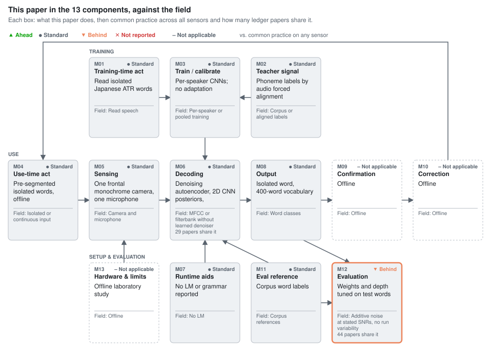

# Audio-visual speech recognition using deep learning

Noda, K., Yamaguchi, Y., Nakadai, K., Okuno, H. G., Ogata, T. · Applied Intelligence 42 · 2015 · [DOI:10.1007/s10489-014-0629-7](https://doi.org/10.1007/s10489-014-0629-7)

**Section:** [Other sensors](../../README.md#other-sensors)

## Figures

### This paper in the 13 components, against the field

<picture><source media="(prefers-color-scheme: dark)" srcset="figures/components-dark.svg"></picture>

Verdicts compare the paper's choice for each component with common practice across 8,995 ledger entries on any sensor (silent speech, brain-to-text, lip reading).

Data

| Component | This paper | Common practice | Papers with this practice | Verdict |
| --- | --- | --- | --- | --- |
| M01 Training-time act | Read isolated Japanese ATR words | Read speech |  | ● Standard (Inherited from the group's corpus.) |
| M02 Teacher signal | Phoneme labels by audio forced alignment | Corpus or aligned labels |  | ● Standard (Shared with [@noda2014lipreading].) |
| M03 Train / calibrate | Per-speaker CNNs; no adaptation | Per-speaker or pooled training |  | ● Standard (No validation set; no seeds.) |
| M04 Use-time act | Pre-segmented isolated words, offline | Isolated or continuous input |  | ● Standard (Inherited.) |
| M05 Sensing | One frontal monochrome camera, one microphone | Camera and microphone |  | ● Standard (Lab rig of the group's corpus.) |
| M06 Decoding | Denoising autoencoder, 2D CNN posteriors, multi-stream HMM | MFCC or filterbank without learned denoiser | 29 of 55 | ● Standard (Learned denoiser 0 of 55; 2D CNN 0 of 106.) |
| M07 Runtime aids | No LM or grammar reported | No LM |  | ● Standard (Isolated-word HMMs.) |
| M08 Output | Isolated word, 400-word vocabulary | Word classes |  | ● Standard (Inherited.) |
| M09 Confirmation | Offline | Offline |  | – Not applicable (Offline study.) |
| M10 Correction | Offline | Offline |  | – Not applicable (Offline study.) |
| M11 Eval reference | Corpus word labels | Corpus references |  | ● Standard (Recording count inconsistent.) |
| M12 Evaluation | Weights and depth tuned on test words | Additive noise at stated SNRs, no run variability | 44 of 55 | ▼ Behind (Held-out set named in 7 of 55.) |
| M13 Hardware & limits | Offline laboratory study | Offline |  | – Not applicable (Real-world conditions deferred (Sec. 8).) |

## Verdict

Both learned front ends of the decoder (M06) [[1]](#ref-1) are new to their populations, 0 of 55 prior AVSR studies naming a learned audio denoiser and 0 of 106 prior lip-reading studies a 2D CNN (pattern match, Appendix), but each moves an outside design ([[2]](#ref-2), [[3]](#ref-3)) and neither gain is repeated, so M06 is standard. The same authors' [concurrent] Interspeech paper [[4]](#ref-4) reports the same visual pipeline on the same corpus without mention in the journal text. Evaluation (M12) is behind on one point: stream weights and autoencoder depth are chosen on the 40 test words, whereas read priors tune weights on held-out data [[5]](#ref-5), [[6]](#ref-6). As the paper states (Sec. 5.3), the "additional 10 %" at 0 dB (Sec. 6.5) is thus a best-of-weights result from one run.

## Against the field, component by component

### M06 Audio front end: denoising autoencoder on MFCC windows

**Usual approach:** Of 55 prior AVSR studies (pattern match, Appendix), 29 name MFCC or filterbank features, 8 any audio enhancement and 0 a learned denoiser.

**State of the art:** In Whisper-Flamingo's (2024) Table 3, VIT 3D reaches 6.1% WER audio-only on English LRS3 sentences (speaker-independent, NoiseX babble at 0 dB) [[7]](#ref-7) [later]; it warns that noisy WER across noise sets is not directly comparable.

The denoiser moves the audio-only design the paper cites [[2]](#ref-2) in front of the fusion. The earlier audio-visual autoencoder [[8]](#ref-8) trains on single-modality inputs, not noisy audio. The main confound is matched noise: the denoiser is trained and tested on the same synthetic Gaussian noise (Sec. 5.1, Sec. 6.1), so the ~65% gain under 10 dB (Abstract) is in-distribution, with only the 5 dB intermediate levels unseen. Verdict: standard.

### M06 Visual front end: CNN phoneme posteriors

**Usual approach:** Of 106 prior lip-reading studies with a recognizer (pattern match, Appendix), 96 name an HMM, 81 hand-crafted features, 4 learned deep features and 0 a 2D CNN on mouth images.

**State of the art:** SyncVSR (2024) reaches 93.2% top-1 on the 500-word, speaker-independent LRW test, without word boundaries, LRW only (157 h) [[9]](#ref-9) [later]; the paper's best is about 22.5%, 40 unseen words of seen speakers (Sec. 6.4).

Networks with phonetic outputs predate it: an MS-TDNN on 384 gray-level lip pixels with viseme states [[3]](#ref-3), and ANN phoneme posteriors from lip parameters in HMMs [[10]](#ref-10); the 2D CNN is new. Its 45.87% phonemes at 32 × 32 (Table 4) and about 22.5% words fall below the 58% and about 37% of [[4]](#ref-4), whose CNN used image sequences from all 300 words, test words included, with a 216/84 split; the target trains the CNN on the 360 training words (Sec. 6.4). Table 4 has per-speaker phoneme rates but no repeated word comparison. Verdict: standard.

### M06 Fusion: multi-stream HMM with weights picked per SNR

**Usual approach:** Of 55 prior AVSR studies (pattern match, Appendix), 26 name multi-stream or coupled HMMs, 22 feature concatenation and 9 automatic or trained stream weights.

**State of the art:** In Whisper-Flamingo (2024), at 0 dB NoiseX babble on LRS3, VIT 3D falls from 6.1% WER audio-only to 2.9% audio-visual [[7]](#ref-7) [later], a 52% relative reduction (inference).

The sweep is the group's: Yoshida and Nakadai swept from 0 to 1 at 0.1 intervals, then regressed the optimal weight on SNR [[11]](#ref-11) (Sec. 3.2, Fig. 1). The paper drops the regression; the authors call adaptive selection open (Sec. 7.2) and "not attained" (Sec. 8). Verdict: standard.

### M12 Evaluation: weights and depth tuned on the test words

**Usual approach:** Of 55 prior AVSR studies (pattern match, Appendix), 44 test stated SNRs, 23 babble or recorded noise, 24 white or Gaussian noise, 9 run variability and 7 a held-out set, [[5]](#ref-5) and [[6]](#ref-6) among them.

**State of the art:** USR 2.0 (2026) reports LRS3 low-resource AVSR WER as mean and SD over three random seeds (50-epoch runs, appendix Table 13) [[12]](#ref-12) [later].

Against best comparable work, Papandreou et al. search the audio weight between 0.0 and 1.0 in steps of 0.1, the paper's grid (Sec. 5.3), on a reserved speaker group [[5]](#ref-5); Potamianos and Neti set the exponent on a held-out set [[6]](#ref-6); Miyajima et al. train weights on training data by GPD [[13]](#ref-13). The paper picks weights and depth on its 40 test words (Sec. 5.3, Sec. 6.1); Gaussian noise was common (24 of 55). Verdict: behind.

## The 13 components

| Component | This paper | Usual approach (count) | State of the art | Verdict |
|---|---|---|---|---|
| M01 Training-time action | Read isolated Japanese ATR words | Read speech | – | standard |
| M02 Training-only supervision | Phoneme labels by audio forced alignment | Corpus or aligned labels | – | standard |
| M03 Training and adaptation | Per-speaker CNNs; no adaptation | Per-speaker or pooled training | – | standard |
| M04 Use-time action | Pre-segmented isolated words, offline | Isolated or continuous input | – | standard |
| M05 Sensors | One frontal monochrome camera, one microphone | Camera and microphone | – | standard |
| M06 Processing and decoding | Denoising autoencoder, 2D CNN posteriors, multi-stream HMM | MFCC or filterbank without learned denoiser (pattern match 29) | [[7]](#ref-7) (2024): LRS3, babble 0 dB, AV 2.9% WER | standard |
| M07 Lexicon and LM | No LM or grammar reported | No LM | – | standard |
| M08 Output | Isolated word, 400-word vocabulary | Word classes | – | standard |
| M09 Confirmation | Offline | Offline | – | not applicable |
| M10 Correction | Offline | Offline | – | not applicable |
| M11 Reference construction | Corpus word labels | Corpus references | – | standard |
| M12 Evaluation | Weights and depth tuned on test words | Additive noise at stated SNRs, no run variability (pattern match 44) | [[12]](#ref-12) (2026): three seeds, appendix Table 13 | behind |
| M13 Device and cost | Offline laboratory study | Offline | – | not applicable |

## Where the claims outrun the evidence

- **Scope of "unaddressed".** CNN lipreading "remains unaddressed" (Sec. 2.2) holds for 2D CNNs but omits networks on lip pixels with phonetic outputs [[3]](#ref-3).
- **Frame split.** Phoneme rates come from shuffled frames split 5/6 to 1/6 (Sec. 5.2), so neighbouring frames of one word sit in training and test (inference).
- **Oracle fusion.** The result is the best over "all stream weight pairs" (Sec. 5.3), which the paper states; depth was picked on the same curves (Sec. 6.1).
- **Inconsistencies.** "216 training words" (Sec. 5.2) against 360 elsewhere; 24000 recordings (Sec. 4) for 2,400 utterances (inference).

## What the field needs next

- M06: the denoiser on unseen babble and recorded noise, against noise-augmented HMM training.
- M06: weights predicted from estimated SNR at test time, as in [[11]](#ref-11).
- M12: a development split for weights and depth, phoneme splits by word, repeated runs.

## Questions for the authors

- Are the 10% and 65% gains absolute or relative, and at which SNR?
- Is the denoiser applied to noisy test features in Sec. 6.5?
- How do phoneme rates change with a split by word?

## Appendix: literature search

Dating against the target's first public month 2014-12: prior before 2014-06, [concurrent] 2014-06 to 2015-06, [later] after 2015-06; months from arXiv ids, ICASSP (May) and ISCA venues (September). Versions count once (ledger key, and untitled duplicate ISCA folders merged with their titled folder); the target is excluded; 19 studies with no automatic recognizer (perception, synthesis, lip tracking, corpus only) are excluded by a checked list, and lip-reading studies whose text names no recognizer by a term filter. Design counts are full-text pattern matches with reference lists removed; related-work mentions count, so they are upper bounds.

**M06, avsr-audio-feature-denoising.** Inclusion rule: studies whose ledger names AVSR, classified by whether their full text names a learned audio denoiser (denoising autoencoder or neural enhancement), any audio enhancement, and MFCC or filterbank features. Ledger: slot-filled M06 7,345 unique studies; pattern match 349 unique studies. Prior (55): MFCC or filterbank 29, any enhancement 8, learned denoiser 0, denoising autoencoder 0. [Concurrent] (4): learned denoiser 0. [Later] (256): denoising autoencoder 4, learned denoiser 12. Usual design at the time: MFCC or filterbank features without a learned denoiser, 29 of 55 (pattern match). Whole-wiki check (1,349 folders dated 2014 or earlier): denoising autoencoder with audio-visual terms, 1 hit [[8]](#ref-8), read. Outside precedent, cited by the target: [[2]](#ref-2). State of the art [[7]](#ref-7). Known-item recall 0.8 (4 of 5).

**M06, lipreading-temporal-model-and-feature-learning** (published table, appended). Inclusion rule: automatic lip-reading, VSR or AVSR studies with optical-camera input, classified by the visual model their full text names. Ledger: pattern match 975 unique studies. Prior (106; 63 without a recognizer term and the listed non-recognizer studies excluded): HMM 96, hand-crafted features 81, learned deep features 4, 2D CNN 0 (one regex hit, the broadcaster name CNN in oa-W3099202502, removed), neural network with phonetic or viseme outputs, TDNN or ANN/HMM 18. [Concurrent] (11): CNN 1 [[4]](#ref-4). [Later] (625): CNN 393. Usual design at the time: HMM classifier, 96 of 106 (pattern match). Whole-wiki check (1,349 folders): CNN with lip-reading terms, 1 hit [[4]](#ref-4), read. Read: [[3]](#ref-3), [[10]](#ref-10); state of the art [[9]](#ref-9). Known-item recall 1.0 (9 of 9).

**M06, avsr-stream-fusion-and-weighting.** Inclusion rule: the same AVSR population, classified by the fusion design its full text names: multi-stream or coupled HMM with stream weights, automatic or trained weights, feature concatenation, deep multimodal fusion. Prior (55): multi-stream HMM 26, concatenation 22, automatic weights 9, deep fusion 0; outside the population, [[8]](#ref-8) and Huang and Kingsbury 2013 (the target's reference 19). [Concurrent] (4): deep fusion 1. [Later] (256): concatenation 89, multi-stream HMM 27, deep fusion 25. Usual design at the time: multi-stream HMM, 26 of 55 (pattern match). Read: [[11]](#ref-11), [[13]](#ref-13), [[6]](#ref-6), [[5]](#ref-5); state of the art [[7]](#ref-7). Known-item recall 1.0 (7 of 7).

**M12, avsr-noise-and-run-variability-protocol** (published table, appended). Inclusion rule: the same AVSR population, classified by evaluation protocol: additive noise at stated SNRs, babble or recorded noise, white or Gaussian noise, run variability, named held-out set. Ledger: slot-filled M12 6,960 unique studies; pattern match 349 unique studies. Prior (55): stated SNR 44, babble or recorded 23, Gaussian 24, variability 9, held-out set 7. Usual design at the time: additive noise at stated SNRs without run variability, 44 of 55 (pattern match). Read: [[5]](#ref-5), [[6]](#ref-6), [[13]](#ref-13); state of the art [[12]](#ref-12). Known-item recall 1.0 (4 of 4).

## References

Numbered by first citation. BibTeX in the same order and keys: [refs.bib](refs.bib).

1. Noda, K., Yamaguchi, Y., Nakadai, K., Okuno, H. G., Ogata, T. “Audio-visual speech recognition using deep learning.” *Applied Intelligence*, 2015, 42, 722-737. doi:[10.1007/s10489-014-0629-7](https://doi.org/10.1007/s10489-014-0629-7). Target. Published online 20 December 2014. [wiki: doi-10.1007-s10489-014-0629-7](https://github.com/supernaiter/deep-research-wiki-for-silent-speech/blob/main/papers/doi-10.1007-s10489-014-0629-7/article.md)
2. Feng, X., Zhang, Y., Glass, J. “Speech feature denoising and dereverberation via deep autoencoders for noisy reverberant speech recognition.” *2014 IEEE International Conference on Acoustics, Speech and Signal Processing (ICASSP)*, 2014, 1759-1763. doi:[10.1109/ICASSP.2014.6853900](https://doi.org/10.1109/ICASSP.2014.6853900). Prior; cited by the target (its reference 13); audio-only deep-autoencoder feature denoising. Not in the wiki; described through the target's citation.
3. Duchnowski, P., Meier, U., Waibel, A. “See Me, Hear Me: Integrating Automatic Speech Recognition and Lip-reading.” *Proc. 3rd International Conference on Spoken Language Processing (ICSLP 94)*, 1994. <https://www.isca-archive.org/icslp_1994/duchnowski94_icslp.html> Prior; neural network on gray-level lip pixels with viseme-state outputs (M06 visual front end). [wiki: isca-duchnowski94_icslp](https://github.com/supernaiter/deep-research-wiki-for-silent-speech/blob/main/papers/isca-duchnowski94_icslp/article.md)
4. Noda, K., Yamaguchi, Y., Nakadai, K., Okuno, H. G., Ogata, T. “Lipreading using Convolutional Neural Network.” *Interspeech 2014*, 2014. doi:[10.21437/Interspeech.2014-293](https://doi.org/10.21437/Interspeech.2014-293). Same authors; same corpus and CNN-to-HMM visual pipeline. Same paper also held as wiki folder isca-noda14_interspeech. [concurrent] [wiki: isca-noda14-cnnlip](https://github.com/supernaiter/deep-research-wiki-for-silent-speech/blob/main/papers/isca-noda14-cnnlip/article.md) [wiki: isca-noda14_interspeech](https://github.com/supernaiter/deep-research-wiki-for-silent-speech/blob/main/papers/isca-noda14_interspeech/article.md)
5. Papandreou, G., Katsamanis, A., Pitsikalis, V., Maragos, P. “Adaptive Multimodal Fusion by Uncertainty Compensation With Application to Audiovisual Speech Recognition.” *IEEE Transactions on Audio, Speech, and Language Processing*, 2009, 17(3). doi:[10.1109/TASL.2008.2011515](https://doi.org/10.1109/TASL.2008.2011515). Prior; deciding prior for M12 (weights grid-searched on a reserved speaker group, NOISEX babble, held-out speakers). [wiki: doi-10.1109-tasl.2008.2011515](https://github.com/supernaiter/deep-research-wiki-for-silent-speech/blob/main/papers/doi-10.1109-tasl.2008.2011515/article.md)
6. Potamianos, G., Neti, C. “Audio-Visual Speech Recognition in Challenging Environments.” *Proc. 8th European Conference on Speech Communication and Technology (Eurospeech 2003)*, 2003. doi:[10.21437/Eurospeech.2003-1026](https://doi.org/10.21437/Eurospeech.2003-1026). Prior; deciding prior for M12 (stream exponent on a held-out set, babble noise). [wiki: isca-potamianos03_eurospeech](https://github.com/supernaiter/deep-research-wiki-for-silent-speech/blob/main/papers/isca-potamianos03_eurospeech/article.md)
7. Rouditchenko, A., Gong, Y., Thomas, S., Karlinsky, L., Kuehne, H., Feris, R., et al. “Whisper-Flamingo: Integrating Visual Features into Whisper for Audio-Visual Speech Recognition and Translation.” *Interspeech 2024*, 2024. arXiv:[2406.10082](https://arxiv.org/abs/2406.10082). Tabulates noisy LRS3 results (Table 3); state of the art for the M06 audio front end and fusion. [later] [wiki: arxiv-2406.10082](https://github.com/supernaiter/deep-research-wiki-for-silent-speech/blob/main/papers/arxiv-2406.10082/article.md) [wiki: isca-rouditchenko24-whisperflamingo](https://github.com/supernaiter/deep-research-wiki-for-silent-speech/blob/main/papers/isca-rouditchenko24-whisperflamingo/article.md) [wiki: in24-whisperflamingo](https://github.com/supernaiter/deep-research-wiki-for-silent-speech/blob/main/papers/in24-whisperflamingo/article.md) [wiki: isca-rouditchenko24_interspeech](https://github.com/supernaiter/deep-research-wiki-for-silent-speech/blob/main/papers/isca-rouditchenko24_interspeech/article.md)
8. Ngiam, J., Khosla, A., Kim, M., Nam, J., Lee, H., Ng, A. Y. “Multimodal Deep Learning.” *Proceedings of the 28th International Conference on Machine Learning (ICML 2011)*, 2011. doi:[10.5555/3104482.3104569](https://doi.org/10.5555/3104482.3104569). Prior; cited by the target; earlier audio-visual autoencoder (M06 audio front end) and deep fusion outside the AVSR ledger population. [wiki: w2076462394-ngiamavsr](https://github.com/supernaiter/deep-research-wiki-for-silent-speech/blob/main/papers/w2076462394-ngiamavsr/article.md)
9. Ahn, Y. J., Park, J., Park, S., Choi, J., Kim, K. “SyncVSR: Data-Efficient Visual Speech Recognition with End-to-End Crossmodal Audio Token Synchronization.” *Interspeech 2024*, 2024. arXiv:[2406.12233](https://arxiv.org/abs/2406.12233). State of the art for the M06 visual front end (LRW word accuracy). [later] [wiki: arxiv-2406.12233](https://github.com/supernaiter/deep-research-wiki-for-silent-speech/blob/main/papers/arxiv-2406.12233/article.md)
10. Heckmann, M., Berthommier, F., Kroschel, K. “A Hybrid ANN/HMM Audio-Visual Speech Recognition System.” *Proc. Auditory-Visual Speech Processing (AVSP 2001)*, 2001. <https://www.isca-archive.org/avsp_2001/heckmann01_avsp.html> Prior; ANN phoneme posteriors from lip parameters fused in an ANN/HMM (M06 visual front end). [wiki: isca-heckmann01-annhmm](https://github.com/supernaiter/deep-research-wiki-for-silent-speech/blob/main/papers/isca-heckmann01-annhmm/article.md)
11. Yoshida, T., Nakadai, K. “Two-Layered Audio-Visual Integration in Voice Activity Detection and Automatic Speech Recognition for Robots.” *Interspeech 2010*, 2010. doi:[10.21437/Interspeech.2010-716](https://doi.org/10.21437/Interspeech.2010-716). Prior; same group (Nakadai); deciding prior for M06 fusion (stream-weight regression on SNR). [wiki: isca-yoshida10-twolayer](https://github.com/supernaiter/deep-research-wiki-for-silent-speech/blob/main/papers/isca-yoshida10-twolayer/article.md)
12. Haliassos, A., Mira, R., Petridis, S. “Pay Attention to CTC: Fast and Robust Pseudo-Labelling for Unified Speech Recognition.” *International Conference on Learning Representations (ICLR)*, 2026. arXiv:[2602.19316](https://arxiv.org/abs/2602.19316). Protocol state of the art for M12 (three seeds). [later] [wiki: arxiv-2602.19316](https://github.com/supernaiter/deep-research-wiki-for-silent-speech/blob/main/papers/arxiv-2602.19316/article.md)
13. Miyajima, C., Tokuda, K., Kitamura, T. “Audio-visual speech recognition using MCE-based HMMs and model-dependent stream weights.” *Proc. 6th International Conference on Spoken Language Processing (ICSLP 2000)*, 2000. doi:[10.21437/ICSLP.2000-446](https://doi.org/10.21437/ICSLP.2000-446). Prior; deciding prior for M06 and M12 (trained stream weights, speaker-independent jackknife). [wiki: isca-miyajima00_icslp](https://github.com/supernaiter/deep-research-wiki-for-silent-speech/blob/main/papers/isca-miyajima00_icslp/article.md)

## Materials

Data behind this review. Full texts of the papers are not included.

- [`review.md`](review.md): the review text (source)
- [`refs.bib`](refs.bib): references (BibTeX)
- [`slots.json`](slots.json): for each of the 13 components: this paper's choice, field practice, number of matching papers, verdict
- [`figures.json`](figures.json): figure definitions
- [`evaluation.md`](evaluation.md): independent evaluation by a second reviewer
- [`triage.md`](triage.md): how each evaluation finding was checked against the sources and resolved
- [`process/log.json`](process/log.json): process record: each step, who did it (reader, script, writer, evaluator), when, the checks run and the input versions
- [`process/notes.json`](process/notes.json): reading notes on the target and comparator papers: claims, numbers, conditions and what is not stated, with locations
- [`process/plan.json`](process/plan.json): plan: which components the paper changes and the topics it is compared on
- [`process/draft.md`](process/draft.md): the review as first written, before the independent evaluation
- [`process/claims-draft.md`](process/claims-draft.md): claim table of the draft: every claim mapped to a note or a count
- [`process/claims.md`](process/claims.md): claim table of the published review
- [`components/M06/avsr-audio-feature-denoising.csv`](../../components/M06/avsr-audio-feature-denoising.csv): M06 topic "avsr-audio-feature-denoising", every candidate paper with its decision (7345 slot-filled, 349 pattern match, usual design in 29, 2 read in full)
- [`components/M06/avsr-stream-fusion-and-weighting.csv`](../../components/M06/avsr-stream-fusion-and-weighting.csv): M06 topic "avsr-stream-fusion-and-weighting", every candidate paper with its decision (7345 slot-filled, 349 pattern match, usual design in 26, 5 read in full)
- [`components/M06/lipreading-temporal-model-and-feature-learning.csv`](../../components/M06/lipreading-temporal-model-and-feature-learning.csv): M06 topic "lipreading-temporal-model-and-feature-learning", every candidate paper with its decision (7345 slot-filled, 975 pattern match, usual design in 113, 6 read in full)
- [`components/M12/avsr-noise-and-run-variability-protocol.csv`](../../components/M12/avsr-noise-and-run-variability-protocol.csv): M12 topic "avsr-noise-and-run-variability-protocol", every candidate paper with its decision (6960 slot-filled, 349 pattern match, usual design in 183, 3 read in full)

## More reviews in Other sensors

- [Brain-to-text: decoding spoken phrases from phone representations in the brain](../brain-to-text-decoding-spoken-phrases-from-phone-representations-in-the-brain/) (2015). Phone-model decoder (M06) is the EMG recognizer moved to ECoG: standard. 25% WER uses per-phrase dictionaries holding the spoken words (M07); the time-shift null (M12) is sound.
- [Fully Implanted Brain-Computer Interface in a Locked-In Patient with ALS](../fully-implanted-brain-computer-interface-in-a-locked-in-patient-with-als/) (2016). Skin-closed ECoG implant used at home without investigators (M13): standard, one user, skin-closed telemetry predates it; main-text 89% spelling accuracy pools inactive steps, no chance level.
- [Lipreading with Long Short-Term Memory](../lipreading-with-long-short-term-memory/) (2016). Joint LSTM + pixel front end (M06) is ahead of 2015 lipreading, but pixel-input and recurrent word models predate it, and the 8.3-point gain is over linear SVMs, not HMMs.
- [Word pair classification during imagined speech using direct brain recordings](../word-pair-classification-during-imagined-speech-using-direct-brain-recordings/) (2016). Whole-word output (M08) is new only to intracranial recordings (Suppes 1997, EEG/MEG); DTW kernel (M06) gain unshown; imagery window confounded by heard and upcoming overt word.
- [Decoding spectrotemporal features of overt and covert speech from the human cortex](../decoding-spectrotemporal-features-of-overt-and-covert-speech-from-the-human-cortex/) (2014). Overt-trained ECoG decoding of covert reading (M04), spectral outputs (M08) and the overt-recording covert reference (M11) are standard; DTW-aligned rest reaches r 0.30 vs covert 0.34.
- [Direct classification of all American English phonemes using signals from functional speech motor cortex](../direct-classification-of-all-american-english-phonemes-using-signals-from-functional-speech-motor-co/) (2014). Phoneme-onset events within words (M06) are ahead as a protocol; full-inventory classification predates it (Brumberg 2011); the 36% headline is consonants only, on hand-labelled onsets.

---

Part of the [Silent Speech Interface Review](https://github.com/supernaiter/silent-speech-review). Found an error? [Open an issue](https://github.com/supernaiter/silent-speech-review/issues/new?template=correction.yml).
