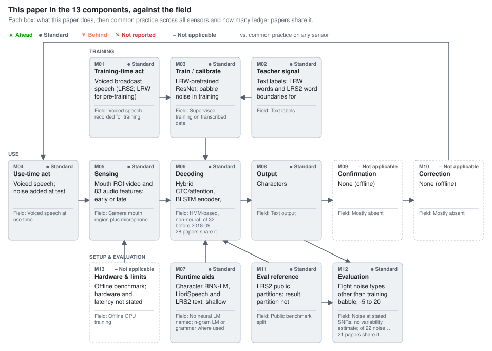

# Audio-Visual Speech Recognition with a Hybrid CTC/Attention Architecture

Stavros Petridis, Themos Stafylakis, Pingchuan Ma, Georgios Tzimiropoulos, Maja Pantic. SLT 2018. [doi:10.1109/SLT.2018.8639643](https://doi.org/10.1109/SLT.2018.8639643) [arXiv:1810.00108](https://arxiv.org/abs/1810.00108)

**Section:** [Other sensors](../../README.md#other-sensors)

## Figures

### This paper in the 13 components, against the field

<picture><source media="(prefers-color-scheme: dark)" srcset="figures/components-dark.svg"></picture>

Verdicts compare the paper's choice for each component with common practice across 8,995 ledger entries on any sensor (silent speech, brain-to-text, lip reading).

Data

| Component | This paper | Common practice | Papers with this practice | Verdict |
| --- | --- | --- | --- | --- |
| M01 Training-time act | Voiced broadcast speech (LRS2; LRW for pre-training) | Voiced speech recorded for training |  | ● Standard (Inherited.) |
| M02 Teacher signal | Text labels; LRW words and LRS2 word boundaries for front-end pre-training | Text labels |  | ● Standard (Inherited.) |
| M03 Train / calibrate | LRW-pretrained ResNet; babble noise in training | Supervised training on transcribed data |  | ● Standard (Inherited.) |
| M04 Use-time act | Voiced speech; noise added at test | Voiced speech at use time |  | ● Standard (Inherited.) |
| M05 Sensing | Mouth ROI video and 83 audio features; early or late fusion | Camera mouth region plus microphone |  | ● Standard (Inherited.) |
| M06 Decoding | Hybrid CTC/attention, BLSTM encoder, joint beam search | HMM-based, non-neural; of 32 before 2018-09 | 28 of 32 | ● Standard (No hybrid objective in the 32 earlier sentence-level AVSR studies (Appendix); no CTC-only or attention-only result reported.) |
| M07 Runtime aids | Character RNN-LM, LibriSpeech and LRS2 text, shallow fusion | No neural LM named; n-gram LM or grammar where used |  | ● Standard (Neural LM with external text; no LM-free result.) |
| M08 Output | Characters | Text output |  | ● Standard (Inherited.) |
| M09 Confirmation | None (offline) | Mostly absent |  | – Not applicable (Offline benchmark.) |
| M10 Correction | None (offline) | Mostly absent |  | – Not applicable (Offline benchmark.) |
| M11 Eval reference | LRS2 public partitions; result partition not written | Public benchmark split |  | ● Standard (Inherited.) |
| M12 Evaluation | Eight noise types other than training babble, -5 to 20 dB; one run | Noise at stated SNRs, no variability estimate; of 22 noise studies before 2018-09 | 21 of 22 | ● Standard (Unseen test noise types; one run, split unnamed.) |
| M13 Hardware & limits | Offline benchmark; hardware and latency not stated | Offline GPU training |  | – Not applicable (No device or latency claim.) |

## Verdict

The paper [[1]](#ref-1) changes one component, M06, and it is standard: none of the 32 earlier sentence-level AVSR studies in the ledger trains a hybrid CTC/attention objective (Appendix), but the paper reports neither a CTC-only nor an attention-only result (Table 2), so the objective's share of its 7.0% WER is unmeasured. In visual-only lip reading, the concurrent [[2]](#ref-2) found the jointly trained variant worse than a single-loss cascade even after tuning its weight (4.9% against 2.9% WER, Table III, Sec. 4.C). The clearest overreach is the visual-only claim "without using any external databases" (Sec. 6), made for a front end pretrained on LRW (Sec. 5.1). M07 and M12 are standard: no LM-free result, and no variability estimate, as in 21 of 22 earlier noise studies (Appendix).

## Against the field, component by component

### M06 Processing: hybrid CTC/attention objective and joint decoding

**Usual approach:** Of the 32 sentence-level AVSR studies in the ledger dated before 2018-09, 28 are non-neural HMM-era systems, corpora or reports; the 4 neural ones train CTC ([[3]](#ref-3) and one other), attention (WLAS [[4]](#ref-4)) or a frame-wise classifier (pattern match, read, Appendix). None trains a hybrid CTC/attention objective (Appendix). The concurrent [[5]](#ref-5) trains CTC and seq2seq separately (Sec. 1).

**State of the art:** The same objective with a Conformer encoder and 3,448 hours gives 1.5% LRS2 AVSR WER and 14.6% visual-only (2023) [[6]](#ref-6) [later], against 7.0% and 63.5% here (Table 2), 79% and 77% lower (inference); its audio-only is also 1.5% (Table 3), so the clean audio-visual gain vanishes there.

At the same 380 hours, CM-seq2seq [[7]](#ref-7) [later], same objective, gives 3.9% (Table 3 of [[6]](#ref-6)), 44% below 7.0%: later gains came from encoder and data (inference). LCANet's multi-task AH-CTC-CE baseline (Table II, Sec. 4.C) [[2]](#ref-2) [concurrent] already trained CTC and attention losses jointly on GRID; the authors cite it and the acoustic origin of the objective (Sec. 1). The novelty claim holds for audio-visual recognition (0 of 32, Appendix). Standard: one dataset, one run, no ablation crediting the objective.

### M07 Lexicon and LM: external-text RNN language model

**Usual approach:** None of the 32 earlier sentence-level AVSR studies names a neural language model (pattern match, Appendix). Here a character RNN-LM on LibriSpeech and LRS2 text is shallow-fused (Secs. 5.3, 5.4); the concurrent [[5]](#ref-5) also uses an external LM and reports results without it (Table 2).

**State of the art:** [[6]](#ref-6) [later] (2023) decodes visual-only models with a Transformer LM trained on 166 million characters, at 14.6% LRS2 WER, and uses no LM for audio and audio-visual models because none helped (Sec. 3.3).

With no LM-free LRS2 number (Table 2), the LM and its out-of-domain text cannot be separated from the 6.9-point visual-only gain over WAS [[4]](#ref-4) (Sec. 6). Standard.

### M12 Evaluation: noise sweep and run variability

**Usual approach:** 22 of the 32 earlier sentence-level AVSR studies test additive noise at stated SNRs, and 21 of them give no variability estimate (pattern match, Appendix); the one with an estimate dates from 1999. The paper reports one run and no seeds (Sec. 5.2). Its strength: the eight test noise types (Sec. 6) differ from the training babble (Sec. 5.2).

**State of the art:** [[8]](#ref-8) [later] (2022) reports LRS2 WER as mean and standard deviation over ten runs: 29.5 ± 0.4% visual-only on LRW and LRS2, 380 hours (Table 1), where it lists this paper at 63.5%. For noise, [[6]](#ref-6) (2023) attributes its low babble test WER mainly to babble also used in training (Sec. 4.4).

Neither the partition behind Table 2 and Fig. 3 (test is implied, Sec. 4.2, inference) nor the noise mixing is written (Sec. 6). Standard.

## The 13 components

| Component | This paper | Usual approach (count) | State of the art | Verdict |
|---|---|---|---|---|
| M01 Training-time action | Voiced broadcast speech (LRS2; LRW for pre-training) | Voiced speech recorded for training | – | standard |
| M02 Training-only supervision | Text labels; LRW words and LRS2 word boundaries for front-end pre-training | Text labels | – | standard |
| M03 Training and adaptation | LRW-pretrained ResNet; babble noise in training | Supervised training on transcribed data | – | standard |
| M04 Use-time action | Voiced speech; noise added at test | Voiced speech at use time | – | standard |
| M05 Sensors | Mouth ROI video and 83 audio features; early or late fusion | Camera mouth region plus microphone | – | standard |
| M06 Processing and decoding | Hybrid CTC/attention, BLSTM encoder, joint beam search | HMM-based, non-neural; of 32 before 2018-09 (pattern match 28) | [[6]](#ref-6) 1.5% LRS2 AVSR WER, same objective | standard |
| M07 Lexicon and LM | Character RNN-LM, LibriSpeech and LRS2 text, shallow fusion | No neural LM named; n-gram LM or grammar where used | [[6]](#ref-6) Transformer LM for visual-only; none for AV | standard |
| M08 Output | Characters | Text output | – | standard |
| M09 Confirmation | None (offline) | Mostly absent | – | not applicable |
| M10 Correction | None (offline) | Mostly absent | – | not applicable |
| M11 Reference construction | LRS2 public partitions; result partition not written | Public benchmark split | – | standard |
| M12 Evaluation | Eight noise types other than training babble, -5 to 20 dB; one run | Noise at stated SNRs, no variability estimate; of 22 noise studies before 2018-09 (pattern match 21) | [[8]](#ref-8) mean and std over ten runs | standard |
| M13 Device and cost | Offline benchmark; hardware and latency not stated | Offline GPU training | – | not applicable |

## Where the claims outrun the evidence

- The authors separate their public training data from the comparator's non-public pretraining (Table 2 caption). But the visual-only result is called state of the art "without using any external databases" (Sec. 6) while the ResNet is pretrained on LRW (Sec. 5.1), and [[8]](#ref-8) lists the system under LRW plus LRS2 (Table 1). The audio-only and audio-visual results use LibriSpeech LM text (Sec. 5.3); their 7.0% against 8.2% for [[5]](#ref-5) (Table 2) mixes objective, front end, LM text and fusion.
- The clean audio-visual gain, 8.3% to 7.0% WER (Table 2), 16% relative (inference), comes from one run with no seeds (Sec. 5.2).
- "Late fusion performs worse than early fusion" (Sec. 6) rests on clean audio, one weight of 0.85 (Sec. 5.4) and one run; the noise sweep uses early fusion only (Sec. 6).
- Sec. 1 says "high SNR levels" for the 32.9-point gain where Sec. 6 and Sec. 7 mean high noise, a one-line slip.

## What the field needs next

- M06: an α sweep including 0 and 1, front end, LM and data fixed, three or more seeds, on two corpora.
- M07: results without the LM.
- M12: a released noisy test list, late fusion included.

## Questions for the authors

- Which LRS2 partition produced Table 2 and Fig. 3?
- What WER do α = 0 and α = 1 give, and what ranges were searched?
- What is the WER without the language model?

## Appendix: literature search

- Setting, the same for every topic: sentence-level AVSR, studies whose ledger matches both the sentence-level lip-reading pattern and the AVSR pattern (265 unique keys). State at the target's time: 38 dated before 2018-09, minus 5 human-perception entries (4 studies) and 1 version duplicate, gives 32; 4 entries (3 studies) dated only to 2018 are left out. Counts are full-text pattern matches, mentions included, unless marked read.
- M06, sentence-lipreading-sequence-objective (published table, appended). Inclusion rule: the published rule (sentence-level or open-vocabulary speech from lip or face video, classified by the sequence objective the full text names), restricted here to the AVSR subset. Ledger counts: 7,345 unique studies slot-filled for M06; 633 unique studies pattern match. Of the 32, mentions: HMM 32, CTC 4, attention or seq2seq 1, hybrid or joint CTC/attention 0. Designs after reading the 4 neural studies: CTC 2, attention 1, frame-wise 1; the other 28 non-neural. Recall check over 2,236 wiki studies first public before 2018-09: 5 hits, one design ([[2]](#ref-2), [concurrent], visual-only GRID) and 4 mentions or citations. Read: [[3]](#ref-3), [[4]](#ref-4) (prior); [[2]](#ref-2), [[5]](#ref-5) ([concurrent]); [[6]](#ref-6) (state of the art). Known-item recall 1.0.
- M07, use-time-language-model-visual-speech (published table, appended). Inclusion rule: the published rule (use-time language information named in the full text), restricted to the AVSR subset. Ledger counts: 119 unique studies slot-filled for M07; 633 unique studies pattern match. Of the 32: neural LM 0; n-gram pattern 4; grammar or lexicon 12. Read: [[5]](#ref-5) ([concurrent]); [[6]](#ref-6) (state of the art). Known-item recall 1.0.
- M12, avsr-noise-and-run-variability-protocol (published table, appended). Inclusion rule: the published rule and regexes (additive noise at stated SNRs, babble, run variability), restricted to the sentence-level subset. Ledger counts: 6,960 unique studies slot-filled for M12; 349 unique studies pattern match. Of the 32: additive noise at stated SNRs 22; babble 14; variability pattern 2, of which 1 is a run-variability estimate after reading (the other a human-listener test), so 21 of 22 without. Read: [[8]](#ref-8), [[6]](#ref-6) (state of the art). Known-item recall 1.0.

## References

Numbered by first citation. BibTeX in the same order and keys: [refs.bib](refs.bib).

1. Petridis, S., Stafylakis, T., Ma, P., Tzimiropoulos, G., Pantic, M. “Audio-Visual Speech Recognition with a Hybrid CTC/Attention Architecture.” *IEEE Spoken Language Technology Workshop (SLT)*, 2018. doi:[10.1109/SLT.2018.8639643](https://doi.org/10.1109/SLT.2018.8639643). arXiv:[1810.00108](https://arxiv.org/abs/1810.00108). First public as arXiv:1810.00108v1 (dated 28 Sep 2018). [wiki: arxiv-1810.00108](https://github.com/supernaiter/deep-research-wiki-for-silent-speech/blob/main/papers/arxiv-1810.00108/article.md) [wiki: doi-10.1109-slt.2018.8639643](https://github.com/supernaiter/deep-research-wiki-for-silent-speech/blob/main/papers/doi-10.1109-slt.2018.8639643/article.md)
2. Xu, K., Li, D., Cassimatis, N., Wang, X. “LCANet: End-to-End Lipreading with Cascaded Attention-CTC.” *IEEE International Conference on Automatic Face and Gesture Recognition (FG)*, 2018, 548-555. arXiv:[1803.04988](https://arxiv.org/abs/1803.04988). Visual-only GRID; multi-task CTC + attention variant with joint decoding (M06), cited by the target. [concurrent] [wiki: arxiv-1803.04988](https://github.com/supernaiter/deep-research-wiki-for-silent-speech/blob/main/papers/arxiv-1803.04988/article.md)
3. Sanabria, R., Metze, F., De La Torre, F. “Robust End-to-End Deep Audiovisual Speech Recognition.” *arXiv preprint*, 2016. arXiv:[1611.06986](https://arxiv.org/abs/1611.06986). Prior; deciding prior for M06 (CTC-only end-to-end AVSR). [wiki: arxiv-1611.06986](https://github.com/supernaiter/deep-research-wiki-for-silent-speech/blob/main/papers/arxiv-1611.06986/article.md)
4. Chung, J. S., Senior, A., Vinyals, O., Zisserman, A. “Lip Reading Sentences in the Wild.” *IEEE Conference on Computer Vision and Pattern Recognition (CVPR)*, 2017. doi:[10.1109/CVPR.2017.367](https://doi.org/10.1109/CVPR.2017.367). arXiv:[1611.05358](https://arxiv.org/abs/1611.05358). Prior; deciding prior for M06 (attention-only audio-visual character decoder). [review](https://github.com/supernaiter/silent-speech-review/tree/main/reviews/lip-reading-sentences-in-the-wild) [wiki: arxiv-1611.05358](https://github.com/supernaiter/deep-research-wiki-for-silent-speech/blob/main/papers/arxiv-1611.05358/article.md) [wiki: cvf-chung17-lipreadwild](https://github.com/supernaiter/deep-research-wiki-for-silent-speech/blob/main/papers/cvf-chung17-lipreadwild/article.md)
5. Afouras, T., Chung, J. S., Senior, A., Vinyals, O., Zisserman, A. “Deep Audio-Visual Speech Recognition.” *IEEE Transactions on Pattern Analysis and Machine Intelligence*, 2018. doi:[10.1109/TPAMI.2018.2889052](https://doi.org/10.1109/TPAMI.2018.2889052). arXiv:[1809.02108](https://arxiv.org/abs/1809.02108). Separate CTC and seq2seq models on one front end, with and without an external LM (M06, M07); a comparison system in the target's Table 2. [concurrent] [review](https://github.com/supernaiter/silent-speech-review/tree/main/reviews/deep-audio-visual-speech-recognition) [wiki: arxiv-1809.02108](https://github.com/supernaiter/deep-research-wiki-for-silent-speech/blob/main/papers/arxiv-1809.02108/article.md) [wiki: doi-10.1109-tpami.2018.2889052](https://github.com/supernaiter/deep-research-wiki-for-silent-speech/blob/main/papers/doi-10.1109-tpami.2018.2889052/article.md)
6. Ma, P., Haliassos, A., Fernandez-Lopez, A., Chen, H., Petridis, S., Pantic, M. “Auto-AVSR: Audio-Visual Speech Recognition with Automatic Labels.” *IEEE International Conference on Acoustics, Speech and Signal Processing (ICASSP)*, 2023. doi:[10.1109/ICASSP49357.2023.10096889](https://doi.org/10.1109/ICASSP49357.2023.10096889). arXiv:[2303.14307](https://arxiv.org/abs/2303.14307). LRS2 state of the art for the joint CTC/attention lineage (M06, M07). [later] [review](https://github.com/supernaiter/silent-speech-review/tree/main/reviews/auto-avsr-audio-visual-speech-recognition-with-automatic-labels) [wiki: arxiv-2303.14307](https://github.com/supernaiter/deep-research-wiki-for-silent-speech/blob/main/papers/arxiv-2303.14307/article.md)
7. Ma, P., Petridis, S., Pantic, M. “End-to-End Audio-Visual Speech Recognition with Conformers.” *IEEE International Conference on Acoustics, Speech and Signal Processing (ICASSP)*, 2021, 7613-7617. arXiv:[2102.06657](https://arxiv.org/abs/2102.06657). CM-seq2seq: joint CTC/attention with a Conformer encoder at the target's 380 h (M06). [later] [review](https://github.com/supernaiter/silent-speech-review/tree/main/reviews/end-to-end-audio-visual-speech-recognition-with-conformers) [wiki: arxiv-2102.06657](https://github.com/supernaiter/deep-research-wiki-for-silent-speech/blob/main/papers/arxiv-2102.06657/article.md)
8. Ma, P., Petridis, S., Pantic, M. “Visual Speech Recognition for Multiple Languages in the Wild.” *Nature Machine Intelligence*, 2022, 930-939. doi:[10.1038/s42256-022-00550-z](https://doi.org/10.1038/s42256-022-00550-z). arXiv:[2202.13084](https://arxiv.org/abs/2202.13084). LRS2 results as mean and standard deviation over ten runs (M12). [later] [review](https://github.com/supernaiter/silent-speech-review/tree/main/reviews/visual-speech-recognition-for-multiple-languages-in-the-wild) [wiki: arxiv-2202.13084](https://github.com/supernaiter/deep-research-wiki-for-silent-speech/blob/main/papers/arxiv-2202.13084/article.md) [wiki: doi-10.1038-s42256-022-00550-z](https://github.com/supernaiter/deep-research-wiki-for-silent-speech/blob/main/papers/doi-10.1038-s42256-022-00550-z/article.md)

## Materials

Data behind this review. Full texts of the papers are not included.

- [`review.md`](review.md): the review text (source)
- [`refs.bib`](refs.bib): references (BibTeX)
- [`slots.json`](slots.json): for each of the 13 components: this paper's choice, field practice, number of matching papers, verdict
- [`figures.json`](figures.json): figure definitions
- [`evaluation.md`](evaluation.md): independent evaluation by a second reviewer
- [`triage.md`](triage.md): how each evaluation finding was checked against the sources and resolved
- [`process/log.json`](process/log.json): process record: each step, who did it (reader, script, writer, evaluator), when, the checks run and the input versions
- [`process/notes.json`](process/notes.json): reading notes on the target and comparator papers: claims, numbers, conditions and what is not stated, with locations
- [`process/plan.json`](process/plan.json): plan: which components the paper changes and the topics it is compared on
- [`process/draft.md`](process/draft.md): the review as first written, before the independent evaluation
- [`process/claims-draft.md`](process/claims-draft.md): claim table of the draft: every claim mapped to a note or a count
- [`process/claims.md`](process/claims.md): claim table of the published review
- [`components/M06/sentence-lipreading-sequence-objective.csv`](../../components/M06/sentence-lipreading-sequence-objective.csv): M06 topic "sentence-lipreading-sequence-objective", every candidate paper with its decision (7345 slot-filled, 633 pattern match, usual design in 291, 6 read in full)
- [`components/M07/use-time-language-model-visual-speech.csv`](../../components/M07/use-time-language-model-visual-speech.csv): M07 topic "use-time-language-model-visual-speech", every candidate paper with its decision (119 slot-filled, 633 pattern match, usual design in 143, 4 read in full)
- [`components/M12/avsr-noise-and-run-variability-protocol.csv`](../../components/M12/avsr-noise-and-run-variability-protocol.csv): M12 topic "avsr-noise-and-run-variability-protocol", every candidate paper with its decision (6960 slot-filled, 349 pattern match, usual design in 183, 3 read in full)

## More reviews in Other sensors

- [End-to-End Audiovisual Speech Recognition](../end-to-end-audiovisual-speech-recognition/) (2018). Raw-waveform front end and BGRU fusion (M06) depart from the usual approach but are standard: they tie MFCC in clean LRW audio (97.7%); noise gains lack repeated runs and use matched babble.
- [Inferring imagined speech using EEG signals: a new approach using Riemannian manifold features](../inferring-imagined-speech-using-eeg-signals-a-new-approach-using-riemannian-manifold-features/) (2018). Covariance tangent-space + RVM (M06) is new to imagined-speech EEG but beats only at-chance baselines; evaluation is behind: no test against chance, which 3 of 7 priors ran.
- [Large-Scale Visual Speech Recognition](../large-scale-visual-speech-recognition/) (2018). Its YouTube mining scaled on in later work, but Table 1 holds data fixed; the phoneme+WFST decoder had 2016-17 priors; zero-shot LRS3 changes everything at once: standard.
- [Generating Natural, Intelligible Speech From Brain Activity in Motor, Premotor, and Inferior Frontal Cortices](../generating-natural-intelligible-speech-from-brain-activity-in-motor-premotor-and-inferior-frontal-co/) (2019). Unit selection (M06) and own-voice concatenation (M08) are standard: an EMG design new to ECoG, never compared on its folds; 4-choice test (M12) on 30 best words; naturalness unmeasured.
- [Real-time decoding of question-and-answer speech dialogue using human cortical activity](../real-time-decoding-of-question-and-answer-speech-dialogue-using-human-cortical-activity/) (2019). Context prior from the decoded question (M07) is ahead, gaining in 3 of 3 participants; HMM decoder (M06) is standard; no online accuracy or latency backs the real-time claim.
- [Recurrent Neural Network Transducer for Audio-Visual Speech Recognition](../recurrent-neural-network-transducer-for-audio-visual-speech-recognition/) (2019). First neural transducer for audio-visual speech in the ledger, but the LRS3 gain mixes 31k h of data, external-LM baselines and the decoder; one run, one test set: all changes standard.

---

Part of the [Silent Speech Interface Review](https://github.com/supernaiter/silent-speech-review). Found an error? [Open an issue](https://github.com/supernaiter/silent-speech-review/issues/new?template=correction.yml).
