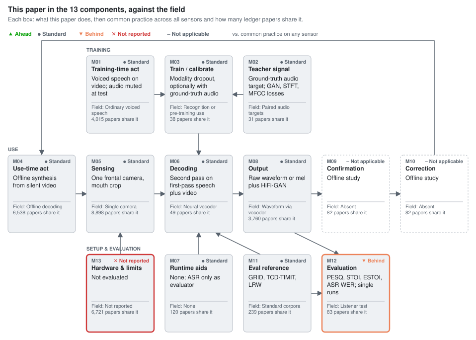

# Audio-visual video-to-speech synthesis with synthesized input audio

Triantafyllos Kefalas, Yannis Panagakis, Maja Pantic. arXiv preprint (cs.SD), 2023. [arXiv:2307.16584](https://arxiv.org/abs/2307.16584)

**Section:** [Lip & face video](../../README.md#lip--face-video)

## Figures

### This paper in the 13 components, against the field

<picture><source media="(prefers-color-scheme: dark)" srcset="figures/components-dark.svg"></picture>

Verdicts compare the paper's choice for each component with common practice across 8,995 ledger entries on any sensor (silent speech, brain-to-text, lip reading).

Data

| Component | This paper | Common practice | Papers with this practice | Verdict |
| --- | --- | --- | --- | --- |
| M01 Training-time act | Voiced speech on video; audio muted at test | Ordinary voiced speech | 4,015 of 8,995 | ● Standard (Inherited.) |
| M02 Teacher signal | Ground-truth audio target; GAN, STFT, MFCC losses | Paired audio targets | 31 of 8,995 | ● Standard (End-to-end WGAN lineage.) |
| M03 Train / calibrate | Modality dropout, optionally with ground-truth audio | Recognition or pre-training use | 38 of 8,995 | ● Standard (No variant best everywhere; Tables III, VI, VII.) |
| M04 Use-time act | Offline synthesis from silent video | Offline decoding | 6,538 of 8,995 | ● Standard (Inherited.) |
| M05 Sensing | One frontal camera, mouth crop | Single camera | 8,898 of 8,995 | ● Standard (Inherited.) |
| M06 Decoding | Second pass on first-pass speech plus video | Neural vocoder | 49 of 8,995 | ● Standard (Gains inconsistent.) |
| M07 Runtime aids | None; ASR only as evaluator | None | 120 of 8,995 | ● Standard (Inherited.) |
| M08 Output | Raw waveform or mel plus HiFi-GAN | Waveform via vocoder | 3,760 of 8,995 | ● Standard (Inherited.) |
| M09 Confirmation | Offline study | Absent | 82 of 8,995 | – Not applicable (Offline.) |
| M10 Correction | Offline study | Absent | 82 of 8,995 | – Not applicable (Offline.) |
| M11 Eval reference | GRID, TCD-TIMIT, LRW | Standard corpora | 239 of 8,995 | ● Standard (Inherited.) |
| M12 Evaluation | PESQ, STOI, ESTOI, ASR WER; single runs | Listener test | 83 of 8,995 | ▼ Behind (No listener test, no seeds.) |
| M13 Hardware & limits | Not evaluated | Not reported | 6,721 of 8,995 | ✕ Not reported (No latency or compute.) |

## Verdict

The paper [[1]](#ref-1) changes the decoder (M06), adding a second synthesis pass that takes the first pass's speech as input with the video, and training (M03), with modality dropout. Both are standard: autoregressive decoders already feed their own synthesized frames back at inference [[2]](#ref-2), so the claim of §I holds only for a separate audio encoder, and modality dropout is common in audio-visual recognition [[3]](#ref-3). The gains are small and inconsistent: on GRID unseen speakers the pre-trained base reaches 17.63% WER and its best second pass 17.70% (Table VI), and earlier systems keep lower WER on three of the four WER splits [[4]](#ref-4), [[5]](#ref-5), leading everywhere except GRID four speakers (3.67% against 4.07%, Table III). The strongest confound is extra training: the second pass adds an encoder and retrains the shared modules (§V-C3), with no equal-training control. There is no listener test and no repeated run, so the claim that synthesized audio helps is not supported.

## Against the field, component by component

### M06 Decoding: second pass on synthesized speech

**Usual approach:** A neural vocoder on predicted acoustic features is the most common design, 49 of 165 unique video-to-speech studies (pattern match, Appendix) [[6]](#ref-6), [[5]](#ref-5). Seven of the 165 name teacher forcing or scheduled sampling (pattern match, Appendix), the training schemes of autoregressive decoders that feed their own predicted frames back at inference; LipSound2 is one [[2]](#ref-2), and a memory network recalls audio context from video alone [[7]](#ref-7). The departure is a whole-utterance, non-autoregressive second pass with its own audio encoder.

**State of the art:** On the paper's own splits, earlier systems lead on WER: 16.05% (first public 2021) on GRID unseen speakers [[4]](#ref-4) against 17.69% for the best second-pass model (Table VI), and 12.90% (first public 2022) on LRW [[5]](#ref-5) against 14.24% (Table VII). On a different benchmark, LRS3 unseen speakers, a [later] flow-based model (2024) reaches 28.5% WER [[8]](#ref-8); this paper does not test there.

The second pass alone does not help: LRW raw-waveform WER rises from 29.79% to 30.73%, and only the variant with ground-truth-audio dropout lowers it to 24.96%, 4.83 points or 16.2% relative (inference), Table VII. On 4-speaker GRID without audio pre-training it rises from 4.68% to 4.84% (Table III). Verdict: standard; no repeated run shows the effect.

### M03 Training: modality dropout

**Usual approach:** Of 44 unique studies using modality dropout (pattern match, Appendix), 38 are audio-visual recognition, lip reading or pre-training, as in AV-HuBERT [[3]](#ref-3). The departure is a variant whose audio-only passes use ground-truth audio while inference uses synthesized audio (§V-C).

**State of the art:** None is established: 4 of the 165 video-to-speech studies, all 2023 or later, mention modality dropout, the target included (pattern match, Appendix). Inside the paper no variant wins everywhere: the ground-truth-audio variant is best on GRID four speakers (3.67%, Table III) and LRW raw waveform (24.96%), while variants without dropout are best on GRID unseen speakers (17.69%, Table VI) and LRW mel (14.24%, Table VII). Verdict: standard.

### M12 Evaluation: listener test and repeated runs

**Usual approach:** 83 of 165 video-to-speech studies run a listener or opinion test (pattern match, Appendix) [[9]](#ref-9), [[10]](#ref-10). The paper reports only PESQ, STOI, ESTOI and ASR WER (§V-D) and concedes that these metrics correlate imperfectly with human perception.

**State of the art:** Listener tests date from 2017: listeners reach 85% word accuracy on synthesized speech (2017) [[9]](#ref-9), and Vid2speech (2017) used 23 listeners [[10]](#ref-10). This paper has neither listeners nor repeated runs. Verdict: behind, against the typical study.

## The 13 components

| Component | This paper | Usual approach (count) | State of the art | Verdict |
|---|---|---|---|---|
| M01 Training-time action | Voiced speech on video; audio muted at test | Ordinary voiced speech (slot-filled 4,015) | – | standard |
| M02 Training-only supervision | Ground-truth audio target; GAN, STFT, MFCC losses | Paired audio targets (slot-filled 31) | – | standard |
| M03 Training and adaptation | Modality dropout, optionally with ground-truth audio | Recognition or pre-training use (pattern match 38) | – | standard |
| M04 Use-time action | Offline synthesis from silent video | Offline decoding (slot-filled 6,538) | – | standard |
| M05 Sensors | One frontal camera, mouth crop | Single camera (slot-filled 8,898) | – | standard |
| M06 Processing and decoding | Second pass on first-pass speech plus video | Neural vocoder (pattern match 49) | GRID unseen 16.05% WER [[4]](#ref-4); LRW 12.90% [[5]](#ref-5) | standard |
| M07 Lexicon and LM | None; ASR only as evaluator | None (slot-filled 120) | – | standard |
| M08 Output | Raw waveform or mel plus HiFi-GAN | Waveform via vocoder (slot-filled 3,760) | – | standard |
| M09 Confirmation | Offline study | Absent (slot-filled 82) | – | not applicable |
| M10 Correction | Offline study | Absent (slot-filled 82) | – | not applicable |
| M11 Reference construction | GRID, TCD-TIMIT, LRW | Standard corpora (slot-filled 239) | – | standard |
| M12 Evaluation | PESQ, STOI, ESTOI, ASR WER; single runs | Listener test (pattern match 83) | Listener word accuracy 85% [[9]](#ref-9) | behind |
| M13 Device and cost | Not evaluated | Not reported (slot-filled 6,721) | – | not reported |

## Where the claims outrun the evidence

- §I says no earlier method used audio inputs at inference, yet it describes the teacher-forced decoder of LipSound2 [[2]](#ref-2), which feeds its own predicted frames back at inference.
- The training-set audio comes from a base model fitted to that same set (§V-C), so the second pass trains on better audio than it sees at test (inference); the gap is not measured.
- Without an equal-training base, extra fine-tuning explains the gains as well as the audio input does (§V-C3).
- STOI gains such as 0.690 to 0.698 (GRID four speakers, Table III) are single runs with no seeds reported (§V-C2). The authors note that WER fluctuates (§VI-A) and that the decoder may suffer from fine-tuning twice (§VI); the text is honest, but "outperforms" overstates Tables IV–VII.
- On TCD-TIMIT, a 2021 system's STOI of 0.595 [[6]](#ref-6) beats every proposed model, the best of which reaches 0.569 (Table V).

## What the field needs next

- M06: a base model trained for the same extra steps with the audio branch fed zeros, and a third pass to test whether gains compound.
- M03: training-set audio from cross-fitted base models, so train and test inputs match.
- M12: a listener intelligibility test and at least three seeds with spread on GRID unseen speakers and LRW.

## Questions for the authors

- How close is training-set synthesized audio to the ground truth compared with test-set audio?
- How many extra steps does the second pass train, and what does the base gain from the same steps?
- How many seeds lie behind each table row?
- How are cropped mouth images normalized?

## Appendix: literature search

**M06 video-to-speech-synthesis.** Inclusion rule: studies that synthesize a speech waveform from talking-face or lip video with audio muted at test; enhancement with noisy audio, talking-head generation and text-only lip reading excluded. Ledger: 7,345 slot-filled unique studies; 165 pattern match (unique studies). Usual design: neural vocoder on predicted acoustic features, 49 of 165 (pattern match). Added full-text counts over the 165: synthesized speech fed as a second-stage input 1 (the target); teacher forcing or scheduled sampling 8 including the target; modality dropout 4 including the target. Read in full: [[2]](#ref-2), [[7]](#ref-7). Known-item recall 1.0 (published seeds); 0.67 for this review's 3 seeds, the memory-network paper lying outside the ledger pattern.

**M03 modality-dropout-training.** Inclusion rule: multimodal speech models trained while withholding one whole input modality per example or sequence; frame-level masking, ordinary dropout and citation-only mentions excluded. Ledger: 1,526 slot-filled unique studies; 44 pattern match (unique studies). Usual design: recognition, lip reading or audio-visual pre-training, 38 of 44 (pattern match); self-supervised pre-training 30; speech generation 9 including the target. Read in full: [[3]](#ref-3).

**M12 video-to-speech-output-evaluation.** Inclusion rule: the M06 population; how synthesized speech is evaluated. Ledger: 6,960 slot-filled unique studies; 165 pattern match (unique studies). Usual design: listener or opinion test, 83 of 165 (pattern match); unseen-speaker test 51, ASR WER on output 38. Read in full: [[9]](#ref-9), [[10]](#ref-10). Known-item recall 1.0.

## References

Numbered by first citation. BibTeX in the same order and keys: [refs.bib](refs.bib).

1. Kefalas, T., Panagakis, Y., Pantic, M. “Audio-visual video-to-speech synthesis with synthesized input audio.” *arXiv preprint (cs.SD)*, 2023. arXiv:[2307.16584](https://arxiv.org/abs/2307.16584). Target. Read as arXiv v1 (31 Jul 2023). [review](https://github.com/supernaiter/silent-speech-review/tree/main/reviews/audio-visual-video-to-speech-synthesis-with-synthesized-input-audio) [wiki: arxiv-2307.16584-av2acascade](https://github.com/supernaiter/deep-research-wiki-for-silent-speech/blob/main/papers/arxiv-2307.16584-av2acascade/article.md)
2. Qu, L., Weber, C., Wermter, S. “LipSound2: Self-Supervised Pre-Training for Lip-to-Speech Reconstruction and Lip Reading.” *IEEE Transactions on Neural Networks and Learning Systems*, 2022. doi:[10.1109/TNNLS.2022.3191677](https://doi.org/10.1109/TNNLS.2022.3191677). arXiv:[2112.04748](https://arxiv.org/abs/2112.04748). [wiki: arxiv-2112.04748](https://github.com/supernaiter/deep-research-wiki-for-silent-speech/blob/main/papers/arxiv-2112.04748/article.md) [wiki: doi-10.1109-tnnls.2022.3191677](https://github.com/supernaiter/deep-research-wiki-for-silent-speech/blob/main/papers/doi-10.1109-tnnls.2022.3191677/article.md)
3. Shi, B., Hsu, W., Lakhotia, K., Mohamed, A. “Learning Audio-Visual Speech Representation by Masked Multimodal Cluster Prediction.” *International Conference on Learning Representations (ICLR)*, 2022. arXiv:[2201.02184](https://arxiv.org/abs/2201.02184). [review](https://github.com/supernaiter/silent-speech-review/tree/main/reviews/learning-audio-visual-speech-representation-by-masked-multimodal-cluster-prediction) [wiki: arxiv-2201.02184](https://github.com/supernaiter/deep-research-wiki-for-silent-speech/blob/main/papers/arxiv-2201.02184/article.md)
4. Mira, R., Vougioukas, K., Ma, P., Petridis, S., Schuller, B. W., Pantic, M. “End-to-End Video-To-Speech Synthesis using Generative Adversarial Networks.” *IEEE Transactions on Cybernetics*, 2023, 53(6), 3454-3466. doi:[10.1109/TCYB.2022.3162495](https://doi.org/10.1109/TCYB.2022.3162495). arXiv:[2104.13332](https://arxiv.org/abs/2104.13332). Title and authors from the arXiv first page; journal, volume, pages and DOI confirmed against the Crossref record of the DOI. [wiki: arxiv-2104.13332](https://github.com/supernaiter/deep-research-wiki-for-silent-speech/blob/main/papers/arxiv-2104.13332/article.md)
5. Mira, R., Haliassos, A., Petridis, S., Schuller, B. W., Pantic, M. “SVTS: Scalable Video-to-Speech Synthesis.” *Interspeech 2022*, 2022. arXiv:[2205.02058](https://arxiv.org/abs/2205.02058). [review](https://github.com/supernaiter/silent-speech-review/tree/main/reviews/svts-scalable-video-to-speech-synthesis) [wiki: arxiv-2205.02058](https://github.com/supernaiter/deep-research-wiki-for-silent-speech/blob/main/papers/arxiv-2205.02058/article.md)
6. Kim, M., Hong, J., Ro, Y. M. “Lip to Speech Synthesis with Visual Context Attentional GAN.” *35th Conference on Neural Information Processing Systems (NeurIPS 2021)*, 2021. arXiv:[2204.01726](https://arxiv.org/abs/2204.01726). Read as arXiv v1 (4 Apr 2022). [wiki: arxiv-2204.01726](https://github.com/supernaiter/deep-research-wiki-for-silent-speech/blob/main/papers/arxiv-2204.01726/article.md)
7. Kim, M., Hong, J., Park, S. J., Ro, Y. M. “Multi-modality Associative Bridging through Memory: Speech Sound Recollected from Face Video.” *Proceedings of the IEEE/CVF International Conference on Computer Vision (ICCV)*, 2021. arXiv:[2204.01265](https://arxiv.org/abs/2204.01265). [review](https://github.com/supernaiter/silent-speech-review/tree/main/reviews/multi-modality-associative-bridging-through-memory-speech-sound-recollected-from-face-video) [wiki: arxiv-2204.01265](https://github.com/supernaiter/deep-research-wiki-for-silent-speech/blob/main/papers/arxiv-2204.01265/article.md) [wiki: cvf-kim21-mabm](https://github.com/supernaiter/deep-research-wiki-for-silent-speech/blob/main/papers/cvf-kim21-mabm/article.md)
8. Choi, J., Kim, J., Li, J., Chung, J. S., Liu, S. “V2SFlow: Video-to-Speech Generation with Speech Decomposition and Rectified Flow.” *arXiv preprint*, 2024. arXiv:[2411.19486](https://arxiv.org/abs/2411.19486). Read as arXiv v2 (30 May 2025). [later] [wiki: arxiv-2411.19486](https://github.com/supernaiter/deep-research-wiki-for-silent-speech/blob/main/papers/arxiv-2411.19486/article.md)
9. Le Cornu, T., Milner, B. “Generating Intelligible Audio Speech From Visual Speech.” *IEEE/ACM Transactions on Audio, Speech, and Language Processing*, 2017, 25(9), 1751-1761. doi:[10.1109/TASLP.2017.2716178](https://doi.org/10.1109/TASLP.2017.2716178). [wiki: doi-10.1109-taslp.2017.2716178](https://github.com/supernaiter/deep-research-wiki-for-silent-speech/blob/main/papers/doi-10.1109-taslp.2017.2716178/article.md)
10. Ephrat, A., Peleg, S. “Vid2speech: Speech Reconstruction from Silent Video.” *2017 IEEE International Conference on Acoustics, Speech and Signal Processing (ICASSP)*, 2017, 5095-5099. doi:[10.1109/ICASSP.2017.7953127](https://doi.org/10.1109/ICASSP.2017.7953127). arXiv:[1701.00495](https://arxiv.org/abs/1701.00495). [review](https://github.com/supernaiter/silent-speech-review/tree/main/reviews/vid2speech-speech-reconstruction-from-silent-video) [wiki: arxiv-1701.00495](https://github.com/supernaiter/deep-research-wiki-for-silent-speech/blob/main/papers/arxiv-1701.00495/article.md)

## Materials

Data behind this review. Full texts of the papers are not included.

- [`review.md`](review.md): the review text (source)
- [`refs.bib`](refs.bib): references (BibTeX)
- [`slots.json`](slots.json): for each of the 13 components: this paper's choice, field practice, number of matching papers, verdict
- [`figures.json`](figures.json): figure definitions
- [`evaluation.md`](evaluation.md): independent evaluation by a second reviewer
- [`triage.md`](triage.md): how each evaluation finding was checked against the sources and resolved
- [`components/M03/modality-dropout-training.csv`](../../components/M03/modality-dropout-training.csv): M03 topic "modality-dropout-training", every candidate paper with its decision (1526 slot-filled, 21 pattern match, usual design in 38, 2 read in full)
- [`components/M06/video-to-speech-synthesis.csv`](../../components/M06/video-to-speech-synthesis.csv): M06 topic "video-to-speech-synthesis", every candidate paper with its decision (7345 slot-filled, 165 pattern match, usual design in 49, 3 read in full)
- [`components/M12/video-to-speech-output-evaluation.csv`](../../components/M12/video-to-speech-output-evaluation.csv): M12 topic "video-to-speech-output-evaluation", every candidate paper with its decision (6960 slot-filled, 165 pattern match, usual design in 83, 5 read in full)

## More reviews in Lip & face video

- [Auto-AVSR: Audio-Visual Speech Recognition with Automatic Labels](../auto-avsr-audio-visual-speech-recognition-with-automatic-labels/) (2023). Training lipreading and AV-ASR on 3,448 h including ASR-pseudo-labelled AVSpeech and VoxCeleb2 cuts LRS3 visual-only WER to 19.1% and audio-visual WER to 0.9%.
- [High-Quality Automatic Voice Over with Accurate Alignment: Supervision through Self-Supervised Discrete Speech Units](../high-quality-automatic-voice-over-with-accurate-alignment-supervision-through-self-supervised-discrete-speech-units/) (2023). An automatic voice-over system that supervises alignment by predicting self-supervised discrete speech units from text and lip video, improving lip-sync and speech quality on a single-speaker dataset. Not an SSI paper.
- [Improving the Gap in Visual Speech Recognition Between Normal and Silent Speech Based on Metric Learning](../improving-the-gap-in-visual-speech-recognition-between-normal-and-silent-speech-based-on-metric-learning/) (2023). Joint normal-silent training does most of the gap closing; the viseme KL terms add 0.93 WER points with no run count reported, so the metric-learning gain is not established.
- [Intelligible Lip-to-Speech Synthesis with Speech Units](../intelligible-lip-to-speech-synthesis-with-speech-units/) (2023). Unit target (M02) and unit-conditioned vocoder (M06) are standard; units cut LRS3 WER 21.8 points, AV-HuBERT 20.4 more, the vocoder 0.3; unit gain untested on AV-HuBERT, single runs.
- [Large-scale unsupervised audio pre-training for video-to-speech synthesis](../large-scale-unsupervised-audio-pre-training-for-video-to-speech-synthesis/) (2023). Audio-only decoder pre-training (M03) is standard after TTS decoder transfer; it lowers WER in 7 of 16 pairs, earlier systems keep lower WER, and no equal-training control or listener test exists.
- [LipLearner: Customizable Silent Speech Interactions on Mobile Devices](../liplearner-customizable-silent-speech-interactions-on-mobile-devices/) (2023). All three changed components are standard: on-device few-shot head untested against prototypes or fine-tuning; voiced enrollment loses 5.6 points; visual KWS predates it uncited.

---

Part of the [Silent Speech Interface Review](https://github.com/supernaiter/silent-speech-review). Found an error? [Open an issue](https://github.com/supernaiter/silent-speech-review/issues/new?template=correction.yml).
