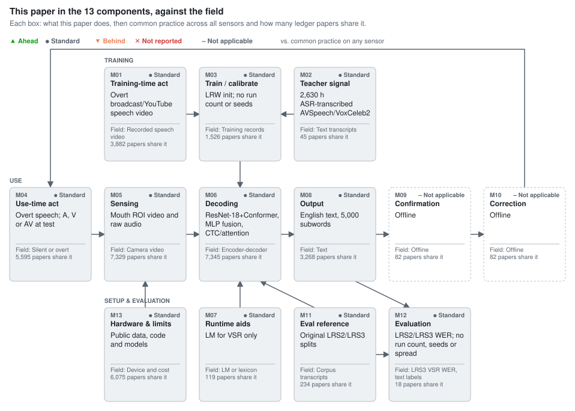

# Auto-AVSR: Audio-Visual Speech Recognition with Automatic Labels

Ma, P., Haliassos, A., Fernandez-Lopez, A., Chen, H., Petridis, S., Pantic, M. · ICASSP 2023 · 2023 · [DOI:10.1109/ICASSP49357.2023.10096889](https://doi.org/10.1109/ICASSP49357.2023.10096889) · [arXiv:2303.14307](https://arxiv.org/abs/2303.14307)

**Section:** [Lip & face video](../../README.md#lip--face-video)

## Figures

### This paper in the 13 components, against the field

<picture><source media="(prefers-color-scheme: dark)" srcset="figures/components-dark.svg"></picture>

Verdicts compare the paper's choice for each component with common practice across 8,995 ledger entries on any sensor (silent speech, brain-to-text, lip reading).

Data

| Component | This paper | Common practice | Papers with this practice | Verdict |
| --- | --- | --- | --- | --- |
| M01 Training-time act | Overt broadcast/YouTube speech video | Recorded speech video | 3,882 of 8,995 | ● Standard (Inherited.) |
| M02 Teacher signal | 2,630 h ASR-transcribed AVSpeech/VoxCeleb2 | Text transcripts | 45 of 8,995 | ● Standard (ASR transcripts as labels predate it (Afouras 2020, Ma 2022).) |
| M03 Train / calibrate | LRW init; no run count or seeds | Training records | 1,526 of 8,995 | ● Standard (No run count, seeds or spread.) |
| M04 Use-time act | Overt speech; A, V or AV at test | Silent or overt | 5,595 of 8,995 | ● Standard (Inherited.) |
| M05 Sensing | Mouth ROI video and raw audio | Camera video | 7,329 of 8,995 | ● Standard (Inherited.) |
| M06 Decoding | ResNet-18+Conformer, MLP fusion, CTC/attention | Encoder-decoder | 7,345 of 8,995 | ● Standard (Inherited (Ma et al. 2021 lineage).) |
| M07 Runtime aids | LM for VSR only | LM or lexicon | 119 of 8,995 | ● Standard (Inherited.) |
| M08 Output | English text, 5,000 subwords | Text | 3,268 of 8,995 | ● Standard (Inherited.) |
| M09 Confirmation | Offline | Offline | 82 of 8,995 | – Not applicable (Offline study.) |
| M10 Correction | Offline | Offline | 82 of 8,995 | – Not applicable (Offline study.) |
| M11 Eval reference | Original LRS2/LRS3 splits | Corpus transcripts | 234 of 8,995 | ● Standard (Speaker overlap with added data not stated.) |
| M12 Evaluation | LRS2/LRS3 WER; no run count, seeds or spread | LRS3 VSR WER, text labels | 18 of 8,995 | ● Standard (Ten-run means of the group's prior work dropped.) |
| M13 Hardware & limits | Public data, code and models | Device and cost | 6,075 of 8,995 | ● Standard (No latency or compute figures.) |

## Verdict

Auto-AVSR [[1]](#ref-1) changes one component, the training labels (M02), adding 2,630 h of video transcribed by a public ASR model. The design is standard: Afouras et al. trained lip readers with CTC on ASR-generated transcripts of unlabelled video [[2]](#ref-2), and the same group had already added AVSpeech with automatically generated transcriptions [[3]](#ref-3); the paper adds scale (641 h to 2,630 h) and four labellers. With the model fixed, LRS3 visual-only WER falls from 33.0% to 19.1% as automatic-label hours grow (Table 2), but the [later] USR 2.0 reaches 17.6% on the same two corpora with self-generated labels and no language model [[4]](#ref-4). Evaluation (M12) reports no run count, seeds or spread, unlike the ten-run means of the group's prior work [[3]](#ref-3), so the labeller ranking (Table 1) is not established; the 30% headline names no baseline.

## Against the field, component by component

### M02 Training-only supervision: ASR transcripts of unlabelled video

**Usual approach:** Of 428 visual or audio-visual speech recognition studies with a recorded supervision kind (slot-filled, Appendix), 45 record text transcripts; in the full texts of 1,049 such studies (pattern match, Appendix), 164 name self-supervised pretraining, 106 teacher distillation and 148 pseudo or automatic labels, of which 18 are dated up to 2022-09.

**State of the art:** USR 2.0 (2026) [[4]](#ref-4) reaches 17.6% LRS3 VSR, 0.9% ASR and 0.8% AVSR WER with 656 labelled and 2,649 unlabelled hours, self-generated labels and no external language model (Abstract; Table 7). That is 1.5 points (8% relative) below Auto-AVSR's 19.1%, which uses one, at nearly equal unlabelled hours (inference); the Huge model confounds the label source.

Afouras et al. trained with "CTC loss on the ASR-generated transcripts" of VoxCeleb2 plus distillation: 61.7% LRS3 WER with ASR labels only, 59.8% after fine-tuning on ground-truth transcripts [[2]](#ref-2). The target's §1 describes it as posterior matching only; Auto-AVSR differs by dropping distillation, not by using ASR transcripts. Ma et al. added 641 h of AVSpeech with automatic transcriptions and reached 31.5% on LRS3 at 1,459 h, the best of ten runs (mean 32.1 ± 0.3) [[3]](#ref-3). The drop from there to 19.1% is not all scale: the authors credit 1.7 points at equal 818 h to model capacity (§4.2; 34.7% in [[3]](#ref-3) against 33.0%), and a best-of-ten figure is set against an unrepeated one. Its contrast with ASR-filtered captions (§1) holds [[5]](#ref-5). [Concurrent] SynthVSR reuses the 2,630 h [[6]](#ref-6). Verdict: standard.

### M12 Evaluation: LRS3 WER without spread

**Usual approach:** Of 258 LRS3 visual-only studies (pattern match, Appendix), 141 record a supervision kind and 18 of them text labels (slot-filled); the table records no run counts, and one test WER per row is common (inference). Auto-AVSR reports no run count, seeds or spread (§3.3).

**State of the art:** Public data here means public audio-visual corpora; Whisper initialisation and labellers trained on non-public audio, as in Auto-AVSR, are allowed. VSR: LP Conformer (2023, [concurrent]) reports 12.8% with 100k h of mined YouTube video [[5]](#ref-5); on public data SynthVSR (2023, [concurrent]) reports 16.9% (18.2% without the language model) [[6]](#ref-6). AVSR: Whisper-Flamingo (2024, [later]) reports 0.76% [[7]](#ref-7) and Llama-AVSR (2024, [later]) 0.77% [[8]](#ref-8), both Whisper-initialised. Auto-AVSR's 0.9% trails by 0.14 points (inference).

The labellers' VSR spread, 19.0% to 19.8% (Table 1), is under three of the prior paper's ± 0.3 deviations [[3]](#ref-3) (inference). Whisper (19.0%) against Conformer-Transducer (19.1%) lies inside that band, and the "on average" criterion for choosing Conformer-Transducer (§4.1) is not defined. Verdict: standard.

## The 13 components

| Component | This paper | Usual approach (count) | State of the art | Verdict |
|---|---|---|---|---|
| M01 Training-time action | Overt broadcast/YouTube speech video | Recorded speech video (slot-filled 3,882) | – | standard |
| M02 Training-only supervision | 2,630 h ASR-transcribed AVSpeech/VoxCeleb2 | Text transcripts (slot-filled 45) | [[4]](#ref-4) (2026): LRS3 VSR 17.6%, self-training | standard |
| M03 Training and adaptation | LRW init; no run count or seeds | Training records (slot-filled 1,526) | – | standard |
| M04 Use-time action | Overt speech; A, V or AV at test | Silent or overt (slot-filled 5,595) | – | standard |
| M05 Sensors | Mouth ROI video and raw audio | Camera video (slot-filled 7,329) | – | standard |
| M06 Processing and decoding | ResNet-18+Conformer, MLP fusion, CTC/attention | Encoder-decoder (slot-filled 7,345) | – | standard |
| M07 Lexicon and LM | LM for VSR only | LM or lexicon (slot-filled 119) | – | standard |
| M08 Output | English text, 5,000 subwords | Text (slot-filled 3,268) | – | standard |
| M09 Confirmation | Offline | Offline (slot-filled 82) | – | not applicable |
| M10 Correction | Offline | Offline (slot-filled 82) | – | not applicable |
| M11 Reference construction | Original LRS2/LRS3 splits | Corpus transcripts (slot-filled 234) | – | standard |
| M12 Evaluation | LRS2/LRS3 WER; no run count, seeds or spread | LRS3 VSR WER, text labels (slot-filled 18) | [[5]](#ref-5) (2023): VSR 12.8%; [[6]](#ref-6) (2023): VSR 16.9% public; [[7]](#ref-7) (2024): AV 0.76% | standard |
| M13 Device and cost | Public data, code and models | Device and cost (slot-filled 6,075) | – | standard |

## Where the claims outrun the evidence

- The 30% relative improvement (Abstract) names no baseline. From 0.9% it matches AV-HuBERT's audio-only 1.3% (31%), not its AVSR 1.4% (36%) or ViT3D-CM's 1.6% (44%) in Table 4 (inference).
- The "26 times more training data" claim (Abstract) holds against ViT3D-CM (90,000 h) on AVSR only; on VSR ViT3D-CM is better (17.0% against 19.1%), as conceded (§4.3).
- Table 4 lists CM-aux on LRS3 only at 37.9% without extra data, while Table 3 gives its 1,459 h automatic-transcription row on LRS2 (25.5%); the 31.5% LRS3 row [[3]](#ref-3) is missing.
- The LRS3 audio-only 1.0% row is 1,921 h in §4.3 and 1,902 h in Table 4.
- Babble noise is in training and test, which the authors concede (§4.4). Pink and white noise, not named for training, give 16.2% and 24.2% AVSR WER at −7.5 dB (Table 5).

## What the field needs next

- M02: external-ASR labels against self-training labels [[4]](#ref-4) and a human-transcribed subset at equal hours and model size, with label WER on the added corpora; Table 1 gives labeller WER only on LRS3 test.
- M12: repeated runs with mean and spread, as in [[3]](#ref-3), before ranking labellers.
- M11: a speaker- and video-ID disjointness audit between VoxCeleb2, AVSpeech and the LRS2/LRS3 test sets.
- M04: a silent-articulation test set.

## Questions for the authors

- Which baseline gives the 30% relative improvement?
- How many runs and seeds underlie each row?
- Which data selected the final checkpoints? The public repository (commit 182b628, train.py lines 91-101) defaults validation and test lists to the same LRS3 test file.
- Do any AVSpeech or VoxCeleb2 speakers or videos appear in the LRS3 test set?

## Appendix: literature search

- M02, asr-transcribed-unlabelled-video-training. Inclusion rule: studies whose ledger text names lip reading, VSR, AVSR or audio-visual speech recognition, classified from the full text by the label source for unlabelled video; a study counts under every design its text names (upper bound); versions once. Ledger counts: slot-filled M02 31; population 1,049 unique studies (pattern match). Usual design: M03 supervision kind text labels 45 of 428 (slot-filled); full-text designs: self-supervised pretraining 164, pseudo or automatic labels 148 (18 of these dated up to 2022-09), teacher distillation 106, human or caption transcripts 9 (pattern match). Read in full: [[2]](#ref-2), [[3]](#ref-3) (prior); [[4]](#ref-4), [[6]](#ref-6) (state of the art). Known-item recall 1.0 (8 seeds).
- M12, lrs3-visual-only-wer (reused published table). Inclusion rule: studies reporting visual-only WER on the LRS3 test set, any training regime; audio-only, audio-visual and quoted rows excluded; versions once. Ledger counts: 258 unique studies (pattern match). Usual design: text labels 18 of 141 (slot-filled). Read in full for this review: [[5]](#ref-5), [[7]](#ref-7), [[8]](#ref-8) (state of the art), [[3]](#ref-3) (prior). Known-item recall 1.0.

## References

Numbered by first citation. BibTeX in the same order and keys: [refs.bib](refs.bib).

1. Ma, P., Haliassos, A., Fernandez-Lopez, A., Chen, H., Petridis, S., Pantic, M. “Auto-AVSR: Audio-Visual Speech Recognition with Automatic Labels.” *IEEE International Conference on Acoustics, Speech and Signal Processing (ICASSP)*, 2023. doi:[10.1109/ICASSP49357.2023.10096889](https://doi.org/10.1109/ICASSP49357.2023.10096889). arXiv:[2303.14307](https://arxiv.org/abs/2303.14307). Target. Read as arXiv v3. [review](https://github.com/supernaiter/silent-speech-review/tree/main/reviews/auto-avsr-audio-visual-speech-recognition-with-automatic-labels) [wiki: arxiv-2303.14307](https://github.com/supernaiter/deep-research-wiki-for-silent-speech/blob/main/papers/arxiv-2303.14307/article.md)
2. Afouras, T., Chung, J. S., Zisserman, A. “ASR is all you need: cross-modal distillation for lip reading.” *IEEE International Conference on Acoustics, Speech and Signal Processing (ICASSP)*, 2020. arXiv:[1911.12747](https://arxiv.org/abs/1911.12747). Prior; deciding prior for M02 (CTC on ASR-generated transcripts of unlabelled video). Read as arXiv v2. [wiki: arxiv-1911.12747](https://github.com/supernaiter/deep-research-wiki-for-silent-speech/blob/main/papers/arxiv-1911.12747/article.md)
3. Ma, P., Petridis, S., Pantic, M. “Visual Speech Recognition for Multiple Languages in the Wild.” *Nature Machine Intelligence*, 2022, 930-939. doi:[10.1038/s42256-022-00550-z](https://doi.org/10.1038/s42256-022-00550-z). arXiv:[2202.13084](https://arxiv.org/abs/2202.13084). Prior; same group; deciding prior for M02 (AVSpeech with automatically generated transcriptions) and M12 (ten-run means). Read as arXiv v2. [review](https://github.com/supernaiter/silent-speech-review/tree/main/reviews/visual-speech-recognition-for-multiple-languages-in-the-wild) [wiki: arxiv-2202.13084](https://github.com/supernaiter/deep-research-wiki-for-silent-speech/blob/main/papers/arxiv-2202.13084/article.md) [wiki: doi-10.1038-s42256-022-00550-z](https://github.com/supernaiter/deep-research-wiki-for-silent-speech/blob/main/papers/doi-10.1038-s42256-022-00550-z/article.md)
4. Haliassos, A., Mira, R., Petridis, S. “Pay Attention to CTC: Fast and Robust Pseudo-Labelling for Unified Speech Recognition.” *International Conference on Learning Representations (ICLR)*, 2026. arXiv:[2602.19316](https://arxiv.org/abs/2602.19316). [later]; state of the art for M02 and M12 with public data. Read as arXiv v1. [later] [wiki: arxiv-2602.19316](https://github.com/supernaiter/deep-research-wiki-for-silent-speech/blob/main/papers/arxiv-2602.19316/article.md)
5. Chang, O., Liao, H., Serdyuk, D., Shah, A., Siohan, O. “Conformers are All You Need for Visual Speech Recognition.” *IEEE International Conference on Acoustics, Speech and Signal Processing (ICASSP)*, 2024, 10136-10140. arXiv:[2302.10915](https://arxiv.org/abs/2302.10915). [concurrent] (arXiv 2023-02); best LRS3 VSR WER on non-public data (M12). Read as arXiv v2; venue and pages from the reference list of arXiv:2602.19316. [concurrent] [wiki: arxiv-2302.10915](https://github.com/supernaiter/deep-research-wiki-for-silent-speech/blob/main/papers/arxiv-2302.10915/article.md)
6. Liu, X., Lakomkin, E., Vougioukas, K., Ma, P., Chen, H., Xie, R., et al. “SynthVSR: Scaling Up Visual Speech Recognition With Synthetic Supervision.” *IEEE/CVF Conference on Computer Vision and Pattern Recognition (CVPR)*, 2023. arXiv:[2303.17200](https://arxiv.org/abs/2303.17200). [concurrent]; reuses the target's 2,630 h pseudo-labelled data (M02, M12). [concurrent] [wiki: arxiv-2303.17200](https://github.com/supernaiter/deep-research-wiki-for-silent-speech/blob/main/papers/arxiv-2303.17200/article.md) [wiki: cvf23-liu_synthvsr](https://github.com/supernaiter/deep-research-wiki-for-silent-speech/blob/main/papers/cvf23-liu_synthvsr/article.md)
7. Rouditchenko, A., Gong, Y., Thomas, S., Karlinsky, L., Kuehne, H., Feris, R., et al. “Whisper-Flamingo: Integrating Visual Features into Whisper for Audio-Visual Speech Recognition and Translation.” *Interspeech 2024*, 2024. arXiv:[2406.10082](https://arxiv.org/abs/2406.10082). [later]; LRS3 AVSR state of the art (M12). Read as arXiv version in the wiki. [later] [wiki: arxiv-2406.10082](https://github.com/supernaiter/deep-research-wiki-for-silent-speech/blob/main/papers/arxiv-2406.10082/article.md) [wiki: isca-rouditchenko24-whisperflamingo](https://github.com/supernaiter/deep-research-wiki-for-silent-speech/blob/main/papers/isca-rouditchenko24-whisperflamingo/article.md) [wiki: in24-whisperflamingo](https://github.com/supernaiter/deep-research-wiki-for-silent-speech/blob/main/papers/in24-whisperflamingo/article.md) [wiki: isca-rouditchenko24_interspeech](https://github.com/supernaiter/deep-research-wiki-for-silent-speech/blob/main/papers/isca-rouditchenko24_interspeech/article.md)
8. Cappellazzo, U., Kim, M., Chen, H., Ma, P., Petridis, S., Falavigna, D., et al. “Large Language Models are Strong Audio-Visual Speech Recognition Learners.” *IEEE International Conference on Acoustics, Speech and Signal Processing (ICASSP)*, 2025. doi:[10.1109/ICASSP49660.2025.10889251](https://doi.org/10.1109/ICASSP49660.2025.10889251). arXiv:[2409.12319](https://arxiv.org/abs/2409.12319). [later]; LRS3 AVSR 0.77% (M12). Read as arXiv v2. [later] [wiki: arxiv-2409.12319](https://github.com/supernaiter/deep-research-wiki-for-silent-speech/blob/main/papers/arxiv-2409.12319/article.md) [wiki: doi-10.1109-icassp49660.2025.10889251](https://github.com/supernaiter/deep-research-wiki-for-silent-speech/blob/main/papers/doi-10.1109-icassp49660.2025.10889251/article.md)

## Materials

Data behind this review. Full texts of the papers are not included.

- [`review.md`](review.md): the review text (source)
- [`refs.bib`](refs.bib): references (BibTeX)
- [`slots.json`](slots.json): for each of the 13 components: this paper's choice, field practice, number of matching papers, verdict
- [`figures.json`](figures.json): figure definitions
- [`evaluation.md`](evaluation.md): independent evaluation by a second reviewer
- [`triage.md`](triage.md): how each evaluation finding was checked against the sources and resolved
- [`process/log.json`](process/log.json): process record: each step, who did it (reader, script, writer, evaluator), when, the checks run and the input versions
- [`process/notes.json`](process/notes.json): reading notes on the target and comparator papers: claims, numbers, conditions and what is not stated, with locations
- [`process/plan.json`](process/plan.json): plan: which components the paper changes and the topics it is compared on
- [`process/draft.md`](process/draft.md): the review as first written, before the independent evaluation
- [`process/claims-draft.md`](process/claims-draft.md): claim table of the draft: every claim mapped to a note or a count
- [`process/claims.md`](process/claims.md): claim table of the published review
- [`components/M02/asr-transcribed-unlabelled-video-training.csv`](../../components/M02/asr-transcribed-unlabelled-video-training.csv): M02 topic "asr-transcribed-unlabelled-video-training", every candidate paper with its decision (31 slot-filled, 1049 pattern match, usual design in 45, 4 read in full)
- [`components/M12/lrs3-visual-only-wer.csv`](../../components/M12/lrs3-visual-only-wer.csv): M12 topic "lrs3-visual-only-wer", every candidate paper with its decision (6960 slot-filled, 258 pattern match, usual design in 18, 1 read in full)

## More reviews in Lip & face video

- [Audio-visual video-to-speech synthesis with synthesized input audio](../audio-visual-video-to-speech-synthesis-with-synthesized-input-audio/) (2023). A second synthesis pass on first-pass speech (M06) and modality dropout (M03) are standard; gains are small and inconsistent, earlier systems keep lower WER, and no equal-training control exists.
- [High-Quality Automatic Voice Over with Accurate Alignment: Supervision through Self-Supervised Discrete Speech Units](../high-quality-automatic-voice-over-with-accurate-alignment-supervision-through-self-supervised-discrete-speech-units/) (2023). An automatic voice-over system that supervises alignment by predicting self-supervised discrete speech units from text and lip video, improving lip-sync and speech quality on a single-speaker dataset. Not an SSI paper.
- [Improving the Gap in Visual Speech Recognition Between Normal and Silent Speech Based on Metric Learning](../improving-the-gap-in-visual-speech-recognition-between-normal-and-silent-speech-based-on-metric-learning/) (2023). Joint normal-silent training does most of the gap closing; the viseme KL terms add 0.93 WER points with no run count reported, so the metric-learning gain is not established.
- [Intelligible Lip-to-Speech Synthesis with Speech Units](../intelligible-lip-to-speech-synthesis-with-speech-units/) (2023). Unit target (M02) and unit-conditioned vocoder (M06) are standard; units cut LRS3 WER 21.8 points, AV-HuBERT 20.4 more, the vocoder 0.3; unit gain untested on AV-HuBERT, single runs.
- [Large-scale unsupervised audio pre-training for video-to-speech synthesis](../large-scale-unsupervised-audio-pre-training-for-video-to-speech-synthesis/) (2023). Audio-only decoder pre-training (M03) is standard after TTS decoder transfer; it lowers WER in 7 of 16 pairs, earlier systems keep lower WER, and no equal-training control or listener test exists.
- [LipLearner: Customizable Silent Speech Interactions on Mobile Devices](../liplearner-customizable-silent-speech-interactions-on-mobile-devices/) (2023). All three changed components are standard: on-device few-shot head untested against prototypes or fine-tuning; voiced enrollment loses 5.6 points; visual KWS predates it uncited.

---

Part of the [Silent Speech Interface Review](https://github.com/supernaiter/silent-speech-review). Found an error? [Open an issue](https://github.com/supernaiter/silent-speech-review/issues/new?template=correction.yml).
