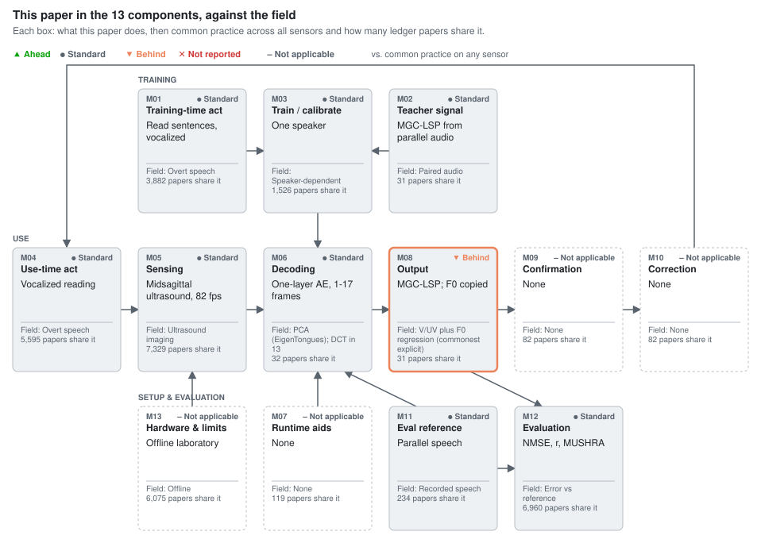

# Autoencoder-Based Articulatory-to-Acoustic Mapping for Ultrasound Silent Speech Interfaces

Gosztolya, G., Pintér, Á., Tóth, L., Grósz, T., Markó, A., Csapó, T. G. · IJCNN 2019 · 2019 · [doi:10.1109/IJCNN.2019.8852153](https://doi.org/10.1109/IJCNN.2019.8852153) · [arXiv:1904.05259](https://arxiv.org/abs/1904.05259)

**Section:** [Ultrasound & tongue imaging](../../README.md#ultrasound--tongue-imaging)

## Figures

### This paper in the 13 components, against the field

<picture><source media="(prefers-color-scheme: dark)" srcset="figures/components-dark.svg"></picture>

Verdicts compare the paper's choice for each component with common practice across 8,995 ledger entries on any sensor (silent speech, brain-to-text, lip reading).

Data

| Component | This paper | Common practice | Papers with this practice | Verdict |
| --- | --- | --- | --- | --- |
| M01 Training-time act | Read sentences, vocalized | Overt speech | 3,882 of 8,995 | ● Standard (Inherited from the Csapo/Toth corpus.) |
| M02 Teacher signal | MGC-LSP from parallel audio | Paired audio | 31 of 8,995 | ● Standard (Frame-aligned regression.) |
| M03 Train / calibrate | One speaker | Speaker-dependent | 1,526 of 8,995 | ● Standard (No held-out session or speaker.) |
| M04 Use-time act | Vocalized reading | Overt speech | 5,595 of 8,995 | ● Standard (No silent test.) |
| M05 Sensing | Midsagittal ultrasound, 82 fps | Ultrasound imaging | 7,329 of 8,995 | ● Standard (Articulate Instruments Micro.) |
| M06 Decoding | One-layer AE, 1-17 frames | PCA (EigenTongues); DCT in 13 | 32 of 8,995 | ● Standard (AE features predate it; no PCA/DCT baseline; field ranking is from recognition.) |
| M07 Runtime aids | None | None | 119 of 8,995 | – Not applicable (Direct spectral estimation.) |
| M08 Output | MGC-LSP; F0 copied | V/UV plus F0 regression (commonest explicit) | 31 of 8,995 | ▼ Behind (12 prior studies predict F0 [@grosz2018f0].) |
| M09 Confirmation | None | None | 82 of 8,995 | – Not applicable (Offline study.) |
| M10 Correction | None | None | 82 of 8,995 | – Not applicable (Offline study.) |
| M11 Eval reference | Parallel speech | Recorded speech | 234 of 8,995 | ● Standard (Reference from the same recording.) |
| M12 Evaluation | NMSE, r, MUSHRA | Error vs reference | 6,960 of 8,995 | ● Standard (No intelligibility test or seeds.) |
| M13 Hardware & limits | Offline laboratory | Offline | 6,075 of 8,995 | – Not applicable (No deployment claim.) |

## Verdict

The paper [[1]](#ref-1) changes the ultrasound encoder (M06): a one-layer autoencoder bottleneck, stacked over up to 17 frames, replaces raw pixels as input to a spectral DNN. M06 is standard: autoencoder features of tongue images predate it [[2]](#ref-2), [[3]](#ref-3), and the only baseline is raw pixels, not the PCA or DCT coefficients the field usually feeds. The headline 25-29% NMSE reduction sets multi-frame autoencoder inputs against a pixel baseline that gained almost nothing from context (test NMSE 0.534 to 0.530, Table I); at one frame each the gain is 13.5-19.7% relative (inference). Where the field compared them, in word recognition on the Silent Speech Challenge, dense autoencoder features trailed DCT [[3]](#ref-3), [[4]](#ref-4); the target runs no such comparison for synthesis, so nothing shows the bottleneck beats the usual compression. M08 is behind the best comparable work: 12 prior studies predict F0 from the articulatory signal, while synthesis here copies F0 from the recording, so the listening test scores a system no silent user could run.

## Against the field, component by component

### M06 Encoder: ultrasound image features

**Usual approach:** PCA (EigenTongues) or 2D-DCT coefficients, 30 per stream in the Silent Speech Challenge setup [[3]](#ref-3): of 39 unique studies on ultrasound image features (pattern match), 32 use PCA/EigenTongues and 13 DCT; autoencoders appear in 13. The paper learns a 64-512 unit bottleneck with no further hidden layers (§III-D) and compares it only with 8,192 raw pixels (Table I).

**State of the art:** a denoising convolutional autoencoder, 6.17% WER on the Silent Speech Challenge (60 features) against 6.45% for 30-element DCT, 2019 [[4]](#ref-4) [concurrent]. That is recognition; the target reports neither recognition nor a shared corpus, so the gap is one of design: its encoder is the dense kind that trailed DCT there.

On that single-speaker benchmark, 30-element DCT gave 6.45% WER and a dense deep autoencoder 7.72%, about 20% relative worse (inference), and DCT stayed ahead at 20 and 10 elements (Table 4) [[3]](#ref-3); at 60 elements the concurrent study found DCT 6.58% against 7.37% for the dense autoencoder (Table 2) [[4]](#ref-4). Whether a recognition ranking carries over to spectral regression is open (inference); the target uses the weakest of these designs and never names PCA or DCT. What it shows is that a compact input lets a five-layer DNN use more context: the pixel baseline barely gained from five frames (§IV), while the autoencoder input ran to 17. The advantage the field had found for autoencoders, robustness at tiny size (10.07% against 99.51% WER at five features [[3]](#ref-3)), is not tested; the smallest bottleneck is 64. Verdict: standard.

### M08 Output: F0 source

**Usual approach:** among 138 unique studies that predict or evaluate F0 of speech from a non-acoustic signal (pattern match), the commonest explicit design is a voiced/unvoiced decision plus F0 regression, 31 (12 prior), including the authors' own ultrasound work [[5]](#ref-5); 53 predict F0 implicitly through mel spectrograms or neural vocoders, 35 of them later. The paper copies F0 from the parallel audio, calling it standard practice and citing four earlier SSI studies (§III-B).

**State of the art:** 10.49 Hz F0 RMSE and 10.32% voicing error from EMA, one male speaker, 2018 [[6]](#ref-6), not directly comparable with ultrasound; from ultrasound, a 0.74 correlation with the original F0, which listeners could not tell apart [[5]](#ref-5).

Copying F0 isolates the spectral estimator, and earlier SSI studies did the same, but the MUSHRA scores (Fig. 6) are the paper's only perceptual evidence, and every sample carries the speaker's true intonation and voicing. The same group had predicted F0 from ultrasound a year earlier [[5]](#ref-5), so this gap had a known remedy. Verdict: behind (best comparable work; 12 prior studies, pattern match, Appendix).

## The 13 components

| Component | This paper | Usual approach (count) | State of the art | Verdict |
|---|---|---|---|---|
| M01 Training-time action | Read sentences, vocalized | Overt speech (slot-filled 3,882) | – | standard |
| M02 Training-only supervision | MGC-LSP from parallel audio | Paired audio (slot-filled 31) | – | standard |
| M03 Training and adaptation | One speaker | Speaker-dependent (slot-filled 1,526) | – | standard |
| M04 Use-time action | Vocalized reading | Overt speech (slot-filled 5,595) | – | standard |
| M05 Sensors | Midsagittal ultrasound, 82 fps | Ultrasound imaging (slot-filled 7,329) | – | standard |
| M06 Processing and decoding | One-layer AE, 1-17 frames | PCA (EigenTongues); DCT in 13 (pattern match 32) | 6.17% SSC WER, 2019 [[4]](#ref-4) [concurrent] | standard |
| M07 Lexicon and LM | None | None (slot-filled 119) | – | not applicable |
| M08 Output | MGC-LSP; F0 copied | V/UV plus F0 regression (commonest explicit) (pattern match 31) | 10.49 Hz F0 RMSE, 2018 [[6]](#ref-6) | behind |
| M09 Confirmation | None | None (slot-filled 82) | – | not applicable |
| M10 Correction | None | None (slot-filled 82) | – | not applicable |
| M11 Reference construction | Parallel speech | Recorded speech (slot-filled 234) | – | standard |
| M12 Evaluation | NMSE, r, MUSHRA | Error vs reference (slot-filled 6,960) | – | standard |
| M13 Device and cost | Offline laboratory | Offline (slot-filled 6,075) | – | not applicable |

## Where the claims outrun the evidence

- The 30-33% correlation improvement (§IV) is a reduction of 1 - r; raw r rises from 0.680 to 0.787, 15.7% relative (inference).
- The best configuration (N = 256, 13 frames) is named as best "for both subsets", development and test together, with no selection rule on development data alone (§IV).
- "Definitely significant" (§IV) rests on no stated test, seed or repeated run; the authors say bottleneck sizes (N = 64-512) differ significantly only without context frames (§IV).
- Naturalness rises from 16.58 (pixels) to 40.98 (best autoencoder) but stays far below 75.16 for vocoded speech (Fig. 6), as the authors concede; no intelligibility test was run, and all 87 test sentences come from the training speaker (§III-A).
- The size argument sets 8.7M weights, encoder included, against a 46.2M five-frame pixel network (Table I, §IV); a PCA or DCT front end would cost almost nothing (inference).

## What the field needs next

- M06: PCA, DCT, dense and convolutional autoencoder features at equal size and context, scored by NMSE and a listening test on a shared ultrasound-to-speech corpus.
- M08: listening results with F0 predicted from ultrasound beside the copied-F0 condition.
- M03 and M12: held-out sessions and a second speaker, with seeds and an intelligibility test.

## Questions for the authors

- Which data trained the autoencoder, and was the bottleneck linear?
- How was the Table I configuration selected without test scores?
- What is the exact NMSE definition, and were targets standardized?
- How many recording sessions do the 438 utterances span, and are the splits session-disjoint?

## Appendix: literature search

- M06 ultrasound-tongue-image-features (published topic table, reused and appended). Inclusion rule: studies that compress ultrasound tongue images (with or without lip images) into feature vectors for recognition, synthesis or articulatory mapping by DCT, PCA/EigenTongues, autoencoders or learned CNN encoders; contour-only tracking without a downstream feature vector, raw-image end-to-end models with no stated feature stage, and reviews excluded; versions counted once. Slot-filled 7,345 unique studies; pattern match 39 unique studies. Full-text pattern counts: PCA/EigenTongue 32, DCT 13, autoencoder 13, raw-image CNN 2. Usual design: PCA/EigenTongues (32) or 2D-DCT (13) coefficients (pattern match). State of the art: [[4]](#ref-4) [concurrent]. Read in full: [[2]](#ref-2), [[3]](#ref-3), [[4]](#ref-4), target. Known-item recall 0.75 (3 of 4 seeds).
- M08 articulatory-f0-prediction (published topic table, reused). Inclusion rule: studies that generate speech from a non-acoustic speech signal (ultrasound, EMA, PMA, EMG, lip or face video, rtMRI, intracranial or scalp neural recordings) in which F0 or voicing of the output is predicted or evaluated; acoustic-input conversion, talking-head synthesis, text-to-speech after text decoding and reviews excluded; versions counted once. Slot-filled 3,268 unique studies; pattern match 138 unique studies. Full-text pattern counts: voiced/unvoiced plus F0 regression 31 (12 prior), continuous F0 16, implicit F0 through a mel-spectrogram or neural vocoder 53 (35 later). Usual design (commonest explicit F0 design): voiced/unvoiced decision plus F0 regression, 31 (pattern match); copied F0 is not counted. State of the art: [[6]](#ref-6). Read in full: [[5]](#ref-5), [[6]](#ref-6), target. Known-item recall 1.0 (2 of 2 seeds).

## References

Numbered by first citation. BibTeX in the same order and keys: [refs.bib](refs.bib).

1. Gosztolya, G., Pintér, Á., Tóth, L., Grósz, T., Markó, A., Csapó, T. G. “Autoencoder-Based Articulatory-to-Acoustic Mapping for Ultrasound Silent Speech Interfaces.” *Proc. International Joint Conference on Neural Networks (IJCNN 2019)*, 2019, 1–8. doi:[10.1109/IJCNN.2019.8852153](https://doi.org/10.1109/IJCNN.2019.8852153). arXiv:[1904.05259](https://arxiv.org/abs/1904.05259). Target. Read as arXiv v1; venue, pages and DOI confirmed with Crossref. [review](https://github.com/supernaiter/silent-speech-review/tree/main/reviews/autoencoder-based-articulatory-to-acoustic-mapping-for-ultrasound-silent-speech-interfaces) [wiki: arxiv-1904.05259](https://github.com/supernaiter/deep-research-wiki-for-silent-speech/blob/main/papers/arxiv-1904.05259/article.md)
2. Jaumard-Hakoun, A., Xu, K., Leboullenger, C., Roussel-Ragot, P., Denby, B. “An Articulatory-Based Singing Voice Synthesis Using Tongue and Lips Imaging.” *Proc. Interspeech 2016*, 2016, 1467–1471. doi:[10.21437/Interspeech.2016-385](https://doi.org/10.21437/Interspeech.2016-385). [wiki: isca-jaumardhakoun16_interspeech](https://github.com/supernaiter/deep-research-wiki-for-silent-speech/blob/main/papers/isca-jaumardhakoun16_interspeech/article.md)
3. Ji, Y., Liu, L., Wang, H., Liu, Z., Niu, Z., Denby, B. “Updating the Silent Speech Challenge benchmark with deep learning.” *Speech Communication*, 2018, 98, 42–50. doi:[10.1016/j.specom.2018.02.002](https://doi.org/10.1016/j.specom.2018.02.002). arXiv:[1709.06818](https://arxiv.org/abs/1709.06818). [review](https://github.com/supernaiter/silent-speech-review/tree/main/reviews/updating-the-silent-speech-challenge-benchmark-with-deep-learning) [wiki: arxiv-1709.06818](https://github.com/supernaiter/deep-research-wiki-for-silent-speech/blob/main/papers/arxiv-1709.06818/article.md) [wiki: doi-10.1016-j.specom.2018.02.002](https://github.com/supernaiter/deep-research-wiki-for-silent-speech/blob/main/papers/doi-10.1016-j.specom.2018.02.002/article.md)
4. Li, B., Xu, K., Feng, D., Mi, H., Wang, H., Zhu, J. “Denoising Convolutional Autoencoder Based B-mode Ultrasound Tongue Image Feature Extraction.” *Proc. IEEE ICASSP 2019*, 2019, 7130–7134. doi:[10.1109/ICASSP.2019.8682806](https://doi.org/10.1109/ICASSP.2019.8682806). arXiv:[1903.00888](https://arxiv.org/abs/1903.00888). [concurrent] [review](https://github.com/supernaiter/silent-speech-review/tree/main/reviews/denoising-convolutional-autoencoder-based-b-mode-ultrasound-tongue-image-feature-extraction) [wiki: arxiv-1903.00888](https://github.com/supernaiter/deep-research-wiki-for-silent-speech/blob/main/papers/arxiv-1903.00888/article.md)
5. Grósz, T., Gosztolya, G., Tóth, L., Csapó, T. G., Markó, A. “F0 Estimation for DNN-Based Ultrasound Silent Speech Interfaces.” *Proc. IEEE ICASSP 2018*, 2018, 291–295. doi:[10.1109/ICASSP.2018.8461732](https://doi.org/10.1109/ICASSP.2018.8461732). [wiki: doi-10-1109-icassp-2018-8461732](https://github.com/supernaiter/deep-research-wiki-for-silent-speech/blob/main/papers/doi-10-1109-icassp-2018-8461732/article.md)
6. Taguchi, F., Kaburagi, T. “Articulatory-to-speech Conversion Using Bi-directional Long Short-term Memory.” *Proc. Interspeech 2018*, 2018, 2499–2503. doi:[10.21437/Interspeech.2018-999](https://doi.org/10.21437/Interspeech.2018-999). [wiki: isca-taguchi18_interspeech](https://github.com/supernaiter/deep-research-wiki-for-silent-speech/blob/main/papers/isca-taguchi18_interspeech/article.md)

## Materials

Data behind this review. Full texts of the papers are not included.

- [`review.md`](review.md): the review text (source)
- [`refs.bib`](refs.bib): references (BibTeX)
- [`slots.json`](slots.json): for each of the 13 components: this paper's choice, field practice, number of matching papers, verdict
- [`figures.json`](figures.json): figure definitions
- [`evaluation.md`](evaluation.md): independent evaluation by a second reviewer
- [`triage.md`](triage.md): how each evaluation finding was checked against the sources and resolved
- [`components/M06/ultrasound-tongue-image-features.csv`](../../components/M06/ultrasound-tongue-image-features.csv): M06 topic "ultrasound-tongue-image-features", every candidate paper with its decision (7345 slot-filled, 39 pattern match, usual design in 32, 3 read in full)
- [`components/M08/articulatory-f0-prediction.csv`](../../components/M08/articulatory-f0-prediction.csv): M08 topic "articulatory-f0-prediction", every candidate paper with its decision (3268 slot-filled, 138 pattern match, usual design in 31, 5 read in full)

## More reviews in Ultrasound & tongue imaging

- [Denoising convolutional autoencoder based B-mode ultrasound tongue image feature extraction](../denoising-convolutional-autoencoder-based-b-mode-ultrasound-tongue-image-feature-extraction/) (2019). Uses a denoising convolutional autoencoder to extract ultrasound tongue image features, improving silent speech recognition over prior feature extraction methods on the 2010 Silent Speech Challenge data.
- [SottoVoce: An Ultrasound Imaging-Based Silent Speech Interaction Using Deep Neural Networks](../sottovoce/) (2019). SottoVoce reconstructs speech audio from under-jaw ultrasound images with two DNNs to control unmodified smart speakers; command success rose from 42.5% to 65.0% with the second network, versus 90.0% for real audio.
- [Ultrasound-based Silent Speech Interface Built on a Continuous Vocoder](../ultrasound-based-silent-speech-interface-built-on-a-continuous-vocoder/) (2019). Continuous F0 targets from articulation were prior work; MVF carrying voicing instead of a flag is new but unproven: the F0 RMSE gain uses different reference contours and naturalness is not better.
- [Ultra2Speech -- A Deep Learning Framework for Formant Frequency Estimation and Tracking from Ultrasound Tongue Images](../ultra2speech-a-deep-learning-framework-for-formant-frequency-estimation-and-tracking-from-ultrasound-tongue-images/) (2020). Estimates and tracks formant frequencies from ultrasound tongue image sequences for speech synthesis; best U2F configuration reaches mean R2 99.96 on joint f1-f2 prediction versus 90.01 for a Conv-BiLSTM baseline.
- [Updating the Silent Speech Challenge benchmark with deep learning](../updating-the-silent-speech-challenge-benchmark-with-deep-learning/) (2018). Kaldi DNN-HMM cuts SSC WER from 17.4% to 6.45% (M06, M12: standard), but with the same bigram its own GMM gives 12.71%, so the DNN halves WER; one speaker, single runs.
- [3D Convolutional Neural Networks for Ultrasound-Based Silent Speech Interfaces](../3d-convolutional-neural-networks-for-ultrasound-based-silent-speech-interfaces/) (2021). Shows a compact (2+1)D 3D CNN outperforms 2D CNN and CNN+LSTM models for regressing 13 vocoder parameters from ultrasound tongue video, with lower complexity and training time.

---

Part of the [Silent Speech Interface Review](https://github.com/supernaiter/silent-speech-review). Found an error? [Open an issue](https://github.com/supernaiter/silent-speech-review/issues/new?template=correction.yml).
