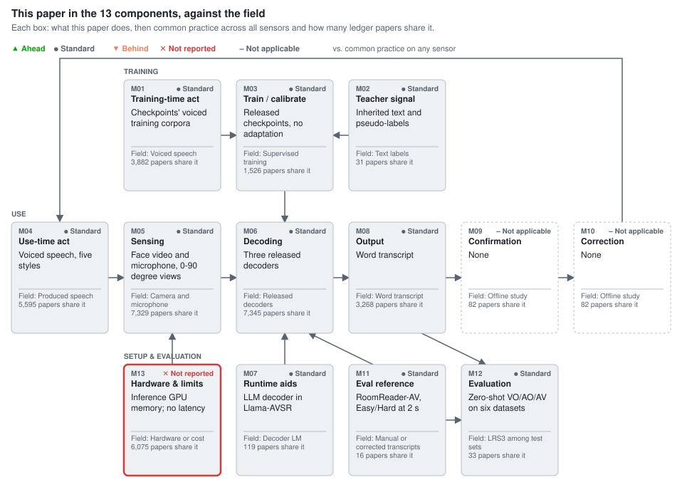

# AVSRBench: A Multi-Condition AVSR Benchmark

Jain, R., Harte, N. · arXiv preprint · 2026 · [arXiv:2609.10366](https://arxiv.org/abs/2609.10366)

**Section:** [Lip & face video](../../README.md#lip--face-video)

## Figures

### This paper in the 13 components, against the field

<picture><source media="(prefers-color-scheme: dark)" srcset="figures/components-dark.svg"></picture>

Verdicts compare the paper's choice for each component with common practice across 8,995 ledger entries on any sensor (silent speech, brain-to-text, lip reading).

Data

| Component | This paper | Common practice | Papers with this practice | Verdict |
| --- | --- | --- | --- | --- |
| M01 Training-time act | Checkpoints' voiced training corpora | Voiced speech | 3,882 of 8,995 | ● Standard (Nothing trained in this study.) |
| M02 Teacher signal | Inherited text and pseudo-labels | Text labels | 31 of 8,995 | ● Standard (Inherited from Auto-AVSR, AV-HuBERT and Llama-AVSR.) |
| M03 Train / calibrate | Released checkpoints, no adaptation | Supervised training | 1,526 of 8,995 | ● Standard (Auto-AVSR at 3,448 h and 1,759 h compared for scale.) |
| M04 Use-time act | Voiced speech, five styles | Produced speech | 5,595 of 8,995 | ● Standard (Voiced speech only.) |
| M05 Sensing | Face video and microphone, 0-90 degree views | Camera and microphone | 7,329 of 8,995 | ● Standard (Profile penalty similar to in-domain training [@ma2019lombard].) |
| M06 Decoding | Three released decoders | Released decoders | 7,345 of 8,995 | ● Standard (Beam size and output length not stated.) |
| M07 Runtime aids | LLM decoder in Llama-AVSR | Decoder LM | 119 of 8,995 | ● Standard (No external lexicon.) |
| M08 Output | Word transcript | Word transcript | 3,268 of 8,995 | ● Standard (Scoring normalization not stated.) |
| M09 Confirmation | None | Offline study | 82 of 8,995 | – Not applicable (Offline evaluation.) |
| M10 Correction | None | Offline study | 82 of 8,995 | – Not applicable (Offline evaluation.) |
| M11 Eval reference | RoomReader-AV, Easy/Hard at 2 s | Manual or corrected transcripts | 16 of 8,995 | ● Standard (Keeps short turns; Auto-AVSR Easy visual-only WER 105.35%.) |
| M12 Evaluation | Zero-shot VO/AO/AV on six datasets | LRS3 among test sets | 33 of 8,995 | ● Standard (No seeds, repeated runs or intervals.) |
| M13 Hardware & limits | Inference GPU memory; no latency | Hardware or cost | 6,075 of 8,995 | ✕ Not reported (Real-time claim without a latency measurement; GPU memory is reported.) |

## Verdict

The paper [[1]](#ref-1) changes the evaluation (M12), testing three released AVSR checkpoints zero-shot in three input modes on six datasets, and the reference (M11), an Easy/Hard RoomReader video-call set. Both are standard: testing publicly released checkpoints outside LRS3 was already done in WildVSR [[2]](#ref-2), and concurrent work tests the same checkpoints on conversational video [[3]](#ref-3) [concurrent] and on an LRS3-matched unseen set over five runs [[4]](#ref-4) [concurrent], which shares the target's senior author. The main claim, that broadcast WER overstates generalization, holds, but each condition shifts speaking style, vocabulary, transmission, pose and preprocessing at once, and the design does not separate them. Auto-AVSR visual-only WER on RoomReader-AV exceeds 100% even on Easy clips (Table X), so the collapse lies mainly in the video channel, not only in short turns; Hard clips add 21.6 points (inference). The authors' blame on the LLM decoder for the Llama-AVSR failure (§IV-E, §V) rests on one run per condition, without variance.

## Against the field, component by component

### M12 Evaluation: zero-shot cross-corpus testing

**Usual approach:** among 75 studies whose ledger ties AVSR or VSR to out-of-domain or cross-corpus testing (pattern match, Appendix), LRS3 is a test set in 33; video calls or conversation appear in 22, GRID in 19, profile views in 6, Lombard speech in 2, all three input modes in 3.

**State of the art:** in 2026, an unseen set matched to the LRS3 test distribution takes Auto-AVSR from 0.95% audio-visual WER on LRS3 to 14.0 ± 0.3%, over five runs [[4]](#ref-4) [concurrent].

The collapse is prior: on WildVSR the same 3,448-h Auto-AVSR went from 19.1% to 38.6% visual-only WER [[2]](#ref-2) (Table 2). On LombardGrid it gives 64.88% frontal and 92.50% profile visual-only WER (Table VI), against 25.00% and 39.45% for a model trained on Lombard GRID and tested on unseen speakers [[5]](#ref-5). That model trained on profile crops (§4.2 of [[5]](#ref-5)); its profile penalty is 14.45 points against 27.62 zero-shot, but 1.58 against 1.43 times (inference), so these numbers do not separate domain from pose. Doubling Auto-AVSR data barely moves RoomReader-AV (113.20% to 110.07%, Table XI) but cut WildVSR WER from 49.3% to 38.6% [[2]](#ref-2), 21.7% relative (inference). No seeds, repeated runs or intervals are reported (Sec. III). Verdict: standard.

### M11 Reference: conversational video-call test set

**Usual approach:** among 59 studies whose ledger ties audio-visual speech to conversation, meetings or video calls (pattern match, Appendix), 16 name manual or corrected transcripts, 10 automatic labels, 8 a duration filter or bins. RoomReader-AV uses manually corrected transcripts on individual streams and the entire corpus, split at 2 s (Sec. II-A).

**State of the art:** in 2026, LRS-VoxMM gives Auto-AVSR 11.03% audio-visual and 55.15% visual-only WER on conversational clips of 1-25 s [[3]](#ref-3) [concurrent].

There, audio-visual beats audio-only by 2.12 points, 16.1% relative (inference); on RoomReader-AV the same checkpoint is 0.99 points worse with video (26.39% against 25.40%, Table IX). Its Easy clips (at least 2 s, 15.9 words) still give 105.35% visual-only (Table X), about twice the LRS-VoxMM figure (inference). Video-call transmission alone takes visual-only Auto-AVSR on LRS3 from 19.08% offline to 90.26% after Zoom [[6]](#ref-6) [concurrent], so transmission is a candidate cause the design cannot isolate. The Hard boundary is below 2 s in the text and at most 2.0 s in the code. Verdict: standard.

## The 13 components

| Component | This paper | Usual approach (count) | State of the art | Verdict |
|---|---|---|---|---|
| M01 Training-time action | Checkpoints' voiced training corpora | Voiced speech (slot-filled 3,882) | – | standard |
| M02 Training-only supervision | Inherited text and pseudo-labels | Text labels (slot-filled 31) | – | standard |
| M03 Training and adaptation | Released checkpoints, no adaptation | Supervised training (slot-filled 1,526) | – | standard |
| M04 Use-time action | Voiced speech, five styles | Produced speech (slot-filled 5,595) | – | standard |
| M05 Sensors | Face video and microphone, 0-90 degree views | Camera and microphone (slot-filled 7,329) | – | standard |
| M06 Processing and decoding | Three released decoders | Released decoders (slot-filled 7,345) | – | standard |
| M07 Lexicon and LM | LLM decoder in Llama-AVSR | Decoder LM (slot-filled 119) | – | standard |
| M08 Output | Word transcript | Word transcript (slot-filled 3,268) | – | standard |
| M09 Confirmation | None | Offline study (slot-filled 82) | – | not applicable |
| M10 Correction | None | Offline study (slot-filled 82) | – | not applicable |
| M11 Reference construction | RoomReader-AV, Easy/Hard at 2 s | Manual or corrected transcripts (pattern match 16) | [[3]](#ref-3) [concurrent]: 11.03% AV WER | standard |
| M12 Evaluation | Zero-shot VO/AO/AV on six datasets | LRS3 among test sets (pattern match 33) | [[4]](#ref-4) [concurrent]: 14.0% AV WER, matched set | standard |
| M13 Device and cost | Inference GPU memory; no latency | Hardware or cost (slot-filled 6,075) | – | not reported |

## Where the claims outrun the evidence

- "LLM-based AVSR generalizes poorly" (Abstract): the same Llama-AVSR checkpoint gives 311.48% visual-only WER on RoomReader-AV (Table IX) and 70.71% on LRS-VoxMM [[3]](#ref-3), which points at decoding or input handling; Table X omits the model.
- Auto-AVSR audio-visual is 8.90 points worse than audio-only on GRID (§IV-B) but 2.29 points better on LombardGrid (§IV-C), same grammar; a GRID pipeline mismatch is not excluded.
- "AV fusion helps mainly under Lombard speech" rests on that gain for one model, 16.3% relative (inference); AV-HuBERT gains 0.40 points, Llama-AVSR loses 2.79 (§IV-C).
- The prose gives 45.57% for matched volunteers; Table VIII gives 43.15% (§IV-D).
- "Unsuitable for real-time applications" rests on GPU memory, 17.91 against 2.29 GB; latency is not measured (§V).
- The authors flag the under-one-hour LRS3 test set (§I) but audit no speaker overlap with the checkpoints' training data (§IV-A).

## What the field needs next

- M12: conditions that change one factor at a time (transmission, pose, style) on the same speakers, with repeated runs as in [[4]](#ref-4).
- M11: RoomReader-AV re-scored under LRS-VoxMM selection rules.
- M06: insertion counts and capped output length for WER above 100%.
- M05: profile conditions with models trained on profile video [[5]](#ref-5).

## Questions for the authors

- Which 1,759-h Auto-AVSR checkpoint gives 31.14% on LRS3, when that size gave 25.1% in WildVSR?
- Which beam size, length penalty and maximum output length did each model use?
- Was the RoomReader video re-encoded by Zoom, and at what bit rate?
- How many utterances per corpus did face detection drop?

## Appendix: literature search

- M12 cross-corpus-avsr-generalization (new topic table). Inclusion rule: studies that test already trained visual-only or audio-visual sentence recognizers on at least one corpus or recording condition outside the training domain (another corpus, in-the-wild or conversational video, video calls, Lombard speech, non-frontal views) and report WER per condition; in-domain tests with only synthetic noise added and word-level classification are excluded; benchmark papers built for such testing are included; versions count once. Slot-filled 6,960 unique studies; pattern match 75 unique studies. Full-text pattern counts: LRS3 33, LRS2 25, conversation, meeting or video call 22, GRID 19, profile or non-frontal view 6, WildVSR 5, TCD-TIMIT 3, all three input modes 3, Lombard 2. Usual design: LRS3 among the test sets, 33 (pattern match). State of the art: [[4]](#ref-4) [concurrent]. Read in full for this topic: [[2]](#ref-2), [[5]](#ref-5), [[4]](#ref-4), [[3]](#ref-3). Known-item recall 0.5.
- M11 conversational-av-speech-test-corpus (new topic table). Inclusion rule: studies that build or release an audio-visual speech test set drawn from spontaneous conversation, meetings or video calls, with transcripts used as ground truth for AVSR or VSR scoring; audio-only meeting corpora, read-prompt corpora and broadcast monologue sets selected without a conversation criterion are excluded; corpora derived from conversational TV or web video count; versions count once. Slot-filled 234 unique studies (M11 is filled in 3% of the wiki); pattern match 59 unique studies. Full-text pattern counts: overlapping speech named 18, manual or corrected transcripts 16, automatic or pseudo-label transcripts 10, duration filter or bins 8, backchannels named 7. Usual design: manually transcribed or corrected references, 16 (pattern match). State of the art: [[3]](#ref-3) [concurrent]. Read in full for this topic: [[3]](#ref-3), [[6]](#ref-6). Known-item recall 1.0.

## References

Numbered by first citation. BibTeX in the same order and keys: [refs.bib](refs.bib).

1. Jain, R., Harte, N. “AVSRBench: A Multi-Condition AVSR Benchmark.” *arXiv preprint*, 2026. doi:[10.48550/arXiv.2609.10366](https://doi.org/10.48550/arXiv.2609.10366). arXiv:[2609.10366](https://arxiv.org/abs/2609.10366). Target. Read as arXiv v1. [review](https://github.com/supernaiter/silent-speech-review/tree/main/reviews/avsrbench-a-multi-condition-avsr-benchmark) [wiki: arxiv-2609.10366-avsrbench](https://github.com/supernaiter/deep-research-wiki-for-silent-speech/blob/main/papers/arxiv-2609.10366-avsrbench/article.md)
2. Djilali, Y. A. D., Narayan, S., Le Bihan, E., Boussaid, H., Almazrouei, E., Debbah, M. “Do VSR Models Generalize Beyond LRS3?.” *arXiv preprint*, 2023. arXiv:[2311.14063](https://arxiv.org/abs/2311.14063). Prior; deciding prior for M12. [wiki: arxiv-2311.14063](https://github.com/supernaiter/deep-research-wiki-for-silent-speech/blob/main/papers/arxiv-2311.14063/article.md)
3. Kwak, D., Choi, J., Lee, S., Chung, J. S. “LRS-VoxMM: A benchmark for in-the-wild audio-visual speech recognition.” *arXiv preprint*, 2026. doi:[10.48550/arXiv.2604.27866](https://doi.org/10.48550/arXiv.2604.27866). arXiv:[2604.27866](https://arxiv.org/abs/2604.27866). Concurrent; state of the art for M11. [concurrent] [wiki: arxiv-2604-27866-lrsvoxmm](https://github.com/supernaiter/deep-research-wiki-for-silent-speech/blob/main/papers/arxiv-2604-27866-lrsvoxmm/article.md) [wiki: arxiv-2604.27866](https://github.com/supernaiter/deep-research-wiki-for-silent-speech/blob/main/papers/arxiv-2604.27866/article.md) [wiki: arxiv-2604.27866-lrsvoxmm](https://github.com/supernaiter/deep-research-wiki-for-silent-speech/blob/main/papers/arxiv-2604.27866-lrsvoxmm/article.md)
4. Lin, Z., Petridis, S., Pantic, M., Harte, N. “Assessing True Generalisability of Audio-Visual Speech Recognisers.” *arXiv preprint*, 2026. arXiv:[2606.07259](https://arxiv.org/abs/2606.07259). Concurrent; state of the art for M12. [concurrent] [wiki: arxiv-2606.07259](https://github.com/supernaiter/deep-research-wiki-for-silent-speech/blob/main/papers/arxiv-2606.07259/article.md)
5. Ma, P., Petridis, S., Pantic, M. “Investigating the Lombard Effect Influence on End-to-End Audio-Visual Speech Recognition.” *arXiv preprint*, 2019. arXiv:[1906.02112](https://arxiv.org/abs/1906.02112). Prior; deciding prior for the LombardGrid and profile-view conditions (M12). [wiki: arxiv-1906.02112](https://github.com/supernaiter/deep-research-wiki-for-silent-speech/blob/main/papers/arxiv-1906.02112/article.md)
6. Huang, Y., Xue, J., Liu, J., Li, D., Zhang, T., Yi, Z., et al. “When AVSR Meets Video Conferencing: Dataset, Degradation, and the Hidden Mechanism Behind Performance Collapse.” *arXiv preprint*, 2026. doi:[10.48550/arXiv.2603.22915](https://doi.org/10.48550/arXiv.2603.22915). arXiv:[2603.22915](https://arxiv.org/abs/2603.22915). Concurrent; video-call transmission effect (M11, M12). [concurrent] [wiki: arxiv-2603-22915-vcavsr](https://github.com/supernaiter/deep-research-wiki-for-silent-speech/blob/main/papers/arxiv-2603-22915-vcavsr/article.md) [wiki: arxiv-2603.22915](https://github.com/supernaiter/deep-research-wiki-for-silent-speech/blob/main/papers/arxiv-2603.22915/article.md) [wiki: cvpr26-huang-mldvc](https://github.com/supernaiter/deep-research-wiki-for-silent-speech/blob/main/papers/cvpr26-huang-mldvc/article.md)

## Materials

Data behind this review. Full texts of the papers are not included.

- [`review.md`](review.md): the review text (source)
- [`refs.bib`](refs.bib): references (BibTeX)
- [`slots.json`](slots.json): for each of the 13 components: this paper's choice, field practice, number of matching papers, verdict
- [`figures.json`](figures.json): figure definitions
- [`evaluation.md`](evaluation.md): independent evaluation by a second reviewer
- [`triage.md`](triage.md): how each evaluation finding was checked against the sources and resolved
- [`components/M11/conversational-av-speech-test-corpus.csv`](../../components/M11/conversational-av-speech-test-corpus.csv): M11 topic "conversational-av-speech-test-corpus", every candidate paper with its decision (234 slot-filled, 59 pattern match, usual design in 16, 2 read in full)
- [`components/M12/cross-corpus-avsr-generalization.csv`](../../components/M12/cross-corpus-avsr-generalization.csv): M12 topic "cross-corpus-avsr-generalization", every candidate paper with its decision (6960 slot-filled, 75 pattern match, usual design in 33, 4 read in full)

## More reviews in Lip & face video

- [A First Exploration of Neuromorphic OT-CFM for Multi-Speaker VSR](../lipsflow-a-first-exploration-of-neuromorphic-ot-cfm-for-multi-speaker-vsr/) (2026). Event input and a two-step OT-CFM decoder are standard; the DVS-Lip evaluation is behind: WER on an isolated-word set with no split details or seeds, and baselines that do not match their sources.
- [LipSody: Lip-to-Speech Synthesis with Enhanced Prosody Consistency](../lipsody-lip-to-speech-synthesis-with-enhanced-prosody-consistency/) (2026). Pitch and energy predicted from lips, face and emotion (M06) is standard: Faces-to-Voices did it in 2025. Prosody metrics improve, WER does not; normalization change unablated.
- [SLD-L2S: Hierarchical Subspace Latent Diffusion for High-Fidelity Lip to Speech Synthesis](../sld-l2s-hierarchical-subspace-latent-diffusion-for-high-fidelity-lip-to-speech-synthesis/) (2026). SLD-L2S, a hierarchical subspace latent diffusion model for lip-to-speech synthesis that improves naturalness, while word accuracy and speaker similarity trail stronger baselines.
- [Landmark Guided Visual Feature Extractor for Visual Speech Recognition with Limited Resource](../landmark-guided-visual-feature-extractor-for-visual-speech-recognition-with-limited-resource/) (2025). Lip-landmark graph plus pixel fusion is a standard design (2020 precedent); the 0.90-point low-data gain comes from one unseeded run, and LRW 91.69% stays below 95.0%.
- [LipDiffuser: Lip-to-Speech Generation with Conditional Diffusion Models](../lipdiffuser-lip-to-speech-generation-with-conditional-diffusion-models/) (2025). LipDiffuser generates speech from mouth video plus the target speaker's enrollment audio using a conditional diffusion model. On LRS3-CHiME3 at -10 dB it improves quality and speaker similarity, but WER is 38% versus 36% for the best baseline.
- [LTA-L2S: Lexical Tone-Aware Lip-to-Speech Synthesis for Mandarin with Cross-Lingual Transfer Learning](../lta-l2s-lexical-tone-aware-lip-to-speech-synthesis-for-mandarin-with-cross-lingual-transfer-lear/) (2025). LTA-L2S synthesizes Mandarin speech from lip video using English pretraining and tone-aware generation, reducing character and tone errors versus baselines, but CER remains 61.2%.

---

Part of the [Silent Speech Interface Review](https://github.com/supernaiter/silent-speech-review). Found an error? [Open an issue](https://github.com/supernaiter/silent-speech-review/issues/new?template=correction.yml).
