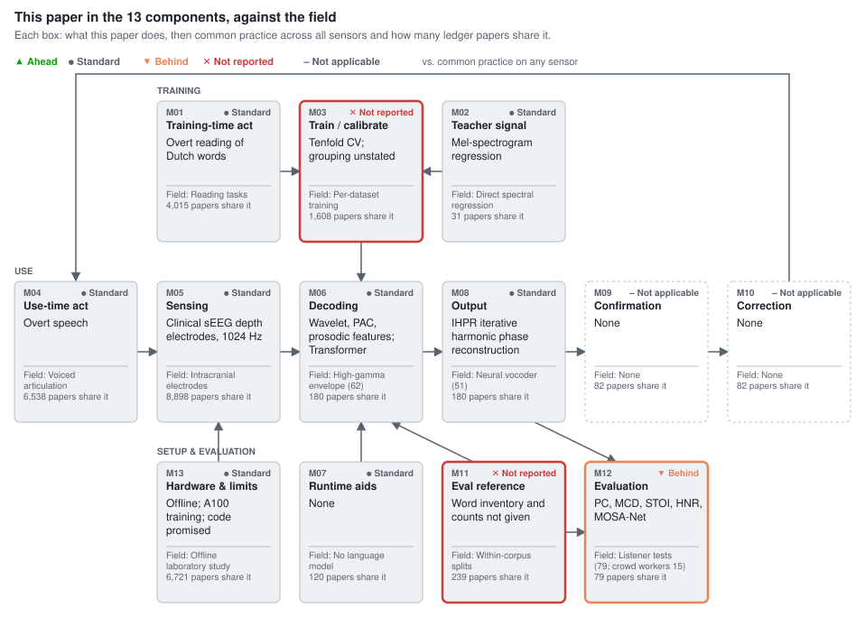

# Brain-to-Speech: Prosody Feature Engineering and Transformer-Based Reconstruction

Mohammed Salah Al-Radhi, Géza Németh, Andon Tchechmedjiev, Binbin Xu. Artificial Intelligence, Data and Robotics (Springer), 2026. [doi:10.1007/978-3-032-10561-5_16](https://doi.org/10.1007/978-3-032-10561-5_16) · [arXiv:2604.05751](https://arxiv.org/abs/2604.05751)

**Section:** [Brain signals (EEG, MEG, intracortical)](../../README.md#brain-signals-eeg-meg-intracortical)

## Figures

### This paper in the 13 components, against the field

<picture><source media="(prefers-color-scheme: dark)" srcset="figures/components-dark.svg"></picture>

Verdicts compare the paper's choice for each component with common practice across 8,995 ledger entries on any sensor (silent speech, brain-to-text, lip reading).

Data

| Component | This paper | Common practice | Papers with this practice | Verdict |
| --- | --- | --- | --- | --- |
| M01 Training-time act | Overt reading of Dutch words | Reading tasks | 4,015 of 8,995 | ● Standard (Inherited.) |
| M02 Teacher signal | Mel-spectrogram regression | Direct spectral regression | 31 of 8,995 | ● Standard (Inherited.) |
| M03 Train / calibrate | Tenfold CV; grouping unstated | Per-dataset training | 1,608 of 8,995 | ✕ Not reported (Fold unit and z-score fitting not stated.) |
| M04 Use-time act | Overt speech | Voiced articulation | 6,538 of 8,995 | ● Standard (Inherited.) |
| M05 Sensing | Clinical sEEG depth electrodes, 1024 Hz | Intracranial electrodes | 8,898 of 8,995 | ● Standard (Inherited; audio source misdescribed.) |
| M06 Decoding | Wavelet, PAC, prosodic features; Transformer | High-gamma envelope (62) | 180 of 8,995 | ● Standard (Same three parts as MiSTR; no ablation.) |
| M07 Runtime aids | None | No language model | 120 of 8,995 | ● Standard (Inherited.) |
| M08 Output | IHPR iterative harmonic phase reconstruction | Neural vocoder (51) | 180 of 8,995 | ● Standard (Griffin-Lim family (inference); vocoder not isolated.) |
| M09 Confirmation | None | None | 82 of 8,995 | – Not applicable (Offline study.) |
| M10 Correction | None | None | 82 of 8,995 | – Not applicable (Offline study.) |
| M11 Eval reference | Word inventory and counts not given | Within-corpus splits | 239 of 8,995 | ✕ Not reported (Words described as continuous speech.) |
| M12 Evaluation | PC, MCD, STOI, HNR, MOSA-Net | Listener tests (79; crowd workers 15) | 79 of 8,995 | ▼ Behind (Table 1 values equal MiSTR Table 1; no listener test.) |
| M13 Hardware & limits | Offline; A100 training; code promised | Offline laboratory study | 6,721 of 8,995 | ● Standard (No latency measured.) |

## Verdict

The chapter [[1]](#ref-1) changes two components: wavelet and phase-amplitude-coupling (PAC) sEEG features feeding an autoencoder and a Transformer (M06), and iterative harmonic phase reconstruction (IHPR) for the waveform (M08). Both are standard: both have precedents (Appendix), and no ablation isolates any part. MiSTR [[2]](#ref-2), by the same first two authors (August 2025), lists the same three parts and the same 28 Table 1 values; the chapter's reference list does not include it. The evaluation (M12) is behind: no listener heard the output, unlike 24 prior studies in the listener-test table (Appendix). "Highly intelligible" speech (§3.2.2, §6) has no listener measure, Table 1 contradicts the claimed lower MCD than every baseline, and two baseline MCDs equal [[3]](#ref-3)'s 80/20-split means despite the stated shared protocol.

## Against the field, component by component

### M06 Processing: wavelet, PAC and "prosodic" neural features

**Usual approach:** Among 180 unique intracranial speech-synthesis studies (pattern match, Appendix), the high-gamma envelope is the common input (62); wavelet decomposition appears in 19, theta or beta power in 13, PAC in 4. The chapter adds wavelet bands, theta-gamma PAC and five "prosodic" features (§3.1).

**State of the art:** Intracortical voice synthesis reached a median 43.75% listener WER in 2025 [[4]](#ref-4); ECoG reached 31% WER with a 25-word pool in 2019 [[5]](#ref-5); on this sEEG word dataset, listeners gave 2024 systems naturalness of 18–29 [[3]](#ref-3). The chapter has no listener measure to place on it.

MiSTR lists the same wavelet, PAC, Transformer and IHPR parts [[2]](#ref-2). No experiment removes the wavelet bands, PAC, prosodic features or autoencoder; each Table 1 row is a different full system, so the correlation gain over the encoder-decoder baseline (0.91 against 0.87) belongs to no feature (inference). The dataset authors note that correlation here mostly reflects speech versus silence [[6]](#ref-6). Verdict: standard.

### M08 Output: IHPR phase reconstruction

**Usual approach:** In the same 180 studies (pattern match, Appendix), neural vocoders are named in 51, unit selection in 30, parametric vocoders in 15 and Griffin-Lim in 11. IHPR refines STFT phase iteratively under harmonic constraints (§3.2.3), a Griffin-Lim-family method (inference), and the abstract measures it against Griffin-Lim, not against neural vocoders.

**State of the art:** On the same dataset, FC-DNN with WaveGlow reached a mean MCD of 4.55 dB in 2024 under a per-speaker 80/20 split [[3]](#ref-3); Table 1 (tenfold CV) is not on that protocol, so its 3.92 does not clear 4.55. Table 1 omits that row but carries two others.

§3.2.2 sends the Mel spectrogram to "a neural vocoder", §3.2.3 to IHPR phase refinement: the waveform path is inconsistent. HNR rises from 11.1 to 12.7 dB over the best baseline, +1.6 dB or 14% (inference), but between full systems, and MiSTR reports the same values [[2]](#ref-2). Verdict: standard.

### M12 Evaluation: no listeners, carried-over numbers

**Usual approach:** A listener test: 79 studies score non-acoustic-to-speech output with listeners (pattern match, Appendix), 15 of them with crowd workers; the encoder-decoder baseline's authors ran a binary forced-choice test with 19 listeners [[7]](#ref-7). The chapter uses MOSA-Net, an indirect proxy by its own account (§5.4), and prints no values; MiSTR reported a MOSA-Net score of 3.38 [[2]](#ref-2).

**State of the art:** 43.75% listener WER for intracortical voice synthesis, 2025 [[4]](#ref-4).

They gave five runs per setting and above-chance identification for two of three participants [[7]](#ref-7); the chapter gives neither. Verdict: behind 24 prior listener-test studies (confirmed in text, Appendix); best comparable work read: [[5]](#ref-5).

## The 13 components

| Component | This paper | Usual approach (count) | State of the art | Verdict |
|---|---|---|---|---|
| M01 Training-time action | Overt reading of Dutch words | Reading tasks (slot-filled 4,015) | – | standard |
| M02 Training-only supervision | Mel-spectrogram regression | Direct spectral regression (slot-filled 31) | – | standard |
| M03 Training and adaptation | Tenfold CV; grouping unstated | Per-dataset training (slot-filled 1,608) | – | not reported |
| M04 Use-time action | Overt speech | Voiced articulation (slot-filled 6,538) | – | standard |
| M05 Sensors | Clinical sEEG depth electrodes, 1024 Hz | Intracranial electrodes (slot-filled 8,898) | – | standard |
| M06 Processing and decoding | Wavelet, PAC, prosodic features; Transformer | High-gamma envelope (62) (pattern match 180) | 43.75% listener WER, intracortical [[4]](#ref-4) | standard |
| M07 Lexicon and LM | None | No language model (slot-filled 120) | – | standard |
| M08 Output | IHPR iterative harmonic phase reconstruction | Neural vocoder (51) (pattern match 180) | MCD 4.55 dB, same dataset, 80/20 split [[3]](#ref-3) | standard |
| M09 Confirmation | None | None (slot-filled 82) | – | not applicable |
| M10 Correction | None | None (slot-filled 82) | – | not applicable |
| M11 Reference construction | Word inventory and counts not given | Within-corpus splits (slot-filled 239) | – | not reported |
| M12 Evaluation | PC, MCD, STOI, HNR, MOSA-Net | Listener tests (79; crowd workers 15) (pattern match 79) | 43.75% listener WER [[4]](#ref-4) | behind |
| M13 Device and cost | Offline; A100 training; code promised | Offline laboratory study (slot-filled 6,721) | – | standard |

## Where the claims outrun the evidence

- Table 1 gives the same PC, MCD, STOI and HNR values as MiSTR's Table 1 for all seven systems (28 values), and MiSTR is not in the reference list [[2]](#ref-2).
- "The MCD score was consistently lower than the baselines" (§5.1) contradicts Table 1: Seq2Seq has 3.90 against 3.92. MiSTR stated this exception [[2]](#ref-2); the chapter drops it.
- §4.4 says all baselines shared one protocol, yet the regression (5.39) and 3D-CNN (5.04) MCDs equal the Table I means of [[3]](#ref-3), from a per-speaker 80/20 split, not tenfold CV.
- §4.1 describes isolated words and continuous speech from a high-fidelity microphone at 16 kHz; the dataset has 100 single words per participant from a notebook's onboard microphone at 48 kHz [[6]](#ref-6).
- "Significantly" (§5.1) has no test or chance level, though the dataset paper supplies a random circular-shift chance baseline [[6]](#ref-6).
- F0 comes from Harvest (§3.1.3), a speech-waveform estimator; if it reads the audio, target information enters the input (inference).

## What the field needs next

- M06: ablate wavelet bands, PAC and prosodic inputs against high gamma alone, over several seeds, with fold-wise normalization.
- M08: IHPR against WaveGlow, as used on this dataset [[3]](#ref-3), on identical predicted spectrograms.
- M12: listener identification with a chance level, as in [[7]](#ref-7), before claiming intelligibility.

## Questions for the authors

- Are the Table 1 numbers the MiSTR experiment, and which baseline values were taken from their papers?
- Were folds split by word or participant, and were z-scores fit on training folds only?
- Is F0 computed from the iEEG or from the audio?

## Appendix: literature search

- M06 intracranial-synthesis-neural-features. Inclusion rule: studies that reconstruct speech acoustics from intracranial recordings (ECoG, sEEG or depth electrodes, intracortical arrays) made during speech production, classified by the neural feature fed to the decoder; heard-speech reconstruction, TTS read-out of decoded text and reviews excluded; versions counted once. Slot-filled 7,345 unique studies; pattern match 180 unique studies (upper bound). Usual design: high-gamma envelope, 62 (pattern match, full text). Design counts: high-gamma envelope 62, wavelet decomposition 19, theta or beta band power 13, phase-amplitude coupling 4. Read in full: [[2]](#ref-2), [[6]](#ref-6), [[4]](#ref-4), target. Known-item recall 1.0 (5 seeds).
- M08 intracranial-synthesis-waveform-generation. Inclusion rule: the same population, classified by how predicted acoustic features become a waveform. Slot-filled 3,268 unique studies; pattern match 180 unique studies (upper bound). Usual design: pretrained neural vocoder, 51 (pattern match, full text). Design counts: neural vocoder 51, unit selection 30, parametric vocoder 15, Griffin-Lim 11. Read in full: [[3]](#ref-3), [[2]](#ref-2), target. Known-item recall 1.0 (3 seeds).
- M12 listener-intelligibility-test (published topic table, appended). Inclusion rule: studies that evaluate speech synthesized from non-acoustic signals with human listeners who transcribe or identify words or sentences; naturalness-, preference- or MOS-only ratings, ASR-only scoring and acoustic-input conversion excluded. Slot-filled 6,960 unique studies; pattern match 79 unique studies. Usual design: listener test, 79; most common listener pool: crowd workers, 15 (pattern match). Prior to the target (first public before 2025-10): 24 unique studies (confirmed in text). Read in full: [[5]](#ref-5), [[7]](#ref-7), [[4]](#ref-4). Known-item recall 1.0.

## References

Numbered by first citation. BibTeX in the same order and keys: [refs.bib](refs.bib).

1. Al-Radhi, M. S., Németh, G., Tchechmedjiev, A., Xu, B. “Brain-to-Speech: Prosody Feature Engineering and Transformer-Based Reconstruction.” *Artificial Intelligence, Data and Robotics (E. Curry et al., eds.)*, 2026, 453. doi:[10.1007/978-3-032-10561-5_16](https://doi.org/10.1007/978-3-032-10561-5_16). arXiv:[2604.05751](https://arxiv.org/abs/2604.05751). Target. Read as arXiv 2604.05751v1 (Springer chapter, open access). [review](https://github.com/supernaiter/silent-speech-review/tree/main/reviews/brain-to-speech-prosody-feature-engineering-and-transformer-based-reconstruction) [wiki: arxiv-2604.05751](https://github.com/supernaiter/deep-research-wiki-for-silent-speech/blob/main/papers/arxiv-2604.05751/article.md)
2. Al-Radhi, M. S., Németh, G., Gerazov, B. “MiSTR: Multi-Modal iEEG-to-Speech Synthesis with Transformer-Based Prosody Prediction and Neural Phase Reconstruction.” *Proc. Interspeech 2025*, 2025. doi:[10.21437/Interspeech.2025-1334](https://doi.org/10.21437/Interspeech.2025-1334). arXiv:[2508.03166](https://arxiv.org/abs/2508.03166). [wiki: arxiv-2508.03166](https://github.com/supernaiter/deep-research-wiki-for-silent-speech/blob/main/papers/arxiv-2508.03166/article.md) [wiki: isca-alradhi25-mistr](https://github.com/supernaiter/deep-research-wiki-for-silent-speech/blob/main/papers/isca-alradhi25-mistr/article.md)
3. Arthur, F. V., Csapó, T. G. “Speech synthesis from intracranial stereotactic Electroencephalography using a neural vocoder.” *Infocommunications Journal*, 2024, 16(1), 47–55. doi:[10.36244/ICJ.2024.1.6](https://doi.org/10.36244/ICJ.2024.1.6). [wiki: doi-10.36244-icj.2024.1.6](https://github.com/supernaiter/deep-research-wiki-for-silent-speech/blob/main/papers/doi-10.36244-icj.2024.1.6/article.md)
4. Wairagkar, M., Card, N. S., Singer-Clark, T., Hou, X., Iacobacci, C., Miller, L. M., et al. “An instantaneous voice-synthesis neuroprosthesis.” *Nature*, 2025. doi:[10.1038/s41586-025-09127-3](https://doi.org/10.1038/s41586-025-09127-3). [review](https://github.com/supernaiter/silent-speech-review/tree/main/reviews/an-instantaneous-voice-synthesis-neuroprosthesis) [wiki: doi-10.1038-s41586-025-09127-3](https://github.com/supernaiter/deep-research-wiki-for-silent-speech/blob/main/papers/doi-10.1038-s41586-025-09127-3/article.md) [wiki: doi-10.1101-2024.08.14.607690](https://github.com/supernaiter/deep-research-wiki-for-silent-speech/blob/main/papers/doi-10.1101-2024.08.14.607690/article.md) [wiki: pmc-12369848-voicesynth](https://github.com/supernaiter/deep-research-wiki-for-silent-speech/blob/main/papers/pmc-12369848-voicesynth/article.md) [wiki: pmc-12369848-voice-synth-np](https://github.com/supernaiter/deep-research-wiki-for-silent-speech/blob/main/papers/pmc-12369848-voice-synth-np/article.md) [wiki: pmc-11370360-instvoice](https://github.com/supernaiter/deep-research-wiki-for-silent-speech/blob/main/papers/pmc-11370360-instvoice/article.md)
5. Anumanchipalli, G. K., Chartier, J., Chang, E. F. “Speech synthesis from neural decoding of spoken sentences.” *Nature*, 2019, 568(7753), 493–498. doi:[10.1038/s41586-019-1119-1](https://doi.org/10.1038/s41586-019-1119-1). [review](https://github.com/supernaiter/silent-speech-review/tree/main/reviews/speech-synthesis-from-neural-decoding-of-spoken-sentences) [wiki: doi-10.1038-s41586-019-1119-1](https://github.com/supernaiter/deep-research-wiki-for-silent-speech/blob/main/papers/doi-10.1038-s41586-019-1119-1/article.md) [wiki: pmc-9714519-speechsynth](https://github.com/supernaiter/deep-research-wiki-for-silent-speech/blob/main/papers/pmc-9714519-speechsynth/article.md)
6. Verwoert, M., Ottenhoff, M. C., Goulis, S., Colon, A. J., Wagner, L., Tousseyn, S., et al. “Dataset of Speech Production in intracranial Electroencephalography.” *Scientific Data*, 2022, 9, 434. doi:[10.1038/s41597-022-01542-9](https://doi.org/10.1038/s41597-022-01542-9). [wiki: doi-10.1038-s41597-022-01542-9](https://github.com/supernaiter/deep-research-wiki-for-silent-speech/blob/main/papers/doi-10.1038-s41597-022-01542-9/article.md) [wiki: doi-10.1101-2022.04.05.487183](https://github.com/supernaiter/deep-research-wiki-for-silent-speech/blob/main/papers/doi-10.1101-2022.04.05.487183/article.md) [wiki: pmc-9307753-spproddata](https://github.com/supernaiter/deep-research-wiki-for-silent-speech/blob/main/papers/pmc-9307753-spproddata/article.md)
7. Kohler, J., Ottenhoff, M. C., Goulis, S., Angrick, M., Colon, A. J., Wagner, L., et al. “Synthesizing Speech from Intracranial Depth Electrodes using an Encoder-Decoder Framework.” *arXiv preprint (Neurons, Behavior, Data analysis, and Theory)*, 2022. arXiv:[2111.01457](https://arxiv.org/abs/2111.01457). [wiki: arxiv-2111.01457](https://github.com/supernaiter/deep-research-wiki-for-silent-speech/blob/main/papers/arxiv-2111.01457/article.md)

## Materials

Data behind this review. Full texts of the papers are not included.

- [`review.md`](review.md): the review text (source)
- [`refs.bib`](refs.bib): references (BibTeX)
- [`slots.json`](slots.json): for each of the 13 components: this paper's choice, field practice, number of matching papers, verdict
- [`figures.json`](figures.json): figure definitions
- [`evaluation.md`](evaluation.md): independent evaluation by a second reviewer
- [`triage.md`](triage.md): how each evaluation finding was checked against the sources and resolved
- [`components/M06/intracranial-synthesis-neural-features.csv`](../../components/M06/intracranial-synthesis-neural-features.csv): M06 topic "intracranial-synthesis-neural-features", every candidate paper with its decision (7345 slot-filled, 180 pattern match, usual design in 62, 3 read in full)
- [`components/M08/intracranial-synthesis-waveform-generation.csv`](../../components/M08/intracranial-synthesis-waveform-generation.csv): M08 topic "intracranial-synthesis-waveform-generation", every candidate paper with its decision (3268 slot-filled, 180 pattern match, usual design in 51, 2 read in full)
- [`components/M12/listener-intelligibility-test.csv`](../../components/M12/listener-intelligibility-test.csv): M12 topic "listener-intelligibility-test", every candidate paper with its decision (6960 slot-filled, 37 pattern match, usual design in 15, 5 read in full)

## More reviews in Brain signals (EEG, MEG, intracortical)

- [A cross-species neural foundation model for end-to-end speech decoding](../a-cross-species-neural-foundation-model-for-end-to-end-speech-decoding/) (2026). Cascaded decoding with the pretrained encoder is a strong standard result; the end-to-end audio-LLM path beats the prior end-to-end entry but trails RNN cascades, and the cross-species gain is small.
- [Brain2Speech-Net: Intelligible, Real-Time Brain-to-Speech Synthesis Without Text Decoding](../brain2speech-net-intelligible-real-time-brain-to-speech-synthesis-without-text-decoding/) (2026). Text-free synthesis of attempted speech from intracortical recordings in one participant with ALS; 47.2% WER on unseen utterances versus 6.8% on a training-set sample, with faster-than-real-time throughput (RTF ~0.5).
- [Do EEG Foundation Models Transfer to Speech? A Benchmark on Overt and Imagined Speech Decoding](../do-eeg-foundation-models-transfer-to-speech-a-benchmark-on-overt-and-imagined-speech-decoding/) (2026). Benchmark of EEG foundation models versus conventional models for overt and imagined speech decoding on two datasets; general EEG pretraining shows no consistent advantage and word decoding stays near chance.
- [EEG-Based Imagined Speech Decoding Using a Hybrid CNN-SNN Architecture](../eeg-based-imagined-speech-decoding-using-a-hybrid-cnn-snn-architecture/) (2026). Hybrid CNN-SNN classifier for five-class EEG imagined speech; reports 80.13% accuracy and 80.14% F1 in offline subject-dependent evaluation, about 98 ms GPU prediction time per trial.
- [iPhoneme: Brain-to-Text Communication for ALS Using ConformerXL Decoding](../iphoneme-brain-to-text-communication-for-als-using-conformerxl-decoding/) (2026). ConformerXL-based intracortical brain-to-text decoding for ALS with a proposed gaze-confirmation interface; WFST decoding reaches 7.86% phoneme error rate retrospectively in one participant.
- [Mechanistic Interpretability of Brain-to-Speech Models Across Speech Modes](../mechanistic-interpretability-of-brain-to-speech-models-across-speech-modes/) (2026). Applies activation interventions to a stereotactic EEG brain-to-speech decoder across vocalized, mimed and imagined speech; baseline PCC is 0.75/0.73/0.57, but internal inconsistencies leave strong causal conclusions unestablished.

---

Part of the [Silent Speech Interface Review](https://github.com/supernaiter/silent-speech-review). Found an error? [Open an issue](https://github.com/supernaiter/silent-speech-review/issues/new?template=correction.yml).
