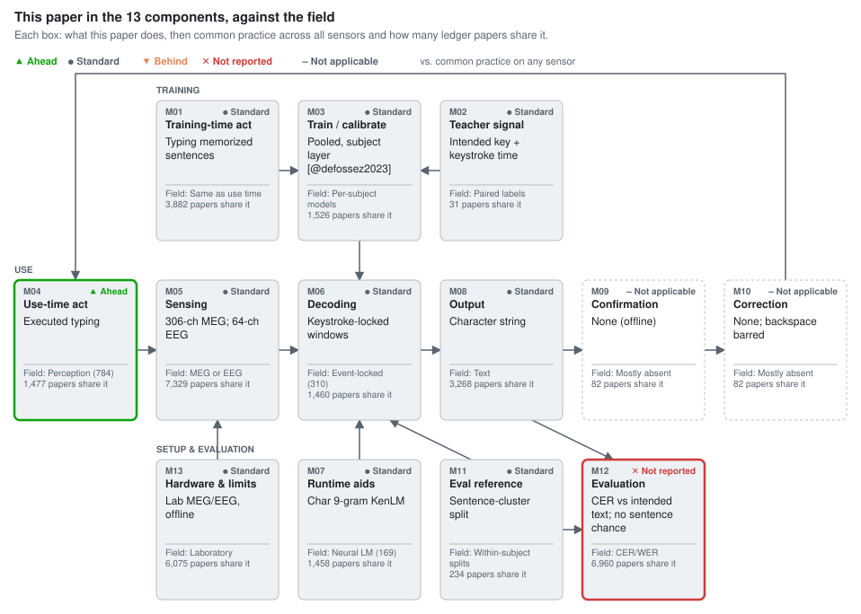

# Brain-to-Text Decoding: A Non-invasive Approach via Typing

Lévy J, Zhang M, Pinet S, Rapin J, Banville H, d’Ascoli S, King J-R. arXiv preprint, 2025. [arXiv:2502.17480](https://arxiv.org/abs/2502.17480)

**Section:** [Brain signals (EEG, MEG, intracortical)](../../README.md#brain-signals-eeg-meg-intracortical)

## Figures

### This paper in the 13 components, against the field

<picture><source media="(prefers-color-scheme: dark)" srcset="figures/components-dark.svg"></picture>

Verdicts compare the paper's choice for each component with common practice across 8,995 ledger entries on any sensor (silent speech, brain-to-text, lip reading).

Data

| Component | This paper | Common practice | Papers with this practice | Verdict |
| --- | --- | --- | --- | --- |
| M01 Training-time act | Typing memorized sentences | Same as use time | 3,882 of 8,995 | ● Standard (Inherited.) |
| M02 Teacher signal | Intended key + keystroke time | Paired labels | 31 of 8,995 | ● Standard (Labels need typing.) |
| M03 Train / calibrate | Pooled, subject layer [@defossez2023] | Per-subject models | 1,526 of 8,995 | ● Standard (Lineage of [@defossez2023].) |
| M04 Use-time act | Executed typing | Perception (784) | 1,477 of 8,995 | ▲ Ahead (Healthy typists only.) |
| M05 Sensing | 306-ch MEG; 64-ch EEG | MEG or EEG | 7,329 of 8,995 | ● Standard (Cohorts differ.) |
| M06 Decoding | Keystroke-locked windows | Event-locked (310) | 1,460 of 8,995 | ● Standard (Needs keystroke times.) |
| M07 Runtime aids | Char 9-gram KenLM | Neural LM (169) | 1,458 of 8,995 | ● Standard (Corrects typos.) |
| M08 Output | Character string | Text | 3,268 of 8,995 | ● Standard (Sentence level.) |
| M09 Confirmation | None (offline) | Mostly absent | 82 of 8,995 | – Not applicable (Offline study; same 82 ledger papers as M10.) |
| M10 Correction | None; backspace barred | Mostly absent | 82 of 8,995 | – Not applicable (Offline study; same 82 ledger papers as M09.) |
| M11 Eval reference | Sentence-cluster split | Within-subject splits | 234 of 8,995 | ● Standard (Same people in test.) |
| M12 Evaluation | CER vs intended text; no sentence chance | CER/WER | 6,960 of 8,995 | ✕ Not reported (No sentence-CER chance level or LM-only CER.) |
| M13 Hardware & limits | Lab MEG/EEG, offline | Laboratory | 6,075 of 8,995 | ● Standard (MEG not wearable.) |

## Verdict

The paper [[1]](#ref-1) changes the use-time action (M04) to executed typing; no earlier MEG or EEG ledger paper decodes typed text (Appendix), so this was ahead in February 2025. Its decoder (M06) is standard: keystroke-locked windows, whose need for keystroke times the authors acknowledge (Discussion); on the target's data, without a language model, the group's [later] asynchronous encoder gives CER 0.59 against 0.39 locked [[2]](#ref-2). The character n-gram model (M07) is standard but corrects the typists' own errors, so the headline CER mixes decoding with correction. The signal is executed finger movement of healthy typists: the paper shows keystroke decoding, not communication for people who cannot move, as the authors concede (Discussion). A [later] control clears window timing as a label leak: synthetic inputs that keep the aligned windows give 6.8% balanced character accuracy on test against 34.9% with MEG [[3]](#ref-3). The "two-fold" MEG-over-EEG gain compares mostly different people.

## Against the field, component by component

### M04 Use-time action: executed typing

**Usual approach:** Among 1,477 MEG or EEG language-decoding studies (pattern match with full-text-only additions, unique studies, Appendix), perception is the default (784), then imagined speech (532); non-invasive text entry has meant evoked-potential spellers (164). The paper decodes typing movements.

**State of the art:** In 2026 the [later] Brain2Qwerty v2 decodes typed sentences from real-time MEG at 39% WER, nine subjects × 10 hours [[2]](#ref-2); invasive typing reaches 110 characters per minute at 1.6% WER online [[4]](#ref-4).

Of 95 typing-pattern hits dated before February 2025, the 14 that pair typing with decoding are spellers, handwriting imagery, error potentials or reviews; none decodes executed keystrokes from MEG or EEG (Appendix). The closest earlier design is intracortical attempted handwriting at 90 characters per minute and 94.1% raw online accuracy [[5]](#ref-5). The target carries it to non-invasive sensors in 20 MEG and 20 EEG participants (Sec. 1). Verdict: ahead at the time. The price is the action: healthy typists screened for at least 80% accuracy (Sec. 4.1), a hand signal peaking 40 ms after the keypress, when touch feedback is present (Sec. 2.1; inference), and no route for people unable to type (Discussion).

### M06 Decoding: keystroke-locked windows

**Usual approach:** Windows locked to onsets supplied at test time are the default (310 of 1,460 MEG or EEG studies, pattern match with full-text-only additions, Appendix), against 63 with CTC or asynchronous decoding; the paper follows it with 500-ms keypress windows (Sec. 4.1).

**State of the art:** In 2026 a [later] asynchronous CTC encoder reaches CER 0.25 without a language model, against 0.23 keystroke-locked (Fig. 1D–E) [[2]](#ref-2).

On the target's recordings, encoders alone, the asynchronous one gives CER 0.59 against 0.39 locked [[2]](#ref-2), so keystroke times remove about a third of the encoder error at this data scale (inference); the target's 32% includes its n-gram model. The timing does not leak labels: synthetic inputs keeping the aligned windows reach 6.8% balanced character accuracy on test against 34.9% with MEG and 3.45% chance (Fig. 10), unlike word-aligned listening, where brain-free inputs score 22.0% against 22.3% [[3]](#ref-3). The EEGNet baseline lacks the subject layer (Sec. 4.2.4), so the 1.14-fold EEG gain over it does not isolate the architecture. Verdict: standard.

### M07 Language prior: character n-gram

**Usual approach:** Neural or large language models are the most frequent prior in MEG or EEG decoding (169 of 1,458, pattern match, Appendix), ahead of n-gram models (56); the paper uses a 9-gram character KenLM (Sec. 4.2.1).

**State of the art:** In 2026 a [later] LLM pipeline lowers WER from 0.43 with a 6-gram character model to 0.39 but raises CER from 0.26 to 0.31 (Fig. 3A–B; encoder alone 0.28 there, 0.25 in Fig. 1E) [[2]](#ref-2).

The model corrects participants' own typos (Sec. 2.5, Table 1), which were 3.9% of keystrokes (Sec. 2.8), and CER is scored against the intended sentence (Sec. 4.1, 4.2.3); no language-model-only baseline is given. Verdict: standard; n-gram models suit CER, sentence-level models suit WER.

## The 13 components

| Component | This paper | Usual approach (count) | State of the art | Verdict |
|---|---|---|---|---|
| M01 Training-time action | Typing memorized sentences | Same as use time (slot-filled 3,882) | – | standard |
| M02 Training-only supervision | Intended key + keystroke time | Paired labels (slot-filled 31) | – | standard |
| M03 Training and adaptation | Pooled, subject layer [[6]](#ref-6) | Per-subject models (slot-filled 1,526) | – | standard |
| M04 Use-time action | Executed typing | Perception (784) (pattern match 1,477) | 39% WER, real-time MEG [[2]](#ref-2) | ahead |
| M05 Sensors | 306-ch MEG; 64-ch EEG | MEG or EEG (slot-filled 7,329) | – | standard |
| M06 Processing and decoding | Keystroke-locked windows | Event-locked (310) (pattern match 1,460) | CTC CER 0.25 vs 0.23 locked [[2]](#ref-2) | standard |
| M07 Lexicon and LM | Char 9-gram KenLM | Neural LM (169) (pattern match 1,458) | LLM WER 0.39 vs 0.43 n-gram [[2]](#ref-2) | standard |
| M08 Output | Character string | Text (slot-filled 3,268) | – | standard |
| M09 Confirmation | None (offline) | Mostly absent (slot-filled 82) | – | not applicable |
| M10 Correction | None; backspace barred | Mostly absent (slot-filled 82) | – | not applicable |
| M11 Reference construction | Sentence-cluster split | Within-subject splits (slot-filled 234) | – | standard |
| M12 Evaluation | CER vs intended text; no sentence chance | CER/WER (slot-filled 6,960) | – | not reported |
| M13 Device and cost | Lab MEG/EEG, offline | Laboratory (slot-filled 6,075) | – | standard |

## Where the claims outrun the evidence

- MEG versus EEG: the "two-fold" gain (Discussion) compares cohorts that share five people (Sec. 4.1), and the across-device test (Sec. 2.2) confounds people with sensors.
- Generalisation: all participants are in training, with one fixed split seed and an undefined ± on the headline CER (Sec. 2.2, 4.1); [later] work tests held-out subjects [[2]](#ref-2).
- Chance: the 14% chance is for single characters (Sec. 2.1); nothing anchors the 32% and 67% sentence CER.
- Inconsistencies: words "heard" versus visual RSVP (Sec. 4.1); 3.9% versus 3.6% typos (Sec. 2.8, 4.1).

## What the field needs next

1. M06: decode the same recordings asynchronously, so the cost of keystroke timing is reported [[2]](#ref-2).
2. M04: attempted typing with movement verified absent by EMG, the patients' condition.
3. M07: a language-model-only baseline and scoring against keys actually pressed.
4. M05: a within-subject MEG versus EEG comparison.

## Questions for the authors

- Which data selected beam size and language-model weight?
- Were RobustScaler parameters fit on training data only?
- What do the ± values denote, and how many split seeds enter Fig. 3?
- What is the CER for a participant left out of training?

## Appendix: literature search

- M04 noninvasive-text-production-action. Inclusion rule: language or text decoding studies whose ledger names scalp EEG or MEG; the design compared is the use-time action that produces the decoded signal (perception, imagined speech, evoked-potential spelling, executed typing or handwriting); keypresses used only as behavioural responses are not typing decoding; versions count once. Slot-filled 5,595 unique studies (M04); pattern match 1,458 unique studies in the ledger; adding 20 full-text-only folders gives 1,477 unique studies for the action counts. Action counts (pattern match, of 1,477): perception 784, imagined speech 532, evoked speller 164, typing 163, handwriting 86. Typing hits dated before 2025-02: 95; 14 pair typing with decoding, none decodes executed typing from MEG or EEG. Read in full: [[5]](#ref-5) (prior), [[2]](#ref-2), [[4]](#ref-4). Known-item recall 1.0.
- M06 noninvasive-decoding-segmentation. Inclusion rule: same population; the design compared is test-time segmentation, windows locked to supplied onsets versus continuous decoding that infers segmentation (CTC, asynchronous, sliding window); event-locked training with continuous test-time decoding counts as continuous. Slot-filled 7,345 unique studies; pattern match 1,458 unique studies in the ledger; adding 3 full-text-only folders gives 1,460 unique studies for the segmentation counts. Segmentation counts (pattern match, of 1,460): event-locked 310, CTC or asynchronous 63. Read in full: [[2]](#ref-2), [[3]](#ref-3). Known-item recall 1.0.
- M07 noninvasive-text-decoding-language-model. Inclusion rule: same population; the design compared is the use-time language prior (n-gram or character model with beam search, neural or large language model, none); models used only to build training targets do not count. Slot-filled 119 unique studies (sparse slot); pattern match 1,458 unique studies. Prior counts (pattern match, of 1,458; no full-text-only additions): neural or large language model 169, n-gram 56, beam search 36. Read in full: [[2]](#ref-2). Known-item recall 1.0.

## References

Numbered by first citation. BibTeX in the same order and keys: [refs.bib](refs.bib).

1. Lévy, J., Zhang, M., Pinet, S., Rapin, J., Banville, H., d’Ascoli, S., et al. “Brain-to-Text Decoding: A Non-invasive Approach via Typing.” *arXiv preprint*, 2025. arXiv:[2502.17480](https://arxiv.org/abs/2502.17480). arXiv v1 (2025-02-18); journal version: Nature Neuroscience 2026, doi:10.1038/s41593-026-02303-2 [review](https://github.com/supernaiter/silent-speech-review/tree/main/reviews/brain-to-text-decoding-a-non-invasive-approach-via-typing) [wiki: arxiv-2502.17480](https://github.com/supernaiter/deep-research-wiki-for-silent-speech/blob/main/papers/arxiv-2502.17480/article.md) [wiki: doi-10.1038-s41593-026-02303-2](https://github.com/supernaiter/deep-research-wiki-for-silent-speech/blob/main/papers/doi-10.1038-s41593-026-02303-2/article.md) [wiki: pmc-13633113-b2qwerty](https://github.com/supernaiter/deep-research-wiki-for-silent-speech/blob/main/papers/pmc-13633113-b2qwerty/article.md) [wiki: pmc-13633113-brain2qwerty](https://github.com/supernaiter/deep-research-wiki-for-silent-speech/blob/main/papers/pmc-13633113-brain2qwerty/article.md)
2. Zhang, M., Lévy, J., Rommel, C., Rapin, J., Bel, C., Bonnaire, J., et al. “Accurate Decoding of Natural Sentences from Non-Invasive Brain Recordings.” *arXiv preprint*, 2026. arXiv:[2608.18114](https://arxiv.org/abs/2608.18114). [later] [wiki: arxiv-2608.18114](https://github.com/supernaiter/deep-research-wiki-for-silent-speech/blob/main/papers/arxiv-2608.18114/article.md) [wiki: arxiv-2608-18114-natsent](https://github.com/supernaiter/deep-research-wiki-for-silent-speech/blob/main/papers/arxiv-2608-18114-natsent/article.md) [wiki: arxiv-2608.18114-brain2qwerty2](https://github.com/supernaiter/deep-research-wiki-for-silent-speech/blob/main/papers/arxiv-2608.18114-brain2qwerty2/article.md)
3. Jayalath, D., Parker Jones, O. “Removing Timing Shortcuts Improves Non-Invasive Brain-to-Text.” *arXiv preprint*, 2026. arXiv:[2609.40359](https://arxiv.org/abs/2609.40359). [later] [wiki: arxiv-2609-40359-shortcuts](https://github.com/supernaiter/deep-research-wiki-for-silent-speech/blob/main/papers/arxiv-2609-40359-shortcuts/article.md) [wiki: arxiv-2609-40359-timingshort](https://github.com/supernaiter/deep-research-wiki-for-silent-speech/blob/main/papers/arxiv-2609-40359-timingshort/article.md)
4. Jude, J. J., Levi-Aharoni, H., Acosta, A. J., Allcroft, S. B., Nicolas, C., Lacayo, B. E., et al. “Restoring rapid natural bimanual typing with a neuroprosthesis after paralysis.” *Nature Neuroscience*, 2026, 29. doi:[10.1038/s41593-026-02218-y](https://doi.org/10.1038/s41593-026-02218-y). author list continues in the article [later] [wiki: doi-10.1038-s41593-026-02218-y](https://github.com/supernaiter/deep-research-wiki-for-silent-speech/blob/main/papers/doi-10.1038-s41593-026-02218-y/article.md) [wiki: pmc-13633126-bimantype](https://github.com/supernaiter/deep-research-wiki-for-silent-speech/blob/main/papers/pmc-13633126-bimantype/article.md) [wiki: pmc-13633126-bimanualtype](https://github.com/supernaiter/deep-research-wiki-for-silent-speech/blob/main/papers/pmc-13633126-bimanualtype/article.md) [wiki: pmc-13633126-bitype](https://github.com/supernaiter/deep-research-wiki-for-silent-speech/blob/main/papers/pmc-13633126-bitype/article.md) [wiki: pmc-13633126-bityping](https://github.com/supernaiter/deep-research-wiki-for-silent-speech/blob/main/papers/pmc-13633126-bityping/article.md) [wiki: pmc-13633126-ibcityping](https://github.com/supernaiter/deep-research-wiki-for-silent-speech/blob/main/papers/pmc-13633126-ibcityping/article.md)
5. Willett, F. R., Avansino, D. T., Hochberg, L. R., Henderson, J. M., Shenoy, K. V. “High-performance brain-to-text communication via handwriting.” *Nature*, 2021, 593, 249–254. doi:[10.1038/s41586-021-03506-2](https://doi.org/10.1038/s41586-021-03506-2). also in the wiki as doi-10.1038-s41586-021-03506-2 [wiki: pmc-8163299-b2thand](https://github.com/supernaiter/deep-research-wiki-for-silent-speech/blob/main/papers/pmc-8163299-b2thand/article.md)
6. Défossez, A., Caucheteux, C., Rapin, J., Kabeli, O., King, J. “Decoding speech perception from non-invasive brain recordings.” *Nature Machine Intelligence*, 2023, 5, 1097–1107. doi:[10.1038/s42256-023-00714-5](https://doi.org/10.1038/s42256-023-00714-5). arXiv:[2208.12266](https://arxiv.org/abs/2208.12266). arXiv v2 (2023-10-05), journal version label on first page [review](https://github.com/supernaiter/silent-speech-review/tree/main/reviews/decoding-speech-perception-from-non-invasive-brain-recordings) [wiki: arxiv-2208.12266-natmi](https://github.com/supernaiter/deep-research-wiki-for-silent-speech/blob/main/papers/arxiv-2208.12266-natmi/article.md)

## Materials

Data behind this review. Full texts of the papers are not included.

- [`review.md`](review.md): the review text (source)
- [`refs.bib`](refs.bib): references (BibTeX)
- [`slots.json`](slots.json): for each of the 13 components: this paper's choice, field practice, number of matching papers, verdict
- [`figures.json`](figures.json): figure definitions
- [`evaluation.md`](evaluation.md): independent evaluation by a second reviewer
- [`triage.md`](triage.md): how each evaluation finding was checked against the sources and resolved
- [`components/M04/noninvasive-text-production-action.csv`](../../components/M04/noninvasive-text-production-action.csv): M04 topic "noninvasive-text-production-action", every candidate paper with its decision (5595 slot-filled, 1458 pattern match, usual design in 784, 3 read in full)
- [`components/M06/noninvasive-decoding-segmentation.csv`](../../components/M06/noninvasive-decoding-segmentation.csv): M06 topic "noninvasive-decoding-segmentation", every candidate paper with its decision (7345 slot-filled, 1458 pattern match, usual design in 310, 2 read in full)
- [`components/M07/noninvasive-text-decoding-language-model.csv`](../../components/M07/noninvasive-text-decoding-language-model.csv): M07 topic "noninvasive-text-decoding-language-model", every candidate paper with its decision (119 slot-filled, 1458 pattern match, usual design in 169, 1 read in full)

## More reviews in Brain signals (EEG, MEG, intracortical)

- [A Convolutional Framework for Mapping Imagined Auditory MEG into Listened Brain Responses](../a-convolutional-framework-for-mapping-imagined-auditory-meg-into-listened-brain-responses/) (2025). Mapping imagined onto listened MEG (M06) is ahead in design, but the subject-calibrated CNN gain is unproven: no ablation, a channel-shuffling null, and r 0.0113 against 0.0063.
- [An instantaneous voice-synthesis neuroprosthesis](../an-instantaneous-voice-synthesis-neuroprosthesis/) (2025). Closed-loop sentence voice from intracortical arrays holds for one participant; the design is standard, forced-choice and proxy-target metrics overstate intelligibility.
- [Distinct Theta Synchrony across Speech Modes: Perceived, Spoken, Whispered, and Imagined](../distinct-theta-synchrony-across-speech-modes-perceived-spoken-whispered-and-imagined/) (2025). Exploratory comparison of EEG theta-band functional connectivity across perceived, spoken, whispered and imagined speech in ten healthy subjects; no recognition performance is measured.
- [EEG-to-Voice Decoding of Spoken and Imagined speech Using Non-Invasive EEG](../eeg-to-voice-decoding-of-spoken-and-imagined-speech-using-non-invasive-eeg/) (2025). Reconstructs cued overt and imagined speech audio and text from 130-channel wet EEG with subject-specific models; imagined-speech WER is 47.48% (2 s) and 43.46% (4 s) before language correction.
- [Lightweight Diffusion-based Framework for Online Imagined Speech Decoding in Aphasia](../lightweight-diffusion-based-framework-for-online-imagined-speech-decoding-in-aphasia/) (2025). Real-time diffusion-based EEG decoder for one person with aphasia classifying three imagined Korean words plus rest, reporting 65% top-1 and 70% top-2 accuracy over 20 online trials.
- [MultiDiffNet: A Multi-Objective Diffusion Framework for Generalizable Brain Decoding](../multidiffnet-a-multi-objective-diffusion-framework-for-generalizable-brain-decoding/) (2025). Diff-E-style decoder (M06) whose own ablation does not show diffusion helping; 1.01-point imagined-speech gain over EEGNet on two held-out subjects, normalized on scored trials (M03).

---

Part of the [Silent Speech Interface Review](https://github.com/supernaiter/silent-speech-review). Found an error? [Open an issue](https://github.com/supernaiter/silent-speech-review/issues/new?template=correction.yml).
