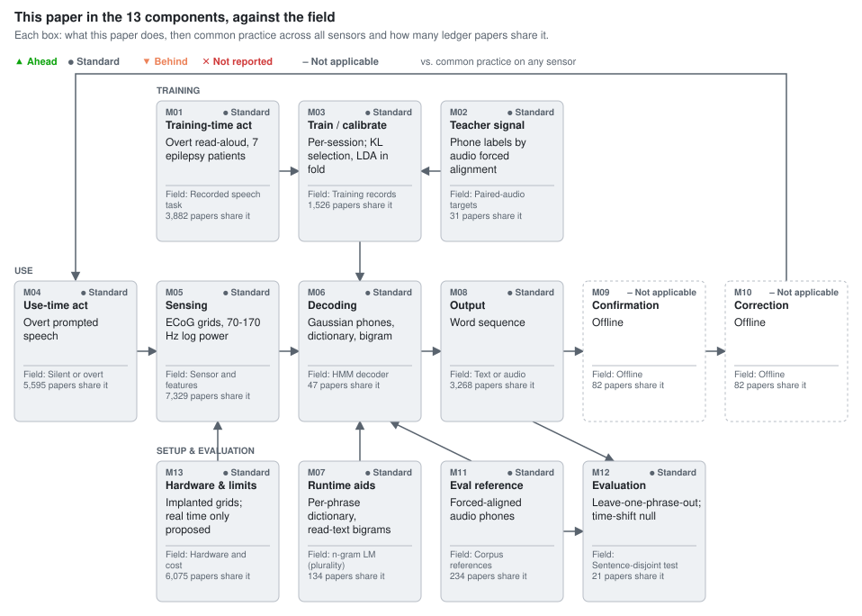

# Brain-to-text: decoding spoken phrases from phone representations in the brain

Herff, C., Heger, D., de Pesters, A., Telaar, D., Brunner, P., Schalk, G., Schultz, T. · Frontiers in Neuroscience · 2015 · [doi:10.3389/fnins.2015.00217](https://doi.org/10.3389/fnins.2015.00217)

**Section:** [Other sensors](../../README.md#other-sensors)

## Figures

### This paper in the 13 components, against the field

<picture><source media="(prefers-color-scheme: dark)" srcset="figures/components-dark.svg"></picture>

Verdicts compare the paper's choice for each component with common practice across 8,995 ledger entries on any sensor (silent speech, brain-to-text, lip reading).

Data

| Component | This paper | Common practice | Papers with this practice | Verdict |
| --- | --- | --- | --- | --- |
| M01 Training-time act | Overt read-aloud, 7 epilepsy patients | Recorded speech task | 3,882 of 8,995 | ● Standard (Inherited (clinical ECoG).) |
| M02 Teacher signal | Phone labels by audio forced alignment | Paired-audio targets | 31 of 8,995 | ● Standard (Inherited (EMG-ASR lineage); needs overt audio.) |
| M03 Train / calibrate | Per-session; KL selection, LDA in fold | Training records | 1,526 of 8,995 | ● Standard (No seeds or normalisation stated.) |
| M04 Use-time act | Overt prompted speech | Silent or overt | 5,595 of 8,995 | ● Standard (Inherited.) |
| M05 Sensing | ECoG grids, 70-170 Hz log power | Sensor and features | 7,329 of 8,995 | ● Standard (Inherited (ECoG high gamma).) |
| M06 Decoding | Gaussian phones, dictionary, bigram | HMM decoder | 47 of 8,995 | ● Standard (EMG recognizer chain on ECoG) |
| M07 Runtime aids | Per-phrase dictionary, read-text bigrams | n-gram LM (plurality) | 134 of 8,995 | ● Standard (Test words always in dictionary) |
| M08 Output | Word sequence | Text or audio | 3,268 of 8,995 | ● Standard (Inherited.) |
| M09 Confirmation | Offline | Offline | 82 of 8,995 | – Not applicable (Offline study.) |
| M10 Correction | Offline | Offline | 82 of 8,995 | – Not applicable (Offline study.) |
| M11 Eval reference | Forced-aligned audio phones | Corpus references | 234 of 8,995 | ● Standard (Inherited.) |
| M12 Evaluation | Leave-one-phrase-out; time-shift null | Sentence-disjoint test | 21 of 8,995 | ● Standard (No cross-session test) |
| M13 Hardware & limits | Implanted grids; real time only proposed | Hardware and cost | 6,075 of 8,995 | ● Standard (Real-time use not shown.) |

## Verdict

Brain-to-Text [[1]](#ref-1) changes the decoder (M06): Gaussian phone models on ECoG broadband gamma, joined to a dictionary and a bigram model by Viterbi search. This is standard: the chain is that of continuous EMG recognizers co-authored by Schultz [[2]](#ref-2), [[3]](#ref-3), uncited by the paper (References), moved to a new signal; the Abstract's priority claim is scoped to ECoG. The lexicon (M07) is the weak point: each test phrase gets a dictionary containing its spoken words (§2.11), and bigrams come from the read texts with no stated exclusion of the test phrase (§2.10), whereas the EMG prior kept test sentences out of its language model [[2]](#ref-2). The 25% WER is a closed-set figure on overt read speech, not comparable with the 25% median WER of [later] ECoG work on attempted speech in paralysis over a 1,024-word set [[4]](#ref-4). The evaluation (M12) is standard; its time-shifted null, keeping dictionary and language model, is the strongest design choice. Scaling beyond dictionaries holding the spoken words, and beyond the session, is unsupported.

## Against the field, component by component

### M06 Decoding: phone models, dictionary and n-gram search

**Usual approach:** Of 102 recognition-to-text studies across all signals (Appendix), 47 record an HMM decoder (slot-filled); 28 name HMM or GMM phone models and 26 CTC (pattern match). Brain-to-Text is in the HMM-phone group: one context-independent Gaussian per grouped phone (§2.9).

**State of the art:** Card et al. (2024, [later]): 2.5% WER online in the final 5 sessions with a 125,000-word vocabulary, intracortical [[5]](#ref-5); on ECoG, a 25% median WER on a 1,024-word sentence set [[4]](#ref-4).

Jou et al. decode continuous EMG speech with phoneme-based acoustic models and a trigram language model [[2]](#ref-2); Schultz and Wand use 3-state phoneme HMMs and a Broadcast News trigram [[3]](#ref-3). Brain-to-Text keeps this chain and swaps the front end for ECoG features with phone labels forced-aligned from the parallel audio (§2.5). The authors concede that context-dependent models need more than "several minutes of ECoG signals for each subject" (§2.11, §4.1). Verdict: standard.

### M07 Lexicon and language model: phrase-specific dictionaries

**Usual approach:** Of 1,162 studies whose ledger names a vocabulary, language model or lexicon (pattern match), the most named design is an n-gram model (134); none is a majority. Brain-to-Text builds a dictionary for every test phrase from "the words that were actually spoken" plus random words (§2.11).

**State of the art:** 2.5% WER with a 125,000-word vocabulary (2024, [later]) [[5]](#ref-5); on ECoG, 25% median WER on a 1,024-word set (2023, [later]) [[4]](#ref-4).

A test-covering vocabulary was common in 2015: 108 words in Jou et al., 101 in Schultz and Wand [[2]](#ref-2), [[3]](#ref-3). The language model is the difference: Jou et al. state that "the test sentences do not exist in the language model training data" [[2]](#ref-2); Brain-to-Text estimates bigrams "on the texts read by the subjects" (§2.10). With 10 words, 75% of words are correct (§3.2). The randomized models share dictionaries and language models (§2.11), so the significance tests isolate the neural part; the absolute WER does not. The verdict judges design against the field, where test-covering vocabularies were common; exclusion is unstated, not shown absent. Verdict: standard.

### M12 Evaluation: held-out phrases and a time-shifted null

**Usual approach:** Of 145 neural text-decoding studies (pattern match), the most named split is sentence-disjoint (21); of 132 studies with an empirical null (pattern match), the most named is label or trial permutation (45), time shift 17. Brain-to-Text holds out one phrase per fold within a session and shifts training data by half its length with labels unchanged (§2.11).

**State of the art:** Willett et al. (2023, [later]): held-out sentences "never duplicated in the training set", 23.8% WER on a 125,000-word vocabulary [[6]](#ref-6).

WER beats the null "for all dictionary sizes" (p < 0.001, one-sided paired t-test, §3.2). Train and test share session and speaker (§2.11); both sessions of subject 4 and session 2 of subject 5 were rejected after preselection (§2.4). Verdict: standard.

## The 13 components

| Component | This paper | Usual approach (count) | State of the art | Verdict |
|---|---|---|---|---|
| M01 Training-time action | Overt read-aloud, 7 epilepsy patients | Recorded speech task (slot-filled 3,882) | – | standard |
| M02 Training-only supervision | Phone labels by audio forced alignment | Paired-audio targets (slot-filled 31) | – | standard |
| M03 Training and adaptation | Per-session; KL selection, LDA in fold | Training records (slot-filled 1,526) | – | standard |
| M04 Use-time action | Overt prompted speech | Silent or overt (slot-filled 5,595) | – | standard |
| M05 Sensors | ECoG grids, 70-170 Hz log power | Sensor and features (slot-filled 7,329) | – | standard |
| M06 Processing and decoding | Gaussian phones, dictionary, bigram | HMM decoder (slot-filled 47) | [[5]](#ref-5) (2024): WER 2.5% | standard |
| M07 Lexicon and LM | Per-phrase dictionary, read-text bigrams | n-gram LM (plurality) (pattern match 134) | [[5]](#ref-5) (2024): WER 2.5%, 125,000 words | standard |
| M08 Output | Word sequence | Text or audio (slot-filled 3,268) | – | standard |
| M09 Confirmation | Offline | Offline (slot-filled 82) | – | not applicable |
| M10 Correction | Offline | Offline (slot-filled 82) | – | not applicable |
| M11 Reference construction | Forced-aligned audio phones | Corpus references (slot-filled 234) | – | standard |
| M12 Evaluation | Leave-one-phrase-out; time-shift null | Sentence-disjoint test (pattern match 21) | [[6]](#ref-6) (2023): WER 23.8% | standard |
| M13 Device and cost | Implanted grids; real time only proposed | Hardware and cost (slot-filled 6,075) | – | standard |

## Where the claims outrun the evidence

- The 25% WER and the overt read-speech task differ in kind from [later] attempted-speech results in paralysed participants [[5]](#ref-5), [[4]](#ref-4)
- "Word error rates as low as 25%" (Abstract) names no subject, session or dictionary size; it is consistent with the 10-word result, 75% correct (§3.2), if insertions are few (inference).
- "Scales well for increasing dictionary sizes" (§3.2): every dictionary contains the spoken words (§2.11).
- "Unseen spoken utterances" (§4.4) share session and speaker with training.
- Real-time suitability (§4.4) is untested; the authors state the evaluations were offline.

## What the field needs next

- M07: a fixed lexicon independent of the test phrase, the held-out phrase removed from the language model, WER against vocabulary size.
- M12: train on one session, test on another.
- M02/M04: phone labels without overt audio; forced alignment (§2.5) blocks imagined speech (§4.4).

## Questions for the authors

- Which subject, session and dictionary size give the 25% WER and the phone error below 50%?
- Was the held-out phrase removed from the bigram texts?
- Did the preselection that rejected sessions use the test phrases?

## Appendix: literature search

- M06, subword-unit-text-decoding-with-lexicon. Inclusion rule: ledger records a recognition-to-text decoder for a speech-related signal (any modality) and names phones, a lexicon or dictionary, an n-gram or language model, an HMM or CTC; a study counts under every design its full text names (upper bound); closed-set word classifiers outside; versions once. Counts: M06 slot-filled 7,345 unique studies; population 102 unique studies. Usual design: HMM decoder, 47 (slot-filled); full-text pattern match: HMM or GMM phone models 28, n-gram language model 27, CTC 26, LLM rescoring 10, pronunciation dictionary 7. Read in full: [[2]](#ref-2), [[3]](#ref-3) (prior); [[5]](#ref-5), [[4]](#ref-4) (state of the art). Known-item recall 0.33 (the two EMG priors are outside the ledger population).
- M07, large-vocabulary-lm-for-neural-speech (published table, reused). Inclusion rule: neural speech decoders constraining output with a vocabulary of at least 1,000 words through an n-gram or neural language model; 50-word or command sets count as small. Counts: slot-filled 119, pattern match 1,162 unique studies. Pattern population: 1,162 unique studies whose ledger names a vocabulary, language model or lexicon; the inclusion rule above defines the large-vocabulary design within it. Full-text pattern match: n-gram language model 134, LLM rescoring 14. Read in full: [[2]](#ref-2), [[3]](#ref-3) (prior); [[5]](#ref-5), [[4]](#ref-4).
- M12, neural-text-unseen-sentence-test (published table, reused). Inclusion rule: neural text decoders, classified by whether WER is measured on sentences absent from training or on repeats. Counts: slot-filled 6,960, pattern match 145 unique studies. Usual design: sentence-disjoint test, 21 (pattern match); repeated training sentences 10. Read in full: [[6]](#ref-6). Known-item recall 0.8 (published table).
- M12, null-model-construction-neural-decoding (published table, reused). Inclusion rule: neural decoding studies testing against an empirical null from shuffled or permuted labels, trials, time or channels. Counts: slot-filled 6,960, pattern match 132 unique studies. Usual design: label or trial permutation, 45 (pattern match); time shift or phase randomisation 17; channel shuffle 10. Known-item recall 0.0 (the target itself is outside the ledger population).

## References

Numbered by first citation. BibTeX in the same order and keys: [refs.bib](refs.bib).

1. Herff, C., Heger, D., de Pesters, A., Telaar, D., Brunner, P., Schalk, G., et al. “Brain-to-text: decoding spoken phrases from phone representations in the brain.” *Frontiers in Neuroscience*, 2015, 9, 217. doi:[10.3389/fnins.2015.00217](https://doi.org/10.3389/fnins.2015.00217). Target. Read as the version of record. [wiki: doi-10.3389-fnins.2015.00217](https://github.com/supernaiter/deep-research-wiki-for-silent-speech/blob/main/papers/doi-10.3389-fnins.2015.00217/article.md) [wiki: pmc-4464168-brain2text](https://github.com/supernaiter/deep-research-wiki-for-silent-speech/blob/main/papers/pmc-4464168-brain2text/article.md) [wiki: pmc-4464168-brain2text15](https://github.com/supernaiter/deep-research-wiki-for-silent-speech/blob/main/papers/pmc-4464168-brain2text15/article.md)
2. Jou, S., Schultz, T., Walliczek, M., Kraft, F., Waibel, A. “Towards Continuous Speech Recognition Using Surface Electromyography.” *Interspeech 2006 - ICSLP*, 2006. doi:[10.21437/Interspeech.2006-212](https://doi.org/10.21437/Interspeech.2006-212). Prior; deciding prior for M06 and M07. [wiki: isca-jou06_interspeech](https://github.com/supernaiter/deep-research-wiki-for-silent-speech/blob/main/papers/isca-jou06_interspeech/article.md)
3. Schultz, T., Wand, M. “Modeling Coarticulation in EMG-based Continuous Speech Recognition.” *Speech Communication*, 2010, 52(4), 341. doi:[10.1016/j.specom.2009.12.002](https://doi.org/10.1016/j.specom.2009.12.002). Prior; deciding prior for M06. [wiki: doi-10.1016-j.specom.2009.12.002](https://github.com/supernaiter/deep-research-wiki-for-silent-speech/blob/main/papers/doi-10.1016-j.specom.2009.12.002/article.md)
4. Metzger, S. L., Littlejohn, K. T., Silva, A. B., Moses, D. A., Seaton, M. P., Wang, R., et al. “A high-performance neuroprosthesis for speech decoding and avatar control.” *Nature*, 2023, 620, 1037–1046. doi:[10.1038/s41586-023-06443-4](https://doi.org/10.1038/s41586-023-06443-4). ECoG text decoding reference. [later] [review](https://github.com/supernaiter/silent-speech-review/tree/main/reviews/a-high-performance-neuroprosthesis-for-speech-decoding-and-avatar-control) [wiki: doi-10.1038-s41586-023-06443-4](https://github.com/supernaiter/deep-research-wiki-for-silent-speech/blob/main/papers/doi-10.1038-s41586-023-06443-4/article.md) [wiki: pmc-10826467-avatarnp](https://github.com/supernaiter/deep-research-wiki-for-silent-speech/blob/main/papers/pmc-10826467-avatarnp/article.md)
5. Card, N. S., Wairagkar, M., Iacobacci, C., Hou, X., Singer-Clark, T., Willett, F. R., et al. “An Accurate and Rapidly Calibrating Speech Neuroprosthesis.” *New England Journal of Medicine*, 2024, 391(7), 609–618. doi:[10.1056/NEJMoa2314132](https://doi.org/10.1056/NEJMoa2314132). state of the art for M06 and M07. [later] [review](https://github.com/supernaiter/silent-speech-review/tree/main/reviews/an-accurate-and-rapidly-calibrating-speech-neuroprosthesis) [wiki: doi-10.1056-nejmoa2314132](https://github.com/supernaiter/deep-research-wiki-for-silent-speech/blob/main/papers/doi-10.1056-nejmoa2314132/article.md) [wiki: doi-10.1056-NEJMoa2314132](https://github.com/supernaiter/deep-research-wiki-for-silent-speech/blob/main/papers/doi-10.1056-NEJMoa2314132/article.md) [wiki: pmc-11328962-rapidcal](https://github.com/supernaiter/deep-research-wiki-for-silent-speech/blob/main/papers/pmc-11328962-rapidcal/article.md)
6. Willett, F. R., Kunz, E. M., Fan, C., Avansino, D. T., Wilson, G. H., Choi, E. Y., et al. “A high-performance speech neuroprosthesis.” *Nature*, 2023, 620(7976), 1031-1036. doi:[10.1038/s41586-023-06377-x](https://doi.org/10.1038/s41586-023-06377-x). state of the art for M12. [later] [review](https://github.com/supernaiter/silent-speech-review/tree/main/reviews/a-high-performance-speech-neuroprosthesis) [wiki: doi-10.1038-s41586-023-06377-x](https://github.com/supernaiter/deep-research-wiki-for-silent-speech/blob/main/papers/doi-10.1038-s41586-023-06377-x/article.md)

## Materials

Data behind this review. Full texts of the papers are not included.

- [`review.md`](review.md): the review text (source)
- [`refs.bib`](refs.bib): references (BibTeX)
- [`slots.json`](slots.json): for each of the 13 components: this paper's choice, field practice, number of matching papers, verdict
- [`figures.json`](figures.json): figure definitions
- [`evaluation.md`](evaluation.md): independent evaluation by a second reviewer
- [`triage.md`](triage.md): how each evaluation finding was checked against the sources and resolved
- [`process/log.json`](process/log.json): process record: each step, who did it (reader, script, writer, evaluator), when, the checks run and the input versions
- [`process/notes.json`](process/notes.json): reading notes on the target and comparator papers: claims, numbers, conditions and what is not stated, with locations
- [`process/plan.json`](process/plan.json): plan: which components the paper changes and the topics it is compared on
- [`process/draft.md`](process/draft.md): the review as first written, before the independent evaluation
- [`process/claims-draft.md`](process/claims-draft.md): claim table of the draft: every claim mapped to a note or a count
- [`process/claims.md`](process/claims.md): claim table of the published review
- [`components/M06/subword-unit-text-decoding-with-lexicon.csv`](../../components/M06/subword-unit-text-decoding-with-lexicon.csv): M06 topic "subword-unit-text-decoding-with-lexicon", every candidate paper with its decision (7345 slot-filled, 102 pattern match, usual design in 47, 4 read in full)
- [`components/M07/large-vocabulary-lm-for-neural-speech.csv`](../../components/M07/large-vocabulary-lm-for-neural-speech.csv): M07 topic "large-vocabulary-lm-for-neural-speech", every candidate paper with its decision (119 slot-filled, 1162 pattern match, usual design in 152, 4 read in full)
- [`components/M12/neural-text-unseen-sentence-test.csv`](../../components/M12/neural-text-unseen-sentence-test.csv): M12 topic "neural-text-unseen-sentence-test", every candidate paper with its decision (6960 slot-filled, 145 pattern match, usual design in 21, 4 read in full)
- [`components/M12/null-model-construction-neural-decoding.csv`](../../components/M12/null-model-construction-neural-decoding.csv): M12 topic "null-model-construction-neural-decoding", every candidate paper with its decision (6960 slot-filled, 132 pattern match, usual design in 45, 2 read in full)

## More reviews in Other sensors

- [End-to-End Audiovisual Speech Recognition](../end-to-end-audiovisual-speech-recognition/) (2018). Raw-waveform front end and BGRU fusion (M06) depart from the usual approach but are standard: they tie MFCC in clean LRW audio (97.7%); noise gains lack repeated runs and use matched babble.
- [Real-time decoding of question-and-answer speech dialogue using human cortical activity](../real-time-decoding-of-question-and-answer-speech-dialogue-using-human-cortical-activity/) (2019). Context prior from the decoded question (M07) is ahead, gaining in 3 of 3 participants; HMM decoder (M06) is standard; no online accuracy or latency backs the real-time claim.
- [Speech Synthesis from ECoG using Densely Connected 3D Convolutional Neural Networks](../speech-synthesis-from-ecog-using-densely-connected-3d-convolutional-neural-networks/) (2019). 3D DenseNet regressor (M06) and LJ-Speech WaveNet (M08) are standard: no in-paper baseline, mixed later head-to-heads, and no listener test behind the quality claims.
- [Machine translation of cortical activity to text with an encoder-decoder framework](../machine-translation-of-cortical-activity-to-text-with-an-encoder-decoder-framework/) (2020). Word-level ECoG encoder-decoder; all changed components standard. 3% WER is on repeats of 50 sentences; unseen sentences and participants were never tested.
- [End-to-End Audio-Visual Speech Recognition with Conformers](../end-to-end-audio-visual-speech-recognition-with-conformers/) (2021). Conformer back-end on raw inputs (M06) and Transformer LM (M07) are standard: raw-input AVSR predates it, and the Conformer gain is one unrepeated step confounded with a decoder swap.
- [A Wireless Brain-Machine Interface for Real-Time Speech Synthesis](../a-wireless-brain-machine-interface-for-real-time-speech-synthesis/) (2009). Closed-loop formant decoding (M06) and F1/F2 output (M08) are standard: gesture-driven formant synthesis came first; one user learns vowels; hit rate lacks a chance level; no speech measured.

---

Part of the [Silent Speech Interface Review](https://github.com/supernaiter/silent-speech-review). Found an error? [Open an issue](https://github.com/supernaiter/silent-speech-review/issues/new?template=correction.yml).
