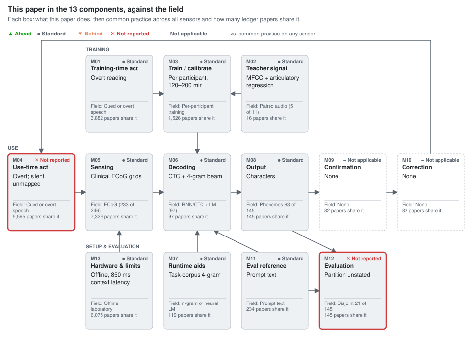

# Brain2Char: a deep architecture for decoding text from brain recordings

Sun, Anumanchipalli, Chang. Journal of Neural Engineering 17(6), 066015 (2020); first public on arXiv 2019. [doi:10.1088/1741-2552/abc742](https://doi.org/10.1088/1741-2552/abc742) · [arXiv:1909.01401](https://arxiv.org/abs/1909.01401)

**Section:** [Brain signals (EEG, MEG, intracortical)](../../README.md#brain-signals-eeg-meg-intracortical)

## Figures

### This paper in the 13 components, against the field

<picture><source media="(prefers-color-scheme: dark)" srcset="figures/components-dark.svg"></picture>

Verdicts compare the paper's choice for each component with common practice across 8,995 ledger entries on any sensor (silent speech, brain-to-text, lip reading).

Data

| Component | This paper | Common practice | Papers with this practice | Verdict |
| --- | --- | --- | --- | --- |
| M01 Training-time act | Overt reading | Cued or overt speech | 3,882 of 8,995 | ● Standard (Inherited.) |
| M02 Teacher signal | MFCC + articulatory regression | Paired audio (5 of 11) | 16 of 8,995 | ● Standard (As [concurrent] [@makin2020].) |
| M03 Train / calibrate | Per participant, 120–200 min | Per-participant training | 1,526 of 8,995 | ● Standard (Fig. 3a caption conflict.) |
| M04 Use-time act | Overt; silent unmapped | Cued or overt speech | 5,595 of 8,995 | ✕ Not reported (No silent trials identified.) |
| M05 Sensing | Clinical ECoG grids | ECoG (233 of 246) | 7,329 of 8,995 | ● Standard (Inherited.) |
| M06 Decoding | CTC + 4-gram beam | RNN/CTC + LM (97) | 97 of 8,995 | ● Standard (No seeds; LM confound.) |
| M07 Runtime aids | Task-corpus 4-gram | n-gram or neural LM | 119 of 8,995 | ● Standard (Test exclusion unstated.) |
| M08 Output | Characters | Phonemes 63 of 145 | 145 of 8,995 | ● Standard (No unit comparison.) |
| M09 Confirmation | None | None | 82 of 8,995 | – Not applicable (Offline.) |
| M10 Correction | None | None | 82 of 8,995 | – Not applicable (Offline.) |
| M11 Eval reference | Prompt text | Prompt text | 234 of 8,995 | ● Standard (Inherited.) |
| M12 Evaluation | Partition unstated | Disjoint 21 of 145 | 145 of 8,995 | ✕ Not reported (80% WER unseen.) |
| M13 Hardware & limits | Offline, 850 ms context latency | Offline laboratory | 6,075 of 8,995 | ● Standard (Not causal.) |

## Verdict

Brain2Char [[1]](#ref-1) changed the output unit (M08, characters), the decoder (M06, CTC with a 4-gram LM) and the training-only targets (M02, MFCC and articulatory regression); all three are standard. The auxiliary MFCC loss appeared in [concurrent] work from the same lab [[2]](#ref-2), and characters were never tested against phonemes or words on the same data. The headline 7.0–10.6% WER does not support the claimed new state of the art: the test partition is unstated, the best results rely on repeated sentences (Sec. 4), and the language model is trained on the task corpus (Sec. 2.4). On sentence-disjoint tests the decoder averages 80% WER, against 25.5% for [later] ECoG decoding with a 1,024-word constrained vocabulary [[3]](#ref-3).

## Against the field, component by component

### M08 Output: character sequences

**Usual approach:** Of 145 neural text-decoding studies (pattern match, unique studies), 63 name phonemes as the output unit, 49 characters and 25 word or sentence classes (upper bounds, Appendix). Brain2Char emits characters (Sec. 2.3).

**State of the art:** Phonemes with a lexicon-constrained language model: 39 phones with CTC from ECoG (2023) [[3]](#ref-3); 2.5% online WER at 125,000 words (2024) [[4]](#ref-4); both [later].

From 2023 on, characters (35) trail phonemes (42) (Appendix). With no same-data unit comparison, verdict: standard. On unseen sentences PER (65–74%) is below WER (mean 80%), which the authors read as phonetic spellings with wrong word boundaries (Sec. 3.3, Table 3); a phoneme unit with a lexicon targets that error (inference).

### M06 Decoding: CTC with an n-gram language model

**Usual approach:** An RNN or CTC network emitting sub-word units, then an n-gram or neural language model: 97 studies (pattern match, unique studies; decoding step slot-filled in 61 of 96). Brain2Char follows it, with a 3D Inception front end.

**State of the art:** At the time, 3% WER on held-out repeats (2020) [[2]](#ref-2) [concurrent]. Today 2.5% online WER at 125,000 words (2024) [[4]](#ref-4) [later].

The roughly 30% gains over DeepSpeech baselines (Fig. 2a) carry no seeds or test; [[2]](#ref-2) trained 30 models per condition. The language-model gain is 10–25%, but only 3–15% over a LibriSpeech LM (Sec. 3.1, Fig. 2b); the task-corpus LM, which holds any repeated test sentence, explains at most that share. Verdict: standard.

### M02 Training-only targets: acoustic and articulatory regression

**Usual approach:** 16 studies match auxiliary acoustic or articulatory losses (pattern match, unique studies), mostly with paired-audio supervision (5 of 11, slot-filled). Brain2Char uses both; its articulatory targets are inverted from the same audio (Sec. 2.1).

**State of the art:** [[2]](#ref-2) [concurrent] used the same MFCC loss (2020); without it, errors rose several-fold. The best ECoG system (2023) [[3]](#ref-3) [later] uses grapheme-to-phoneme labels, no audio.

Gains reach 15% absolute with MFCC plus articulatory targets in P2 and 8% (unit unstated) from MFCC across two participants (Sec. 3.2, Fig. 3b); articulatory targets are called "significantly better" with no test. Both targets come from one audio signal, so the articulatory branch adds little beyond it (inference). Verdict: standard. Both need overt speech, which the authors concede paralyzed users lack (Sec. 4).

### M12 Evaluation: repeated versus unseen sentences

**Usual approach:** Of the 145 studies, 21 describe a sentence-disjoint test and 10 repeated training sentences (pattern match, upper bounds). The paper does not state the partition behind its headline WER (Sec. 3.1).

**State of the art:** 23.8% online WER on sentences never duplicated in training, 125,000 words (2023) [[5]](#ref-5); from ECoG, 25.5% on 249 unseen sentences (2023) [[3]](#ref-3); both [later].

Stories and interviews were read once (Sec. 2.1), so the 1,200–1,900-word vocabularies describe corpora, not test sets (inference). Disjoint WER spans 25–120% (Fig. 4a); P4 falls from 84% to 10% as test sentences repeat (Fig. 4b). Against [[3]](#ref-3), 80% versus 25.5% is a 68% relative gap (inference) but not like for like: a 1,024-word constrained vocabulary, a 253-electrode array and about 1.6 h of training data per day over 13 days there; 120–200 min of recordings per participant here (Sec. 2.1). Verdict: not reported.

## The 13 components

| Component | This paper | Usual approach (count) | State of the art | Verdict |
|---|---|---|---|---|
| M01 Training-time action | Overt reading | Cued or overt speech (slot-filled 3,882) | – | standard |
| M02 Training-only supervision | MFCC + articulatory regression | Paired audio (5 of 11) (pattern match 16) | No audio target [[3]](#ref-3) | standard |
| M03 Training and adaptation | Per participant, 120–200 min | Per-participant training (slot-filled 1,526) | – | standard |
| M04 Use-time action | Overt; silent unmapped | Cued or overt speech (slot-filled 5,595) | – | not reported |
| M05 Sensors | Clinical ECoG grids | ECoG (233 of 246) (slot-filled 7,329) | 253-electrode ECoG [[3]](#ref-3) | standard |
| M06 Processing and decoding | CTC + 4-gram beam | RNN/CTC + LM (97) (pattern match 97) | 2.5% WER [[4]](#ref-4) | standard |
| M07 Lexicon and LM | Task-corpus 4-gram | n-gram or neural LM (slot-filled 119) | – | standard |
| M08 Output | Characters | Phonemes 63 of 145 (pattern match 145) | Phonemes, 2.5% WER [[4]](#ref-4) | standard |
| M09 Confirmation | None | None (slot-filled 82) | – | not applicable |
| M10 Correction | None | None (slot-filled 82) | – | not applicable |
| M11 Reference construction | Prompt text | Prompt text (slot-filled 234) | – | standard |
| M12 Evaluation | Partition unstated | Disjoint 21 of 145 (pattern match 145) | 23.8% unseen [[5]](#ref-5) | not reported |
| M13 Device and cost | Offline, 850 ms context latency | Offline laboratory (slot-filled 6,075) | – | standard |

## Where the claims outrun the evidence

- "New state-of-the-art" (Sec. 5) rests on cross-study numbers; [[2]](#ref-2) [concurrent] reported 3% on repeats of 50 sentences (about 250 words).
- The 4% calibration gain is captioned as two participants; the legend lists P1–P4 (Fig. 3a).
- Sec. 2.3 says CTC maps to phoneme-level sequences; the network outputs characters and was never trained on phonetic transcriptions (Sec. 3.3).
- "Incremental decoding" (Table 1) is shown offline on truncated trials; look-ahead windows give an 850 ms context latency (Sec. 2.4).
- Participants "spoke overtly or silently" (Sec. 1); no silent result is identified.

## What the field needs next

- M08: characters, phonemes plus lexicon, and words on one ECoG dataset, sentence-disjoint, several seeds.
- M02: text-derived auxiliary targets against audio-derived ones in the same participants.
- M12 and M07: headline WER on sentences absent from decoder and LM training.

## Questions for the authors

- Which participants give 10.6%, 8.5% and 7.0%, and which sentences and sessions form that test set?
- Did the 4-gram LM corpus include test sentences?
- How many seeds underlie each curve?
- Were z-scoring statistics fitted on training data only?

## Appendix: literature search

- M08 neural-text-output-unit. Inclusion rule: neural decoders (ECoG, intracortical, sEEG, EEG, MEG) that output text and report a word, character or phoneme error rate; the design compared is the unit emitted before any lexicon or language model (characters, phonemes, word or sentence classes); a paper counts under every unit its text names; handwriting and spelling BCIs count as characters. Ledger counts: 3,268 slot-filled; 145 pattern match (unique studies). Usual design: phonemes 63, characters 49, word or sentence classes 25 (pattern match, upper bounds); studies dated up to 2019: 29, of which characters 0 and phonemes 4; 2023 onward: characters 35, phonemes 42. Read in full: [[4]](#ref-4) (state of the art), [[3]](#ref-3), [[5]](#ref-5), [[2]](#ref-2) (deciding prior). Known-item recall 0.8 (5 seeds).
- M06 phoneme-rnn-ctc-lm-decoding (reused topic table). Inclusion rule as published. Ledger counts: 7,345 slot-filled; 97 pattern match (unique studies). Usual design: decoding step, 61 of 96 (slot-filled). Read in full: [[4]](#ref-4), [[3]](#ref-3) (state of the art), [[6]](#ref-6) [later], [[2]](#ref-2) (deciding priors). Known-item recall 0.5 (as published).
- M02 auxiliary-speech-feature-regression. Inclusion rule: text or speech-unit decoders from a non-acoustic signal whose training adds a loss regressing acoustic or articulatory features of the paired produced speech from an intermediate layer, discarded at use time; excluded: synthesis outputs and targets from pretrained speech encoders. Ledger counts: 31 slot-filled (sparse slot); 16 pattern match (unique studies). Usual design from M03 supervision kind: paired audio, 5 of 11 (slot-filled); full-text patterns over the whole wiki: auxiliary acoustic loss 12, auxiliary articulatory loss 4 (pattern match). Read in full: [[2]](#ref-2) (deciding prior), [[3]](#ref-3) (state of the art). Known-item recall 0.0 (1 seed).
- M12 neural-text-unseen-sentence-test. Inclusion rule: same population as M08; the design compared is whether reported WER is measured on sentences absent from training or on repeats of training sentences. Ledger counts: 6,960 slot-filled; 145 pattern match (unique studies). Usual design: sentence-disjoint test 21, repeated training sentences 10 (pattern match, upper bounds); sentence-disjoint by period: 2020–2022: 3, 2023 onward: 13. Read in full: [[5]](#ref-5) (state of the art), [[3]](#ref-3), [[2]](#ref-2) (deciding prior). Known-item recall 0.8 (5 seeds).

## References

Numbered by first citation. BibTeX in the same order and keys: [refs.bib](refs.bib).

1. Sun, P., Anumanchipalli, G. K., Chang, E. F. “Brain2Char: a deep architecture for decoding text from brain recordings.” *Journal of Neural Engineering*, 2020, 17(6), 066015. doi:[10.1088/1741-2552/abc742](https://doi.org/10.1088/1741-2552/abc742). arXiv:[1909.01401](https://arxiv.org/abs/1909.01401). [review](https://github.com/supernaiter/silent-speech-review/tree/main/reviews/brain2char-a-deep-architecture-for-decoding-text-from-brain-recordings) [wiki: doi-10.1088-1741-2552-abc742](https://github.com/supernaiter/deep-research-wiki-for-silent-speech/blob/main/papers/doi-10.1088-1741-2552-abc742/article.md) [wiki: pmc-9591243-brain2char](https://github.com/supernaiter/deep-research-wiki-for-silent-speech/blob/main/papers/pmc-9591243-brain2char/article.md)
2. Makin, J. G., Moses, D. A., Chang, E. F. “Machine translation of cortical activity to text with an encoder-decoder framework.” *Nature Neuroscience*, 2020, 23, 575–582. doi:[10.1038/s41593-020-0608-8](https://doi.org/10.1038/s41593-020-0608-8). [concurrent] [wiki: doi-10.1038-s41593-020-0608-8](https://github.com/supernaiter/deep-research-wiki-for-silent-speech/blob/main/papers/doi-10.1038-s41593-020-0608-8/article.md) [wiki: pmc-10560395-makin](https://github.com/supernaiter/deep-research-wiki-for-silent-speech/blob/main/papers/pmc-10560395-makin/article.md)
3. Metzger, S. L., Littlejohn, K. T., Silva, A. B., Moses, D. A., Seaton, M. P., Wang, R., et al. “A high-performance neuroprosthesis for speech decoding and avatar control.” *Nature*, 2023, 620, 1037–1046. doi:[10.1038/s41586-023-06443-4](https://doi.org/10.1038/s41586-023-06443-4). [later] [review](https://github.com/supernaiter/silent-speech-review/tree/main/reviews/a-high-performance-neuroprosthesis-for-speech-decoding-and-avatar-control) [wiki: doi-10.1038-s41586-023-06443-4](https://github.com/supernaiter/deep-research-wiki-for-silent-speech/blob/main/papers/doi-10.1038-s41586-023-06443-4/article.md) [wiki: pmc-10826467-avatarnp](https://github.com/supernaiter/deep-research-wiki-for-silent-speech/blob/main/papers/pmc-10826467-avatarnp/article.md)
4. Card, N. S., Wairagkar, M., Iacobacci, C., Hou, X., Singer-Clark, T., Willett, F. R., et al. “An accurate and rapidly calibrating speech neuroprosthesis.” *New England Journal of Medicine*, 2024, 391(7), 609–618. doi:[10.1056/NEJMoa2314132](https://doi.org/10.1056/NEJMoa2314132). [later] [review](https://github.com/supernaiter/silent-speech-review/tree/main/reviews/an-accurate-and-rapidly-calibrating-speech-neuroprosthesis) [wiki: doi-10.1056-nejmoa2314132](https://github.com/supernaiter/deep-research-wiki-for-silent-speech/blob/main/papers/doi-10.1056-nejmoa2314132/article.md) [wiki: doi-10.1056-NEJMoa2314132](https://github.com/supernaiter/deep-research-wiki-for-silent-speech/blob/main/papers/doi-10.1056-NEJMoa2314132/article.md) [wiki: pmc-11328962-rapidcal](https://github.com/supernaiter/deep-research-wiki-for-silent-speech/blob/main/papers/pmc-11328962-rapidcal/article.md)
5. Willett, F. R., Kunz, E. M., Fan, C., Avansino, D. T., Wilson, G. H., Choi, E. Y., et al. “A high-performance speech neuroprosthesis.” *Nature*, 2023, 620, 1031–1036. doi:[10.1038/s41586-023-06377-x](https://doi.org/10.1038/s41586-023-06377-x). [later] [review](https://github.com/supernaiter/silent-speech-review/tree/main/reviews/a-high-performance-speech-neuroprosthesis) [wiki: doi-10.1038-s41586-023-06377-x](https://github.com/supernaiter/deep-research-wiki-for-silent-speech/blob/main/papers/doi-10.1038-s41586-023-06377-x/article.md) [wiki: pmc-10468393-neuroprosthesis](https://github.com/supernaiter/deep-research-wiki-for-silent-speech/blob/main/papers/pmc-10468393-neuroprosthesis/article.md)
6. Willett, F. R., Avansino, D. T., Hochberg, L. R., Henderson, J. M., Shenoy, K. V. “High-performance brain-to-text communication via handwriting.” *Nature*, 2021, 593, 249–254. doi:[10.1038/s41586-021-03506-2](https://doi.org/10.1038/s41586-021-03506-2). [later] [wiki: doi-10.1038-s41586-021-03506-2](https://github.com/supernaiter/deep-research-wiki-for-silent-speech/blob/main/papers/doi-10.1038-s41586-021-03506-2/article.md) [wiki: pmc-8163299-b2thand](https://github.com/supernaiter/deep-research-wiki-for-silent-speech/blob/main/papers/pmc-8163299-b2thand/article.md)

## Materials

Data behind this review. Full texts of the papers are not included.

- [`review.md`](review.md): the review text (source)
- [`refs.bib`](refs.bib): references (BibTeX)
- [`slots.json`](slots.json): for each of the 13 components: this paper's choice, field practice, number of matching papers, verdict
- [`figures.json`](figures.json): figure definitions
- [`evaluation.md`](evaluation.md): independent evaluation by a second reviewer
- [`triage.md`](triage.md): how each evaluation finding was checked against the sources and resolved
- [`components/M02/auxiliary-speech-feature-regression.csv`](../../components/M02/auxiliary-speech-feature-regression.csv): M02 topic "auxiliary-speech-feature-regression", every candidate paper with its decision (31 slot-filled, 16 pattern match, usual design in 5, 3 read in full)
- [`components/M06/phoneme-rnn-ctc-lm-decoding.csv`](../../components/M06/phoneme-rnn-ctc-lm-decoding.csv): M06 topic "phoneme-rnn-ctc-lm-decoding", every candidate paper with its decision (7345 slot-filled, 97 pattern match, usual design in 61, 5 read in full)
- [`components/M08/neural-text-output-unit.csv`](../../components/M08/neural-text-output-unit.csv): M08 topic "neural-text-output-unit", every candidate paper with its decision (3268 slot-filled, 145 pattern match, usual design in 63, 5 read in full)
- [`components/M12/neural-text-unseen-sentence-test.csv`](../../components/M12/neural-text-unseen-sentence-test.csv): M12 topic "neural-text-unseen-sentence-test", every candidate paper with its decision (6960 slot-filled, 145 pattern match, usual design in 21, 4 read in full)

## More reviews in Brain signals (EEG, MEG, intracortical)

- [A comparison of oscillatory characteristics in covert speech and speech perception](../a-comparison-of-oscillatory-characteristics-in-covert-speech-and-speech-perception/) (2020). EEG analysis comparing oscillatory activity in covert speech and speech perception in eight participants; finds stronger low-gamma for covert speech, stronger delta/theta for perception, and theta-gamma coupling.
- [Continuous Silent Speech Recognition using EEG](../continuous-silent-speech-recognition-using-eeg/) (2020). Standard on silent reading (M04) and CTC decoding (M06); 83% WER on 30 sentences repeated in training, with an undisclosed 4-gram LM and no chance baseline, does not show EEG decoding.
- [EMA2S: An End-to-End Multimodal Articulatory-to-Speech System](../ema2s-an-end-to-end-multimodal-articulatory-to-speech-system/) (2021). Speech-latent target (M02) has a 2017 precedent and small, mixed single-run gains; spectrogram-loss-only end-to-end loses to WORLD (M06); a preference test replaces listener transcription (M12).
- [Neuroprosthesis for decoding speech in a paralyzed person with anarthria](../neuroprosthesis-for-decoding-speech-in-a-paralyzed-person-with-anarthria/) (2021). Sentence decoding from a person who cannot speak holds for 50 words and one participant; the decoder is standard for 2021, and an LM restricted to the test vocabulary drives the gain.
- [Silent Speech and Emotion Recognition from Vocal Tract Shape Dynamics in Real-Time MRI](../silent-speech-and-emotion-recognition-from-vocal-tract-shape-dynamics-in-real-time-mri/) (2021). LipNet decoder on rtMRI (M06) and new sentence-text output (M08) are standard; one unseen-speaker split without repeats; a shared 460-sentence list likely puts training sentences in the test.
- [A Novel Task-Oriented Text Corpus in Silent Speech Recognition and its Natural Language Generation Construction Method](../a-novel-task-oriented-text-corpus-in-silent-speech-recognition-and-its-natural-language-generation-construction-method/) (2019). Proposes a task-oriented text corpus and a hybrid natural language generation method for building EEG silent speech recognition datasets; claims gains over template and neural NLG but gives no numeric benchmark.

---

Part of the [Silent Speech Interface Review](https://github.com/supernaiter/silent-speech-review). Found an error? [Open an issue](https://github.com/supernaiter/silent-speech-review/issues/new?template=correction.yml).
