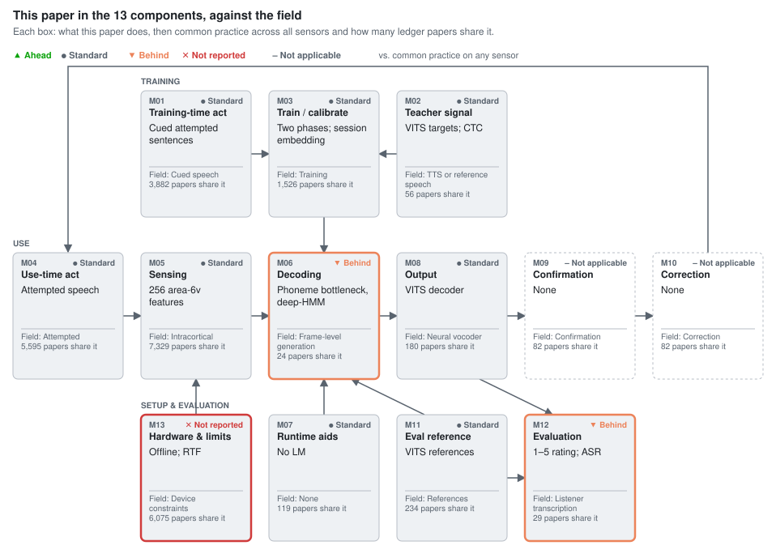

# Brain2Speech-Net: Fast and Intelligible Brain-to-Speech Synthesis Without Text Decoding

Chandra, Cai, Tsao, King, Sisman. arXiv preprint, 2026. [arXiv:2609.04455](https://arxiv.org/abs/2609.04455)

**Section:** [Brain signals (EEG, MEG, intracortical)](../../README.md#brain-signals-eeg-meg-intracortical)

## Figures

### This paper in the 13 components, against the field

<picture><source media="(prefers-color-scheme: dark)" srcset="figures/components-dark.svg"></picture>

Verdicts compare the paper's choice for each component with common practice across 8,995 ledger entries on any sensor (silent speech, brain-to-text, lip reading).

Data

| Component | This paper | Common practice | Papers with this practice | Verdict |
| --- | --- | --- | --- | --- |
| M01 Training-time act | Cued attempted sentences | Cued speech | 3,882 of 8,995 | ● Standard (Inherited.) |
| M02 Teacher signal | VITS targets; CTC | TTS or reference speech | 56 of 8,995 | ● Standard (As prior work.) |
| M03 Train / calibrate | Two phases; session embedding | Training | 1,526 of 8,995 | ● Standard (No seeds.) |
| M04 Use-time act | Attempted speech | Attempted | 5,595 of 8,995 | ● Standard (Inherited.) |
| M05 Sensing | 256 area-6v features | Intracortical | 7,329 of 8,995 | ● Standard (Inherited.) |
| M06 Decoding | Phoneme bottleneck, deep-HMM | Frame-level generation | 24 of 8,995 | ▼ Behind (Acausal.) |
| M07 Runtime aids | No LM | None | 119 of 8,995 | ● Standard (By design.) |
| M08 Output | VITS decoder | Neural vocoder | 180 of 8,995 | ● Standard (One run.) |
| M09 Confirmation | None | Confirmation | 82 of 8,995 | – Not applicable (Offline.) |
| M10 Correction | None | Correction | 82 of 8,995 | – Not applicable (Offline.) |
| M11 Eval reference | VITS references | References | 234 of 8,995 | ● Standard (VITS only.) |
| M12 Evaluation | 1–5 rating; ASR | Listener transcription | 29 of 8,995 | ▼ Behind (Rating only.) |
| M13 Hardware & limits | Offline; RTF | Device constraints | 6,075 of 8,995 | ✕ Not reported (Hardware unstated.) |

## Verdict

The paper [[1]](#ref-1) changes two components: a phoneme-logit bottleneck with deep-HMM alignment into a TTS latent space (M06), and a pretrained VITS decoder driven by those latents (M08). M08 is standard, resting on one participant and one run. The authors' "real time" is throughput (RTF 0.532, Table 1); judged on causality, M06 is behind the field: the alignment uses evidence from the end of the utterance (Sec. 4), whereas causal intracortical synthesis already played audio within 10 ms [[2]](#ref-2). On unseen sentences the WER is 2.3 times that of the 5-gram plus LLM cascade (0.472 against 0.206, Table 1; inference). Intelligibility rests on a 1–5 rating and Whisper ASR, not the listener transcription used by 29 text-verified synthesis studies (M12, Appendix).

## Against the field, component by component

### M06 Processing: causal versus utterance-level synthesis

**Usual approach:** Among 87 studies of real-time or causal synthesis (pattern match, unique studies; Appendix), 84 have a slot-filled design value, most often a frame-level generation step (24 of 84, slot-filled) that sounds while the person speaks [[3]](#ref-3), [[4]](#ref-4), [[2]](#ref-2). The paper's forward-backward pass instead accumulates evidence from future observations until the end of the utterance (Sec. 4).

**State of the art:** Causal intracortical synthesis within 10 ms with 43.75% median listener WER on participant T15 (2025) [[2]](#ref-2); [concurrent] brain2voice 2.0 reports 5.24% listener WER on the benchmark dataset of [[2]](#ref-2), with causal outputs every 10 ms in offline simulated real-time inference (2026) [[5]](#ref-5). The target's 0.472 is Whisper-medium WER (Sec. 5) on the participant of the Willett et al. dataset [[6]](#ref-6) (Sec. 3), so the gap is causality, not a measured accuracy difference.

Three prior works in the topic table meet this causal condition: formant feedback within 50 ms [[3]](#ref-3), real-time sEEG synthesis of imagined speech [[4]](#ref-4) and intracortical synthesis within 10 ms [[2]](#ref-2); the paper cites Wairagkar et al. only for prosody (Sec. 2) and does not compare with them. The released code times RTF over each whole utterance (scripts/synthesize.py): throughput, so "intelligible real-time speech" (Sec. 1) overstates it. Verdict: behind on causality, against the best comparable work; on throughput it beats the cascades.

### M08 Output: TTS latents instead of a vocoder

**Usual approach:** A pretrained neural vocoder makes the waveform in 51 of 180 intracranial synthesis studies (pattern match, unique studies; Appendix). The paper predicts VITS text-encoder representations for the pretrained VITS decoder (Sec. 4).

**State of the art:** 43.75% median listener WER through an LPCNet vocoder (2025) [[2]](#ref-2); [concurrent] 5.24% (2026) [[5]](#ref-5). The TTS prior lowers MCD against DSU (5.522 against 6.181 dB, Table 1) but fixes one voice; with one participant and no seeds (Sec. 5) it cannot be called ahead. Verdict: standard.

### M02 Training targets: TTS pseudo-speech

**Usual approach:** Targets the user did not produce appear in 56 studies (pattern match, unique studies; Appendix), with no dominant kind (Appendix), e.g. cued-text TTS [[2]](#ref-2) or a reference speaker [[7]](#ref-7). The paper's VITS pseudo-speech (Sec. 3) follows the TTS route of [[2]](#ref-2).

**State of the art:** As for M06, [concurrent] 5.24% (2026) [[5]](#ref-5).

One VITS model supplies targets, decoder and MCD reference, so MCD and the 0.025 reference WER (Table 1) measure closeness to VITS, not to intended speech. Verdict: standard.

### M12 Evaluation: listener transcription

**Usual approach:** Of 79 candidate studies, 29 are text-verified tests in which listeners transcribe synthesized speech or pick the sentence, most often crowd workers (15 of 79, pattern match; Appendix), e.g. median 31% WER with a 25-word pool [[8]](#ref-8). The paper's 1–5 rating by 20 listeners (Sec. 6) falls outside the topic's inclusion rule.

**State of the art:** 43.75% median open-transcription WER (2025) [[2]](#ref-2); [concurrent] 5.24% (2026) [[5]](#ref-5).

MOS 3.34 is read as "intelligible" (Sec. 6), but a rating counts no words, and a Whisper WER of 0.472 means about half the words are wrong (inference). Verdict: behind, against the best comparable work, which counts words heard.

## The 13 components

| Component | This paper | Usual approach (count) | State of the art | Verdict |
|---|---|---|---|---|
| M01 Training-time action | Cued attempted sentences | Cued speech (slot-filled 3,882) | – | standard |
| M02 Training-only supervision | VITS targets; CTC | TTS or reference speech (pattern match 56) | 5.24% [concurrent] [[5]](#ref-5) | standard |
| M03 Training and adaptation | Two phases; session embedding | Training (slot-filled 1,526) | – | standard |
| M04 Use-time action | Attempted speech | Attempted (slot-filled 5,595) | – | standard |
| M05 Sensors | 256 area-6v features | Intracortical (slot-filled 7,329) | – | standard |
| M06 Processing and decoding | Phoneme bottleneck, deep-HMM | Frame-level generation (slot-filled 24 of 84) | 43.75% causal [[2]](#ref-2) | behind |
| M07 Lexicon and LM | No LM | None (slot-filled 119) | – | standard |
| M08 Output | VITS decoder | Neural vocoder (pattern match 180) | 5.24% [concurrent] [[5]](#ref-5) | standard |
| M09 Confirmation | None | Confirmation (slot-filled 82) | – | not applicable |
| M10 Correction | None | Correction (slot-filled 82) | – | not applicable |
| M11 Reference construction | VITS references | References (slot-filled 234) | – | standard |
| M12 Evaluation | 1–5 rating; ASR | Listener transcription (confirmed 29 of 79) | 43.75% [[2]](#ref-2) | behind |
| M13 Device and cost | Offline; RTF | Device constraints (slot-filled 6,075) | – | not reported |

## Where the claims outrun the evidence

- "Faster than real time" (Abstract) rests on RTF without hardware (Sec. 6); with acausal alignment, first audio waits for the end of the attempt (inference).
- Held-out WER is seven times the seen-set WER (0.472 against 0.068), against about fourfold for the 5-gram cascade (0.059 to 0.229, Sec. 6; inference); "generalization, not capacity" (Sec. 6) rests on one run.
- The released Phase 1 configuration selects the checkpoint on the official test split by default (configs/phase1_content_encoder.yaml, "val: data/test.npz", "best-checkpoint selection"); the README says so; the paper does not say what selected the Table 1 model.
- λCTC is 0.1 in Sec. 5 and 0.3 in the released configuration, whose comment notes that the paper states 0.1; data are 5.71 h in Sec. 3 and 5.2 h in Sec. 6.

## What the field needs next

- M06: a causal variant with measured first-audio latency on the public T15 benchmark, set against [[2]](#ref-2).
- M12: open transcription by naive listeners alongside the rating.
- M08: several seeds and a second participant.

## Questions for the authors

- Are test sessions disjoint from training sessions, and does any test sentence repeat a training prompt?
- Which data selected the checkpoints behind Table 1?
- Did listeners see the prompt text?
- On what hardware was RTF measured, and when does the first audio sample appear?

## Appendix: literature search

Ledger at wiki commit 730b0b4: 7,388 unique studies.

**M06, causal-closed-loop-speech-synthesis.** Inclusion rule: studies that synthesize speech acoustics from a non-acoustic signal online, in real time, with audio played back while or right after the person speaks; offline studies count only when they simulate causal frame-level inference; offline acausal reconstruction and text decoding read out by TTS are excluded. Ledger counts: M06 slot filled in 7,345 unique studies; 87 pattern match (unique studies), 84 with a slot-filled design value. Usual design: frame-level generation step, 24 of 84 (slot-filled). Read in full: [[5]](#ref-5) (state of the art), [[3]](#ref-3), [[4]](#ref-4), [[2]](#ref-2) (prior). Known-item recall: 1.0.

**M08, intracranial-synthesis-waveform-generation.** Inclusion rule: studies that reconstruct speech acoustics from intracranial recordings during overt, mouthed, attempted or imagined speech; heard-speech reconstruction and text-only decoding read out by TTS are excluded. Ledger counts: 3,268 slot-filled unique studies; 180 pattern match (unique studies). Usual design: pretrained neural vocoder 51, unit selection 30, parametric vocoder 15, Griffin-Lim 11 (pattern match). Read in full: [[2]](#ref-2), [[7]](#ref-7). Known-item recall: 1.0.

**M02, synthetic-speech-target.** Inclusion rule: studies that train a speech-acoustics decoder from a non-acoustic signal on target speech the user did not produce (TTS output, a reference speaker, a voice-converted or pre-injury voice); paired same-user audio is excluded. Ledger counts: M02 slot filled in 31 unique studies (sparse slot); 56 pattern match (unique studies). Usual design, from the M03 supervision kind, slot-filled in 32 topic candidates: "other" 8, paired audio 7. Read in full: [[7]](#ref-7), [[2]](#ref-2) (prior), [[5]](#ref-5) (state of the art). Known-item recall: 0.0.

**M12, listener-intelligibility-test.** Inclusion rule: studies that evaluate speech synthesized from non-acoustic signals with human listeners transcribing it or identifying words or sentences; rating-only (MOS, naturalness, preference) and ASR-only evaluations are excluded. Ledger counts: 6,960 slot-filled unique studies; 37 pattern match plus 66 full-text-only folders; 79 candidate studies, 29 text-verified includes. Usual design: crowd workers 15 of 79 (pattern match). Read in full: [[2]](#ref-2) (state of the art), [[8]](#ref-8) (prior). Known-item recall: 1.0.

**Inherited slots (M01, M03–M05, M07, M09–M11, M13).** Table counts are slot-filled ledger values at the same commit.

## References

Numbered by first citation. BibTeX in the same order and keys: [refs.bib](refs.bib).

1. Chandra, S. S., Cai, Z., Tsao, Y., King, S., Sisman, B. “Brain2Speech-Net: Fast and Intelligible Brain-to-Speech Synthesis Without Text Decoding.” *arXiv preprint*, 2026. arXiv:[2609.04455](https://arxiv.org/abs/2609.04455). arXiv v2 [review](https://github.com/supernaiter/silent-speech-review/tree/main/reviews/brain2speech-net-intelligible-real-time-brain-to-speech-synthesis-without-text-decoding) [wiki: arxiv-2609.04455](https://github.com/supernaiter/deep-research-wiki-for-silent-speech/blob/main/papers/arxiv-2609.04455/article.md) [wiki: arxiv-2609-04455-b2snet](https://github.com/supernaiter/deep-research-wiki-for-silent-speech/blob/main/papers/arxiv-2609-04455-b2snet/article.md) [wiki: arxiv-2609.04455-brain2speech](https://github.com/supernaiter/deep-research-wiki-for-silent-speech/blob/main/papers/arxiv-2609.04455-brain2speech/article.md)
2. Wairagkar, M., Card, N. S., Singer-Clark, T., Hou, X., Iacobacci, C., Miller, L. M., et al. “An instantaneous voice-synthesis neuroprosthesis.” *Nature*, 2025. doi:[10.1038/s41586-025-09127-3](https://doi.org/10.1038/s41586-025-09127-3). [review](https://github.com/supernaiter/silent-speech-review/tree/main/reviews/an-instantaneous-voice-synthesis-neuroprosthesis) [wiki: doi-10.1038-s41586-025-09127-3](https://github.com/supernaiter/deep-research-wiki-for-silent-speech/blob/main/papers/doi-10.1038-s41586-025-09127-3/article.md) [wiki: doi-10.1101-2024.08.14.607690](https://github.com/supernaiter/deep-research-wiki-for-silent-speech/blob/main/papers/doi-10.1101-2024.08.14.607690/article.md) [wiki: pmc-12369848-voicesynth](https://github.com/supernaiter/deep-research-wiki-for-silent-speech/blob/main/papers/pmc-12369848-voicesynth/article.md) [wiki: pmc-12369848-voice-synth-np](https://github.com/supernaiter/deep-research-wiki-for-silent-speech/blob/main/papers/pmc-12369848-voice-synth-np/article.md) [wiki: pmc-11370360-instvoice](https://github.com/supernaiter/deep-research-wiki-for-silent-speech/blob/main/papers/pmc-11370360-instvoice/article.md)
3. Guenther, F. H., Brumberg, J. S., Wright, E. J., Nieto-Castanon, A., Tourville, J. A., Panko, M., et al. “A Wireless Brain-Machine Interface for Real-Time Speech Synthesis.” *PLoS ONE*, 2009, 4(12), e8218. doi:[10.1371/journal.pone.0008218](https://doi.org/10.1371/journal.pone.0008218). [wiki: pmc-2784218-wireless](https://github.com/supernaiter/deep-research-wiki-for-silent-speech/blob/main/papers/pmc-2784218-wireless/article.md) [wiki: pmc-2784218-wirelesssynth](https://github.com/supernaiter/deep-research-wiki-for-silent-speech/blob/main/papers/pmc-2784218-wirelesssynth/article.md) [wiki: doi-10.1371-journal.pone.0008218](https://github.com/supernaiter/deep-research-wiki-for-silent-speech/blob/main/papers/doi-10.1371-journal.pone.0008218/article.md)
4. Angrick, M., Ottenhoff, M. C., Diener, L., Ivucic, D., Ivucic, G., Goulis, S., et al. “Real-time synthesis of imagined speech processes from minimally invasive recordings of neural activity.” *Communications Biology*, 2021, 4, 1055. doi:[10.1038/s42003-021-02578-0](https://doi.org/10.1038/s42003-021-02578-0). [wiki: doi-10.1038-s42003-021-02578-0](https://github.com/supernaiter/deep-research-wiki-for-silent-speech/blob/main/papers/doi-10.1038-s42003-021-02578-0/article.md) [wiki: pmc-8460739-realtimesynth](https://github.com/supernaiter/deep-research-wiki-for-silent-speech/blob/main/papers/pmc-8460739-realtimesynth/article.md)
5. Wairagkar, M., Srinivasan, A., Card, N. S., Singer-Clark, T., Hou, X., Iacobacci, C., et al. “Brain2voice 2.0: High-performance voice synthesis brain-computer interface.” *bioRxiv*, 2026. doi:[10.64898/2026.06.30.735633](https://doi.org/10.64898/2026.06.30.735633). [concurrent] [wiki: doi-10.64898-2026.06.30.735633](https://github.com/supernaiter/deep-research-wiki-for-silent-speech/blob/main/papers/doi-10.64898-2026.06.30.735633/article.md)
6. Willett, F. R., Kunz, E. M., Fan, C., Avansino, D. T., Wilson, G. H., Choi, E. Y., et al. “A high-performance speech neuroprosthesis.” *Nature*, 2023, 620(7976), 1031-1036. doi:[10.1038/s41586-023-06377-x](https://doi.org/10.1038/s41586-023-06377-x). [review](https://github.com/supernaiter/silent-speech-review/tree/main/reviews/a-high-performance-speech-neuroprosthesis) [wiki: doi-10.1038-s41586-023-06377-x](https://github.com/supernaiter/deep-research-wiki-for-silent-speech/blob/main/papers/doi-10.1038-s41586-023-06377-x/article.md)
7. Metzger, S. L., Littlejohn, K. T., Silva, A. B., Moses, D. A., Seaton, M. P., Wang, R., et al. “A high-performance neuroprosthesis for speech decoding and avatar control.” *Nature*, 2023, 620, 1037–1046. doi:[10.1038/s41586-023-06443-4](https://doi.org/10.1038/s41586-023-06443-4). [review](https://github.com/supernaiter/silent-speech-review/tree/main/reviews/a-high-performance-neuroprosthesis-for-speech-decoding-and-avatar-control) [wiki: doi-10.1038-s41586-023-06443-4](https://github.com/supernaiter/deep-research-wiki-for-silent-speech/blob/main/papers/doi-10.1038-s41586-023-06443-4/article.md) [wiki: pmc-10826467-avatarnp](https://github.com/supernaiter/deep-research-wiki-for-silent-speech/blob/main/papers/pmc-10826467-avatarnp/article.md)
8. Anumanchipalli, G. K., Chartier, J., Chang, E. F. “Speech synthesis from neural decoding of spoken sentences.” *Nature*, 2019, 568(7753), 493–498. doi:[10.1038/s41586-019-1119-1](https://doi.org/10.1038/s41586-019-1119-1). [review](https://github.com/supernaiter/silent-speech-review/tree/main/reviews/speech-synthesis-from-neural-decoding-of-spoken-sentences) [wiki: doi-10.1038-s41586-019-1119-1](https://github.com/supernaiter/deep-research-wiki-for-silent-speech/blob/main/papers/doi-10.1038-s41586-019-1119-1/article.md) [wiki: pmc-9714519-speechsynth](https://github.com/supernaiter/deep-research-wiki-for-silent-speech/blob/main/papers/pmc-9714519-speechsynth/article.md)

## Materials

Data behind this review. Full texts of the papers are not included.

- [`review.md`](review.md): the review text (source)
- [`refs.bib`](refs.bib): references (BibTeX)
- [`slots.json`](slots.json): for each of the 13 components: this paper's choice, field practice, number of matching papers, verdict
- [`figures.json`](figures.json): figure definitions
- [`evaluation.md`](evaluation.md): independent evaluation by a second reviewer
- [`triage.md`](triage.md): how each evaluation finding was checked against the sources and resolved
- [`components/M02/synthetic-speech-target.csv`](../../components/M02/synthetic-speech-target.csv): M02 topic "synthetic-speech-target", every candidate paper with its decision (31 slot-filled, 56 pattern match, usual design in 8, 2 read in full)
- [`components/M06/causal-closed-loop-speech-synthesis.csv`](../../components/M06/causal-closed-loop-speech-synthesis.csv): M06 topic "causal-closed-loop-speech-synthesis", every candidate paper with its decision (7345 slot-filled, 87 pattern match, usual design in 24, 3 read in full)
- [`components/M08/intracranial-synthesis-waveform-generation.csv`](../../components/M08/intracranial-synthesis-waveform-generation.csv): M08 topic "intracranial-synthesis-waveform-generation", every candidate paper with its decision (3268 slot-filled, 180 pattern match, usual design in 51, 2 read in full)
- [`components/M12/listener-intelligibility-test.csv`](../../components/M12/listener-intelligibility-test.csv): M12 topic "listener-intelligibility-test", every candidate paper with its decision (6960 slot-filled, 37 pattern match, usual design in 15, 5 read in full)

## More reviews in Brain signals (EEG, MEG, intracortical)

- [A cross-species neural foundation model for end-to-end speech decoding](../a-cross-species-neural-foundation-model-for-end-to-end-speech-decoding/) (2026). Cascaded decoding with the pretrained encoder is a strong standard result; the end-to-end audio-LLM path beats the prior end-to-end entry but trails RNN cascades, and the cross-species gain is small.
- [Brain-to-Speech: Prosody Feature Engineering and Transformer-Based Reconstruction](../brain-to-speech-prosody-feature-engineering-and-transformer-based-reconstruction/) (2026). Same three parts and same Table 1 values as MiSTR (2025, same first two authors), not cited. Features (M06) and phase vocoder (M08) standard, unablated; no listener test (M12, behind).
- [Do EEG Foundation Models Transfer to Speech? A Benchmark on Overt and Imagined Speech Decoding](../do-eeg-foundation-models-transfer-to-speech-a-benchmark-on-overt-and-imagined-speech-decoding/) (2026). Benchmark of EEG foundation models versus conventional models for overt and imagined speech decoding on two datasets; general EEG pretraining shows no consistent advantage and word decoding stays near chance.
- [EEG-Based Imagined Speech Decoding Using a Hybrid CNN-SNN Architecture](../eeg-based-imagined-speech-decoding-using-a-hybrid-cnn-snn-architecture/) (2026). Hybrid CNN-SNN classifier for five-class EEG imagined speech; reports 80.13% accuracy and 80.14% F1 in offline subject-dependent evaluation, about 98 ms GPU prediction time per trial.
- [iPhoneme: Brain-to-Text Communication for ALS Using ConformerXL Decoding](../iphoneme-brain-to-text-communication-for-als-using-conformerxl-decoding/) (2026). ConformerXL-based intracortical brain-to-text decoding for ALS with a proposed gaze-confirmation interface; WFST decoding reaches 7.86% phoneme error rate retrospectively in one participant.
- [Mechanistic Interpretability of Brain-to-Speech Models Across Speech Modes](../mechanistic-interpretability-of-brain-to-speech-models-across-speech-modes/) (2026). Applies activation interventions to a stereotactic EEG brain-to-speech decoder across vocalized, mimed and imagined speech; baseline PCC is 0.75/0.73/0.57, but internal inconsistencies leave strong causal conclusions unestablished.

---

Part of the [Silent Speech Interface Review](https://github.com/supernaiter/silent-speech-review). Found an error? [Open an issue](https://github.com/supernaiter/silent-speech-review/issues/new?template=correction.yml).
