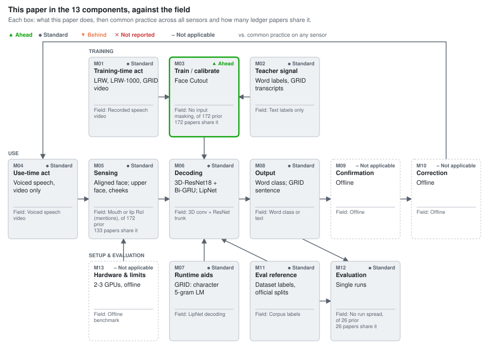

# Can We Read Speech Beyond the Lips? Rethinking RoI Selection for Deep Visual Speech Recognition

Yuanhang Zhang, Shuang Yang, Jingyun Xiao, Shiguang Shan, Xilin Chen. IEEE FG 2020, pp. 356–363, 2020. doi: [10.1109/FG47880.2020.00134](https://doi.org/10.1109/FG47880.2020.00134); arXiv: [2003.03206](https://arxiv.org/abs/2003.03206)

**Section:** [Other sensors](../../README.md#other-sensors)

## Figures

### This paper in the 13 components, against the field

<picture><source media="(prefers-color-scheme: dark)" srcset="figures/components-dark.svg"></picture>

Verdicts compare the paper's choice for each component with common practice across 8,995 ledger entries on any sensor (silent speech, brain-to-text, lip reading).

Data

| Component | This paper | Common practice | Papers with this practice | Verdict |
| --- | --- | --- | --- | --- |
| M01 Training-time act | LRW, LRW-1000, GRID video | Recorded speech video |  | ● Standard (Inherited; no new recording.) |
| M02 Teacher signal | Word labels, GRID transcripts | Text labels only |  | ● Standard (Inherited.) |
| M03 Train / calibrate | Face Cutout | No input masking, of 172 prior | 172 of 172 | ▲ Ahead (LRW-1000 from LRW; no mouth+Cutout.) |
| M04 Use-time act | Voiced speech, video only | Voiced speech video |  | ● Standard (Inherited.) |
| M05 Sensing | Aligned face; upper face, cheeks | Mouth or lip RoI (mentions), of 172 prior | 133 of 172 | ● Standard (Face vs mouth tested before.) |
| M06 Decoding | 3D-ResNet18 + Bi-GRU; LipNet | 3D conv + ResNet trunk |  | ● Standard (Inherited.) |
| M07 Runtime aids | GRID: character 5-gram LM | LipNet decoding |  | ● Standard (Inherited; beam and LM weights not given.) |
| M08 Output | Word class; GRID sentence | Word class or text |  | ● Standard (Inherited.) |
| M09 Confirmation | Offline | Offline |  | – Not applicable (Offline study.) |
| M10 Correction | Offline | Offline |  | – Not applicable (Offline study.) |
| M11 Eval reference | Dataset labels, official splits | Corpus labels |  | ● Standard (Chance level not stated.) |
| M12 Evaluation | Single runs | No run spread, of 26 prior | 26 of 26 | ● Standard (GRID claim uses an LM.) |
| M13 Hardware & limits | 2-3 GPUs, offline | Offline benchmark |  | – Not applicable (No device evaluation claimed.) |

## Verdict

The paper [[1]](#ref-1) changes the input region (M05) and the training augmentation (M03). Face Cutout is ahead: none of 172 prior decoders masks input patches (Appendix), and it helps on LRW and GRID, plus LRW-1000, initialised from LRW. The face RoI is standard: full-face and mouth features had been compared in lip reading before, with the mouth winning [[2]](#ref-2), [[3]](#ref-3), and the paper's reversal holds on LRW-1000 and GRID but not on LRW when aligned (one run). The strongest confound is that Cutout is applied only to faces (Tables I–III), so the headline gains (LRW 85.02% against 83.30%, LRW-1000 45.24% against 38.64%) are not tied to extraoral cues. The GRID state-of-the-art claim fails as worded: 2.9% WER uses a 5-gram character LM, while the uncompared LCANet reports 2.9% (3.0% in its abstract) with no LM stated [[4]](#ref-4).

## Against the field, component by component

### M05 Sensors: facial region fed to the decoder

**Usual approach:** a mouth or lip RoI, named by 133 of 172 prior decoders (pattern match, mention count, Appendix), as in [[5]](#ref-5); the paper feeds the aligned whole face and, as probes, the upper face or cheeks alone.

**State of the art:** face input pays off mainly after self-supervised pretraining: on LRS3 (2022), with the same targets and iteration, 34.6% WER against 40.3% for the lip RoI after AV-HuBERT pretraining, but 57.1% against 57.8% from scratch [[6]](#ref-6).

All three prior region-coverage comparisons (Appendix) favoured the mouth: full-face AAM features lost to mouth-only ones [[2]](#ref-2), whole-face AAM features gave 64.00% WER against 58.14% for mouth DCT features [[3]](#ref-3), and the best mouth-plus-margin RoI had 27% lower relative WER than the lower half face on 11 words [[7]](#ref-7). Video-to-speech had found 40% lower regression error on acoustic features from face input for one GRID speaker [[8]](#ref-8); only [[7]](#ref-7) is cited, against "previously overlooked" (§V). Verdict: standard. New are the reversal with deep front ends and the isolated extraoral probes: the upper face alone gives 48.33% on LRW and 15.84% on LRW-1000 against chance of 0.2% and 0.1% (inference), but LRW-1000 front ends start from LRW (§IV-B) and the GRID upper face (14.4% WER) is LM-decoded. The whole-face gain is +3.07 points on LRW-1000 and −1.6 points WER on GRID but negative on LRW when aligned, blamed by the authors on mouth resolution (§IV-C). In [later] masking with 30 h labelled, hiding the top 30% of the face moves WER only from 42.5% to 42.7% [[6]](#ref-6).

### M03 Training: spatial occlusion augmentation

**Usual approach:** no input masking: none of 172 prior decoders masks input patches, the one hit being spatial dropout [[7]](#ref-7), and 11 name crop and flip (pattern match, Appendix) [[5]](#ref-5).

**State of the art:** not kept. The best [later] LRW single model of an augmentation study (2022), without word boundaries or self-distillation, reaches 90.4% with crop, flip, mixup and time masking on a mouth RoI, listing the paper as the Cutout entry [[9]](#ref-9); the same group's [later] recipe (2020) returned to aligned lip crops without Cutout, 85.0% on LRW and 48.0% on LRW-1000 [[10]](#ref-10).

On the aligned face, Cutout adds 1.92 points on LRW, 3.53 on LRW-1000 and 0.2 points WER on GRID with the LM (inference); the authors note a slight loss on the hardest pose subset (§IV-D). Verdict: ahead, a first use in lip reading, repeated on two independent datasets with one run each. The authors read it as curbing overfitting (Fig. 3); without mouth-plus-Cutout the extraoral mechanism is untested.

### M12 Evaluation: run repetition

**Usual approach:** one LRW figure per system; none of 26 prior LRW decoders reports a spread over training runs (pattern match, hand-checked, Appendix), and the paper follows this.

**State of the art:** a 2024 model with audio-token targets from a pretrained vq-wav2vec averages three seeds on LRW, standard deviation 0.1 points [[11]](#ref-11).

At a similar spread the single-run LRW face-versus-mouth differences (+0.16 and −0.2 points) would lie within about two seed standard deviations (inference). Verdict: standard.

## The 13 components

| Component | This paper | Usual approach (count) | State of the art | Verdict |
|---|---|---|---|---|
| M01 Training-time action | LRW, LRW-1000, GRID video | Recorded speech video | – | standard |
| M02 Training-only supervision | Word labels, GRID transcripts | Text labels only | – | standard |
| M03 Training and adaptation | Face Cutout | No input masking, of 172 prior (pattern match 172) | [[9]](#ref-9) (2022): LRW 90.4%, no Cutout | ahead |
| M04 Use-time action | Voiced speech, video only | Voiced speech video | – | standard |
| M05 Sensors | Aligned face; upper face, cheeks | Mouth or lip RoI (mentions), of 172 prior (pattern match 133) | [[6]](#ref-6) (2022): LRS3 34.6% vs 40.3% | standard |
| M06 Processing and decoding | 3D-ResNet18 + Bi-GRU; LipNet | 3D conv + ResNet trunk | – | standard |
| M07 Lexicon and LM | GRID: character 5-gram LM | LipNet decoding | – | standard |
| M08 Output | Word class; GRID sentence | Word class or text | – | standard |
| M09 Confirmation | Offline | Offline | – | not applicable |
| M10 Correction | Offline | Offline | – | not applicable |
| M11 Reference construction | Dataset labels, official splits | Corpus labels | – | standard |
| M12 Evaluation | Single runs | No run spread, of 26 prior (pattern match 26) | [[11]](#ref-11) (2024): 3 seeds, ±0.1 | standard |
| M13 Device and cost | 2-3 GPUs, offline | Offline benchmark | – | not applicable |

## Where the claims outrun the evidence

- State of the art (§IV-D): LRW 85.02% beats the best prior without word boundaries, 84.07% [[5]](#ref-5), not a prior model given boundaries (11.92% error) [[12]](#ref-12), and [concurrent] work reached 85.3% [[13]](#ref-13); LRW-1000 45.24% exceeds the 38.19% baseline [[14]](#ref-14). On GRID, LCANet and LRSW (3.0%) are cited for the 255-sentence protocol (§IV-B) but omitted from Table III, which compares only LipNet [[15]](#ref-15).
- The GRID face gain uses overlapped speakers, which the authors credit to "idiosyncratic speaking styles" (§IV-C); face features carry more speaker identity (EER 0.76% against 1.03%, LRS3 [[6]](#ref-6)), so part may be speaker recognition.
- "Much better" transfer (§IV-C) rests on one validation run per input (40.35% against 38.40%), and "far above chance" states no chance level.

## What the field needs next

- M03 with M05: mouth or face, with or without Cutout, three seeds or more on LRW and LRW-1000.
- M05: region masking on a pretrained front end with the mouth visible, by LRW-1000 pose subset (hard subset 18.36% to 27.21% with face input, Table VI).
- M12: GRID on unseen speakers, no LM.

## Questions for the authors

- How many runs stand behind each entry of Tables I–III, and what is their spread?
- What do mouth crops trained with Cutout score?
- Which GRID beam width and LM weight, tuned on which data, and what WER without the LM?
- Which seed drew the GRID test sentences; was a validation split held out?
- How many LRW-1000 test samples were scored, which checkpoints are reported, and how were pixels normalised?

## Appendix: literature search

Population (all topics): wiki studies whose ledger or title names lip reading, visual speech recognition or AVSR with camera input and a word, sentence, phoneme or command recognition task; dataset-resource and meta-analysis designs, surveys, book chapters, enhancement and separation, video-to-speech synthesis, talking-face generation, synchronisation, keyword-spotting-only, speaker embedding, human perception, neuroimaging and education studies removed; versions merged by ledger key and title, titles missing from the ledger filled from the source. 517 unique decoder studies besides the target: 172 prior (first public before 2019-09), 26 [concurrent] (2019-09 to 2020-09), 317 [later], 2 date unresolved.

- M05 / visual-speech-roi-selection. Inclusion rule: decoders of the population classified by the facial region their own method feeds the front end (mouth or lip RoI, lower face with jaw and cheeks, whole face, isolated extraoral regions) and whether they compare regions; full-face tracking followed by a mouth crop counts as a mouth RoI; mentions and citations are not designs; video-to-speech is outside the population and named as a cross-task prior. Ledger counts: slot-filled 7,329 unique; ledger pattern match 1,108 unique; filtered population as above. Usual design: mouth or lip RoI named by 133 of 172 prior (pattern match, mention count; 23 of 26 [concurrent], 214 of 317 [later]). Whole face as decoder input: 2 of 172 prior, both AAM features (26 mentions read) [[2]](#ref-2), [[3]](#ref-3); lower-face RoI with jaw or cheeks: 4; isolated extraoral input: 0; region-coverage comparison: 3 [[2]](#ref-2), [[3]](#ref-3), [[7]](#ref-7). [concurrent]: no face-input design (3 mentions read). Whole-wiki full-text pattern: 49 further papers, read as snippets; prior same-design hits only in video-to-speech [[8]](#ref-8). Same-group prior: the LRW-1000 benchmark uses a mouth RoI [[14]](#ref-14). Cited by the target, outside the population: Chung and Zisserman, profile lip reading with a whole-face bounding box, and Shiraishi and Saitoh, optical-flow features in non-rectangular lower-face RoIs (target §II-A, references 10 and 24). Read in full: [[2]](#ref-2), [[3]](#ref-3), [[7]](#ref-7), [[8]](#ref-8), [[5]](#ref-5), [[6]](#ref-6), [[10]](#ref-10), [[11]](#ref-11). Known-item recall 1.0 (4 of 4).
- M03 / spatial-occlusion-augmentation-lip-reading. Inclusion rule: the same population, classified by whether training masks or erases spatial patches of the input frames; spatial dropout, time masking, mixup and crop or flip do not count; citations of the target are not designs. Ledger counts: slot-filled 1,526 unique; ledger pattern match 1,108 unique. Usual design: no spatial occlusion of the input, 172 of 172 prior (pattern match, hand-checked; 1 hit read: spatial dropout); crop and flip named by 11 of 172 (mention count). Spatial occlusion of the input: 0 of 26 [concurrent] (3 hits read: two citations of the target, one spatial dropout), 21 [later] mentions. Whole-wiki full-text pattern: 5 further papers, none prior. Read in full: [[5]](#ref-5), [[7]](#ref-7), [[9]](#ref-9), [[10]](#ref-10), [[11]](#ref-11). Known-item recall 1.0 (2 of 2).
- M12 / lrw-word-accuracy (published table reused, counts appended). Inclusion rule: visual-only LRW top-1 accuracy; appended here, the LRW decoders of the population dated against 2020-03. Ledger counts: slot-filled 6,960 unique; pattern match 155 unique (published). LRW decoders of the population: 26 prior, 14 [concurrent], 127 [later]. Spread over training runs: 0 of 26 prior and 0 of 14 [concurrent] after hand check (the two regex hits time inference); 10 of 127 [later] mentions. Significance test named: 2 of 26 prior. Read in full: [[4]](#ref-4), [[15]](#ref-15), [[14]](#ref-14), [[5]](#ref-5), [[12]](#ref-12), [[13]](#ref-13), [[11]](#ref-11). Known-item recall 0.75 (published).

## References

Numbered by first citation. BibTeX in the same order and keys: [refs.bib](refs.bib).

1. Zhang, Y., Yang, S., Xiao, J., Shan, S., Chen, X. “Can We Read Speech Beyond the Lips? Rethinking RoI Selection for Deep Visual Speech Recognition.” *2020 15th IEEE International Conference on Automatic Face and Gesture Recognition (FG 2020)*, 2020, 356–363. doi:[10.1109/FG47880.2020.00134](https://doi.org/10.1109/FG47880.2020.00134). arXiv:[2003.03206](https://arxiv.org/abs/2003.03206). Target. Read as arXiv v2 (same title and authors); venue, pages and DOI checked against Crossref. [wiki: arxiv-2003.03206](https://github.com/supernaiter/deep-research-wiki-for-silent-speech/blob/main/papers/arxiv-2003.03206/article.md)
2. Cox, S., Harvey, R., Lan, Y., Newman, J., Theobald, B. “The challenge of multispeaker lip-reading.” *Proc. International Conference on Auditory-Visual Speech Processing (AVSP 2008)*, 2008. <https://www.isca-archive.org/avsp_2008/cox08_avsp.html> Prior; deciding prior for M05 (full-face against mouth-only AAM features, mouth better). [wiki: isca-cox08_avsp](https://github.com/supernaiter/deep-research-wiki-for-silent-speech/blob/main/papers/isca-cox08_avsp/article.md)
3. Neti, C., Potamianos, G., Luettin, J., Matthews, I., Glotin, H., Vergyri, D., et al. “Audio-Visual Speech Recognition (JSALT 2000 summer workshop final report).” *IDIAP Research Report RR-00-35*, 2000. <http://publications.idiap.ch/index.php/publications/showcite/glotinidiaprr0035> Prior; deciding prior for M05 (whole-face AAM features against mouth DCT features, face worse). [wiki: oa-W3099202502](https://github.com/supernaiter/deep-research-wiki-for-silent-speech/blob/main/papers/oa-W3099202502/article.md)
4. Xu, K., Li, D., Cassimatis, N., Wang, X. “LCANet: End-to-End Lipreading with Cascaded Attention-CTC.” *arXiv preprint*, 2018. arXiv:[1803.04988](https://arxiv.org/abs/1803.04988). Prior; GRID comparison for M12. [review](https://github.com/supernaiter/silent-speech-review/tree/main/reviews/lcanet-end-to-end-lipreading-with-cascaded-attention-ctc) [wiki: arxiv-1803.04988](https://github.com/supernaiter/deep-research-wiki-for-silent-speech/blob/main/papers/arxiv-1803.04988/article.md)
5. Weng, X., Kitani, K. “Learning Spatio-Temporal Features with Two-Stream Deep 3D CNNs for Lipreading.” *arXiv preprint*, 2019. arXiv:[1905.02540](https://arxiv.org/abs/1905.02540). Prior; best prior LRW result without word boundaries; mouth crop with crop and flip augmentation. [wiki: arxiv-1905.02540](https://github.com/supernaiter/deep-research-wiki-for-silent-speech/blob/main/papers/arxiv-1905.02540/article.md)
6. Zhang, J., Wan, G., Pan, J. “Is Lip Region-of-Interest Sufficient for Lipreading?.” *arXiv preprint*, 2022. arXiv:[2205.14295](https://arxiv.org/abs/2205.14295). Later; face versus lip RoI with and without self-supervised pretraining on LRS3. [later] [wiki: arxiv-2205.14295](https://github.com/supernaiter/deep-research-wiki-for-silent-speech/blob/main/papers/arxiv-2205.14295/article.md)
7. Koumparoulis, A., Potamianos, G., Mroueh, Y., Rennie, S. J. “Exploring ROI size in deep learning based lipreading.” *Proc. International Conference on Auditory-Visual Speech Processing (AVSP 2017)*, 2017. <https://www.isca-archive.org/avsp_2017/koumparoulis17_avsp.html> Prior; deciding prior for M05 (lower-face RoI coverage comparison) and M03 (spatial dropout only). [wiki: isca-koumparoulis17_avsp](https://github.com/supernaiter/deep-research-wiki-for-silent-speech/blob/main/papers/isca-koumparoulis17_avsp/article.md)
8. Ephrat, A., Peleg, S. “Vid2speech: Speech Reconstruction from Silent Video.” *arXiv preprint*, 2017. arXiv:[1701.00495](https://arxiv.org/abs/1701.00495). Prior; cross-task deciding prior for M05 (face versus mouth input, video-to-speech, one GRID speaker). Not cited by the target. [review](https://github.com/supernaiter/silent-speech-review/tree/main/reviews/vid2speech-speech-reconstruction-from-silent-video) [wiki: arxiv-1701.00495](https://github.com/supernaiter/deep-research-wiki-for-silent-speech/blob/main/papers/arxiv-1701.00495/article.md)
9. Ma, P., Wang, Y., Petridis, S., Shen, J., Pantic, M. “Training Strategies for Improved Lip-reading.” *arXiv preprint*, 2022. arXiv:[2209.01383](https://arxiv.org/abs/2209.01383). Later; augmentation study on LRW. [later] [wiki: arxiv-2209.01383](https://github.com/supernaiter/deep-research-wiki-for-silent-speech/blob/main/papers/arxiv-2209.01383/article.md)
10. Feng, D., Yang, S., Shan, S., Chen, X. “Learn an Effective Lip Reading Model without Pains.” *arXiv preprint*, 2020. arXiv:[2011.07557](https://arxiv.org/abs/2011.07557). Later; same group; aligned lip crops without Cutout. [later] [wiki: arxiv-2011.07557](https://github.com/supernaiter/deep-research-wiki-for-silent-speech/blob/main/papers/arxiv-2011.07557/article.md)
11. Ahn, Y. J., Park, J., Park, S., Choi, J., Kim, K. “SyncVSR: Data-Efficient Visual Speech Recognition with End-to-End Crossmodal Audio Token Synchronization.” *arXiv preprint*, 2024. arXiv:[2406.12233](https://arxiv.org/abs/2406.12233). Later; state of the art on LRW and CAS-VSR-W1K (mean of three seeds). [later] [wiki: arxiv-2406.12233](https://github.com/supernaiter/deep-research-wiki-for-silent-speech/blob/main/papers/arxiv-2406.12233/article.md)
12. Stafylakis, T., Khan, M. H., Tzimiropoulos, G. “Pushing the boundaries of audiovisual word recognition using Residual Networks and LSTMs.” *arXiv preprint*, 2018. arXiv:[1811.01194](https://arxiv.org/abs/1811.01194). Prior; best prior LRW result with word boundaries. [wiki: arxiv-1811.01194](https://github.com/supernaiter/deep-research-wiki-for-silent-speech/blob/main/papers/arxiv-1811.01194/article.md)
13. Martinez, B., Ma, P., Petridis, S., Pantic, M. “Lipreading using Temporal Convolutional Networks.” *arXiv preprint*, 2020. arXiv:[2001.08702](https://arxiv.org/abs/2001.08702). [concurrent]; LRW and LRW-1000 comparison. [concurrent] [review](https://github.com/supernaiter/silent-speech-review/tree/main/reviews/lipreading-using-temporal-convolutional-networks) [wiki: arxiv-2001.08702](https://github.com/supernaiter/deep-research-wiki-for-silent-speech/blob/main/papers/arxiv-2001.08702/article.md)
14. Yang, S., Zhang, Y., Feng, D., Yang, M., Wang, C., Xiao, J., et al. “LRW-1000: A Naturally-Distributed Large-Scale Benchmark for Lip Reading in the Wild.” *arXiv preprint*, 2018. arXiv:[1810.06990](https://arxiv.org/abs/1810.06990). Prior; same group; LRW-1000 baseline used in Table VI. [wiki: arxiv-1810.06990](https://github.com/supernaiter/deep-research-wiki-for-silent-speech/blob/main/papers/arxiv-1810.06990/article.md)
15. Assael, Y. M., Shillingford, B., Whiteson, S., de Freitas, N. “LipNet: End-to-End Sentence-level Lipreading.” *arXiv preprint*, 2016. arXiv:[1611.01599](https://arxiv.org/abs/1611.01599). Prior; GRID baseline of Table III. [review](https://github.com/supernaiter/silent-speech-review/tree/main/reviews/lipnet-end-to-end-sentence-level-lipreading) [wiki: arxiv-1611.01599](https://github.com/supernaiter/deep-research-wiki-for-silent-speech/blob/main/papers/arxiv-1611.01599/article.md)

## Materials

Data behind this review. Full texts of the papers are not included.

- [`review.md`](review.md): the review text (source)
- [`refs.bib`](refs.bib): references (BibTeX)
- [`slots.json`](slots.json): for each of the 13 components: this paper's choice, field practice, number of matching papers, verdict
- [`figures.json`](figures.json): figure definitions
- [`evaluation.md`](evaluation.md): independent evaluation by a second reviewer
- [`triage.md`](triage.md): how each evaluation finding was checked against the sources and resolved
- [`process/log.json`](process/log.json): process record: each step, who did it (reader, script, writer, evaluator), when, the checks run and the input versions
- [`process/notes.json`](process/notes.json): reading notes on the target and comparator papers: claims, numbers, conditions and what is not stated, with locations
- [`process/plan.json`](process/plan.json): plan: which components the paper changes and the topics it is compared on
- [`process/draft.md`](process/draft.md): the review as first written, before the independent evaluation
- [`process/claims-draft.md`](process/claims-draft.md): claim table of the draft: every claim mapped to a note or a count
- [`process/claims.md`](process/claims.md): claim table of the published review
- [`components/M03/spatial-occlusion-augmentation-lip-reading.csv`](../../components/M03/spatial-occlusion-augmentation-lip-reading.csv): M03 topic "spatial-occlusion-augmentation-lip-reading", every candidate paper with its decision (1526 slot-filled, 1108 pattern match, usual design in 172, 5 read in full)
- [`components/M05/visual-speech-roi-selection.csv`](../../components/M05/visual-speech-roi-selection.csv): M05 topic "visual-speech-roi-selection", every candidate paper with its decision (7329 slot-filled, 1108 pattern match, usual design in 133, 8 read in full)
- [`components/M12/lrw-word-accuracy.csv`](../../components/M12/lrw-word-accuracy.csv): M12 topic "lrw-word-accuracy", every candidate paper with its decision (6960 slot-filled, 155 pattern match, usual design in 90, 2 read in full)

## More reviews in Other sensors

- [ASR is all you need: cross-modal distillation for lip reading](../asr-is-all-you-need-cross-modal-distillation-for-lip-reading/) (2020). ASR-teacher labels (M02) replaced transcribed-data alignment targets; standard: LRS2 parity holds, but effects differ across datasets, one WER each, and distillation is not isolated.
- [Audio-Visual Recognition of Overlapped Speech for the LRS2 Dataset](../audio-visual-recognition-of-overlapped-speech-for-the-lrs2-dataset/) (2020). Gated AV fusion for overlapped speech (M06) is standard: AV-driven fusion weights (2006) and mixture recognition with lips (2016) came first; 15.20% to 10.31% WER, no seeds; test interferers unstated.
- [Decoding Imagined and Spoken Phrases From Non-invasive Neural (MEG) Signals](../decoding-imagined-and-spoken-phrases-from-non-invasive-neural-meg-signals/) (2020). Scalogram CNNs (M06) and ImageNet weights (M03) were new for imagined speech but standard: effects not isolated; 93% imagination sits on a 43.77% pre-stimulus floor (Table 1).
- [Decoding spoken English from intracortical electrode arrays in dorsal precentral gyrus](../decoding-spoken-english-from-intracortical-electrode-arrays-in-dorsal-precentral-gyrus/) (2020). 39-phoneme decoding from dorsal Utah arrays (M06) and overt-speech confound controls (M12) are standard: both have read priors, T5 alone carries them, and folds share words.
- [Discriminative Multi-modality Speech Recognition](../discriminative-multi-modality-speech-recognition/) (2020). Enhance-then-AV-recognise (M06) is standard: video used twice predates it (2002, 2013); LRS3 0 dB WER 41.1% to 25.5%, but one run, a clean-trained AV baseline and copied baselines.
- [Hearing Lips: Improving Lip Reading by Distilling Speech Recognizers](../hearing-lips-improving-lip-reading-by-distilling-speech-recognizers/) (2020). Recognizer-to-lip-reader distillation (M02) is ahead of the prior record and repeats over two datasets and three teachers; the audio rationale is untested and the LRS2 state-of-the-art claim fails.

---

Part of the [Silent Speech Interface Review](https://github.com/supernaiter/silent-speech-review). Found an error? [Open an issue](https://github.com/supernaiter/silent-speech-review/issues/new?template=correction.yml).
