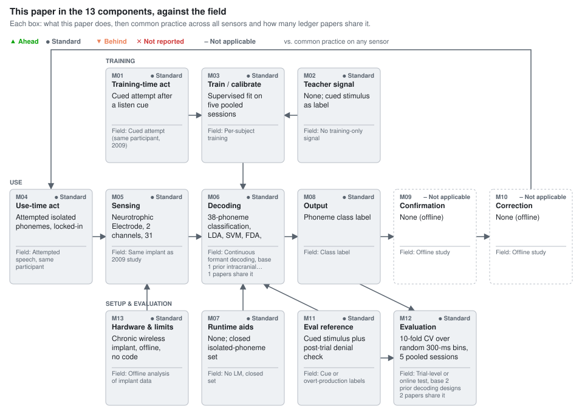

# Classification of intended phoneme production from chronic intracortical microelectrode recordings in speech-motor cortex

Brumberg, Wright, Andreasen, Guenther, Kennedy. Frontiers in Neuroscience 5:65, 2011. [doi:10.3389/fnins.2011.00065](https://doi.org/10.3389/fnins.2011.00065)

**Section:** [Other sensors](../../README.md#other-sensors)

## Figures

### This paper in the 13 components, against the field

<picture><source media="(prefers-color-scheme: dark)" srcset="figures/components-dark.svg"></picture>

Verdicts compare the paper's choice for each component with common practice across 8,995 ledger entries on any sensor (silent speech, brain-to-text, lip reading).

Data

| Component | This paper | Common practice | Papers with this practice | Verdict |
| --- | --- | --- | --- | --- |
| M01 Training-time act | Cued attempt after a listen cue | Cued attempt (same participant, 2009) |  | ● Standard (Inherited from Guenther et al. 2009.) |
| M02 Teacher signal | None; cued stimulus as label | No training-only signal |  | ● Standard (Inherited.) |
| M03 Train / calibrate | Supervised fit on five pooled sessions | Per-subject training |  | ● Standard (SVM cost and gamma fixed; selection not stated.) |
| M04 Use-time act | Attempted isolated phonemes, locked-in | Attempted speech, same participant |  | ● Standard (Inherited from Guenther et al. 2009.) |
| M05 Sensing | Neurotrophic Electrode, 2 channels, 31 clusters | Same implant as 2009 study |  | ● Standard (Inherited; sorting parameters reused across sessions, single and multi-unit pooled.) |
| M06 Decoding | 38-phoneme classification, LDA, SVM, FDA, 300-ms bins | Continuous formant decoding, base 1 prior intracranial decoding design | 1 of 1 | ● Standard (Prior discrete intracranial sets: four phonemes (Blakely 2008, via target), ten words (Kellis 2010); isolated-phoneme EMG classification prior (Jorgensen 2005 via Walliczek); one participant.) |
| M07 Runtime aids | None; closed isolated-phoneme set | No LM, closed set |  | ● Standard (Inherited.) |
| M08 Output | Phoneme class label | Class label |  | ● Standard (Inherited.) |
| M09 Confirmation | None (offline) | Offline study |  | – Not applicable (Offline.) |
| M10 Correction | None (offline) | Offline study |  | – Not applicable (Offline.) |
| M11 Eval reference | Cued stimulus plus post-trial denial check | Cue or overt-production labels |  | ● Standard (Inherited; no attempt onset; rejected-trial counts not reported.) |
| M12 Evaluation | 10-fold CV over random 300-ms bins, 5 pooled sessions | Trial-level or online test, base 2 prior decoding designs | 2 of 2 | ● Standard (Bin-level split (inference from fold counts); 2 earlier trial-level designs, below the behind threshold of 3.) |
| M13 Hardware & limits | Chronic wireless implant, offline, no code | Offline analysis of implant data |  | ● Standard (Kennedy (98%) and Andreasen (2%) own Neural Signals Inc. (Conflict of Interest Statement).) |

## Verdict

The paper [[1]](#ref-1) changes one component, the decoder (M06): it replaces the same participant's continuous three-vowel formant control [[2]](#ref-2) with classification of 38 attempted phonemes, against prior intracranial classifiers of four phonemes (Blakely et al. 2008, cited by the target) and ten overt words [[3]](#ref-3); the one prior intracranial decoding design in the ledger has no discrete unit set (Appendix). It is standard, not ahead: isolated phonemes of nearly a full inventory had been classified from subvocal EMG (Jorgensen and Binsted 2005, as described by [[4]](#ref-4)), 40 phone classes were units of continuous recognition from ultrasound and lip video [[5]](#ref-5), and nothing repeats the result beyond one participant, as the authors state. The evaluation (M12) is standard for 2011, but bins, not trials, were assigned to folds (inference from the fold counts), the strongest confound for the 16–21% accuracies. Their "truly not great enough to be useful as a communication device" holds; their "lower-bound on the possible classification/prediction performance" is unsupported, because mixing a trial's bins across folds biases accuracy upward (inference).

## Against the field, component by component

### M06 Processing and decoding: size of the speech-unit class set

**Usual approach:** before 2010-11 the intracranial ledger population holds one decoding design, the same participant's continuous formant decoder in two reports, three-vowel hit rates 45% to 70% [[2]](#ref-2) (pattern match, Appendix). Discrete classifiers outside it use small sets: ten overt words, 48% with the best five micro-ECoG electrodes [[3]](#ref-3), and four phonemes (Blakely et al. 2008, cited by the target); [concurrent] ECoG screened four phonemes [[6]](#ref-6).

**State of the art:** Willett et al. (2023) [later] decode 39 attempted phonemes at 62% from 1 s of area 6v activity per trial, one participant [[7]](#ref-7); the target's best, 21.0% (SVM, Table 3), is about a third of that from 300-ms bins (inference).

Across signals the class-set step is not new. Walliczek et al. describe isolated subvocal-EMG recognition of eighteen vowels and twenty-three consonants at 50% (Jorgensen and Binsted 2005, second-hand) [[4]](#ref-4); their own study used 32 expressions. Hueber et al. recognized 40 phonetic classes at 60%, in continuous read speech rather than isolated classification [[5]](#ref-5). No intracranial study among 45 matches from 2010 or earlier classifies a full inventory (Appendix). Verdict: standard: one participant with pooled sessions is not repetition (the authors concede it "may not generalize well to others", Conclusion), and three classifiers on one split repeat the method.

### M12 Evaluation: random 10-fold split over bins

**Usual approach:** the 12 prior intracranial ledger studies contain two decoding designs, both testing whole trials: the same participant's decoder ran online with feedback within 50 ms [[2]](#ref-2), and Kellis et al. used 15 training and 15 decoding trials per word [[3]](#ref-3) (Appendix). The paper partitions bins.

**State of the art:** Card et al. (2024) [later]: online copy-task decoding, 2.5% WER over the final five evaluation sessions, 125,000-word vocabulary, one participant [[8]](#ref-8).

Verdict: standard. Both earlier designs keep the trial as the unit, but two is below the three the behind rule needs.

## The 13 components

| Component | This paper | Usual approach (count) | State of the art | Verdict |
|---|---|---|---|---|
| M01 Training-time action | Cued attempt after a listen cue | Cued attempt (same participant, 2009) | – | standard |
| M02 Training-only supervision | None; cued stimulus as label | No training-only signal | – | standard |
| M03 Training and adaptation | Supervised fit on five pooled sessions | Per-subject training | – | standard |
| M04 Use-time action | Attempted isolated phonemes, locked-in | Attempted speech, same participant | – | standard |
| M05 Sensors | Neurotrophic Electrode, 2 channels, 31 clusters | Same implant as 2009 study | – | standard |
| M06 Processing and decoding | 38-phoneme classification, LDA, SVM, FDA, 300-ms bins | Continuous formant decoding, base 1 prior intracranial decoding design (pattern match 1) | [[7]](#ref-7) (2023): 39 attempted phonemes, 62% from 1 s per trial | standard |
| M07 Lexicon and LM | None; closed isolated-phoneme set | No LM, closed set | – | standard |
| M08 Output | Phoneme class label | Class label | – | standard |
| M09 Confirmation | None (offline) | Offline study | – | not applicable |
| M10 Correction | None (offline) | Offline study | – | not applicable |
| M11 Reference construction | Cued stimulus plus post-trial denial check | Cue or overt-production labels | – | standard |
| M12 Evaluation | 10-fold CV over random 300-ms bins, 5 pooled sessions | Trial-level or online test, base 2 prior decoding designs (pattern match 2) | [[8]](#ref-8) (2024): online copy task, 125,000 words, 2.5% WER | standard |
| M13 Device and cost | Chronic wireless implant, offline, no code | Offline analysis of implant data | – | standard |

## Where the claims outrun the evidence

- Leakage. "Between 180 and 216 data points per-phoneme" (§ Classification analysis) equals 10–12 trials × 20 bins × 0.9, so these are training-fold bin counts and a trial's bins straddle the split (inference). No rest or shuffled-label control is reported (§ Experimental protocol); the binomial test's n is not stated, and if it counts bins it treats them as independent (inference).
- Lower bound (§ Classification Summary). The authors concede segments where "we do not expect the classifiers to correctly predict the appropriate phoneme"; under a trial-mixed split such bins can still score (inference).
- Attempt. The authors concede that attempt onsets are unknown and that attempted versus imagined speech "was not explicitly tested" (§ Experimental protocol); rejected-trial counts are not reported (§ Discussion).
- Units (M05). Beyond the spike-clustering noise the authors name (§ Classification Summary), sorting parameters from one off-line analysis were reused for all sessions (§ Recording system).
- Online use. "Immediately applicable to use in online applications" (§ Discussion) rests on an off-line bin-level split, unlike the group's own online test [[2]](#ref-2).
- Consistency. § Classification Summary counts 18 phonemes above chance against 20 in Fig. 4; 20 bins of 300 ms span 6 s of the "10-s SPEAK period" (§ Experimental protocol).

## What the field needs next

- M12: each trial's bins in one fold, sessions held out, with shuffled-label and rest baselines.
- M06: one decision per trial from an attempt-aligned window, per session, comparable with [[7]](#ref-7).
- M11: an independent attempt marker.

## Questions for the authors

- Were a trial's 20 bins kept in one fold, how many trials were rejected, and how were the SVM and MARS settings chosen?
- Which 6 s of the 10-s response period do the 20 bins cover?
- Are 18 or 20 above chance?
- Which five sessions without technical problems or biofeedback were analysed, with what accuracy each?

## Appendix: literature search

- M06, intracranial-phoneme-inventory-classification (published table, appended). Inclusion rule: intracranial signal named with phonemes, vowels, consonants or syllables in the ledger text; design = size of the speech-unit class set; prior = first public before 2010-11, [concurrent] 2010-11 to 2011-11; versions and reports of one experiment merged; non-decoders excluded. Ledger counts: slot-filled 7,345 unique studies; pattern match 101 unique studies (all years). Prior population 1 decoding design (continuous formant decoding; two reports merged; Flinker et al. 2010, auditory suppression, excluded); full inventory 0; small subset 0. Discrete decoders outside the pattern: Kellis et al. 2010 (read), Blakely et al. 2008 (via the target's citation, outside the ledger). Full-text pattern over the whole wiki (38–46 phonemes or phones, "all phonemes", "phoneme inventory"): 491 folders, 375 unique studies; 45 unique first public in 2010 or earlier, all snippets read; intracranial full-inventory classifiers among them 0; full-phone-set recognizers from other signals: ultrasound and lip video [[5]](#ref-5) and two audio-visual ASR systems. Recall sample 30 snippets, 0 with the same design. Known-item recall 1.0. Read in full: [[3]](#ref-3), [[2]](#ref-2), [[5]](#ref-5), [[4]](#ref-4), [[7]](#ref-7) (state of the art); [[6]](#ref-6) [concurrent] from the published table.
- M12, intracranial-speech-test-partition (published table, appended). Inclusion rule: intracranial speech decoding; design = separation of test from training data; studies first public before 2010-11. Ledger counts: slot-filled 6,960 unique studies; pattern match 618 unique studies (all years). Prior population 12 unique studies; after removing 3 reviews and 6 perception, mapping or suppression studies and merging two reports of one experiment, 2 decoding designs, both trial-level or online (2 of 2); sample-level split 0. Known-item recall 1.0. Read in full: [[2]](#ref-2), [[3]](#ref-3), [[8]](#ref-8) (state of the art).

## References

Numbered by first citation. BibTeX in the same order and keys: [refs.bib](refs.bib).

1. Brumberg, J. S., Wright, E. J., Andreasen, D. S., Guenther, F. H., Kennedy, P. R. “Classification of intended phoneme production from chronic intracortical microelectrode recordings in speech-motor cortex.” *Frontiers in Neuroscience*, 2011, 5, 65. doi:[10.3389/fnins.2011.00065](https://doi.org/10.3389/fnins.2011.00065). Target. Version of record, published 12 May 2011. [wiki: doi-10.3389-fnins.2011.00065](https://github.com/supernaiter/deep-research-wiki-for-silent-speech/blob/main/papers/doi-10.3389-fnins.2011.00065/article.md) [wiki: pmc-3096823-phoneme-intracortical](https://github.com/supernaiter/deep-research-wiki-for-silent-speech/blob/main/papers/pmc-3096823-phoneme-intracortical/article.md) [wiki: pmc-3096823-phonintent](https://github.com/supernaiter/deep-research-wiki-for-silent-speech/blob/main/papers/pmc-3096823-phonintent/article.md)
2. Guenther, F. H., Brumberg, J. S., Wright, E. J., Nieto-Castanon, A., Tourville, J. A., Panko, M., et al. “A Wireless Brain-Machine Interface for Real-Time Speech Synthesis.” *PLoS ONE*, 2009, 4(12), e8218. doi:[10.1371/journal.pone.0008218](https://doi.org/10.1371/journal.pone.0008218). Prior; same participant and implant. [review](https://github.com/supernaiter/silent-speech-review/tree/main/reviews/a-wireless-brain-machine-interface-for-real-time-speech-synthesis) [wiki: pmc-2784218-wireless](https://github.com/supernaiter/deep-research-wiki-for-silent-speech/blob/main/papers/pmc-2784218-wireless/article.md) [wiki: pmc-2784218-wirelesssynth](https://github.com/supernaiter/deep-research-wiki-for-silent-speech/blob/main/papers/pmc-2784218-wirelesssynth/article.md) [wiki: doi-10.1371-journal.pone.0008218](https://github.com/supernaiter/deep-research-wiki-for-silent-speech/blob/main/papers/doi-10.1371-journal.pone.0008218/article.md)
3. Kellis, S., Miller, K., Thomson, K., Brown, R., House, P., Greger, B. “Decoding spoken words using local field potentials recorded from the cortical surface.” *Journal of Neural Engineering*, 2010, 7(5), 056007. doi:[10.1088/1741-2560/7/5/056007](https://doi.org/10.1088/1741-2560/7/5/056007). Prior; cited by the target. [review](https://github.com/supernaiter/silent-speech-review/tree/main/reviews/decoding-spoken-words-using-local-field-potentials-recorded-from-the-cortical-surface) [wiki: doi-10.1088-1741-2560-7-5-056007](https://github.com/supernaiter/deep-research-wiki-for-silent-speech/blob/main/papers/doi-10.1088-1741-2560-7-5-056007/article.md) [wiki: pmc-2970568-lfpwords](https://github.com/supernaiter/deep-research-wiki-for-silent-speech/blob/main/papers/pmc-2970568-lfpwords/article.md)
4. Walliczek, M., Kraft, F., Jou, S., Schultz, T., Waibel, A. “Sub-Word Unit based Non-Audible Speech Recognition using Surface Electromyography.” *Interspeech 2006*, 2006. doi:[10.21437/Interspeech.2006-425](https://doi.org/10.21437/Interspeech.2006-425). Prior; describes Jorgensen and Binsted 2005 (isolated subvocal-EMG phonemes). [wiki: isca-walliczek06_interspeech](https://github.com/supernaiter/deep-research-wiki-for-silent-speech/blob/main/papers/isca-walliczek06_interspeech/article.md)
5. Hueber, T., Chollet, G., Denby, B., Dreyfus, G., Stone, M. “Phone Recognition from Ultrasound and Optical Video Sequences for a Silent Speech Interface.” *Interspeech 2008*, 2008, 2032-2035. doi:[10.21437/Interspeech.2008-528](https://doi.org/10.21437/Interspeech.2008-528). Prior; deciding prior for the class-set design across signals. [wiki: isca-hueber08b-usphone](https://github.com/supernaiter/deep-research-wiki-for-silent-speech/blob/main/papers/isca-hueber08b-usphone/article.md) [wiki: isca-hueber08b_phonerec](https://github.com/supernaiter/deep-research-wiki-for-silent-speech/blob/main/papers/isca-hueber08b_phonerec/article.md)
6. Leuthardt, E. C., Gaona, C., Sharma, M., Szrama, N., Roland, J., Freudenberg, Z., et al. “Using the electrocorticographic speech network to control a brain-computer interface in humans.” *Journal of Neural Engineering*, 2011, 8(3), 036004. doi:[10.1088/1741-2560/8/3/036004](https://doi.org/10.1088/1741-2560/8/3/036004). Concurrent. [concurrent] [wiki: doi-10.1088-1741-2560-8-3-036004](https://github.com/supernaiter/deep-research-wiki-for-silent-speech/blob/main/papers/doi-10.1088-1741-2560-8-3-036004/article.md)
7. Willett, F. R., Kunz, E. M., Fan, C., Avansino, D. T., Wilson, G. H., Choi, E. Y., et al. “A high-performance speech neuroprosthesis.” *Nature*, 2023, 620(7976), 1031-1036. doi:[10.1038/s41586-023-06377-x](https://doi.org/10.1038/s41586-023-06377-x). Later; state of the art for M06. [later] [review](https://github.com/supernaiter/silent-speech-review/tree/main/reviews/a-high-performance-speech-neuroprosthesis) [wiki: doi-10.1038-s41586-023-06377-x](https://github.com/supernaiter/deep-research-wiki-for-silent-speech/blob/main/papers/doi-10.1038-s41586-023-06377-x/article.md)
8. Card, N. S., Wairagkar, M., Iacobacci, C., Hou, X., Singer-Clark, T., Willett, F. R., et al. “An accurate and rapidly calibrating speech neuroprosthesis.” *New England Journal of Medicine*, 2024, 391(7), 609-618. doi:[10.1056/NEJMoa2314132](https://doi.org/10.1056/NEJMoa2314132). Later; state of the art for M12. [later] [review](https://github.com/supernaiter/silent-speech-review/tree/main/reviews/an-accurate-and-rapidly-calibrating-speech-neuroprosthesis) [wiki: doi-10.1056-nejmoa2314132](https://github.com/supernaiter/deep-research-wiki-for-silent-speech/blob/main/papers/doi-10.1056-nejmoa2314132/article.md) [wiki: pmc-11328962-rapidcal](https://github.com/supernaiter/deep-research-wiki-for-silent-speech/blob/main/papers/pmc-11328962-rapidcal/article.md)

## Materials

Data behind this review. Full texts of the papers are not included.

- [`review.md`](review.md): the review text (source)
- [`refs.bib`](refs.bib): references (BibTeX)
- [`slots.json`](slots.json): for each of the 13 components: this paper's choice, field practice, number of matching papers, verdict
- [`figures.json`](figures.json): figure definitions
- [`evaluation.md`](evaluation.md): independent evaluation by a second reviewer
- [`triage.md`](triage.md): how each evaluation finding was checked against the sources and resolved
- [`process/log.json`](process/log.json): process record: each step, who did it (reader, script, writer, evaluator), when, the checks run and the input versions
- [`process/notes.json`](process/notes.json): reading notes on the target and comparator papers: claims, numbers, conditions and what is not stated, with locations
- [`process/plan.json`](process/plan.json): plan: which components the paper changes and the topics it is compared on
- [`process/draft.md`](process/draft.md): the review as first written, before the independent evaluation
- [`process/claims-draft.md`](process/claims-draft.md): claim table of the draft: every claim mapped to a note or a count
- [`process/claims.md`](process/claims.md): claim table of the published review
- [`components/M06/intracranial-phoneme-inventory-classification.csv`](../../components/M06/intracranial-phoneme-inventory-classification.csv): M06 topic "intracranial-phoneme-inventory-classification", every candidate paper with its decision (7345 slot-filled, 101 pattern match, usual design in 4, 5 read in full)
- [`components/M12/intracranial-speech-test-partition.csv`](../../components/M12/intracranial-speech-test-partition.csv): M12 topic "intracranial-speech-test-partition", every candidate paper with its decision (6960 slot-filled, 618 pattern match, usual design in 132, 2 read in full)

## More reviews in Other sensors

- [Decoding Vowels and Consonants in Spoken and Imagined Words Using Electrocorticographic Signals in Humans](../decoding-vowels-and-consonants-in-spoken-and-imagined-words-using-electrocorticographic-signals-in-h/) (2011). Paired covert/overt vowel and consonant-class decoding on ECoG (M04) is ahead as a 2011 protocol; best-of-47–64-electrode selection and prompt-only covert labels make its gains upper bounds.
- [Reconstructing Speech from Human Auditory Cortex](../reconstructing-speech-from-human-auditory-cortex/) (2012). M06 ahead for 2012: earliest heard-speech spectrogram reconstruction from human ECoG in the ledger, above zero in all 15 patients; modulation result is a group effect; word readout uses one patient.
- [Decoding spoken words using local field potentials recorded from the cortical surface](../decoding-spoken-words-using-local-field-potentials-recorded-from-the-cortical-surface/) (2010). Micro-ECoG closed-set word decoding (M05, M06) departs from 2009 intracortical formant decoding and clinical grids but stays standard: one patient, one split, selection on test data.
- [A Wireless Brain-Machine Interface for Real-Time Speech Synthesis](../a-wireless-brain-machine-interface-for-real-time-speech-synthesis/) (2009). Closed-loop formant decoding (M06) and F1/F2 output (M08) are standard: gesture-driven formant synthesis came first; one user learns vowels; hit rate lacks a chance level; no speech measured.
- [Decoding spectrotemporal features of overt and covert speech from the human cortex](../decoding-spectrotemporal-features-of-overt-and-covert-speech-from-the-human-cortex/) (2014). Overt-trained ECoG decoding of covert reading (M04), spectral outputs (M08) and the overt-recording covert reference (M11) are standard; DTW-aligned rest reaches r 0.30 vs covert 0.34.
- [Direct classification of all American English phonemes using signals from functional speech motor cortex](../direct-classification-of-all-american-english-phonemes-using-signals-from-functional-speech-motor-co/) (2014). Phoneme-onset events within words (M06) are ahead as a protocol; full-inventory classification predates it (Brumberg 2011); the 36% headline is consonants only, on hand-labelled onsets.

---

Part of the [Silent Speech Interface Review](https://github.com/supernaiter/silent-speech-review). Found an error? [Open an issue](https://github.com/supernaiter/silent-speech-review/issues/new?template=correction.yml).
