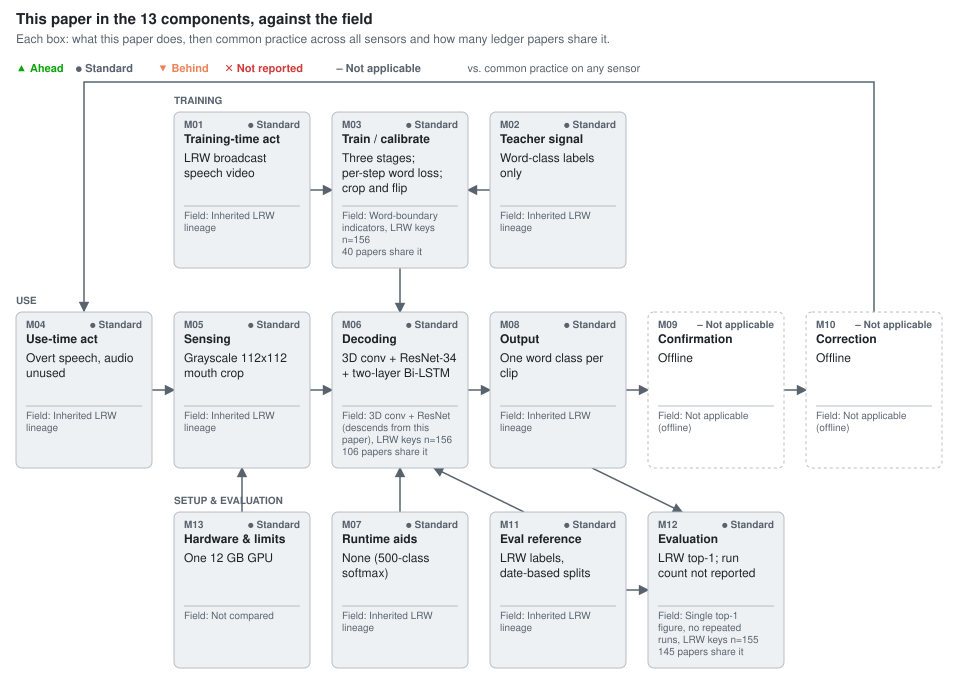

# Combining Residual Networks with LSTMs for Lipreading

Themos Stafylakis, Georgios Tzimiropoulos. Proc. Interspeech 2017, 2017. [doi:10.21437/Interspeech.2017-85](https://doi.org/10.21437/Interspeech.2017-85) [arXiv:1703.04105](https://arxiv.org/abs/1703.04105)

**Section:** [Other sensors](../../README.md#other-sensors)

## Figures

### This paper in the 13 components, against the field

<picture><source media="(prefers-color-scheme: dark)" srcset="figures/components-dark.svg"></picture>

Verdicts compare the paper's choice for each component with common practice across 8,995 ledger entries on any sensor (silent speech, brain-to-text, lip reading).

Data

| Component | This paper | Common practice | Papers with this practice | Verdict |
| --- | --- | --- | --- | --- |
| M01 Training-time act | LRW broadcast speech video | Inherited LRW lineage |  | ● Standard (Inherited.) |
| M02 Teacher signal | Word-class labels only | Inherited LRW lineage |  | ● Standard (Inherited; viseme labels proposed, not tested (Sec. 1).) |
| M03 Train / calibrate | Three stages; per-step word loss; crop and flip | Word-boundary indicators, LRW keys n=156 | 40 of 156 | ● Standard (No prior LRW study; per-step loss gain (about 3 points) has no table row or run count.) |
| M04 Use-time act | Overt speech, audio unused | Inherited LRW lineage |  | ● Standard (Inherited.) |
| M05 Sensing | Grayscale 112x112 mouth crop | Inherited LRW lineage |  | ● Standard (Inherited.) |
| M06 Decoding | 3D conv + ResNet-34 + two-layer Bi-LSTM | 3D conv + ResNet (descends from this paper), LRW keys n=156 | 106 of 156 | ● Standard (0 of 4 [concurrent] keys had it; standard only because no run count or dispersion is reported.) |
| M07 Runtime aids | None (500-class softmax) | Inherited LRW lineage |  | ● Standard (Inherited.) |
| M08 Output | One word class per clip | Inherited LRW lineage |  | ● Standard (Inherited.) |
| M09 Confirmation | Offline | Not applicable (offline) |  | – Not applicable (Offline benchmark.) |
| M10 Correction | Offline | Not applicable (offline) |  | – Not applicable (Offline benchmark.) |
| M11 Eval reference | LRW labels, date-based splits | Inherited LRW lineage |  | ● Standard (Inherited.) |
| M12 Evaluation | LRW top-1; run count not reported | Single top-1 figure, no repeated runs, LRW keys n=155 | 145 of 155 | ● Standard (No run count or dispersion reported; matches the field's protocol.) |
| M13 Hardware & limits | One 12 GB GPU | Not compared |  | ● Standard (No latency reported.) |

## Verdict

The paper [[1]](#ref-1) changes the processing chain (M06), one 3D convolution layer, a per-frame ResNet-34 and a two-layer Bi-LSTM, and the training recipe (M03), three stages with the word loss at every time step. Both are standard solely because no run count or dispersion is reported (§4.5), which ahead requires; nothing can be behind, as the LRW benchmark [[2]](#ref-2) is [concurrent] and the ledger holds 0 prior LRW keys (Appendix). The M06 design descends from this paper: 0 of 4 [concurrent] LRW keys name a ResNet; 106 of 156 keys now name 3D convolution and a ResNet (upper bound; Appendix). The 6.8-point margin over WAS [[3]](#ref-3) [concurrent] is one cross-system comparison with no run count; WAS's extra BBC pretraining favours the comparator. Today 83.0% sits 10.2 points below SyncVSR [[4]](#ref-4) [later], which is trained with quantized-audio targets, so the gap mixes architecture with audio supervision (inference).

## Against the field, component by component

### M06 Processing: 3D-conv + ResNet front end and Bi-LSTM back end

**Usual approach:** today a 3D convolution plus ResNet: 106 of 156 LRW / LRW-1000 keys (pattern match, upper bound), 103 of the 149 [later] keys against 0 of 4 [concurrent] (Appendix), a default descending from this paper. At the time the benchmark baselines were VGG-M networks [[2]](#ref-2), and WAS [[3]](#ref-3) [concurrent] already fed VGG-M features to an encoder LSTM on LRW; the paper adds the 3D layer, the ResNet trunk and a classification Bi-LSTM without sentence pretraining.

**State of the art:** at the time, WAS [[3]](#ref-3) [concurrent], 23.8% word error on LRW (76.2% accuracy), 6.8 points below the paper's 83.0%. Today SyncVSR [[4]](#ref-4) [later] (2024), 93.2% without word boundaries (mean of three seeds), trained to predict quantized audio tokens, 10.2 points above with audio supervision the paper lacks (inference); the audio-free [[5]](#ref-5) [later] keeps the 3D convolution plus ResNet encoder.

Earlier and [concurrent] work had the parts: a prior GRID lipreader chained two LSTM layers on raw mouth images [[6]](#ref-6), and LipNet [[7]](#ref-7) [concurrent], cited by the authors (§4.2), put spatiotemporal convolutions before a bidirectional GRU. Its 2D-to-3D gain (69.6% to 74.6%, Table 2) runs against the benchmark paper, where whole-network 3D ConvNets trail 2D ones by about 14 points [[2]](#ref-2) [concurrent]; here 3D is one layer before a 2D trunk (inference). The Bi-LSTM beats temporal convolution by 3.8 points (78.4% vs 74.6%, Table 3), but N4 and N5 keep N2's front end frozen and add rather than concatenate the two directions (§5.2). Verdict: standard, solely because no run count or dispersion is reported.

### M03 Training: three-stage recipe and per-time-step word loss

**Usual approach:** word-boundary indicators are the temporal handling named most often (40 of 156 keys, pattern match, upper bound), with time masking 27; a word loss stated at every time step is named in 11 keys (the target's 3, 0 [concurrent], 8 [later]; Appendix). The paper trains a temporal-convolution back end, then the Bi-LSTM for 5 epochs on a frozen front end, then end to end (§4.5); crops and flips are its only augmentation (§4.1).

**State of the art:** [[5]](#ref-5) [later] (2022) reaches 92.8% on LRW from a single model (93.4% as an ensemble) with word-boundary indicators, self-distillation, mixup and time masking.

The paper leaves out temporal augmentation, although the [concurrent] benchmark paper had gained 3.5 points of top-1 validation error from random time shifts of up to 0.2 s [[2]](#ref-2). End-to-end fine-tuning adds 1.9 points (79.6% to 81.5%, Tables 3 and 4); the per-time-step loss has no table row (§4.4). Verdict: standard.

### M12 Evaluation: LRW top-1 protocol

**Usual approach:** top-1 on the 25,000-clip LRW test set as a single figure: 145 of 155 keys name no repeated-run statistic; the 10 that do are all [later] (pattern match, Appendix). The paper follows it (§4.5).

**State of the art:** SyncVSR [[4]](#ref-4) [later] (2024), 93.2% without and 95.0% with word boundaries, each a mean of three seeds, with audio-token targets.

LRW splits by broadcast date, not speaker [[2]](#ref-2), so the missing speaker statement (§3) is the benchmark's gap; the paper's own are no seed, run count or checkpoint rule (§4.5). As the authors note (§3, §5.3), singular/plural and tense pairs are hard: four of the ten top errors in Table 5 are such pairs (SPEND to SPENT 26%), scored as full errors (inference). Verdict: standard.

## The 13 components

| Component | This paper | Usual approach (count) | State of the art | Verdict |
|---|---|---|---|---|
| M01 Training-time action | LRW broadcast speech video | Inherited LRW lineage | – | standard |
| M02 Training-only supervision | Word-class labels only | Inherited LRW lineage | – | standard |
| M03 Training and adaptation | Three stages; per-step word loss; crop and flip | Word-boundary indicators, LRW keys n=156 (pattern match 40) | [[5]](#ref-5) (2022): 92.8% LRW (WB) | standard |
| M04 Use-time action | Overt speech, audio unused | Inherited LRW lineage | – | standard |
| M05 Sensors | Grayscale 112x112 mouth crop | Inherited LRW lineage | – | standard |
| M06 Processing and decoding | 3D conv + ResNet-34 + two-layer Bi-LSTM | 3D conv + ResNet (descends from this paper), LRW keys n=156 (pattern match 106) | [[4]](#ref-4) (2024): 93.2% LRW (audio-token targets) | standard |
| M07 Lexicon and LM | None (500-class softmax) | Inherited LRW lineage | – | standard |
| M08 Output | One word class per clip | Inherited LRW lineage | – | standard |
| M09 Confirmation | Offline | Not applicable (offline) | – | not applicable |
| M10 Correction | Offline | Not applicable (offline) | – | not applicable |
| M11 Reference construction | LRW labels, date-based splits | Inherited LRW lineage | – | standard |
| M12 Evaluation | LRW top-1; run count not reported | Single top-1 figure, no repeated runs, LRW keys n=155 (pattern match 145) | [[4]](#ref-4) (2024): 93.2% LRW (audio-token targets) | standard |
| M13 Device and cost | One 12 GB GPU | Not compared | – | standard |

## Where the claims outrun the evidence

- The 6.8-point margin (Abstract, §6) is one comparison against a different system trained on extra BBC sentences [[3]](#ref-3), with no run count on either side; the 74.2% in §5.1 is a misprint, corrected to 76.2% in arXiv v4 and matching WAS's 23.8% word error.
- Concatenation over addition (83.0% vs 81.5%, Table 4) is a 1.5-point difference with no run count or dispersion reported (inference).

## What the field needs next

- M06: repeat the 2D/3D and recurrent/temporal-convolution comparisons with several seeds on a second word-level set, end to end.
- M03: add time shifts or time masking and tabulate the per-step loss.
- M12: report run-to-run spread and score inflection errors separately.

## Questions for the authors

- How many runs, with which seeds, stand behind Tables 2 to 4, and which validation metric selected the checkpoint?
- Is N5's top-10 in Table 3 (96.3%, below N4's 97.4%) a typo?
- What does a Bi-LSTM trained end to end from scratch score?

## Appendix: literature search

Dating for all topics: target first public 2017-03 (arXiv v1); prior before 2016-09, [concurrent] 2016-09 to 2017-09, [later] after. Counting basis: ledger keys; the target has three keys, so 156 keys are 154 studies and 155 keys are 153 studies. All pattern counts are upper bounds (related-work mentions included).

- **M06, topic word-lipreading-visual-frontend** (new). Inclusion rule: studies whose ledger names English LRW or Mandarin LRW-1000 / CAS-VSR-W1K (word-level lip reading), classified by the visual front end their full text names (3D convolution, ResNet, VGG, ViT or patch transformer); versions once by key. Ledger counts: slot-filled 7,345 unique studies; pattern match 156 keys. Usual design: 3D convolution and ResNet both named, 106 keys (pattern match, upper bound): the target's 3, prior 0, [concurrent] 0 of 4, [later] 103 of 149. 3D convolution 122, ResNet 124, VGG 64, ViT 13 keys. Read in full: [[6]](#ref-6), [[2]](#ref-2), [[7]](#ref-7), [[3]](#ref-3), [[4]](#ref-4), [[5]](#ref-5). Known-item recall 1.0 (8 seeds).
- **M06, topic word-lipreading-temporal-backend** (reused published table, appended). Inclusion rule: the same population, classified by the temporal back end named (recurrent, temporal convolution, Transformer, Conformer). Ledger counts: slot-filled 7,345 unique studies; pattern match 156 keys. Usual design in the published table: recurrent back end (not dated against 2017-03; not used here). Dated against 2017-03: prior 0, [concurrent] 4, [later] 149 keys. Read in full: [[6]](#ref-6), [[7]](#ref-7), [[3]](#ref-3), [[2]](#ref-2). Known-item recall 1.0 (8 seeds).
- **M03, topic word-lipreading-temporal-augmentation** (reused published table, appended). Inclusion rule: the same population, classified by named training-time data handling (temporal cropping, time masking, frame dropping, mixup, word-boundary indicators, crop and flip, multi-stage training). Ledger counts: slot-filled 1,526 unique studies; pattern match 156 keys. Usual design: word-boundary indicators, 40 keys (pattern match, upper bound, negated mentions included); time masking 27. Word loss at every time step (added pattern requiring a loss term): 11 keys, the target's 3, prior 0, [concurrent] 0, [later] 8. Read in full: [[2]](#ref-2), [[5]](#ref-5). Known-item recall 1.0 (4 seeds).
- **M12, topic lrw-word-accuracy** (reused published table, appended). Inclusion rule: visual-only word-level lip reading on English LRW with top-1 test accuracy; LRW-1000 excluded; versions once. Ledger counts: slot-filled 6,960 unique studies; pattern match 155 keys. Evaluation protocol (added): a repeated-run statistic is named in 10 keys (target 0 of 3, [concurrent] 0 of 4, [later] 10 of 148), none in 145. The published usual design (a ResNet-18 front end) is a processing design and is not used here. Read in full: [[4]](#ref-4), [[3]](#ref-3), [[2]](#ref-2). Known-item recall 0.75.

## References

Numbered by first citation. BibTeX in the same order and keys: [refs.bib](refs.bib).

1. Stafylakis, T., Tzimiropoulos, G. “Combining Residual Networks with LSTMs for Lipreading.” *Proc. Interspeech 2017*, 2017. doi:[10.21437/Interspeech.2017-85](https://doi.org/10.21437/Interspeech.2017-85). arXiv:[1703.04105](https://arxiv.org/abs/1703.04105). Target. Read as the ISCA Interspeech 2017 proceedings version; arXiv v4 consulted for Sec. 5.1. [wiki: isca-stafylakis17-resnetlstm](https://github.com/supernaiter/deep-research-wiki-for-silent-speech/blob/main/papers/isca-stafylakis17-resnetlstm/article.md) [wiki: arxiv-1703.04105](https://github.com/supernaiter/deep-research-wiki-for-silent-speech/blob/main/papers/arxiv-1703.04105/article.md) [wiki: isca-stafylakis17_lipread](https://github.com/supernaiter/deep-research-wiki-for-silent-speech/blob/main/papers/isca-stafylakis17_lipread/article.md) [wiki: isca-stafylakis17_interspeech](https://github.com/supernaiter/deep-research-wiki-for-silent-speech/blob/main/papers/isca-stafylakis17_interspeech/article.md)
2. Chung, J. S., Zisserman, A. “Lip Reading in the Wild.” *Asian Conference on Computer Vision (ACCV)*, 2016. doi:[10.1007/978-3-319-54184-6_6](https://doi.org/10.1007/978-3-319-54184-6_6). [concurrent]; the LRW benchmark and its VGG-M baselines; deciding paper for M06 and M03. [concurrent] [wiki: w2594690981-lrw](https://github.com/supernaiter/deep-research-wiki-for-silent-speech/blob/main/papers/w2594690981-lrw/article.md)
3. Chung, J. S., Senior, A., Vinyals, O., Zisserman, A. “Lip Reading Sentences in the Wild.” *IEEE Conference on Computer Vision and Pattern Recognition (CVPR)*, 2017. doi:[10.1109/CVPR.2017.367](https://doi.org/10.1109/CVPR.2017.367). arXiv:[1611.05358](https://arxiv.org/abs/1611.05358). [concurrent]; the target's state-of-the-art comparator on LRW. [concurrent] [review](https://github.com/supernaiter/silent-speech-review/tree/main/reviews/lip-reading-sentences-in-the-wild) [wiki: arxiv-1611.05358](https://github.com/supernaiter/deep-research-wiki-for-silent-speech/blob/main/papers/arxiv-1611.05358/article.md) [wiki: cvf-chung17-lipreadwild](https://github.com/supernaiter/deep-research-wiki-for-silent-speech/blob/main/papers/cvf-chung17-lipreadwild/article.md)
4. Ahn, Y. J., Park, J., Park, S., Choi, J., Kim, K. “SyncVSR: Data-Efficient Visual Speech Recognition with End-to-End Crossmodal Audio Token Synchronization.” *Proc. Interspeech 2024*, 2024. doi:[10.21437/Interspeech.2024-432](https://doi.org/10.21437/Interspeech.2024-432). arXiv:[2406.12233](https://arxiv.org/abs/2406.12233). [later]; state of the art on LRW. [later] [wiki: arxiv-2406.12233](https://github.com/supernaiter/deep-research-wiki-for-silent-speech/blob/main/papers/arxiv-2406.12233/article.md) [wiki: in24-syncvsr](https://github.com/supernaiter/deep-research-wiki-for-silent-speech/blob/main/papers/in24-syncvsr/article.md)
5. Ma, P., Wang, Y., Petridis, S., Shen, J., Pantic, M. “Training Strategies for Improved Lip-reading.” *arXiv preprint*, 2022. doi:[10.48550/arXiv.2209.01383](https://doi.org/10.48550/arXiv.2209.01383). arXiv:[2209.01383](https://arxiv.org/abs/2209.01383). [later]; state of the art for the LRW training recipe. [later] [wiki: arxiv-2209.01383](https://github.com/supernaiter/deep-research-wiki-for-silent-speech/blob/main/papers/arxiv-2209.01383/article.md)
6. Wand, M., Koutník, J., Schmidhuber, J. “Lipreading with Long Short-Term Memory.” *Proc. IEEE ICASSP 2016*, 2016. doi:[10.1109/ICASSP.2016.7472852](https://doi.org/10.1109/ICASSP.2016.7472852). arXiv:[1601.08188](https://arxiv.org/abs/1601.08188). Prior; LSTM back end on raw mouth images (GRID, speaker-dependent). [wiki: arxiv-1601.08188](https://github.com/supernaiter/deep-research-wiki-for-silent-speech/blob/main/papers/arxiv-1601.08188/article.md) [wiki: doi-10.1109-icassp.2016.7472852](https://github.com/supernaiter/deep-research-wiki-for-silent-speech/blob/main/papers/doi-10.1109-icassp.2016.7472852/article.md)
7. Assael, Y. M., Shillingford, B., Whiteson, S., de Freitas, N. “LipNet: End-to-End Sentence-level Lipreading.” *arXiv preprint*, 2016. doi:[10.48550/arXiv.1611.01599](https://doi.org/10.48550/arXiv.1611.01599). arXiv:[1611.01599](https://arxiv.org/abs/1611.01599). [concurrent]; spatiotemporal convolution with a bidirectional GRU (GRID). [concurrent] [review](https://github.com/supernaiter/silent-speech-review/tree/main/reviews/lipnet-end-to-end-sentence-level-lipreading) [wiki: arxiv-1611.01599](https://github.com/supernaiter/deep-research-wiki-for-silent-speech/blob/main/papers/arxiv-1611.01599/article.md)

## Materials

Data behind this review. Full texts of the papers are not included.

- [`review.md`](review.md): the review text (source)
- [`refs.bib`](refs.bib): references (BibTeX)
- [`slots.json`](slots.json): for each of the 13 components: this paper's choice, field practice, number of matching papers, verdict
- [`figures.json`](figures.json): figure definitions
- [`evaluation.md`](evaluation.md): independent evaluation by a second reviewer
- [`triage.md`](triage.md): how each evaluation finding was checked against the sources and resolved
- [`process/log.json`](process/log.json): process record: each step, who did it (reader, script, writer, evaluator), when, the checks run and the input versions
- [`process/notes.json`](process/notes.json): reading notes on the target and comparator papers: claims, numbers, conditions and what is not stated, with locations
- [`process/plan.json`](process/plan.json): plan: which components the paper changes and the topics it is compared on
- [`process/draft.md`](process/draft.md): the review as first written, before the independent evaluation
- [`process/claims-draft.md`](process/claims-draft.md): claim table of the draft: every claim mapped to a note or a count
- [`process/claims.md`](process/claims.md): claim table of the published review
- [`components/M03/word-lipreading-temporal-augmentation.csv`](../../components/M03/word-lipreading-temporal-augmentation.csv): M03 topic "word-lipreading-temporal-augmentation", every candidate paper with its decision (1526 slot-filled, 156 pattern match, usual design in 40, 3 read in full)
- [`components/M06/word-lipreading-temporal-backend.csv`](../../components/M06/word-lipreading-temporal-backend.csv): M06 topic "word-lipreading-temporal-backend", every candidate paper with its decision (7345 slot-filled, 156 pattern match, usual design in 115, 6 read in full)
- [`components/M06/word-lipreading-visual-frontend.csv`](../../components/M06/word-lipreading-visual-frontend.csv): M06 topic "word-lipreading-visual-frontend", every candidate paper with its decision (7345 slot-filled, 156 pattern match, usual design in 106, 6 read in full)
- [`components/M12/lrw-word-accuracy.csv`](../../components/M12/lrw-word-accuracy.csv): M12 topic "lrw-word-accuracy", every candidate paper with its decision (6960 slot-filled, 155 pattern match, usual design in 90, 2 read in full)

## More reviews in Other sensors

- [High performance communication by people with paralysis using an intracortical brain-computer interface](../high-performance-communication-by-people-with-paralysis-using-an-intracortical-brain-computer-interf/) (2017). ReFIT-KF + HMM click (M06) and ccpm/bitrate protocol (M12) are standard for 2017; 1.4-4.2x record gains are cross-study and the HMM is never isolated; later decoders reach 110 chars/min.
- [End-to-End Audiovisual Speech Recognition](../end-to-end-audiovisual-speech-recognition/) (2018). Raw-waveform front end and BGRU fusion (M06) depart from the usual approach but are standard: they tie MFCC in clean LRW audio (97.7%); noise gains lack repeated runs and use matched babble.
- [Fully Implanted Brain-Computer Interface in a Locked-In Patient with ALS](../fully-implanted-brain-computer-interface-in-a-locked-in-patient-with-als/) (2016). Skin-closed ECoG implant used at home without investigators (M13): standard, one user, skin-closed telemetry predates it; main-text 89% spelling accuracy pools inactive steps, no chance level.
- [Real-time decoding of question-and-answer speech dialogue using human cortical activity](../real-time-decoding-of-question-and-answer-speech-dialogue-using-human-cortical-activity/) (2019). Context prior from the decoded question (M07) is ahead, gaining in 3 of 3 participants; HMM decoder (M06) is standard; no online accuracy or latency backs the real-time claim.
- [Speech Synthesis from ECoG using Densely Connected 3D Convolutional Neural Networks](../speech-synthesis-from-ecog-using-densely-connected-3d-convolutional-neural-networks/) (2019). 3D DenseNet regressor (M06) and LJ-Speech WaveNet (M08) are standard: no in-paper baseline, mixed later head-to-heads, and no listener test behind the quality claims.
- [Brain-to-text: decoding spoken phrases from phone representations in the brain](../brain-to-text-decoding-spoken-phrases-from-phone-representations-in-the-brain/) (2015). Phone-model decoder (M06) is the EMG recognizer moved to ECoG: standard. 25% WER uses per-phrase dictionaries holding the spoken words (M07); the time-shift null (M12) is sound.

---

Part of the [Silent Speech Interface Review](https://github.com/supernaiter/silent-speech-review). Found an error? [Open an issue](https://github.com/supernaiter/silent-speech-review/issues/new?template=correction.yml).
