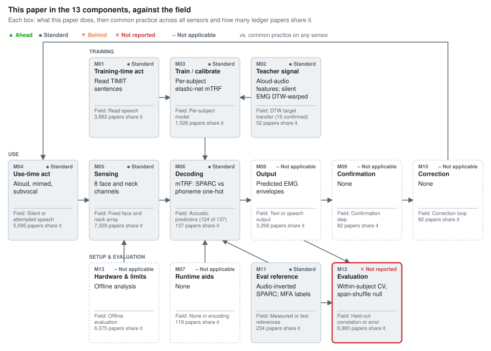

# Comparison of sEMG Encoding Accuracy Across Speech Modes Using Articulatory and Phoneme Features

Le, Li, Fumagalli, Esmaeili, Chen, Khalilian-Gourtani, He, Flinker, Wang. arXiv preprint, 2026. [arXiv:2604.18920](https://arxiv.org/abs/2604.18920)

**Section:** [Surface EMG](../../README.md#surface-emg)

## Figures

### This paper in the 13 components, against the field

<picture><source media="(prefers-color-scheme: dark)" srcset="figures/components-dark.svg"></picture>

Verdicts compare the paper's choice for each component with common practice across 8,995 ledger entries on any sensor (silent speech, brain-to-text, lip reading).

Data

| Component | This paper | Common practice | Papers with this practice | Verdict |
| --- | --- | --- | --- | --- |
| M01 Training-time act | Read TIMIT sentences | Read speech | 3,882 of 8,995 | ● Standard (Prompted sentences.) |
| M02 Teacher signal | Aloud-audio features; silent EMG DTW-warped | DTW target transfer (15 confirmed) | 52 of 8,995 | ● Standard (Warp not in the null.) |
| M03 Train / calibrate | Per-subject elastic-net mTRF | Per-subject model | 1,526 of 8,995 | ● Standard (Hyperparameters fixed across subjects.) |
| M04 Use-time act | Aloud, mimed, subvocal | Silent or attempted speech | 5,595 of 8,995 | ● Standard (Subvocal: occluded tract, no phonation.) |
| M05 Sensing | 8 face and neck channels | Fixed face and neck array | 7,329 of 8,995 | ● Standard (Links shown before [@lee2025].) |
| M06 Decoding | mTRF: SPARC vs phoneme one-hot | Acoustic predictors (124 of 137) | 137 of 8,995 | ● Standard (Same comparison on ECoG [@chartier2018].) |
| M07 Runtime aids | None | None in encoding | 119 of 8,995 | – Not applicable (Encoding study.) |
| M08 Output | Predicted EMG envelopes | Text or speech output | 3,268 of 8,995 | – Not applicable (No decoder.) |
| M09 Confirmation | None | Confirmation step | 82 of 8,995 | – Not applicable (Offline.) |
| M10 Correction | None | Correction loop | 82 of 8,995 | – Not applicable (Offline.) |
| M11 Eval reference | Audio-inverted SPARC; MFA labels | Measured or text references | 234 of 8,995 | ● Standard (No measured kinematics.) |
| M12 Evaluation | Within-subject CV, span-shuffle null | Held-out correlation or error | 6,960 of 8,995 | ✕ Not reported (Test split not stated: folds, seeds, sessions.) |
| M13 Hardware & limits | Offline analysis | Offline evaluation | 6,075 of 8,995 | – Not applicable (No device claim tested.) |

## Verdict

The paper [[1]](#ref-1) changes the predictor space of a forward sEMG encoding model (M06, articulatory SPARC features against phoneme one-hots) and how silent EMG gets its features (M02, from paired aloud audio after DTW warping); both are standard. Chartier et al. made the same comparison on ECoG with the same outcome [[2]](#ref-2), so the contribution is the signal and the three speech modes, not the method. The only tabulated effect is small: on single-subject Gaddy data SPARC gains 0.012 in mean r voiced and 0.018 mimed, 2.7% and 5.2% relative (inference), and the 24-participant results are plotted only. Mode contrasts are confounded by 12 silent against 14 aloud features (§II-B) and by a warp to the aloud trial; the authors concede only that the warp can inflate absolute correlations (§III-B). No decoder is trained, so the claim that articulatory targets are better SSI intermediates is untested. Evaluation is within subject, with folds, seeds and sessions unstated (M12).

## Against the field, component by component

### M06 Processing: articulatory versus phoneme predictors of sEMG

**Usual approach:** Of 137 encoding-model studies in the ledger (pattern match, unique studies; Appendix), acoustic predictors such as the speech envelope or spectrogram match 124 (upper bound), phoneme or phonetic features 41 and articulatory features 23; by the same Appendix tally the target is the only surface-EMG study among them.

**State of the art:** Chartier et al. (2018) fitted articulatory, phoneme and acoustic (formant) encoding models to ECoG of 5 participants; the articulatory model won on sentences from separate recording sessions (p<1e-20) [[2]](#ref-2). The target reaches the same ordering for sEMG with a weaker test.

Chartier et al. also inferred kinematics from the produced audio [[2]](#ref-2), so both results inherit an inversion model. In the decoding direction, Lee et al. predicted audio-inverted articulatory features from the 8-electrode Gaddy layout with correlation of about 0.9 for most features, on vocalized speech of one speaker [[3]](#ref-3). Two confounds limit "articulatory beats phoneme". A 12- or 14-dimensional smooth trajectory (silent or aloud) and a 40-dimensional one-hot step train differ in continuity, and a linear filter on a 50 Hz envelope favours the smoother predictor whatever its articulatory content (inference). In the variance partitioning the component both feature sets share dominates across electrodes (§III-A, Fig. 3), so the articulatory-only share is the smaller part. Verdict: standard.

### M02 Training-only supervision: aloud-derived features for silent EMG

**Usual approach:** Of 15 confirmed studies that train on silent signals with targets transferred from a paired vocalized recording (Appendix), two precede the target: one maps phoneme labels by linear length scaling, and one aligns the audible session data to silent EMG by DTW [[4]](#ref-4); later, DTW transfer became the default recipe on the Gaddy corpus. The paper does the same with Fast-DTW on z-scored EMG envelopes (radius 30).

**State of the art:** A decoder trained with DTW-transferred targets (2026) [concurrent] reaches 11.89% WER on silent Gaddy EMG [[5]](#ref-5); the target reports no decoding result.

The warped silent envelope is scored against features timed by the aloud audio, so a good warp raises silent correlations by construction. The authors' defence, one shared path per trial (§III-B), covers the within-mode SPARC-phoneme difference, not the claims that aloud and mimed encoding are comparably high or subvocal above chance: the null shuffles phoneme spans inside each warped utterance (§II-C) and leaves the warp in place (inference). Verdict: standard.

## The 13 components

| Component | This paper | Usual approach (count) | State of the art | Verdict |
|---|---|---|---|---|
| M01 Training-time action | Read TIMIT sentences | Read speech (slot-filled 3,882) | – | standard |
| M02 Training-only supervision | Aloud-audio features; silent EMG DTW-warped | DTW target transfer (15 confirmed) (pattern match 52) | 11.89% WER, silent EMG [concurrent] [[5]](#ref-5) | standard |
| M03 Training and adaptation | Per-subject elastic-net mTRF | Per-subject model (slot-filled 1,526) | – | standard |
| M04 Use-time action | Aloud, mimed, subvocal | Silent or attempted speech (slot-filled 5,595) | – | standard |
| M05 Sensors | 8 face and neck channels | Fixed face and neck array (slot-filled 7,329) | – | standard |
| M06 Processing and decoding | mTRF: SPARC vs phoneme one-hot | Acoustic predictors (124 of 137) (pattern match 137) | Articulatory beats phoneme on session-held-out ECoG [[2]](#ref-2) | standard |
| M07 Lexicon and LM | None | None in encoding (slot-filled 119) | – | not applicable |
| M08 Output | Predicted EMG envelopes | Text or speech output (slot-filled 3,268) | – | not applicable |
| M09 Confirmation | None | Confirmation step (slot-filled 82) | – | not applicable |
| M10 Correction | None | Correction loop (slot-filled 82) | – | not applicable |
| M11 Reference construction | Audio-inverted SPARC; MFA labels | Measured or text references (slot-filled 234) | – | standard |
| M12 Evaluation | Within-subject CV, span-shuffle null | Held-out correlation or error (slot-filled 6,960) | – | not reported |
| M13 Device and cost | Offline analysis | Offline evaluation (slot-filled 6,075) | – | not applicable |

## Where the claims outrun the evidence

- **Effect size.** "Nearly all electrodes" (Abstract) rests on main-cohort bars without values (Fig. 2); the tabulated Gaddy gains the authors call modest (§III-A).
- **Gaddy uncertainty.** The ± on single-subject Gaddy means is undefined, and 7 of 8 electrodes of one speaker (§III-A) carry no population claim.
- **Anatomy.** Weight maps are read as anatomically consistent while the formal test is deferred (§III-B); Lee et al. linked these electrodes to articulators earlier [[3]](#ref-3).
- **Downstream use.** Better SSI intermediates (§IV) is an encoding inference.

## What the field needs next

- M06: the same mTRF comparison against a smoothed phoneme or phonological-feature control.
- M02: a null that warps silent EMG to the aloud trial of another sentence.
- M12: session-held-out encoding tests, as in [[2]](#ref-2), and speaker-held-out tests.
- M06: an sEMG decoder trained to SPARC and to phonemes on mimed and subvocal speech, scored on text.

## Questions for the authors

- How many outer folds, of what size, and were repetitions of a sentence kept in one fold?
- Were repetitions recorded in one session, and did any test sentence come from an unseen session?
- Which seeds govern folds and permutations?
- Are z-scoring statistics per utterance, session or subject, from training folds only?
- What does ± denote for the Gaddy means, and which split was used?

## Appendix: literature search

- **M06 speech-feature-encoding-model** (new topic). Inclusion rule: forward encoding models from time-varying speech features to a recorded biosignal (EEG, MEG, ECoG, EMG, fMRI), evaluated on held-out data and classified by predictor space (acoustic, phonetic, articulatory); pure decoding, source-localisation forward models and acoustic-only inversion excluded; versions once. Ledger: 7,345 slot-filled; 137 pattern match (unique studies). Usual design: acoustic predictors 124 (pattern match, upper bound); phoneme or phonetic 41; articulatory 23; one surface-EMG study, the target. Read in full: [[2]](#ref-2) (prior; state of the art), [[3]](#ref-3) (prior). Known-item recall 0.5 (2 seeds; [[2]](#ref-2) found by citation).
- **M02 silent-target-transfer** (published table, reused unchanged). Inclusion rule: training on silently articulated non-acoustic signals with targets transferred from a separate vocalized recording of the same utterance by time alignment; vocalized-only training, scoring-only alignment, whisper or NAM conversion and imagined speech excluded; versions once. Ledger: 31 slot-filled; 52 pattern match (unique studies); 15 confirmed. The target is listed and excluded, as it trains no decoder. Read in full: [[4]](#ref-4) (prior), [[5]](#ref-5) (state of the art). Known-item recall 0.67.

## References

Numbered by first citation. BibTeX in the same order and keys: [refs.bib](refs.bib).

1. Le, C., Li, R., Fumagalli, B., Esmaeili, Y., Chen, X., Khalilian-Gourtani, A., et al. “Comparison of sEMG Encoding Accuracy Across Speech Modes Using Articulatory and Phoneme Features.” *arXiv preprint*, 2026. arXiv:[2604.18920](https://arxiv.org/abs/2604.18920). [review](https://github.com/supernaiter/silent-speech-review/tree/main/reviews/comparison-of-semg-encoding-accuracy-across-speech-modes-using-articulatory-and-phoneme-features) [wiki: arxiv-2604.18920](https://github.com/supernaiter/deep-research-wiki-for-silent-speech/blob/main/papers/arxiv-2604.18920/article.md)
2. Chartier, J., Anumanchipalli, G. K., Johnson, K., Chang, E. F. “Encoding of Articulatory Kinematic Trajectories in Human Speech Sensorimotor Cortex.” *Neuron*, 2018, 98(5), 1042–1054. doi:[10.1016/j.neuron.2018.04.031](https://doi.org/10.1016/j.neuron.2018.04.031). [wiki: pmc-5992088-articulkin](https://github.com/supernaiter/deep-research-wiki-for-silent-speech/blob/main/papers/pmc-5992088-articulkin/article.md)
3. Lee, J., Huang, K., Avramidis, K., Pistrosch, S., Gonzalez-Machorro, M., Lee, Y., et al. “Articulatory Feature Prediction from Surface EMG during Speech Production.” *Proc. Interspeech 2025*, 2025, 320–324. doi:[10.21437/Interspeech.2025-565](https://doi.org/10.21437/Interspeech.2025-565). arXiv:[2505.13814](https://arxiv.org/abs/2505.13814). [review](https://github.com/supernaiter/silent-speech-review/tree/main/reviews/articulatory-feature-prediction-from-surface-emg-during-speech-production) [wiki: isca-lee25d-semgartic](https://github.com/supernaiter/deep-research-wiki-for-silent-speech/blob/main/papers/isca-lee25d-semgartic/article.md) [wiki: arxiv-2505.13814](https://github.com/supernaiter/deep-research-wiki-for-silent-speech/blob/main/papers/arxiv-2505.13814/article.md) [wiki: isca-lee25d_interspeech](https://github.com/supernaiter/deep-research-wiki-for-silent-speech/blob/main/papers/isca-lee25d_interspeech/article.md)
4. Janke, M. “EMG-to-Speech: Direct Generation of Speech from Facial Electromyographic Signals.” *Dissertation, Karlsruhe Institute of Technology (KIT)*, 2016. <https://publikationen.bibliothek.kit.edu/1000054490> Related journal article: Janke and Diener, IEEE/ACM TASLP 25(12), 2017, doi:10.1109/TASLP.2017.2738568. [wiki: doi-10.1109-taslp-2017-2738568](https://github.com/supernaiter/deep-research-wiki-for-silent-speech/blob/main/papers/doi-10.1109-taslp-2017-2738568/article.md)
5. Lee, J., Lee, J., Lee, K. “GETS: Guiding EMG-to-Speech Synthesis via Silent Speech Recognition.” *Proc. Interspeech 2026*, 2026. doi:[10.21437/Interspeech.2026-1938](https://doi.org/10.21437/Interspeech.2026-1938). [concurrent] [wiki: isca-lee26r_interspeech](https://github.com/supernaiter/deep-research-wiki-for-silent-speech/blob/main/papers/isca-lee26r_interspeech/article.md)

## Materials

Data behind this review. Full texts of the papers are not included.

- [`review.md`](review.md): the review text (source)
- [`refs.bib`](refs.bib): references (BibTeX)
- [`slots.json`](slots.json): for each of the 13 components: this paper's choice, field practice, number of matching papers, verdict
- [`figures.json`](figures.json): figure definitions
- [`evaluation.md`](evaluation.md): independent evaluation by a second reviewer
- [`triage.md`](triage.md): how each evaluation finding was checked against the sources and resolved
- [`components/M02/silent-target-transfer.csv`](../../components/M02/silent-target-transfer.csv): M02 topic "silent-target-transfer", every candidate paper with its decision (31 slot-filled, 52 pattern match, usual design in 15, 4 read in full)
- [`components/M06/speech-feature-encoding-model.csv`](../../components/M06/speech-feature-encoding-model.csv): M06 topic "speech-feature-encoding-model", every candidate paper with its decision (7345 slot-filled, 137 pattern match, usual design in 124, 3 read in full)

## More reviews in Surface EMG

- [A 1000-hour EEG-EMG-audio dataset of Japanese speech production](../a-1000-hour-eeg-emg-audio-dataset-of-japanese-speech-production/) (2026). A 1020-hour EEG-EMG-audio dataset of Japanese overt speech from three participants, with signal-quality and physiological validation but no decoding benchmarks.
- [AESSI: An Around-Ear Silent Speech Interface for Cross-Day Online Reuse without Test-Day Calibration](../aessi-an-around-ear-silent-speech-interface-for-cross-day-online-reuse-without-test-day-calibrat/) (2026). Around-ear cEEGrid system recognizing 25 fixed Mandarin sentences from silent articulation without test-day calibration; 92.24% mean accuracy on held-out later-day sessions and 98.00% in 250 live trials 21+ days later.
- [Affect Decoding in Phonated and Silent Speech Production from Surface EMG](../affect-decoding-in-phonated-and-silent-speech-production-from-surface-emg/) (2026). Affect decoded from silent-articulation EMG, a design absent from 99 ledger studies (M08, ahead); it works within subject, nears chance across speakers, and is not separated from facial expression.
- [Cross-Modal Masking for Robust Silent Speech Synthesis Using sEMG and Lipreading](../cross-modal-masking-for-robust-silent-speech-synthesis-using-semg-and-lipreading/) (2026). Silent speech synthesis fusing sEMG and lipreading with cross-modal masked training, improving performance and robustness to modality degradation over monomodal baselines.
- [CS-ETS: Chaos-Inspired Samba-Based EMG-To-Speech Synthesis with Nonlinear Chaotic Losses](../cs-ets-chaos-inspired-samba-based-emg-to-speech-synthesis-with-nonlinear-chaotic-losses/) (2026). Smaller chaos-inspired Samba-based EMG-to-speech model with nonlinear losses; WER improves modestly from 42.20% to 41.26% while parameters drop from 54.10M to 32.03M.
- [EMG-to-Speech with Fewer Channels](../emg-to-speech-with-fewer-channels/) (2026). Halving EMG electrodes costs synthesis the same ~35% relative WER known from recognition; initialization helps, channel dropout does not, and a weak unrepeated baseline undercuts the ranking.

---

Part of the [Silent Speech Interface Review](https://github.com/supernaiter/silent-speech-review). Found an error? [Open an issue](https://github.com/supernaiter/silent-speech-review/issues/new?template=correction.yml).
