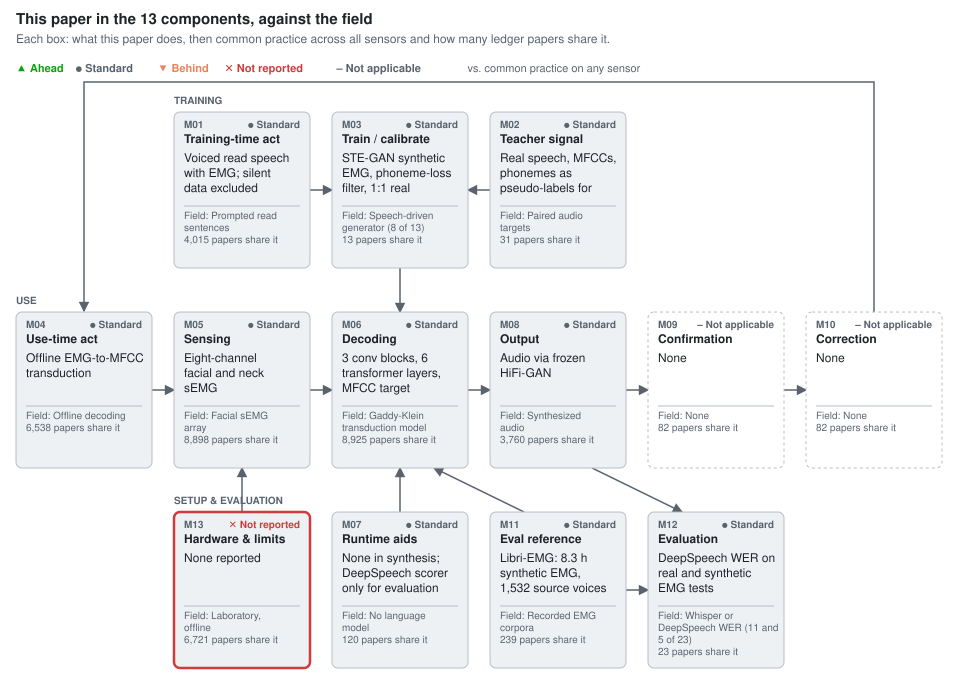

# Confidence-Based Self-Training for EMG-to-Speech: Leveraging Synthetic EMG for Robust Modeling

Xiaodan Chen, Xiaoxue Gao, Mathias Quoy, Alexandre Pitti, Nancy F. Chen. arXiv preprint (cs.SD), 2025. [arXiv:2506.11862](https://arxiv.org/abs/2506.11862)

**Section:** [Surface EMG](../../README.md#surface-emg)

## Figures

### This paper in the 13 components, against the field

<picture><source media="(prefers-color-scheme: dark)" srcset="figures/components-dark.svg"></picture>

Verdicts compare the paper's choice for each component with common practice across 8,995 ledger entries on any sensor (silent speech, brain-to-text, lip reading).

Data

| Component | This paper | Common practice | Papers with this practice | Verdict |
| --- | --- | --- | --- | --- |
| M01 Training-time act | Voiced read speech with EMG; silent data excluded | Prompted read sentences | 4,015 of 8,995 | ● Standard (Silent EMG excluded (§IV).) |
| M02 Teacher signal | Real speech, MFCCs, phonemes as pseudo-labels for generated EMG | Paired audio targets | 31 of 8,995 | ● Standard (Inherited from the generator lineage.) |
| M03 Train / calibrate | STE-GAN synthetic EMG, phoneme-loss filter, 1:1 real mix by utterance count | Speech-driven generator (8 of 13) | 13 of 8,995 | ● Standard (Real-test gain 6.1% relative (inference).) |
| M04 Use-time act | Offline EMG-to-MFCC transduction | Offline decoding | 6,538 of 8,995 | ● Standard (Filtering is training-time only.) |
| M05 Sensing | Eight-channel facial and neck sEMG | Facial sEMG array | 8,898 of 8,995 | ● Standard (Gaddy and Klein setup.) |
| M06 Decoding | 3 conv blocks, 6 transformer layers, MFCC target | Gaddy-Klein transduction model | 8,925 of 8,995 | ● Standard (Inherited.) |
| M07 Runtime aids | None in synthesis; DeepSpeech scorer only for evaluation | No language model | 120 of 8,995 | ● Standard (Inherited.) |
| M08 Output | Audio via frozen HiFi-GAN | Synthesized audio | 3,760 of 8,995 | ● Standard (Inherited.) |
| M09 Confirmation | None | None | 82 of 8,995 | – Not applicable (Offline study.) |
| M10 Correction | None | None | 82 of 8,995 | – Not applicable (Offline study.) |
| M11 Eval reference | Libri-EMG: 8.3 h synthetic EMG, 1,532 source voices | Recorded EMG corpora | 239 of 8,995 | ● Standard (Synthetic corpus counted under M03; real EMG from one speaker.) |
| M12 Evaluation | DeepSpeech WER on real and synthetic EMG tests | Whisper or DeepSpeech WER (11 and 5 of 23) | 23 of 8,995 | ● Standard (Headline gains on synthetic test EMG; real baseline 23.30% is a reported value.) |
| M13 Hardware & limits | None reported | Laboratory, offline | 6,721 of 8,995 | ✕ Not reported (Clinical use motivated, not evaluated.) |

## Verdict

The paper [[1]](#ref-1) changes one component, training data (M03): EMG generated from LibriSpeech audio by a speech-to-EMG generator [[2]](#ref-2), filtered by phoneme loss and mixed 1:1 by utterance count with real voiced EMG (Table III). That design is standard: a speech-driven generator of the input signal is the usual approach among the 13 ledger studies on synthetic training signals (Appendix), and lip reading scaled it to 3,652 hours two years earlier [[3]](#ref-3). The benefit on real EMG is small: 23.30% to 21.87% WER on the one-speaker voiced test, 1.43 points or 6.1% relative (inference), from single values with no spread (§IV-B, Tables III and IV). The main confound: 23.30% is the value reported by earlier work (§IV-C.1, Table IV), not stated as re-run with the paper's scorer. The large gains, 37.63% to 8.75%, are measured on synthetic EMG from the same generator, so they show agreement with the generator, not robustness. Speaker independence, silent EMG and clinical use are untested.

## Against the field, component by component

### M03 Training: synthetic EMG as training data

**Usual approach:** Of 13 unique studies that train or propose training a speech decoder on generated non-acoustic signals (pattern match, Appendix), 8 drive the generator from speech or audio, 7 use a GAN and 5 mention filtering or selection of synthetic samples. The paper is the only EMG decoder among them (Appendix); its generator paper had already proposed this use [[2]](#ref-2). The departures are the phoneme-loss filter and the mix ratio.

**State of the art:** In lip reading (2023), 3,652 hours of speech-driven synthetic video added to 438 hours of real data lowered WER on the real LRS3 test from 36.7% to 27.9% [[3]](#ref-3), 24.0% relative (inference); synthetic video alone gave 100.3%. That gain was measured on real test data. The paper's real-data gain is 6.1% relative (inference), from equal real and synthetic utterance counts (up to 5×1300, about 16 hours, Table III); starting points differ, so the gap alone proves little.

The filter is the paper's own step: the 0.5-hour subset below phoneme loss 0.5 reaches 29.36% WER on the raw synthetic test, against 42.75% for the 5.0-hour subset below 0.8 (§IV-A). The generator paper scored its output with an EMG encoder trained on real EMG (82.65% phoneme accuracy, 10.29% round-trip WER) [[2]](#ref-2); selecting by that criterion keeps samples generator and classifier already agree on, and every filter result is measured on synthetic tests (inference). Verdict: standard.

### M12 Evaluation: synthetic test sets

**Usual approach:** Of 23 unique studies on speech synthesized from voiced EMG (pattern match, Appendix), 11 score WER with Whisper and 5 with DeepSpeech; 3 test on synthetic data. The pattern misses the Gaddy papers and the generator paper (known-item recall 0.0, Appendix), so no scorer is a settled default; the generator paper uses Whisper [[2]](#ref-2), the paper DeepSpeech 0.7.0 with an external scorer (repository README).

**State of the art:** The best later result in the set (2026, Appendix) is on the harder silent condition: 19.77% WER with Whisper-medium [[4]](#ref-4), below the paper's voiced 21.87% with DeepSpeech; ASR and condition differ, so this is a loose bound (inference).

The multi-speaker headline numbers (15.90% self-training, 8.75% from scratch, Table IV) are on synthetic test EMG; the released loader splits utterances without grouping by speaker (read_emg_sheldan.py), and the 1,532 Libri-EMG speakers are source voices, not EMG users. Verdict: standard, with the headline on a synthetic test.

## The 13 components

| Component | This paper | Usual approach (count) | State of the art | Verdict |
|---|---|---|---|---|
| M01 Training-time action | Voiced read speech with EMG; silent data excluded | Prompted read sentences (slot-filled 4,015) | – | standard |
| M02 Training-only supervision | Real speech, MFCCs, phonemes as pseudo-labels for generated EMG | Paired audio targets (slot-filled 31) | – | standard |
| M03 Training and adaptation | STE-GAN synthetic EMG, phoneme-loss filter, 1:1 real mix by utterance count | Speech-driven generator (8 of 13) (pattern match 13) | LRS3 WER 36.7% to 27.9% with synthetic video [[3]](#ref-3) | standard |
| M04 Use-time action | Offline EMG-to-MFCC transduction | Offline decoding (slot-filled 6,538) | – | standard |
| M05 Sensors | Eight-channel facial and neck sEMG | Facial sEMG array (slot-filled 8,898) | – | standard |
| M06 Processing and decoding | 3 conv blocks, 6 transformer layers, MFCC target | Gaddy-Klein transduction model (slot-filled 8,925) | – | standard |
| M07 Lexicon and LM | None in synthesis; DeepSpeech scorer only for evaluation | No language model (slot-filled 120) | – | standard |
| M08 Output | Audio via frozen HiFi-GAN | Synthesized audio (slot-filled 3,760) | – | standard |
| M09 Confirmation | None | None (slot-filled 82) | – | not applicable |
| M10 Correction | None | None (slot-filled 82) | – | not applicable |
| M11 Reference construction | Libri-EMG: 8.3 h synthetic EMG, 1,532 source voices | Recorded EMG corpora (slot-filled 239) | – | standard |
| M12 Evaluation | DeepSpeech WER on real and synthetic EMG tests | Whisper or DeepSpeech WER (11 and 5 of 23) (pattern match 23) | Silent-EMG WER 19.77% [[4]](#ref-4) [later] | standard |
| M13 Device and cost | None reported | Laboratory, offline (slot-filled 6,721) | – | not reported |

## Where the claims outrun the evidence

- "Robust" and "speaker-independent" (§IV-C.2) rest on synthetic test EMG. Real EMG comes from one male speaker; the authors state that the generator does not distinguish speakers at the voice level (§II-A).
- The mix-ratio test set has 99 real and 99 synthetic utterances (§IV-B), so the 18.03% WER at 16 hours (Table III) mixes conditions whose levels differ by more than a factor of two (21.87% against 8.75%, Table IV).
- The 15.1% relative human-WER reduction (§IV-D.1) does not follow from Table V: 27.35% to 23.58% is 13.8% (inference).
- MOS rises from 3.00 to 3.25 on real data, ten raters, no intervals (Table VI); the authors concede a vocoder bias (§IV-D.2).
- Self-training is called largely unexplored in EMG-to-speech, yet §I cites a prior study of self-learning and active-learning for EMG-to-speech (their ref. 12).

## What the field needs next

- M03: real-only test, several seeds, with the synthetic share varied at fixed real hours, as in lip reading [[3]](#ref-3).
- M12: silent-EMG WER on the standard split, scored with Whisper as in later work [[4]](#ref-4).
- M11: real EMG from new speakers, to test speaker independence.

## Questions for the authors

- How many real utterances are in the Table IV single-speaker test, and is it the split of the prior 23.30% result?
- What seeds and how many runs underlie Tables III and IV?
- Are the Libri-EMG test speakers disjoint from the training speakers?
- Which data set the phoneme-loss threshold?
- Which LibriSpeech pool gave the 8.3 hours of Libri-EMG, when the same threshold kept 0.5 of 5.4 dev-clean hours (Table I)?

## Appendix: literature search

**M03 synthetic-biosignal-training-data.** Inclusion rule: speech or language decoders from a non-acoustic speech signal (EMG, EEG, ECoG, ultrasound, articulography, MRI, lip or face video) trained on input signals generated by a model, alone or mixed with real recordings; signal-level augmentation and synthetic target speech (M02) excluded; generators not used to train a decoder are pattern matches only. Ledger: 1,526 slot-filled unique studies; 13 pattern match (unique studies). Usual design: speech- or audio-driven generator, 8 of 13 (pattern match); GAN 7, text-driven 5, synthetic-sample filtering 5, diffusion 2, real-synthetic mix ratio 2. Read in full: [[3]](#ref-3), [[2]](#ref-2). Known-item recall 1.0 (4 seeds).

**M12 voiced-emg-to-speech-benchmark.** Inclusion rule: speech synthesized from vocalized surface EMG with a WER of the synthesized speech; silent-only results and recognition-only studies excluded; synthetic tests recorded as a design value. Ledger: 6,960 slot-filled unique studies; 23 pattern match (unique studies). Usual design: Whisper-scored WER, 11 of 23 (pattern match); DeepSpeech 5, synthetic test data 3, listener transcription 1. Read in full: [[4]](#ref-4), [[2]](#ref-2). Known-item recall 0.0 (3 seeds: the Gaddy papers and the generator paper do not match the ledger pattern for voiced WER).

## References

Numbered by first citation. BibTeX in the same order and keys: [refs.bib](refs.bib).

1. Chen, X., Gao, X., Quoy, M., Pitti, A., Chen, N. F. “Confidence-Based Self-Training for EMG-to-Speech: Leveraging Synthetic EMG for Robust Modeling.” *arXiv preprint (cs.SD)*, 2025. arXiv:[2506.11862](https://arxiv.org/abs/2506.11862). Target. Read as arXiv v2. [review](https://github.com/supernaiter/silent-speech-review/tree/main/reviews/confidence-based-self-training-for-emg-to-speech-leveraging-synthetic-emg-for-robust-modeling) [wiki: arxiv-2506.11862](https://github.com/supernaiter/deep-research-wiki-for-silent-speech/blob/main/papers/arxiv-2506.11862/article.md)
2. Scheck, K., Schultz, T. “STE-GAN: Speech-to-Electromyography Signal Conversion using Generative Adversarial Networks.” *Proc. Interspeech 2023*, 2023, 1174-1178. doi:[10.21437/Interspeech.2023-174](https://doi.org/10.21437/Interspeech.2023-174). [wiki: isca-scheck23_interspeech](https://github.com/supernaiter/deep-research-wiki-for-silent-speech/blob/main/papers/isca-scheck23_interspeech/article.md)
3. Liu, X., Lakomkin, E., Vougioukas, K., Ma, P., Chen, H., Xie, R., et al. “SynthVSR: Scaling Up Visual Speech Recognition With Synthetic Supervision.” *Proc. IEEE/CVF Conference on Computer Vision and Pattern Recognition (CVPR)*, 2023. doi:[10.1109/CVPR52729.2023.01806](https://doi.org/10.1109/CVPR52729.2023.01806). arXiv:[2303.17200](https://arxiv.org/abs/2303.17200). [wiki: arxiv-2303.17200](https://github.com/supernaiter/deep-research-wiki-for-silent-speech/blob/main/papers/arxiv-2303.17200/article.md) [wiki: cvf23-liu_synthvsr](https://github.com/supernaiter/deep-research-wiki-for-silent-speech/blob/main/papers/cvf23-liu_synthvsr/article.md)
4. Han, D., Hwang, I., Lee, J., Lee, J., Lee, K. “TAP-ETS: Time Aligned Phoneme Guiding for EMG-to-Speech Synthesis.” *Proc. Interspeech 2026*, 2026, 3610-3614. doi:[10.21437/Interspeech.2026-3485](https://doi.org/10.21437/Interspeech.2026-3485). [later] [wiki: isca-han26f-tapets](https://github.com/supernaiter/deep-research-wiki-for-silent-speech/blob/main/papers/isca-han26f-tapets/article.md)

## Materials

Data behind this review. Full texts of the papers are not included.

- [`review.md`](review.md): the review text (source)
- [`refs.bib`](refs.bib): references (BibTeX)
- [`slots.json`](slots.json): for each of the 13 components: this paper's choice, field practice, number of matching papers, verdict
- [`figures.json`](figures.json): figure definitions
- [`evaluation.md`](evaluation.md): independent evaluation by a second reviewer
- [`triage.md`](triage.md): how each evaluation finding was checked against the sources and resolved
- [`components/M03/synthetic-biosignal-training-data.csv`](../../components/M03/synthetic-biosignal-training-data.csv): M03 topic "synthetic-biosignal-training-data", every candidate paper with its decision (1526 slot-filled, 13 pattern match, usual design in 8, 3 read in full)
- [`components/M12/voiced-emg-to-speech-benchmark.csv`](../../components/M12/voiced-emg-to-speech-benchmark.csv): M12 topic "voiced-emg-to-speech-benchmark", every candidate paper with its decision (6960 slot-filled, 23 pattern match, usual design in 11, 3 read in full)

## More reviews in Surface EMG

- [A Parallel Ultra-Low Power Silent Speech Interface based on a Wearable, Fully-dry EMG Neckband](../a-parallel-ultra-low-power-silent-speech-interface-based-on-a-wearable-fully-dry-emg-neckband/) (2025). A fully dry wearable EMG neckband with ultra-low-power BioGAP-Ultra classifies 8 silently articulated words for one healthy user at 68% accuracy, dropping to 54% on an unseen re-wearing session; acquisition plus BLE uses 22.2 mW.
- [A Silent Speech Decoding System from EEG and EMG with Heterogenous Electrode Configurations](../a-silent-speech-decoding-system-from-eeg-and-emg-with-heterogenous-electrode-configurations/) (2025). Pooled EEG/EMG pretraining lifts 64-word accuracy, but each test subject's training sessions, the patient's included, are in pretraining; the coordinate kernel is neither new nor best.
- [Articulatory Feature Prediction from Surface EMG during Speech Production](../articulatory-feature-prediction-from-surface-emg-during-speech-production/) (2025). Articulatory route works on vocalized EMG but trails the mel baseline on WER; it exists for ECoG since 2019, and the electrode subset is never tested against equal-size alternatives.
- [CAT-Net: A Cross-Attention Tone Network for Cross-Subject EEG-EMG Fusion Tone Decoding](../cat-net-a-cross-attention-tone-network-for-cross-subject-eeg-emg-fusion-tone-decoding/) (2025). CAT-Net fuses EEG and surface EMG with cross-attention to classify Mandarin lexical tones in silent articulation, reporting 85.10% leave-one-subject-out accuracy over 4 tones.
- [emg2speech: Synthesizing speech from electromyography using self-supervised speech models](../emg2speech-synthesizing-speech-from-electromyography-using-self-supervised-speech-models/) (2025). Ports a 2023 ECoG recipe (text-to-speech HuBERT units, CTC) to EMG; phoneme guidance (M02) and covariance input (M06) are standard. Table 6 mixes listener and decoder scoring, so it ranks no route.
- [From Silent Signals to Natural Language: A Dual-Stage Transformer-LLM Approach](../from-silent-signals-to-natural-language-a-dual-stage-transformer-llm-approach/) (2025). GPT-2 correction of one ASR transcript is neither first nor near the field: LLM correction of silent-EMG hypotheses already reached 12.2% WER on this benchmark; here 30% on ~100 utterances, one run.

---

Part of the [Silent Speech Interface Review](https://github.com/supernaiter/silent-speech-review). Found an error? [Open an issue](https://github.com/supernaiter/silent-speech-review/issues/new?template=correction.yml).
