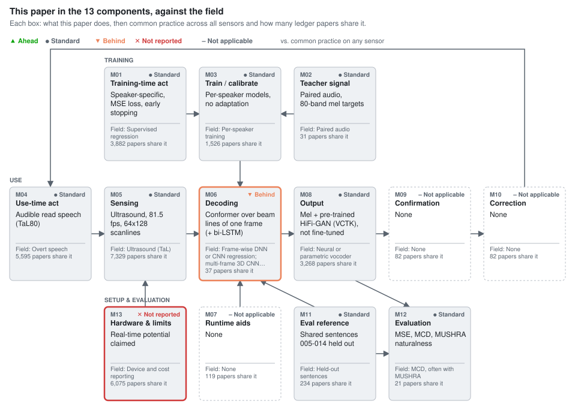

# Conformer-based Ultrasound-to-Speech Conversion

Ibrahimov, I., Zainkó, C., Gosztolya, G. · Interspeech 2025 · 2025 · [doi:10.21437/Interspeech.2025-2147](https://doi.org/10.21437/Interspeech.2025-2147) · [arXiv:2506.03831](https://arxiv.org/abs/2506.03831)

**Section:** [Ultrasound & tongue imaging](../../README.md#ultrasound--tongue-imaging)

## Figures

### This paper in the 13 components, against the field

<picture><source media="(prefers-color-scheme: dark)" srcset="figures/components-dark.svg"></picture>

Verdicts compare the paper's choice for each component with common practice across 8,995 ledger entries on any sensor (silent speech, brain-to-text, lip reading).

Data

| Component | This paper | Common practice | Papers with this practice | Verdict |
| --- | --- | --- | --- | --- |
| M01 Training-time act | Speaker-specific, MSE loss, early stopping | Supervised regression | 3,882 of 8,995 | ● Standard (No seeds or repeated runs.) |
| M02 Teacher signal | Paired audio, 80-band mel targets | Paired audio | 31 of 8,995 | ● Standard (Audible speech supplies the targets.) |
| M03 Train / calibrate | Per-speaker models, no adaptation | Per-speaker training | 1,526 of 8,995 | ● Standard (No unseen speaker.) |
| M04 Use-time act | Audible read speech (TaL80) | Overt speech | 5,595 of 8,995 | ● Standard (Silent articulation not tested.) |
| M05 Sensing | Ultrasound, 81.5 fps, 64x128 scanlines | Ultrasound (TaL) | 7,329 of 8,995 | ● Standard (Four TaL80 speakers.) |
| M06 Decoding | Conformer over beam lines of one frame (+ bi-LSTM) | Frame-wise DNN or CNN regression; multi-frame 3D CNN since 2020 | 37 of 8,995 | ▼ Behind (Single-frame; Base MCD higher for all 4 speakers, significantly for 3.) |
| M07 Runtime aids | None | None | 119 of 8,995 | – Not applicable (Direct synthesis.) |
| M08 Output | Mel + pre-trained HiFi-GAN (VCTK), not fine-tuned | Neural or parametric vocoder | 3,268 of 8,995 | ● Standard (Vocoder not adapted to the speakers.) |
| M09 Confirmation | None | None | 82 of 8,995 | – Not applicable (Offline study.) |
| M10 Correction | None | None | 82 of 8,995 | – Not applicable (Offline study.) |
| M11 Eval reference | Shared sentences 005-014 held out | Held-out sentences | 234 of 8,995 | ● Standard (Same speakers in train and test.) |
| M12 Evaluation | MSE, MCD, MUSHRA naturalness | MCD, often with MUSHRA | 21 of 8,995 | ● Standard (No intelligibility measure; MUSHRA in 14.) |
| M13 Hardware & limits | Real-time potential claimed | Device and cost reporting | 6,075 of 8,995 | ✕ Not reported (No latency or throughput.) |

## Verdict

The paper [[1]](#ref-1) changes one component, the ultrasound-to-mel network (M06), replacing a single-frame 2D-CNN with a Conformer, alone or with bi-LSTM. The Conformer is new to ultrasound-to-speech (0 prior studies among 51, Appendix), but both variants attend over the 64 beam lines of one frame, while 8 prior studies fed several frames to 3D-CNN or ConvLSTM mappers; on another single-speaker corpus this lowered test MSE from 0.366 to 0.315 against a 2D CNN [[2]](#ref-2). M06 is behind on the paper's own evidence: the only baseline is the single-frame design, and neither Conformer beats it on MSE or MCD. As context only, a later re-implementation on one TaL1 speaker, a different setup from the four TaL80 speakers here, scores 99.26% WER where a 3D front end with a Transformer reaches 15.93% [[3]](#ref-3) [later]. Evaluation (M12) is the usual MCD with MUSHRA; the one positive result, naturalness 32 against 28, says nothing about intelligibility. The abstract understates significant degradations that the results report, and "fewer parameters" is false for the preferred model.

## Against the field, component by component

### M06 Processing: ultrasound-to-mel network

**Usual approach:** frame-wise regression from ultrasound frames to vocoder or mel features by a fully connected DNN (37 of 51 studies) or a CNN (31) (pattern match; Appendix); since 2020 stronger systems feed several frames to a 3D CNN or ConvLSTM (8 prior studies), as in [[2]](#ref-2). Here the baseline is single-frame and the Conformer's sequence is one frame's beam lines (Sec. 3.3), which the bi-LSTM variant keeps (Sec. 3.4).

**State of the art:** in 2026, 15.93% WER (ASR on synthesized speech) on one TaL1 speaker with a 3D front end and a multi-layer Transformer [[3]](#ref-3) [later]; there a re-implemented Conformer-U2S gives 99.26%, and 2D-CNN+BiLSTM 60.29% against 36.46% for 3D-CNN+BiLSTM. At publication the comparable reference was a multi-frame mapper such as the 2020 3D CNN; the paper cites CNN+LSTM work (Sec. 1) but tests none.

Against the 2D-CNN, Conformer Base has higher MCD for all four speakers, significantly for 01fi, 03mn and 04me (p = 0.001 each; 03mn: 4.133 against 3.641 dB, 13.5% relative (inference)), and higher MSE for 03mn (p = 0.026); the bi-LSTM variant also has higher MCD for all four, significantly for 04me (p = 0.002) (Tables 1-2). In [[2]](#ref-2), with vocoder targets on one speaker, several frames instead of one lowered test MSE from 0.366 to 0.315, 13.9% relative (inference), and the later study finds the same in WER: inter-frame context matters, and neither Conformer has it. The nearest prior "transformer" design is a spatial transformer network, an affine input warp, not attention [[4]](#ref-4). The later study re-implemented the model, reporting no public code although the paper gives a Zenodo link (Sec. 5); its 99.26% is one failed reproduction in another setup. Verdict: behind (best comparable work: multi-frame mappers since 2020).

### M12 Evaluation: spectral distance and naturalness only

**Usual approach:** MCD (21 of 51 studies), often with MUSHRA naturalness (14) (pattern match; Appendix); listener transcription in 5, ASR on the output in 3. The paper follows it and measures no intelligibility.

**State of the art:** in 2026, ASR WER on synthesized speech, 15.93% for one TaL1 speaker and 31.64% with all 81 TaL80 speakers pooled [[3]](#ref-3) [later], arguing spectral distortion is a weak indicator of lexical accuracy. Listener transcription tests were in use by 2016 [[5]](#ref-5).

Listeners prefer the bi-LSTM variant (p = 0.037) although its MCD is higher for all four speakers, significantly for 04me; Sec. 5 concedes the discrepancy. The 4-point gain, 14% relative (inference), sits at 28-32 where natural speech scores 96. MCD does not carry across papers even within this group: on the same four speakers [[6]](#ref-6) reported a baseline mean of 2.148 dB with a custom implementation, against 3.009-3.641 dB here. Verdict: standard; the yardstick now is intelligibility, on which the paper is silent.

## The 13 components

| Component | This paper | Usual approach (count) | State of the art | Verdict |
|---|---|---|---|---|
| M01 Training-time action | Speaker-specific, MSE loss, early stopping | Supervised regression (slot-filled 3,882) | – | standard |
| M02 Training-only supervision | Paired audio, 80-band mel targets | Paired audio (slot-filled 31) | – | standard |
| M03 Training and adaptation | Per-speaker models, no adaptation | Per-speaker training (slot-filled 1,526) | – | standard |
| M04 Use-time action | Audible read speech (TaL80) | Overt speech (slot-filled 5,595) | – | standard |
| M05 Sensors | Ultrasound, 81.5 fps, 64x128 scanlines | Ultrasound (TaL) (slot-filled 7,329) | – | standard |
| M06 Processing and decoding | Conformer over beam lines of one frame (+ bi-LSTM) | Frame-wise DNN or CNN regression; multi-frame 3D CNN since 2020 (pattern match 37) | 15.93% WER, 3D CNN + Transformer, 2026 [[3]](#ref-3) [later] | behind |
| M07 Lexicon and LM | None | None (slot-filled 119) | – | not applicable |
| M08 Output | Mel + pre-trained HiFi-GAN (VCTK), not fine-tuned | Neural or parametric vocoder (slot-filled 3,268) | – | standard |
| M09 Confirmation | None | None (slot-filled 82) | – | not applicable |
| M10 Correction | None | None (slot-filled 82) | – | not applicable |
| M11 Reference construction | Shared sentences 005-014 held out | Held-out sentences (slot-filled 234) | – | standard |
| M12 Evaluation | MSE, MCD, MUSHRA naturalness | MCD, often with MUSHRA (pattern match 21) | 31.64% WER on TaL80, 2026 [[3]](#ref-3) [later] | standard |
| M13 Device and cost | Real-time potential claimed | Device and cost reporting (slot-filled 6,075) | – | not reported |

## Where the claims outrun the evidence

- The abstract reports no significant objective improvement; Tables 1-2 and Sec. 4.2-4.3 show significant degradations (Base: MSE 03mn, MCD 01fi, 03mn, 04me; bi-LSTM: MCD 04me). "Matched the performance of the baseline" (Abstract) holds for MUSHRA only.
- "Fewer parameters" (Sec. 5): the bi-LSTM model has 5.35M against 4.09M (Sec. 3.2, 3.4).
- "Better real-time potential" (Sec. 5) rests on training time; no inference latency is reported.
- MCD and MUSHRA p-values (Sec. 4.3, 4.4) lack the test, unit and correction across speakers, models and metrics.
- Audible speech of four seen speakers only (Sec. 2): nothing on silent articulation or new users.

## What the field needs next

- M06: the Conformer over consecutive frames in time, against a 3D-CNN baseline [[2]](#ref-2).
- M12: intelligibility by listener transcription or ASR next to MCD, as in [[3]](#ref-3) [later].
- M01: repeated seeds per speaker to separate a 4-point MUSHRA gap from run variance.
- M13: inference latency per frame on stated hardware.

## Questions for the authors

- How many runs and seeds stand behind each table entry?
- Which test, unit and correction give the MCD and MUSHRA p-values?
- How are the mel targets normalized?
- Which sentences form each speaker's training and development sets?

## Appendix: literature search

- M06 ultrasound-to-speech-network-architecture (new topic table). Inclusion rule: studies that map ultrasound tongue images (with or without lip video) to acoustic features or a waveform with a trained network and name the mapping architecture; recognition without synthesis, contour tracking, ultrasound prediction from other signals and reviews excluded; spatial transformer networks counted as CNNs; versions counted once. Slot-filled 7,345 unique studies; pattern match 51 unique studies. Full-text pattern counts: fully connected DNN 37, CNN 31, recurrent 25, 3D CNN 19, transformer 9 (prior hits are spatial transformer networks [[4]](#ref-4) or future-work mentions), conformer 3 (the target and two later works; 0 prior). Prior studies with a multi-frame mapper (3D CNN or ConvLSTM): 8. Usual design: frame-wise DNN (37) or CNN (31) regression (pattern match). State of the art: [[3]](#ref-3) [later], 15.93% WER. Read in full: [[2]](#ref-2), [[3]](#ref-3) [later], target. Known-item recall 1.0 (3 of 3 seeds).
- M12 ultrasound-to-speech-output-evaluation (new topic table). Inclusion rule: studies that synthesize speech or acoustic features from ultrasound tongue images and evaluate the output, classified by measure (MCD, MUSHRA or MOS, listener transcription, ASR on the output); recognition-only studies, contour tracking and reviews excluded; versions counted once. Slot-filled 6,960 unique studies; pattern match 51 unique studies. Full-text pattern counts: MCD 21, MUSHRA 14, listener intelligibility 5, MOS 4, ASR on output 3. Usual design: MCD, 21, often with MUSHRA, 14 (pattern match). State of the art: [[3]](#ref-3) [later], 31.64% WER on TaL80. Read in full: [[5]](#ref-5), [[6]](#ref-6), [[3]](#ref-3) [later], target.

## References

Numbered by first citation. BibTeX in the same order and keys: [refs.bib](refs.bib).

1. Ibrahimov, I., Zainkó, C., Gosztolya, G. “Conformer-based Ultrasound-to-Speech Conversion.” *Proc. Interspeech 2025*, 2025, 5578–5582. doi:[10.21437/Interspeech.2025-2147](https://doi.org/10.21437/Interspeech.2025-2147). arXiv:[2506.03831](https://arxiv.org/abs/2506.03831). Target. Read as arXiv v1. [review](https://github.com/supernaiter/silent-speech-review/tree/main/reviews/conformer-based-ultrasound-to-speech-conversion) [wiki: arxiv-2506.03831](https://github.com/supernaiter/deep-research-wiki-for-silent-speech/blob/main/papers/arxiv-2506.03831/article.md) [wiki: isca-ibrahimov25-usconformer](https://github.com/supernaiter/deep-research-wiki-for-silent-speech/blob/main/papers/isca-ibrahimov25-usconformer/article.md) [wiki: isca-ibrahimov25_interspeech](https://github.com/supernaiter/deep-research-wiki-for-silent-speech/blob/main/papers/isca-ibrahimov25_interspeech/article.md)
2. Tóth, L., Shandiz, A. H. “3D Convolutional Neural Networks for Ultrasound-Based Silent Speech Interfaces.” *Artificial Intelligence and Soft Computing (ICAISC 2020), Lecture Notes in Computer Science 12415*, 2020, 159–169. doi:[10.1007/978-3-030-61401-0_16](https://doi.org/10.1007/978-3-030-61401-0_16). arXiv:[2104.11532](https://arxiv.org/abs/2104.11532). [review](https://github.com/supernaiter/silent-speech-review/tree/main/reviews/3d-convolutional-neural-networks-for-ultrasound-based-silent-speech-interfaces) [wiki: arxiv-2104.11532](https://github.com/supernaiter/deep-research-wiki-for-silent-speech/blob/main/papers/arxiv-2104.11532/article.md)
3. Sonkar, Y., Kilaru, Y., Yelimeli, S., Shah, N., Gandhi, V. “Tongue2Speech: Real-Time Speech Synthesis from Tongue Ultrasound Videos via Spatiotemporal Transformers.” *Proc. Interspeech 2026*, 2026, 6856–6860. doi:[10.21437/Interspeech.2026-3023](https://doi.org/10.21437/Interspeech.2026-3023). [later] [wiki: isca-sonkar26_interspeech](https://github.com/supernaiter/deep-research-wiki-for-silent-speech/blob/main/papers/isca-sonkar26_interspeech/article.md)
4. Tóth, L., Shandiz, A. H., Gosztolya, G., Csapó, T. G. “Adaptation of Tongue Ultrasound-Based Silent Speech Interfaces Using Spatial Transformer Networks.” *Proc. Interspeech 2023*, 2023. doi:[10.21437/Interspeech.2023-1607](https://doi.org/10.21437/Interspeech.2023-1607). arXiv:[2305.19130](https://arxiv.org/abs/2305.19130). [review](https://github.com/supernaiter/silent-speech-review/tree/main/reviews/adaptation-of-tongue-ultrasound-based-silent-speech-interfaces-using-spatial-transformer-networks) [wiki: arxiv-2305.19130](https://github.com/supernaiter/deep-research-wiki-for-silent-speech/blob/main/papers/arxiv-2305.19130/article.md) [wiki: isca-toth23_interspeech](https://github.com/supernaiter/deep-research-wiki-for-silent-speech/blob/main/papers/isca-toth23_interspeech/article.md)
5. Hueber, T., Bailly, G. “Statistical Conversion of Silent Articulation into Audible Speech using Full-Covariance HMM.” *Computer Speech & Language*, 2016, 36, 274–293. doi:[10.1016/j.csl.2015.09.008](https://doi.org/10.1016/j.csl.2015.09.008). [wiki: doi-10.1016-j.csl.2015.09.008](https://github.com/supernaiter/deep-research-wiki-for-silent-speech/blob/main/papers/doi-10.1016-j.csl.2015.09.008/article.md)
6. Ibrahimov, I., Gosztolya, G., Csapó, T. G. “Data Augmentation Methods on Ultrasound Tongue Images for Articulation-to-Speech Synthesis.” *Proc. 12th ISCA Speech Synthesis Workshop (SSW 2023)*, 2023, 230–235. doi:[10.21437/SSW.2023-36](https://doi.org/10.21437/SSW.2023-36). [wiki: doi-10.21437-ssw-2023-36](https://github.com/supernaiter/deep-research-wiki-for-silent-speech/blob/main/papers/doi-10.21437-ssw-2023-36/article.md)

## Materials

Data behind this review. Full texts of the papers are not included.

- [`review.md`](review.md): the review text (source)
- [`refs.bib`](refs.bib): references (BibTeX)
- [`slots.json`](slots.json): for each of the 13 components: this paper's choice, field practice, number of matching papers, verdict
- [`figures.json`](figures.json): figure definitions
- [`evaluation.md`](evaluation.md): independent evaluation by a second reviewer
- [`triage.md`](triage.md): how each evaluation finding was checked against the sources and resolved
- [`components/M06/ultrasound-to-speech-network-architecture.csv`](../../components/M06/ultrasound-to-speech-network-architecture.csv): M06 topic "ultrasound-to-speech-network-architecture", every candidate paper with its decision (7345 slot-filled, 51 pattern match, usual design in 37, 4 read in full)
- [`components/M12/ultrasound-to-speech-output-evaluation.csv`](../../components/M12/ultrasound-to-speech-output-evaluation.csv): M12 topic "ultrasound-to-speech-output-evaluation", every candidate paper with its decision (6960 slot-filled, 51 pattern match, usual design in 21, 3 read in full)

## More reviews in Ultrasound & tongue imaging

- [Adaptation of Tongue Ultrasound-Based Silent Speech Interfaces Using Spatial Transformer Networks](../adaptation-of-tongue-ultrasound-based-silent-speech-interfaces-using-spatial-transformer-networks/) (2023). STN-only adaptation (M03) closes 75-76% of the retraining gap, not the 88% the abstract states; untested against lower-layer adaptation; dev-set MSE only (M12 behind).
- [Speech Reconstruction from Silent Tongue and Lip Articulation By Pseudo Target Generation and Domain Adversarial Training](../speech-reconstruction-from-silent-tongue-and-lip-articulation-by-pseudo-target-generation-and-domain-adversarial-training/) (2023). Reconstructs speech from silent tongue ultrasound and lip video using pseudo acoustic targets and domain adversarial training, improving silent-mode WER by about 15% and MOS by 0.34 over TaLNet on TaL.
- [Improved Processing of Ultrasound Tongue Videos by Combining ConvLSTM and 3D Convolutional Networks](../improved-processing-of-ultrasound-tongue-videos-by-combining-convlstm-and-3d-convolutional-networks/) (2022). Combines 3D CNNs and ConvLSTM to regress mel-spectrograms from ultrasound tongue video, modestly outperforming prior architectures in accuracy and efficiency on single-speaker Hungarian data.
- [Convolutional Neural Network-Based Age Estimation Using B-Mode Ultrasound Tongue Image](../convolutional-neural-network-based-age-estimation-using-b-mode-ultrasound-tongue-image/) (2021). Exploratory CNN regression of child age from tongue ultrasound images, reaching validation MSE 2.03 on UXTD versus 3.64 for a mean-age baseline.
- [Improving Neural Silent Speech Interface Models by Adversarial Training](../improving-neural-silent-speech-interface-models-by-adversarial-training/) (2021). Standard on the adversarial loss (M02): it predates the paper in video-to-speech and its gains are small, with no variance reported; behind on evaluation (M12): no listening test.
- [Neural Speaker Embeddings for Ultrasound-based Silent Speech Interfaces](../neural-speaker-embeddings-for-ultrasound-based-silent-speech-interfaces/) (2021). Standard on embedding conditioning (2.4% relative MSE gain on seen speakers); behind on speaker recognition, which never separates speaker from recording session.

---

Part of the [Silent Speech Interface Review](https://github.com/supernaiter/silent-speech-review). Found an error? [Open an issue](https://github.com/supernaiter/silent-speech-review/issues/new?template=correction.yml).
