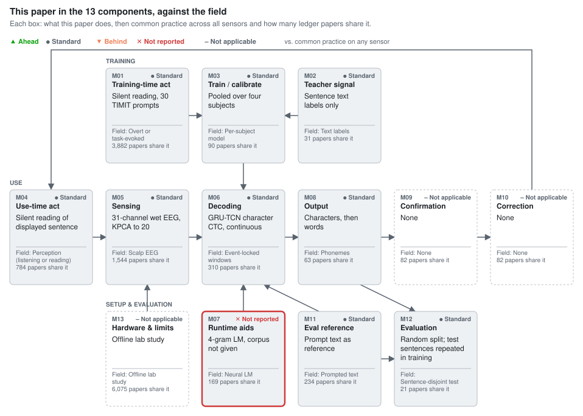

# Continuous Silent Speech Recognition using EEG

Krishna, G., Tran, C., Carnahan, M., Tewfik, A. H. · arXiv preprint · 2020 · [arXiv:2002.03851](https://arxiv.org/abs/2002.03851)

**Section:** [Brain signals (EEG, MEG, intracortical)](../../README.md#brain-signals-eeg-meg-intracortical)

## Figures

### This paper in the 13 components, against the field

<picture><source media="(prefers-color-scheme: dark)" srcset="figures/components-dark.svg"></picture>

Verdicts compare the paper's choice for each component with common practice across 8,995 ledger entries on any sensor (silent speech, brain-to-text, lip reading).

Data

| Component | This paper | Common practice | Papers with this practice | Verdict |
| --- | --- | --- | --- | --- |
| M01 Training-time act | Silent reading, 30 TIMIT prompts | Overt or task-evoked | 3,882 of 8,995 | ● Standard (Training data come from the same silent-reading task as the test.) |
| M02 Teacher signal | Sentence text labels only | Text labels | 31 of 8,995 | ● Standard (No audio or articulatory target.) |
| M03 Train / calibrate | Pooled over four subjects | Per-subject model | 90 of 8,995 | ● Standard (Cross-subject WER 92.55% with the fourth subject held out.) |
| M04 Use-time act | Silent reading of displayed sentence | Perception (listening or reading) | 784 of 8,995 | ● Standard (Reading and inner speech are not separated.) |
| M05 Sensing | 31-channel wet EEG, KPCA to 20 | Scalp EEG | 1,544 of 8,995 | ● Standard (The authors' earlier feature pipeline.) |
| M06 Decoding | GRU-TCN character CTC, continuous | Event-locked windows | 310 of 8,995 | ● Standard (CTC on EEG predates it in the authors' own work.) |
| M07 Runtime aids | 4-gram LM, corpus not given | Neural LM | 169 of 8,995 | ✕ Not reported (Corpus decides how closed the task is.) |
| M08 Output | Characters, then words | Phonemes | 63 of 8,995 | ● Standard (Characters in 49 studies (pattern match).) |
| M09 Confirmation | None | None | 82 of 8,995 | – Not applicable (Offline study.) |
| M10 Correction | None | None | 82 of 8,995 | – Not applicable (Offline study.) |
| M11 Eval reference | Prompt text as reference | Prompted text | 234 of 8,995 | ● Standard (Normalization for WER not stated.) |
| M12 Evaluation | Random split; test sentences repeated in training | Sentence-disjoint test | 21 of 8,995 | ● Standard (Repeat protocol was usual before 2020; no chance baseline.) |
| M13 Hardware & limits | Offline lab study | Offline lab study | 6,075 of 8,995 | – Not applicable (No device or online test.) |

## Verdict

The paper [[1]](#ref-1) changes the use-time action (M04), silent reading of displayed sentences, and decodes it continuously with CTC (M06), a design the authors had already applied to EEG from overt speech and listening (Sec. 1) [[2]](#ref-2). Both are standard. The feasibility claim does not hold: 83.34% WER (Table 1) is measured on repeats of 30 training sentences, with a 4-gram language model of unreported corpus and no chance baseline, so EEG decoding is not separated from the language prior and trial-length cues. The repeat protocol is lenient: on it the [concurrent] decoder of [[3]](#ref-3) reaches about 3% WER for its example participant, though from ECoG during overt speech. The paper does not show EEG decoding of unseen silently read sentences.

## Against the field, component by component

### M04 Use-time action: silent reading

**Usual approach:** perception (listening or reading), 784 of 1,477 EEG/MEG language-decoding studies, with imagined or covert speech in 532 (pattern match; Appendix). The paper sits between the two: subjects read each sentence from a screen "in their mind" (Sec. 3).

**State of the art:** in 2026, MEG decoding of sentences typed by nine subjects, recorded for 10 hours each, reaches 39% average WER [[4]](#ref-4) [later]. That decoder rests on a motor action, typing, not on reading.

The "first" claim (Sec. 7) stands on the Appendix check: of scalp-EEG papers up to 2020, 2 match an imagined- or silent-sentence pattern [[5]](#ref-5), [[6]](#ref-6) and neither decodes sentences. The weakness is the action: the sentence is on screen (Sec. 3), and no condition separates reading from inner speech. Verdict: standard.

### M06 Processing: continuous decoding

**Usual approach:** event-locked windows with onsets supplied at test time, 310 of 1,460 studies, against 63 with CTC or asynchronous decoding (pattern match; Appendix). The paper uses character CTC over 20 KPCA components of 155 handcrafted features (Sec. 4, 5).

**State of the art:** in 2026, an asynchronous MEG encoder reaches CER 0.25, down from 0.59 with data scale [[4]](#ref-4) [later].

The authors' earlier papers jointly decoded EEG from overt speech and listening with CTC and other end-to-end models (Sec. 1), among them [[2]](#ref-2); only the task is new. Encoder length is feature rate times recording length (Sec. 2), so among 30 sentences of different lengths, duration alone carries sentence identity (inference). Verdict: standard.

### M07 Language model

**Usual approach:** a neural LM, 169 studies, against 56 with an n-gram model (pattern match; Appendix).

**State of the art:** in 2026, LLM generation gives WER 0.39 against 0.43 with an n-gram model and 0.55 without one [[4]](#ref-4) [later].

The LM's training text and fusion weight are not given (Sec. 2); the reference cited for it compares LM-integration methods and names no corpus. Trained on the 30 prompts, the LM would reduce decoding to choosing among known sentences (inference). The authors tentatively attribute the 10-sentence set's WER (84.08%), higher than the 15- to 30-sentence sets (79.63% to 83.34%), to words the LM failed to correct (Sec. 6). Verdict: not reported.

### M12 Evaluation: sentence overlap

**Usual approach:** a sentence-disjoint test, 21 of 145 neural text-decoding studies, against 10 that test repeats of training sentences; none of the 29 studies up to 2019 matches the sentence-disjoint pattern (pattern match; Appendix).

**State of the art:** in 2024, 2.5% WER with a 125,000-word vocabulary over the final five sessions, intracortical, one participant [[7]](#ref-7) [later]; in 2023, 23.8% online WER on sentences never duplicated in training [[8]](#ref-8) [later].

A random split of 360 recordings (Sec. 2, 3) puts all 30 sentences in the 72 test recordings (Table 1), each repeated in training (inference). [[3]](#ref-3) [concurrent] uses the same protocol on 30-50 sentences, from ECoG during overt speech: standard then, not open decoding today. Verdict: standard.

## The 13 components

| Component | This paper | Usual approach (count) | State of the art | Verdict |
|---|---|---|---|---|
| M01 Training-time action | Silent reading, 30 TIMIT prompts | Overt or task-evoked (slot-filled 3,882) | – | standard |
| M02 Training-only supervision | Sentence text labels only | Text labels (slot-filled 31) | – | standard |
| M03 Training and adaptation | Pooled over four subjects | Per-subject model (pattern match 90) | – | standard |
| M04 Use-time action | Silent reading of displayed sentence | Perception (listening or reading) (pattern match 784) | 39% WER, typed, MEG, 2026 [[4]](#ref-4) [later] | standard |
| M05 Sensors | 31-channel wet EEG, KPCA to 20 | Scalp EEG (slot-filled 1,544) | – | standard |
| M06 Processing and decoding | GRU-TCN character CTC, continuous | Event-locked windows (pattern match 310) | CER 0.25, MEG, 2026 [[4]](#ref-4) [later] | standard |
| M07 Lexicon and LM | 4-gram LM, corpus not given | Neural LM (pattern match 169) | WER 0.39 with LLM, 2026 [[4]](#ref-4) [later] | not reported |
| M08 Output | Characters, then words | Phonemes (pattern match 63) | – | standard |
| M09 Confirmation | None | None (slot-filled 82) | – | not applicable |
| M10 Correction | None | None (slot-filled 82) | – | not applicable |
| M11 Reference construction | Prompt text as reference | Prompted text (slot-filled 234) | – | standard |
| M12 Evaluation | Random split; test sentences repeated in training | Sentence-disjoint test (pattern match 21) | 2.5% WER, 125,000 words, intracortical, 2024 [[7]](#ref-7) [later]; 23.8% on unseen sentences, 2023 [[8]](#ref-8) [later] | standard |
| M13 Device and cost | Offline lab study | Offline lab study (slot-filled 6,075) | – | not applicable |

## Where the claims outrun the evidence

- "Feasibility" (Abstract, Sec. 7) rests on WER of 74.86% to 84.08% (Table 1) with no chance level, shuffled-label control or LM-only decode.
- WER is not monotonic in sentence count: the 10-sentence set is worse than the larger sets (Table 1); the authors' LM explanation (Sec. 6) is untested and makes the LM, not EEG, the source of variation.
- All sensors (83.34%) beat frontal (85.04%) and temporal (86.73%) subsets (Sec. 6) by under 4 points (inference), one split, no seeds: too little to bear on the frontal and temporal involvement cited as motivation (Sec. 6).
- Cross-subject WER of 92.55% (Sec. 6) comes from a single run holding out the fourth subject, without repetition.

## What the field needs next

- M12: a sentence-disjoint test with chance and shuffled-label baselines, following [[8]](#ref-8) [later].
- M07: decoding with the LM disabled and with an LM trained without the test prompts.
- M04: the sentence removed before covert production, with duration-matched trials.

## Questions for the authors

- What text trained the 4-gram LM, and what fusion weight was used?
- Was the sentence visible while EEG was recorded, and how long was each trial?
- How were ICA and KPCA fitted: on training data only, or on all recordings?
- How is the reported WER averaged across subjects?

## Appendix: literature search

- M04 noninvasive-text-production-action (published topic table, reused). Inclusion rule: language or text decoding studies whose ledger names scalp EEG or MEG; the design compared is the use-time action that produces the decoded signal: perception (listening or reading), imagined or covert speech, evoked-potential spelling, or executed typing or handwriting; versions counted once. Slot-filled 5,595 unique studies; pattern match 1,458 unique studies. Full-text pattern counts: perception 784, imagined speech 532, evoked speller 164, typing 163, handwriting 86 (population 1,477 unique studies: the 1,458 ledger pattern matches plus studies matched in full text only). Usual design: perception, 784 (pattern match). State of the art: [[4]](#ref-4) [later]. Imagined or silent sentence check (scalp EEG, up to 2020): 2 pattern matches, neither a sentence decoder: a thesis noting that EEG may not suffice for covert sentences [[5]](#ref-5) and a review whose table lists overt or imagined Korean words [[6]](#ref-6).
- M06 noninvasive-decoding-segmentation (published topic table, reused). Inclusion rule: EEG/MEG language or text decoding; the design compared is test-time segmentation: windows locked to supplied onsets versus continuous decoding that infers segmentation (CTC, asynchronous, sliding window). Slot-filled 7,345 unique studies; pattern match 1,458 unique studies. Full-text pattern counts: event-locked 310, CTC or asynchronous 63 (population 1,460 unique studies: the 1,458 ledger pattern matches plus studies matched in full text only). Usual design: event-locked windows, 310 (pattern match). State of the art: [[4]](#ref-4) [later].
- M07 noninvasive-text-decoding-language-model (published topic table, reused). Inclusion rule: EEG/MEG language or text decoding; the design compared is the use-time language prior: n-gram with beam search, neural or large language model, or none; LMs used only to build stimuli or training targets do not count. Slot-filled 119 unique studies (sparse); pattern match 1,458 unique studies. Full-text pattern counts: neural LM 169, n-gram LM 56, beam search 36. Usual design: neural LM, 169 (pattern match). State of the art: [[4]](#ref-4) [later].
- M12 neural-text-unseen-sentence-test (published topic table, reused). Inclusion rule: neural text decoders reporting WER; the design compared is whether WER is measured on sentences absent from training or on repeats of training sentences. Slot-filled 6,960 unique studies; pattern match 145 unique studies. Full-text pattern counts: sentence-disjoint test 21 (none of 29 studies up to 2019), repeated training sentences 10. Usual design: sentence-disjoint test, 21 (pattern match). State of the art: [[8]](#ref-8) [later]; lower WER, condition as stated in its Results: [[7]](#ref-7) [later]. Read in full for this topic: [[3]](#ref-3) [concurrent], [[8]](#ref-8) [later]. Known-item recall 0.8.

## References

Numbered by first citation. BibTeX in the same order and keys: [refs.bib](refs.bib).

1. Krishna, G., Tran, C., Carnahan, M., Tewfik, A. H. “Continuous Silent Speech Recognition using EEG.” *arXiv preprint*, 2020. arXiv:[2002.03851](https://arxiv.org/abs/2002.03851). Target. Read as arXiv v7 (4 May 2020); no journal or proceedings version found in Crossref, and arXiv lists no journal reference. [review](https://github.com/supernaiter/silent-speech-review/tree/main/reviews/continuous-silent-speech-recognition-using-eeg) [wiki: arxiv-2002.03851](https://github.com/supernaiter/deep-research-wiki-for-silent-speech/blob/main/papers/arxiv-2002.03851/article.md)
2. Krishna, G., Tran, C., Yu, J., Tewfik, A. H. “Speech Recognition with No Speech or with Noisy Speech.” *ICASSP 2019 - 2019 IEEE International Conference on Acoustics, Speech and Signal Processing (ICASSP)*, 2019, 1090–1094. doi:[10.1109/ICASSP.2019.8683453](https://doi.org/10.1109/ICASSP.2019.8683453). Cited by the target as [1]; not in the wiki. Given names and pages from Crossref.
3. Makin, J. G., Moses, D. A., Chang, E. F. “Machine translation of cortical activity to text with an encoder-decoder framework.” *Nature Neuroscience*, 2020, 23, 575–582. doi:[10.1038/s41593-020-0608-8](https://doi.org/10.1038/s41593-020-0608-8). [concurrent] [wiki: doi-10.1038-s41593-020-0608-8](https://github.com/supernaiter/deep-research-wiki-for-silent-speech/blob/main/papers/doi-10.1038-s41593-020-0608-8/article.md) [wiki: pmc-10560395-makin](https://github.com/supernaiter/deep-research-wiki-for-silent-speech/blob/main/papers/pmc-10560395-makin/article.md)
4. Zhang, M., Lévy, J., Rommel, C., Rapin, J., Bel, C., Bonnaire, J., et al. “Accurate Decoding of Natural Sentences from Non-Invasive Brain Recordings.” *arXiv preprint*, 2026. arXiv:[2608.18114](https://arxiv.org/abs/2608.18114). [later] [wiki: arxiv-2608.18114](https://github.com/supernaiter/deep-research-wiki-for-silent-speech/blob/main/papers/arxiv-2608.18114/article.md) [wiki: arxiv-2608-18114-natsent](https://github.com/supernaiter/deep-research-wiki-for-silent-speech/blob/main/papers/arxiv-2608-18114-natsent/article.md) [wiki: arxiv-2608.18114-brain2qwerty2](https://github.com/supernaiter/deep-research-wiki-for-silent-speech/blob/main/papers/arxiv-2608.18114-brain2qwerty2/article.md)
5. Rezazadeh Sereshkeh, A. “Development of a Hybrid Brain-Computer Interface Based on Imagined Speech Using Electroencephalography and Near-Infrared Spectroscopy.” *University of Toronto*, 2018. <http://hdl.handle.net/1807/97898> PhD thesis. [wiki: oa-W3088488915](https://github.com/supernaiter/deep-research-wiki-for-silent-speech/blob/main/papers/oa-W3088488915/article.md)
6. Cooney, C., Folli, R., Coyle, D. “Neurolinguistics Research Advancing Development of a Direct-Speech Brain-Computer Interface.” *iScience*, 2018, 8, 103-125. doi:[10.1016/j.isci.2018.09.016](https://doi.org/10.1016/j.isci.2018.09.016). [wiki: pmc-6174918-directspeech](https://github.com/supernaiter/deep-research-wiki-for-silent-speech/blob/main/papers/pmc-6174918-directspeech/article.md)
7. Card, N. S., Wairagkar, M., Iacobacci, C., Hou, X., Singer-Clark, T., Willett, F. R., et al. “An accurate and rapidly calibrating speech neuroprosthesis.” *New England Journal of Medicine*, 2024, 391(7), 609-618. doi:[10.1056/NEJMoa2314132](https://doi.org/10.1056/NEJMoa2314132). [later] [review](https://github.com/supernaiter/silent-speech-review/tree/main/reviews/an-accurate-and-rapidly-calibrating-speech-neuroprosthesis) [wiki: doi-10.1056-nejmoa2314132](https://github.com/supernaiter/deep-research-wiki-for-silent-speech/blob/main/papers/doi-10.1056-nejmoa2314132/article.md) [wiki: doi-10.1056-NEJMoa2314132](https://github.com/supernaiter/deep-research-wiki-for-silent-speech/blob/main/papers/doi-10.1056-NEJMoa2314132/article.md) [wiki: pmc-11328962-rapidcal](https://github.com/supernaiter/deep-research-wiki-for-silent-speech/blob/main/papers/pmc-11328962-rapidcal/article.md)
8. Willett, F. R., Kunz, E. M., Fan, C., Avansino, D. T., Wilson, G. H., Choi, E. Y., et al. “A high-performance speech neuroprosthesis.” *Nature*, 2023, 620(7976), 1031-1036. doi:[10.1038/s41586-023-06377-x](https://doi.org/10.1038/s41586-023-06377-x). [later] [review](https://github.com/supernaiter/silent-speech-review/tree/main/reviews/a-high-performance-speech-neuroprosthesis) [wiki: doi-10.1038-s41586-023-06377-x](https://github.com/supernaiter/deep-research-wiki-for-silent-speech/blob/main/papers/doi-10.1038-s41586-023-06377-x/article.md)

## Materials

Data behind this review. Full texts of the papers are not included.

- [`review.md`](review.md): the review text (source)
- [`refs.bib`](refs.bib): references (BibTeX)
- [`slots.json`](slots.json): for each of the 13 components: this paper's choice, field practice, number of matching papers, verdict
- [`figures.json`](figures.json): figure definitions
- [`evaluation.md`](evaluation.md): independent evaluation by a second reviewer
- [`triage.md`](triage.md): how each evaluation finding was checked against the sources and resolved
- [`components/M04/noninvasive-text-production-action.csv`](../../components/M04/noninvasive-text-production-action.csv): M04 topic "noninvasive-text-production-action", every candidate paper with its decision (5595 slot-filled, 1458 pattern match, usual design in 784, 3 read in full)
- [`components/M06/noninvasive-decoding-segmentation.csv`](../../components/M06/noninvasive-decoding-segmentation.csv): M06 topic "noninvasive-decoding-segmentation", every candidate paper with its decision (7345 slot-filled, 1458 pattern match, usual design in 310, 2 read in full)
- [`components/M07/noninvasive-text-decoding-language-model.csv`](../../components/M07/noninvasive-text-decoding-language-model.csv): M07 topic "noninvasive-text-decoding-language-model", every candidate paper with its decision (119 slot-filled, 1458 pattern match, usual design in 169, 1 read in full)
- [`components/M12/neural-text-unseen-sentence-test.csv`](../../components/M12/neural-text-unseen-sentence-test.csv): M12 topic "neural-text-unseen-sentence-test", every candidate paper with its decision (6960 slot-filled, 145 pattern match, usual design in 21, 4 read in full)

## More reviews in Brain signals (EEG, MEG, intracortical)

- [A comparison of oscillatory characteristics in covert speech and speech perception](../a-comparison-of-oscillatory-characteristics-in-covert-speech-and-speech-perception/) (2020). EEG analysis comparing oscillatory activity in covert speech and speech perception in eight participants; finds stronger low-gamma for covert speech, stronger delta/theta for perception, and theta-gamma coupling.
- [Brain2Char: a deep architecture for decoding text from brain recordings](../brain2char-a-deep-architecture-for-decoding-text-from-brain-recordings/) (2020). Character CTC decoding from ECoG; all changes are standard. The 7.0-10.6% WER relies on repeated sentences, as the authors concede, and unseen sentences average 80% WER.
- [EMA2S: An End-to-End Multimodal Articulatory-to-Speech System](../ema2s-an-end-to-end-multimodal-articulatory-to-speech-system/) (2021). Speech-latent target (M02) has a 2017 precedent and small, mixed single-run gains; spectrogram-loss-only end-to-end loses to WORLD (M06); a preference test replaces listener transcription (M12).
- [Neuroprosthesis for decoding speech in a paralyzed person with anarthria](../neuroprosthesis-for-decoding-speech-in-a-paralyzed-person-with-anarthria/) (2021). Sentence decoding from a person who cannot speak holds for 50 words and one participant; the decoder is standard for 2021, and an LM restricted to the test vocabulary drives the gain.
- [Silent Speech and Emotion Recognition from Vocal Tract Shape Dynamics in Real-Time MRI](../silent-speech-and-emotion-recognition-from-vocal-tract-shape-dynamics-in-real-time-mri/) (2021). Sentence-level speech recognition from real-time MRI of the vocal tract, plus emotion and gender articulation analysis; reaches 40.6% PER on USC-TIMIT with a language model, beating earlier rtMRI baselines.
- [A Novel Task-Oriented Text Corpus in Silent Speech Recognition and its Natural Language Generation Construction Method](../a-novel-task-oriented-text-corpus-in-silent-speech-recognition-and-its-natural-language-generation-construction-method/) (2019). Proposes a task-oriented text corpus and a hybrid natural language generation method for building EEG silent speech recognition datasets; claims gains over template and neural NLG but gives no numeric benchmark.

---

Part of the [Silent Speech Interface Review](https://github.com/supernaiter/silent-speech-review). Found an error? [Open an issue](https://github.com/supernaiter/silent-speech-review/issues/new?template=correction.yml).
