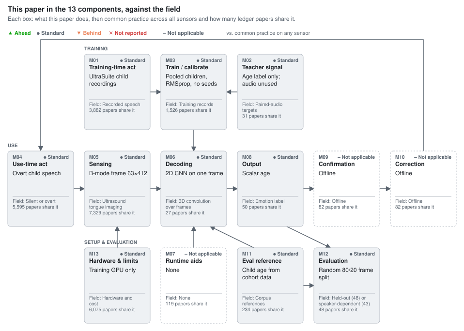

# Convolutional Neural Network-Based Age Estimation Using B-Mode Ultrasound Tongue Image

Xu, K., Csapó, T. G., Feng, M. · arXiv preprint · 2021 · [arXiv:2101.11245](https://arxiv.org/abs/2101.11245)

**Section:** [Ultrasound & tongue imaging](../../README.md#ultrasound--tongue-imaging)

## Figures

### This paper in the 13 components, against the field

<picture><source media="(prefers-color-scheme: dark)" srcset="figures/components-dark.svg"></picture>

Verdicts compare the paper's choice for each component with common practice across 8,995 ledger entries on any sensor (silent speech, brain-to-text, lip reading).

Data

| Component | This paper | Common practice | Papers with this practice | Verdict |
| --- | --- | --- | --- | --- |
| M01 Training-time act | UltraSuite child recordings | Recorded speech | 3,882 of 8,995 | ● Standard (Inherited (UXTD, UPX).) |
| M02 Teacher signal | Age label only; audio unused | Paired-audio targets | 31 of 8,995 | ● Standard (No training-only signal.) |
| M03 Train / calibrate | Pooled children, RMSprop, no seeds | Training records | 1,526 of 8,995 | ● Standard (Run count not stated.) |
| M04 Use-time act | Overt child speech | Silent or overt | 5,595 of 8,995 | ● Standard (Inherited.) |
| M05 Sensing | B-mode frame 63×412 | Ultrasound tongue imaging | 7,329 of 8,995 | ● Standard (Inherited.) |
| M06 Decoding | 2D CNN on one frame | 3D convolution over frames | 27 of 8,995 | ● Standard (No per-child pooling or normalisation.) |
| M07 Runtime aids | None | None | 119 of 8,995 | – Not applicable (No linguistic aid in age regression.) |
| M08 Output | Scalar age | Emotion label | 50 of 8,995 | ● Standard (New output; effect unshown beyond speaker identity.) |
| M09 Confirmation | Offline | Offline | 82 of 8,995 | – Not applicable (Offline study.) |
| M10 Correction | Offline | Offline | 82 of 8,995 | – Not applicable (Offline study.) |
| M11 Eval reference | Child age from cohort data | Corpus references | 234 of 8,995 | ● Standard (Error unit not stated.) |
| M12 Evaluation | Random 80/20 frame split | Held-out (48) or speaker-dependent (43) | 48 of 8,995 | ● Standard (No held-out-child condition; weaker than same-corpus priors.) |
| M13 Hardware & limits | Training GPU only | Hardware and cost | 6,075 of 8,995 | ● Standard (Therapy use proposed, not evaluated.) |

## Verdict

The paper changes one component, the output (M08): a speaker's age regressed by a CNN from single B-mode tongue frames [[1]](#ref-1). The output is new (none of the 99 paralinguistic studies in the Appendix matches an age-estimation pattern), but the verdict is standard because the evidence does not show that age is decoded. The 80/20 split is random over frames with no grouping by child (§4.1), so frames of the same children almost certainly fall on both sides (inference), and a network that recognises the child returns that child's age; a 0.25 s ultrasound segment identifies 50 speakers with 3.16% error in [concurrent] work [[2]](#ref-2). Evaluation (M12) is standard but weaker than the best comparable work, which tests held-out children on the same UXTD corpus and finds them well below seen children [[3]](#ref-3). The abstract's "MAE" values are validation MSE in the body (§4.4), and the speech-therapy use is untested. The claim that tongue images carry age information beyond speaker identity (§4.4) is unsupported.

## Against the field, component by component

### M08 Output: speaker age from tongue images

**Usual approach:** Among 99 studies that infer a paralinguistic property from a non-acoustic production signal (pattern match, published table, Appendix), the labels are emotion (50) or speaker identity (7); none matches an age-estimation pattern (0, Appendix).

**State of the art:** Diener et al. (2020, [concurrent]) identify speakers from EMG at 73% UAR (chance 12.5%) on held-out sessions [[4]](#ref-4).

Diener et al. hold out sessions to isolate speaker characteristics [[4]](#ref-4); the target has no such control. Its support is validation MSE 2.03 against 3.64 for a mean-age predictor on UXTD (§4.4), 44% lower (inference), and 4.87 against 5.35 on UPX (§4.5), only 9% lower (inference) even before leakage. Speaker recognition alone could produce both gaps (M12). The authors call the work a proof of concept with a narrow age range (§5). Verdict: standard; no speaker-controlled, repeated effect shows the new output works.

### M12 Evaluation: children shared between training and validation

**Usual approach:** Of 148 ultrasound studies (pattern match, upper bounds, Appendix), 48 mention a held-out-speaker test and 43 a speaker-dependent setup, about equally common. Pooled seen-speaker conditions exist, but beside a held-out one [[3]](#ref-3); the target reports only the pooled random 80/20 frame split, with no grouping by child, session or utterance and no test set (§4.1).

**State of the art:** On the 58 UXTD children, Ribeiro et al. (2019) compare seen speakers with leave-one-speaker-out testing: their raw-image CNN falls from 74.70% to 59.42% (Table 1) [[3]](#ref-3), 20% relative (inference); Al Ani et al. (2024, [later]) still find 82.32% precision for held-out speakers against 92.12% on nine UXTD children [[5]](#ref-5).

Eshky et al. (2019) also hold out UXTD and UPX speakers [[6]](#ref-6), and Fabre et al. (2015) a speaker in tongue-contour tracking [[7]](#ref-7). For age the leak is worse than for phonetic classes (inference): each UXTD child carries one label, so any speaker cue is an age cue, and ultrasound tongue videos are very speaker-specific [[2]](#ref-2). The 2.03 is a minimum validation MSE (§4.4) after the rotation setting was chosen among nine Table 3 rows on the same data (§4.3), with no seeds. Verdict: standard. Only two earlier studies hold out speakers on the same child corpora [[3]](#ref-3), [[6]](#ref-6), short of the three the behind rule needs, but the target falls below both.

### M06 Decoder: single-frame CNN

**Usual approach:** Of the 148 ultrasound studies (pattern match, published table), 27 integrate frames by 3D convolution and 24 by a CNN with a recurrent layer. The target scores one frame from every 150 (§4.1) with a 2D CNN.

**State of the art:** Tongue2Speech (2026, [later]) reaches 15.93% WER with a 3D CNN and Transformer [[8]](#ref-8), a speech task; no age estimator exists to compare.

A frame-level model suits a static trait, but the paper neither pools a child's frames nor describes any normalisation (§3.1, §4.1–4.2). Ribeiro et al. add the speaker-mean frame as a second channel, lifting held-out-speaker CNN accuracy to 67.00% [[3]](#ref-3). Verdict: standard.

## The 13 components

| Component | This paper | Usual approach (count) | State of the art | Verdict |
|---|---|---|---|---|
| M01 Training-time action | UltraSuite child recordings | Recorded speech (slot-filled 3,882) | – | standard |
| M02 Training-only supervision | Age label only; audio unused | Paired-audio targets (slot-filled 31) | – | standard |
| M03 Training and adaptation | Pooled children, RMSprop, no seeds | Training records (slot-filled 1,526) | – | standard |
| M04 Use-time action | Overt child speech | Silent or overt (slot-filled 5,595) | – | standard |
| M05 Sensors | B-mode frame 63×412 | Ultrasound tongue imaging (slot-filled 7,329) | – | standard |
| M06 Processing and decoding | 2D CNN on one frame | 3D convolution over frames (pattern match 27) | [[8]](#ref-8) (2026): WER 15.93% (speech task) | standard |
| M07 Lexicon and LM | None | None (slot-filled 119) | – | not applicable |
| M08 Output | Scalar age | Emotion label (pattern match 50) | [[4]](#ref-4) (2020): speaker ID 73% UAR | standard |
| M09 Confirmation | Offline | Offline (slot-filled 82) | – | not applicable |
| M10 Correction | Offline | Offline (slot-filled 82) | – | not applicable |
| M11 Reference construction | Child age from cohort data | Corpus references (slot-filled 234) | – | standard |
| M12 Evaluation | Random 80/20 frame split | Held-out (48) or speaker-dependent (43) (pattern match 48) | [[3]](#ref-3) (2019, same corpus): held-out 59.42% vs seen 74.70%; [[5]](#ref-5) (2024): 82.32% held-out | standard |
| M13 Device and cost | Training GPU only | Hardware and cost (slot-filled 6,075) | – | standard |

## Where the claims outrun the evidence

- The abstract reports MAE 2.03 and 4.87; §4.4–4.5 and Table 3 call them validation MSE; the extracted Eq. (1), named MSE, shows no square; no age unit is given.
- "Ultrasound tongue images contain some age information" (§4.4): speaker identification explains the same result (M12).
- The abstract proposes a speech-therapy assessment tool; §4 reports only age error, no session-level measurement.
- §4.1 assigns both 24,449 and 54,582 frames to UXTD.

## What the field needs next

- M12: leave-one-child-out testing on UXTD and UPX, one estimate per child, error in years against the cohort-mean predictor, several seeds.
- M12: age error on held-out children set beside speaker-recognition accuracy on the same frames.
- M06: a speaker-mean channel and pooling over a child's frames against the single-frame model.
- M08: within-child tracking across UPX sessions.

## Questions for the authors

- Did any child contribute frames to both training and validation?
- Are 2.03 and 4.87 MSE or MAE, and in years?
- Is 2.03 the best epoch on validation data, and how many runs were made?
- Was any intensity normalisation applied?
- Was the mean-age predictor fitted on training ages?

## Appendix: literature search

- M08, paralinguistic-output-from-production-signals (published table, reused). Inclusion rule: studies that infer a paralinguistic property of the speaker or utterance (affect, speaker identity, speaking mode, prosody) from a non-acoustic speech-production signal (EMG, EMA, ultrasound, real-time MRI, electropalatography, strain sensors, ECoG or intracortical recordings); acoustic-only and face-video emotion recognition excluded; versions count once. Ledger: 3,268 unique studies slot-filled for M08; 99 unique studies pattern match. Usual design: audio output 12 (slot-filled, 71 studies with an M08 value). Full-text patterns over the candidates (this review): emotion 50, speaker identity 7, age estimation 0 (pattern match). The target's ledger text names no paralinguistic keyword; it enters by the inclusion rule (a speaker trait from ultrasound). Read in full: [[4]](#ref-4). Known-item recall 1.0.
- M12, ultrasound-tongue-speaker-split (new). Inclusion rule: studies whose ledger lists ultrasound imaging, classified by full-text pattern into held-out-speaker tests (speaker-independent, unseen or held-out speakers, leave-one-speaker-out, cross-speaker) and within-speaker setups (speaker-dependent, single-speaker); related-work mentions count (upper bound); a study counts under every split it names; versions count once. Ledger: 6,960 unique studies slot-filled for M12; 148 unique studies pattern match. Held-out speakers 48, speaker-dependent 43 (pattern match). Earlier held-out-speaker studies on the same UltraSuite corpora: 2 ([[3]](#ref-3), [[6]](#ref-6)). Read in full: [[3]](#ref-3), [[7]](#ref-7), [[6]](#ref-6), [[5]](#ref-5), [[2]](#ref-2). Known-item recall 1.0 (2 seeds).
- M06, ultrasound-image-sequence-temporal-layer (published table, reused). Inclusion rule: studies listing ultrasound imaging, classified by how the network integrates frames over time (3D convolution, CNN then recurrent layer, ConvLSTM, Transformer); related-work mentions count (upper bound). Ledger: 7,345 unique studies slot-filled for M06; 148 unique studies pattern match. 3D convolution 27, CNN then recurrent 24, ConvLSTM 9, Transformer or Conformer 8 (pattern match, published counts). Read in full (published table): [[8]](#ref-8). Known-item recall 1.0.

## References

Numbered by first citation. BibTeX in the same order and keys: [refs.bib](refs.bib).

1. Xu, K., Csapó, T. G., Feng, M. “Convolutional Neural Network-Based Age Estimation Using B-Mode Ultrasound Tongue Image.” *arXiv preprint*, 2021. doi:[10.48550/arXiv.2101.11245](https://doi.org/10.48550/arXiv.2101.11245). arXiv:[2101.11245](https://arxiv.org/abs/2101.11245). Target. Read as arXiv v1. [review](https://github.com/supernaiter/silent-speech-review/tree/main/reviews/convolutional-neural-network-based-age-estimation-using-b-mode-ultrasound-tongue-image) [wiki: arxiv-2101.11245](https://github.com/supernaiter/deep-research-wiki-for-silent-speech/blob/main/papers/arxiv-2101.11245/article.md)
2. Shandiz, A. H., Tóth, L., Gosztolya, G., Markó, A., Csapó, T. G. “Neural Speaker Embeddings for Ultrasound-based Silent Speech Interfaces.” *Proc. Interspeech 2021*, 2021, 1932–1936. doi:[10.21437/Interspeech.2021-1466](https://doi.org/10.21437/Interspeech.2021-1466). arXiv:[2106.04552](https://arxiv.org/abs/2106.04552). Single-frame speaker recognition from ultrasound (Table 1). Read as arXiv v2. [concurrent] [review](https://github.com/supernaiter/silent-speech-review/tree/main/reviews/neural-speaker-embeddings-for-ultrasound-based-silent-speech-interfaces) [wiki: arxiv-2106.04552](https://github.com/supernaiter/deep-research-wiki-for-silent-speech/blob/main/papers/arxiv-2106.04552/article.md) [wiki: doi-10.21437-interspeech.2021-1466](https://github.com/supernaiter/deep-research-wiki-for-silent-speech/blob/main/papers/doi-10.21437-interspeech.2021-1466/article.md) [wiki: isca-shandiz21-usspeaker](https://github.com/supernaiter/deep-research-wiki-for-silent-speech/blob/main/papers/isca-shandiz21-usspeaker/article.md) [wiki: isca-shandiz21_interspeech](https://github.com/supernaiter/deep-research-wiki-for-silent-speech/blob/main/papers/isca-shandiz21_interspeech/article.md)
3. Ribeiro, M. S., Eshky, A., Richmond, K., Renals, S. “Speaker-independent classification of phonetic segments from raw ultrasound in child speech.” *arXiv preprint*, 2019. arXiv:[1907.01413](https://arxiv.org/abs/1907.01413). Prior; deciding prior for M12 (same UXTD corpus, leave-one-speaker-out). Cited by the target. [wiki: arxiv-1907.01413](https://github.com/supernaiter/deep-research-wiki-for-silent-speech/blob/main/papers/arxiv-1907.01413/article.md)
4. Diener, L., Amiriparian, S., Botelho, C., Scheck, K., Küster, D., Trancoso, I., et al. “Towards Silent Paralinguistics: Deriving Speaking Mode and Speaker ID from Electromyographic Signals.” *Proc. Interspeech 2020*, 2020, 3117-3121. doi:[10.21437/Interspeech.2020-2848](https://doi.org/10.21437/Interspeech.2020-2848). Closest speaker-trait decoder from a production signal, held-out sessions. [concurrent] [wiki: isca-diener20-emgmode](https://github.com/supernaiter/deep-research-wiki-for-silent-speech/blob/main/papers/isca-diener20-emgmode/article.md) [wiki: isca-diener20_interspeech](https://github.com/supernaiter/deep-research-wiki-for-silent-speech/blob/main/papers/isca-diener20_interspeech/article.md)
5. Al Ani, S., Cleland, J., Zoha, A. “Automated Classification of Phonetic Segments in Child Speech Using Raw Ultrasound Imaging.” *arXiv preprint*, 2024. arXiv:[2402.17482](https://arxiv.org/abs/2402.17482). Held-out-speaker evaluation on UXTD. [later] [wiki: arxiv-2402.17482](https://github.com/supernaiter/deep-research-wiki-for-silent-speech/blob/main/papers/arxiv-2402.17482/article.md)
6. Eshky, A., Ribeiro, M. S., Richmond, K., Renals, S. “Synchronising audio and ultrasound by learning cross-modal embeddings.” *Proc. Interspeech 2019*, 2019. doi:[10.21437/Interspeech.2019-1804](https://doi.org/10.21437/Interspeech.2019-1804). Prior; test on unseen speakers and sessions of child ultrasound. [wiki: isca-eshky19-sync](https://github.com/supernaiter/deep-research-wiki-for-silent-speech/blob/main/papers/isca-eshky19-sync/article.md)
7. Fabre, D., Hueber, T., Bocquelet, F., Badin, P. “Tongue Tracking in Ultrasound Images using EigenTongue Decomposition and Artificial Neural Networks.” *Proc. Interspeech 2015*, 2015, 2410-2414. doi:[10.21437/Interspeech.2015-521](https://doi.org/10.21437/Interspeech.2015-521). Prior; held-out-speaker test on ultrasound. [wiki: doi-10.21437-interspeech.2015-521](https://github.com/supernaiter/deep-research-wiki-for-silent-speech/blob/main/papers/doi-10.21437-interspeech.2015-521/article.md)
8. Sonkar, Y., Kilaru, Y., Yelimeli, S., Shah, N., Gandhi, V. “Tongue2Speech: Real-Time Speech Synthesis from Tongue Ultrasound Videos via Spatiotemporal Transformers.” *Proc. Interspeech 2026*, 2026, 6856–6860. doi:[10.21437/Interspeech.2026-3023](https://doi.org/10.21437/Interspeech.2026-3023). State of the art in the reused M06 table. [later] [wiki: isca-sonkar26_interspeech](https://github.com/supernaiter/deep-research-wiki-for-silent-speech/blob/main/papers/isca-sonkar26_interspeech/article.md)

## Materials

Data behind this review. Full texts of the papers are not included.

- [`review.md`](review.md): the review text (source)
- [`refs.bib`](refs.bib): references (BibTeX)
- [`slots.json`](slots.json): for each of the 13 components: this paper's choice, field practice, number of matching papers, verdict
- [`figures.json`](figures.json): figure definitions
- [`evaluation.md`](evaluation.md): independent evaluation by a second reviewer
- [`triage.md`](triage.md): how each evaluation finding was checked against the sources and resolved
- [`process/log.json`](process/log.json): process record: each step, who did it (reader, script, writer, evaluator), when, the checks run and the input versions
- [`process/notes.json`](process/notes.json): reading notes on the target and comparator papers: claims, numbers, conditions and what is not stated, with locations
- [`process/plan.json`](process/plan.json): plan: which components the paper changes and the topics it is compared on
- [`process/draft.md`](process/draft.md): the review as first written, before the independent evaluation
- [`process/claims-draft.md`](process/claims-draft.md): claim table of the draft: every claim mapped to a note or a count
- [`process/claims.md`](process/claims.md): claim table of the published review
- [`components/M06/ultrasound-image-sequence-temporal-layer.csv`](../../components/M06/ultrasound-image-sequence-temporal-layer.csv): M06 topic "ultrasound-image-sequence-temporal-layer", every candidate paper with its decision (7345 slot-filled, 148 pattern match, usual design in 27, 4 read in full)
- [`components/M08/paralinguistic-output-from-production-signals.csv`](../../components/M08/paralinguistic-output-from-production-signals.csv): M08 topic "paralinguistic-output-from-production-signals", every candidate paper with its decision (3268 slot-filled, 99 pattern match, usual design in 12, 4 read in full)
- [`components/M12/ultrasound-tongue-speaker-split.csv`](../../components/M12/ultrasound-tongue-speaker-split.csv): M12 topic "ultrasound-tongue-speaker-split", every candidate paper with its decision (6960 slot-filled, 148 pattern match, usual design in 48, 4 read in full)

## More reviews in Ultrasound & tongue imaging

- [Improving Neural Silent Speech Interface Models by Adversarial Training](../improving-neural-silent-speech-interface-models-by-adversarial-training/) (2021). Standard on the adversarial loss (M02): it predates the paper in video-to-speech and its gains are small, with no variance reported; behind on evaluation (M12): no listening test.
- [Neural Speaker Embeddings for Ultrasound-based Silent Speech Interfaces](../neural-speaker-embeddings-for-ultrasound-based-silent-speech-interfaces/) (2021). Standard on embedding conditioning (2.4% relative MSE gain on seen speakers); behind on speaker recognition, which never separates speaker from recording session.
- [Silent versus modal multi-speaker speech recognition from ultrasound and video](../silent-versus-modal-multi-speaker-speech-recognition-from-ultrasound-and-video/) (2021). Standard on both changed components: modal-to-silent loss and fMLLR were known; later work narrows the absolute gap but not the fMLLR ratio, and adaptation gains rest on single runs.
- [Speech Synthesis from Text and Ultrasound Tongue Image-based Articulatory Input](../speech-synthesis-from-text-and-ultrasound-tongue-image-based-articulatory-input/) (2021). Limited-data TTS augmented with ultrasound tongue images; combined text plus ultrasound gives the lowest test MCD for all 8 speakers, while ultrasound-only input remains far worse.
- [Voice Activity Detection for Ultrasound-based Silent Speech Interfaces using Convolutional Neural Networks](../voice-activity-detection-for-ultrasound-based-silent-speech-interfaces-using-convolutional-neural-networks/) (2021). CNN speech-versus-silence detection from ultrasound tongue images on one speaker (TaL1), reaching 85.2% test accuracy; removing silence slightly improves downstream SSI reconstruction (MCD 3.05 vs 3.12).
- [Improved Processing of Ultrasound Tongue Videos by Combining ConvLSTM and 3D Convolutional Networks](../improved-processing-of-ultrasound-tongue-videos-by-combining-convlstm-and-3d-convolutional-networks/) (2022). ConvLSTM top layer (M06) is standard: new to ultrasound-to-speech, but a 2.1% MSE edge over BiLSTM, one speaker, one run; later work dropped it. No MCD or listener test (M12 behind).

---

Part of the [Silent Speech Interface Review](https://github.com/supernaiter/silent-speech-review). Found an error? [Open an issue](https://github.com/supernaiter/silent-speech-review/issues/new?template=correction.yml).
