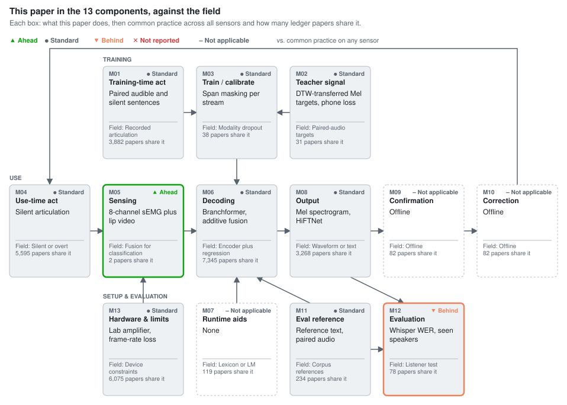

# Cross-Modal Masking for Robust Silent Speech Synthesis Using sEMG and Lipreading

del Blanco, E., Gimeno-Gómez, D., Navas, E., Martínez-Hinarejos, C.-D., Hernáez, I. · arXiv preprint · 2026 · [arXiv:2606.09667](https://arxiv.org/abs/2606.09667)

**Section:** [Surface EMG](../../README.md#surface-emg)

## Figures

### This paper in the 13 components, against the field

<picture><source media="(prefers-color-scheme: dark)" srcset="figures/components-dark.svg"></picture>

Verdicts compare the paper's choice for each component with common practice across 8,995 ledger entries on any sensor (silent speech, brain-to-text, lip reading).

Data

| Component | This paper | Common practice | Papers with this practice | Verdict |
| --- | --- | --- | --- | --- |
| M01 Training-time act | Paired audible and silent sentences | Recorded articulation | 3,882 of 8,995 | ● Standard (ReSSInt.) |
| M02 Teacher signal | DTW-transferred Mel targets, phone loss | Paired-audio targets | 31 of 8,995 | ● Standard (Gaddy lineage.) |
| M03 Train / calibrate | Span masking per stream | Modality dropout | 38 of 8,995 | ● Standard (Not compared with two-stream dropout.) |
| M04 Use-time act | Silent articulation | Silent or overt | 5,595 of 8,995 | ● Standard (Inherited.) |
| M05 Sensing | 8-channel sEMG plus lip video | Fusion for classification | 2 of 8,995 | ▲ Ahead (Synthesis new to the ledger.) |
| M06 Decoding | Branchformer, additive fusion | Encoder plus regression | 7,345 of 8,995 | ● Standard (Inherited.) |
| M07 Runtime aids | None | Lexicon or LM | 119 of 8,995 | – Not applicable (Whisper scores only.) |
| M08 Output | Mel spectrogram, HiFTNet | Waveform or text | 3,268 of 8,995 | ● Standard (Surrogate voice.) |
| M09 Confirmation | Offline | Offline | 82 of 8,995 | – Not applicable (Offline.) |
| M10 Correction | Offline | Offline | 82 of 8,995 | – Not applicable (Offline.) |
| M11 Eval reference | Reference text, paired audio | Corpus references | 234 of 8,995 | ● Standard (Surrogate reference.) |
| M12 Evaluation | Whisper WER, seen speakers | Listener test | 78 of 8,995 | ▼ Behind (No held-out speakers.) |
| M13 Hardware & limits | Lab amplifier, frame-rate loss | Device constraints | 6,075 of 8,995 | ● Standard (Bitrate units missing.) |

## Verdict

The paper [[1]](#ref-1) changes the sensors (M05), synthesizing speech from fused surface EMG and lip video, and the training (M03), masking spans of each stream. The sensor pairing is ahead: both earlier fused sEMG-video decoders in the ledger classify words or sentences (Appendix), and here the pair cuts silent-speech WER from 54.5% (best lip-only model) to 40.5% for six laryngeal speakers (Table III). The masking is standard: span masking added to a video dropout of up to 75% (§IV-D), never compared with whole-stream dropout of both streams, with a clean gain of 3.5 points the authors call not statistically significant (§V-B). The strongest confound is capacity: with sEMG zeroed at test, the unmasked multimodal model still reaches 46.9% WER, so 7.6 of its 10.5-point lead over lip-only needs no sEMG (inference). The evaluation (M12) is behind the best comparable work: test speakers are all seen in training (Table I), with no listener test or repeated runs, and for three laryngectomized speakers the gain is not significant (§V-E).

## Against the field, component by component

### M05 Sensors: sEMG fused with lip video

**Usual approach:** Of 20 unique studies whose ledger pairs EMG with video (pattern match), two earlier ones fuse them in one decoder, both to classify digits [[2]](#ref-2) or 100 sentences [[3]](#ref-3); the target synthesizes speech instead.

**State of the art:** AVE Speech (2025) reaches 95.51% closed-set accuracy over 100 sentences on unseen subjects with three-stream fusion at -10 dB audio, below its visual-only 98.55% [[3]](#ref-3); silent EMG-to-speech reaches 11.89% WER for synthesized speech on the one-speaker English Gaddy corpus in GETS [concurrent] [[4]](#ref-4), against 83.2% for the target's sEMG-only model on Spanish ReSSInt, a gap of corpus as much as method (inference).

None of the 20 pattern-match studies besides the target synthesizes speech from the pair (Appendix). Earlier fusion gains were small, 14.5% relative over video and 2.4% over EMG [[2]](#ref-2); the target's 14.0 points (25.7% relative) is larger but measured on speakers seen in training, while AVE Speech tests unseen subjects (inference). AVE Speech's fusion fell below its visual stream once audio degraded [[3]](#ref-3); the unmasked target model repeats this, 92.5% WER with lips removed against 83.2% for sEMG alone (Tables III-IV). Verdict: ahead, for six laryngeal speakers.

### M03 Training: span masking instead of modality dropout

**Usual approach:** Withholding a whole stream (modality dropout) is the default: 38 of 44 full-text matches (pattern match) use it in recognition, lip reading or audio-visual pre-training [[5]](#ref-5). The target zeroes spans of up to 0.4 of each one-second chunk in each stream (§III-C) and keeps a video dropout of up to 75% (§IV-D).

**State of the art:** the closest cited prior is AV-HuBERT's modality dropout (2022) [[5]](#ref-5), which drops a whole stream (§II), not run here; masking lowers WER with lips removed from 92.5% to 73.7% and leaves WER with sEMG removed at 48.2% against 46.9% (Table IV).

The frame-rate augmentation baseline costs 13.3 points on clean input (57.3% against 44.0%) (inference). Masking worsens both single-stream models, by about 10 points for sEMG (highly significant) and 2.7 for lips (not significant), and the authors concede they cannot separate masking from exposure to corrupted inputs (§V-B). Verdict: standard, since the clean gain is not significant and lip-reading time masking already exists (§III-C).

### M12 Evaluation: seen speakers, ASR-only scoring

**Usual approach:** Of 165 video-to-speech studies (pattern match), 78 name a listener test, 65 ASR WER and 52 speakers held out of training, as in the 15/8/10-subject GRID split [[6]](#ref-6); the target scores Whisper WER, phone accuracy and SSIM on text-disjoint, speaker-overlapping splits (§IV-A).

**State of the art:** V2SFlow (2024) reaches 28.5% WER on the SVTS unseen-speaker split of LRS3 [[7]](#ref-7); the target's 40.5% on seen speakers is not comparable (inference).

Its only cross-speaker step is fine-tuning to three laryngectomized speakers (§V-E). Repeated runs appear in 2 of 165 studies (Appendix), and the target has none; its bootstrap intervals cover test sampling only. Verdict: behind the best comparable work [[6]](#ref-6), [[7]](#ref-7), [[3]](#ref-3), not the typical study (52 of 165 hold speakers out).

## The 13 components

| Component | This paper | Usual approach (count) | State of the art | Verdict |
|---|---|---|---|---|
| M01 Training-time action | Paired audible and silent sentences | Recorded articulation (slot-filled 3,882) | – | standard |
| M02 Training-only supervision | DTW-transferred Mel targets, phone loss | Paired-audio targets (slot-filled 31) | – | standard |
| M03 Training and adaptation | Span masking per stream | Modality dropout (pattern match 38) | Closest prior: [[5]](#ref-5) (2022) | standard |
| M04 Use-time action | Silent articulation | Silent or overt (slot-filled 5,595) | – | standard |
| M05 Sensors | 8-channel sEMG plus lip video | Fusion for classification (confirmed 2) | 95.51% closed-set accuracy [[3]](#ref-3) (2025) | ahead |
| M06 Processing and decoding | Branchformer, additive fusion | Encoder plus regression (slot-filled 7,345) | – | standard |
| M07 Lexicon and LM | None | Lexicon or LM (slot-filled 119) | – | not applicable |
| M08 Output | Mel spectrogram, HiFTNet | Waveform or text (slot-filled 3,268) | – | standard |
| M09 Confirmation | Offline | Offline (slot-filled 82) | – | not applicable |
| M10 Correction | Offline | Offline (slot-filled 82) | – | not applicable |
| M11 Reference construction | Reference text, paired audio | Corpus references (slot-filled 234) | – | standard |
| M12 Evaluation | Whisper WER, seen speakers | Listener test (pattern match 78) | 28.5% WER [[7]](#ref-7) (2024) | behind |
| M13 Device and cost | Lab amplifier, frame-rate loss | Device constraints (slot-filled 6,075) | – | standard |

## Where the claims outrun the evidence

- "Significantly outperforms single-modality models across evaluation settings" (§V-A) fails for laryngectomized speakers: 68.2% against 75.1% WER, not significant by the authors' account (§V-E).
- The multimodal model has 101.7M parameters against 55.6M for lip-only (§IV-B), with no size-matched control (inference).
- Table IV names no test cohort (§V-B).
- "Low-bitrate" robustness is a frame-rate cut whose bitrate values carry no units (§IV-C).
- Whisper normalization and decoding are unstated (§IV-D).

## What the field needs next

- M03: span masking against whole-stream dropout and no dropout, at matched size and over seeds.
- M12: a held-out-speaker ReSSInt test and listener test.
- M05: sEMG plus lip synthesis on unseen and laryngectomized speakers, reported per speaker [[3]](#ref-3).

## Questions for the authors

- Does the 75% video dropout drop the whole stream or frames, and does the no-masking baseline keep it?
- Which speakers does Table IV use?
- How many training runs underlie each row, and what is the bootstrap unit?
- Were surrogate voices chosen on test data?

## Appendix: literature search

- M05, emg-lip-video-fusion. Inclusion rule: decoders that take surface EMG together with lip or face video as joint inputs and report a fused result; separate per-modality decoders, face images used only for voice identity, video used as a prediction target, acquisition-only studies and reviews are excluded; versions count once. Ledger: 7,329 unique studies slot-filled for M05; 20 unique studies pattern match (24 folders); 23 full-text-only folders read as snippets, none fusing the two. Usual design: feature-level fusion for classification, 2 prior studies (confirmed) [[2]](#ref-2), [[3]](#ref-3), plus the target. Read in full: [[2]](#ref-2), [[3]](#ref-3). Known-item recall 1.0 (2 of 2 seeds).
- M03, modality-dropout-training (published table, reused). Inclusion rule: multimodal speech models trained while randomly withholding one input modality for whole examples or sequences; frame-level masking inside one modality and ordinary feature dropout excluded. Ledger: 1,526 unique studies slot-filled for M03; 21 unique studies pattern match in ledger text; 44 unique studies in the full-text population. Usual design: modality dropout in recognition, lip reading or audio-visual pre-training, 38 (pattern match); speech-generation output 9. Read in full: [[5]](#ref-5).
- M12, video-to-speech-speaker-held-out-test (published table, reused). Inclusion rule: video-to-speech synthesis studies, counting the evaluation protocols their full text names; audio-visual enhancement and video-to-text-to-speech pipelines excluded. Ledger: 6,960 unique studies slot-filled for M12; 165 unique studies pattern match. Protocols: listener or opinion test 78, ASR WER on output 65, held-out speakers 52, repeated runs 2 (pattern match). Read in full: [[6]](#ref-6), [[7]](#ref-7). Known-item recall 1.0.

## References

Numbered by first citation. BibTeX in the same order and keys: [refs.bib](refs.bib).

1. del Blanco, E., Gimeno-Gómez, D., Navas, E., Martínez-Hinarejos, C., Hernáez, I. “Cross-Modal Masking for Robust Silent Speech Synthesis Using sEMG and Lipreading.” *arXiv preprint*, 2026. doi:[10.48550/arXiv.2606.09667](https://doi.org/10.48550/arXiv.2606.09667). arXiv:[2606.09667](https://arxiv.org/abs/2606.09667). Target. Read as arXiv v1. [review](https://github.com/supernaiter/silent-speech-review/tree/main/reviews/cross-modal-masking-for-robust-silent-speech-synthesis-using-semg-and-lipreading) [wiki: arxiv-2606-09667-xmask](https://github.com/supernaiter/deep-research-wiki-for-silent-speech/blob/main/papers/arxiv-2606-09667-xmask/article.md) [wiki: arxiv-2606.09667](https://github.com/supernaiter/deep-research-wiki-for-silent-speech/blob/main/papers/arxiv-2606.09667/article.md)
2. Freitas, J., Ferreira, A., Figueiredo, M., Teixeira, A., Dias, M. S. “Enhancing Multimodal Silent Speech Interfaces with Feature Selection.” *Proc. Interspeech 2014*, 2014. <https://www.isca-archive.org/interspeech_2014/freitas14_interspeech.pdf> Prior; deciding prior for M05. [wiki: isca-freitas14_interspeech](https://github.com/supernaiter/deep-research-wiki-for-silent-speech/blob/main/papers/isca-freitas14_interspeech/article.md)
3. Zhou, D., Zhang, Y., Wu, J., Zhang, X., Xie, L., Yin, E. “AVE Speech: A Comprehensive Multi-Modal Dataset for Speech Recognition Integrating Audio, Visual, and Electromyographic Signals.” *arXiv preprint*, 2025. arXiv:[2501.16780](https://arxiv.org/abs/2501.16780). Prior; deciding prior and state of the art for M05. Read as arXiv v2. [wiki: arxiv-2501.16780](https://github.com/supernaiter/deep-research-wiki-for-silent-speech/blob/main/papers/arxiv-2501.16780/article.md)
4. Lee, J., Lee, J., Lee, K. “GETS: Guiding EMG-to-Speech Synthesis via Silent Speech Recognition.” *Proc. Interspeech 2026*, 2026. doi:[10.21437/Interspeech.2026-1938](https://doi.org/10.21437/Interspeech.2026-1938). Concurrent; silent EMG-to-speech on the English Gaddy corpus. [concurrent] [wiki: isca-lee26r_interspeech](https://github.com/supernaiter/deep-research-wiki-for-silent-speech/blob/main/papers/isca-lee26r_interspeech/article.md)
5. Shi, B., Hsu, W., Lakhotia, K., Mohamed, A. “Learning Audio-Visual Speech Representation by Masked Multimodal Cluster Prediction.” *International Conference on Learning Representations (ICLR)*, 2022. arXiv:[2201.02184](https://arxiv.org/abs/2201.02184). Prior; modality dropout (M03). [review](https://github.com/supernaiter/silent-speech-review/tree/main/reviews/learning-audio-visual-speech-representation-by-masked-multimodal-cluster-prediction) [wiki: arxiv-2201.02184](https://github.com/supernaiter/deep-research-wiki-for-silent-speech/blob/main/papers/arxiv-2201.02184/article.md)
6. Kim, M., Hong, J., Ro, Y. M. “Lip to Speech Synthesis with Visual Context Attentional GAN.” *35th Conference on Neural Information Processing Systems (NeurIPS 2021)*, 2021. arXiv:[2204.01726](https://arxiv.org/abs/2204.01726). Prior; unseen-speaker lip-to-speech test (M12). [wiki: arxiv-2204.01726](https://github.com/supernaiter/deep-research-wiki-for-silent-speech/blob/main/papers/arxiv-2204.01726/article.md)
7. Choi, J., Kim, J., Li, J., Chung, J. S., Liu, S. “V2SFlow: Video-to-Speech Generation with Speech Decomposition and Rectified Flow.” *arXiv preprint*, 2024. arXiv:[2411.19486](https://arxiv.org/abs/2411.19486). Prior; state of the art for M12. [wiki: arxiv-2411.19486](https://github.com/supernaiter/deep-research-wiki-for-silent-speech/blob/main/papers/arxiv-2411.19486/article.md)

## Materials

Data behind this review. Full texts of the papers are not included.

- [`review.md`](review.md): the review text (source)
- [`refs.bib`](refs.bib): references (BibTeX)
- [`slots.json`](slots.json): for each of the 13 components: this paper's choice, field practice, number of matching papers, verdict
- [`figures.json`](figures.json): figure definitions
- [`evaluation.md`](evaluation.md): independent evaluation by a second reviewer
- [`triage.md`](triage.md): how each evaluation finding was checked against the sources and resolved
- [`components/M03/modality-dropout-training.csv`](../../components/M03/modality-dropout-training.csv): M03 topic "modality-dropout-training", every candidate paper with its decision (1526 slot-filled, 21 pattern match, usual design in 38, 2 read in full)
- [`components/M05/emg-lip-video-fusion.csv`](../../components/M05/emg-lip-video-fusion.csv): M05 topic "emg-lip-video-fusion", every candidate paper with its decision (7329 slot-filled, 20 pattern match, usual design in 2, 3 read in full)
- [`components/M12/video-to-speech-speaker-held-out-test.csv`](../../components/M12/video-to-speech-speaker-held-out-test.csv): M12 topic "video-to-speech-speaker-held-out-test", every candidate paper with its decision (6960 slot-filled, 165 pattern match, usual design in 78, 5 read in full)

## More reviews in Surface EMG

- [A 1000-hour EEG-EMG-audio dataset of Japanese speech production](../a-1000-hour-eeg-emg-audio-dataset-of-japanese-speech-production/) (2026). A 1020-hour EEG-EMG-audio dataset of Japanese overt speech from three participants, with signal-quality and physiological validation but no decoding benchmarks.
- [AESSI: An Around-Ear Silent Speech Interface for Cross-Day Online Reuse without Test-Day Calibration](../aessi-an-around-ear-silent-speech-interface-for-cross-day-online-reuse-without-test-day-calibrat/) (2026). Around-ear cEEGrid system recognizing 25 fixed Mandarin sentences from silent articulation without test-day calibration; 92.24% mean accuracy on held-out later-day sessions and 98.00% in 250 live trials 21+ days later.
- [Affect Decoding in Phonated and Silent Speech Production from Surface EMG](../affect-decoding-in-phonated-and-silent-speech-production-from-surface-emg/) (2026). Affect decoded from silent-articulation EMG, a design absent from 99 ledger studies (M08, ahead); it works within subject, nears chance across speakers, and is not separated from facial expression.
- [Comparison of sEMG Encoding Accuracy Across Speech Modes Using Articulatory and Phoneme Features](../comparison-of-semg-encoding-accuracy-across-speech-modes-using-articulatory-and-phoneme-features/) (2026). Applies an ECoG articulatory-versus-phoneme encoding comparison (Chartier 2018) to sEMG in three speech modes; the gain is small, mode contrasts are confounded, and no decoder is tested.
- [CS-ETS: Chaos-Inspired Samba-Based EMG-To-Speech Synthesis with Nonlinear Chaotic Losses](../cs-ets-chaos-inspired-samba-based-emg-to-speech-synthesis-with-nonlinear-chaotic-losses/) (2026). Smaller chaos-inspired Samba-based EMG-to-speech model with nonlinear losses; WER improves modestly from 42.20% to 41.26% while parameters drop from 54.10M to 32.03M.
- [EMG-to-Speech with Fewer Channels](../emg-to-speech-with-fewer-channels/) (2026). Halving EMG electrodes costs synthesis the same ~35% relative WER known from recognition; initialization helps, channel dropout does not, and a weak unrepeated baseline undercuts the ranking.

---

Part of the [Silent Speech Interface Review](https://github.com/supernaiter/silent-speech-review). Found an error? [Open an issue](https://github.com/supernaiter/silent-speech-review/issues/new?template=correction.yml).
