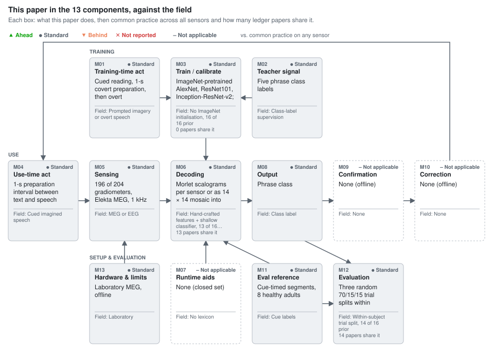

# Decoding Imagined and Spoken Phrases From Non-invasive Neural (MEG) Signals

Dash D, Ferrari P, Wang J. Frontiers in Neuroscience, 2020. [doi:10.3389/fnins.2020.00290](https://doi.org/10.3389/fnins.2020.00290)

**Section:** [Other sensors](../../README.md#other-sensors)

## Figures

### This paper in the 13 components, against the field

<picture><source media="(prefers-color-scheme: dark)" srcset="figures/components-dark.svg"></picture>

Verdicts compare the paper's choice for each component with common practice across 8,995 ledger entries on any sensor (silent speech, brain-to-text, lip reading).

Data

| Component | This paper | Common practice | Papers with this practice | Verdict |
| --- | --- | --- | --- | --- |
| M01 Training-time act | Cued reading, 1-s covert preparation, then overt articulation | Prompted imagery or overt speech |  | ● Standard (Inherited from the group's MEG paradigm.) |
| M02 Teacher signal | Five phrase class labels | Class-label supervision |  | ● Standard (Inherited.) |
| M03 Train / calibrate | ImageNet-pretrained AlexNet, ResNet101, Inception-ResNet-v2; no from-scratch control | No ImageNet initialisation, 16 of 16 prior | 0 of 16 | ● Standard (New at the time; effect of pretraining untested.) |
| M04 Use-time act | 1-s preparation interval between text and speech | Cued imagined speech |  | ● Standard (Imagery not separated from preparation (Sec. 5.3).) |
| M05 Sensing | 196 of 204 gradiometers, Elekta MEG, 1 kHz | MEG or EEG |  | ● Standard (Inherited.) |
| M06 Decoding | Morlet scalograms per sensor or as 14 × 14 mosaic into CNNs; RMS-feature ANN baseline | Hand-crafted features + shallow classifier, 13 of 16 prior | 13 of 16 | ● Standard (Time-frequency image CNN in 0 of 16 priors; representation and classifier change together (authors, Sec. 5.1); mosaic not better for imagination.) |
| M07 Runtime aids | None (closed set) | No lexicon |  | – Not applicable (Closed five-class task.) |
| M08 Output | Phrase class | Class label |  | ● Standard (Inherited.) |
| M09 Confirmation | None (offline) | None |  | – Not applicable (Offline study.) |
| M10 Correction | None (offline) | None |  | – Not applicable (Offline study.) |
| M11 Eval reference | Cue-timed segments, 8 healthy adults | Cue labels |  | ● Standard (Inherited.) |
| M12 Evaluation | Three random 70/15/15 trial splits within subject; pre-stimulus above chance | Within-subject trial split, 14 of 16 prior | 14 of 16 | ● Standard (Matches usual practice; pre-stimulus 43.77% (AlexNet, Table 1) vs 20% theoretical chance, reported by the authors.) |
| M13 Hardware & limits | Laboratory MEG, offline | Laboratory |  | ● Standard (Authors call MEG unsuitable for deployment (Sec. 5.4).) |

## Verdict

The paper [[1]](#ref-1) changes the decoder (M06) to scalogram CNNs and training (M03) to ImageNet initialisation. Neither appears among the 16 earlier imagined-speech decoders of any electrophysiological signal (Appendix), yet both are standard: the CNN-versus-ANN gain changes representation and classifier together, as the authors concede (Sec. 5.1), the sensor mosaic does not beat per-sensor scalograms for imagination, and no network is trained from scratch. The authors report the 0.5-s pre-stimulus window above chance for all methods, 43.77% for AlexNet SST-CNN (Table 1) against 20% theoretical chance (Sec. 4.2), and cite carryover (Sec. 5.3). The floor is equal across methods (Sec. 4.1), so it does not explain the CNN gain, but part of every stage score is not phrase content. The 93.24% for imagination shows phrase information in a one-second window that follows reading of visibly different phrases; it does not separate imagery from reading carryover and preparation.

## Against the field, component by component

### M06 Decoder: scalogram images and a sensor mosaic

**Usual approach:** 13 of 16 prior decoders use hand-crafted features with a shallow classifier (pattern match, Appendix), including the group's own 2018 MEG study on this paradigm, an ANN on wavelet RMS features that reached 78.35% for imagination with 4 subjects [[2]](#ref-2); no prior decoder feeds time-frequency images to a CNN (Appendix).

**State of the art:** The closest later five-class comparator, from the same laboratory and paradigm (2020, [later]), reports 54.34% for imagined phrases with 9 forward-selected sensors and 45.46% with all 196 (SVM on RMS features, 60 trials per phrase, 5-fold within-subject CV, 7 subjects, 20% chance) [[3]](#ref-3).

The authors took the ANN baseline from the prior approach they judged strongest (Sec. 1) and say they compared approaches, not features, because the inputs differ in content and dimension (Sec. 5.1). The gain therefore belongs to the whole pipeline. Within it, ST-CNN reaches 91.71% and SST-CNN 93.24% for imagination, not different (p = 0.2135, Sec. 4.1), and the authors note that shift augmentation, used for SST-CNN alone, may explain the mosaic's other wins (Sec. 5.1). Verdict: standard.

### M03 Training: ImageNet-pretrained CNNs

**Usual approach:** None of the 16 prior or 8 [concurrent] decoders initialises from ImageNet (pattern match, Appendix); the paper fine-tunes AlexNet, ResNet101 and Inception-ResNet-v2 (Sec. 3.2).

**State of the art:** A [later] MEG study (2026, 21 participants) ran the from-scratch control with full fine-tuning: imagery versus silence falls from 90.4% to 80.2% pooled (binary, 50% chance) and three vowels on held-out participants from 51.7% to 44.8% (33% chance) [[4]](#ref-4), relative drops of 11.3% and 13.3% (inference).

Without a from-scratch arm, the paper shows pretrained CNNs work, not that pretraining helps. Verdict: standard.

### M12 Evaluation: trial splits and the pre-stimulus floor

**Usual approach:** 14 of 16 prior decoders use within-subject k-fold, leave-one-out or random trial splits (13 pattern match, 1 read; Appendix), as do the paper's three random 70/15/15 splits (Sec. 3.1).

**State of the art:** On held-out participants, a [later] MEG study (2026) reaches 77.5% for imagery versus silence (50% chance) and 51.7% for three vowels (33% chance), with its vowel pre-cue window at 34.8%, near chance [[4]](#ref-4).

The pre-stimulus control is to the authors' credit. The group's 2018 study saw pre-stimulus accuracy rise with trial count at rest and attributed it to memorisation of the five stimuli [[2]](#ref-2). Under pseudo-random order (Sec. 2.2), carryover predicts the current phrase only if the order is constrained (inference). EMG during internal speech [[5]](#ref-5) and across-day testing [[6]](#ref-6) occur in 1 of 16 priors each (Appendix), too few for behind. Verdict: standard.

## The 13 components

| Component | This paper | Usual approach (count) | State of the art | Verdict |
|---|---|---|---|---|
| M01 Training-time action | Cued reading, 1-s covert preparation, then overt articulation | Prompted imagery or overt speech | – | standard |
| M02 Training-only supervision | Five phrase class labels | Class-label supervision | – | standard |
| M03 Training and adaptation | ImageNet-pretrained AlexNet, ResNet101, Inception-ResNet-v2; no from-scratch control | No ImageNet initialisation, 16 of 16 prior (pattern match 0) | From scratch 80.2 vs 90.4% [[4]](#ref-4) [later] | standard |
| M04 Use-time action | 1-s preparation interval between text and speech | Cued imagined speech | – | standard |
| M05 Sensors | 196 of 204 gradiometers, Elekta MEG, 1 kHz | MEG or EEG | – | standard |
| M06 Processing and decoding | Morlet scalograms per sensor or as 14 × 14 mosaic into CNNs; RMS-feature ANN baseline | Hand-crafted features + shallow classifier, 13 of 16 prior (pattern match 13) | Closest later 5-class: 54.34%, 9 sensors, SVM [[3]](#ref-3) | standard |
| M07 Lexicon and LM | None (closed set) | No lexicon | – | not applicable |
| M08 Output | Phrase class | Class label | – | standard |
| M09 Confirmation | None (offline) | None | – | not applicable |
| M10 Correction | None (offline) | None | – | not applicable |
| M11 Reference construction | Cue-timed segments, 8 healthy adults | Cue labels | – | standard |
| M12 Evaluation | Three random 70/15/15 trial splits within subject; pre-stimulus above chance | Within-subject trial split, 14 of 16 prior (pattern match 14) | LOSO 51.7%, 3 vowels, pre-cue 34.8% [[4]](#ref-4) | standard |
| M13 Device and cost | Laboratory MEG, offline | Laboratory | – | standard |

## Where the claims outrun the evidence

- "Imagined" (Title): the window starts at text offset, after 1 s of reading that CNNs decode at 86.83% to 90.38% (Sec. 4.1), and phrases differ in length; the authors allow that it mixes preparation and imagination (Sec. 5.3). No EMG is recorded, and the jaw-motion channel, acquired during articulation (Sec. 2.1), is not reported for this window.
- The abstract's "up to 93%" sits on a 43.77% pre-stimulus floor (Table 1), 49.47 points below it (inference).
- About 75 valid trials per phrase per subject (Sec. 2.3), but chance is computed for about 60 (Sec. 4.2).
- Table 2's note gives 1,382 test trials in total, yet each of its five rows sums to 1,382 (Table 2).
- Pairwise t-tests are uncorrected (Sec. 4.1); split indices, stratification and seeds are unreported (Sec. 3.1).

## What the field needs next

- M12: block- or session-wise folds; test whether the pre-stimulus window predicts the previous phrase.
- M04: imagery without following overt speech or text offset, with articulatory EMG as in [[5]](#ref-5).
- M03 and M06: CNNs from scratch, as in [[4]](#ref-4), and both scalogram inputs with equal augmentation.

## Questions for the authors

- What constrained the pseudo-randomised order?
- For ST-CNN, were the 196 sensor images of a trial kept in one partition?
- Was RMS chosen on training trials only?
- Is 1,382 in Table 2 the total test set or the per-phrase total?

## Appendix: literature search

Target-time population for all three topics: imagined, covert, inner or internal speech decoders (or an imagination stage) from scalp EEG, MEG, ECoG, depth or intracortical recordings first public before 2019-01, found by a full-text pattern over the whole wiki and triaged by hand; fMRI, fNIRS, reviews, synthetic data, implanted unit recordings of attempted or inner speech, listening-only, overt-only and analyses without a decoder excluded; versions once. Target time 2019-07, the date of the same group's EMBC 2019 conference paper on CNN transfer learning for MEG speech decoding (doi:10.1109/EMBC.2019.8857874); journal received 2019-08 and published 2020-04. 16 prior unique studies (one EEG and MEG, one MEG, five intracranial, nine EEG), 8 [concurrent] (2019-01 to 2020-01).

- M06 imagined-speech-neural-time-frequency-image-cnn (new). Inclusion rule: decoders of imagined, covert or inner speech from electrophysiological recordings; design compared is decoder input and classifier; related-work mentions do not count. Ledger counts: slot-filled 7,345 unique studies (M06); pattern match 309 unique studies, all years. Among the 16 prior: shallow classifier 13 (pattern match); any CNN 1 (pattern match), 0 (design-confirmed); time-frequency image with CNN 0; ImageNet-pretrained 0 (pattern match). Among the 8 [concurrent]: any CNN 6, time-frequency image with CNN 0 (pattern match). Whole-wiki recall check (any electrophysiological speech decoder up to 2019, overt included): 2 hits, both off-design. Read: [[2]](#ref-2) (prior), [[3]](#ref-3) ([later] comparator). Known-item recall 1.0 (3 seeds).
- M03 imagenet-pretrained-vision-backbone-neural-speech (published table, reused). Inclusion rule: speech or language decoders from EEG, MEG or intracranial recordings that initialise a vision backbone pretrained on natural images. Ledger counts: slot-filled 1,526 unique studies (M03); pattern match 8 unique studies, all years, none earlier than the target. At target time: 0 of 16 prior, 0 of 8 [concurrent] (pattern match). Read: [[4]](#ref-4) (state of the art). Known-item recall 1.0 (2 seeds).
- M12 imagined-speech-neural-test-partition-and-artifact-controls (new). Inclusion rule: same population; design compared is test separation and EMG recorded during the covert condition; EMG named only for artifact removal or background does not count. Ledger counts: slot-filled 6,960 unique studies (M12); pattern match 309 unique studies, all years. Among the 16 prior: within-subject k-fold, leave-one-out or random split 14 (13 pattern match, 1 read); held-out-subject term 8, session or day term 3, EMG term 6, permutation null 4 (pattern match); across-day evaluation 1, EMG during covert speech 1, EMG removal re-tested 1, pre-stimulus above chance reported 1 (design-confirmed). Read: [[5]](#ref-5), [[6]](#ref-6), [[2]](#ref-2) (prior), [[4]](#ref-4) (state of the art). Known-item recall 1.0 (2 seeds).

## References

Numbered by first citation. BibTeX in the same order and keys: [refs.bib](refs.bib).

1. Dash, D., Ferrari, P., Wang, J. “Decoding Imagined and Spoken Phrases From Non-invasive Neural (MEG) Signals.” *Frontiers in Neuroscience*, 2020, 14, 290. doi:[10.3389/fnins.2020.00290](https://doi.org/10.3389/fnins.2020.00290). Target. Published version read. [wiki: doi-10.3389-fnins.2020.00290](https://github.com/supernaiter/deep-research-wiki-for-silent-speech/blob/main/papers/doi-10.3389-fnins.2020.00290/article.md) [wiki: doi-10.3389-fnhum.2020.00290](https://github.com/supernaiter/deep-research-wiki-for-silent-speech/blob/main/papers/doi-10.3389-fnhum.2020.00290/article.md) [wiki: pmc-7154084-megphrases](https://github.com/supernaiter/deep-research-wiki-for-silent-speech/blob/main/papers/pmc-7154084-megphrases/article.md)
2. Dash, D., Ferrari, P., Malik, S., Montillo, A., Maldjian, J. A., Wang, J. “Determining the Optimal Number of MEG Trials: A Machine Learning and Speech Decoding Perspective.” *Brain Informatics (BI 2018), Lecture Notes in Computer Science*, 2018, 11309, 163-172. doi:[10.1007/978-3-030-05587-5_16](https://doi.org/10.1007/978-3-030-05587-5_16). Prior; same group and paradigm; deciding prior for the ANN comparator and the pre-stimulus observation. [wiki: pmc-6876632-megtrials](https://github.com/supernaiter/deep-research-wiki-for-silent-speech/blob/main/papers/pmc-6876632-megtrials/article.md) [wiki: doi-10.1007-978-3-030-05587-5_16](https://github.com/supernaiter/deep-research-wiki-for-silent-speech/blob/main/papers/doi-10.1007-978-3-030-05587-5_16/article.md)
3. Dash, D., Wisler, A., Ferrari, P., Davenport, E. M., Maldjian, J., Wang, J. “MEG Sensor Selection for Neural Speech Decoding.” *IEEE Access*, 2020, 8, 182320-182337. doi:[10.1109/ACCESS.2020.3028831](https://doi.org/10.1109/ACCESS.2020.3028831). Same laboratory and paradigm; state of the art for M06 and M12. [later] [wiki: pmc-7668411-megsel](https://github.com/supernaiter/deep-research-wiki-for-silent-speech/blob/main/papers/pmc-7668411-megsel/article.md) [wiki: doi-10.1109-access.2020.3028831](https://github.com/supernaiter/deep-research-wiki-for-silent-speech/blob/main/papers/doi-10.1109-access.2020.3028831/article.md) [wiki: pmc-7668411-meg-sensor-selection](https://github.com/supernaiter/deep-research-wiki-for-silent-speech/blob/main/papers/pmc-7668411-meg-sensor-selection/article.md)
4. Jhilal, S., Martin, S., Giraud, A. “Transfer Learning from ImageNet for MEG-Based Decoding of Imagined Speech.” *IEEE International Symposium on Biomedical Imaging (ISBI)*, 2026. arXiv:[2601.15909](https://arxiv.org/abs/2601.15909). State of the art for M03 (pretraining ablation). [later] [review](https://github.com/supernaiter/silent-speech-review/tree/main/reviews/transfer-learning-from-imagenet-for-meg-based-decoding-of-imagined-speech) [wiki: arxiv-2601.15909](https://github.com/supernaiter/deep-research-wiki-for-silent-speech/blob/main/papers/arxiv-2601.15909/article.md) [wiki: arxiv-2601.15909-imgmeg](https://github.com/supernaiter/deep-research-wiki-for-silent-speech/blob/main/papers/arxiv-2601.15909-imgmeg/article.md)
5. Suppes, P., Lu, Z., Han, B. “Brain wave recognition of words.” *Proceedings of the National Academy of Sciences*, 1997, 94(26), 14965-14969. doi:[10.1073/pnas.94.26.14965](https://doi.org/10.1073/pnas.94.26.14965). Prior; EMG recorded during internal speech. [wiki: pmc-25146-brainwave](https://github.com/supernaiter/deep-research-wiki-for-silent-speech/blob/main/papers/pmc-25146-brainwave/article.md)
6. Rezazadeh Sereshkeh, A. “Development of a Hybrid Brain-Computer Interface Based on Imagined Speech Using Electroencephalography and Near-Infrared Spectroscopy.” *University of Toronto (PhD thesis)*, 2018. <http://hdl.handle.net/1807/97898> Prior; across-day evaluation and EMG-removal re-test. [wiki: oa-W3088488915](https://github.com/supernaiter/deep-research-wiki-for-silent-speech/blob/main/papers/oa-W3088488915/article.md)

## Materials

Data behind this review. Full texts of the papers are not included.

- [`review.md`](review.md): the review text (source)
- [`refs.bib`](refs.bib): references (BibTeX)
- [`slots.json`](slots.json): for each of the 13 components: this paper's choice, field practice, number of matching papers, verdict
- [`figures.json`](figures.json): figure definitions
- [`evaluation.md`](evaluation.md): independent evaluation by a second reviewer
- [`triage.md`](triage.md): how each evaluation finding was checked against the sources and resolved
- [`process/log.json`](process/log.json): process record: each step, who did it (reader, script, writer, evaluator), when, the checks run and the input versions
- [`process/notes.json`](process/notes.json): reading notes on the target and comparator papers: claims, numbers, conditions and what is not stated, with locations
- [`process/plan.json`](process/plan.json): plan: which components the paper changes and the topics it is compared on
- [`process/draft.md`](process/draft.md): the review as first written, before the independent evaluation
- [`process/claims-draft.md`](process/claims-draft.md): claim table of the draft: every claim mapped to a note or a count
- [`process/claims.md`](process/claims.md): claim table of the published review
- [`components/M03/imagenet-pretrained-vision-backbone-neural-speech.csv`](../../components/M03/imagenet-pretrained-vision-backbone-neural-speech.csv): M03 topic "imagenet-pretrained-vision-backbone-neural-speech", every candidate paper with its decision (1526 slot-filled, 8 pattern match, usual design in 5, 3 read in full)
- [`components/M06/imagined-speech-neural-time-frequency-image-cnn.csv`](../../components/M06/imagined-speech-neural-time-frequency-image-cnn.csv): M06 topic "imagined-speech-neural-time-frequency-image-cnn", every candidate paper with its decision (7345 slot-filled, 309 pattern match, usual design in 13, 3 read in full)
- [`components/M12/imagined-speech-neural-test-partition-and-artifact-controls.csv`](../../components/M12/imagined-speech-neural-test-partition-and-artifact-controls.csv): M12 topic "imagined-speech-neural-test-partition-and-artifact-controls", every candidate paper with its decision (6960 slot-filled, 309 pattern match, usual design in 14, 5 read in full)

## More reviews in Other sensors

- [ASR is all you need: cross-modal distillation for lip reading](../asr-is-all-you-need-cross-modal-distillation-for-lip-reading/) (2020). ASR-teacher labels (M02) replaced transcribed-data alignment targets; standard: LRS2 parity holds, but effects differ across datasets, one WER each, and distillation is not isolated.
- [Decoding spoken English from intracortical electrode arrays in dorsal precentral gyrus](../decoding-spoken-english-from-intracortical-electrode-arrays-in-dorsal-precentral-gyrus/) (2020). 39-phoneme decoding from dorsal Utah arrays (M06) and overt-speech confound controls (M12) are standard: both have read priors, T5 alone carries them, and folds share words.
- [Hearing Lips: Improving Lip Reading by Distilling Speech Recognizers](../hearing-lips-improving-lip-reading-by-distilling-speech-recognizers/) (2020). Recognizer-to-lip-reader distillation (M02) is ahead of the prior record and repeats over two datasets and three teachers; the audio rationale is untested and the LRS2 state-of-the-art claim fails.
- [Learning Individual Speaking Styles for Accurate Lip to Speech Synthesis](../learning-individual-speaking-styles-for-accurate-lip-to-speech-synthesis/) (2020). Lip2Wav's per-speaker natural corpus (M03) is ahead; its attention decoder (M06) is standard, since LipSound had one in 2019; two Table 2 baseline WERs match another recognizer's values.
- [Lipreading using Temporal Convolutional Networks](../lipreading-using-temporal-convolutional-networks/) (2020). Multi-scale TCN (M06) and variable-length cropping (M03) are standard: head and augmentation are not separated, no run counts, robustness comes from the cropping; 85.3% LRW trails 93.2% today.
- [Machine translation of cortical activity to text with an encoder-decoder framework](../machine-translation-of-cortical-activity-to-text-with-an-encoder-decoder-framework/) (2020). Word-level ECoG encoder-decoder; all changed components standard. 3% WER is on repeats of 50 sentences; unseen sentences and participants were never tested.

---

Part of the [Silent Speech Interface Review](https://github.com/supernaiter/silent-speech-review). Found an error? [Open an issue](https://github.com/supernaiter/silent-speech-review/issues/new?template=correction.yml).
