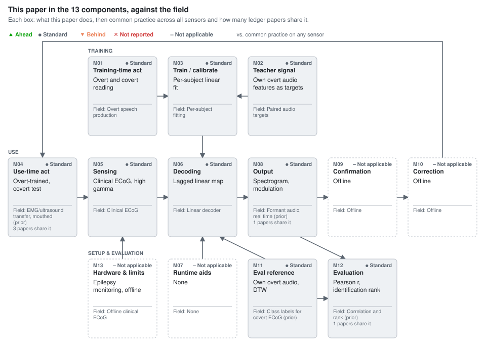

# Decoding spectrotemporal features of overt and covert speech from the human cortex

Stéphanie Martin, Peter Brunner, Chris Holdgraf, Hans-Jochen Heinze, Nathan E. Crone, Jochem Rieger, Gerwin Schalk, Robert T. Knight, Brian N. Pasley. Frontiers in Neuroengineering 7:14, 2014. [doi:10.3389/fneng.2014.00014](https://doi.org/10.3389/fneng.2014.00014)

**Section:** [Other sensors](../../README.md#other-sensors)

## Figures

### This paper in the 13 components, against the field

<picture><source media="(prefers-color-scheme: dark)" srcset="figures/components-dark.svg"></picture>

Verdicts compare the paper's choice for each component with common practice across 8,995 ledger entries on any sensor (silent speech, brain-to-text, lip reading).

Data

| Component | This paper | Common practice | Papers with this practice | Verdict |
| --- | --- | --- | --- | --- |
| M01 Training-time act | Overt and covert reading | Overt speech production |  | ● Standard (Inherited.) |
| M02 Teacher signal | Own overt audio features as targets | Paired audio targets |  | ● Standard (Inherited (Pasley lineage).) |
| M03 Train / calibrate | Per-subject linear fit | Per-subject fitting |  | ● Standard (No seeds or split repeats.) |
| M04 Use-time act | Overt-trained, covert test | EMG/ultrasound transfer, mouthed (prior) | 3 of 3 | ● Standard (No neural prior; neural covert decoders trained within condition.) |
| M05 Sensing | Clinical ECoG, high gamma | Clinical ECoG |  | ● Standard (Inherited.) |
| M06 Decoding | Lagged linear map | Linear decoder |  | ● Standard (Inherited (Pasley lineage).) |
| M07 Runtime aids | None | None |  | – Not applicable (Feature reconstruction, no LM.) |
| M08 Output | Spectrogram, modulation | Formant audio, real time (prior) | 1 of 1 | ● Standard (Richer features, no audio.) |
| M09 Confirmation | Offline | Offline |  | – Not applicable (Offline study.) |
| M10 Correction | Offline | Offline |  | – Not applicable (Offline study.) |
| M11 Eval reference | Own overt audio, DTW | Class labels for covert ECoG (prior) |  | ● Standard (Audible reference used in NAM conversion.) |
| M12 Evaluation | Pearson r, identification rank | Correlation and rank (prior) | 1 of 5 | ● Standard (Pasley protocol; no held-out story.) |
| M13 Hardware & limits | Epilepsy monitoring, offline | Offline clinical ECoG |  | – Not applicable (Use proposed, not tested.) |

## Verdict

The paper [[1]](#ref-1) changes three components, all standard against any signal type. Testing an overt-trained decoder on covert reading (M04) follows EMG and ultrasound transfer tests on mouthed speech [[2]](#ref-2), [[3]](#ref-3). Spectrogram and modulation output (M08) extends one earlier formant decoder [[4]](#ref-4). Scoring covert output against the speaker's DTW-aligned overt recording (M11) repeats the reference used in whispered and NAM conversion [[5]](#ref-5), although no earlier neural covert study builds one (Appendix). That reference is the main confound: separately recorded rest, warped the same way, reaches r = 0.30 against covert r = 0.34, and covert identification beat chance in one of seven subjects (Sec. Discussion), so covert decoding is a small group effect.

## Against the field, component by component

### M04 Use-time action: overt-trained decoder on covert speech

**Usual approach:** 3 of 3 prior overt-to-silent transfer studies are EMG or ultrasound recognizers on mouthed speech, and 0 are neural (confirmed, unique studies, Appendix) [[2]](#ref-2), [[6]](#ref-6), [[3]](#ref-3); the closest neural covert decoder trained and tested within the covert condition on class labels [[7]](#ref-7).
**State of the art:** Komeiji et al. (2024) [later] [[8]](#ref-8) decode covert ECoG sentences with an overt-trained Transformer at 46.3% token error rate against 46.6% when covert-trained (16 patients, eight sentences).

The authors frame transfer as a test of shared representation [[1]](#ref-1). Mouthed speech keeps an articulatory signal and covert reading has none, so the EMG and ultrasound degradations [[3]](#ref-3) set no expectation for ECoG. With no covert-trained arm, the transfer cost stays unknown; a later sentence-level test finds none [[8]](#ref-8). Verdict: standard.

### M08 Output: spectrotemporal features from production

**Usual approach:** 1 of 1 prior confirmed study decodes continuous acoustics from production activity (confirmed, unique studies, Appendix): two formants driving a real-time synthesizer [[4]](#ref-4); the target outputs 32 spectrogram bins and 60 modulation features but no audio.
**State of the art:** Wairagkar et al. (2025) [later] [[9]](#ref-9) synthesize voice from attempted speech at a median listener word error rate of 43.75% (one participant).

The 32 bins span consonant cues that two formants omit (inference), but no listener heard the output, so the gain over Guenther et al. is in representation only [[9]](#ref-9). Verdict: standard.

### M11 Ground truth: own overt recording as covert reference

**Usual approach:** no field-practice count; the closest neural covert prior scores ECoG decoding against class labels [[7]](#ref-7), while whispered and NAM conversion already scored output against the speaker's DTW-aligned audible recording of the same utterance [[5]](#ref-5).
**State of the art:** Kim et al. (2025) [later] [[10]](#ref-10) use the overt recording of the same sentence as target audio for imagined EEG, with 15 participants and 30 unseen test sentences each.

The authors concede that covert speech has no simple ground truth and that alignment is a major difficulty [[1]](#ref-1). Under the any-signal rule of M04 the construction predates the target [[5]](#ref-5), so the verdict is standard; new for neural decoding is that none of the prior pattern-match hits builds an overt reference for covert production (Appendix). The protocol lacks a matched null: rest has no text, eye movement or reading rhythm, and no covert output is warped to mismatched text. Covert beats rest in 5 of 7 subjects for spectrogram, 4 of 7 for modulation and 1 of 7 for identification; rest reaches 88% of covert r, and covert keeps one fifth (spectrogram) and one sixth (modulation) of the overt margin over rest (inference).

### M12 Evaluation: correlation and identification rank

**Usual approach:** of 5 prior pattern-match studies, only Pasley et al. [[11]](#ref-11) evaluate a reconstruction, by correlation and DTW-based identification rank (median 0.89 trial-averaged, 0.76 single-trial, 47 words); the paper reuses both.
**State of the art:** Wairagkar et al. (2025) [later] [[9]](#ref-9) evaluate synthesized speech by listener open transcription, 43.75% median word error rate.

Overt rank 0.91 matches Pasley on 24–140 candidate 5-s segments of continuous reading; covert rank 0.55 sits far below Pasley's single-trial 0.76 (inference). A percentile rank says nothing about intelligibility [[9]](#ref-9). Verdict: standard.

## The 13 components

| Component | This paper | Usual approach (count) | State of the art | Verdict |
|---|---|---|---|---|
| M01 Training-time action | Overt and covert reading | Overt speech production | – | standard |
| M02 Training-only supervision | Own overt audio features as targets | Paired audio targets | – | standard |
| M03 Training and adaptation | Per-subject linear fit | Per-subject fitting | – | standard |
| M04 Use-time action | Overt-trained, covert test | EMG/ultrasound transfer, mouthed (prior) (confirmed 3) | [[8]](#ref-8) (2024): covert TER 46.3% | standard |
| M05 Sensors | Clinical ECoG, high gamma | Clinical ECoG | – | standard |
| M06 Processing and decoding | Lagged linear map | Linear decoder | – | standard |
| M07 Lexicon and LM | None | None | – | not applicable |
| M08 Output | Spectrogram, modulation | Formant audio, real time (prior) (confirmed 1) | [[9]](#ref-9) (2025): listener WER 43.75% | standard |
| M09 Confirmation | Offline | Offline | – | not applicable |
| M10 Correction | Offline | Offline | – | not applicable |
| M11 Reference construction | Own overt audio, DTW | Class labels for covert ECoG (prior) | [[10]](#ref-10) (2025): matched overt reference, unseen sentences | standard |
| M12 Evaluation | Pearson r, identification rank | Correlation and rank (prior) (pattern match 1) | [[9]](#ref-9) (2025): listener WER 43.75% | standard |
| M13 Device and cost | Epilepsy monitoring, offline | Offline clinical ECoG | – | not applicable |

## Where the claims outrun the evidence

- Covert beats warped rest by r 0.04 for spectrogram and for modulation, 0.46 against 0.42 [[1]](#ref-1); there is no mismatched-text control.
- The "partially shared" substrate (Abstract) rests on a transferred linear map; lower high-gamma SNR explains lower covert accuracy as well, as the authors concede (Discussion) [[1]](#ref-1).
- Covert scoring uses overt audio of the same stories, and the paper does not say whether references were restricted to overt test blocks [[1]](#ref-1), so covert references overlap overt training targets in text.
- The random 90/10 block split has no seeds and no held-out story or session [[1]](#ref-1).

## What the field needs next

- M11: covert output scored against mismatched overt text under identical DTW, with a task-matched null.
- M04: a covert-trained arm in the same subjects [[8]](#ref-8), to separate representation from SNR.
- M12: held-out stories in both conditions, candidates from unseen text.
- M08: audio rendering and a listener test [[9]](#ref-9).

## Questions for the authors

- Were standardization statistics computed on training blocks only?
- How many random partitions and seeds were used?
- Were covert references restricted to overt test blocks?
- How was the DTW window chosen?

## Appendix: literature search

- M04 overt-to-silent-transfer (reused topic table). Inclusion rule: decoder trained only on overt or attempted overt speech applied to silent, mimed, inner or imagined speech without retraining, any signal; whisper transfer, perception-to-imagery transfer and similarity-only analyses excluded; versions count once. Ledger counts: slot-filled 5,595, pattern match 33 unique studies. Usual design: overt-to-silent transfer reported as degradation, 23 confirmed unique studies over all years (versions merged); 3 prior (first public before 2013-11), all EMG or ultrasound/video on mouthed speech, 0 neural [[2]](#ref-2), [[6]](#ref-6), [[3]](#ref-3). Read in full: [[3]](#ref-3), [[8]](#ref-8). Known-item recall 1.0.
- M08 neural-speech-synthesis (reused topic table). Inclusion rule: continuous acoustic representations decoded from neural signals of speech production, output as speech or convertible to it; perception, text-then-TTS and limb-imagery control excluded. Ledger counts: slot-filled 3,268, pattern match 35 unique studies. 15 confirmed unique studies over all years, 1 prior [[4]](#ref-4). Read in full: [[4]](#ref-4), [[9]](#ref-9). Known-item recall 1.0.
- M11 covert-neural-reconstruction-reference (new topic). Inclusion rule: neural studies of covert, imagined, mimed or silent speech that state how the covert ground truth is built; design of interest is an acoustic reconstruction scored against the same participant's overt recording of the same text; class-label, heard-stimulus and text-only references are other designs; the any-signal check also covers acoustic whisper and NAM conversion. Ledger counts: slot-filled 234, pattern match 167 unique studies. Prior pattern-match hits: 10 unique studies, of which 2 decode speech (Pasley 2012 perception, Tankus 2012 vowel classification) and none covert speech; Pei 2011 is added as the closest neural covert prior [[7]](#ref-7). All years: label_only 54, dtw_alignment 35, overt_audio_reference 15 of 167 (pattern match). Full-text recall check over 8,947 wiki folders: 240 hits; before the target, 5 non-target hits, one with the same reference construction for non-audible input [[5]](#ref-5), none neural covert. Read in full: [[11]](#ref-11), [[7]](#ref-7), [[5]](#ref-5), [[10]](#ref-10). Known-item recall 0.67.
- M12 neural-speech-reconstruction-identification-test (reused topic table). Inclusion rule: continuous acoustic reconstruction from neural recordings during perceived, produced, mimed or imagined speech, with evaluation; classification-only and text-only decoders excluded. Ledger counts: slot-filled 6,960, pattern match 173 unique studies. Usual design over all years: correlation, 122 of 173 (pattern match). Prior population: 5 unique studies, 1 reconstruction [[11]](#ref-11). Read in full: [[11]](#ref-11), [[9]](#ref-9). Known-item recall 0.67.

## References

Numbered by first citation. BibTeX in the same order and keys: [refs.bib](refs.bib).

1. Martin, S., Brunner, P., Holdgraf, C., Heinze, H., Crone, N. E., Rieger, J., et al. “Decoding spectrotemporal features of overt and covert speech from the human cortex.” *Frontiers in Neuroengineering*, 2014, 7, 14. doi:[10.3389/fneng.2014.00014](https://doi.org/10.3389/fneng.2014.00014). Target. Read as the published article. [wiki: doi-10.3389-fneng.2014.00014](https://github.com/supernaiter/deep-research-wiki-for-silent-speech/blob/main/papers/doi-10.3389-fneng.2014.00014/article.md) [wiki: pmc-4034498-overtcovert](https://github.com/supernaiter/deep-research-wiki-for-silent-speech/blob/main/papers/pmc-4034498-overtcovert/article.md) [wiki: pmc-4034498-spectemp](https://github.com/supernaiter/deep-research-wiki-for-silent-speech/blob/main/papers/pmc-4034498-spectemp/article.md)
2. Janke, M., Wand, M., Schultz, T. “A Spectral Mapping Method for EMG-based Recognition of Silent Speech.” *Proc. BIOSIGNALS 2010*, 2010. doi:[10.5220/0002814100220031](https://doi.org/10.5220/0002814100220031). Prior; M04 overt-to-silent transfer (EMG). [wiki: doi-10.5220-0002814100220031](https://github.com/supernaiter/deep-research-wiki-for-silent-speech/blob/main/papers/doi-10.5220-0002814100220031/article.md)
3. Florescu, V., Crevier-Buchman, L., Denby, B., Hueber, T., Pillot-Loiseau, C., Roussel, P., et al. “Silent vs Vocalized Articulation for a Portable Ultrasound-Based Silent Speech Interface.” *Interspeech*, 2010. <https://www.isca-archive.org/interspeech_2010/florescu10_interspeech.html> Prior; M04 overt-to-silent transfer (ultrasound and video). [wiki: isca-florescu10](https://github.com/supernaiter/deep-research-wiki-for-silent-speech/blob/main/papers/isca-florescu10/article.md) [wiki: isca-florescu10-silentvocal](https://github.com/supernaiter/deep-research-wiki-for-silent-speech/blob/main/papers/isca-florescu10-silentvocal/article.md) [wiki: isca-florescu10_interspeech](https://github.com/supernaiter/deep-research-wiki-for-silent-speech/blob/main/papers/isca-florescu10_interspeech/article.md)
4. Guenther, F. H., Brumberg, J. S., Wright, E. J., Nieto-Castanon, A., Tourville, J. A., Panko, M., et al. “A Wireless Brain-Machine Interface for Real-Time Speech Synthesis.” *PLoS ONE*, 2009, 4(12), e8218. doi:[10.1371/journal.pone.0008218](https://doi.org/10.1371/journal.pone.0008218). Prior; deciding prior for M08 and M11. Versions pmc-2784218-wireless and pmc-2784218-wirelesssynth in the wiki. [review](https://github.com/supernaiter/silent-speech-review/tree/main/reviews/a-wireless-brain-machine-interface-for-real-time-speech-synthesis) [wiki: doi-10.1371-journal.pone.0008218](https://github.com/supernaiter/deep-research-wiki-for-silent-speech/blob/main/papers/doi-10.1371-journal.pone.0008218/article.md)
5. Tran, V. “Silent Communication: whispered speech-to-clear speech conversion.” *PhD thesis, Institut National Polytechnique de Grenoble*, 2010. <https://theses.hal.science/tel-00614289v1> Prior; same reference construction for M11 (whispered/NAM conversion scored against audible recordings). [wiki: w-2246823171](https://github.com/supernaiter/deep-research-wiki-for-silent-speech/blob/main/papers/w-2246823171/article.md)
6. Wand, M., Schultz, T. “Session-Independent EMG-Based Speech Recognition.” *Proc. BIOSIGNALS 2011*, 2011. doi:[10.5220/0003169702950300](https://doi.org/10.5220/0003169702950300). Prior; M04 overt-to-silent transfer (EMG). [wiki: doi-10.5220-0003169702950300](https://github.com/supernaiter/deep-research-wiki-for-silent-speech/blob/main/papers/doi-10.5220-0003169702950300/article.md)
7. Pei, X., Barbour, D., Leuthardt, E. C., Schalk, G. “Decoding Vowels and Consonants in Spoken and Imagined Words Using Electrocorticographic Signals in Humans.” *Journal of Neural Engineering*, 2011, 8(4), 046028. doi:[10.1088/1741-2560/8/4/046028](https://doi.org/10.1088/1741-2560/8/4/046028). Prior; closest neural covert prior for M04 and M11. Read as the PMC author manuscript; version pmc-3772685-vowelcons in the wiki. [review](https://github.com/supernaiter/silent-speech-review/tree/main/reviews/decoding-vowels-and-consonants-in-spoken-and-imagined-words-using-electrocorticographic-signals-in-h) [wiki: doi-10.1088-1741-2560-8-4-046028](https://github.com/supernaiter/deep-research-wiki-for-silent-speech/blob/main/papers/doi-10.1088-1741-2560-8-4-046028/article.md)
8. Komeiji, S., Mitsuhashi, T., Iimura, Y., Suzuki, H., Sugano, H., Shinoda, K., et al. “Feasibility of decoding covert speech in ECoG with a Transformer trained on overt speech.” *Scientific Reports*, 2024, 14, 11491. doi:[10.1038/s41598-024-62230-9](https://doi.org/10.1038/s41598-024-62230-9). Later; state of the art for M04. [later] [wiki: doi-10.1038-s41598-024-62230-9](https://github.com/supernaiter/deep-research-wiki-for-silent-speech/blob/main/papers/doi-10.1038-s41598-024-62230-9/article.md) [wiki: pmc-11106343-ecogtransformer](https://github.com/supernaiter/deep-research-wiki-for-silent-speech/blob/main/papers/pmc-11106343-ecogtransformer/article.md) [wiki: doi-10.1101-2024.02.05.578911](https://github.com/supernaiter/deep-research-wiki-for-silent-speech/blob/main/papers/doi-10.1101-2024.02.05.578911/article.md) [wiki: doi-10.21203-rs.3.rs-3927907-v1](https://github.com/supernaiter/deep-research-wiki-for-silent-speech/blob/main/papers/doi-10.21203-rs.3.rs-3927907-v1/article.md)
9. Wairagkar, M., Card, N. S., Singer-Clark, T., Hou, X., Iacobacci, C., Miller, L. M., et al. “An instantaneous voice-synthesis neuroprosthesis.” *Nature*, 2025. doi:[10.1038/s41586-025-09127-3](https://doi.org/10.1038/s41586-025-09127-3). Later; state of the art for M08. [later] [review](https://github.com/supernaiter/silent-speech-review/tree/main/reviews/an-instantaneous-voice-synthesis-neuroprosthesis) [wiki: doi-10.1038-s41586-025-09127-3](https://github.com/supernaiter/deep-research-wiki-for-silent-speech/blob/main/papers/doi-10.1038-s41586-025-09127-3/article.md) [wiki: doi-10.1101-2024.08.14.607690](https://github.com/supernaiter/deep-research-wiki-for-silent-speech/blob/main/papers/doi-10.1101-2024.08.14.607690/article.md) [wiki: pmc-12369848-voicesynth](https://github.com/supernaiter/deep-research-wiki-for-silent-speech/blob/main/papers/pmc-12369848-voicesynth/article.md) [wiki: pmc-12369848-voice-synth-np](https://github.com/supernaiter/deep-research-wiki-for-silent-speech/blob/main/papers/pmc-12369848-voice-synth-np/article.md) [wiki: pmc-11370360-instvoice](https://github.com/supernaiter/deep-research-wiki-for-silent-speech/blob/main/papers/pmc-11370360-instvoice/article.md)
10. Kim, D., Lee, S., Yin, K., Lee, S. “Reconstructing Unseen Sentences from Speech-related Biosignals for Open-vocabulary Neural Communication.” *arXiv preprint*, 2025. arXiv:[2510.27247](https://arxiv.org/abs/2510.27247). Later; state of the art for M11. [later] [review](https://github.com/supernaiter/silent-speech-review/tree/main/reviews/reconstructing-unseen-sentences-from-speech-related-biosignals-for-open-vocabulary-neural-commun) [wiki: arxiv-2510.27247](https://github.com/supernaiter/deep-research-wiki-for-silent-speech/blob/main/papers/arxiv-2510.27247/article.md)
11. Pasley, B. N., David, S. V., Mesgarani, N., Flinker, A., Shamma, S. A., Crone, N. E., et al. “Reconstructing Speech from Human Auditory Cortex.” *PLoS Biology*, 2012, 10(1), e1001251. doi:[10.1371/journal.pbio.1001251](https://doi.org/10.1371/journal.pbio.1001251). Prior; deciding prior for M11 and M12. Versions doi-10.1371-journal.pbio.1001251 and pmc-3269422-speechrecon in the wiki. [review](https://github.com/supernaiter/silent-speech-review/tree/main/reviews/reconstructing-speech-from-human-auditory-cortex) [wiki: pmc-3269422-pasley](https://github.com/supernaiter/deep-research-wiki-for-silent-speech/blob/main/papers/pmc-3269422-pasley/article.md)

## Materials

Data behind this review. Full texts of the papers are not included.

- [`review.md`](review.md): the review text (source)
- [`refs.bib`](refs.bib): references (BibTeX)
- [`slots.json`](slots.json): for each of the 13 components: this paper's choice, field practice, number of matching papers, verdict
- [`figures.json`](figures.json): figure definitions
- [`evaluation.md`](evaluation.md): independent evaluation by a second reviewer
- [`triage.md`](triage.md): how each evaluation finding was checked against the sources and resolved
- [`process/log.json`](process/log.json): process record: each step, who did it (reader, script, writer, evaluator), when, the checks run and the input versions
- [`process/notes.json`](process/notes.json): reading notes on the target and comparator papers: claims, numbers, conditions and what is not stated, with locations
- [`process/plan.json`](process/plan.json): plan: which components the paper changes and the topics it is compared on
- [`process/draft.md`](process/draft.md): the review as first written, before the independent evaluation
- [`process/claims-draft.md`](process/claims-draft.md): claim table of the draft: every claim mapped to a note or a count
- [`process/claims.md`](process/claims.md): claim table of the published review
- [`components/M04/overt-to-silent-transfer.csv`](../../components/M04/overt-to-silent-transfer.csv): M04 topic "overt-to-silent-transfer", every candidate paper with its decision (5595 slot-filled, 33 pattern match, usual design in 23, 104 read in full)
- [`components/M08/neural-speech-synthesis.csv`](../../components/M08/neural-speech-synthesis.csv): M08 topic "neural-speech-synthesis", every candidate paper with its decision (3268 slot-filled, 35 pattern match, usual design in 11, 2 read in full)
- [`components/M11/covert-neural-reconstruction-reference.csv`](../../components/M11/covert-neural-reconstruction-reference.csv): M11 topic "covert-neural-reconstruction-reference", every candidate paper with its decision (234 slot-filled, 167 pattern match, usual design in 54, 4 read in full)
- [`components/M12/neural-speech-reconstruction-identification-test.csv`](../../components/M12/neural-speech-reconstruction-identification-test.csv): M12 topic "neural-speech-reconstruction-identification-test", every candidate paper with its decision (6960 slot-filled, 173 pattern match, usual design in 122, 4 read in full)

## More reviews in Other sensors

- [Direct classification of all American English phonemes using signals from functional speech motor cortex](../direct-classification-of-all-american-english-phonemes-using-signals-from-functional-speech-motor-co/) (2014). Phoneme-onset events within words (M06) are ahead as a protocol; full-inventory classification predates it (Brumberg 2011); the 36% headline is consonants only, on hand-labelled onsets.
- [Audio-visual speech recognition using deep learning](../audio-visual-speech-recognition-using-deep-learning/) (2015). Both front ends are new to their 2014 populations but transfer outside designs without repetition (M06 standard); stream weights and depth are tuned on the test words (M12 behind).
- [Brain-to-text: decoding spoken phrases from phone representations in the brain](../brain-to-text-decoding-spoken-phrases-from-phone-representations-in-the-brain/) (2015). Phone-model decoder (M06) is the EMG recognizer moved to ECoG: standard. 25% WER uses per-phrase dictionaries holding the spoken words (M07); the time-shift null (M12) is sound.
- [Fully Implanted Brain-Computer Interface in a Locked-In Patient with ALS](../fully-implanted-brain-computer-interface-in-a-locked-in-patient-with-als/) (2016). Skin-closed ECoG implant used at home without investigators (M13): standard, one user, skin-closed telemetry predates it; main-text 89% spelling accuracy pools inactive steps, no chance level.
- [Lipreading with Long Short-Term Memory](../lipreading-with-long-short-term-memory/) (2016). Joint LSTM + pixel front end (M06) is ahead of 2015 lipreading, but pixel-input and recurrent word models predate it, and the 8.3-point gain is over linear SVMs, not HMMs.
- [Neural speech recognition: continuous phoneme decoding using spatiotemporal representations of human cortical activity](../neural-speech-recognition-continuous-phoneme-decoding-using-spatiotemporal-representations-of-human/) (2016). ASR decoding (M06) and phoneme LM (M07) on heard-speech ECoG: standard, with ECoG precedents of 2015. Electrodes chosen on the test set (M12); LM effect not isolated from smoothing.

---

Part of the [Silent Speech Interface Review](https://github.com/supernaiter/silent-speech-review). Found an error? [Open an issue](https://github.com/supernaiter/silent-speech-review/issues/new?template=correction.yml).
