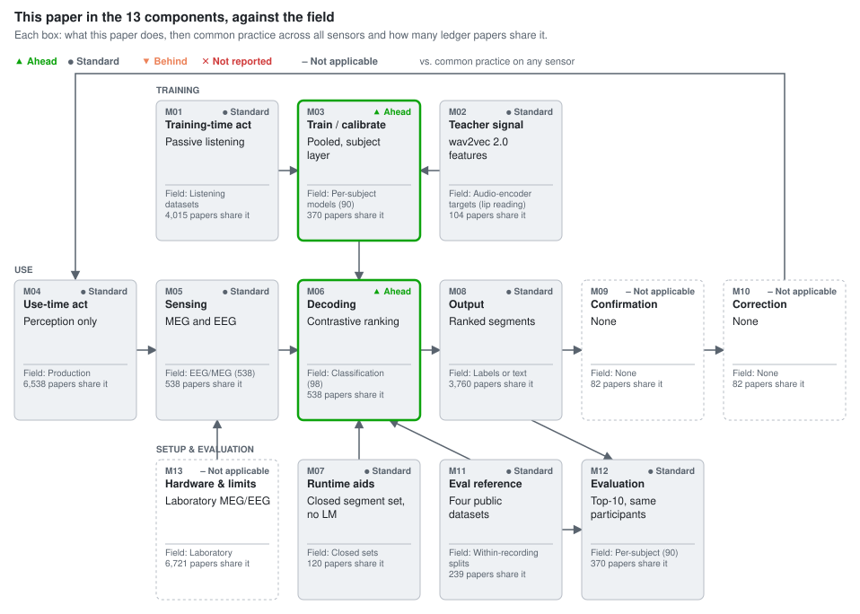

# Decoding speech perception from non-invasive brain recordings

Défossez A, Caucheteux C, Rapin J, Kabeli O, King J-R. Nature Machine Intelligence, 2023. [doi:10.1038/s42256-023-00714-5](https://doi.org/10.1038/s42256-023-00714-5) · [arXiv:2208.12266](https://arxiv.org/abs/2208.12266)

**Section:** [Brain signals (EEG, MEG, intracortical)](../../README.md#brain-signals-eeg-meg-intracortical)

## Figures

### This paper in the 13 components, against the field

<picture><source media="(prefers-color-scheme: dark)" srcset="figures/components-dark.svg"></picture>

Verdicts compare the paper's choice for each component with common practice across 8,995 ledger entries on any sensor (silent speech, brain-to-text, lip reading).

Data

| Component | This paper | Common practice | Papers with this practice | Verdict |
| --- | --- | --- | --- | --- |
| M01 Training-time act | Passive listening | Listening datasets | 4,015 of 8,995 | ● Standard (Inherited.) |
| M02 Teacher signal | wav2vec 2.0 features | Audio-encoder targets (lip reading) | 104 of 8,995 | ● Standard (Small gain on Brennan EEG.) |
| M03 Train / calibrate | Pooled, subject layer | Per-subject models (90) | 370 of 8,995 | ▲ Ahead (No new-user test.) |
| M04 Use-time act | Perception only | Production | 6,538 of 8,995 | ● Standard (Conceded.) |
| M05 Sensing | MEG and EEG | EEG/MEG (538) | 538 of 8,995 | ● Standard (Cross-study gap.) |
| M06 Decoding | Contrastive ranking | Classification (98) | 538 of 8,995 | ▲ Ahead (Earlier: Siamese EEG, match/mismatch.) |
| M07 Runtime aids | Closed segment set, no LM | Closed sets | 120 of 8,995 | ● Standard (Conceded.) |
| M08 Output | Ranked segments | Labels or text | 3,760 of 8,995 | ● Standard (No text output.) |
| M09 Confirmation | None | None | 82 of 8,995 | – Not applicable (Offline.) |
| M10 Correction | None | None | 82 of 8,995 | – Not applicable (Offline.) |
| M11 Eval reference | Four public datasets | Within-recording splits | 239 of 8,995 | ● Standard (Split seed in code only.) |
| M12 Evaluation | Top-10, same participants | Per-subject (90) | 370 of 8,995 | ● Standard (No unseen-participant test.) |
| M13 Hardware & limits | Laboratory MEG/EEG | Laboratory | 6,721 of 8,995 | – Not applicable (Conceded.) |

## Verdict

The paper [[1]](#ref-1) changes the decoding objective (M06, contrastive ranking of segments), the training population (M03, 175 participants in one model with a subject layer) and the target (M02, wav2vec 2.0 features). M06 and M03 were ahead: no earlier M/EEG decoder in the ledger ranks open candidate sets against a pretrained speech representation or uses a subject layer (Appendix); the subject layer helps on all four datasets, the contrastive loss on three (Tables 2–3). M02 is standard by cross-modal precedent from lip reading [[2]](#ref-2), [[3]](#ref-3); on Brennan EEG it gains under one standard deviation over a learned Mel encoder. The evaluation (M12) is standard but never tests the subject layer on a new person. The MEG result holds within this protocol; the EEG headline figures, EEG zero-shot words and the parity with invasive decoders do not.

## Against the field, component by component

### M06 Decoding: contrastive alignment

**Usual approach:** Among 538 scalp-EEG or MEG speech studies (pattern match, unique studies, Appendix), classification into fixed classes leads (98), then regression of an acoustic target (71), as in envelope reconstruction [[4]](#ref-4) or CTC recognition [[5]](#ref-5).

**State of the art:** A [later] 2024 study reaches 76.0% top-10 of 512 segments with 175 h of EEG from one speaker, against this paper's 70.7% of 1,363 on Gwilliams MEG [[6]](#ref-6).

Of 64 contrastive studies (pattern match, Appendix), the one dated earlier contrasts EEG trials of six fixed words [[7]](#ref-7); earlier EEG match/mismatch picks one of two segments [[8]](#ref-8), whereas the target ranks 190 to 1,842 (Table 1). The contrastive loss lifts top-10 from 12.4% to 55.1% on Gwilliams but only from 6.0 ± 0.9% to 8.0 ± 4.8% on Brennan (Table 2). Verdict: ahead; [later] cross-subject work keeps the same loss [[9]](#ref-9).

### M03 Training: pooled participants with a subject layer

**Usual approach:** Of 370 cross-subject studies (pattern match, unique studies, Appendix), per-subject models are most frequent (90); subject-specific layers appear in 34, none earlier among decoders (Appendix), though the authors derive theirs from their MEG-encoding subject embedding (§2.2.2). An earlier motor-imagery M/EEG decoder pooled subjects without subject parameters [[10]](#ref-10).

**State of the art:** A [later] 2026 study pre-trains on other subjects and fine-tunes on the target one: 61.3%, 43.0% and 39.9% top-10 against 17.4%, 20.8% and 17.7% for this paper's model trained on that subject alone [[9]](#ref-9).

Removing the subject layer costs 14.4 top-10 points on average, on all four datasets (Table 3). Verdict: ahead. The price: a new user needs labelled data and the paper does not say how one is added; with 2.9 h from its single participant, a [later] pipeline gave 10.5% top-10 among 190 segments [[6]](#ref-6).

### M02 Training-only supervision: pretrained speech features

**Usual approach:** In the reused topic table (104 unique studies, pattern match), audio-encoder targets came from lip reading [[2]](#ref-2), [[3]](#ref-3); M/EEG used Mel or envelope targets [[4]](#ref-4).

**State of the art:** A [later] 2024 comparison ranks wav2vec 2.0 first: 76.0% top-10 against 60.4% (Encodec) and 52.9% (Whisper) [[6]](#ref-6).

Against Deep Mel: 70.7% vs 64.4% (Gwilliams), 17.7 ± 0.6% vs 15.4 ± 1.6% (Broderick), 25.7 ± 2.9% vs 24.7 ± 3.2% (Brennan; Table 2). Verdict: standard; the precedent is cross-modal.

### M12 Evaluation: no unseen participants

**Usual approach:** Of the cross-subject studies, 90 use per-subject models and 75 leave-one-subject-out testing (pattern match, Appendix), one earlier in MEG/EEG motor imagery [[10]](#ref-10); here blocks are split inside each recording (code, bm/dataset.py).

**State of the art:** Without target-subject data, a [later] 2026 model is above chance in 21 of 47 subjects [[9]](#ref-9).

Verdict: standard, but no test covers a new person; "zero-shot" means segments absent from training (Fig. 1).

## The 13 components

| Component | This paper | Usual approach (count) | State of the art | Verdict |
|---|---|---|---|---|
| M01 Training-time action | Passive listening | Listening datasets (slot-filled 4,015) | – | standard |
| M02 Training-only supervision | wav2vec 2.0 features | Audio-encoder targets (lip reading) (pattern match 104) | wav2vec 2.0 76.0% top-10 [[6]](#ref-6) | standard |
| M03 Training and adaptation | Pooled, subject layer | Per-subject models (90) (pattern match 370) | 61.3% top-10 after fine-tuning [[9]](#ref-9) | ahead |
| M04 Use-time action | Perception only | Production (slot-filled 6,538) | – | standard |
| M05 Sensors | MEG and EEG | EEG/MEG (538) (pattern match 538) | – | standard |
| M06 Processing and decoding | Contrastive ranking | Classification (98) (pattern match 538) | 76.0% top-10 of 512 [[6]](#ref-6) | ahead |
| M07 Lexicon and LM | Closed segment set, no LM | Closed sets (slot-filled 120) | – | standard |
| M08 Output | Ranked segments | Labels or text (slot-filled 3,760) | – | standard |
| M09 Confirmation | None | None (slot-filled 82) | – | not applicable |
| M10 Correction | None | None (slot-filled 82) | – | not applicable |
| M11 Reference construction | Four public datasets | Within-recording splits (slot-filled 239) | – | standard |
| M12 Evaluation | Top-10, same participants | Per-subject (90) (pattern match 370) | 21 of 47 unseen subjects above chance [[9]](#ref-9) | standard |
| M13 Device and cost | Laboratory MEG/EEG | Laboratory (slot-filled 6,721) | – | not applicable |

## Where the claims outrun the evidence

- §1 reports 72.5% top-10 of 1,594 segments (MEG) and 19.1% of 2,604 (EEG), matching no dataset in Tables 1–2; the arXiv v1 abstract (2022) has the same figures, so they likely predate the final splits (inference).
- The text omits EEG chance, given only in Table 2: Brennan's 25.7% is about 4.8 times its 5.3%, Broderick's 17.7% about 33 times its 0.5% (inference).
- On unseen words, EEG keeps about a quarter of its top-10 accuracy (35.9% to 9.7%, 32.9% to 8.0%) and MEG 91% and 84% (70.0% to 64.0%, 73.4% to 61.6%; Appendix A.7) (inference): zero-shot words work on MEG and largely fail on EEG, as the authors concede.
- Setting over 72.5% top-1 of 50 candidates against 74% for an invasive decoder (§4.3) compares perception with production, as the authors concede.
- Without clamping, top-10 falls to 0.5% on Broderick (Table 3) and to 0.7% at a learning rate of 1e-3 (Appendix A.6). Training is fragile, not preprocessing-free.

## What the field needs next

- M12 and M03: participant-disjoint tests with accuracy against minutes of new-participant data.
- M05: the same stimuli recorded with MEG and EEG in the same people; the matched comparison (§3.2) crosses stimuli, language and lab, as the authors concede.
- M04 and M07: production or imagined speech with candidates outside the stimulus set, or a generative decoder.

## Questions for the authors

- How were the §1 figures computed?
- Which participants formed the early-stopping validation set?
- Do test segments share stories with training segments, given that predictions track phrase embeddings (§3.5)?

## Appendix: literature search

- M06 noninvasive-speech-decoding-objective. Inclusion rule: speech or language decoding from scalp EEG or MEG (perceived, imagined, attempted or overt); the design compared is the training objective; reviews excluded; versions counted once. Slot-filled 7,345 unique studies; pattern match 538 unique studies (modality), plus 50 full-text-only folders. Objective counts (pattern match, of 569 with text): classification 98, regression or reconstruction 71, contrastive 64; one contrastive study dated before the target. Read in full: [[4]](#ref-4), [[5]](#ref-5), [[7]](#ref-7), [[8]](#ref-8), [[6]](#ref-6), target [[1]](#ref-1). Known-item recall 1.0.
- M03 cross-subject-pooled-training. Inclusion rule: neural or biosignal speech or language decoders trained on data pooled across participants, with or without participant-specific layers; per-participant models reported only as averages excluded. Slot-filled 1,526 unique studies; pattern match 370 unique studies, plus 15 full-text-only folders. Design counts (pattern match, of 379 with text): per-subject model 90, leave-one-subject-out 75, subject-specific layer 34 (none earlier than the target). Read in full: [[10]](#ref-10), [[9]](#ref-9), [[6]](#ref-6), target [[1]](#ref-1). Known-item recall 1.0.
- M02 auxiliary-representation-prediction (published table, appended). Inclusion rule: training adds a loss that predicts or aligns to representations of a pretrained audio or visual encoder; self-generated targets excluded. Slot-filled 31; pattern match 104 unique studies. Usual design: supervision_kind=other, 8 of 62 (slot-filled). Read in full: [[2]](#ref-2), [[3]](#ref-3), [[6]](#ref-6), target [[1]](#ref-1), plus the priors already in the table. Known-item recall 1.0.

## References

Numbered by first citation. BibTeX in the same order and keys: [refs.bib](refs.bib).

1. Défossez, A., Caucheteux, C., Rapin, J., Kabeli, O., King, J. “Decoding speech perception from non-invasive brain recordings.” *Nature Machine Intelligence*, 2023, 5, 1097–1107. doi:[10.1038/s42256-023-00714-5](https://doi.org/10.1038/s42256-023-00714-5). arXiv:[2208.12266](https://arxiv.org/abs/2208.12266). arXiv v2 (2023-10-05), journal version label on first page [review](https://github.com/supernaiter/silent-speech-review/tree/main/reviews/decoding-speech-perception-from-non-invasive-brain-recordings) [wiki: arxiv-2208.12266-natmi](https://github.com/supernaiter/deep-research-wiki-for-silent-speech/blob/main/papers/arxiv-2208.12266-natmi/article.md)
2. Afouras, T., Chung, J. S., Zisserman, A. “ASR is all you need: cross-modal distillation for lip reading.” *IEEE International Conference on Acoustics, Speech and Signal Processing (ICASSP)*, 2020. arXiv:[1911.12747](https://arxiv.org/abs/1911.12747). [wiki: arxiv-1911.12747](https://github.com/supernaiter/deep-research-wiki-for-silent-speech/blob/main/papers/arxiv-1911.12747/article.md)
3. Ma, P., Mira, R., Petridis, S., Schuller, B. W., Pantic, M. “LiRA: Learning Visual Speech Representations from Audio through Self-supervision.” *Interspeech*, 2021. doi:[10.21437/Interspeech.2021-1360](https://doi.org/10.21437/Interspeech.2021-1360). arXiv:[2106.09171](https://arxiv.org/abs/2106.09171). [wiki: isca-ma21c-lira](https://github.com/supernaiter/deep-research-wiki-for-silent-speech/blob/main/papers/isca-ma21c-lira/article.md)
4. Crosse, M. J., Di Liberto, G. M., Bednar, A., Lalor, E. C. “The Multivariate Temporal Response Function (mTRF) Toolbox: A MATLAB Toolbox for Relating Neural Signals to Continuous Stimuli.” *Frontiers in Human Neuroscience*, 2016, 10, 604. doi:[10.3389/fnhum.2016.00604](https://doi.org/10.3389/fnhum.2016.00604). [wiki: pmc-5127806-mtrf](https://github.com/supernaiter/deep-research-wiki-for-silent-speech/blob/main/papers/pmc-5127806-mtrf/article.md)
5. Krishna, G., Tran, C., Carnahan, M., Han, Y., Tewfik, A. H. “Improving EEG based Continuous Speech Recognition.” *arXiv preprint*, 2019. arXiv:[1911.11610](https://arxiv.org/abs/1911.11610). [wiki: arxiv-1911.11610-impeegasr](https://github.com/supernaiter/deep-research-wiki-for-silent-speech/blob/main/papers/arxiv-1911.11610-impeegasr/article.md)
6. Sato, M., Tomeoka, K., Horiguchi, I., Arulkumaran, K., Kanai, R., Sasai, S. “Scaling Law in Neural Data: Non-Invasive Speech Decoding with 175 Hours of EEG Data.” *arXiv preprint*, 2024. arXiv:[2407.07595](https://arxiv.org/abs/2407.07595). [later] [wiki: arxiv-2407.07595](https://github.com/supernaiter/deep-research-wiki-for-silent-speech/blob/main/papers/arxiv-2407.07595/article.md)
7. Lee, D., Lee, M., Lee, S. “Classification of Imagined Speech Using Siamese Neural Network.” *arXiv preprint*, 2020. arXiv:[2008.12487](https://arxiv.org/abs/2008.12487). [wiki: arxiv-2008.12487](https://github.com/supernaiter/deep-research-wiki-for-silent-speech/blob/main/papers/arxiv-2008.12487/article.md)
8. Monesi, M. J., Accou, B., Francart, T., Van hamme, H. “Extracting Different Levels of Speech Information from EEG Using an LSTM-Based Model.” *Interspeech*, 2021, 526–530. doi:[10.21437/Interspeech.2021-336](https://doi.org/10.21437/Interspeech.2021-336). [wiki: isca-monesi21-eeglstm](https://github.com/supernaiter/deep-research-wiki-for-silent-speech/blob/main/papers/isca-monesi21-eeglstm/article.md)
9. Zhang, A., Wang, B., Wu, X., Cheng, H., Chen, J. “Cross-Subject Generalization in Decoding Perceived Speech from Non-Invasive Brain Recordings.” *arXiv preprint*, 2026. arXiv:[2608.22420](https://arxiv.org/abs/2608.22420). [later] [wiki: arxiv-2608.22420](https://github.com/supernaiter/deep-research-wiki-for-silent-speech/blob/main/papers/arxiv-2608.22420/article.md)
10. Halme, H., Parkkonen, L. “Across-subject offline decoding of motor imagery from MEG and EEG.” *Scientific Reports*, 2018, 8, 10087. doi:[10.1038/s41598-018-28295-z](https://doi.org/10.1038/s41598-018-28295-z). [wiki: pmc-6031658-megeegmi](https://github.com/supernaiter/deep-research-wiki-for-silent-speech/blob/main/papers/pmc-6031658-megeegmi/article.md)

## Materials

Data behind this review. Full texts of the papers are not included.

- [`review.md`](review.md): the review text (source)
- [`refs.bib`](refs.bib): references (BibTeX)
- [`slots.json`](slots.json): for each of the 13 components: this paper's choice, field practice, number of matching papers, verdict
- [`figures.json`](figures.json): figure definitions
- [`evaluation.md`](evaluation.md): independent evaluation by a second reviewer
- [`triage.md`](triage.md): how each evaluation finding was checked against the sources and resolved
- [`components/M02/auxiliary-representation-prediction.csv`](../../components/M02/auxiliary-representation-prediction.csv): M02 topic "auxiliary-representation-prediction", every candidate paper with its decision (31 slot-filled, 104 pattern match, usual design in 8, 6 read in full)
- [`components/M03/cross-subject-pooled-training.csv`](../../components/M03/cross-subject-pooled-training.csv): M03 topic "cross-subject-pooled-training", every candidate paper with its decision (1526 slot-filled, 370 pattern match, usual design in 90, 4 read in full)
- [`components/M06/noninvasive-speech-decoding-objective.csv`](../../components/M06/noninvasive-speech-decoding-objective.csv): M06 topic "noninvasive-speech-decoding-objective", every candidate paper with its decision (7345 slot-filled, 538 pattern match, usual design in 98, 6 read in full)

## More reviews in Brain signals (EEG, MEG, intracortical)

- [A high-performance neuroprosthesis for speech decoding and avatar control](../a-high-performance-neuroprosthesis-for-speech-decoding-and-avatar-control/) (2023). Text, voice and avatar from ECoG in one participant hold as a demonstration; sensor and decoder are standard, and an LM trained on the test pool inflates the text result.
- [A high-performance speech neuroprosthesis](../a-high-performance-speech-neuroprosthesis/) (2023). Large-vocabulary attempted-speech decoding in one participant holds; sensor, decoder and LM were already in the field, and the resolution attribution and cross-study ratios outrun the evidence.
- [An Accurate and Rapidly Calibrating Speech Neuroprosthesis](../an-accurate-and-rapidly-calibrating-speech-neuroprosthesis/) (2024). Reaches 2.5% online large-vocabulary WER and 248 h of home use in one participant; rapid calibration is a cross-study claim and the 97.5% conversation accuracy matches the Copy Task figure.
- [Towards Neural Decoding of Imagined Speech based on Spoken Speech](../towards-neural-decoding-of-imagined-speech-based-on-spoken-speech/) (2022). Transfers CSP+SVM models trained on spoken-speech EEG to imagined speech decoding; accuracy is slightly lower but not significantly different from direct training in a 5-class, 7-subject offline task.
- [A Convolutional Framework for Mapping Imagined Auditory MEG into Listened Brain Responses](../a-convolutional-framework-for-mapping-imagined-auditory-meg-into-listened-brain-responses/) (2025). Maps imagined auditory MEG (melodies and poems) to listened-response MEG; 8-condition classification reaches 50.7% (chance 12.5%), and calibrated cross-subject CNN beats shuffled controls, but correlations are small.
- [A cross-species neural foundation model for end-to-end speech decoding](../a-cross-species-neural-foundation-model-for-end-to-end-speech-decoding/) (2025). Introduces a cross-species self-supervised transformer encoder for Utah-array spiking data combined with audio-LLM end-to-end decoding, reporting state-of-the-art Brain-to-Text benchmark accuracy and imagined speech decoding.

---

Part of the [Silent Speech Interface Review](https://github.com/supernaiter/silent-speech-review). Found an error? [Open an issue](https://github.com/supernaiter/silent-speech-review/issues/new?template=correction.yml).
