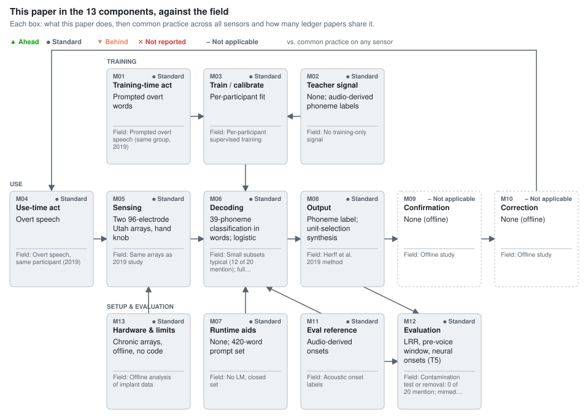

# Decoding spoken English from intracortical electrode arrays in dorsal precentral gyrus

Wilson, Stavisky, Willett, Avansino, Kelemen, Hochberg, Henderson, Druckmann, Shenoy. Journal of Neural Engineering 17(6):066007, 2020. [doi:10.1088/1741-2552/abbfef](https://doi.org/10.1088/1741-2552/abbfef)

**Section:** [Other sensors](../../README.md#other-sensors)

## Figures

### This paper in the 13 components, against the field

<picture><source media="(prefers-color-scheme: dark)" srcset="figures/components-dark.svg"></picture>

Verdicts compare the paper's choice for each component with common practice across 8,995 ledger entries on any sensor (silent speech, brain-to-text, lip reading).

Data

| Component | This paper | Common practice | Papers with this practice | Verdict |
| --- | --- | --- | --- | --- |
| M01 Training-time act | Prompted overt words | Prompted overt speech (same group, 2019) |  | ● Standard (Inherited from Stavisky et al. 2019.) |
| M02 Teacher signal | None; audio-derived phoneme labels | No training-only signal |  | ● Standard (Inherited.) |
| M03 Train / calibrate | Per-participant fit | Per-participant supervised training |  | ● Standard (LRR hyperparameters tuned manually; tuning data not stated.) |
| M04 Use-time act | Overt speech | Overt speech, same participant (2019) |  | ● Standard (Inherited; no attempted or silent condition.) |
| M05 Sensing | Two 96-electrode Utah arrays, hand knob | Same arrays as 2019 study |  | ● Standard (Inherited from the same group.) |
| M06 Decoding | 39-phoneme classification in words; logistic regression and RNN | Small subsets typical (12 of 20 mention); full inventory 8 of 20 mention, 2 read |  | ● Standard (Full inventory and deep classifiers both precede it; matched test lands at the ECoG level.) |
| M07 Runtime aids | None; 420-word prompt set | No LM, closed set |  | ● Standard (Inherited.) |
| M08 Output | Phoneme label; unit-selection synthesis | Herff et al. 2019 method |  | ● Standard (Inherited; most synthesized trials unintelligible (Sec. 3.7).) |
| M09 Confirmation | None (offline) | Offline study |  | – Not applicable (Offline study.) |
| M10 Correction | None (offline) | Offline study |  | – Not applicable (Offline study.) |
| M11 Eval reference | Audio-derived onsets | Acoustic onset labels |  | ● Standard (Realignment limited to first phonemes.) |
| M12 Evaluation | LRR, pre-voice window, neural onsets (T5) | Contamination test or removal: 0 of 20 mention; mimed control read |  | ● Standard (Contamination step follows Roussel et al.; other controls preceded it; all in T5.) |
| M13 Hardware & limits | Chronic arrays, offline, no code | Offline analysis of implant data |  | ● Standard (Inherited.) |

## Verdict

The paper [[1]](#ref-1) changes two components, and both are standard. The decoder (M06) extends the same group's 10- and 11-class syllable and word decoding from the same participant and arrays [[2]](#ref-2) to 39 phonemes, but the full inventory had already been classified from intracortical [[3]](#ref-3) and ECoG [[4]](#ref-4) signals, and the authors' matched test lands at the ECoG level, 36.8% against 36.1% on consonants. The evaluation (M12) adds a contamination test with artifact removal, which none of the 20 prior decoders with full text mentions (Appendix), but the step comes from Roussel et al. [[5]](#ref-5), whom the authors credit, other controls preceded it [[6]](#ref-6), and every control runs in T5 alone. The strongest confound is the split: folds are over phoneme instances (Secs. 2.7, 2.8), so the word's other phonemes, whose 500-ms windows overlap the test window, and its other repetitions sit in training; the authors concede that the 420-word dictionary lets windows exploit adjacent phonemes (Sec. 3.2). Their judgment that two dorsal arrays are insufficient for fluent open-vocabulary communication (Sec. 4) holds; "competitive" with ECoG holds only as the ballpark estimate they call it (Sec. 4.1).

## Against the field, component by component

### M06 Processing and decoding: full phoneme inventory from dorsal arrays

**Usual approach:** of 29 intracranial speech decoders first public before 2020-01 (20 with full text), 12 mention small unit subsets, 8 a full phoneme inventory and 8 a recurrent, convolutional or deep network (pattern match, mentions, Appendix). Full-inventory precedents, read: 38 attempted phonemes at 16–21% against 2.6% chance [[3]](#ref-3); all phonemes at hand-labelled onsets within words, four ECoG subjects [[4]](#ref-4); deep networks on 57 CV syllables [[7]](#ref-7). Only the signal departs: hand-knob arrays already separated 10 syllables at 84.6% in T5 [[2]](#ref-2) (Sec. 1).

**State of the art:** Willett et al. (2023) [later], same group, reach 62% on 39 attempted isolated phonemes from area 6v arrays in one participant [[8]](#ref-8); the target's 33.9% (RNN, T5, phonemes within overt words) is 28.1 points lower (inference), with site, task and segmentation differing.

The closest matched test is the authors': matched words, trial count and a 600-ms window give 36.8% on 24 consonants and 27.7% on 16 vowels against Mugler's best subject at 36.1% and 23.9% [[4]](#ref-4), 2% and 16% relative (inference), with audio-derived against hand-labelled onsets; the authors call such comparisons ballpark estimates (Sec. 4.1). T11 reaches 11.22% against T5's 29.29% on 39 classes, and no matched test was run in T11 (Sec. 3.2). The RNN gain is modest (Sec. 4), after deep networks [[7]](#ref-7). Verdict: standard.

### M12 Evaluation: overt-speech confound controls

**Usual approach:** none of the 20 prior decoders with full text mentions a contamination test or artifact removal; 5 mention a mimed condition or auditory feedback, 5 a pre-onset window and 1 a condition-invariant signal [[2]](#ref-2) (pattern match, mentions, Appendix). Anumanchipalli et al. tested their decoder on mimed speech against auditory feedback [[6]](#ref-6); Roussel et al. tested 20 datasets from 5 centres and compared ECoG decoders with and without 90–200 Hz features [[5]](#ref-5). The authors call LRR a "novel use" of a stimulation-artifact procedure (Sec. 4) and the confounds little studied (Sec. 1).

**State of the art:** Peterson et al. (2024) [later] remove the speech artifact (method applied to 54 patients) and re-test a consonant decoder in three subjects, similar or better than raw, while ICA lowers accuracy [[9]](#ref-9); LRR can likewise remove shared neural signal, as the target concedes (Sec. 3.5).

LRR lowers accuracy from 29.3% to 25.8%, 12% relative (inference), and realignment from 54.9% to 47.8% on first phonemes, 12.9% relative (Sec. 3.4); the pre-voice window gives 34.8% against 54.9% centred (Sec. 3.5), but it also moves the window. Not ahead: the step follows [[5]](#ref-5), realignment covers first phonemes (Sec. 4.1), and all runs in T5. Verdict: standard.

## The 13 components

| Component | This paper | Usual approach (count) | State of the art | Verdict |
|---|---|---|---|---|
| M01 Training-time action | Prompted overt words | Prompted overt speech (same group, 2019) | – | standard |
| M02 Training-only supervision | None; audio-derived phoneme labels | No training-only signal | – | standard |
| M03 Training and adaptation | Per-participant fit | Per-participant supervised training | – | standard |
| M04 Use-time action | Overt speech | Overt speech, same participant (2019) | – | standard |
| M05 Sensors | Two 96-electrode Utah arrays, hand knob | Same arrays as 2019 study | – | standard |
| M06 Processing and decoding | 39-phoneme classification in words; logistic regression and RNN | Small subsets typical (12 of 20 mention); full inventory 8 of 20 mention, 2 read | [[8]](#ref-8) (2023): 39 attempted phonemes, 62% | standard |
| M07 Lexicon and LM | None; 420-word prompt set | No LM, closed set | – | standard |
| M08 Output | Phoneme label; unit-selection synthesis | Herff et al. 2019 method | – | standard |
| M09 Confirmation | None (offline) | Offline study | – | not applicable |
| M10 Correction | None (offline) | Offline study | – | not applicable |
| M11 Reference construction | Audio-derived onsets | Acoustic onset labels | – | standard |
| M12 Evaluation | LRR, pre-voice window, neural onsets (T5) | Contamination test or removal: 0 of 20 mention; mimed control read | [[9]](#ref-9) (2024): artifact removal, decoder re-tested in three subjects | standard |
| M13 Device and cost | Chronic arrays, offline, no code | Offline analysis of implant data | – | standard |

## Where the claims outrun the evidence

- Overlapping windows. Leave-one-out over phonemes (Sec. 2.7) keeps a test phoneme's neighbours in training; no word-held-out test bounds this (inference).
- ECoG comparisons. "Competitive" (Sec. 1) becomes "ballpark estimates" (Sec. 4.1). Synthesis at r = 0.523 is set against Herff et al.'s best participant at 0.574 and mean 0.246 [[10]](#ref-10); most random trials were unintelligible (Sec. 3.7).
- Inconsistencies. The RNN is 33.4% in Sec. 3.2 but 33.9% in the Abstract and Sec. 4; the matched set is 256 shared plus 64 filled in Sec. 2.2 but in Sec. 3.2 232 shared plus 80 replaced, 312 in all (inference).
- Variability. No interval on headline accuracies and no repeated RNN runs (Sec. 2.8).

## What the field needs next

- M12: word-held-out folds, and confound controls in every participant.
- M06: free-running decoding without audio-derived onsets, the authors' next step (Sec. 4.1), on attempted speech.
- M05: dorsal and ventral arrays compared in one participant; the authors propose ventral arrays (Abstract), as [[8]](#ref-8) later used.

## Questions for the authors

- What is accuracy with words held out?
- How was the 6% chance level computed?
- Which RNN value and which matched word count are final?
- On which data was LRR tuned, and how were RNN inputs normalized?
- Do the confound analyses hold in T11?

## Appendix: literature search

- M06, intracranial-phoneme-inventory-classification (published table, appended). Inclusion rule: intracranial signal named with phonemes, vowels, consonants or syllables in the ledger text; design = size of the speech-unit class set, plus the classifier family. Ledger counts: slot-filled 7,345 unique studies; pattern match 101 unique studies (all years). Population at the target's time: ledger-pattern decoders of produced, attempted or imagined speech first public before 2020-01, reviews, perception, mapping and non-speech studies removed, versions merged, plus Kellis et al. [[11]](#ref-11) from the target's reference list: 29 decoders, 20 with full text; [concurrent] 2020-01 to 2021-01. Mention counts over the 20 with full text (pattern match): full phoneme inventory 8, small unit subset 12, recurrent, convolutional or deep network 8, threshold crossings 2. Full-inventory classifiers confirmed by reading: [[3]](#ref-3), [[4]](#ref-4). Known-item recall 1.0. Read in full: [[2]](#ref-2), [[4]](#ref-4), [[7]](#ref-7), [[3]](#ref-3), [[8]](#ref-8) (state of the art).
- M12, intracranial-overt-speech-acoustic-contamination-control (new). Inclusion rule: the same 29-decoder population; design = an explicit overt-speech confound control (audio-neural contamination test or artifact removal, a window before voice onset, or neural onset alignment); assessment studies without a decoder are deciding priors, not decoders. Ledger counts: slot-filled 6,960 unique studies; pattern match 618 unique studies (all years). Mention counts over the 20 prior decoders with full text (pattern match): contamination test or removal 0, mimed condition or auditory feedback 5, pre-onset window 5, condition-invariant or neural onset 1. Read controls: mimed speech [[6]](#ref-6), condition-invariant signal [[2]](#ref-2). Whole-wiki full-text pattern for contamination terms: 122 folders; first public before 2020-01 and intracranial: [[5]](#ref-5) (bioRxiv 2019-08) and one listening study. Known-item recall 1.0. Read in full: [[5]](#ref-5), [[6]](#ref-6), [[2]](#ref-2), [[9]](#ref-9) (state of the art).

## References

Numbered by first citation. BibTeX in the same order and keys: [refs.bib](refs.bib).

1. Wilson, G. H., Stavisky, S. D., Willett, F. R., Avansino, D. T., Kelemen, J. N., Hochberg, L. R., et al. “Decoding spoken English from intracortical electrode arrays in dorsal precentral gyrus.” *Journal of Neural Engineering*, 2020, 17(6), 066007. doi:[10.1088/1741-2552/abbfef](https://doi.org/10.1088/1741-2552/abbfef). Target. First public as bioRxiv 10.1101/2020.06.30.180935 (2020-07-01, phoneme decoding and confound analyses); journal version online 2020-11-11 adds speech synthesis. [wiki: doi-10.1088-1741-2552-abbfef](https://github.com/supernaiter/deep-research-wiki-for-silent-speech/blob/main/papers/doi-10.1088-1741-2552-abbfef/article.md) [wiki: pmc-8293867-dorsal](https://github.com/supernaiter/deep-research-wiki-for-silent-speech/blob/main/papers/pmc-8293867-dorsal/article.md)
2. Stavisky, S. D., Willett, F. R., Wilson, G. H., Murphy, B. A., Rezaii, P., Avansino, D. T., et al. “Neural ensemble dynamics in dorsal motor cortex during speech in people with paralysis.” *eLife*, 2019, 8, e46015. doi:[10.7554/eLife.46015](https://doi.org/10.7554/eLife.46015). Prior; same group, same participant T5 and arrays. [wiki: pmc-6954053-t5t8](https://github.com/supernaiter/deep-research-wiki-for-silent-speech/blob/main/papers/pmc-6954053-t5t8/article.md) [wiki: pmc-6954053-dorsalmcx](https://github.com/supernaiter/deep-research-wiki-for-silent-speech/blob/main/papers/pmc-6954053-dorsalmcx/article.md)
3. Brumberg, J. S., Wright, E. J., Andreasen, D. S., Guenther, F. H., Kennedy, P. R. “Classification of intended phoneme production from chronic intracortical microelectrode recordings in speech-motor cortex.” *Frontiers in Neuroscience*, 2011, 5, 65. doi:[10.3389/fnins.2011.00065](https://doi.org/10.3389/fnins.2011.00065). Prior; full 38-phoneme intracortical set, cited by the target. [review](https://github.com/supernaiter/silent-speech-review/tree/main/reviews/classification-of-intended-phoneme-production-from-chronic-intracortical-microelectrode-recordings-i) [wiki: doi-10.3389-fnins.2011.00065](https://github.com/supernaiter/deep-research-wiki-for-silent-speech/blob/main/papers/doi-10.3389-fnins.2011.00065/article.md) [wiki: pmc-3096823-phoneme-intracortical](https://github.com/supernaiter/deep-research-wiki-for-silent-speech/blob/main/papers/pmc-3096823-phoneme-intracortical/article.md) [wiki: pmc-3096823-phonintent](https://github.com/supernaiter/deep-research-wiki-for-silent-speech/blob/main/papers/pmc-3096823-phonintent/article.md)
4. Mugler, E. M., Patton, J. L., Flint, R. D., Wright, Z. A., Schuele, S. U., Rosenow, J., et al. “Direct classification of all American English phonemes using signals from functional speech motor cortex.” *Journal of Neural Engineering*, 2014, 11(3), 035015. doi:[10.1088/1741-2560/11/3/035015](https://doi.org/10.1088/1741-2560/11/3/035015). Prior; ECoG comparator of the target's matched test. [review](https://github.com/supernaiter/silent-speech-review/tree/main/reviews/direct-classification-of-all-american-english-phonemes-using-signals-from-functional-speech-motor-co) [wiki: pmc-4097188-mugler](https://github.com/supernaiter/deep-research-wiki-for-silent-speech/blob/main/papers/pmc-4097188-mugler/article.md) [wiki: doi-10.1088-1741-2560-11-3-035015](https://github.com/supernaiter/deep-research-wiki-for-silent-speech/blob/main/papers/doi-10.1088-1741-2560-11-3-035015/article.md)
5. Roussel, P., Le Godais, G., Bocquelet, F., Palma, M., Hongjie, J., Zhang, S., et al. “Observation and assessment of acoustic contamination of electrophysiological brain signals during speech production and sound perception.” *Journal of Neural Engineering*, 2020, 17(5), 056028. doi:[10.1088/1741-2552/abb25e](https://doi.org/10.1088/1741-2552/abb25e). Prior (bioRxiv 10.1101/722207, 2019-08-01); deciding prior for M12, cited by the target. [wiki: jne-17-abb25e-acoustic](https://github.com/supernaiter/deep-research-wiki-for-silent-speech/blob/main/papers/jne-17-abb25e-acoustic/article.md)
6. Anumanchipalli, G. K., Chartier, J., Chang, E. F. “Speech synthesis from neural decoding of spoken sentences.” *Nature*, 2019, 568(7753), 493-498. doi:[10.1038/s41586-019-1119-1](https://doi.org/10.1038/s41586-019-1119-1). Prior; mimed-speech control against auditory feedback. [review](https://github.com/supernaiter/silent-speech-review/tree/main/reviews/speech-synthesis-from-neural-decoding-of-spoken-sentences) [wiki: pmc-9714519-speechsynth](https://github.com/supernaiter/deep-research-wiki-for-silent-speech/blob/main/papers/pmc-9714519-speechsynth/article.md) [wiki: doi-10.1038-s41586-019-1119-1](https://github.com/supernaiter/deep-research-wiki-for-silent-speech/blob/main/papers/doi-10.1038-s41586-019-1119-1/article.md)
7. Livezey, J. A., Bouchard, K. E., Chang, E. F. “Deep learning as a tool for neural data analysis: Speech classification and cross-frequency coupling in human sensorimotor cortex.” *PLoS Computational Biology*, 2019, 15(9), e1007091. doi:[10.1371/journal.pcbi.1007091](https://doi.org/10.1371/journal.pcbi.1007091). Prior; deep-network intracranial speech classifier, cited by the target. [wiki: pmc-6762206-dlspeech](https://github.com/supernaiter/deep-research-wiki-for-silent-speech/blob/main/papers/pmc-6762206-dlspeech/article.md) [wiki: doi-10.1371-journal.pcbi.1007091](https://github.com/supernaiter/deep-research-wiki-for-silent-speech/blob/main/papers/doi-10.1371-journal.pcbi.1007091/article.md)
8. Willett, F. R., Kunz, E. M., Fan, C., Avansino, D. T., Wilson, G. H., Choi, E. Y., et al. “A high-performance speech neuroprosthesis.” *Nature*, 2023, 620(7976), 1031-1036. doi:[10.1038/s41586-023-06377-x](https://doi.org/10.1038/s41586-023-06377-x). Later; state of the art for M06. [later] [review](https://github.com/supernaiter/silent-speech-review/tree/main/reviews/a-high-performance-speech-neuroprosthesis) [wiki: doi-10.1038-s41586-023-06377-x](https://github.com/supernaiter/deep-research-wiki-for-silent-speech/blob/main/papers/doi-10.1038-s41586-023-06377-x/article.md)
9. Peterson, V., Vissani, M., Luo, S., Rabbani, Q., Crone, N. E., Bush, A., et al. “A supervised data-driven spatial filter denoising method for speech artifacts in intracranial electrophysiological recordings.” *Imaging Neuroscience*, 2024, 2. doi:[10.1162/imag_a_00301](https://doi.org/10.1162/imag_a_00301). Later (bioRxiv 10.1101/2023.04.05.535577); state of the art for M12. [later] [wiki: pmc-12290705-spfilt](https://github.com/supernaiter/deep-research-wiki-for-silent-speech/blob/main/papers/pmc-12290705-spfilt/article.md) [wiki: pmc-10104030-spatiallfilter](https://github.com/supernaiter/deep-research-wiki-for-silent-speech/blob/main/papers/pmc-10104030-spatiallfilter/article.md)
10. Herff, C., Diener, L., Angrick, M., Mugler, E., Tate, M. C., Goldrick, M. A., et al. “Generating Natural, Intelligible Speech From Brain Activity in Motor, Premotor, and Inferior Frontal Cortices.” *Frontiers in Neuroscience*, 2019, 13, 1267. doi:[10.3389/fnins.2019.01267](https://doi.org/10.3389/fnins.2019.01267). Prior; origin of the Brain-to-Speech unit selection. [review](https://github.com/supernaiter/silent-speech-review/tree/main/reviews/generating-natural-intelligible-speech-from-brain-activity-in-motor-premotor-and-inferior-frontal-co) [wiki: doi-10.3389-fnins.2019.01267](https://github.com/supernaiter/deep-research-wiki-for-silent-speech/blob/main/papers/doi-10.3389-fnins.2019.01267/article.md) [wiki: pmc-6882773-b2speech](https://github.com/supernaiter/deep-research-wiki-for-silent-speech/blob/main/papers/pmc-6882773-b2speech/article.md) [wiki: pmc-6882773-braintospeech](https://github.com/supernaiter/deep-research-wiki-for-silent-speech/blob/main/papers/pmc-6882773-braintospeech/article.md)
11. Kellis, S., Miller, K., Thomson, K., Brown, R., House, P., Greger, B. “Decoding spoken words using local field potentials recorded from the cortical surface.” *Journal of Neural Engineering*, 2010, 7(5), 056007. doi:[10.1088/1741-2560/7/5/056007](https://doi.org/10.1088/1741-2560/7/5/056007). Prior; spoken-word micro-ECoG decoder, cited by the target. [review](https://github.com/supernaiter/silent-speech-review/tree/main/reviews/decoding-spoken-words-using-local-field-potentials-recorded-from-the-cortical-surface) [wiki: doi-10.1088-1741-2560-7-5-056007](https://github.com/supernaiter/deep-research-wiki-for-silent-speech/blob/main/papers/doi-10.1088-1741-2560-7-5-056007/article.md) [wiki: pmc-2970568-lfpwords](https://github.com/supernaiter/deep-research-wiki-for-silent-speech/blob/main/papers/pmc-2970568-lfpwords/article.md)

## Materials

Data behind this review. Full texts of the papers are not included.

- [`review.md`](review.md): the review text (source)
- [`refs.bib`](refs.bib): references (BibTeX)
- [`slots.json`](slots.json): for each of the 13 components: this paper's choice, field practice, number of matching papers, verdict
- [`figures.json`](figures.json): figure definitions
- [`evaluation.md`](evaluation.md): independent evaluation by a second reviewer
- [`triage.md`](triage.md): how each evaluation finding was checked against the sources and resolved
- [`process/log.json`](process/log.json): process record: each step, who did it (reader, script, writer, evaluator), when, the checks run and the input versions
- [`process/notes.json`](process/notes.json): reading notes on the target and comparator papers: claims, numbers, conditions and what is not stated, with locations
- [`process/plan.json`](process/plan.json): plan: which components the paper changes and the topics it is compared on
- [`process/draft.md`](process/draft.md): the review as first written, before the independent evaluation
- [`process/claims-draft.md`](process/claims-draft.md): claim table of the draft: every claim mapped to a note or a count
- [`process/claims.md`](process/claims.md): claim table of the published review
- [`components/M06/intracranial-phoneme-inventory-classification.csv`](../../components/M06/intracranial-phoneme-inventory-classification.csv): M06 topic "intracranial-phoneme-inventory-classification", every candidate paper with its decision (7345 slot-filled, 101 pattern match, usual design in 4, 5 read in full)
- [`components/M12/intracranial-overt-speech-acoustic-contamination-control.csv`](../../components/M12/intracranial-overt-speech-acoustic-contamination-control.csv): M12 topic "intracranial-overt-speech-acoustic-contamination-control", every candidate paper with its decision (6960 slot-filled, 618 pattern match, usual design in 20, 4 read in full)

## More reviews in Other sensors

- [ASR is all you need: cross-modal distillation for lip reading](../asr-is-all-you-need-cross-modal-distillation-for-lip-reading/) (2020). ASR-teacher labels (M02) replaced transcribed-data alignment targets; standard: LRS2 parity holds, but effects differ across datasets, one WER each, and distillation is not isolated.
- [Decoding Imagined and Spoken Phrases From Non-invasive Neural (MEG) Signals](../decoding-imagined-and-spoken-phrases-from-non-invasive-neural-meg-signals/) (2020). Scalogram CNNs (M06) and ImageNet weights (M03) were new for imagined speech but standard: effects not isolated; 93% imagination sits on a 43.77% pre-stimulus floor (Table 1).
- [Hearing Lips: Improving Lip Reading by Distilling Speech Recognizers](../hearing-lips-improving-lip-reading-by-distilling-speech-recognizers/) (2020). Recognizer-to-lip-reader distillation (M02) is ahead of the prior record and repeats over two datasets and three teachers; the audio rationale is untested and the LRS2 state-of-the-art claim fails.
- [Learning Individual Speaking Styles for Accurate Lip to Speech Synthesis](../learning-individual-speaking-styles-for-accurate-lip-to-speech-synthesis/) (2020). Lip2Wav's per-speaker natural corpus (M03) is ahead; its attention decoder (M06) is standard, since LipSound had one in 2019; two Table 2 baseline WERs match another recognizer's values.
- [Lipreading using Temporal Convolutional Networks](../lipreading-using-temporal-convolutional-networks/) (2020). Multi-scale TCN (M06) and variable-length cropping (M03) are standard: head and augmentation are not separated, no run counts, robustness comes from the cropping; 85.3% LRW trails 93.2% today.
- [Machine translation of cortical activity to text with an encoder-decoder framework](../machine-translation-of-cortical-activity-to-text-with-an-encoder-decoder-framework/) (2020). Word-level ECoG encoder-decoder; all changed components standard. 3% WER is on repeats of 50 sentences; unseen sentences and participants were never tested.

---

Part of the [Silent Speech Interface Review](https://github.com/supernaiter/silent-speech-review). Found an error? [Open an issue](https://github.com/supernaiter/silent-speech-review/issues/new?template=correction.yml).
