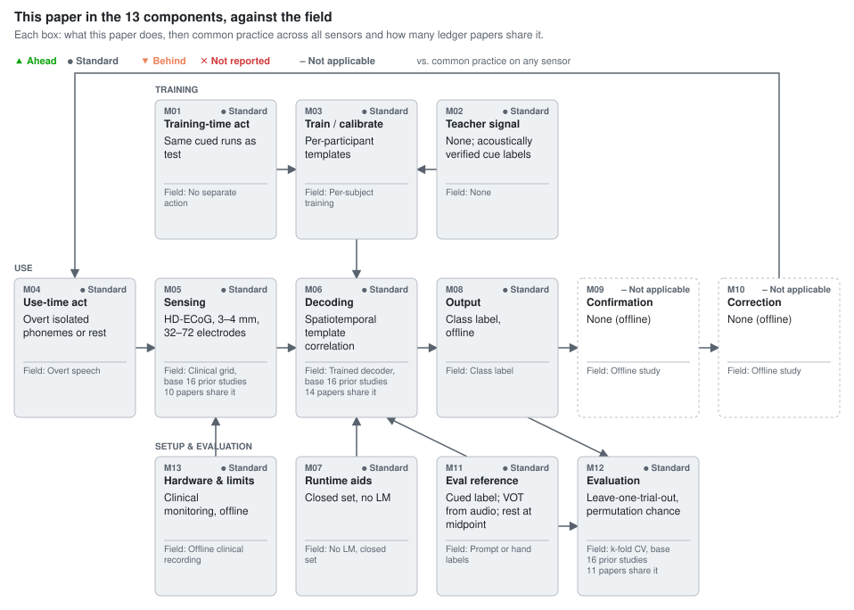

# Decoding spoken phonemes from sensorimotor cortex with High-Density ECoG grids

Ramsey, Salari, Aarnoutse, Vansteensel, Bleichner, Freudenburg. NeuroImage 180(Pt A):301–311, 2018 (online 2017). [doi:10.1016/j.neuroimage.2017.10.011](https://doi.org/10.1016/j.neuroimage.2017.10.011)

**Section:** [Other sensors](../../README.md#other-sensors)

## Figures

### This paper in the 13 components, against the field

<picture><source media="(prefers-color-scheme: dark)" srcset="figures/components-dark.svg"></picture>

Verdicts compare the paper's choice for each component with common practice across 8,995 ledger entries on any sensor (silent speech, brain-to-text, lip reading).

Data

| Component | This paper | Common practice | Papers with this practice | Verdict |
| --- | --- | --- | --- | --- |
| M01 Training-time act | Same cued runs as test | No separate action |  | ● Standard (Inherited.) |
| M02 Teacher signal | None; acoustically verified cue labels | None |  | ● Standard (Inherited.) |
| M03 Train / calibrate | Per-participant templates | Per-subject training |  | ● Standard (Inherited.) |
| M04 Use-time act | Overt isolated phonemes or rest | Overt speech |  | ● Standard (No attempted or silent condition.) |
| M05 Sensing | HD-ECoG, 3–4 mm, 32–72 electrodes | Clinical grid, base 16 prior studies | 10 of 16 | ● Standard (Departs; density gain not supported (no density test).) |
| M06 Decoding | Spatiotemporal template correlation | Trained decoder, base 16 prior studies | 14 of 16 | ● Standard (Departs; same as group gesture method; SVM equal.) |
| M07 Runtime aids | Closed set, no LM | No LM, closed set |  | ● Standard (Inherited.) |
| M08 Output | Class label, offline | Class label |  | ● Standard (Inherited.) |
| M09 Confirmation | None (offline) | Offline study |  | – Not applicable (Offline study.) |
| M10 Correction | None (offline) | Offline study |  | – Not applicable (Offline study.) |
| M11 Eval reference | Cued label; VOT from audio; rest at midpoint | Prompt or hand labels |  | ● Standard (Onset and rest anchoring; see claims.) |
| M12 Evaluation | Leave-one-trial-out, permutation chance | k-fold CV, base 16 prior studies | 11 of 16 | ● Standard (No run-held-out test.) |
| M13 Hardware & limits | Clinical monitoring, offline | Offline clinical recording |  | ● Standard (Inherited.) |

## Verdict

The paper [[1]](#ref-1) changes the decoder (M06): it departs from the usual trained decoder but is standard, because the same group published the class-mean spatiotemporal template classifier for hand gestures [[2]](#ref-2) and a linear SVM equals it (p>0.3, Sec. 3.1). Its sensors (M05) are standard: micro- or HD arrays appear in 5 of 16 earlier intracranial speech decoders (pattern match, Appendix), and the credit to HD grids rests on no density test (Sec. 3.2). Evaluation (M12) is standard for 2017. The strongest confound is timing: each phoneme trial is cut on its own audio-marked voice onset and each rest trial on its midpoint (Sec. 2.3), and the group's gesture paper names systematic onset differences between classes as a source of inflated accuracy [[2]](#ref-2). The temporal gain is significant for five classes but not four in the 1-s window (p=0.046, p=0.064), and for both in the 0.5-s window (Sec. 3.3). The pre-onset result does not separate decoding from feedback, since plosive closure precedes voice onset (inference).

## Against the field, component by component

### M06 Processing and decoding: spatiotemporal template correlation

**Usual approach:** 14 of 16 intracranial speech decoders first public before 2017-04 train a discriminative, generative or regression decoder (pattern match, Appendix), for example LDA over time bins [[3]](#ref-3); Kellis et al. alone use a nearest centroid [[4]](#ref-4). The target picks the best-correlated class-mean HFB trace, with no fitted weights (Sec. 2.4).

**State of the art:** Zhao et al. (2026) [later], median 78.3% overt syllables, six or eight classes, 256-channel HD-ECoG in nine tumour-surgery patients [[5]](#ref-5); the target: 71.9% on four phonemes (chance 29.4%).

Branco et al. labelled each left-out gesture trial by its highest Pearson correlation with channels-by-time templates on 3-mm HD grids, claiming temporal features add information [[2]](#ref-2). The target cites that paper for localization, re-referencing and alignment, not as the source of the classifier (Sec. 1, 2.1, 2.3, 4), and lists the matched filter and temporal concatenation as factors setting it apart (Sec. 4). Verdict: standard (difference not supported).

### M05 Sensors: electrode scale

**Usual approach:** clinical grids over 4 mm in 10 of 16 prior studies (7 alone, 3 with an HD or micro array in some participants), intracortical or depth microelectrodes in 4 (pattern match, Appendix), for example 1-cm grids [[3]](#ref-3); the target uses 3–4 mm grids, 32–72 analysed electrodes (Sec. 2.1).

**State of the art:** Duraivel et al. (2023) [later] decode four-way vowels at 71% from micro-ECoG against 36.7% from ECoG (chance 25%), and nine-way phonemes at a mean 49.9% (chance 11.11%) [[6]](#ref-6).

Kellis et al. used 1-mm micro-ECoG [[4]](#ref-4); the authors cite Blakely 2008 for similar grids (Sec. 4). "The high classification scores are likely to be enabled by the use of high density grids, and by the use of discrete phonemes" (Abstract) rests on informative electrodes clustering within a square cm (Sec. 4); no density manipulation is reported (Sec. 3.2). Verdict: standard (density gain not supported).

### M12 Evaluation: trial-level leave-one-out

**Usual approach:** within-subject k-fold cross-validation in 11 of 16 prior studies, leave-one-out in 2, held-out session or subject in none (pattern match, Appendix), for example [[3]](#ref-3). The target uses leave-one-trial-out and 500 label shuffles (120 for the SVM).

**State of the art:** leave-one-subject-out speech synthesis, spectrogram PCC 0.765 on unseen participants, Chen et al. (2024) [later] [[7]](#ref-7). Verdict: standard for 2017.

## The 13 components

| Component | This paper | Usual approach (count) | State of the art | Verdict |
|---|---|---|---|---|
| M01 Training-time action | Same cued runs as test | No separate action | – | standard |
| M02 Training-only supervision | None; acoustically verified cue labels | None | – | standard |
| M03 Training and adaptation | Per-participant templates | Per-subject training | – | standard |
| M04 Use-time action | Overt isolated phonemes or rest | Overt speech | – | standard |
| M05 Sensors | HD-ECoG, 3–4 mm, 32–72 electrodes | Clinical grid, base 16 prior studies (pattern match 10) | [[6]](#ref-6) (2023): vowels 71% micro-ECoG vs 36.7% ECoG | standard |
| M06 Processing and decoding | Spatiotemporal template correlation | Trained decoder, base 16 prior studies (pattern match 14) | [[5]](#ref-5) (2026): 78.3% overt syllables, 6-8 classes | standard |
| M07 Lexicon and LM | Closed set, no LM | No LM, closed set | – | standard |
| M08 Output | Class label, offline | Class label | – | standard |
| M09 Confirmation | None (offline) | Offline study | – | not applicable |
| M10 Correction | None (offline) | Offline study | – | not applicable |
| M11 Reference construction | Cued label; VOT from audio; rest at midpoint | Prompt or hand labels | – | standard |
| M12 Evaluation | Leave-one-trial-out, permutation chance | k-fold CV, base 16 prior studies (pattern match 11) | [[7]](#ref-7) (2024): unseen subjects, synthesis PCC 0.765 | standard |
| M13 Device and cost | Clinical monitoring, offline | Offline clinical recording | – | standard |

## Where the claims outrun the evidence

- Timing (M06, M11). The authors attribute R1's missing temporal gain to "less accurate VOT determinations" and propose HFB-based alignment (Sec. 4). The review adds the direction: the marker is a burst for /p/ and /k/ but voicing onset for /u/ and /a:/ (inference), so class-specific latencies enter the templates, which Branco et al. name as inflating accuracy [[2]](#ref-2); Wilson et al. [later] found onset differences "modestly increased decoding accuracy" [[8]](#ref-8).
- Rest anchoring. Rest trials are centred on event-free midpoints (Sec. 2.3), so part of the 87.6% active-versus-rest STMF score can reflect anchoring (inference); the authors flag rest dominance (Sec. 4).
- Feedback. The authors concede "a certain degree of confound due to somatosensory feedback activity" (Sec. 4). The pre-onset 58.3% (four phonemes, chance 28.8%, Table 2) does not remove it: plosive closure precedes voice onset (inference).
- Acoustics. Roussel et al. [later] show that high-gamma power overlaps voice F0 and found contamination at three of five centres [[9]](#ref-9); the paper never discusses it. Four of five recordings were band-limited at 134.4 Hz (Sec. 2.1), and the post-onset window scores below the centred one (65.3% vs 72.4%, Table 2): contamination is untested but does not carry the result (inference).

## What the field needs next

- M06/M11: align on the HFB response as in [[2]](#ref-2); re-test the temporal gain.
- M05: subsample the same HD grids to 1-cm spacing, as [[6]](#ref-6) did for micro-ECoG.
- M04: a mimed, soundless condition.

## Questions for the authors

- Were run-wise z-score statistics (Sec. 2.3) computed over the whole run, including the held-out trial?
- How many runs per participant, and were trials of one run split across folds?
- What is the cue-to-VOT latency per phoneme?
- Which seeds drew the shuffles and random subsets?

## Appendix: literature search

- **Setting (all topics).** Ledger pattern of the published M12 partition topic (intracranial signal and speech unit in the ledger text), 618 unique studies; first public before 2017-04, screened by title and methods snippet: population 16 unique studies (versions merged; Heger 2015 and Herff 2015 share seven patients and count once; reviews, listening, mapping without decoder and non-speech BCIs excluded). 2017-04 to 2018-04 is [concurrent]. Target-cited prior decoders not in the ledger, described through the target only: Blakely 2008, Bouchard and Chang 2014 (EMBC), Mugler 2015 (EMBC), Jiang 2016 (EMBC).
- **M06 / intracranial-speech-classifier-family.** Inclusion rule: setting above; design of interest: trial assigned to the best-correlated or nearest class-mean spatiotemporal template versus a trained discriminative, generative or regression decoder. Counts: slot-filled 7,345; pattern match 618 unique studies; population 16; trained decoder 14, nearest centroid 1, online power-threshold control 1; outside speech, the same group's gesture template classifier [[2]](#ref-2). Read in full: [[2]](#ref-2), [[4]](#ref-4), [[3]](#ref-3), [[5]](#ref-5). Known-item recall 1.0 over the 7 target-cited prior decoders in the ledger (7 of 11 cited are in the ledger, 0.64).
- **M05 / intracranial-speech-electrode-scale** (published table, reused). Inclusion rule: published rule, decoder requirement kept; HD or micro = 4 mm or less. Counts: slot-filled 7,329; pattern match 618 unique studies; population 16; HD or micro only 2, clinical with HD or micro in some participants 3, clinical only 7, intracortical or depth 4; with the two cited HD studies outside the ledger, at least 7 (inference). Read in full: [[4]](#ref-4), [[3]](#ref-3), [[2]](#ref-2), [[6]](#ref-6). Known-item recall 1.0.
- **M12 / intracranial-speech-test-partition** (published table, reused). Inclusion rule: published rule. Counts: slot-filled 6,960; pattern match 618 unique studies; population 16; k-fold 11, leave-one-out 2, random holdout 1, jackknife 1, online closed loop 1, held-out session 0, held-out subject 0; label permutation for chance 5. Read in full: [[3]](#ref-3), [[7]](#ref-7). Known-item recall 1.0.

## References

Numbered by first citation. BibTeX in the same order and keys: [refs.bib](refs.bib).

1. Ramsey, N., Salari, E., Aarnoutse, E., Vansteensel, M., Bleichner, M., Freudenburg, Z. “Decoding spoken phonemes from sensorimotor cortex with High-Density ECoG grids.” *NeuroImage*, 2018, 180(Pt A), 301-311. doi:[10.1016/j.neuroimage.2017.10.011](https://doi.org/10.1016/j.neuroimage.2017.10.011). Target. Read as the PMC author manuscript (PMC6433278); online 2017-10-07. [wiki: doi-10.1016-j.neuroimage.2017.10.011](https://github.com/supernaiter/deep-research-wiki-for-silent-speech/blob/main/papers/doi-10.1016-j.neuroimage.2017.10.011/article.md) [wiki: pmc-6433278-hdecog](https://github.com/supernaiter/deep-research-wiki-for-silent-speech/blob/main/papers/pmc-6433278-hdecog/article.md)
2. Branco, M., Freudenburg, Z., Aarnoutse, E., Bleichner, M., Vansteensel, M., Ramsey, N. “Decoding hand gestures from primary somatosensory cortex using high-density ECoG.” *NeuroImage*, 2017, 147, 130-142. doi:[10.1016/j.neuroimage.2016.12.004](https://doi.org/10.1016/j.neuroimage.2016.12.004). Prior; deciding prior for M06 (same group; spatiotemporal template correlation, leave-one-out, 3-mm HD grids, hand gestures). Volume and pages from the target's reference list. [wiki: pmc-5322832-s1ecog](https://github.com/supernaiter/deep-research-wiki-for-silent-speech/blob/main/papers/pmc-5322832-s1ecog/article.md)
3. Mugler, E. M., Patton, J. L., Flint, R. D., Wright, Z. A., Schuele, S. U., Rosenow, J., et al. “Direct classification of all American English phonemes using signals from functional speech motor cortex.” *Journal of Neural Engineering*, 2014, 11(3), 035015. doi:[10.1088/1741-2560/11/3/035015](https://doi.org/10.1088/1741-2560/11/3/035015). Prior; LDA over time bins, 1-cm grids, 10-fold cross-validation. [review](https://github.com/supernaiter/silent-speech-review/tree/main/reviews/direct-classification-of-all-american-english-phonemes-using-signals-from-functional-speech-motor-co) [wiki: doi-10.1088-1741-2560-11-3-035015](https://github.com/supernaiter/deep-research-wiki-for-silent-speech/blob/main/papers/doi-10.1088-1741-2560-11-3-035015/article.md) [wiki: pmc-4097188-mugler](https://github.com/supernaiter/deep-research-wiki-for-silent-speech/blob/main/papers/pmc-4097188-mugler/article.md)
4. Kellis, S., Miller, K., Thomson, K., Brown, R., House, P., Greger, B. “Decoding spoken words using local field potentials recorded from the cortical surface.” *Journal of Neural Engineering*, 2010, 7(5), 056007. doi:[10.1088/1741-2560/7/5/056007](https://doi.org/10.1088/1741-2560/7/5/056007). Prior; nearest-centroid word classifier on 1-mm micro-ECoG. [review](https://github.com/supernaiter/silent-speech-review/tree/main/reviews/decoding-spoken-words-using-local-field-potentials-recorded-from-the-cortical-surface) [wiki: doi-10.1088-1741-2560-7-5-056007](https://github.com/supernaiter/deep-research-wiki-for-silent-speech/blob/main/papers/doi-10.1088-1741-2560-7-5-056007/article.md) [wiki: pmc-2970568-lfpwords](https://github.com/supernaiter/deep-research-wiki-for-silent-speech/blob/main/papers/pmc-2970568-lfpwords/article.md)
5. Zhao, Z., Wang, Z., Liu, Y., Qian, Y., Yin, Y., Gao, X., et al. “A neural architecture for imagined and overt speech motor dynamics.” *Nature Neuroscience*, 2026. doi:[10.1038/s41593-026-02456-0](https://doi.org/10.1038/s41593-026-02456-0). Later; state of the art for M06 (overt and imagined syllables, 256-channel HD-ECoG, awake tumour surgery). [later] [wiki: natneuro-02456-motordyn](https://github.com/supernaiter/deep-research-wiki-for-silent-speech/blob/main/papers/natneuro-02456-motordyn/article.md)
6. Duraivel, S., Rahimpour, S., Chiang, C., Trumpis, M., Wang, C., Barth, K., et al. “High-resolution neural recordings improve the accuracy of speech decoding.” *Nature Communications*, 2023, 14, 6938. doi:[10.1038/s41467-023-42555-1](https://doi.org/10.1038/s41467-023-42555-1). Later; state of the art for M05 (micro-ECoG versus ECoG and SEEG on the same vowel task). [later] [wiki: doi-10.1038-s41467-023-42555-1](https://github.com/supernaiter/deep-research-wiki-for-silent-speech/blob/main/papers/doi-10.1038-s41467-023-42555-1/article.md) [wiki: pmc-10628285-uecog](https://github.com/supernaiter/deep-research-wiki-for-silent-speech/blob/main/papers/pmc-10628285-uecog/article.md)
7. Chen, J., Chen, X., Wang, R., Le, C., Khalilian-Gourtani, A., Jensen, E., et al. “Subject-Agnostic Transformer-Based Neural Speech Decoding from Surface and Depth Electrode Signals.” *bioRxiv*, 2024. doi:[10.1101/2024.03.11.584533](https://doi.org/10.1101/2024.03.11.584533). Later; state of the art for M12 (leave-one-subject-out speech synthesis, spectrogram PCC). [later] [wiki: doi-10.1101-2024.03.11.584533](https://github.com/supernaiter/deep-research-wiki-for-silent-speech/blob/main/papers/doi-10.1101-2024.03.11.584533/article.md)
8. Wilson, G. H., Stavisky, S. D., Willett, F. R., Avansino, D. T., Kelemen, J. N., Hochberg, L. R., et al. “Decoding spoken English from intracortical electrode arrays in dorsal precentral gyrus.” *Journal of Neural Engineering*, 2020, 17(6), 066007. doi:[10.1088/1741-2552/abbfef](https://doi.org/10.1088/1741-2552/abbfef). Later; intracortical arrays: microphonic contamination and onset differences modestly raise accuracy. [later] [wiki: doi-10.1088-1741-2552-abbfef](https://github.com/supernaiter/deep-research-wiki-for-silent-speech/blob/main/papers/doi-10.1088-1741-2552-abbfef/article.md)
9. Roussel, P., Le Godais, G., Bocquelet, F., Palma, M., Hongjie, J., Zhang, S., et al. “Observation and assessment of acoustic contamination of electrophysiological brain signals during speech production and sound perception.” *Journal of Neural Engineering*, 2020, 17, 056028. doi:[10.1088/1741-2552/abb25e](https://doi.org/10.1088/1741-2552/abb25e). Later; acoustic contamination of high-gamma ECoG and intracortical recordings during speech (abstract read). [later] [wiki: jne-17-abb25e-acoustic](https://github.com/supernaiter/deep-research-wiki-for-silent-speech/blob/main/papers/jne-17-abb25e-acoustic/article.md)

## Materials

Data behind this review. Full texts of the papers are not included.

- [`review.md`](review.md): the review text (source)
- [`refs.bib`](refs.bib): references (BibTeX)
- [`slots.json`](slots.json): for each of the 13 components: this paper's choice, field practice, number of matching papers, verdict
- [`figures.json`](figures.json): figure definitions
- [`evaluation.md`](evaluation.md): independent evaluation by a second reviewer
- [`triage.md`](triage.md): how each evaluation finding was checked against the sources and resolved
- [`process/log.json`](process/log.json): process record: each step, who did it (reader, script, writer, evaluator), when, the checks run and the input versions
- [`process/notes.json`](process/notes.json): reading notes on the target and comparator papers: claims, numbers, conditions and what is not stated, with locations
- [`process/plan.json`](process/plan.json): plan: which components the paper changes and the topics it is compared on
- [`process/draft.md`](process/draft.md): the review as first written, before the independent evaluation
- [`process/claims-draft.md`](process/claims-draft.md): claim table of the draft: every claim mapped to a note or a count
- [`process/claims.md`](process/claims.md): claim table of the published review
- [`components/M05/intracranial-speech-electrode-scale.csv`](../../components/M05/intracranial-speech-electrode-scale.csv): M05 topic "intracranial-speech-electrode-scale", every candidate paper with its decision (7329 slot-filled, 618 pattern match, usual design in 2, 4 read in full)
- [`components/M06/intracranial-speech-classifier-family.csv`](../../components/M06/intracranial-speech-classifier-family.csv): M06 topic "intracranial-speech-classifier-family", every candidate paper with its decision (7345 slot-filled, 618 pattern match, usual design in 14, 4 read in full)
- [`components/M12/intracranial-speech-test-partition.csv`](../../components/M12/intracranial-speech-test-partition.csv): M12 topic "intracranial-speech-test-partition", every candidate paper with its decision (6960 slot-filled, 618 pattern match, usual design in 132, 2 read in full)

## More reviews in Other sensors

- [Audio-Visual Speech Recognition with a Hybrid CTC/Attention Architecture](../audio-visual-speech-recognition-with-a-hybrid-ctc-attention-architecture/) (2018). No earlier sentence-level AVSR study in the ledger trains hybrid CTC/attention (0 of 32), but no CTC- or attention-only result, LRW under the no-external-data claim, one run: standard.
- [End-to-End Audiovisual Speech Recognition](../end-to-end-audiovisual-speech-recognition/) (2018). Raw-waveform front end and BGRU fusion (M06) depart from the usual approach but are standard: they tie MFCC in clean LRW audio (97.7%); noise gains lack repeated runs and use matched babble.
- [Inferring imagined speech using EEG signals: a new approach using Riemannian manifold features](../inferring-imagined-speech-using-eeg-signals-a-new-approach-using-riemannian-manifold-features/) (2018). Covariance tangent-space + RVM (M06) is new to imagined-speech EEG but beats only at-chance baselines; evaluation is behind: no test against chance, which 3 of 7 priors ran.
- [Large-Scale Visual Speech Recognition](../large-scale-visual-speech-recognition/) (2018). Its YouTube mining scaled on in later work, but Table 1 holds data fixed; the phoneme+WFST decoder had 2016-17 priors; zero-shot LRS3 changes everything at once: standard.
- [Generating Natural, Intelligible Speech From Brain Activity in Motor, Premotor, and Inferior Frontal Cortices](../generating-natural-intelligible-speech-from-brain-activity-in-motor-premotor-and-inferior-frontal-co/) (2019). Unit selection (M06) and own-voice concatenation (M08) are standard: an EMG design new to ECoG, never compared on its folds; 4-choice test (M12) on 30 best words; naturalness unmeasured.
- [Real-time decoding of question-and-answer speech dialogue using human cortical activity](../real-time-decoding-of-question-and-answer-speech-dialogue-using-human-cortical-activity/) (2019). Context prior from the decoded question (M07) is ahead, gaining in 3 of 3 participants; HMM decoder (M06) is standard; no online accuracy or latency backs the real-time claim.

---

Part of the [Silent Speech Interface Review](https://github.com/supernaiter/silent-speech-review). Found an error? [Open an issue](https://github.com/supernaiter/silent-speech-review/issues/new?template=correction.yml).
