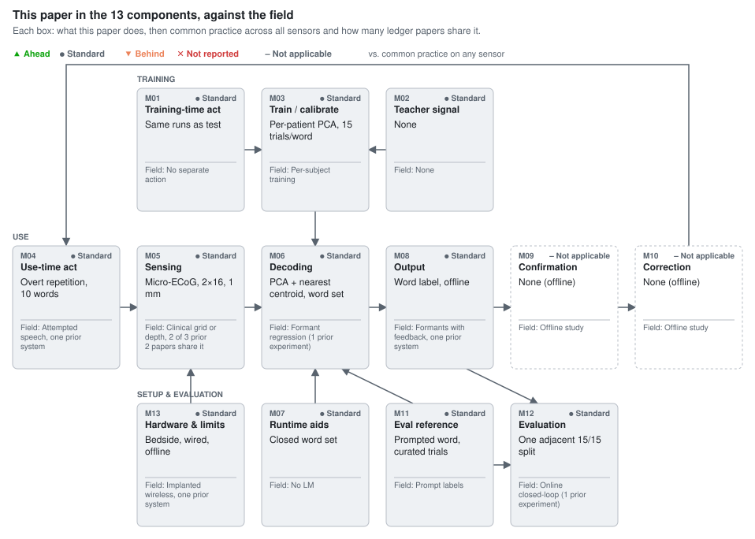

# Decoding spoken words using local field potentials recorded from the cortical surface

Kellis, Miller, Thomson, Brown, House, Greger. Journal of Neural Engineering 7(5):056007, 2010. [doi:10.1088/1741-2560/7/5/056007](https://doi.org/10.1088/1741-2560/7/5/056007)

**Section:** [Other sensors](../../README.md#other-sensors)

## Figures

### This paper in the 13 components, against the field

<picture><source media="(prefers-color-scheme: dark)" srcset="figures/components-dark.svg"></picture>

Verdicts compare the paper's choice for each component with common practice across 8,995 ledger entries on any sensor (silent speech, brain-to-text, lip reading).

Data

| Component | This paper | Common practice | Papers with this practice | Verdict |
| --- | --- | --- | --- | --- |
| M01 Training-time act | Same runs as test | No separate action |  | ● Standard (Inherited.) |
| M02 Teacher signal | None | None |  | ● Standard (Inherited.) |
| M03 Train / calibrate | Per-patient PCA, 15 trials/word | Per-subject training |  | ● Standard (Electrode selection not separated from decode trials (Sec. 3.3).) |
| M04 Use-time act | Overt repetition, 10 words | Attempted speech, one prior system |  | ● Standard (Overt speech only; no attempted or imagined condition.) |
| M05 Sensing | Micro-ECoG, 2×16, 1 mm | Clinical grid or depth, 2 of 3 prior | 2 of 3 | ● Standard (Departs from macro-ECoG; one patient; no macro baseline.) |
| M06 Decoding | PCA + nearest centroid, word set | Formant regression (1 prior experiment) |  | ● Standard (Departs from the only prior system; one patient, one split, selection on test data.) |
| M07 Runtime aids | Closed word set | No LM |  | ● Standard (Inherited.) |
| M08 Output | Word label, offline | Formants with feedback, one prior system |  | ● Standard (Offline only.) |
| M09 Confirmation | None (offline) | Offline study |  | – Not applicable (Offline study.) |
| M10 Correction | None (offline) | Offline study |  | – Not applicable (Offline study.) |
| M11 Eval reference | Prompted word, curated trials | Prompt labels |  | ● Standard (Curation criteria not operationalised (Sec. 2.2).) |
| M12 Evaluation | One adjacent 15/15 split | Online closed-loop (1 prior experiment) |  | ● Standard (Prior online test is a different task; no yardstick.) |
| M13 Hardware & limits | Bedside, wired, offline | Implanted wireless, one prior system |  | ● Standard (Inherited.) |

## Verdict

The paper [[1]](#ref-1) changes two components, both standard: each departs from the single prior speech decoder but is shown in one patient on one split. Its sensors (M05) use 1-mm micro-ECoG where earlier intracranial speech recordings used clinical grids or depth electrodes (2 of 3 prior experiments, Appendix); its decoder (M06) classifies a closed word set where the one prior decoder regressed formants. The strongest confound is selection on the evaluation data: trials were kept only if judged stereotyped, more than half discarded for some words (Sec. 2.2), and the best five FMC electrodes, ranked by overall accuracy with no separate selection set described (Sec. 2.6, 3.3; inference), carry gains of up to 20.0 percentage points. That micro-scale recording matters is untested: the clinical grid in the same patient was not decoded (Sec. 2.1, 2.3).

## Against the field, component by component

### M05 Sensors: micro-ECoG against clinical macro-ECoG

**Usual approach:** before 2010-03 the ledger holds 3 intracranial recording experiments during speech production: clinical subdural grids at 10 or 7.5 mm spacing [[2]](#ref-2) and depth electrodes [[3]](#ref-3) (2 of 3, pattern match), and one intracortical decoder [[4]](#ref-4); micro-ECoG 0 (Appendix). The authors blame the size and spacing of clinical electrodes (Sec. 1) and build on non-speech micro-ECoG recordings (refs. 26, 43).

**State of the art:** Duraivel et al. (2023) [later] decode spoken phonemes from thin-film micro-ECoG in four patients, up to 57% against 11.11% chance; subsampled to standard intracranial spacing, median accuracy falls to 20–35% [[5]](#ref-5).

No prior speech study in the ledger records micro-ECoG or high-density ECoG (full-text check, Appendix). Brumberg et al. [later] name Blakely et al. 2008, which the authors cite (ref. 31), and this paper as the earlier micro-ECoG speech work [[6]](#ref-6). Verdict: standard. The scale argument rests on neighbour differences within one array (nearly 30% at 1 mm, Sec. 4.2), with no macro baseline or significance test (Sec. 2.6).

### M06 Decoding: closed-set words instead of continuous formants

**Usual approach:** the only prior intracranial speech decoder, one experiment reported twice [[4]](#ref-4), maps neural activity to continuous F1/F2 formants with a Kalman filter; word classification 0 (Appendix). The authors draw the contrast themselves (Sec. 1), though they cite ref. 31 both for phonemes and among formant decoders.

**State of the art:** Card et al. (2024) [later] reach 99.6% word accuracy in the first session, decoding attempted sentences from a 50-word vocabulary through a language model, from intracortical arrays [[7]](#ref-7). Task, sensor and language model all differ from the target's isolated words (48% on ten, Sec. 3.3).

The authors themselves set their 500-ms delay against a 30-ms trajectory decoder as a different problem (Sec. 4.4.3). The FMC best-five gain of 13.5 ± 5.2 points is inseparable from selection on decode trials (Sec. 3.3; inference); the same selection on Wernicke's area gained 1.3 ± 0.7 points, and adding the whole Wernicke array 0.40 ± 0.43 (Sec. 3.2–3.3). Verdict: standard: word classification is absent from the prior system (Appendix), but one patient, one split and selection on test data do not support it well enough.

### M12 Evaluation: one adjacent split in one patient

**Usual approach:** the only prior system was tested online in closed loop across 25 sessions [[8]](#ref-8), with offline two-fold cross-validation within each session [[4]](#ref-4); held-out subject 0 (pattern match, Appendix). The paper uses one offline 15/15 split of 30 adjacent stereotyped trials per word (Sec. 2.2), with no repeated splits (Sec. 2.6).

**State of the art:** Chen et al. (2024) [later] decode speech from ECoG and sEEG in 43 participants and reach a mean spectrogram PCC of 0.765 on participants left out of training [[9]](#ref-9).

Repetition: 1 patient, 1 split, no reruns; power varied between sessions (Sec. 3.1), yet the four days get no day-wise score (Sec. 2.2). Verdict: standard. The prior online test measures learning with feedback, a different task, and gives no yardstick for an offline split.

## The 13 components

| Component | This paper | Usual approach (count) | State of the art | Verdict |
|---|---|---|---|---|
| M01 Training-time action | Same runs as test | No separate action | – | standard |
| M02 Training-only supervision | None | None | – | standard |
| M03 Training and adaptation | Per-patient PCA, 15 trials/word | Per-subject training | – | standard |
| M04 Use-time action | Overt repetition, 10 words | Attempted speech, one prior system | – | standard |
| M05 Sensors | Micro-ECoG, 2×16, 1 mm | Clinical grid or depth, 2 of 3 prior (pattern match 2) | [[5]](#ref-5) (2023): 57% phonemes, 4 patients | standard |
| M06 Processing and decoding | PCA + nearest centroid, word set | Formant regression (1 prior experiment) | [[7]](#ref-7) (2024): 99.6%, 50-word sentences with LM | standard |
| M07 Lexicon and LM | Closed word set | No LM | – | standard |
| M08 Output | Word label, offline | Formants with feedback, one prior system | – | standard |
| M09 Confirmation | None (offline) | Offline study | – | not applicable |
| M10 Correction | None (offline) | Offline study | – | not applicable |
| M11 Reference construction | Prompted word, curated trials | Prompt labels | – | standard |
| M12 Evaluation | One adjacent 15/15 split | Online closed-loop (1 prior experiment) | [[9]](#ref-9) (2024): PCC 0.765, held-out participants | standard |
| M13 Device and cost | Bedside, wired, offline | Implanted wireless, one prior system | – | standard |

## Where the claims outrun the evidence

- Selection on test data. The best five electrodes are those "with best overall accuracy" (Sec. 3.3); gains run from 4.0 points (89.6%, two words) to 20.0 points (48%, ten words), so all 16 FMC electrodes gave about 28% on ten words (inference).
- Trial curation. Stereotypy was judged on inflection, pitch and duration with no thresholds, rater count or blinding (Sec. 2.2); for "yes", 81 of 166 trials passed (Table 1); the authors flag pitch and inflection as a confound (Sec. 4.3).
- Local assemblies. The Abstract reads word-specific electrode patterns as independent local processing; the evidence is neighbour differences such as 84.4% versus 56.7% for "hot" 1 mm apart (Sec. 3.5), with 15 decode trials per word and no test against sampling variability (Sec. 2.6).

## What the field needs next

- M05: decode the co-implanted clinical grid and the micro-ECoG arrays on the same trials.
- M12: fix curation and electrode selection on training data only; add repeated splits and a day-held-out test.
- M04: repeat the words in an attempted or mimed condition.

## Questions for the authors

- Were the best five electrodes chosen on the decode trials?
- Which day supplied each 30-trial block?
- Was log-normalization fitted on training trials only?
- Who judged stereotypy, and what is accuracy on all recorded trials?

## Appendix: literature search

Target first public 2010-09-01 (epub; the wiki manifest gives the issue date 2010-10-01). Prior = before 2010-03, [concurrent] = 2010-03 to 2011-03. Setting: human studies of produced, attempted or imagined speech from intracranial recordings, one shared ledger pattern (intracranial signal plus speech unit). M06 and M12 require a decoder; M05, a sensor slot, does not. Off-population: reviews and listening-only studies, plus studies without a decoder for M06 and M12. Versions count once: Guenther 2009 and Brumberg 2009 [[8]](#ref-8) report the same participant and sessions, 1 experiment.

- **M05 / intracranial-speech-electrode-scale.** Inclusion rule: the setting without the decoder requirement; design of interest: intracortical microelectrodes, clinical grids (about 1 cm), 4-mm high-density ECoG or micro-ECoG. Ledger counts: slot-filled 7,329; pattern match 618 unique studies. Prior: 7 pattern-match hits, 3 off-population (2 reviews, 1 listening study), 4 reports of 3 experiments: clinical subdural grid or depth 2, intracortical 1, micro-ECoG 0, high-density ECoG 0. [Concurrent]: 6 hits, none decodes produced speech; Chang 2010 classifies perceived syllables on a 4-mm grid. Full-text check of all wiki papers mentioning speech (reference lists removed): micro-ECoG wording 114 unique studies, before 2012 only the target and [[6]](#ref-6); high-density or 1–4 mm wording before 2012 only [concurrent] studies. Blakely et al. 2008 (cited by the target) is not in the ledger. All years, pattern match with mentions: high-density ECoG 138, micro-ECoG 51, clinical 1-cm grid 47. Read in full: [[2]](#ref-2), [[3]](#ref-3), [[4]](#ref-4), [[6]](#ref-6), [[5]](#ref-5). Known-item recall 1.0.
- **M06 / intracranial-speech-decoding-target.** Inclusion rule: the setting; design of interest: closed-set word classification, phoneme or syllable classification, or continuous acoustic/formant regression. Ledger counts: slot-filled 7,345; pattern match 618 unique studies. Prior: 1 experiment (2 reports), formant regression 1, word classification 0, phoneme classification 0 (slot-filled). All years, pattern match with mentions: continuous acoustic/formant regression 318, closed-set word classification 163, phoneme or syllable classification 122. Read in full: [[4]](#ref-4), [[7]](#ref-7). Known-item recall 1.0.
- **M12 / intracranial-speech-test-partition** (published table, reused). Inclusion rule: intracranial speech decoding studies; design of interest: how test data are separated from training data. Ledger counts: slot-filled 6,960; pattern match 618 unique studies; k-fold 132 (all years). Prior: 1 experiment (2 reports): online closed-loop test 1 (slot-filled); held-out session wording 1 (pattern match; the text shows within-session two-fold cross-validation), held-out subject 0 (pattern match). Read in full: [[4]](#ref-4), [[8]](#ref-8), [[9]](#ref-9) [later]. Known-item recall 1.0.

## References

Numbered by first citation. BibTeX in the same order and keys: [refs.bib](refs.bib).

1. Kellis, S., Miller, K., Thomson, K., Brown, R., House, P., Greger, B. “Decoding spoken words using local field potentials recorded from the cortical surface.” *Journal of Neural Engineering*, 2010, 7(5), 056007. doi:[10.1088/1741-2560/7/5/056007](https://doi.org/10.1088/1741-2560/7/5/056007). Target. Read as the PMC author manuscript (PMC2970568). [wiki: doi-10.1088-1741-2560-7-5-056007](https://github.com/supernaiter/deep-research-wiki-for-silent-speech/blob/main/papers/doi-10.1088-1741-2560-7-5-056007/article.md) [wiki: pmc-2970568-lfpwords](https://github.com/supernaiter/deep-research-wiki-for-silent-speech/blob/main/papers/pmc-2970568-lfpwords/article.md)
2. Towle, V. L., Yoon, H., Castelle, M., Edgar, J. C., Biassou, N. M., Frim, D. M., et al. “ECoG gamma activity during a language task: differentiating expressive and receptive speech areas.” *Brain*, 2008, 131(8), 2013–2027. doi:[10.1093/brain/awn147](https://doi.org/10.1093/brain/awn147). Prior; deciding prior for M05 (clinical subdural grids, 10 or 7.5 mm, no decoder). [wiki: doi-10.1093-brain-awn147](https://github.com/supernaiter/deep-research-wiki-for-silent-speech/blob/main/papers/doi-10.1093-brain-awn147/article.md)
3. Sahin, N. T., Pinker, S., Cash, S. S., Schomer, D., Halgren, E. “Sequential processing of lexical, grammatical, and phonological information within Broca's area.” *Science*, 2009, 326(5951), 445–449. doi:[10.1126/science.1174481](https://doi.org/10.1126/science.1174481). Prior; deciding prior for M05 (depth electrodes, word production, no decoder). [wiki: doi-10.1126-science.1174481](https://github.com/supernaiter/deep-research-wiki-for-silent-speech/blob/main/papers/doi-10.1126-science.1174481/article.md)
4. Guenther, F. H., Brumberg, J. S., Wright, E. J., Nieto-Castanon, A., Tourville, J. A., Panko, M., et al. “A Wireless Brain-Machine Interface for Real-Time Speech Synthesis.” *PLoS ONE*, 2009, 4(12), e8218. doi:[10.1371/journal.pone.0008218](https://doi.org/10.1371/journal.pone.0008218). Prior; deciding prior for M05, M06 and M12 (intracortical, continuous formant decoding, online across sessions, one locked-in participant). [review](https://github.com/supernaiter/silent-speech-review/tree/main/reviews/a-wireless-brain-machine-interface-for-real-time-speech-synthesis) [wiki: pmc-2784218-wirelesssynth](https://github.com/supernaiter/deep-research-wiki-for-silent-speech/blob/main/papers/pmc-2784218-wirelesssynth/article.md)
5. Duraivel, S., Rahimpour, S., Chiang, C., Trumpis, M., Wang, C., Barth, K., et al. “High-resolution neural recordings improve the accuracy of speech decoding.” *Nature Communications*, 2023, 14, 6938. doi:[10.1038/s41467-023-42555-1](https://doi.org/10.1038/s41467-023-42555-1). Later; state of the art for M05 (micro-ECoG speech decoding, four patients). [later] [wiki: doi-10.1038-s41467-023-42555-1](https://github.com/supernaiter/deep-research-wiki-for-silent-speech/blob/main/papers/doi-10.1038-s41467-023-42555-1/article.md) [wiki: pmc-10628285-uecog](https://github.com/supernaiter/deep-research-wiki-for-silent-speech/blob/main/papers/pmc-10628285-uecog/article.md)
6. Brumberg, J. S., Wright, E. J., Andreasen, D. S., Guenther, F. H., Kennedy, P. R. “Classification of Intended Phoneme Production from Chronic Intracortical Microelectrode Recordings in Speech-Motor Cortex.” *Frontiers in Neuroscience*, 2011, 5, 65. doi:[10.3389/fnins.2011.00065](https://doi.org/10.3389/fnins.2011.00065). Later; describes Blakely et al. 2008 and the target as the earlier micro-ECoG speech studies. [later] [wiki: pmc-3096823-phonintent](https://github.com/supernaiter/deep-research-wiki-for-silent-speech/blob/main/papers/pmc-3096823-phonintent/article.md)
7. Card, N. S., Wairagkar, M., Iacobacci, C., Hou, X., Singer-Clark, T., Willett, F. R., et al. “An accurate and rapidly calibrating speech neuroprosthesis.” *New England Journal of Medicine*, 2024, 391(7), 609–618. doi:[10.1056/NEJMoa2314132](https://doi.org/10.1056/NEJMoa2314132). Later; state of the art for M06 (50-word accuracy, intracortical). [later] [review](https://github.com/supernaiter/silent-speech-review/tree/main/reviews/an-accurate-and-rapidly-calibrating-speech-neuroprosthesis) [wiki: doi-10.1056-nejmoa2314132](https://github.com/supernaiter/deep-research-wiki-for-silent-speech/blob/main/papers/doi-10.1056-nejmoa2314132/article.md) [wiki: doi-10.1056-NEJMoa2314132](https://github.com/supernaiter/deep-research-wiki-for-silent-speech/blob/main/papers/doi-10.1056-NEJMoa2314132/article.md) [wiki: pmc-11328962-rapidcal](https://github.com/supernaiter/deep-research-wiki-for-silent-speech/blob/main/papers/pmc-11328962-rapidcal/article.md)
8. Brumberg, J. S., Kennedy, P. R., Guenther, F. H. “Artificial speech synthesizer control by brain-computer interface.” *Proc. Interspeech 2009*, 2009. doi:[10.21437/Interspeech.2009-225](https://doi.org/10.21437/Interspeech.2009-225). Prior; same participant and sessions as Guenther et al. 2009 (one experiment). [wiki: isca-brumberg09_bcisynth](https://github.com/supernaiter/deep-research-wiki-for-silent-speech/blob/main/papers/isca-brumberg09_bcisynth/article.md)
9. Chen, J., Chen, X., Wang, R., Le, C., Khalilian-Gourtani, A., Jensen, E., et al. “Subject-Agnostic Transformer-Based Neural Speech Decoding from Surface and Depth Electrode Signals.” *bioRxiv*, 2024. doi:[10.1101/2024.03.11.584533](https://doi.org/10.1101/2024.03.11.584533). Later; state of the art in the published M12 topic table (leave-one-subject-out test). [later] [wiki: doi-10.1101-2024.03.11.584533](https://github.com/supernaiter/deep-research-wiki-for-silent-speech/blob/main/papers/doi-10.1101-2024.03.11.584533/article.md)

## Materials

Data behind this review. Full texts of the papers are not included.

- [`review.md`](review.md): the review text (source)
- [`refs.bib`](refs.bib): references (BibTeX)
- [`slots.json`](slots.json): for each of the 13 components: this paper's choice, field practice, number of matching papers, verdict
- [`figures.json`](figures.json): figure definitions
- [`evaluation.md`](evaluation.md): independent evaluation by a second reviewer
- [`triage.md`](triage.md): how each evaluation finding was checked against the sources and resolved
- [`process/log.json`](process/log.json): process record: each step, who did it (reader, script, writer, evaluator), when, the checks run and the input versions
- [`process/notes.json`](process/notes.json): reading notes on the target and comparator papers: claims, numbers, conditions and what is not stated, with locations
- [`process/plan.json`](process/plan.json): plan: which components the paper changes and the topics it is compared on
- [`process/draft.md`](process/draft.md): the review as first written, before the independent evaluation
- [`process/claims-draft.md`](process/claims-draft.md): claim table of the draft: every claim mapped to a note or a count
- [`process/claims.md`](process/claims.md): claim table of the published review
- [`components/M05/intracranial-speech-electrode-scale.csv`](../../components/M05/intracranial-speech-electrode-scale.csv): M05 topic "intracranial-speech-electrode-scale", every candidate paper with its decision (7329 slot-filled, 618 pattern match, usual design in 2, 4 read in full)
- [`components/M06/intracranial-speech-decoding-target.csv`](../../components/M06/intracranial-speech-decoding-target.csv): M06 topic "intracranial-speech-decoding-target", every candidate paper with its decision (7345 slot-filled, 618 pattern match, usual design in 1, 2 read in full)
- [`components/M12/intracranial-speech-test-partition.csv`](../../components/M12/intracranial-speech-test-partition.csv): M12 topic "intracranial-speech-test-partition", every candidate paper with its decision (6960 slot-filled, 618 pattern match, usual design in 132, 2 read in full)

## More reviews in Other sensors

- [Decoding Vowels and Consonants in Spoken and Imagined Words Using Electrocorticographic Signals in Humans](../decoding-vowels-and-consonants-in-spoken-and-imagined-words-using-electrocorticographic-signals-in-h/) (2011). Paired covert/overt vowel and consonant-class decoding on ECoG (M04) is ahead as a 2011 protocol; best-of-47–64-electrode selection and prompt-only covert labels make its gains upper bounds.
- [A Wireless Brain-Machine Interface for Real-Time Speech Synthesis](../a-wireless-brain-machine-interface-for-real-time-speech-synthesis/) (2009). Closed-loop formant decoding (M06) and F1/F2 output (M08) are standard: gesture-driven formant synthesis came first; one user learns vowels; hit rate lacks a chance level; no speech measured.
- [Reconstructing Speech from Human Auditory Cortex](../reconstructing-speech-from-human-auditory-cortex/) (2012). M06 ahead for 2012: earliest heard-speech spectrogram reconstruction from human ECoG in the ledger, above zero in all 15 patients; modulation result is a group effect; word readout uses one patient.
- [Decoding spectrotemporal features of overt and covert speech from the human cortex](../decoding-spectrotemporal-features-of-overt-and-covert-speech-from-the-human-cortex/) (2014). Overt-trained ECoG decoding of covert reading (M04), spectral outputs (M08) and the overt-recording covert reference (M11) are standard; DTW-aligned rest reaches r 0.30 vs covert 0.34.
- [Direct classification of all American English phonemes using signals from functional speech motor cortex](../direct-classification-of-all-american-english-phonemes-using-signals-from-functional-speech-motor-co/) (2014). Phoneme-onset events within words (M06) are ahead as a protocol; full-inventory classification predates it (Brumberg 2011); the 36% headline is consonants only, on hand-labelled onsets.
- [Brain-to-text: decoding spoken phrases from phone representations in the brain](../brain-to-text-decoding-spoken-phrases-from-phone-representations-in-the-brain/) (2015). Phone-model decoder (M06) is the EMG recognizer moved to ECoG: standard. 25% WER uses per-phrase dictionaries holding the spoken words (M07); the time-shift null (M12) is sound.

---

Part of the [Silent Speech Interface Review](https://github.com/supernaiter/silent-speech-review). Found an error? [Open an issue](https://github.com/supernaiter/silent-speech-review/issues/new?template=correction.yml).
