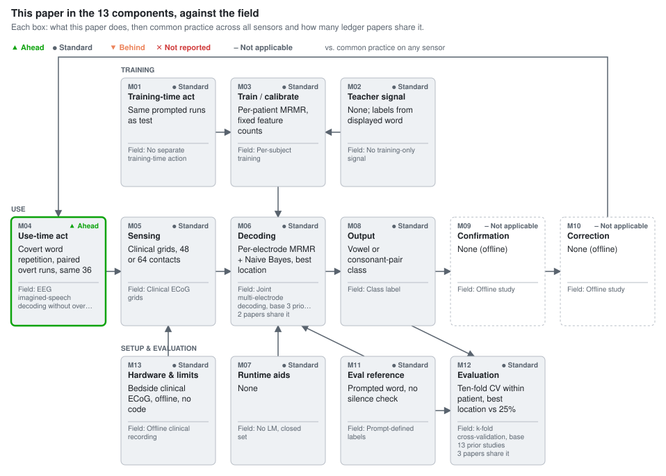

# Decoding Vowels and Consonants in Spoken and Imagined Words Using Electrocorticographic Signals in Humans

Pei, Barbour, Leuthardt, Schalk. Journal of Neural Engineering 8(4):046028, 2011. [doi:10.1088/1741-2560/8/4/046028](https://doi.org/10.1088/1741-2560/8/4/046028)

**Section:** [Other sensors](../../README.md#other-sensors)

## Figures

### This paper in the 13 components, against the field

<picture><source media="(prefers-color-scheme: dark)" srcset="figures/components-dark.svg"></picture>

Verdicts compare the paper's choice for each component with common practice across 8,995 ledger entries on any sensor (silent speech, brain-to-text, lip reading).

Data

| Component | This paper | Common practice | Papers with this practice | Verdict |
| --- | --- | --- | --- | --- |
| M01 Training-time act | Same prompted runs as test | No separate training-time action |  | ● Standard (Inherited.) |
| M02 Teacher signal | None; labels from displayed word | No training-only signal |  | ● Standard (Inherited.) |
| M03 Train / calibrate | Per-patient MRMR, fixed feature counts | Per-subject training |  | ● Standard (Per-patient training reported; fold nesting of MRMR not stated (Sec. 2.5).) |
| M04 Use-time act | Covert word repetition, paired overt runs, same 36 words | EEG imagined-speech decoding without overt condition |  | ▲ Ahead (Ahead as protocol; corrected repetition 2/6, 1/6 (inference).) |
| M05 Sensing | Clinical grids, 48 or 64 contacts | Clinical ECoG grids |  | ● Standard (Inherited (BCI2000 ECoG lineage).) |
| M06 Decoding | Per-electrode MRMR + Naive Bayes, best location | Joint multi-electrode decoding, base 3 prior studies | 2 of 3 | ● Standard (Single electrode caps accuracy; authors propose combining (Sec. 4).) |
| M07 Runtime aids | None | No LM, closed set |  | ● Standard (Inherited.) |
| M08 Output | Vowel or consonant-pair class | Class label |  | ● Standard (Inherited.) |
| M09 Confirmation | None (offline) | Offline study |  | – Not applicable (Offline.) |
| M10 Correction | None (offline) | Offline study |  | – Not applicable (Offline.) |
| M11 Eval reference | Prompted word, no silence check | Prompt-defined labels |  | ● Standard (No silence or movement check; later work uses EMG and video.) |
| M12 Evaluation | Ten-fold CV within patient, best location vs 25% chance | k-fold cross-validation, base 13 prior studies | 3 of 13 | ● Standard (No held-out session or patient.) |
| M13 Hardware & limits | Bedside clinical ECoG, offline, no code | Offline clinical recording |  | ● Standard (No online test; one offline demo fold.) |

## Verdict

The paper [[1]](#ref-1) changes two components. Its use-time action (M04) is ahead as a protocol: it discriminates vowel and consonant-pair classes in covert and overt repetition of the same 36 words within the same patients on ECoG, which no read prior does, confirming the authors' own "for the first time" claim (Sec. 1; Appendix). Its decoder (M06), one classifier per electrode with the best location reported, is standard for its time but departs from joint multi-electrode input. The overt result holds; the covert one rests on prompt-defined labels and on the best of 47–64 electrodes, and after a correction for that choice it survives in 2/6 patients for vowels and 1/6 for consonants (inference). Today a paired imagined/articulated design on high-density ECoG reaches 80.4% median imagined-syllable accuracy [[2]](#ref-2), so this paper is a feasibility result, not a benchmark.

## Against the field, component by component

### M04 Use-time action: covert words paired with overt words

**Usual approach:** before 2011 the ledger holds no imagined-speech decoder on intracranial signals. Of 39 prior pattern-match hits, mostly audiovisual and lip-reading papers (Appendix), the only imagined-speech decoder is Deng et al., who decoded imagined syllable rhythm from EEG in seven subjects; joint /ba/-/ku/ by rhythm classification was not significant (22.10% vs 16.67% chance), and there was no overt condition [[3]](#ref-3). Intracranial priors decoded attempted speech [[4]](#ref-4) or overt words [[5]](#ref-5).

**State of the art:** Zhao et al. (2026) [later] record imagined and articulated syllables in nine participants on 256-channel high-density ECoG: 80.4% median imagined accuracy, 78.3% articulated, against 16.7% chance for the six-class participants (1/8 for the others) [[2]](#ref-2). The target's 37.5% covert vowel accuracy is 12.5 points over its 25% chance; Zhao et al. stand about 63.7 points over the six-class chance (inference).

Two works are [concurrent]: Leuthardt et al. (online 7 April 2011, target 13 July 2011) used imagined phoneme vs. rest in patients 3 and 4 as a cursor control; this is detection, not discrimination between speech units [[6]](#ref-6); Brumberg et al. classified attempted phonemes from an intracortical implant in a locked-in volunteer [[7]](#ref-7). Covert accuracy is significant in 5/6 patients for vowels and 4/6 for consonants as reported (Sec. 3.1), 2/6 and 1/6 after a Bonferroni bound over 47–64 electrodes on the Table 3 z-scores (inference). Verdict: ahead, for the paired covert/overt protocol, not for accuracy.

### M06 Processing and decoding: one electrode at a time

**Usual approach:** the 2011 base is thin: 3 prior intracranial speech-unit studies, 2 decoding from several electrodes jointly (pattern match, Appendix); Kellis et al. decoded from single micro-electrodes and from concatenated features of all of them [[5]](#ref-5). The paper ranks features by MRMR per channel, feeds the top 35 (consonants) or 40 (vowels) to Naive Bayes, and reports the best location (Sec. 2.5).

**State of the art:** joint input now dominates, 78 of 96 studies across years (pattern match), and the best imagined-speech result (2026) feeds all encoding electrodes as channels [[2]](#ref-2). Verdict: standard. The authors note that multiple informative locations point to a way to improve accuracy (Sec. 4).

### M12 Evaluation: within-patient folds

**Usual approach:** k-fold cross-validation, in 3 of 13 prior intracranial speech studies and 132 of 618 across years (pattern match, Appendix); the paper uses ten-fold cross-validation within each patient (Sec. 2.5).

**State of the art:** leave-one-subject-out testing, PCC 0.765 on unseen participants in Chen et al. (2024) [later] [[8]](#ref-8). Verdict: standard for 2011, with no held-out session or patient.

## The 13 components

| Component | This paper | Usual approach (count) | State of the art | Verdict |
|---|---|---|---|---|
| M01 Training-time action | Same prompted runs as test | No separate training-time action | – | standard |
| M02 Training-only supervision | None; labels from displayed word | No training-only signal | – | standard |
| M03 Training and adaptation | Per-patient MRMR, fixed feature counts | Per-subject training | – | standard |
| M04 Use-time action | Covert word repetition, paired overt runs, same 36 words | EEG imagined-speech decoding without overt condition | [[2]](#ref-2) (2026): 80.4% median imagined syllables, HD-ECoG | ahead |
| M05 Sensors | Clinical grids, 48 or 64 contacts | Clinical ECoG grids | – | standard |
| M06 Processing and decoding | Per-electrode MRMR + Naive Bayes, best location | Joint multi-electrode decoding, base 3 prior studies (pattern match 2) | [[2]](#ref-2) (2026): multi-electrode input, 80.4% | standard |
| M07 Lexicon and LM | None | No LM, closed set | – | standard |
| M08 Output | Vowel or consonant-pair class | Class label | – | standard |
| M09 Confirmation | None (offline) | Offline study | – | not applicable |
| M10 Correction | None (offline) | Offline study | – | not applicable |
| M11 Reference construction | Prompted word, no silence check | Prompt-defined labels | – | standard |
| M12 Evaluation | Ten-fold CV within patient, best location vs 25% chance | k-fold cross-validation, base 13 prior studies (pattern match 3) | [[8]](#ref-8) (2024): leave-one-subject-out, PCC 0.765 | standard |
| M13 Device and cost | Bedside clinical ECoG, offline, no code | Offline clinical recording | – | standard |

## Where the claims outrun the evidence

- Selection. Accuracies are reported for the best location (Sec. 2.5, 4), chosen from the cross-validated accuracies of 47–64 electrodes; whether MRMR ranking was fixed inside training folds is not stated. The bootstrap tests against 25% chance do not account for this choice (inference).
- Covert labels are the prompt, with no described check that patients stayed silent (Sec. 2.2–2.3); Zhao et al. checked with video and audio, adding EMG in S6–S9 [[2]](#ref-2).
- Inconsistencies. Overt-consonant significance is p<0.0022 in Sec. 3.1 and p<0.022 in Table 3; Fig. 5 labels z=2 as p=0.0023, while a one-sided z of 2 gives about 0.023 (inference); the eighth patient is I in Table 1 and H in Table 3.
- "Effective communication with only little training" (Sec. 4) has no online test; the imagined-vowel demonstration is one offline fold from subject D (Supplementary Material).

## What the field needs next

- M03: electrode and feature selection nested in each training fold.
- M04/M11: covert trials checked by EMG or audio, and an overt-trained decoder tested on covert trials.
- M06: joint decoding against the single best electrode on the same folds.
- M12: a held-out session test.

## Questions for the authors

- Were MRMR ranking and feature counts chosen within each training fold, and how does a pre-specified electrode perform?
- How were the folds formed (by trial or run, stratified), and with what seed?
- Were classifier features normalized on training folds only?
- Did the bootstrap test account for choosing the best of 47–64 electrodes?

## Appendix: literature search

- **M04 / covert-speech-decoding-with-paired-overt-condition.** Inclusion rule: ledger text names decoding, classification or recognition together with imagined, covert, inner or unspoken speech, any signal; design of interest: covert-trial decoding with an overt condition on the same items in the same participants from intracranial electrodes; attempted speech is a different action; versions count once. Ledger counts: slot-filled 5,595; pattern match 777 unique studies, plus 88 full-text-only folders. First public before 2011: 39 pattern-match hits (88 undated excluded), mostly audiovisual and lip-reading papers; full-text term counts EEG 10, intracranial 6, ECoG 3 (none decodes imagined speech), paired overt/covert wording 1 (fMRI, no decoder). Imagined-speech decoders among them: 1 (Deng 2010, EEG). All years: paired wording 277, intracranial 433. A recall sample of 30 full-text snippets was read. Read in full: [[4]](#ref-4), [[3]](#ref-3), [[5]](#ref-5), [[6]](#ref-6) [concurrent], [[7]](#ref-7) [concurrent], [[2]](#ref-2). Known-item recall 0.5.
- **M06 / intracranial-speech-unit-classification.** Inclusion rule: ledger text names ECoG, sEEG or intracortical recording with phonemes, vowels, consonants or syllables; design of interest: single-electrode versus joint multi-electrode decoding; word-level decoders only as read priors. Ledger counts: slot-filled 7,345; pattern match 101 unique studies. Before 2011: 3 studies, multi-electrode 2. All years: 96 dated studies, multi-electrode 78, single-electrode 19 (pattern match). Read in full: [[5]](#ref-5), [[4]](#ref-4), [[2]](#ref-2). Known-item recall 0.33.
- **M12 / intracranial-speech-test-partition** (published table, reused). Inclusion rule: intracranial speech decoding studies; design of interest: how test data are separated from training data. Ledger counts: slot-filled 6,960; pattern match 618 unique studies; k-fold 132, held-out subject 28. Before 2011: 13 studies (two index-misdated 2012 papers and one duplicate folder removed), k-fold 3, held-out session or subject 0 (pattern match). Read in full: [[8]](#ref-8). Known-item recall 1.0.

## References

Numbered by first citation. BibTeX in the same order and keys: [refs.bib](refs.bib).

1. Pei, X., Barbour, D., Leuthardt, E. C., Schalk, G. “Decoding Vowels and Consonants in Spoken and Imagined Words Using Electrocorticographic Signals in Humans.” *Journal of Neural Engineering*, 2011, 8(4), 046028. doi:[10.1088/1741-2560/8/4/046028](https://doi.org/10.1088/1741-2560/8/4/046028). Target. Read as the PMC author manuscript (PMC3772685). [wiki: doi-10.1088-1741-2560-8-4-046028](https://github.com/supernaiter/deep-research-wiki-for-silent-speech/blob/main/papers/doi-10.1088-1741-2560-8-4-046028/article.md) [wiki: pmc-3772685-vowelcons](https://github.com/supernaiter/deep-research-wiki-for-silent-speech/blob/main/papers/pmc-3772685-vowelcons/article.md)
2. Zhao, Z., Wang, Z., Liu, Y., Qian, Y., Yin, Y., Gao, X., et al. “A neural architecture for imagined and overt speech motor dynamics.” *Nature Neuroscience*, 2026. doi:[10.1038/s41593-026-02456-0](https://doi.org/10.1038/s41593-026-02456-0). Later; state of the art for M04 and M06. Accepted 18 August 2026; online date not printed in the read version. [later] [wiki: natneuro-02456-motordyn](https://github.com/supernaiter/deep-research-wiki-for-silent-speech/blob/main/papers/natneuro-02456-motordyn/article.md)
3. Deng, S., Srinivasan, R., Lappas, T., D'Zmura, M. “EEG classification of imagined syllable rhythm using Hilbert spectrum methods.” *Journal of Neural Engineering*, 2010, 7(4), 046006. doi:[10.1088/1741-2560/7/4/046006](https://doi.org/10.1088/1741-2560/7/4/046006). Prior; deciding prior for M04 (scalp EEG, imagined syllables, no overt condition). [wiki: doi-10.1088-1741-2560-7-4-046006](https://github.com/supernaiter/deep-research-wiki-for-silent-speech/blob/main/papers/doi-10.1088-1741-2560-7-4-046006/article.md)
4. Guenther, F. H., Brumberg, J. S., Wright, E. J., Nieto-Castanon, A., Tourville, J. A., Panko, M., et al. “A Wireless Brain-Machine Interface for Real-Time Speech Synthesis.” *PLoS ONE*, 2009, 4(12), e8218. doi:[10.1371/journal.pone.0008218](https://doi.org/10.1371/journal.pone.0008218). Prior; deciding prior for M04 and M06 (intracortical, attempted speech, one locked-in participant). [review](https://github.com/supernaiter/silent-speech-review/tree/main/reviews/a-wireless-brain-machine-interface-for-real-time-speech-synthesis) [wiki: pmc-2784218-wirelesssynth](https://github.com/supernaiter/deep-research-wiki-for-silent-speech/blob/main/papers/pmc-2784218-wirelesssynth/article.md)
5. Kellis, S., Miller, K., Thomson, K., Brown, R., House, P., Greger, B. “Decoding spoken words using local field potentials recorded from the cortical surface.” *Journal of Neural Engineering*, 2010, 7(5), 056007. doi:[10.1088/1741-2560/7/5/056007](https://doi.org/10.1088/1741-2560/7/5/056007). Prior; deciding prior for M04 and M06 (micro-ECoG, overt words, single and concatenated electrodes). [wiki: doi-10.1088-1741-2560-7-5-056007](https://github.com/supernaiter/deep-research-wiki-for-silent-speech/blob/main/papers/doi-10.1088-1741-2560-7-5-056007/article.md)
6. Leuthardt, E. C., Gaona, C., Sharma, M., Szrama, N., Roland, J., Freudenberg, Z., et al. “Using the electrocorticographic speech network to control a brain-computer interface in humans.” *Journal of Neural Engineering*, 2011, 8(3), 036004. doi:[10.1088/1741-2560/8/3/036004](https://doi.org/10.1088/1741-2560/8/3/036004). Concurrent (same group); imagined phonemes as ECoG cursor-control features. [concurrent] [wiki: doi-10.1088-1741-2560-8-3-036004](https://github.com/supernaiter/deep-research-wiki-for-silent-speech/blob/main/papers/doi-10.1088-1741-2560-8-3-036004/article.md)
7. Brumberg, J. S., Wright, E. J., Andreasen, D. S., Guenther, F. H., Kennedy, P. R. “Classification of Intended Phoneme Production from Chronic Intracortical Microelectrode Recordings in Speech-Motor Cortex.” *Frontiers in Neuroscience*, 2011, 5, 65. doi:[10.3389/fnins.2011.00065](https://doi.org/10.3389/fnins.2011.00065). Concurrent; intracortical attempted phoneme classification, one locked-in participant. [concurrent] [wiki: pmc-3096823-phonintent](https://github.com/supernaiter/deep-research-wiki-for-silent-speech/blob/main/papers/pmc-3096823-phonintent/article.md)
8. Chen, J., Chen, X., Wang, R., Le, C., Khalilian-Gourtani, A., Jensen, E., et al. “Subject-Agnostic Transformer-Based Neural Speech Decoding from Surface and Depth Electrode Signals.” *bioRxiv*, 2024. doi:[10.1101/2024.03.11.584533](https://doi.org/10.1101/2024.03.11.584533). Later; state of the art in the published M12 topic table (leave-one-subject-out test). [later] [wiki: doi-10.1101-2024.03.11.584533](https://github.com/supernaiter/deep-research-wiki-for-silent-speech/blob/main/papers/doi-10.1101-2024.03.11.584533/article.md)

## Materials

Data behind this review. Full texts of the papers are not included.

- [`review.md`](review.md): the review text (source)
- [`refs.bib`](refs.bib): references (BibTeX)
- [`slots.json`](slots.json): for each of the 13 components: this paper's choice, field practice, number of matching papers, verdict
- [`figures.json`](figures.json): figure definitions
- [`evaluation.md`](evaluation.md): independent evaluation by a second reviewer
- [`triage.md`](triage.md): how each evaluation finding was checked against the sources and resolved
- [`process/log.json`](process/log.json): process record: each step, who did it (reader, script, writer, evaluator), when, the checks run and the input versions
- [`process/notes.json`](process/notes.json): reading notes on the target and comparator papers: claims, numbers, conditions and what is not stated, with locations
- [`process/plan.json`](process/plan.json): plan: which components the paper changes and the topics it is compared on
- [`process/draft.md`](process/draft.md): the review as first written, before the independent evaluation
- [`process/claims-draft.md`](process/claims-draft.md): claim table of the draft: every claim mapped to a note or a count
- [`process/claims.md`](process/claims.md): claim table of the published review
- [`components/M04/covert-speech-decoding-with-paired-overt-condition.csv`](../../components/M04/covert-speech-decoding-with-paired-overt-condition.csv): M04 topic "covert-speech-decoding-with-paired-overt-condition", every candidate paper with its decision (5595 slot-filled, 777 pattern match, usual design in 10, 6 read in full)
- [`components/M06/intracranial-speech-unit-classification.csv`](../../components/M06/intracranial-speech-unit-classification.csv): M06 topic "intracranial-speech-unit-classification", every candidate paper with its decision (7345 slot-filled, 101 pattern match, usual design in 2, 3 read in full)
- [`components/M12/intracranial-speech-test-partition.csv`](../../components/M12/intracranial-speech-test-partition.csv): M12 topic "intracranial-speech-test-partition", every candidate paper with its decision (6960 slot-filled, 618 pattern match, usual design in 132, 2 read in full)

## More reviews in Other sensors

- [Reconstructing Speech from Human Auditory Cortex](../reconstructing-speech-from-human-auditory-cortex/) (2012). M06 ahead for 2012: earliest heard-speech spectrogram reconstruction from human ECoG in the ledger, above zero in all 15 patients; modulation result is a group effect; word readout uses one patient.
- [A Wireless Brain-Machine Interface for Real-Time Speech Synthesis](../a-wireless-brain-machine-interface-for-real-time-speech-synthesis/) (2009). Closed-loop formant decoding (M06) and F1/F2 output (M08) are standard: gesture-driven formant synthesis came first; one user learns vowels; hit rate lacks a chance level; no speech measured.
- [Direct classification of all American English phonemes using signals from functional speech motor cortex](../direct-classification-of-all-american-english-phonemes-using-signals-from-functional-speech-motor-co/) (2014). Phoneme-onset events within words (M06) are ahead as a protocol; full-inventory classification predates it (Brumberg 2011); the 36% headline is consonants only, on hand-labelled onsets.
- [Brain-to-text: decoding spoken phrases from phone representations in the brain](../brain-to-text-decoding-spoken-phrases-from-phone-representations-in-the-brain/) (2015). Phone-model decoder (M06) is the EMG recognizer moved to ECoG: standard. 25% WER uses per-phrase dictionaries holding the spoken words (M07); the time-shift null (M12) is sound.
- [Fully Implanted Brain-Computer Interface in a Locked-In Patient with ALS](../fully-implanted-brain-computer-interface-in-a-locked-in-patient-with-als/) (2016). Skin-closed ECoG implant used at home without investigators (M13): standard, one user, skin-closed telemetry predates it; main-text 89% spelling accuracy pools inactive steps, no chance level.
- [Lipreading with Long Short-Term Memory](../lipreading-with-long-short-term-memory/) (2016). Joint LSTM + pixel front end (M06) is ahead of 2015 lipreading, but pixel-input and recurrent word models predate it, and the 8.3-point gain is over linear SVMs, not HMMs.

---

Part of the [Silent Speech Interface Review](https://github.com/supernaiter/silent-speech-review). Found an error? [Open an issue](https://github.com/supernaiter/silent-speech-review/issues/new?template=correction.yml).
