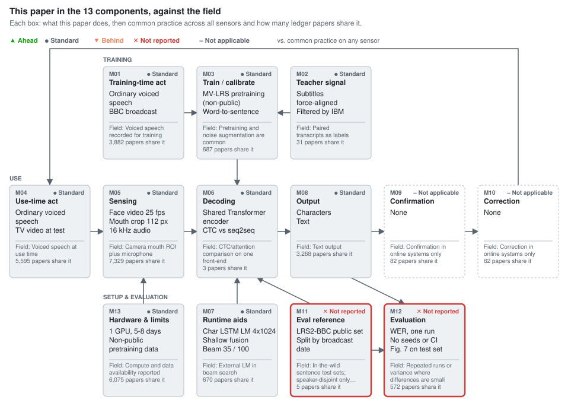
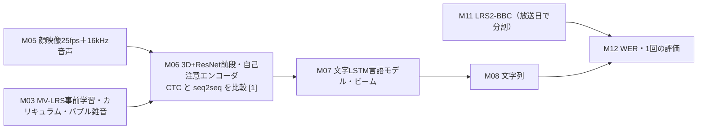

# Deep Audio-Visual Speech Recognition

Triantafyllos Afouras, Joon Son Chung, Andrew Senior, Oriol Vinyals, Andrew Zisserman  
IEEE TPAMI (arXiv 2018) · [DOI](https://doi.org/10.1109/TPAMI.2018.2889052) · [arXiv](https://arxiv.org/abs/1809.02108)

**Section:** [Lip & face video](../README.md#lip--face-video) · **Review basis:** full_text+summary+component_ledger_scan

A structured review of *Deep Audio-Visual Speech Recognition* (Triantafyllos Afouras et al., IEEE TPAMI (arXiv 2018)) for the silent speech interface field: sensor, task, evaluation conditions, results and limitations.

Landmark AVSR paper that releases LRS2-BBC and compares CTC and sequence-to-sequence Transformers on one shared encoder. Video-only TM-seq2seq reaches 48.3% WER with an LM (49.8% without; the 70.4% WAS baseline has no stated decoding conditions, and the same group's Transformer three months earlier already reached 50.0%). CTC and seq2seq differ little once an LM or audio is added.

## Evaluation conditions

| | |
| --- | --- |
| Sensor | Face/mouth video (25 fps, 112 px mouth crop) plus 16 kHz audio |
| Task | Sentence-level lip reading and audio-visual speech recognition |
| Vocabulary | Open vocabulary; 1,693-word LRS2-BBC test vocabulary |
| Speaker | Not stated |
| Session | Not applicable |
| Online / offline | Offline |
| Key result | 48.3% WER video-only (LRS2-BBC, +LM); 8.2% audio-visual clean; 23.6% audio-visual in 0 dB babble |

**Limitations.** Test speakers may overlap with training (split by broadcast date, speaker count unreported); single runs; matched synthetic babble noise only; pretraining uses non-public MV-LRS; GPU model inconsistent between sections.

## Figures

### This paper in the 13 components, against the field

<picture><source media="(prefers-color-scheme: dark)" srcset="../figures/deep-audio-visual-speech-recognition/components-dark.svg"></picture>

Verdicts compare the paper's choice for each component with common practice across 8,995 ledger entries on any sensor (silent speech, brain-to-text, lip reading), not only audio-visual papers. Paper counts come from the maintainer's ledger and undercount some components, notably language models, confirmation and correction.

Data

| Component | This paper | Common practice | Papers with this practice | Verdict |
| --- | --- | --- | --- | --- |
| M01 Training-time act | Ordinary voiced speech BBC broadcast | Voiced speech recorded for training | 3,882 of 8,995 | ● Standard (Inherited from the WLAS / LRS lineage.) |
| M02 Teacher signal | Subtitles force-aligned Filtered by IBM Watson ASR | Paired transcripts as labels | 31 of 8,995 | ● Standard (Automatic labels as in LRS; slot under-recorded in the ledger.) |
| M03 Train / calibrate | MV-LRS pretraining (non-public) Word-to-sentence curriculum 0 dB babble noise p=0.25 | Pretraining and noise augmentation are common | 687 of 8,995 | ● Standard (Curriculum is inherited from WLAS (near-identical wording); noise augmentation is common practice.) |
| M04 Use-time act | Ordinary voiced speech TV video at test | Voiced speech at use time | 5,595 of 8,995 | ● Standard (Inherited.) |
| M05 Sensing | Face video 25 fps Mouth crop 112 px 16 kHz audio | Camera mouth ROI plus microphone | 7,329 of 8,995 | ● Standard (Standard AV input.) |
| M06 Decoding | Shared Transformer encoder CTC vs seq2seq head-to-head Separate AV attention | CTC/attention comparison on one front-end | 3 of 8,995 | ● Standard (No earlier example found in the wiki; a concurrent same-group paper already compared CTC and Transformer, so not ahead.) |
| M07 Runtime aids | Char LSTM LM 4x1024 Shallow fusion Beam 35 / 100 | External LM in beam search | 670 of 8,995 | ● Standard (Common practice; the M07 slot itself is under-recorded.) |
| M08 Output | Characters Text | Text output | 3,268 of 8,995 | ● Standard (Standard.) |
| M09 Confirmation | None | Confirmation in online systems only | 82 of 8,995 | – Not applicable (Offline benchmark study.) |
| M10 Correction | None | Correction in online systems only | 82 of 8,995 | – Not applicable (Offline benchmark study.) |
| M11 Eval reference | LRS2-BBC public set Split by broadcast date Speaker overlap unstated | In-the-wild sentence test sets; speaker-disjoint only in some | 5 of 8,995 | ✕ Not reported (Speaker count and train/test speaker overlap not reported; the same group's LRS3 paper says LRS2-BBC likely repeats people.) |
| M12 Evaluation | WER, one run No seeds or CI Fig. 7 on test set | Repeated runs or variance where differences are small | 572 of 8,995 | ✕ Not reported (8.2% vs 8.5% is within about 0.34 pt binomial error; no repeats reported.) |
| M13 Hardware & limits | 1 GPU, 5-8 days Non-public pretraining data | Compute and data availability reported | 6,075 of 8,995 | ● Standard (Compute reported (GPU model inconsistent between sections); exact numbers need non-public MV-LRS.) |

## 構成要素別レビュー（日本語）

対象：Afouras ら [[1]](#ref-1)（固定版 arXiv v2、2018-12-22、PDF SHA-256 `3a147540…be7236a`、全13ページ）。wiki コミット `730b0b4`。
wiki の台帳（仕様 v2.1.0）の 13 構成要素（M01〜M13）ごとに、信号を問わず同じ要素を扱った論文と比べた。走査は 8,995 台帳フォルダ（版の重複を除くと 7,388 本）。候補は台帳と全文への正規表現で出し、原典を読んで確かめた。
件数は「枠記録」「文字列一致」（目安、上限）「確認済み」（読んで採った研究数）を区別し、数値の出所は「本文確認」「査読者の計算」で示す。
**状態**：2026-11-12 作成。構成要素の採否と判定は LLM による読みで、独立した検証役の指摘を原典で照合して反映した。「他に見つからない」は wiki 内の検索の範囲の話で、話題ごとの再現率の目安は付録A に示す。

---

### 要点

変えたのは **M06 処理・復号**（同じ Transformer エンコーダの上で CTC 損失と系列変換損失を並べて比べ、音声と映像を別々の注意で読む復号器を使う）と **M11 評価用の正解**（BBC 放送から自動で作った文単位の公開データ LRS2-BBC）である。残りは前作 WLAS [[2]](#ref-2) の系譜を継ぐ。

映像だけの最良は TM-seq2seq で WER 48.3%（外部言語モデルあり）、前作 WAS の 70.4% から約 22 ポイント下がった（表2、本文確認）。
ただし 70.4% の評価条件（言語モデルやビーム幅）は対象に書かれておらず、同時期の同グループ論文 [[3]](#ref-3) の表1 でも「MV-WAS」として条件なしで載っている。70.4% が言語モデルなしの値だと仮定すると、同条件の 49.8% との差は 20.6 ポイント、相対 −29% になる（査読者の計算）。3 か月前の同グループ論文の Transformer は言語モデルありで 50.0% で、対象がそこから足した改善は 48.3% までの 1.7 ポイントである（表1、本文確認）。
しかも前段（3D+ResNet）、事前学習データ（非公開の MV-LRS を含む）、後段の三つが同時に変わっており、寄与の切り分けはない。「新しい前段と後段が 22% 以上の改善に寄与した」（§1）という帰属は強すぎる。

CTC と系列変換の差は言語モデルで大きく縮む。映像だけでは言語モデルなしで 65.0% 対 49.8%（差 15.2）、ありで 54.7% 対 48.3%（差 6.4）である（表2、本文確認）。
音声映像のきれいな音声では 8.2% 対 8.5% で、テスト 6,663 語では二項誤差の目安（1 標準誤差）が約 ±0.34 ポイントあり、差は判別できない（査読者の計算）。乱数種や繰り返しの記載はない。

LRS2-BBC のテストは放送日で分けているが、話者数の記載がなく（表1 は「-」）、同じグループの LRS3 論文 [[4]](#ref-4) は「LRS2-BBC は同じ人物が回をまたいで出やすい」と書いている。前作 WLAS は話者が数千人いるので話者に依存しないと述べるが [[2]](#ref-2)、テストが未知話者の評価であることは保証されない。

### 何をしたか

入力は 25 fps の顔映像から切り出した口元 112×112 画素と、16 kHz 音声の 321 次元スペクトル（40 ms 窓、10 ms ずらし、4 枠ずつ連結）である（§3.1–3.2、本文確認）。
視覚前段は 3D 畳み込み＋2D ResNet [[5]](#ref-5)、各モダリティに 6 層の自己注意エンコーダを置く。TM-seq2seq は復号器の各層で映像と音声に別々の注意をかけて連結し、TM-CTC は二つの符号を連結して自己注意を重ねる（§3.3–3.5、図2）。
復号は幅つきビームサーチで、文字単位の LSTM 言語モデル（4 層×1024、字幕 2,600 万語で学習）を浅い融合で足す（§3.6、§4）。
学習は、前段を MV-LRS の単語切り出しで事前学習し、凍結特徴で MV-LRS・LRS2-BBC・LRS3-TED の pre-train 集合を使って単語から文へ長さを伸ばすカリキュラムで学習し、最後に各データで端から端まで微調整する（§5.1–5.2）。
雑音耐性のため、学習中に確率 0.25 で 0 dB のバブル雑音（LRS2-BBC の 20 発話を混ぜたもの）を足し、雑音条件では常に足して微調整する（§5.3）。

| 対象論文の主要数値 | 値 | 出所 |
|---|---|---|
| LRS2-BBC テスト | 1,243 発話、6,663 語、語彙 1,693、0.5 時間 | 表1（本文確認） |
| LRS2-BBC pre-train／train-val | 96k 発話・195 時間／47k 発話・29 時間 | 表1（本文確認） |
| 映像のみ TM-seq2seq（LRS2／LRS3） | 49.8%・48.3%（+LM）／59.9%・58.9% | 表2（本文確認） |
| 映像のみ TM-CTC（LRS2／LRS3） | 65.0%・54.7%／74.7%・66.3% | 表2（本文確認） |
| 前作 WAS（LRS2、映像のみ） | 70.4% | 表2（本文確認） |
| 音声のみ → 音声映像（LRS2、+LM） | CTC 10.1%→8.2%、seq2seq 9.7%→8.5% | 表2（本文確認） |
| 雑音下 音声のみ → 音声映像（LRS2、+LM） | CTC 53.4%→23.6%、seq2seq 57.4%→34.2% | 表2（本文確認） |
| Google S2T（LRS2、きれい／雑音） | 20.9%／86.3% | 表2（本文確認） |

本文に書かれていないこと：テスト話者と訓練話者の重なり、乱数種と繰り返し回数、雑音テストに使ったバブル雑音の元発話が訓練側かテスト側か、WAS 70.4% の評価条件（再学習か、前作モデルの再評価か）。

### それまでの到達点

**M06（CTC と系列変換）**：唇読みの文単位認識では、CTC を使う LipNet [[6]](#ref-6) と、注意つき系列変換の WLAS [[2]](#ref-2) が別々に提案されていた。同じ前段の上で両者を並べた比較は、wiki 内の検索では対象より前に見つからなかった（付録A、全文一致の標本 30 本を読んで 0 本、既知項目の再現率は研究単位で 1/1）。
同時期には、同じグループの Interspeech 論文 [[3]](#ref-3) が BLSTM-CTC・全畳み込み CTC と Transformer を LRS2 で比べ、Transformer が言語モデルありで 50% に達していた。対象の TM-seq2seq はこの Transformer と同じ構成（数値と前段の事前学習データは異なる）で、対象が新しく足したのは Transformer 版の CTC（TM-CTC）と音声映像への拡張である（§1「On the content」）。
音声映像の融合は、WLAS の二重注意 [[2]](#ref-2) と、Petridis ら [[7]](#ref-7) の音声・映像の特徴連結＋双方向再帰が先行する。

**M11（実環境の文単位データ）**：LRS [[2]](#ref-2) は BBC 放送から 11 万文を集め、放送日で分割していたが、権利の都合で公開できなかった。LRS2-BBC はその公開版の位置づけである。単語単位では LRW が同じ手順で作られている。

**継いだ部品**：M01・M04（通常の発声を撮った放送映像）、M02（字幕を強制整列し、IBM Watson の認識結果で選別したラベル）、M05、M07、M08、M13 は WLAS の系譜をそのまま継ぐ。カリキュラム学習（§5.2）も前作から継いでいる。対象 §5.2 の「単語から始めて長さを伸ばす新しい戦略を導入する」という文は、WLAS §3.1 の文とほぼ同じである [[2]](#ref-2)。

### 何が変わったか

**M06**：CTC と系列変換を、エンコーダを共有したまま並べた点が対象の中心である。結果は「映像だけなら系列変換が明確に良く、音声があれば同程度、雑音下では CTC が良い」（§6.4）。
映像だけの差は言語モデルで半分以下に縮み（15.2 → 6.4 ポイント）、著者も「言語モデルの利得は CTC で大きい」と書いている（§6.4）。比べているのは損失だけでなく、ビーム幅（CTC 100、seq2seq 35）と言語モデルの重み（α 0.5 と 0.1）も別々に調整した構成どうしである（付録C・D）。
雑音下で CTC が良い（23.6% 対 34.2%）のは一つの雑音種・一つの SNR（0 dB バブル）での結果で、学習と同じ種類の雑音で評価している（§5.3）。

同期ずれへの強さ（図8）は、seq2seq が 1 エポックの微調整でほぼ影響を消し、CTC は 4 エポックでも残る。著者はこれを、二つの入力に別々の注意を使う seq2seq と、二つの符号を連結する TM-CTC の融合方式の差として説明している（§6.3）。損失の違いの効果とは分けられていない。

**M11**：LRS2-BBC は pre-train 195 時間、train-val 29 時間、テスト 0.5 時間で、テストは 1,243 発話と小さい。語彙制限はなく、文は 100 文字か 10 秒で切る（§4、表1）。
自動構築の手順（SSD 顔検出、字幕の強制整列、Watson での選別、音声映像の同期と話者判定）は LRS からの継承である。
話者の分離は管理していない。同時期の LRS3 [[4]](#ref-4) は「TED では同じ話者が繰り返し出ないので重なりは少ない」とし、LRS2-BBC は同じ人物が出やすいと明記している。後続のデータでは、ViCocktail [[8]](#ref-8) がテスト話者を訓練と重ならないよう選んでいる。

### 分野での位置づけ

| 枠 | 対象論文の選択 | 分野の通例（件数と層） | 判定 |
|---|---|---|---|
| M01 学習時の行為 | 放送の通常発声 | 枠記録 3,882／7,388 | standard |
| M02 学習専用の教師 | 字幕を強制整列したラベル | 枠記録が疎（31）、通例の数は出さない | standard |
| M03 学習・適応 | MV-LRS 事前学習、カリキュラム、0 dB バブル雑音 | 雑音付加の文字列一致 687 | standard |
| M04 利用時の行為 | 放送の通常発声 | 枠記録 5,595 | standard |
| M05 計測 | 顔映像 25 fps、口元 112 画素、16 kHz 音声 | 枠記録 7,329 | standard |
| M06 処理・復号 | 共通エンコーダで CTC と seq2seq を比較、別注意の融合 | 確認済み 3（先行 0、同時期 1、後続 2） | standard |
| M07 利用時の補助 | 文字 LSTM 言語モデル、浅い融合 | 文字列一致 670（枠記録は疎） | standard |
| M08 出力 | 文字列 | 枠記録 3,268 | standard |
| M09 確認 | なし（オフライン） | 枠記録 82 | not_applicable |
| M10 訂正 | なし（オフライン） | 枠記録 82 | not_applicable |
| M11 評価用の正解 | LRS2-BBC、放送日で分割、話者重複は未記載 | 確認済み 5 | not_reported |
| M12 評価 | WER、1 回の評価、乱数種の記載なし | 乱数種・分散の文字列一致 572 | not_reported |
| M13 装置・運用 | GPU 1 枚で 5〜8 日、事前学習に非公開データ | 枠記録 6,075 | standard |

### 主張の範囲

「公開された文単位の唇読みで従来を大きく上回る」は、LRS2-BBC の上では成り立つ。ただし前作との差には、言語モデルの有無、非公開データを含む事前学習、前段の更新が混ざっている。
「映像は、きれいな音声でも認識を助ける」は、言語モデルありで 10.1% → 8.2%（CTC、相対 −19%）、9.7% → 8.5%（seq2seq、相対 −12%）と一貫して出ている（査読者の計算）。
「雑音下で音声映像が大きく効く」は、学習と同じ種類・同じ強さの合成雑音での結果である。Google S2T の 86.3% は雑音に合わせて調整していない市販系との比較なので、雑音耐性の差の大きさを示す証拠にはならない。

### 実用上の意味

LRS2-BBC と LRS3-TED は、この後の唇読み・音声映像認識の標準ベンチマークになった。TM-seq2seq と TM-CTC は以後の比較表の基準行として繰り返し使われている（付録A の後続文献）。
一方で、LRS2-BBC での数値は、テレビの常連出演者が訓練にもテストにも出うる条件での値である。未知の話者への汎化を言うには、LRS3-TED か話者を分けたテストが要る。

### 前進、未解決、後退した軸

- 前進：公開の文単位ベンチマーク、CTC と系列変換の同条件比較、同期ずれと雑音の系統的な評価。
- 未解決：話者の分離、繰り返しによるばらつき、雑音種・SNR を変えた評価、非公開データなしでの再現。
- 後退：なし。ただし事前学習に非公開の MV-LRS を使うので、公開データだけでは同じ数値を再現できない。

### 限界

- 著者自身の注記：学習時間は seq2seq が約 8 日、CTC が約 5 日（§6.4）。文の長さは GPU メモリのため 100 文字・10 秒で切った（§4）。
- 本文内の不一致：使った GPU が §5.4 では GeForce GTX 1080 Ti（11 GB）、§6.4 では GeForce Titan X（12 GB）になっている。ビーム幅は §6 で seq2seq 35、付録C では言語モデルなしで 6、ありで 35 とされ、言語モデルなしの表2 の値がどちらの幅かは本文から読めない。
- 図7（ビーム幅と WER）の説明は「LRS2-BBC で評価」だけで、縦軸の範囲が表2 と合うことからテスト集合で描かれていると推定される。値の選定は検証集合で行ったと書かれている。
- 付録E の記号は、削除を ni、挿入を nd と書いており紛らわしい（定義そのものは通常どおり）。本文には「figure E」という誤記もある。

### 残る問い

- LRS2-BBC の訓練とテストに同じ話者はどれくらい重なっているか。
- WAS の 70.4% は、LRS2-BBC で再学習したモデルの値か、前作のモデルをそのまま評価した値か。言語モデルとビーム幅はどうか。
- 22 ポイントの改善のうち、非公開の MV-LRS を使った事前学習の寄与はどれくらいか。
- 雑音テストのバブル雑音は、訓練に使った発話から作ったものか。別の雑音種や SNR ではどうなるか。
- 乱数種を変えたとき、8.2% と 8.5% の差は保たれるか。

### 付録A　検討した論文

走査：wiki の全 8,995 台帳フォルダ（版の重複を除くと 7,388 本）を、枠の記入状態と台帳文字列への正規表現で数え、全文への正規表現で台帳が拾わない候補を探した。確認済みは原典の本文を読んで採否を決めた研究数（版の重複は 1 件）。

| 話題 | 枠記録 | 文字列一致 | 確認済み | 読んだ候補／未読 | 既知項目の再現率 | 再現率の目安 |
|---|---:|---:|---:|---|---|---|
| M06 CTC と注意の比較 | 7,345 | 114 | 3 | 42／128 | 研究単位 1/1（版単位 1/2） | 1.0（全文のみ一致の標本 30 本に限った値） |
| M11 実環境の文単位データ | 234 | 271 | 5 | 26／316 | 4/4 | 0.6（全文のみの標本 19 本中 2 本） |

M06 の確認済み：Afouras ら 2018 Interspeech [[3]](#ref-3)（同時期）、Luo ら 2020 [[9]](#ref-9)（後続、音響センシングの無声発話）、Krishna ら 2019 [[10]](#ref-10)（後続、EEG。注意型は WER、CTC は CER で測っており境界例）。対象より前の例は見つからなかった。候補 170 本のうち 128 本は未読で、後続の未読候補（EEG の Transformer など）もあるので、確認済み 3 は下限である。除外の例：Sterpu ら [[11]](#ref-11) は系列変換と CTC 併用の比較で CTC 単独がない。Petridis ら [[12]](#ref-12) は CTC と注意の併用の提案。Shillingford ら [[13]](#ref-13) は CTC 主体で、seq2seq は既存モデルの再実装との比較。

M11 の確認済み：LRS [[2]](#ref-2)（先行、放送日で分割）、LSVSR [[13]](#ref-13)（同時期）、LRS3-TED [[4]](#ref-4)（同時期、話者の重なりは少ないと記述）、VoxLRS-SA [[14]](#ref-14)（後続）、ViCocktail [[8]](#ref-8)（後続、テスト話者を分離）。単語単位の LRW、LRW-1000 は除いた。M11 は未読候補が多く、再現率の目安は 0.6 にとどまる。

### 付録B　数値の出所

- 本文確認：表1（データ統計）、表2（WER すべて）、§3（入力・構成）、§4（データ構築）、§5（学習、雑音、GPU 1080 Ti）、§6（ビーム幅、テスト時拡張 9 通り）、§6.4（学習日数、Titan X）、付録C・D（ビーム幅、α、β）、付録E（適合率と再現率の定義）。WLAS の 50.2%（LRS、前作の表）と §3.1 のカリキュラム記述、LRS3 §2 の話者に関する記述。
- 図読み：なし（図8 の同期ずれは傾向のみ引用）。
- 台帳のみ：なし。
- 照合できなかったもの：WAS 70.4% の評価条件。
- 査読者の計算：20.6 ポイントと相対 −29%（70.4→49.8）、CTC と seq2seq の差 15.2 と 6.4、相対 −19% と −12%、6,663 語での二項誤差の目安 ±0.34 ポイント（√(0.085×0.915/6663)、発話内の相関を無視した下限）。

### 参考文献

番号は本文での初出順。BibTeX は同じ番号順・同じキーで [deep-audio-visual-speech-recognition.bib](../data/component/deep-audio-visual-speech-recognition.bib) にある。

1. Afouras, T., Chung, J. S., Senior, A., Vinyals, O., Zisserman, A. “Deep Audio-Visual Speech Recognition.” *IEEE Transactions on Pattern Analysis and Machine Intelligence*, 2018. doi:[10.1109/TPAMI.2018.2889052](https://doi.org/10.1109/TPAMI.2018.2889052). arXiv:[1809.02108v2](https://arxiv.org/abs/1809.02108v2). 本査読の対象論文（arXiv v2 を固定版として読んだ。DOI は刊行版）。 [wiki: arxiv-1809.02108](https://github.com/supernaiter/deep-research-wiki-for-silent-speech/blob/main/papers/arxiv-1809.02108/article.md) [wiki: doi-10.1109-tpami.2018.2889052](https://github.com/supernaiter/deep-research-wiki-for-silent-speech/blob/main/papers/doi-10.1109-tpami.2018.2889052/article.md)
2. Chung, J. S., Senior, A., Vinyals, O., Zisserman, A. “Lip Reading Sentences in the Wild.” *Proc. IEEE Conference on Computer Vision and Pattern Recognition (CVPR)*, 2017. doi:[10.1109/CVPR.2017.367](https://doi.org/10.1109/CVPR.2017.367). arXiv:[1611.05358](https://arxiv.org/abs/1611.05358). [レビュー](https://github.com/supernaiter/silent-speech-review/blob/main/reviews/lip-reading-sentences-in-the-wild.md) [wiki: arxiv-1611.05358](https://github.com/supernaiter/deep-research-wiki-for-silent-speech/blob/main/papers/arxiv-1611.05358/article.md) [wiki: cvf-chung17-lipreadwild](https://github.com/supernaiter/deep-research-wiki-for-silent-speech/blob/main/papers/cvf-chung17-lipreadwild/article.md)
3. Afouras, T., Chung, J. S., Zisserman, A. “Deep Lip Reading: a comparison of models and an online application.” *Proc. Interspeech 2018*, 2018. arXiv:[1806.06053](https://arxiv.org/abs/1806.06053). ［同時期］ [wiki: arxiv-1806.06053](https://github.com/supernaiter/deep-research-wiki-for-silent-speech/blob/main/papers/arxiv-1806.06053/article.md) [wiki: isca-afouras18b-deeplip](https://github.com/supernaiter/deep-research-wiki-for-silent-speech/blob/main/papers/isca-afouras18b-deeplip/article.md) [wiki: isca-afouras18b_deeplipread](https://github.com/supernaiter/deep-research-wiki-for-silent-speech/blob/main/papers/isca-afouras18b_deeplipread/article.md) [wiki: isca-afouras18b_interspeech](https://github.com/supernaiter/deep-research-wiki-for-silent-speech/blob/main/papers/isca-afouras18b_interspeech/article.md)
4. Afouras, T., Chung, J. S., Zisserman, A. “LRS3-TED: a large-scale dataset for visual speech recognition.” *arXiv preprint*, 2018. arXiv:[1809.00496](https://arxiv.org/abs/1809.00496). ［同時期］ [wiki: arxiv-1809.00496](https://github.com/supernaiter/deep-research-wiki-for-silent-speech/blob/main/papers/arxiv-1809.00496/article.md)
5. Stafylakis, T., Tzimiropoulos, G. “Combining Residual Networks with LSTMs for Lipreading.” *Proc. Interspeech 2017*, 2017. doi:[10.21437/Interspeech.2017-85](https://doi.org/10.21437/Interspeech.2017-85). arXiv:[1703.04105](https://arxiv.org/abs/1703.04105). [wiki: isca-stafylakis17-resnetlstm](https://github.com/supernaiter/deep-research-wiki-for-silent-speech/blob/main/papers/isca-stafylakis17-resnetlstm/article.md) [wiki: isca-stafylakis17_lipread](https://github.com/supernaiter/deep-research-wiki-for-silent-speech/blob/main/papers/isca-stafylakis17_lipread/article.md) [wiki: arxiv-1703.04105](https://github.com/supernaiter/deep-research-wiki-for-silent-speech/blob/main/papers/arxiv-1703.04105/article.md)
6. Assael, Y. M., Shillingford, B., Whiteson, S., de Freitas, N. “LipNet: End-to-End Sentence-level Lipreading.” *arXiv preprint*, 2016. arXiv:[1611.01599](https://arxiv.org/abs/1611.01599). [レビュー](https://github.com/supernaiter/silent-speech-review/blob/main/reviews/lipnet-end-to-end-sentence-level-lipreading.md) [wiki: arxiv-1611.01599](https://github.com/supernaiter/deep-research-wiki-for-silent-speech/blob/main/papers/arxiv-1611.01599/article.md)
7. Petridis, S., Stafylakis, T., Ma, P., Cai, F., Tzimiropoulos, G., Pantic, M. “End-to-End Audiovisual Speech Recognition.” *Proc. IEEE ICASSP 2018*, 2018. doi:[10.1109/ICASSP.2018.8461326](https://doi.org/10.1109/ICASSP.2018.8461326). arXiv:[1802.06424](https://arxiv.org/abs/1802.06424). [wiki: arxiv-1802.06424](https://github.com/supernaiter/deep-research-wiki-for-silent-speech/blob/main/papers/arxiv-1802.06424/article.md)
8. Nguyen, T., Nguyen, T. V., Do, Q. T., Luong, C. M. “ViCocktail: Automated Multi-Modal Data Collection for Vietnamese Audio-Visual Speech Recognition.” *Proc. Interspeech 2025*, 2025. arXiv:[2506.04635](https://arxiv.org/abs/2506.04635). ［後続］ [wiki: isca-nguyen25d_interspeech](https://github.com/supernaiter/deep-research-wiki-for-silent-speech/blob/main/papers/isca-nguyen25d_interspeech/article.md) [wiki: isca-nguyen25d-vicocktail](https://github.com/supernaiter/deep-research-wiki-for-silent-speech/blob/main/papers/isca-nguyen25d-vicocktail/article.md) [wiki: arxiv-2506.04635](https://github.com/supernaiter/deep-research-wiki-for-silent-speech/blob/main/papers/arxiv-2506.04635/article.md) [wiki: arxiv-2506.04635-vicocktail](https://github.com/supernaiter/deep-research-wiki-for-silent-speech/blob/main/papers/arxiv-2506.04635-vicocktail/article.md)
9. Luo, J., Wang, J., Cheng, N., Jiang, G., Xiao, J. “End-to-End Silent Speech Recognition with Acoustic Sensing.” *arXiv preprint*, 2020. arXiv:[2011.11315](https://arxiv.org/abs/2011.11315). ［後続］ [レビュー](https://github.com/supernaiter/silent-speech-review/blob/main/reviews/end-to-end-silent-speech-recognition-with-acoustic-sensing.md) [wiki: arxiv-2011.11315](https://github.com/supernaiter/deep-research-wiki-for-silent-speech/blob/main/papers/arxiv-2011.11315/article.md)
10. Krishna, G., Han, Y., Tran, C., Carnahan, M., Tewfik, A. H. “State-of-the-art Speech Recognition using EEG and Towards Decoding of Speech Spectrum From EEG.” *arXiv preprint*, 2019. arXiv:[1908.05743](https://arxiv.org/abs/1908.05743). ［後続］ [wiki: arxiv-1908.05743-eegasr](https://github.com/supernaiter/deep-research-wiki-for-silent-speech/blob/main/papers/arxiv-1908.05743-eegasr/article.md)
11. Sterpu, G., Saam, C., Harte, N. “Can DNNs Learn to Lipread Full Sentences?.” *arXiv preprint*, 2018. arXiv:[1805.11685](https://arxiv.org/abs/1805.11685). ［同時期］ [wiki: arxiv-1805.11685](https://github.com/supernaiter/deep-research-wiki-for-silent-speech/blob/main/papers/arxiv-1805.11685/article.md)
12. Petridis, S., Stafylakis, T., Ma, P., Tzimiropoulos, G., Pantic, M. “Audio-Visual Speech Recognition with a Hybrid CTC/Attention Architecture.” *Proc. IEEE Spoken Language Technology Workshop (SLT)*, 2018. doi:[10.1109/SLT.2018.8639643](https://doi.org/10.1109/SLT.2018.8639643). arXiv:[1810.00108](https://arxiv.org/abs/1810.00108). ［同時期］ [wiki: arxiv-1810.00108](https://github.com/supernaiter/deep-research-wiki-for-silent-speech/blob/main/papers/arxiv-1810.00108/article.md) [wiki: doi-10.1109-slt.2018.8639643](https://github.com/supernaiter/deep-research-wiki-for-silent-speech/blob/main/papers/doi-10.1109-slt.2018.8639643/article.md)
13. Shillingford, B., Assael, Y., Hoffman, M. W., Paine, T., Hughes, C., Prabhu, U., et al. “Large-Scale Visual Speech Recognition.” *arXiv preprint*, 2018. arXiv:[1807.05162](https://arxiv.org/abs/1807.05162). ［同時期］ [wiki: arxiv-1807.05162](https://github.com/supernaiter/deep-research-wiki-for-silent-speech/blob/main/papers/arxiv-1807.05162/article.md) [wiki: isca-shillingford19-largescale](https://github.com/supernaiter/deep-research-wiki-for-silent-speech/blob/main/papers/isca-shillingford19-largescale/article.md)
14. Yeo, J. H., Kim, C. W., Kim, H., Rha, H., Han, S., Cheng, W., et al. “Personalized Lip Reading: Adapting to Your Unique Lip Movements with Vision and Language.” *arXiv preprint*, 2024. arXiv:[2409.00986](https://arxiv.org/abs/2409.00986). ［後続］ [wiki: arxiv-2409.00986](https://github.com/supernaiter/deep-research-wiki-for-silent-speech/blob/main/papers/arxiv-2409.00986/article.md)

## More reviews in Lip & face video

- [Harnessing AI for Speech Reconstruction using Multi-view Silent Video Feed](harnessing-ai-for-speech-reconstruction-using-multi-view-silent-video-feed.md) (2018). Reconstructs speech audio from multi-view silent video on OuluVS2 with CNN-LSTM models, showing multi-view input improves PESQ over single view and that camera placement matters.
- [Visual-Only Recognition of Normal, Whispered and Silent Speech](visual-only-recognition-of-normal-whispered-and-silent-speech.md) (2018). Compares visual-only recognition of normal, whispered and silent speech, showing silent speech is a distinct regime: matched-condition silent accuracy is 62.2% (digits) and training on normal speech lowers it further.
- [Lipper: Synthesizing Thy Speech using Multi-View Lipreading](lipper-synthesizing-thy-speech-using-multi-view-lipreading.md) (2019). Lipper reconstructs speech from multi-view lip video on OuluVS2 as a regression problem; the best three-view setting reaches PESQ 2.315 with 0.169 s end-to-end delay, though audio remains robotic.
- [Video-Driven Speech Reconstruction using Generative Adversarial Networks](video-driven-speech-reconstruction-using-generative-adversarial-networks.md) (2019). Uses a GAN to generate speech audio directly from silent frontal face video on GRID; speaker-dependent WER is 26.6%, while unseen speakers degrade to 40.5% WER.
- [Improved Speech Reconstruction from Silent Video](improved-speech-reconstruction-from-silent-video.md) (2017). Reconstructs speech from silent full-face video plus optical flow with a CNN and temporal post-processing network, outperforming prior methods on GRID and TCD-TIMIT in objective metrics and human word accuracy.
- [Lip Reading Sentences in the Wild](lip-reading-sentences-in-the-wild.md) (2017). Introduces Watch, Listen, Attend and Spell and the BBC LRS dataset; lips-only decoding reaches 50.2% WER on open-vocabulary broadcast sentences, beating a professional lipreader (73.8%).

---

Part of the [Silent Speech Interface Review](https://github.com/supernaiter/silent-speech-review). Found an error? [Open an issue](https://github.com/supernaiter/silent-speech-review/issues/new?template=correction.yml).
