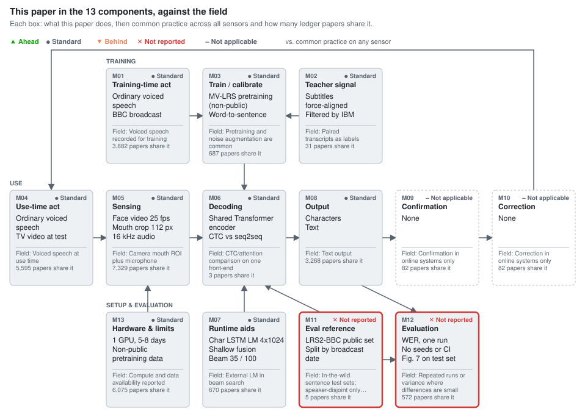

# Deep Audio-Visual Speech Recognition

Afouras, Chung, Senior, Vinyals, Zisserman. IEEE TPAMI, 2018. [doi:10.1109/TPAMI.2018.2889052](https://doi.org/10.1109/TPAMI.2018.2889052) · [arXiv:1809.02108](https://arxiv.org/abs/1809.02108v2)

**Section:** [Lip & face video](../../README.md#lip--face-video)

## Figures

### This paper in the 13 components, against the field

<picture><source media="(prefers-color-scheme: dark)" srcset="figures/components-dark.svg"></picture>

Verdicts compare the paper's choice for each component with common practice across 8,995 ledger entries on any sensor (silent speech, brain-to-text, lip reading), not only audio-visual papers.

Data

| Component | This paper | Common practice | Papers with this practice | Verdict |
| --- | --- | --- | --- | --- |
| M01 Training-time act | Ordinary voiced speech BBC broadcast | Voiced speech recorded for training | 3,882 of 8,995 | ● Standard (Inherited from the WLAS/LRS lineage; nothing to compare.) |
| M02 Teacher signal | Subtitles force-aligned Filtered by IBM Watson ASR | Paired transcripts as labels | 31 of 8,995 | ● Standard (Automatic subtitle labels as in LRS; standard for broadcast-derived data.) |
| M03 Train / calibrate | MV-LRS pretraining (non-public) Word-to-sentence curriculum 0 dB babble noise p=0.25 | Pretraining and noise augmentation are common | 687 of 8,995 | ● Standard (The curriculum is inherited from WLAS in near-identical wording, and the non-public MV-LRS pretraining is an uncontrolled part of the reported gain.) |
| M04 Use-time act | Ordinary voiced speech TV video at test | Voiced speech at use time | 5,595 of 8,995 | ● Standard (Inherited; ordinary voiced broadcast speech at test.) |
| M05 Sensing | Face video 25 fps Mouth crop 112 px 16 kHz audio | Camera mouth ROI plus microphone | 7,329 of 8,995 | ● Standard (Standard audio-visual input.) |
| M06 Decoding | Shared Transformer encoder CTC vs seq2seq head-to-head Separate AV attention | One loss per system; joint CTC/attention in current work | 3 of 8,995 | ● Standard (Standard: a concurrent same-group paper already compared CTC with a Transformer, this comparison confounds loss with beam, LM weight and fusion, and joint CTC/attention has since made the either/or question moot.) |
| M07 Runtime aids | Char LSTM LM 4x1024 Shallow fusion Beam 35 / 100 | External LM in beam search | 670 of 8,995 | ● Standard (Standard external character LM with shallow fusion; it closes most of the CTC vs seq2seq gap.) |
| M08 Output | Characters Text | Text output | 3,268 of 8,995 | ● Standard (Standard character output.) |
| M09 Confirmation | None | Confirmation in online systems only | 82 of 8,995 | – Not applicable (Offline benchmark study; no confirmation step.) |
| M10 Correction | None | Correction in online systems only | 82 of 8,995 | – Not applicable (Offline benchmark study; no correction step.) |
| M11 Eval reference | LRS2-BBC public set Split by broadcast date Speaker overlap unstated | In-the-wild sentence test sets; speaker-disjoint only in some | 5 of 8,995 | ✕ Not reported (Not reported: speaker count and train/test overlap are absent, so LRS2-BBC results do not establish unseen-speaker performance.) |
| M12 Evaluation | WER, one run No seeds or CI Fig. 7 on test set | Repeated runs or variance where differences are small | 572 of 8,995 | ✕ Not reported (Not reported: single runs, and the 8.2% vs 8.5% clean audio-visual gap is within about 0.34 pt binomial error.) |
| M13 Hardware & limits | 1 GPU, 5-8 days Non-public pretraining data | Compute and data availability reported | 6,075 of 8,995 | ● Standard (Compute is reported but inconsistently (GPU model differs between sections), and the numbers depend on non-public MV-LRS.) |

## Verdict

This paper [[1]](#ref-1) changed two components. Its CTC vs seq2seq study on one Transformer encoder (M06) is standard: the group's concurrent paper had already compared CTC with a Transformer on LRS2 [[2]](#ref-2), it mixes loss with beam, LM weight and fusion, and the field now trains both jointly. Its lasting contribution, the public LRS2-BBC set (M11), is not reported where it matters: speaker overlap is absent and the group's LRS3 paper says the same people likely recur [[3]](#ref-3). The "over 22%" gain is not attributable to the new front-end and back-end (§1): front-end, non-public MV-LRS pretraining and back-end changed together, the 70.4% baseline has no stated decoding conditions, and over the group's own Transformer (50.0%) the paper adds 1.7 points. Video helping clean audio is supported; a CTC vs seq2seq difference on clean audio-visual input (8.2% vs 8.5%) is not, and the noise advantage rests on one matched noise type.

## Against the field, component by component

### M06 Decoding: CTC vs seq2seq on one encoder

**Usual approach:** pick one loss: CTC (LipNet [[4]](#ref-4)) or attention seq2seq (WLAS [[5]](#ref-5)); confirmed same-front-end comparisons of the two number 3 (0 prior, 1 concurrent, 2 later). The paper trains both on one Transformer encoder, audio-visual included (prior AV fusion: dual attention, or concatenation [[6]](#ref-6)).
**State of the art:** joint CTC/attention training, introduced for in-the-wild AVSR by the concurrent [[7]](#ref-7) and named as the state-of-the-art recipe in 2024 [[8]](#ref-8) and used in 2025 [[9]](#ref-9), removes the either/or question this paper asks.

TM-seq2seq is the concurrent paper's Transformer configuration [[2]](#ref-2); new are the Transformer CTC variant and the AV extension. Later comparisons use acoustic sensing [[10]](#ref-10) and EEG [[11]](#ref-11). Position: **standard**. The systems are tuned separately (beam 100 vs 35, α 0.5 vs 0.1; Appendices C–D), so the gap is not a pure loss effect; the video-only gap shrinks from 15.2 to 6.4 points with an LM (Table 2). The authors attribute the synchronisation result (Fig. 8) to fusion; nothing separates it from loss (§6.3).

### M11 Evaluation ground truth: LRS2-BBC

**Usual approach:** auto-transcribed broadcast or web video split by date or source; 5 confirmed sets (1 prior, 2 concurrent, 2 later). LRS2-BBC (1,243 test utterances, 0.5 hours) is the public successor of the unreleased, date-split LRS [[5]](#ref-5): the departure is release, not design.
**State of the art:** speaker-disjoint tests: concurrent LRS3-TED [[3]](#ref-3) says TED speakers rarely repeat whereas LRS2-BBC people likely recur; ViCocktail (2025) [[9]](#ref-9) picks test speakers absent from training; VoxLRS-SA (2024) [[8]](#ref-8) targets unseen-speaker adaptation. LRS2-BBC is behind all three on speaker control.

Position: **not reported**. WLAS at least claimed "thousands of different speakers" [[5]](#ref-5); here the Table 1 speaker column is "-", so LRS2-BBC numbers do not establish unseen-speaker performance.

### M12 Evaluation: single run

**Usual approach:** one run; only 572 of 7,388 ledgers mention seeds, SD or CI. **State of the art:** the concurrent LSVSR reports bootstrap standard deviations on every WER [[12]](#ref-12). Position: **not reported**. On 6,663 test words the binomial error near 8.5% is about ±0.34 points (one SE), so the clean AV CTC vs seq2seq ordering is unresolved.

### Inherited

Others follow WLAS/LRS; the front-end is from [[13]](#ref-13). The curriculum (§5.2) is called "a new strategy" in wording almost identical to WLAS §3.1 [[5]](#ref-5).

## The 13 components

| Component | This paper | Usual approach (count) | State of the art | Verdict |
|---|---|---|---|---|
| M01 Training-time behaviour | Broadcast voiced speech | slot-filled 3,882 / 7,388 | same | standard |
| M02 Training-only supervision | Force-aligned subtitles | slot-filled 31 (sparse) | same | standard |
| M03 Training/adaptation | MV-LRS pretraining, curriculum, 0 dB babble | noise augmentation, pattern match 687 | same | standard |
| M04 Use-time behaviour | Broadcast voiced speech | slot-filled 5,595 | same | standard |
| M05 Sensing | 25 fps mouth crop, 16 kHz audio | slot-filled 7,329 | same | standard |
| M06 Processing/decoding | Shared encoder, CTC vs seq2seq | one loss; confirmed 3 (0 prior, 1 concurrent, 2 later) | joint CTC/attention [[7]](#ref-7) | standard |
| M07 Use-time aids | Character LSTM LM, shallow fusion | external LM, pattern match 670 | same | standard |
| M08 Output | Characters | slot-filled 3,268 | same | standard |
| M09 Confirmation | None (offline) | slot-filled 82 | online only | not applicable |
| M10 Correction | None (offline) | slot-filled 82 | online only | not applicable |
| M11 Evaluation ground truth | LRS2-BBC, date split, speaker overlap unstated | date/source split; confirmed 5 | speaker-disjoint test [[9]](#ref-9) | not reported |
| M12 Evaluation | WER, single run, no seeds | single run; seeds/SD/CI pattern match 572 | bootstrap SDs [[12]](#ref-12) | not reported |
| M13 Hardware/operation | One GPU, 5–8 days, non-public pretraining | slot-filled 6,075 | same | standard |

## Where the claims outrun the evidence

- **The 22-point attribution (§1, §6.1).** The concurrent paper lists the same 70.4% as "MV-WAS", also without conditions [[2]](#ref-2). Only if it is LM-free is there a like-for-like gap (49.8%: 20.6 points, −29% relative), and no ablation separates the three simultaneous changes.
- **Noise robustness.** CTC beating seq2seq (23.6% vs 34.2%) and the AV gain come from one noise at one SNR (0 dB babble), the type used in training (§5.3). Google S2T (86.3%), not adapted to that noise, does not measure the gap.
- **Internal inconsistencies.** The GPU is a GTX 1080 Ti (11 GB) in §5.4 and a Titan X (12 GB) in §6.4. Seq2seq beam is 35 in §6 but 6 without LM in Appendix C, leaving the LM-free Table 2 setting ambiguous. Fig. 7 (beam vs WER) is labelled only "LRS2-BBC" but its axis range matches Table 2, apparently the test set, though selection was on validation.

## What the field needs next

- **M06:** CTC vs seq2seq with matched fusion, beam and LM weight, separating loss from fusion.
- **M11:** train/test speaker overlap for LRS2-BBC, or a speaker-disjoint re-split.
- **M03/M13:** the system retrained without MV-LRS.
- **M12:** repeated runs and noise types/SNRs not seen in training.

## Questions for the authors

- How many speakers appear in both LRS2-BBC train and test?
- Is WAS 70.4% a model retrained on LRS2-BBC or the earlier model re-evaluated, with what LM and beam?
- Was the test babble built from training utterances?
- Does the 8.2% vs 8.5% ordering survive different seeds?

## Appendix: literature search

Scan: all 8,995 ledger folders of the wiki (7,388 after merging versions), counted by slot state and by regular expressions on ledger text, with a full-text regular expression for candidates the ledger misses. Confirmed = studies whose source text was read and accepted (versions count once).

| Topic | Slot-filled | Pattern match | Confirmed | Candidates read / unread | Known-item recall | Recall estimate |
|---|---:|---:|---:|---|---|---|
| M06 CTC vs attention | 7,345 | 114 | 3 | 42 / 128 | 1/1 by study (1/2 by version) | 1.0 (full-text-only sample of 30) |
| M11 In-the-wild sentence benchmark | 234 | 271 | 5 | 26 / 316 | 4/4 | 0.6 (2 of 19 full-text-only) |

**M06 inclusion rule:** on the same input front-end (visual, biosignal or audio-visual), both a CTC-trained decoder and an attention/seq2seq decoder (seq2seq or Transformer decoder) are trained and their results compared side by side. Excluded: hybrid CTC/attention only, without results for either alone; comparisons that only list numbers from other papers; audio-only ASR.
Confirmed: Afouras et al. 2018 Interspeech [[2]](#ref-2) (concurrent); Luo et al. 2020 [[10]](#ref-10) (later, acoustic-sensing silent speech); Krishna et al. 2019 [[11]](#ref-11) (later, EEG; attention scored in WER, CTC in CER, a boundary case). No prior example. Excluded examples: Sterpu et al. [[14]](#ref-14) (seq2seq vs seq2seq with joint CTC, no CTC alone); Petridis et al. [[7]](#ref-7) (proposes hybrid CTC/attention); Shillingford et al. [[12]](#ref-12) (CTC-based; seq2seq only as a reimplemented baseline).

**M11 inclusion rule:** sentence- or phrase-level audio-visual data built with automatic transcripts from uncontrolled video (broadcast, YouTube, TED), with a defined test split (split method recorded). Excluded: word-level sets (LRW, LRW-1000); reuse of existing data only; added training data without a test split.
Confirmed: LRS [[5]](#ref-5) (prior, split by broadcast date); LSVSR [[12]](#ref-12) (concurrent); LRS3-TED [[3]](#ref-3) (concurrent, low speaker overlap stated); VoxLRS-SA [[8]](#ref-8) (later); ViCocktail [[9]](#ref-9) (later, speaker-disjoint test).

## References

Numbered by first citation. BibTeX in the same order and keys: [refs.bib](refs.bib).

1. Afouras, T., Chung, J. S., Senior, A., Vinyals, O., Zisserman, A. “Deep Audio-Visual Speech Recognition.” *IEEE Transactions on Pattern Analysis and Machine Intelligence*, 2018. doi:[10.1109/TPAMI.2018.2889052](https://doi.org/10.1109/TPAMI.2018.2889052). arXiv:[1809.02108v2](https://arxiv.org/abs/1809.02108v2). Target of this review (arXiv v2; the DOI is the published version). [wiki: arxiv-1809.02108](https://github.com/supernaiter/deep-research-wiki-for-silent-speech/blob/main/papers/arxiv-1809.02108/article.md) [wiki: doi-10.1109-tpami.2018.2889052](https://github.com/supernaiter/deep-research-wiki-for-silent-speech/blob/main/papers/doi-10.1109-tpami.2018.2889052/article.md)
2. Afouras, T., Chung, J. S., Zisserman, A. “Deep Lip Reading: a comparison of models and an online application.” *Proc. Interspeech 2018*, 2018. arXiv:[1806.06053](https://arxiv.org/abs/1806.06053). [concurrent] [wiki: arxiv-1806.06053](https://github.com/supernaiter/deep-research-wiki-for-silent-speech/blob/main/papers/arxiv-1806.06053/article.md) [wiki: isca-afouras18b-deeplip](https://github.com/supernaiter/deep-research-wiki-for-silent-speech/blob/main/papers/isca-afouras18b-deeplip/article.md) [wiki: isca-afouras18b_deeplipread](https://github.com/supernaiter/deep-research-wiki-for-silent-speech/blob/main/papers/isca-afouras18b_deeplipread/article.md) [wiki: isca-afouras18b_interspeech](https://github.com/supernaiter/deep-research-wiki-for-silent-speech/blob/main/papers/isca-afouras18b_interspeech/article.md)
3. Afouras, T., Chung, J. S., Zisserman, A. “LRS3-TED: a large-scale dataset for visual speech recognition.” *arXiv preprint*, 2018. arXiv:[1809.00496](https://arxiv.org/abs/1809.00496). [concurrent] [wiki: arxiv-1809.00496](https://github.com/supernaiter/deep-research-wiki-for-silent-speech/blob/main/papers/arxiv-1809.00496/article.md)
4. Assael, Y. M., Shillingford, B., Whiteson, S., de Freitas, N. “LipNet: End-to-End Sentence-level Lipreading.” *arXiv preprint*, 2016. arXiv:[1611.01599](https://arxiv.org/abs/1611.01599). [review](https://github.com/supernaiter/silent-speech-review/tree/main/reviews/lipnet-end-to-end-sentence-level-lipreading) [wiki: arxiv-1611.01599](https://github.com/supernaiter/deep-research-wiki-for-silent-speech/blob/main/papers/arxiv-1611.01599/article.md)
5. Chung, J. S., Senior, A., Vinyals, O., Zisserman, A. “Lip Reading Sentences in the Wild.” *Proc. IEEE Conference on Computer Vision and Pattern Recognition (CVPR)*, 2017. doi:[10.1109/CVPR.2017.367](https://doi.org/10.1109/CVPR.2017.367). arXiv:[1611.05358](https://arxiv.org/abs/1611.05358). [review](https://github.com/supernaiter/silent-speech-review/tree/main/reviews/lip-reading-sentences-in-the-wild) [wiki: arxiv-1611.05358](https://github.com/supernaiter/deep-research-wiki-for-silent-speech/blob/main/papers/arxiv-1611.05358/article.md) [wiki: cvf-chung17-lipreadwild](https://github.com/supernaiter/deep-research-wiki-for-silent-speech/blob/main/papers/cvf-chung17-lipreadwild/article.md)
6. Petridis, S., Stafylakis, T., Ma, P., Cai, F., Tzimiropoulos, G., Pantic, M. “End-to-End Audiovisual Speech Recognition.” *Proc. IEEE ICASSP 2018*, 2018. doi:[10.1109/ICASSP.2018.8461326](https://doi.org/10.1109/ICASSP.2018.8461326). arXiv:[1802.06424](https://arxiv.org/abs/1802.06424). [wiki: arxiv-1802.06424](https://github.com/supernaiter/deep-research-wiki-for-silent-speech/blob/main/papers/arxiv-1802.06424/article.md)
7. Petridis, S., Stafylakis, T., Ma, P., Tzimiropoulos, G., Pantic, M. “Audio-Visual Speech Recognition with a Hybrid CTC/Attention Architecture.” *Proc. IEEE Spoken Language Technology Workshop (SLT)*, 2018. doi:[10.1109/SLT.2018.8639643](https://doi.org/10.1109/SLT.2018.8639643). arXiv:[1810.00108](https://arxiv.org/abs/1810.00108). [concurrent] [wiki: arxiv-1810.00108](https://github.com/supernaiter/deep-research-wiki-for-silent-speech/blob/main/papers/arxiv-1810.00108/article.md) [wiki: doi-10.1109-slt.2018.8639643](https://github.com/supernaiter/deep-research-wiki-for-silent-speech/blob/main/papers/doi-10.1109-slt.2018.8639643/article.md)
8. Yeo, J. H., Kim, C. W., Kim, H., Rha, H., Han, S., Cheng, W., et al. “Personalized Lip Reading: Adapting to Your Unique Lip Movements with Vision and Language.” *arXiv preprint*, 2024. arXiv:[2409.00986](https://arxiv.org/abs/2409.00986). [later] [wiki: arxiv-2409.00986](https://github.com/supernaiter/deep-research-wiki-for-silent-speech/blob/main/papers/arxiv-2409.00986/article.md)
9. Nguyen, T., Nguyen, T. V., Do, Q. T., Luong, C. M. “ViCocktail: Automated Multi-Modal Data Collection for Vietnamese Audio-Visual Speech Recognition.” *Proc. Interspeech 2025*, 2025. arXiv:[2506.04635](https://arxiv.org/abs/2506.04635). [later] [wiki: isca-nguyen25d_interspeech](https://github.com/supernaiter/deep-research-wiki-for-silent-speech/blob/main/papers/isca-nguyen25d_interspeech/article.md) [wiki: isca-nguyen25d-vicocktail](https://github.com/supernaiter/deep-research-wiki-for-silent-speech/blob/main/papers/isca-nguyen25d-vicocktail/article.md) [wiki: arxiv-2506.04635](https://github.com/supernaiter/deep-research-wiki-for-silent-speech/blob/main/papers/arxiv-2506.04635/article.md) [wiki: arxiv-2506.04635-vicocktail](https://github.com/supernaiter/deep-research-wiki-for-silent-speech/blob/main/papers/arxiv-2506.04635-vicocktail/article.md)
10. Luo, J., Wang, J., Cheng, N., Jiang, G., Xiao, J. “End-to-End Silent Speech Recognition with Acoustic Sensing.” *arXiv preprint*, 2020. arXiv:[2011.11315](https://arxiv.org/abs/2011.11315). [later] [review](https://github.com/supernaiter/silent-speech-review/tree/main/reviews/end-to-end-silent-speech-recognition-with-acoustic-sensing) [wiki: arxiv-2011.11315](https://github.com/supernaiter/deep-research-wiki-for-silent-speech/blob/main/papers/arxiv-2011.11315/article.md)
11. Krishna, G., Han, Y., Tran, C., Carnahan, M., Tewfik, A. H. “State-of-the-art Speech Recognition using EEG and Towards Decoding of Speech Spectrum From EEG.” *arXiv preprint*, 2019. arXiv:[1908.05743](https://arxiv.org/abs/1908.05743). [later] [wiki: arxiv-1908.05743-eegasr](https://github.com/supernaiter/deep-research-wiki-for-silent-speech/blob/main/papers/arxiv-1908.05743-eegasr/article.md)
12. Shillingford, B., Assael, Y., Hoffman, M. W., Paine, T., Hughes, C., Prabhu, U., et al. “Large-Scale Visual Speech Recognition.” *arXiv preprint*, 2018. arXiv:[1807.05162](https://arxiv.org/abs/1807.05162). [concurrent] [wiki: arxiv-1807.05162](https://github.com/supernaiter/deep-research-wiki-for-silent-speech/blob/main/papers/arxiv-1807.05162/article.md) [wiki: isca-shillingford19-largescale](https://github.com/supernaiter/deep-research-wiki-for-silent-speech/blob/main/papers/isca-shillingford19-largescale/article.md)
13. Stafylakis, T., Tzimiropoulos, G. “Combining Residual Networks with LSTMs for Lipreading.” *Proc. Interspeech 2017*, 2017. doi:[10.21437/Interspeech.2017-85](https://doi.org/10.21437/Interspeech.2017-85). arXiv:[1703.04105](https://arxiv.org/abs/1703.04105). [wiki: isca-stafylakis17-resnetlstm](https://github.com/supernaiter/deep-research-wiki-for-silent-speech/blob/main/papers/isca-stafylakis17-resnetlstm/article.md) [wiki: isca-stafylakis17_lipread](https://github.com/supernaiter/deep-research-wiki-for-silent-speech/blob/main/papers/isca-stafylakis17_lipread/article.md) [wiki: arxiv-1703.04105](https://github.com/supernaiter/deep-research-wiki-for-silent-speech/blob/main/papers/arxiv-1703.04105/article.md)
14. Sterpu, G., Saam, C., Harte, N. “Can DNNs Learn to Lipread Full Sentences?.” *arXiv preprint*, 2018. arXiv:[1805.11685](https://arxiv.org/abs/1805.11685). [concurrent] [wiki: arxiv-1805.11685](https://github.com/supernaiter/deep-research-wiki-for-silent-speech/blob/main/papers/arxiv-1805.11685/article.md)

## Materials

Data behind this review. Full texts of the papers are not included.

- [`review.md`](review.md): the review text (source)
- [`refs.bib`](refs.bib): references (BibTeX)
- [`slots.json`](slots.json): for each of the 13 components: this paper's choice, field practice, number of matching papers, verdict
- [`figures.json`](figures.json): figure definitions
- [`components/M06/ctc-vs-attention.csv`](../../components/M06/ctc-vs-attention.csv): M06 topic "ctc-vs-attention", every candidate paper with its decision (7345 slot-filled, 114 pattern match, 42 read in full)
- [`components/M11/in-the-wild-sentence-benchmark.csv`](../../components/M11/in-the-wild-sentence-benchmark.csv): M11 topic "in-the-wild-sentence-benchmark", every candidate paper with its decision (234 slot-filled, 271 pattern match, 49 read in full)

## More reviews in Lip & face video

- [Harnessing AI for Speech Reconstruction using Multi-view Silent Video Feed](../harnessing-ai-for-speech-reconstruction-using-multi-view-silent-video-feed/) (2018). Reconstructs speech audio from multi-view silent video on OuluVS2 with CNN-LSTM models, showing multi-view input improves PESQ over single view and that camera placement matters.
- [Visual-Only Recognition of Normal, Whispered and Silent Speech](../visual-only-recognition-of-normal-whispered-and-silent-speech/) (2018). Compares visual-only recognition of normal, whispered and silent speech, showing silent speech is a distinct regime: matched-condition silent accuracy is 62.2% (digits) and training on normal speech lowers it further.
- [Lipper: Synthesizing Thy Speech using Multi-View Lipreading](../lipper-synthesizing-thy-speech-using-multi-view-lipreading/) (2019). Lipper reconstructs speech from multi-view lip video on OuluVS2 as a regression problem; the best three-view setting reaches PESQ 2.315 with 0.169 s end-to-end delay, though audio remains robotic.
- [Video-Driven Speech Reconstruction using Generative Adversarial Networks](../video-driven-speech-reconstruction-using-generative-adversarial-networks/) (2019). Uses a GAN to generate speech audio directly from silent frontal face video on GRID; speaker-dependent WER is 26.6%, while unseen speakers degrade to 40.5% WER.
- [Improved Speech Reconstruction from Silent Video](../improved-speech-reconstruction-from-silent-video/) (2017). Reconstructs speech from silent full-face video plus optical flow with a CNN and temporal post-processing network, outperforming prior methods on GRID and TCD-TIMIT in objective metrics and human word accuracy.
- [Lip Reading Sentences in the Wild](../lip-reading-sentences-in-the-wild/) (2017). Made sentence lipreading measurable with LRS, but its decoder and curriculum gains are confounded with data and augmentation, and the beats-a-lipreader claim is on unequal terms.

---

Part of the [Silent Speech Interface Review](https://github.com/supernaiter/silent-speech-review). Found an error? [Open an issue](https://github.com/supernaiter/silent-speech-review/issues/new?template=correction.yml).
