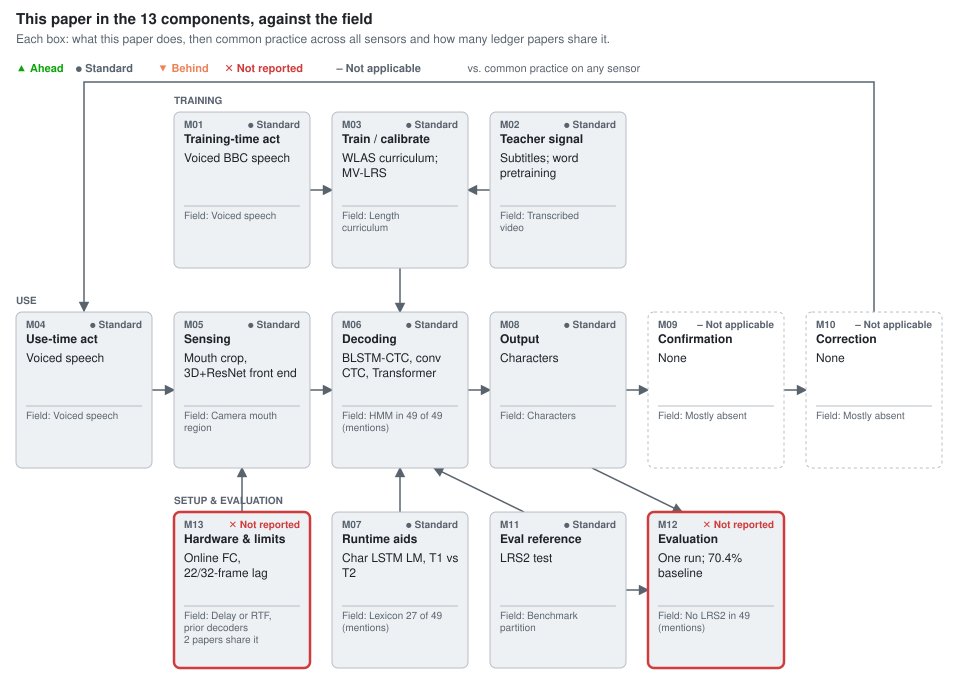

# Deep Lip Reading: a comparison of models and an online application

Afouras, Chung, Zisserman. Proc. Interspeech 2018, pp. 3514–3518. [doi:10.21437/Interspeech.2018-1943](https://doi.org/10.21437/Interspeech.2018-1943) · [arXiv:1806.06053](https://arxiv.org/abs/1806.06053v1)

**Section:** [Other sensors](../../README.md#other-sensors)

## Figures

### This paper in the 13 components, against the field

<picture><source media="(prefers-color-scheme: dark)" srcset="figures/components-dark.svg"></picture>

Verdicts compare the paper's choice for each component with common practice across 8,995 ledger entries on any sensor (silent speech, brain-to-text, lip reading).

Data

| Component | This paper | Common practice | Papers with this practice | Verdict |
| --- | --- | --- | --- | --- |
| M01 Training-time act | Voiced BBC speech | Voiced speech |  | ● Standard (Inherited.) |
| M02 Teacher signal | Subtitles; word pretraining | Transcribed video |  | ● Standard (Inherited.) |
| M03 Train / calibrate | WLAS curriculum; MV-LRS | Length curriculum |  | ● Standard (Inherited; MV-LRS not public.) |
| M04 Use-time act | Voiced speech | Voiced speech |  | ● Standard (Inherited.) |
| M05 Sensing | Mouth crop, 3D+ResNet front end | Camera mouth region |  | ● Standard (Front end of [@stafylakis2017resnet].) |
| M06 Decoding | BLSTM-CTC, conv CTC, Transformer | HMM in 49 of 49 (mentions) |  | ● Standard (One run; architecture confound.) |
| M07 Runtime aids | Char LSTM LM, T1 vs T2 | Lexicon 27 of 49 (mentions) |  | ● Standard (T2 gains 0.7-1.3 points.) |
| M08 Output | Characters | Characters |  | ● Standard (Inherited.) |
| M09 Confirmation | None | Mostly absent |  | – Not applicable (No user in the loop.) |
| M10 Correction | None | Mostly absent |  | – Not applicable (No user in the loop.) |
| M11 Eval reference | LRS2 test | Benchmark partition |  | ● Standard (Speaker overlap unstated.) |
| M12 Evaluation | One run; 70.4% baseline | No LRS2 in 49 (mentions) |  | ✕ Not reported (Baseline data unresolved.) |
| M13 Hardware & limits | Online FC, 22/32-frame lag | Delay or RTF, prior decoders | 2 of 4 | ✕ Not reported (No partial accuracy or ms delay.) |

## Verdict

The paper [[1]](#ref-1) changes the sequence back end (M06, standard) and adds online decoding (M13, not reported). Its Transformer and convolutional CTC readers have no counterpart among the 49 earlier decoders (pattern match, Appendix), but objective and architecture are confounded, by CER FC-15 matches the Transformer, and runs are single. The LRS2 claim holds without the non-public T2 LM, but "over 20" holds as points only with T2, and the 70.4% baseline has two credits and unresolved data. "Low latency" rests on a 22- or 32-frame lag without partial-hypothesis accuracy or delay in ms; real-time factors exist for articulator video from 2011 [[2]](#ref-2).

## Against the field, component by component

### M06 Processing: three back ends on one front end

**Usual approach:** All 49 earlier decoders mention HMMs (pattern match, Appendix); the neural ones use CTC over recurrent layers (LipNet [[3]](#ref-3), which BL follows, Sec. 2.2) or LSTM attention (WLAS [[4]](#ref-4), and its multi-view MV-WAS, the paper's ref. 15, absent from the ledger). The paper adds a Transformer and a depthwise temporal-convolution CTC model on the front end of [[5]](#ref-5), whose back end is a word-level temporal convolution (Sec. 3.2); none of the 49 mentions a Transformer (Appendix).
**State of the art:** Auto-AVSR (2023) [[6]](#ref-6) reaches 14.6% LRS2 visual-only WER with joint CTC/attention, a Conformer, subword units, 3,448 partly pseudo-labelled hours and an LM; with 818 hours it scores 27.9%, and the best LRS2-only system it lists 32.9% (its Table 3). None is like-for-like: the gap to 50.0% is 35.4 points, its own 818-to-3,448-hour step 13.3 (inference).

The authors' "for the first time" (Sec. 1) concerns adapting MT and ASR architectures; no earlier CTC-versus-attention comparison on one front end is the ledger's finding (Appendix). Objective and architecture are confounded: in the group's [concurrent] paper [[7]](#ref-7), one Transformer encoder scores 54.7% with CTC and 48.3% with attention, both with an LM (its Table 2). TM leads FC-15 by 6.8 WER points greedy and 5.0 with T2, at beam width 15 against 100 (inference), but by CER FC-15 is level (33.9% vs 34.0%) and ahead greedy (35.3% vs 38.6%, Table 1). The authors suspect CTC's local nature partly explains why BL, despite full context, trails FC-10 (Sec. 3.3), untested by an attention-decoded BL. Standard: one run, one test set (Sec. 3.1).

### M13 Operation: online decoding

**Usual approach:** Before the target, 2 of 4 lip- or articulator-video decoders claiming online operation report a delay or real-time factor, both 2011 reports on one ultrasound-plus-lip system (pattern match, Appendix); Cai et al. [[2]](#ref-2) give CPU-over-audio-time factors of 0.65 and 0.58 (Julius, one speaker, 20k trigram; its Table 5). Here FC lags by its right context, 22 or 32 frames; its final output equals the offline one (Sec. 4).
**State of the art:** Ma et al. (2023) [[8]](#ref-8) report LRS3 streaming visual-only WER of 50.6% against 38.6% offline, trained on LRS3 alone (438 hours), with computed delays of 580 ms (visual encoder) and 1,060 ms (total) (its Table 1, Sec. 4).

At the group's stated 25 frames per second for LRS2 [[7]](#ref-7), that is 0.88 s or 1.28 s (inference), near the 1.06 s computed by [[8]](#ref-8). Missing are partial-hypothesis accuracy, delay in ms and the cost of the width-100 beam search per frame; arXiv Table 5 shows one utterance from two start points. The [concurrent] Sterpu et al. [[9]](#ref-9) claim the first online monotonic attention for lip reading and keep 12-class viseme accuracy (61.58% vs 61.52%, their Table 1), also untested online. Not reported.

### M07 Language model

**Usual approach:** Of the 49, 27 mention a grammar, lexicon or dictionary, 7 an n-gram LM and none a neural LM (pattern match, Appendix); LipNet uses a character 5-gram [[3]](#ref-3). The paper shallow-fuses a character LSTM trained on T1 (2M words) or the non-public T2 (26M; arXiv Table 3).
**State of the art:** Auto-AVSR (2023) [[6]](#ref-6) decodes its 14.6% with a Transformer LM on 166 million characters (its Sec. 3).

T2 gains 0.7–1.3 points (Sec. 3.3), single runs; TM's T1 column has no external LM (arXiv App. A.3), so its 1.2 is LM against none. Algorithm 1 takes a word dictionary (arXiv App. A.4) without saying what it constrains; a lexicon on CTC alone would bias M06. Standard.

### M12 Evaluation: the LRS2 claim

**Usual approach:** None of the 49 reports LRS2 (pattern match, Appendix); here and in [concurrent] work [[7]](#ref-7), one error rate per system.
**State of the art:** Auto-AVSR (2023) [[6]](#ref-6) also gives one value per system (its Table 3).

Table 1 credits 70.4% to MV-WAS, Sec. 3.3 to WLAS, which reports 50.2% on the unreleased LRS, not LRS2 (its Table 5) [[4]](#ref-4). Against it, 50.0% is 20.4 points (29% relative) and T1 decoding 19.2 points (27% relative), so "over 20" holds as points only with T2, as relative change with both (inference). Not reported: no seeds or test-speaker composition (Sec. 3.1).

## The 13 components

| Component | This paper | Usual approach (count) | State of the art | Verdict |
|---|---|---|---|---|
| M01 Training-time action | Voiced BBC speech | Voiced speech | – | standard |
| M02 Training-only supervision | Subtitles; word pretraining | Transcribed video | – | standard |
| M03 Training and adaptation | WLAS curriculum; MV-LRS | Length curriculum | – | standard |
| M04 Use-time action | Voiced speech | Voiced speech | – | standard |
| M05 Sensors | Mouth crop, 3D+ResNet front end | Camera mouth region | – | standard |
| M06 Processing and decoding | BLSTM-CTC, conv CTC, Transformer | HMM in 49 of 49 (mentions) | [[6]](#ref-6) 14.6% | standard |
| M07 Lexicon and LM | Char LSTM LM, T1 vs T2 | Lexicon 27 of 49 (mentions) | [[6]](#ref-6) Transformer LM | standard |
| M08 Output | Characters | Characters | – | standard |
| M09 Confirmation | None | Mostly absent | – | not applicable |
| M10 Correction | None | Mostly absent | – | not applicable |
| M11 Reference construction | LRS2 test | Benchmark partition | – | standard |
| M12 Evaluation | One run; 70.4% baseline | No LRS2 in 49 (mentions) | [[6]](#ref-6) one value | not reported |
| M13 Device and cost | Online FC, 22/32-frame lag | Delay or RTF, prior decoders (pattern match 2) | [[8]](#ref-8) 580 ms, 50.6% | not reported |

## Where the claims outrun the evidence

- Depthwise convolutions "double the network training speed" with no accuracy loss (Sec. 3.3): no ablation is shown.
- The baseline's data are unresolved: Auto-AVSR lists 70.4% as LRS2-only [[6]](#ref-6), the paper says MV-LRS served earlier work (Sec. 3.1) and adds MV-LRS and LRW to every model here (Sec. 3.2).

## What the field needs next

- M13: partial-hypothesis WER and ms delay against lookahead.
- M06: CTC against seq2seq on one encoder at matched beam, LM weight and lexicon, over seeds.
- M12: all models retrained without MV-LRS and T2.

## Questions for the authors

- Which system produced 70.4%, on what data, with what LM and beam?
- Does Algorithm 1's dictionary restrict CTC outputs, and TM's?
- Does T2 contain subtitles of LRS2 test programmes?

## Appendix: literature search

- Setting for M06, M07 and M12: sequence-level visual and audio-visual speech decoders, including phrase and viseme classifiers and ultrasound-plus-lip systems, the 633-study ledger population of the M06 table. Window for the target (first public 2018-06): prior before 2017-12, [concurrent] 2017-12 to 2018-12. Removing human-perception and neuroscience studies, phonetic analyses, reviews and reports, corpus papers, enhancement, separation, synchronisation and keyword-spotting papers and version duplicates leaves 49 prior decoders, 14 [concurrent] and 2 date unresolved. Counts are full-text pattern matches (mentions, upper bounds), reference lists removed where detected.
- M06, ctc-vs-attention (published table, appended). Inclusion rule: the published rule, CTC-trained and attention or seq2seq decoders trained on one front end and compared side by side; hybrid-only systems excluded, which removes the [concurrent] LCANet and Sterpu's joint row. Ledger counts: 7,345 unique studies slot-filled; 114 unique studies pattern match. Confirmed comparisons besides the target: 0 prior, 1 [concurrent] [[7]](#ref-7), 2 later (acoustic sensing, EEG). Recall estimate 1.0 (published, full-text-only sample of 30); known-item recall 0.5, as the pattern misses the target's ISCA version. Read: [[4]](#ref-4), [[3]](#ref-3) (prior); [[7]](#ref-7) ([concurrent]); [[6]](#ref-6) (state of the art).
- M06, sentence-lipreading-sequence-objective (published table, appended). Inclusion rule: the published rule (sequence objective named in the full text), filtered to decoders, plus Transformer, temporal-convolution and recurrent patterns. Ledger counts: 7,345 unique studies slot-filled; 633 unique studies pattern match. Of the 49 prior: HMM 49, recurrent 13, CTC 6, temporal convolution 2 (a spatiotemporal front end [[3]](#ref-3) and a reference title), attention 1 [[4]](#ref-4), Transformer 0. [Concurrent] 14: CTC 9, attention 8, temporal convolution 7, Transformer 2. Recall check over 1,900 wiki studies before 2017-12: 0 Transformer lip readers (1 hit, an instrument term); 0 temporal-convolution CTC back ends (3 hits, all describing LipNet). Read: [[4]](#ref-4), [[3]](#ref-3) (prior); [[9]](#ref-9) ([concurrent]). Known-item recall 1.0.
- M07, use-time-language-model-visual-speech (published table, appended). Inclusion rule: the published rule (use-time language information named in the full text). Ledger counts: 119 unique studies slot-filled; 633 unique studies pattern match. Of the 49 prior: grammar, lexicon or dictionary 27; n-gram LM 7; neural LM 0; no-LM statement 1. [Concurrent]: neural LM 3, n-gram 3. Read: [[3]](#ref-3) (prior); [[6]](#ref-6) (state of the art). Known-item recall 1.0.
- M12, lrs2-visual-only-sentence-evaluation (published table, appended). Inclusion rule: the published rule (visual-only CER or WER on the LRS2 test set). Ledger counts: 6,960 unique studies slot-filled; 127 unique studies pattern match. Of the 49 prior: LRS2 0; seed, deviation, interval or bootstrap mentions 16 (the published table found such hits to be augmentation or normalisation, not run spread). [Concurrent] LRS2: 3 ([[7]](#ref-7) and two audio-visual systems). Read: [[4]](#ref-4) (prior); [[7]](#ref-7) ([concurrent]); [[6]](#ref-6) (state of the art). Known-item recall 1.0.
- M13, streaming-lip-reading-decoding (new topic). Inclusion rule: decoders of lip, face or articulator video, alone or with audio, that claim online, streaming, simultaneous or real-time operation, classified by a reported latency, computed delay or real-time factor; perception, enhancement, separation, synthesis and phonetic studies excluded on reading the ledger text; versions once. Ledger counts: 6,075 unique studies slot-filled; 25 unique studies pattern match, of which 10 decoders besides the target; the whole-wiki recall check (26 hits before 2017-12) adds 2, giving 12 (4 prior, 8 later). Reporting a latency, computed delay or real-time factor: 2 of 4 prior, both 2011 Cai et al. reports (read [[2]](#ref-2) and the ICPhS paper), possibly one experiment; 4 of 8 later. Read: [[2]](#ref-2), [[4]](#ref-4) (prior); [[9]](#ref-9) ([concurrent]); [[8]](#ref-8) (state of the art).

## References

Numbered by first citation. BibTeX in the same order and keys: [refs.bib](refs.bib).

1. Afouras, T., Chung, J. S., Zisserman, A. “Deep Lip Reading: a comparison of models and an online application.” *Proc. Interspeech 2018*, 2018, 3514-3518. doi:[10.21437/Interspeech.2018-1943](https://doi.org/10.21437/Interspeech.2018-1943). arXiv:[1806.06053](https://arxiv.org/abs/1806.06053). Target of this review (arXiv v1, 15 Jun 2018; the DOI is the Interspeech version). [wiki: arxiv-1806.06053](https://github.com/supernaiter/deep-research-wiki-for-silent-speech/blob/main/papers/arxiv-1806.06053/article.md) [wiki: isca-afouras18b-deeplip](https://github.com/supernaiter/deep-research-wiki-for-silent-speech/blob/main/papers/isca-afouras18b-deeplip/article.md) [wiki: isca-afouras18b_deeplipread](https://github.com/supernaiter/deep-research-wiki-for-silent-speech/blob/main/papers/isca-afouras18b_deeplipread/article.md) [wiki: isca-afouras18b_interspeech](https://github.com/supernaiter/deep-research-wiki-for-silent-speech/blob/main/papers/isca-afouras18b_interspeech/article.md)
2. Cai, J., Denby, B., Roussel, P., Dreyfus, G., Crevier-Buchman, L. “Recognition and Real Time Performances of a Lightweight Ultrasound Based Silent Speech Interface Employing a Language Model.” *Proc. Interspeech 2011*, 2011. doi:[10.21437/Interspeech.2011-410](https://doi.org/10.21437/Interspeech.2011-410). Prior; real-time factors for continuous recognition from ultrasound and lip video, single speaker. [wiki: isca-cai11-lightssi](https://github.com/supernaiter/deep-research-wiki-for-silent-speech/blob/main/papers/isca-cai11-lightssi/article.md)
3. Assael, Y. M., Shillingford, B., Whiteson, S., de Freitas, N. “LipNet: End-to-End Sentence-level Lipreading.” *arXiv preprint*, 2016. arXiv:[1611.01599](https://arxiv.org/abs/1611.01599). Prior; character CTC with a 5-gram LM, GRID. [review](https://github.com/supernaiter/silent-speech-review/tree/main/reviews/lipnet-end-to-end-sentence-level-lipreading) [wiki: arxiv-1611.01599](https://github.com/supernaiter/deep-research-wiki-for-silent-speech/blob/main/papers/arxiv-1611.01599/article.md)
4. Chung, J. S., Senior, A., Vinyals, O., Zisserman, A. “Lip Reading Sentences in the Wild.” *IEEE Conference on Computer Vision and Pattern Recognition (CVPR)*, 2017. doi:[10.1109/CVPR.2017.367](https://doi.org/10.1109/CVPR.2017.367). arXiv:[1611.05358](https://arxiv.org/abs/1611.05358). Prior; attention decoder on LRS; on-line decoder named as an extension. [review](https://github.com/supernaiter/silent-speech-review/tree/main/reviews/lip-reading-sentences-in-the-wild) [wiki: arxiv-1611.05358](https://github.com/supernaiter/deep-research-wiki-for-silent-speech/blob/main/papers/arxiv-1611.05358/article.md) [wiki: cvf-chung17-lipreadwild](https://github.com/supernaiter/deep-research-wiki-for-silent-speech/blob/main/papers/cvf-chung17-lipreadwild/article.md)
5. Stafylakis, T., Tzimiropoulos, G. “Combining Residual Networks with LSTMs for Lipreading.” *Proc. Interspeech 2017*, 2017. doi:[10.21437/Interspeech.2017-85](https://doi.org/10.21437/Interspeech.2017-85). arXiv:[1703.04105](https://arxiv.org/abs/1703.04105). Prior; source of the shared visual front end (target Sec. 2.1). [review](https://github.com/supernaiter/silent-speech-review/tree/main/reviews/combining-residual-networks-with-lstms-for-lipreading) [wiki: isca-stafylakis17-resnetlstm](https://github.com/supernaiter/deep-research-wiki-for-silent-speech/blob/main/papers/isca-stafylakis17-resnetlstm/article.md) [wiki: isca-stafylakis17_lipread](https://github.com/supernaiter/deep-research-wiki-for-silent-speech/blob/main/papers/isca-stafylakis17_lipread/article.md) [wiki: arxiv-1703.04105](https://github.com/supernaiter/deep-research-wiki-for-silent-speech/blob/main/papers/arxiv-1703.04105/article.md)
6. Ma, P., Haliassos, A., Fernandez-Lopez, A., Chen, H., Petridis, S., Pantic, M. “Auto-AVSR: Audio-Visual Speech Recognition with Automatic Labels.” *Proc. IEEE ICASSP 2023*, 2023. doi:[10.1109/ICASSP49357.2023.10096889](https://doi.org/10.1109/ICASSP49357.2023.10096889). arXiv:[2303.14307](https://arxiv.org/abs/2303.14307). Best LRS2 visual-only WER (14.6%); Table 3 lists earlier LRS2 systems with training hours. [later] [review](https://github.com/supernaiter/silent-speech-review/tree/main/reviews/auto-avsr-audio-visual-speech-recognition-with-automatic-labels) [wiki: arxiv-2303.14307](https://github.com/supernaiter/deep-research-wiki-for-silent-speech/blob/main/papers/arxiv-2303.14307/article.md)
7. Afouras, T., Chung, J. S., Senior, A., Vinyals, O., Zisserman, A. “Deep Audio-Visual Speech Recognition.” *IEEE Transactions on Pattern Analysis and Machine Intelligence*, 2022, 44(12), 8717-8727. doi:[10.1109/TPAMI.2018.2889052](https://doi.org/10.1109/TPAMI.2018.2889052). arXiv:[1809.02108](https://arxiv.org/abs/1809.02108). Same group; TM-seq2seq and TM-CTC on LRS2-BBC (early access 2018). [concurrent] [review](https://github.com/supernaiter/silent-speech-review/tree/main/reviews/deep-audio-visual-speech-recognition) [wiki: arxiv-1809.02108](https://github.com/supernaiter/deep-research-wiki-for-silent-speech/blob/main/papers/arxiv-1809.02108/article.md) [wiki: doi-10.1109-tpami.2018.2889052](https://github.com/supernaiter/deep-research-wiki-for-silent-speech/blob/main/papers/doi-10.1109-tpami.2018.2889052/article.md)
8. Ma, P., Moritz, N., Petridis, S., Fuegen, C., Pantic, M. “Streaming Audio-Visual Speech Recognition with Alignment Regularization.” *Proc. Interspeech 2023*, 2023. doi:[10.21437/Interspeech.2023-487](https://doi.org/10.21437/Interspeech.2023-487). arXiv:[2211.02133](https://arxiv.org/abs/2211.02133). Streaming visual-only WER and algorithmic delay on LRS3. [later] [wiki: arxiv-2211.02133](https://github.com/supernaiter/deep-research-wiki-for-silent-speech/blob/main/papers/arxiv-2211.02133/article.md) [wiki: isca-ma23-streamingav](https://github.com/supernaiter/deep-research-wiki-for-silent-speech/blob/main/papers/isca-ma23-streamingav/article.md) [wiki: isca-ma23_interspeech](https://github.com/supernaiter/deep-research-wiki-for-silent-speech/blob/main/papers/isca-ma23_interspeech/article.md)
9. Sterpu, G., Saam, C., Harte, N. “Can DNNs Learn to Lipread Full Sentences?.” *arXiv preprint*, 2018. arXiv:[1805.11685](https://arxiv.org/abs/1805.11685). Monotonic (online-capable) attention for lipreading on TCD-TIMIT. [concurrent] [wiki: arxiv-1805.11685](https://github.com/supernaiter/deep-research-wiki-for-silent-speech/blob/main/papers/arxiv-1805.11685/article.md)

## Materials

Data behind this review. Full texts of the papers are not included.

- [`review.md`](review.md): the review text (source)
- [`refs.bib`](refs.bib): references (BibTeX)
- [`slots.json`](slots.json): for each of the 13 components: this paper's choice, field practice, number of matching papers, verdict
- [`figures.json`](figures.json): figure definitions
- [`evaluation.md`](evaluation.md): independent evaluation by a second reviewer
- [`triage.md`](triage.md): how each evaluation finding was checked against the sources and resolved
- [`process/log.json`](process/log.json): process record: each step, who did it (reader, script, writer, evaluator), when, the checks run and the input versions
- [`process/notes.json`](process/notes.json): reading notes on the target and comparator papers: claims, numbers, conditions and what is not stated, with locations
- [`process/plan.json`](process/plan.json): plan: which components the paper changes and the topics it is compared on
- [`process/draft.md`](process/draft.md): the review as first written, before the independent evaluation
- [`process/claims-draft.md`](process/claims-draft.md): claim table of the draft: every claim mapped to a note or a count
- [`process/claims.md`](process/claims.md): claim table of the published review
- [`components/M06/ctc-vs-attention.csv`](../../components/M06/ctc-vs-attention.csv): M06 topic "ctc-vs-attention", every candidate paper with its decision (7345 slot-filled, 114 pattern match, usual design in 79, 42 read in full)
- [`components/M06/sentence-lipreading-sequence-objective.csv`](../../components/M06/sentence-lipreading-sequence-objective.csv): M06 topic "sentence-lipreading-sequence-objective", every candidate paper with its decision (7345 slot-filled, 633 pattern match, usual design in 291, 6 read in full)
- [`components/M07/use-time-language-model-visual-speech.csv`](../../components/M07/use-time-language-model-visual-speech.csv): M07 topic "use-time-language-model-visual-speech", every candidate paper with its decision (119 slot-filled, 633 pattern match, usual design in 143, 4 read in full)
- [`components/M12/lrs2-visual-only-sentence-evaluation.csv`](../../components/M12/lrs2-visual-only-sentence-evaluation.csv): M12 topic "lrs2-visual-only-sentence-evaluation", every candidate paper with its decision (6960 slot-filled, 127 pattern match, usual design in 4, 7 read in full)
- [`components/M13/streaming-lip-reading-decoding.csv`](../../components/M13/streaming-lip-reading-decoding.csv): M13 topic "streaming-lip-reading-decoding", every candidate paper with its decision (6075 slot-filled, 25 pattern match, usual design in 5, 5 read in full)

## More reviews in Other sensors

- [Audio-Visual Speech Recognition with a Hybrid CTC/Attention Architecture](../audio-visual-speech-recognition-with-a-hybrid-ctc-attention-architecture/) (2018). No earlier sentence-level AVSR study in the ledger trains hybrid CTC/attention (0 of 32), but no CTC- or attention-only result, LRW under the no-external-data claim, one run: standard.
- [Decoding spoken phonemes from sensorimotor cortex with High-Density ECoG grids](../decoding-spoken-phonemes-from-sensorimotor-cortex-with-high-density-ecog-grids/) (2018). Spatiotemporal templates on HD-ECoG (M06, M05) reuse the group's gesture decoder; the density claim is untested: standard. Voice-onset and rest anchoring confound the temporal gain.
- [End-to-End Audiovisual Speech Recognition](../end-to-end-audiovisual-speech-recognition/) (2018). Raw-waveform front end and BGRU fusion (M06) depart from the usual approach but are standard: they tie MFCC in clean LRW audio (97.7%); noise gains lack repeated runs and use matched babble.
- [Inferring imagined speech using EEG signals: a new approach using Riemannian manifold features](../inferring-imagined-speech-using-eeg-signals-a-new-approach-using-riemannian-manifold-features/) (2018). Covariance tangent-space + RVM (M06) is new to imagined-speech EEG but beats only at-chance baselines; evaluation is behind: no test against chance, which 3 of 7 priors ran.
- [Large-Scale Visual Speech Recognition](../large-scale-visual-speech-recognition/) (2018). Its YouTube mining scaled on in later work, but Table 1 holds data fixed; the phoneme+WFST decoder had 2016-17 priors; zero-shot LRS3 changes everything at once: standard.
- [LCANet: End-to-End Lipreading with Cascaded Attention-CTC](../lcanet-end-to-end-lipreading-with-cascaded-attention-ctc/) (2018). New attention-before-CTC decoder for lip reading, but one corpus, one run and no in-house CTC-only or attention-only baseline make it standard; against LRSW it is a tie.

---

Part of the [Silent Speech Interface Review](https://github.com/supernaiter/silent-speech-review). Found an error? [Open an issue](https://github.com/supernaiter/silent-speech-review/issues/new?template=correction.yml).
