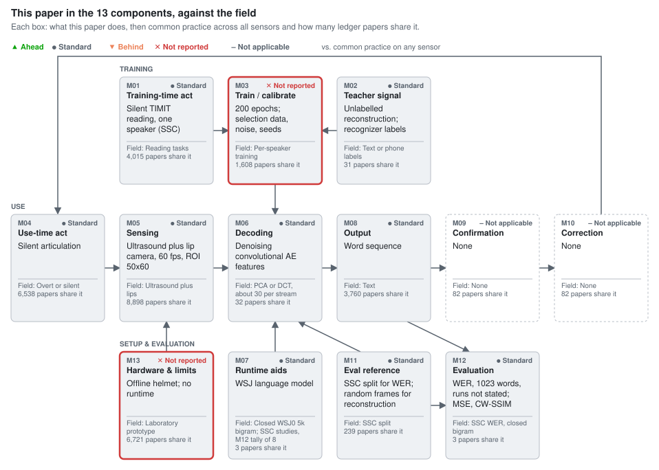

# Denoising Convolutional Autoencoder Based B-Mode Ultrasound Tongue Image Feature Extraction

Li B, Xu K, Feng D, Mi H, Wang H, Zhu J. arXiv preprint, 2019. [arXiv:1903.00888](https://arxiv.org/abs/1903.00888)

**Section:** [Ultrasound & tongue imaging](../../README.md#ultrasound--tongue-imaging)

## Figures

### This paper in the 13 components, against the field

<picture><source media="(prefers-color-scheme: dark)" srcset="figures/components-dark.svg"></picture>

Verdicts compare the paper's choice for each component with common practice across 8,995 ledger entries on any sensor (silent speech, brain-to-text, lip reading).

Data

| Component | This paper | Common practice | Papers with this practice | Verdict |
| --- | --- | --- | --- | --- |
| M01 Training-time act | Silent TIMIT reading, one speaker (SSC) | Reading tasks | 4,015 of 8,995 | ● Standard (SSC archive.) |
| M02 Teacher signal | Unlabelled reconstruction; recognizer labels from Ji et al. | Text or phone labels | 31 of 8,995 | ● Standard (Denoising criterion treated under M06.) |
| M03 Train / calibrate | 200 epochs; selection data, noise, seeds unstated | Per-speaker training | 1,608 of 8,995 | ✕ Not reported (Architecture chosen on unstated data.) |
| M04 Use-time act | Silent articulation | Overt or silent | 6,538 of 8,995 | ● Standard (–) |
| M05 Sensing | Ultrasound plus lip camera, 60 fps, ROI 50x60 | Ultrasound plus lips | 8,898 of 8,995 | ● Standard (SSC hardware.) |
| M06 Decoding | Denoising convolutional AE features | PCA or DCT, about 30 per stream | 32 of 8,995 | ● Standard (Denoising and CNN features prior; 0.21 to 0.41 points over DCT.) |
| M07 Runtime aids | WSJ language model | Closed WSJ0 5k bigram; SSC studies, M12 tally of 8 | 3 of 8,995 | ● Standard (No later closed-LM result; [later] SSC work used a 65k LM.) |
| M08 Output | Word sequence | Text | 3,760 of 8,995 | ● Standard (–) |
| M09 Confirmation | None | None | 82 of 8,995 | – Not applicable (Offline study.) |
| M10 Correction | None | None | 82 of 8,995 | – Not applicable (Offline study.) |
| M11 Eval reference | SSC split for WER; random frames for reconstruction | SSC split | 239 of 8,995 | ● Standard (Reconstruction test set reused as validation (code).) |
| M12 Evaluation | WER, 1023 words, runs not stated; MSE, CW-SSIM | SSC WER, closed bigram | 3 of 8,995 | ● Standard (New WERs not whole error counts.) |
| M13 Hardware & limits | Offline helmet; no runtime | Laboratory prototype | 6,721 of 8,995 | ✕ Not reported (No runtime or device test.) |

## Verdict

The paper [[1]](#ref-1) changes one component, the ultrasound feature extractor (M06), replacing DCT or a fully connected autoencoder with a convolutional autoencoder trained on speckle-corrupted inputs; it is standard. Both halves predate it, speckle denoising of tongue ultrasound [[2]](#ref-2) and CNN features from raw tongue ultrasound [[3]](#ref-3), so the "first attempt" (§4) holds only for their combination. The headline 6.17% against the "state-of-the-art" 6.45% (Abstract) sets length 60 against DCT at length 30; at equal length the margin is 0.41 points at length 60 and 0.21 at length 30, about 4 and 2 words of the 1023-word test [[4]](#ref-4) (inference), on one speaker with the number of runs not reported. Denoising adds 0.05 points over the plain CAE (Table 2): the evidence supports convolution, not denoising. The eight new WERs in Table 2 are not whole error counts over 1023 words, while the two that equal Ji et al.'s published values are (inference), and the paper does not say why.

## Against the field, component by component

### M06 Processing: convolutional denoising autoencoder features

**Usual approach:** PCA (EigenTongues) or 2D-DCT coefficients, about 30 per stream; of 39 unique ultrasound feature studies (pattern match, Appendix), 32 use PCA, 13 DCT and 13 autoencoders [[5]](#ref-5) [[6]](#ref-6).

**State of the art:** the target's 6.17% (2019) remains the lowest SSC WER in the topic tables (Appendix); the prior reference was 6.45% with 30 DCT coefficients (2018) [[4]](#ref-4). The [later] end-to-end SSC model's best is 20.5% WER (2020), with a 65,000-word language model [[7]](#ref-7).

Convolution moves WER: Deep AE 7.37% to CAE 6.22% at length 60 (Table 2), 16% relative (inference). Against DCT: 6.58% to 6.17% at length 60 (6.2% relative) and 6.45% to 6.24% at length 30 (3.3% relative) (inference). Denoising contributes 0.05 points at length 60 and 0.10 at length 30 (Table 2) (inference). Jaumard-Hakoun et al. added speckle noise to tongue images during training only (Sec. 3.1), the same criterion on stacked-RBM layers [[2]](#ref-2); the target gives no noise distribution or level (§3.1). Tatulli and Hueber's phone-supervised CNN features on raw ultrasound beat PCA [[3]](#ref-3), uncited by the target. Verdict: standard: 2 to 4 words over DCT, one speaker, runs not reported, both halves prior.

### M12 Evaluation: SSC word error rate

**Usual approach:** WER on the 100 WSJ0 test sentences (1023 words) of the single SSC speaker with the closed WSJ0 5k bigram; 3 of 8 unique SSC studies (pattern match, Appendix) use this condition [[6]](#ref-6) [[4]](#ref-4).

**State of the art:** 6.17% (2019), the paper's own value; at matched length it is 0.41 points below DCT at length 60, and the length-30 DCAE (6.24%) is 0.21 below the 6.45% reference (Table 2). The two [later] studies recognizing the SSC sentences change the language model (2020) [[7]](#ref-7) or re-record the sentences (2022) [[8]](#ref-8) (Appendix), so no later study tests the closed-bigram number under its own condition.

Ji et al. report 6 insertions, 8 deletions and 52 substitutions over 1023 words for 6.45% (Table 2) [[4]](#ref-4). The target's length-30 DCT (6.45%) and Deep AE (7.72%) equal Ji et al.'s values, but its new values, such as 6.17%, 6.22% and 6.58%, are not whole error counts over 1023 words (inference): averages over runs or another test set, neither stated. The text says the reconstruction images were randomly selected (§3.2), but the public script splits by directory order, the first 10 directories for training, and scores reconstruction on the data it passes as validation during fitting (input data with noise.py), so test and validation coincide. Verdict: standard; as in Ji et al., no seeds, and the run count is not stated.

## The 13 components

| Component | This paper | Usual approach (count) | State of the art | Verdict |
|---|---|---|---|---|
| M01 Training-time action | Silent TIMIT reading, one speaker (SSC) | Reading tasks (slot-filled 4,015) | – | standard |
| M02 Training-only supervision | Unlabelled reconstruction; recognizer labels from Ji et al. | Text or phone labels (slot-filled 31) | – | standard |
| M03 Training and adaptation | 200 epochs; selection data, noise, seeds unstated | Per-speaker training (slot-filled 1,608) | – | not reported |
| M04 Use-time action | Silent articulation | Overt or silent (slot-filled 6,538) | – | standard |
| M05 Sensors | Ultrasound plus lip camera, 60 fps, ROI 50x60 | Ultrasound plus lips (slot-filled 8,898) | – | standard |
| M06 Processing and decoding | Denoising convolutional AE features | PCA or DCT, about 30 per stream (pattern match 32) | 6.17% WER [[1]](#ref-1) | standard |
| M07 Lexicon and LM | WSJ language model | Closed WSJ0 5k bigram; SSC studies, M12 tally of 8 (pattern match 3) | – | standard |
| M08 Output | Word sequence | Text (slot-filled 3,760) | – | standard |
| M09 Confirmation | None | None (slot-filled 82) | – | not applicable |
| M10 Correction | None | None (slot-filled 82) | – | not applicable |
| M11 Reference construction | SSC split for WER; random frames for reconstruction | SSC split (slot-filled 239) | – | standard |
| M12 Evaluation | WER, 1023 words, runs not stated; MSE, CW-SSIM | SSC WER, closed bigram (pattern match 3) | 6.17% WER [[1]](#ref-1) | standard |
| M13 Device and cost | Offline helmet; no runtime | Laboratory prototype (slot-filled 6,721) | – | not reported |

## Where the claims outrun the evidence

- "Outperforms" the 6.45% "state-of-the-art" (Abstract) crosses feature lengths; at equal length the margin is 0.41 points (length 60) and 0.21 (length 30), with no seeds, run count or significance test (§3).
- The "first attempt to use denoising CAE" (§4) omits that speckle denoising appears in its reference 13 [[2]](#ref-2), cited only for "competitive results" (§1), and that CNN features on tongue ultrasound predate it [[3]](#ref-3).
- Robustness to "head movements, variability due to different imaging systems" (§4) is untested; all data come from the single SSC speaker [[4]](#ref-4).
- DCT reconstruction MSE rises from 86.27 to 89.03 as length grows from 30 to 60 (Table 1); adding orthonormal coefficients cannot raise squared error (inference), so the DCT baseline is not a plain truncation; the authors flag the exception (§3.2) without explaining it.
- §3.3 calls the inputs "concatenated tongue and lip feature vectors of dimension K = 60 and 30", yet the length-30 row reproduces Ji et al.'s per-stream K=30 values, a 120-component vector with deltas [[4]](#ref-4) (inference).

## What the field needs next

- M06 and M12: rerun the SSC comparison at equal length with several seeds and per-sentence error counts, with a paired test of DCAE against DCT.
- M06: isolate denoising by varying speckle variance and testing on corrupted images.

## Questions for the authors

- Are the new Table 2 values averages over runs, or from a test set other than the 1023-word SSC test?
- Were the length-30 DCT and Deep AE results rerun or copied from Ji et al.?
- What speckle level, seeds and normalization were used, and which data selected the architectures (§3.1)?

## Appendix: literature search

- M06 ultrasound-tongue-image-features. Inclusion rule: studies that compress ultrasound tongue images, with or without lip images, into feature vectors by DCT, PCA/EigenTongues, autoencoders or learned CNN encoders for recognition, synthesis or articulatory mapping; contour-only tracking, raw-image end-to-end models with no feature stage and reviews excluded; versions counted once. Ledger counts: slot-filled 7,345 unique studies (M06); pattern match 39 unique studies. Usual design (pattern match, full text; a study can match several): PCA/EigenTongue 32, DCT 13, autoencoder 13, raw-image CNN 2. Read in full: [[2]](#ref-2) (prior), [[3]](#ref-3) (prior), [[4]](#ref-4) (prior), [[5]](#ref-5) (prior), [[6]](#ref-6) (prior). Known-item recall 0.75.
- M12 silent-speech-challenge-benchmark. Inclusion rule: studies reporting recognition or reconstruction results on the SSC archive (single speaker, silent TIMIT training, 100 WSJ0 5k test sentences) or on the same 100 sentences re-recorded; mere citations and other ultrasound corpora excluded; surveys kept in the pattern count only; versions counted once. Ledger counts: slot-filled 6,960 unique studies (M12); pattern match 8 unique studies, of which 5 recognize the SSC test sentences and 3 decode with the closed WSJ0 5k bigram. Read in full: [[6]](#ref-6) (prior), [[4]](#ref-4) (prior), [[7]](#ref-7), [[8]](#ref-8). Known-item recall 1.0.

## References

Numbered by first citation. BibTeX in the same order and keys: [refs.bib](refs.bib).

1. Li, B., Xu, K., Feng, D., Mi, H., Wang, H., Zhu, J. “Denoising Convolutional Autoencoder Based B-mode Ultrasound Tongue Image Feature Extraction.” *arXiv preprint*, 2019. arXiv:[1903.00888](https://arxiv.org/abs/1903.00888). Target. Title and authors from the first page of arXiv:1903.00888 v1 (2019-03). [review](https://github.com/supernaiter/silent-speech-review/tree/main/reviews/denoising-convolutional-autoencoder-based-b-mode-ultrasound-tongue-image-feature-extraction) [wiki: arxiv-1903.00888](https://github.com/supernaiter/deep-research-wiki-for-silent-speech/blob/main/papers/arxiv-1903.00888/article.md)
2. Jaumard-Hakoun, A., Xu, K., Leboullenger, C., Roussel-Ragot, P., Denby, B. “An Articulatory-Based Singing Voice Synthesis Using Tongue and Lips Imaging.” *Proc. Interspeech 2016*, 2016. doi:[10.21437/Interspeech.2016-385](https://doi.org/10.21437/Interspeech.2016-385). Prior; deciding prior for M06 (speckle-noise denoising autoencoder on tongue ultrasound). Title, authors and DOI from the paper's first page; URL from the ISCA archive. [wiki: isca-jaumardhakoun16_interspeech](https://github.com/supernaiter/deep-research-wiki-for-silent-speech/blob/main/papers/isca-jaumardhakoun16_interspeech/article.md)
3. Tatulli, E., Hueber, T. “Feature Extraction Using Multimodal Convolutional Neural Networks for Visual Speech Recognition.” *Proc. IEEE ICASSP 2017*, 2017. <https://www.gipsa-lab.grenoble-inp.fr/~thomas.hueber/mes_documents/tatulli_hueber_icassp2017.pdf> Prior; deciding prior for M06 (supervised CNN features from raw tongue ultrasound and lip video). Title and authors from the paper's first page; URL of the author-hosted manuscript. [wiki: icassp2017-tatulli-multimodal-cnn-vsr](https://github.com/supernaiter/deep-research-wiki-for-silent-speech/blob/main/papers/icassp2017-tatulli-multimodal-cnn-vsr/article.md)
4. Ji, Y., Liu, L., Wang, H., Liu, Z., Niu, Z., Denby, B. “Updating the Silent Speech Challenge benchmark with deep learning.” *Speech Communication*, 2018. doi:[10.1016/j.specom.2018.02.002](https://doi.org/10.1016/j.specom.2018.02.002). arXiv:[1709.06818](https://arxiv.org/abs/1709.06818). Prior; deciding prior for M06 (fully connected DAE and DCT baselines) and the SSC reference value. Title and authors from the first page of arXiv:1709.06818 v1 (2017-09); journal version in Speech Communication, 2018. [review](https://github.com/supernaiter/silent-speech-review/tree/main/reviews/updating-the-silent-speech-challenge-benchmark-with-deep-learning) [wiki: arxiv-1709.06818](https://github.com/supernaiter/deep-research-wiki-for-silent-speech/blob/main/papers/arxiv-1709.06818/article.md) [wiki: doi-10.1016-j.specom.2018.02.002](https://github.com/supernaiter/deep-research-wiki-for-silent-speech/blob/main/papers/doi-10.1016-j.specom.2018.02.002/article.md)
5. Hueber, T., Aversano, G., Chollet, G., Denby, B., Dreyfus, G., Oussar, Y., et al. “Eigentongue Feature Extraction for an Ultrasound-Based Silent Speech Interface.” *Proc. IEEE ICASSP 2007*, 2007, 1245–1248. <https://www.gipsa-lab.grenoble-inp.fr/~thomas.hueber/mes_documents/hueber_icassp2007.pdf> Prior; typical work of the usual M06 approach (PCA EigenTongues). Title and authors from the paper's first page; URL of the author-hosted manuscript. [wiki: icassp2007-hueber-eigentongue-ssi](https://github.com/supernaiter/deep-research-wiki-for-silent-speech/blob/main/papers/icassp2007-hueber-eigentongue-ssi/article.md)
6. Cai, J., Denby, B., Roussel, P., Dreyfus, G., Crevier-Buchman, L. “Recognition and Real Time Performances of a Lightweight Ultrasound Based Silent Speech Interface Employing a Language Model.” *Proc. Interspeech 2011*, 2011, 1005–1008. doi:[10.21437/Interspeech.2011-410](https://doi.org/10.21437/Interspeech.2011-410). Title and authors from the paper's first page; DOI and URL from the ISCA archive record. [wiki: isca-cai11_interspeech](https://github.com/supernaiter/deep-research-wiki-for-silent-speech/blob/main/papers/isca-cai11_interspeech/article.md) [wiki: isca-cai11-lightssi](https://github.com/supernaiter/deep-research-wiki-for-silent-speech/blob/main/papers/isca-cai11-lightssi/article.md)
7. Kimura, N., Su, Z., Saeki, T. “End-to-End Deep Learning Speech Recognition Model for Silent Speech Challenge.” *Proc. Interspeech 2020 (Show and Tell)*, 2020. <https://www.isca-archive.org/interspeech_2020/kimura20_interspeech.html> Title and authors from the paper's first page; URL from the ISCA archive. [later] [wiki: isca-kimura20_interspeech](https://github.com/supernaiter/deep-research-wiki-for-silent-speech/blob/main/papers/isca-kimura20_interspeech/article.md) [wiki: isca-kimura20-sschallenge](https://github.com/supernaiter/deep-research-wiki-for-silent-speech/blob/main/papers/isca-kimura20-sschallenge/article.md)
8. Kimura, N., Su, Z., Saeki, T., Rekimoto, J. “SSR7000: A Synchronized Corpus of Ultrasound Tongue Imaging for End-to-End Silent Speech Recognition.” *Proceedings of the 13th Conference on Language Resources and Evaluation (LREC 2022)*, 2022, 6866–6873. <https://aclanthology.org/2022.lrec-1.741> Title, authors, venue and pages from the paper's first page. [later] [wiki: lrec22-ssr7000](https://github.com/supernaiter/deep-research-wiki-for-silent-speech/blob/main/papers/lrec22-ssr7000/article.md) [wiki: doi-10.63317-2b659u3p6oeh](https://github.com/supernaiter/deep-research-wiki-for-silent-speech/blob/main/papers/doi-10.63317-2b659u3p6oeh/article.md)

## Materials

Data behind this review. Full texts of the papers are not included.

- [`review.md`](review.md): the review text (source)
- [`refs.bib`](refs.bib): references (BibTeX)
- [`slots.json`](slots.json): for each of the 13 components: this paper's choice, field practice, number of matching papers, verdict
- [`figures.json`](figures.json): figure definitions
- [`evaluation.md`](evaluation.md): independent evaluation by a second reviewer
- [`triage.md`](triage.md): how each evaluation finding was checked against the sources and resolved
- [`process/log.json`](process/log.json): process record: each step, who did it (reader, script, writer, evaluator), when, the checks run and the input versions
- [`process/notes.json`](process/notes.json): reading notes on the target and comparator papers: claims, numbers, conditions and what is not stated, with locations
- [`process/plan.json`](process/plan.json): plan: which components the paper changes and the topics it is compared on
- [`process/draft.md`](process/draft.md): the review as first written, before the independent evaluation
- [`process/claims-draft.md`](process/claims-draft.md): claim table of the draft: every claim mapped to a note or a count
- [`process/claims.md`](process/claims.md): claim table of the published review
- [`components/M06/ultrasound-tongue-image-features.csv`](../../components/M06/ultrasound-tongue-image-features.csv): M06 topic "ultrasound-tongue-image-features", every candidate paper with its decision (7345 slot-filled, 39 pattern match, usual design in 32, 3 read in full)
- [`components/M12/silent-speech-challenge-benchmark.csv`](../../components/M12/silent-speech-challenge-benchmark.csv): M12 topic "silent-speech-challenge-benchmark", every candidate paper with its decision (6960 slot-filled, 8 pattern match, usual design in 3, 4 read in full)

## More reviews in Ultrasound & tongue imaging

- [Autoencoder-Based Articulatory-to-Acoustic Mapping for Ultrasound Silent Speech Interfaces](../autoencoder-based-articulatory-to-acoustic-mapping-for-ultrasound-silent-speech-interfaces/) (2019). Standard on the encoder: autoencoder features predate it and it is never compared with PCA or DCT; behind on F0, which is copied from the recording, so the listening test is not of a silent system.
- [SottoVoce: An Ultrasound Imaging-Based Silent Speech Interaction Using Deep Neural Networks](../sottovoce/) (2019). SottoVoce reconstructs speech audio from under-jaw ultrasound images with two DNNs to control unmodified smart speakers; command success rose from 42.5% to 65.0% with the second network, versus 90.0% for real audio.
- [Ultrasound-based Silent Speech Interface Built on a Continuous Vocoder](../ultrasound-based-silent-speech-interface-built-on-a-continuous-vocoder/) (2019). Continuous F0 targets from articulation were prior work; MVF carrying voicing instead of a flag is new but unproven: the F0 RMSE gain uses different reference contours and naturalness is not better.
- [3D Convolutional Neural Networks for Ultrasound-Based Silent Speech Interfaces](../3d-convolutional-neural-networks-for-ultrasound-based-silent-speech-interfaces/) (2020). (2+1)D front end (M06) is standard: established in lip reading, ported to ultrasound; a 6.3% MSE edge over CNN+LSTM, one speaker, one run; MSE-only evaluation (M12 behind).
- [Ultra2Speech - A Deep Learning Framework for Formant Frequency Estimation and Tracking from Ultrasound Tongue Images](../ultra2speech-a-deep-learning-framework-for-formant-frequency-estimation-and-tracking-from-ultrasound-tongue-images/) (2020). Formant target and hybrid front end (M06) are standard; evaluation (M12) is behind: random one-second clip split of one speaker, where earlier ultrasound work held out whole utterances.
- [Updating the Silent Speech Challenge benchmark with deep learning](../updating-the-silent-speech-challenge-benchmark-with-deep-learning/) (2018). Kaldi DNN-HMM cuts SSC WER from 17.4% to 6.45% (M06, M12: standard), but with the same bigram its own GMM gives 12.71%, so the DNN halves WER; one speaker, single runs.

---

Part of the [Silent Speech Interface Review](https://github.com/supernaiter/silent-speech-review). Found an error? [Open an issue](https://github.com/supernaiter/silent-speech-review/issues/new?template=correction.yml).
