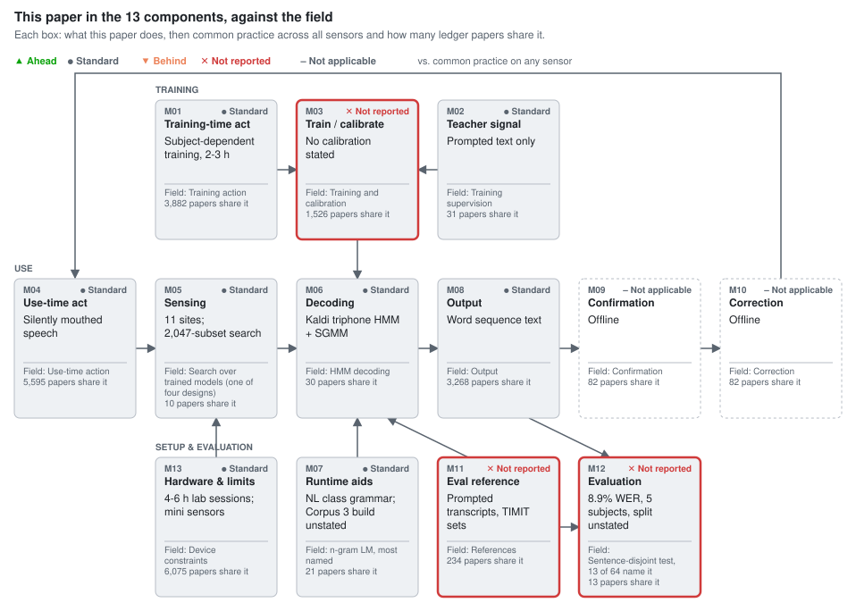

# Development of sEMG sensors and algorithms for silent speech recognition

Meltzner, G. S., Heaton, J. T., Deng, Y., De Luca, G., Roy, S. H., Kline, J. C. · Journal of Neural Engineering · 2018 · [doi:10.1088/1741-2552/aac965](https://doi.org/10.1088/1741-2552/aac965)

**Section:** [Surface EMG](../../README.md#surface-emg)

## Figures

### This paper in the 13 components, against the field

<picture><source media="(prefers-color-scheme: dark)" srcset="figures/components-dark.svg"></picture>

Verdicts compare the paper's choice for each component with common practice across 8,995 ledger entries on any sensor (silent speech, brain-to-text, lip reading).

Data

| Component | This paper | Common practice | Papers with this practice | Verdict |
| --- | --- | --- | --- | --- |
| M01 Training-time act | Subject-dependent training, 2-3 h | Training action | 3,882 of 8,995 | ● Standard (Inherited (BAE/Delsys lineage).) |
| M02 Teacher signal | Prompted text only | Training supervision | 31 of 8,995 | ● Standard (Inherited; no acoustic target.) |
| M03 Train / calibrate | No calibration stated | Training and calibration | 1,526 of 8,995 | ✕ Not reported (Only online detector adaptation described.) |
| M04 Use-time act | Silently mouthed speech | Use-time action | 5,595 of 8,995 | ● Standard (Inherited; Corpus 1 also vocalized.) |
| M05 Sensing | 11 sites; 2,047-subset search | Search over trained models (one of four designs) | 10 of 8,995 | ● Standard (Design predates it (MI ranking 2010; 11-to-8 cut reported 2014).) |
| M06 Decoding | Kaldi triphone HMM + SGMM | HMM decoding | 30 of 8,995 | ● Standard (Same pipeline reported in 2014.) |
| M07 Runtime aids | NL class grammar; Corpus 3 build unstated | n-gram LM, most named | 21 of 8,995 | ● Standard (Grammar established but rare (4 of 64).) |
| M08 Output | Word sequence text | Output | 3,268 of 8,995 | ● Standard (Inherited.) |
| M09 Confirmation | Offline | Confirmation | 82 of 8,995 | – Not applicable (Offline study.) |
| M10 Correction | Offline | Correction | 82 of 8,995 | – Not applicable (Offline study.) |
| M11 Eval reference | Prompted transcripts, TIMIT sets | References | 234 of 8,995 | ✕ Not reported (Prompt verification not described.) |
| M12 Evaluation | 8.9% WER, 5 subjects, split unstated | Sentence-disjoint test, 13 of 64 name it | 13 of 8,995 | ✕ Not reported (Five of six subjects tabulated; 2014 report gives a task-set-disjoint protocol.) |
| M13 Hardware & limits | 4-6 h lab sessions; mini sensors | Device constraints | 6,075 of 8,995 | ● Standard (Authors ask for 8-12 h tests.) |

## Verdict

The paper [[1]](#ref-1) combines an 11-site face and neck sEMG array with an exhaustive subset search (M05), a Kaldi triphone HMM with HLDA, MLLR and SGMM (M06) and a natural-language class grammar (M07); all three are standard against the ledger (Appendix). Its rows for the final system match those this group published in 2014 [[2]](#ref-2), which the paper does not cite. The headline 8.9% WER (Table 2) is the mean of five of the six 2014 subjects, whose six-subject mean is 11.2% [[2]](#ref-2); the omitted subject is not identified, and one possible reason is the stated exclusion of three participants, whose corpus is not given (Methods, Protocol). The 2014 report gives the protocol the journal omits, task-set-disjoint testing with a validation split [[2]](#ref-2), but "far surpassing previous attempts" still compares against other tasks (Discussion).

## Against the field, component by component

### M05 Sensors: 11-site array and subset search

**Usual approach:** Of 42 surface-EMG speech studies reporting electrode subsets (pattern match, unique studies, Appendix), a study can name several methods: 21 use attribution or association wording (an upper bound), 10 search over trained models, 5 rank single channels and 3 use random subsets. This paper runs the costliest search: all 2,047 subsets of 11 sensors, best 10.4% WER with 8 (Fig. 6).

**State of the art:** Hwang et al. (2026, [later]) test all 70 four-channel subsets of an 8-channel array, best 47.2% WER on EMG-to-speech [[3]](#ref-3), a different task.

Sridhar et al. chose 5 of 11 sensors by mutual information, 80.6% accuracy against 79.6% with all 11 [[4]](#ref-4), and the 2014 report states that an earlier study by this group cut 11 sensors to 8 with under 0.5% loss [[2]](#ref-2). No separate selection data are stated for the search (Fig. 6). Verdict: standard; the design predates it.

### M06 Decoder: Kaldi triphone HMM with HLDA, MLLR and SGMM

**Usual approach:** Of 54 wearable silent-sentence studies (pattern match, unique studies, Appendix; a study counts under each decoder it names), 30 name HMM decoding, 16 CTC and 9 attention sequence-to-sequence; the paper follows the HMM majority.

**State of the art:** 97.17% phrase classification accuracy on 33 closed-set Chinese phrases with 256-channel HD-sEMG and CTC (2023, [later]) [[5]](#ref-5); 12.2% WER on single-speaker open-vocabulary silent EMG, mostly from LLM rescoring (2024, [later]) [[6]](#ref-6).

HLDA cuts Corpus 2 WER from 11.3% to 7.3% (Fig. 5), 35% relative (inference); no separate selection data are stated for the mixture count or dimension (Fig. 4). The 8.9% is not comparable with 12.2%: five speaker-dependent subjects, a grammar and 88 to 167 test words per set [[2]](#ref-2) against one speaker and an open vocabulary. Verdict: standard.

### M07 Use-time constraint: natural-language class grammar

**Usual approach:** Of 64 sEMG studies scored with WER or CER (pattern match, sparse slot, Appendix), 21 name an n-gram language model, 14 a neural or large language model, 4 a grammar and 3 none. A grammar is established but rare; the field moved to statistical language models.

**State of the art:** 12.2% WER on the open-vocabulary Gaddy benchmark with LLM rescoring (2024, [later]) [[6]](#ref-6).

For Corpus 2 the grammar replaces each word of the corpus's own sentence-construction rules with a class (Methods); the authors call the sentence-construction grammar an upper bound, and the class grammar scores 6.8% against its 5.8% WER (Fig. 3). How the grammar was built for Corpus 3 is not stated, so the final WER stays entangled with grammar coverage of the test phrases (Table 2). Verdict: standard; its effect against a language model is untested.

## The 13 components

| Component | This paper | Usual approach (count) | State of the art | Verdict |
|---|---|---|---|---|
| M01 Training-time action | Subject-dependent training, 2-3 h | Training action (slot-filled 3,882) | – | standard |
| M02 Training-only supervision | Prompted text only | Training supervision (slot-filled 31) | – | standard |
| M03 Training and adaptation | No calibration stated | Training and calibration (slot-filled 1,526) | – | not reported |
| M04 Use-time action | Silently mouthed speech | Use-time action (slot-filled 5,595) | – | standard |
| M05 Sensors | 11 sites; 2,047-subset search | Search over trained models (one of four designs) (pattern match 10) | [[3]](#ref-3) (2026): 4-channel best 47.2% WER | standard |
| M06 Processing and decoding | Kaldi triphone HMM + SGMM | HMM decoding (pattern match 30) | [[5]](#ref-5) (2023): 97.17% phrase classification accuracy; [[6]](#ref-6) (2024): 12.2% WER, one speaker | standard |
| M07 Lexicon and LM | NL class grammar; Corpus 3 build unstated | n-gram LM, most named (pattern match 21) | [[6]](#ref-6) (2024): 12.2% WER, LLM rescoring | standard |
| M08 Output | Word sequence text | Output (slot-filled 3,268) | – | standard |
| M09 Confirmation | Offline | Confirmation (slot-filled 82) | – | not applicable |
| M10 Correction | Offline | Correction (slot-filled 82) | – | not applicable |
| M11 Reference construction | Prompted transcripts, TIMIT sets | References (slot-filled 234) | – | not reported |
| M12 Evaluation | 8.9% WER, 5 subjects, split unstated | Sentence-disjoint test, 13 of 64 name it (pattern match 13) | [[6]](#ref-6) (2024): 12.2% WER, one speaker | not reported |
| M13 Device and cost | 4-6 h lab sessions; mini sensors | Device constraints (slot-filled 6,075) | – | standard |

## Where the claims outrun the evidence

- The 8.9% WER (Table 2) is the five-subject mean of the 2014 table; with all six it is 11.2% [[2]](#ref-2), 26% higher in relative terms (inference). The paper does not say which subject is missing or why.
- The paper reports no unseen-word count for its "previously unseen words" claim (Table 2); the 2014 report gives 70, 36, 36 and 41 unseen words in the four test sets [[2]](#ref-2).
- The search ranks 11 sensors (Fig. 6), yet the Discussion calls the final system 8-sensor and the 2014 report recorded these task sets with 8 sensors [[2]](#ref-2); the best searched subset (10.4%) and the final system (8.9%) are not reconciled (Fig. 6, Table 2).
- No test partition is given for Corpus 2 or 3, and features, grammar, mixture count, HLDA dimension and sensor subset have no stated selection data (Fig. 2 to Fig. 6).

## What the field needs next

- M12: report every subject, the exclusions per corpus and the held-out protocol.
- M07: decode Corpus 3 with a language model trained on external text, against the class grammar on the same subjects.
- M05: choose the sensor subset on one session and report it on another, against the mutual-information shortcut [[4]](#ref-4).

## Questions for the authors

- Which Corpus 3 subject is missing from Table 2, and was that subject one of the three exclusions?
- Does Table 2 use the 2014 task-set-disjoint protocol and validation split?
- How was the class grammar built for Corpus 3, and did it cover test phrases absent from training?
- On which recordings and with which decoder was the 11-sensor search run, given the 8-sensor final system?

## Appendix: literature search

- M05 emg-speech-electrode-subset (published table reused). Inclusion rule: surface-EMG speech studies that evaluate a reduced subset of their electrodes or rank electrodes, classified by how the subset is chosen; fixed-array, sensor-hardware-only and non-speech studies excluded. Ledger: 7,329 slot-filled; 42 pattern match (unique studies). Designs (pattern match, a study can match several): attribution or association wording 21, exhaustive or greedy search 10, single-channel ranking 5, random subsets 3. Read in full: [[4]](#ref-4), [[2]](#ref-2), [[3]](#ref-3).
- M06 wearable-silent-sentence-decoding (published table reused). Inclusion rule: sentence or phrase recognition from silently articulated speech measured by body-worn non-video sensors, classified by sentence decoder, counting a study under each decoder its text names; lip video, imagined speech and overt-only studies excluded. Ledger: 7,345 slot-filled; 54 pattern match (unique studies). Usual design: HMM decoding, 30 (pattern match). Known-item recall 1.0. Read in full: [[5]](#ref-5), [[2]](#ref-2), [[6]](#ref-6).
- M07 emg-recognition-grammar-and-language-model (new topic). Inclusion rule: surface-EMG decoders scored with WER or CER, classified by the use-time linguistic constraint their full text names (rule grammar, n-gram, neural or large language model, none); a study counts under every design it names. Ledger: 119 slot-filled; 64 pattern match (unique studies). Most named design: n-gram language model, 21 (pattern match). Known-item recall 0.67. Read in full: [[6]](#ref-6), [[2]](#ref-2).
- M12 emg-text-unseen-sentence-test (published table reused). Inclusion rule: surface-EMG decoders scored with WER or CER, classified by whether the headline error is measured on sentences absent from all training data. Ledger: 6,960 slot-filled; 64 pattern match (unique studies). Named designs (pattern match): sentence-disjoint or open-vocabulary test 13, closed-set test 9, held-out-speaker wording 21. Known-item recall 1.0. Read in full: [[6]](#ref-6), [[2]](#ref-2).

## References

Numbered by first citation. BibTeX in the same order and keys: [refs.bib](refs.bib).

1. Meltzner, G. S., Heaton, J. T., Deng, Y., De Luca, G., Roy, S. H., Kline, J. C. “Development of sEMG sensors and algorithms for silent speech recognition.” *Journal of Neural Engineering*, 2018, 15(4), 046031. doi:[10.1088/1741-2552/aac965](https://doi.org/10.1088/1741-2552/aac965). Target. Read as the PMC author manuscript. [review](https://github.com/supernaiter/silent-speech-review/tree/main/reviews/development-of-semg-sensors-and-algorithms-for-silent-speech-recognition) [wiki: doi-10.1088-1741-2552-aac965](https://github.com/supernaiter/deep-research-wiki-for-silent-speech/blob/main/papers/doi-10.1088-1741-2552-aac965/article.md)
2. Deng, Y., Heaton, J. T., Meltzner, G. S. “Towards a Practical Silent Speech Recognition System.” *Proc. Interspeech 2014*, 2014, 1164-1168. doi:[10.21437/Interspeech.2014-296](https://doi.org/10.21437/Interspeech.2014-296). Prior, same group; deciding prior for M05, M06, M12. [wiki: isca-deng14b_interspeech](https://github.com/supernaiter/deep-research-wiki-for-silent-speech/blob/main/papers/isca-deng14b_interspeech/article.md) [wiki: isca-deng14b-practicalssi](https://github.com/supernaiter/deep-research-wiki-for-silent-speech/blob/main/papers/isca-deng14b-practicalssi/article.md)
3. Hwang, I., Lee, J., Lee, K. “EMG-to-Speech with Fewer Channels.” *arXiv preprint*, 2026. doi:[10.48550/arXiv.2602.06460](https://doi.org/10.48550/arXiv.2602.06460). arXiv:[2602.06460](https://arxiv.org/abs/2602.06460). Later; state of the art for M05 subset search. [later] [review](https://github.com/supernaiter/silent-speech-review/tree/main/reviews/emg-to-speech-with-fewer-channels) [wiki: arxiv-2602.06460](https://github.com/supernaiter/deep-research-wiki-for-silent-speech/blob/main/papers/arxiv-2602.06460/article.md)
4. Sridhar, V. K. R., Prasad, R., Natarajan, P. “Mutual Information analysis for feature and sensor subset selection in surface electromyography based speech recognition.” *Proc. Interspeech 2010*, 2010. doi:[10.21437/Interspeech.2010-377](https://doi.org/10.21437/Interspeech.2010-377). Prior; deciding prior for M05. [wiki: isca-sridhar10](https://github.com/supernaiter/deep-research-wiki-for-silent-speech/blob/main/papers/isca-sridhar10/article.md) [wiki: isca-sridhar10_interspeech](https://github.com/supernaiter/deep-research-wiki-for-silent-speech/blob/main/papers/isca-sridhar10_interspeech/article.md)
5. Chen, X., Zhang, X., Chen, X., Chen, X. “Decoding Silent Speech Based on High-Density Surface Electromyogram Using Spatiotemporal Neural Network.” *IEEE Transactions on Neural Systems and Rehabilitation Engineering*, 2023, 31, 2069-2078. doi:[10.1109/TNSRE.2023.3266299](https://doi.org/10.1109/TNSRE.2023.3266299). Later; closed-phrase state of the art for M06. [later] [wiki: tnsre-3266299-hdsemg](https://github.com/supernaiter/deep-research-wiki-for-silent-speech/blob/main/papers/tnsre-3266299-hdsemg/article.md)
6. Benster, T., Wilson, G., Elisha, R., Willett, F. R., Druckmann, S. “A Cross-Modal Approach to Silent Speech with LLM-Enhanced Recognition.” *arXiv preprint*, 2024. doi:[10.48550/arXiv.2403.05583](https://doi.org/10.48550/arXiv.2403.05583). arXiv:[2403.05583](https://arxiv.org/abs/2403.05583). Later; open-vocabulary state of the art for M06, M07, M12. [later] [wiki: arxiv-2403.05583](https://github.com/supernaiter/deep-research-wiki-for-silent-speech/blob/main/papers/arxiv-2403.05583/article.md)

## Materials

Data behind this review. Full texts of the papers are not included.

- [`review.md`](review.md): the review text (source)
- [`refs.bib`](refs.bib): references (BibTeX)
- [`slots.json`](slots.json): for each of the 13 components: this paper's choice, field practice, number of matching papers, verdict
- [`figures.json`](figures.json): figure definitions
- [`evaluation.md`](evaluation.md): independent evaluation by a second reviewer
- [`triage.md`](triage.md): how each evaluation finding was checked against the sources and resolved
- [`process/log.json`](process/log.json): process record: each step, who did it (reader, script, writer, evaluator), when, the checks run and the input versions
- [`process/notes.json`](process/notes.json): reading notes on the target and comparator papers: claims, numbers, conditions and what is not stated, with locations
- [`process/plan.json`](process/plan.json): plan: which components the paper changes and the topics it is compared on
- [`process/draft.md`](process/draft.md): the review as first written, before the independent evaluation
- [`process/claims-draft.md`](process/claims-draft.md): claim table of the draft: every claim mapped to a note or a count
- [`process/claims.md`](process/claims.md): claim table of the published review
- [`components/M05/emg-speech-electrode-subset.csv`](../../components/M05/emg-speech-electrode-subset.csv): M05 topic "emg-speech-electrode-subset", every candidate paper with its decision (7329 slot-filled, 42 pattern match, usual design in 10, 4 read in full)
- [`components/M06/wearable-silent-sentence-decoding.csv`](../../components/M06/wearable-silent-sentence-decoding.csv): M06 topic "wearable-silent-sentence-decoding", every candidate paper with its decision (7345 slot-filled, 54 pattern match, usual design in 30, 6 read in full)
- [`components/M07/emg-recognition-grammar-and-language-model.csv`](../../components/M07/emg-recognition-grammar-and-language-model.csv): M07 topic "emg-recognition-grammar-and-language-model", every candidate paper with its decision (119 slot-filled, 64 pattern match, usual design in 21, 2 read in full)
- [`components/M12/emg-text-unseen-sentence-test.csv`](../../components/M12/emg-text-unseen-sentence-test.csv): M12 topic "emg-text-unseen-sentence-test", every candidate paper with its decision (6960 slot-filled, 64 pattern match, usual design in 13, 3 read in full)

## More reviews in Surface EMG

- [AlterEgo: A Personalized Wearable Silent Speech Interface](../alterego-a-personalized-wearable-silent-speech-interface/) (2018). Wearable headset that recognizes silently articulated words from face and jaw neuromuscular signals and answers through bone-conduction audio; abstract reports 92% median word accuracy in user studies.
- [Digital Voicing of Silent Speech](../digital-voicing-of-silent-speech/) (2020). Silent-EMG target transfer (M02) extends a 2016 DTW recipe; the open corpus scored by WER (M12) became the shared test bed. Headline 94% gain is closed-vocabulary, 20 clips, one evaluator.
- [An Improved Model for Voicing Silent Speech](../an-improved-model-for-voicing-silent-speech/) (2021). Conv-plus-Transformer EMG encoder (M06) is reused by the 2026 state of the art; the phoneme loss (M02) follows 2018 ultrasound work. Single runs; ablations explain 16.3 of 25.8 points.
- [Sequence-to-Sequence Voice Reconstruction for Silent Speech in a Tonal Language](../sequence-to-sequence-voice-reconstruction-for-silent-speech-in-a-tonal-language/) (2022). Duration-regulated seq2seq with toneme loss voices silent Mandarin EMG; gains rest on the auxiliary loss, not the architecture, and prompt grouping in the utterance split is unreported.
- [Knowledge Distilled Ensemble Model for sEMG-based Silent Speech Interface](../knowledge-distilled-ensemble-model-for-semg-based-silent-speech-interface/) (2023). Ensemble-to-student distillation (M02, M06, M13) is standard: same-modality distillation predates it; 85.9% is one unseeded split of unstated unit, and 7x smaller is against six models.
- [A Parallel Ultra-Low Power Silent Speech Interface based on a Wearable, Fully-dry EMG Neckband](../a-parallel-ultra-low-power-silent-speech-interface-based-on-a-wearable-fully-dry-emg-neckband/) (2025). A fully dry wearable EMG neckband with ultra-low-power BioGAP-Ultra classifies 8 silently articulated words for one healthy user at 68% accuracy, dropping to 54% on an unseen re-wearing session; acquisition plus BLE uses 22.2 mW.

---

Part of the [Silent Speech Interface Review](https://github.com/supernaiter/silent-speech-review). Found an error? [Open an issue](https://github.com/supernaiter/silent-speech-review/issues/new?template=correction.yml).
