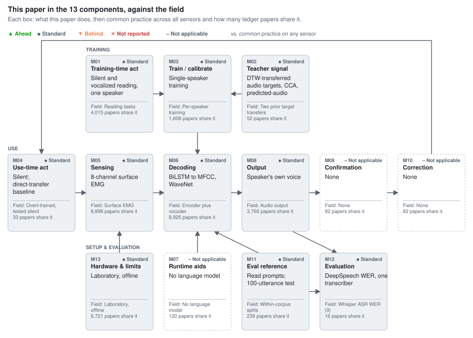

# Digital Voicing of Silent Speech

Gaddy D, Klein D. EMNLP 2020. [doi:10.18653/v1/2020.emnlp-main.445](https://doi.org/10.18653/v1/2020.emnlp-main.445) · [arXiv:2010.02960](https://arxiv.org/abs/2010.02960)

**Section:** [Surface EMG](../../README.md#surface-emg)

## Figures

### This paper in the 13 components, against the field

<picture><source media="(prefers-color-scheme: dark)" srcset="figures/components-dark.svg"></picture>

Verdicts compare the paper's choice for each component with common practice across 8,995 ledger entries on any sensor (silent speech, brain-to-text, lip reading).

Data

| Component | This paper | Common practice | Papers with this practice | Verdict |
| --- | --- | --- | --- | --- |
| M01 Training-time act | Silent and vocalized reading, one speaker | Reading tasks | 4,015 of 8,995 | ● Standard (EMG-UKA style parallel recording.) |
| M02 Teacher signal | DTW-transferred audio targets, CCA, predicted-audio realignment | Two prior target transfers | 52 of 8,995 | ● Standard (Prior recipe; CCA gain from one run.) |
| M03 Train / calibrate | Single-speaker training | Per-speaker training | 1,608 of 8,995 | ● Standard (Normalizer fit data not stated.) |
| M04 Use-time act | Silent; direct-transfer baseline | Overt-trained, tested silent | 33 of 8,995 | ● Standard (Baseline sensitive to one electrode.) |
| M05 Sensing | 8-channel surface EMG | Surface EMG | 8,898 of 8,995 | ● Standard (Electrode ranking from single runs.) |
| M06 Decoding | BiLSTM to MFCC, WaveNet | Encoder plus vocoder | 8,925 of 8,995 | ● Standard (Inherited.) |
| M07 Runtime aids | No language model | No language model | 120 of 8,995 | – Not applicable (Synthesis uses no lexicon.) |
| M08 Output | Speaker's own voice | Audio output | 3,760 of 8,995 | ● Standard (Inherited.) |
| M09 Confirmation | None | None | 82 of 8,995 | – Not applicable (Offline study.) |
| M10 Correction | None | None | 82 of 8,995 | – Not applicable (Offline study.) |
| M11 Eval reference | Read prompts; 100-utterance test | Within-corpus splits | 239 of 8,995 | ● Standard (Released split drawn from one book.) |
| M12 Evaluation | DeepSpeech WER, one transcriber | Whisper ASR WER (9) | 16 of 8,995 | ● Standard (Open corpus adopted; no seeds.) |
| M13 Hardware & limits | Laboratory, offline | Laboratory, offline | 6,721 of 8,995 | ● Standard (No latency or wearable result.) |

## Verdict

The paper [[1]](#ref-1) changes two components: silent EMG learns audio targets transferred from a vocalized repetition (M02), and silent-EMG voicing gets an open 18.6-hour corpus scored by word error rate (M12). M02 is standard: Janke's 2016 dissertation already trained EMG-to-speech on silent EMG with DTW-transferred acoustic targets from audible recordings of the same sentences (§6.3.1) [[2]](#ref-2), so the claim to be first to train on silent EMG fails (Appendix, M02). M12 is standard: ASR scoring of EMG-to-speech output predates it [[2]](#ref-2), and its 68.0% WER fell to 42.2% a year later on the same split and recognizer [[3]](#ref-3) and to 11.89% with Whisper by 2026 [[4]](#ref-4). The headline 94% reduction is a 67-word task with 20 clips per system and one evaluator (§4.1); open-vocabulary human WER falls 21% relative (95.1% to 74.8%; inference). CCA and the electrode ranking are single runs with no reported seed spread, and all 100 released test utterances come from one book.

## Against the field, component by component

### M02 Training-only supervision: audio targets transferred to silent EMG

**Usual approach:** Before 2020, silent-use systems were trained on vocalized recordings (7 prior of 23 confirmed studies, Appendix, M04). Of 15 confirmed studies that train silent signals on targets moved from a vocalized repetition (pattern match 52 unique studies, Appendix), two are prior: phoneme labels mapped by length scaling for recognition [[5]](#ref-5) and audio targets aligned by DTW [[2]](#ref-2).

**State of the art:** The best reaches 11.89% WER with Whisper (2026) [[4]](#ref-4). A 2026 alignment loss gives 25.14 ± 0.90 against 26.75 ± 0.99 Whisper-medium WER for the 2021 Gaddy model (98 test utterances, 10 seeds) [[6]](#ref-6).

The difference is evidence, not design. With 5.5 to 8.9 minutes of silent training data per session (Table 4.1), Janke's silent training lowered mel-cepstral distortion from 6.81 to 6.35 (Gaussian mapping, §6.3.1) and 7.14 to 6.65 (LSTM, §8.3.2), but feed-forward DNNs stayed worse than direct transfer (6.81 against 6.6, §8.3.1) [[2]](#ref-2). The target has 3.6 hours of parallel silent data (Table 2). Removing CCA costs 1.8 points (inference) in one run (69.8% against 68.0%, Table 5), with no seed spread reported; [[6]](#ref-6) measured about 1 point SD for the 2021 model under another recognizer. Predicted-audio realignment (76.5% without) carries the gain. Verdict: standard.

### M12 Evaluation: open corpus and automatic transcription

**Usual approach:** Earlier EMG-to-speech work scored silent output by DTW-aligned mel-cepstral distortion, and audible-EMG output also by ASR WER (§9.1.2) [[2]](#ref-2). On this paper's corpus, 16 unique studies report silent-EMG voicing (pattern match, Appendix): 9 score with Whisper, 7 with DeepSpeech, 3 with listeners (some use more than one).

**State of the art:** In 2021 the same split and recognizer gave 42.2% WER against 68.0% [[3]](#ref-3). The best, from 2026, is 11.89% with Whisper [[4]](#ref-4), 5.7 times lower (inference) under a different recognizer.

New is the open corpus with a fixed split and ASR protocol, which later work adopted. The recognizer floor is 9.5% WER on vocalized test audio (§4.2.2); the paper names neither the DeepSpeech model nor its scorer (the release loads v0.7.0 files, asr.py). Verdict: standard.

### M04 Use-time action: direct transfer as the baseline

**Usual approach:** 23 confirmed studies apply overt-trained decoders to silent or covert speech and report a loss (Appendix, M04); for EMG-to-speech with Gaussian mapping, distortion rises from 5.54 to 6.81 (§6.3.1) [[2]](#ref-2).

**State of the art:** All 12 [later] studies (2021–2026) among the 15 confirmed in the M02 table (Appendix) train on silent signals with transferred targets.

The gap: 88.0% (no-throat direct transfer, the strongest baseline) against 68.0% open-vocabulary WER; 64.6% against 3.6% closed-vocabulary (Tables 4–5). The baseline is the authors' reimplementation (§4.1, footnote 4), and dropping one throat electrode moves it from 88.8% to 64.6% (Table 4); the paper reports only these two variants. Verdict: standard.

## The 13 components

| Component | This paper | Usual approach (count) | State of the art | Verdict |
|---|---|---|---|---|
| M01 Training-time action | Silent and vocalized reading, one speaker | Reading tasks (slot-filled 4,015) | – | standard |
| M02 Training-only supervision | DTW-transferred audio targets, CCA, predicted-audio realignment | Two prior target transfers (pattern match 52) | 11.89% WER, Whisper [[4]](#ref-4) | standard |
| M03 Training and adaptation | Single-speaker training | Per-speaker training (slot-filled 1,608) | – | standard |
| M04 Use-time action | Silent; direct-transfer baseline | Overt-trained, tested silent (pattern match 33) | – | standard |
| M05 Sensors | 8-channel surface EMG | Surface EMG (slot-filled 8,898) | – | standard |
| M06 Processing and decoding | BiLSTM to MFCC, WaveNet | Encoder plus vocoder (slot-filled 8,925) | – | standard |
| M07 Lexicon and LM | No language model | No language model (slot-filled 120) | – | not applicable |
| M08 Output | Speaker's own voice | Audio output (slot-filled 3,760) | – | standard |
| M09 Confirmation | None | None (slot-filled 82) | – | not applicable |
| M10 Correction | None | None (slot-filled 82) | – | not applicable |
| M11 Reference construction | Read prompts; 100-utterance test | Within-corpus splits (slot-filled 239) | – | standard |
| M12 Evaluation | DeepSpeech WER, one transcriber | Whisper ASR WER (9) (pattern match 16) | 11.89% WER, Whisper [[4]](#ref-4) | standard |
| M13 Device and cost | Laboratory, offline | Laboratory, offline (slot-filled 6,721) | – | standard |

## Where the claims outrun the evidence

- Priority (Abstract): contradicted by [[2]](#ref-2) (§6.3.1; Appendix, M02).
- The 94% reduction (§4.1) uses 370 training utterances after open-vocabulary pretraining (Table 1) and clips with no stated selection.
- No seeds or repeated runs are reported (App. D). The electrode study trains 10 of 70 four-electrode removals once each (§4.3.2); the authors note that removing only 5, 7 and 8 gives 75.3%, so the single-run ranking is not established.
- §2.2 draws the 100 test utterances at random from the silent parallel data; the released testset.json takes all of them from one book (War of the Worlds), unstated in the paper.
- "No apparent plateau" beyond 15 hours (Fig. 4) rests on one run per data size.

## What the field needs next

- M02: seeded comparison of DTW target transfer with alignment-free objectives on several speakers.
- M12: named recognizer and normalization, all test utterances, five or more seeds, several listeners.
- M01/M11: a multi-speaker parallel corpus with a test split across texts.

## Questions for the authors

- Which DeepSpeech model and scorer produced Table 5, and was the scorer's language model active?
- How were the 20 human-evaluation clips chosen?
- What is the seed spread of the 68.0% result and of each ablation?
- Which data fit the normalizers (the release uses the first 51 training examples)?

## Appendix: literature search

- M02 silent-target-transfer. Inclusion rule: studies that train a decoder or synthesizer on silently articulated non-acoustic signals with acoustic or label targets transferred from a separate vocalized recording of the same utterance by time alignment; any signal; training on vocalized data only, alignment used only for scoring, whisper or NAM conversion and imagined speech excluded; versions counted once. Ledger counts: slot-filled 31 unique studies (M02); pattern match 52 unique studies; include decisions 15 unique studies (2 prior, the target, the rest [later]). Read in full: [[5]](#ref-5) (prior, §4.1), [[2]](#ref-2) (prior), [[4]](#ref-4), [[6]](#ref-6). Known-item recall 0.67 (the 2021 Gaddy model was missed by the pattern and added by hand).
- M04 overt-to-silent-transfer (published table, reused). Inclusion rule: decoders trained only on overt speech applied to silent, mouthed, inner or imagined speech without retraining; studies that also train on silent data count only if they report an overt-only baseline. Ledger counts: slot-filled 5,595 unique studies; pattern match 33 unique studies; confirmed 23 unique studies, 7 prior. Read in full: [[2]](#ref-2). Known-item recall 1.0.
- M12 silent-emg-voicing-benchmark (published table, reused). Inclusion rule: speech synthesized from silently articulated surface EMG on the Gaddy open-vocabulary corpus, scored by ASR or listener transcription; recognition-only studies, other corpora and voiced-only results excluded; versions counted once. Ledger counts: slot-filled 6,960 unique studies; pattern match 16 unique studies; design counts (pattern match, full text; a study can use more than one): Whisper 9, DeepSpeech 7, listener transcription 3. Read in full: [[3]](#ref-3), [[4]](#ref-4). Known-item recall 1.0.

## References

Numbered by first citation. BibTeX in the same order and keys: [refs.bib](refs.bib).

1. Gaddy, D., Klein, D. “Digital Voicing of Silent Speech.” *Proceedings of the 2020 Conference on Empirical Methods in Natural Language Processing (EMNLP)*, 2020, 5521–5530. doi:[10.18653/v1/2020.emnlp-main.445](https://doi.org/10.18653/v1/2020.emnlp-main.445). arXiv:[2010.02960](https://arxiv.org/abs/2010.02960). Target. Published proceedings version; arXiv v1 posted 2020-10. [review](https://github.com/supernaiter/silent-speech-review/tree/main/reviews/digital-voicing-of-silent-speech) [wiki: doi-10.18653-v1-2020.emnlp-main.445](https://github.com/supernaiter/deep-research-wiki-for-silent-speech/blob/main/papers/doi-10.18653-v1-2020.emnlp-main.445/article.md) [wiki: arxiv-2010.02960](https://github.com/supernaiter/deep-research-wiki-for-silent-speech/blob/main/papers/arxiv-2010.02960/article.md)
2. Janke, M. “EMG-to-Speech: Direct Generation of Speech from Facial Electromyographic Signals.” *Dissertation, Karlsruhe Institute of Technology (KIT)*, 2016. <https://publikationen.bibliothek.kit.edu/1000054490> Dissertation (oral examination 2016-04-22); the wiki entry is filed under the related journal article, Janke and Diener, IEEE/ACM TASLP 25(12), 2017, doi:10.1109/TASLP.2017.2738568. [wiki: doi-10.1109-taslp-2017-2738568](https://github.com/supernaiter/deep-research-wiki-for-silent-speech/blob/main/papers/doi-10.1109-taslp-2017-2738568/article.md)
3. Gaddy, D., Klein, D. “An Improved Model for Voicing Silent Speech.” *Proc. ACL-IJCNLP 2021 (Short Papers)*, 2021. doi:[10.18653/v1/2021.acl-short.23](https://doi.org/10.18653/v1/2021.acl-short.23). arXiv:[2106.01933](https://arxiv.org/abs/2106.01933). [later] [review](https://github.com/supernaiter/silent-speech-review/tree/main/reviews/an-improved-model-for-voicing-silent-speech) [wiki: arxiv-2106.01933](https://github.com/supernaiter/deep-research-wiki-for-silent-speech/blob/main/papers/arxiv-2106.01933/article.md) [wiki: doi-10.18653-v1-2021.acl-short.23](https://github.com/supernaiter/deep-research-wiki-for-silent-speech/blob/main/papers/doi-10.18653-v1-2021.acl-short.23/article.md)
4. Lee, J., Lee, J., Lee, K. “GETS: Guiding EMG-to-Speech Synthesis via Silent Speech Recognition.” *Proc. Interspeech 2026*, 2026. doi:[10.21437/Interspeech.2026-1938](https://doi.org/10.21437/Interspeech.2026-1938). [later] [wiki: isca-lee26r_interspeech](https://github.com/supernaiter/deep-research-wiki-for-silent-speech/blob/main/papers/isca-lee26r_interspeech/article.md)
5. Wand, M., Jou, S. S., Toth, A. R., Schultz, T. “Impact of Different Speaking Modes on EMG-based Speech Recognition.” *Proc. Interspeech 2009*, 2009. doi:[10.21437/Interspeech.2009-228](https://doi.org/10.21437/Interspeech.2009-228). Title and authors from the paper's first page; venue and DOI from the ISCA archive record. [wiki: isca-wand09_interspeech](https://github.com/supernaiter/deep-research-wiki-for-silent-speech/blob/main/papers/isca-wand09_interspeech/article.md)
6. Lee, J., Hwang, I., Lee, J., Kim, E., Han, D., Lee, K. “Enhancing EMG-to-Speech via Silent-Voiced Representation Alignment.” *Proc. Interspeech 2026*, 2026. doi:[10.21437/Interspeech.2026-2931](https://doi.org/10.21437/Interspeech.2026-2931). [later] [wiki: isca-lee26v_interspeech](https://github.com/supernaiter/deep-research-wiki-for-silent-speech/blob/main/papers/isca-lee26v_interspeech/article.md)

## Materials

Data behind this review. Full texts of the papers are not included.

- [`review.md`](review.md): the review text (source)
- [`refs.bib`](refs.bib): references (BibTeX)
- [`slots.json`](slots.json): for each of the 13 components: this paper's choice, field practice, number of matching papers, verdict
- [`figures.json`](figures.json): figure definitions
- [`evaluation.md`](evaluation.md): independent evaluation by a second reviewer
- [`triage.md`](triage.md): how each evaluation finding was checked against the sources and resolved
- [`components/M02/silent-target-transfer.csv`](../../components/M02/silent-target-transfer.csv): M02 topic "silent-target-transfer", every candidate paper with its decision (31 slot-filled, 52 pattern match, usual design in 15, 4 read in full)
- [`components/M04/overt-to-silent-transfer.csv`](../../components/M04/overt-to-silent-transfer.csv): M04 topic "overt-to-silent-transfer", every candidate paper with its decision (23 confirmed, 104 candidates read, 0 unread)
- [`components/M12/silent-emg-voicing-benchmark.csv`](../../components/M12/silent-emg-voicing-benchmark.csv): M12 topic "silent-emg-voicing-benchmark", every candidate paper with its decision (6960 slot-filled, 16 pattern match, usual design in 9, 4 read in full)

## More reviews in Surface EMG

- [An Improved Model for Voicing Silent Speech](../an-improved-model-for-voicing-silent-speech/) (2021). Conv-plus-Transformer EMG encoder (M06) is reused by the 2026 state of the art; the phoneme loss (M02) follows 2018 ultrasound work. Single runs; ablations explain 16.3 of 25.8 points.
- [Sequence-to-Sequence Voice Reconstruction for Silent Speech in a Tonal Language](../sequence-to-sequence-voice-reconstruction-for-silent-speech-in-a-tonal-language/) (2022). Duration-regulated seq2seq with toneme loss voices silent Mandarin EMG; gains rest on the auxiliary loss, not the architecture, and prompt grouping in the utterance split is unreported.
- [AlterEgo: A Personalized Wearable Silent Speech Interface](../alterego-a-personalized-wearable-silent-speech-interface/) (2018). Wearable headset that recognizes silently articulated words from face and jaw neuromuscular signals and answers through bone-conduction audio; abstract reports 92% median word accuracy in user studies.
- [Development of sEMG sensors and algorithms for silent speech recognition](../development-of-semg-sensors-and-algorithms-for-silent-speech-recognition/) (2018). Face- and neck-worn sEMG sensors with staged recognition algorithms decode silently mouthed phrases; abstract reports 8.9% WER on 1,200+ phrases from a 2,200-word vocabulary.
- [Knowledge Distilled Ensemble Model for sEMG-based Silent Speech Interface](../knowledge-distilled-ensemble-model-for-semg-based-silent-speech-interface/) (2023). Ensemble-to-student distillation (M02, M06, M13) is standard: same-modality distillation predates it; 85.9% is one unseeded split of unstated unit, and 7x smaller is against six models.
- [A Parallel Ultra-Low Power Silent Speech Interface based on a Wearable, Fully-dry EMG Neckband](../a-parallel-ultra-low-power-silent-speech-interface-based-on-a-wearable-fully-dry-emg-neckband/) (2025). A fully dry wearable EMG neckband with ultra-low-power BioGAP-Ultra classifies 8 silently articulated words for one healthy user at 68% accuracy, dropping to 54% on an unseen re-wearing session; acquisition plus BLE uses 22.2 mW.

---

Part of the [Silent Speech Interface Review](https://github.com/supernaiter/silent-speech-review). Found an error? [Open an issue](https://github.com/supernaiter/silent-speech-review/issues/new?template=correction.yml).
