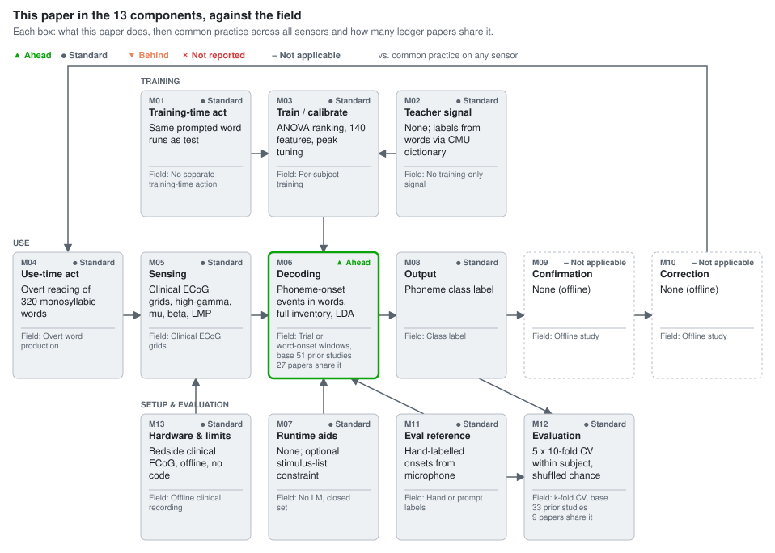

# Direct classification of all American English phonemes using signals from functional speech motor cortex

Mugler, Patton, Flint, Wright, Schuele, Rosenow, Shih, Krusienski, Slutzky. Journal of Neural Engineering 11(3):035015, 2014. [doi:10.1088/1741-2560/11/3/035015](https://doi.org/10.1088/1741-2560/11/3/035015)

**Section:** [Other sensors](../../README.md#other-sensors)

## Figures

### This paper in the 13 components, against the field

<picture><source media="(prefers-color-scheme: dark)" srcset="figures/components-dark.svg"></picture>

Verdicts compare the paper's choice for each component with common practice across 8,995 ledger entries on any sensor (silent speech, brain-to-text, lip reading).

Data

| Component | This paper | Common practice | Papers with this practice | Verdict |
| --- | --- | --- | --- | --- |
| M01 Training-time act | Same prompted word runs as test | No separate training-time action |  | ● Standard (Inherited.) |
| M02 Teacher signal | None; labels from words via CMU dictionary | No training-only signal |  | ● Standard (Inherited.) |
| M03 Train / calibrate | ANOVA ranking, 140 features, peak tuning | Per-subject training |  | ● Standard (Peak configuration (electrodes, feature count, time bins) tuned on CV accuracy; nesting not stated (Sec. 2.5).) |
| M04 Use-time act | Overt reading of 320 monosyllabic words | Overt word production |  | ● Standard (Inherited.) |
| M05 Sensing | Clinical ECoG grids, high-gamma, mu, beta, LMP | Clinical ECoG grids |  | ● Standard (Inherited; coverage set by clinical need.) |
| M06 Decoding | Phoneme-onset events in words, full inventory, LDA | Trial or word-onset windows, base 51 prior studies | 27 of 51 | ▲ Ahead (Ahead as protocol (0 of 51 phoneme-onset); full inventory predates it (Brumberg 2011).) |
| M07 Runtime aids | None; optional stimulus-list constraint | No LM, closed set |  | ● Standard (Inherited.) |
| M08 Output | Phoneme class label | Class label |  | ● Standard (Inherited.) |
| M09 Confirmation | None (offline) | Offline study |  | – Not applicable (Offline.) |
| M10 Correction | None (offline) | Offline study |  | – Not applicable (Offline.) |
| M11 Eval reference | Hand-labelled onsets from microphone | Hand or prompt labels |  | ● Standard (Onsets used for test trials too (Sec. 2.4).) |
| M12 Evaluation | 5 x 10-fold CV within subject, shuffled chance | k-fold CV, base 33 prior studies | 9 of 33 | ● Standard (No held-out session, subject or word.) |
| M13 Hardware & limits | Bedside clinical ECoG, offline, no code | Offline clinical recording |  | ● Standard (ITR is for a hypothetical BCI (Sec. 3.3).) |

## Verdict

The paper [[1]](#ref-1) changes one component, the decoder (M06), and it is ahead as a protocol: it classifies each phoneme as an event at its own onset inside spoken words, which none of 51 earlier intracranial speech studies does (pattern match, Appendix) and none of the read deciding priors does [[2]](#ref-2), [[3]](#ref-3), [[4]](#ref-4), [[5]](#ref-5), confirming the authors' second "first" claim (Sec. 4), with above-chance results in four subjects. The full-inventory part is not new: Brumberg et al. classified 38 attempted isolated phonemes at 16–21% against 2.6% chance, which the authors cite (Sec. 1), so their ECoG-scoped "first" is the accurate one. The headline overreaches: "up to 36% accuracy when classifying all phonemes" (Abstract) is subject NU2's consonant accuracy (36.1%, Sec. 3.1). The strongest confound is the labels: every analysed phoneme, test trials included, sits on an onset placed by hand from the microphone (Sec. 2.4), and Wilson et al. [later] measured that audio-derived onsets and microphonic contamination both inflate overt-speech phoneme accuracy, modestly [[6]](#ref-6). On a matched protocol, later intracortical arrays only nearly matched it [[6]](#ref-6); today's decoders need no per-phoneme onsets [[7]](#ref-7).

## Against the field, component by component

### M06 Processing and decoding: phoneme events within words, full inventory

**Usual approach:** before 2013-11, 27 of 51 intracranial speech studies align windows to the trial cue, stimulus or word or speech onset and none to phoneme onsets inside words (pattern match, Appendix); 4 of 9 ledger-matched speech-unit studies name subsets of two to six units, 1 the full inventory, and none of the 5 ECoG studies among them the full inventory (pattern match, Appendix). The read ECoG decoders classified four vowels, or four-class groups drawn from nine consonant pairs, at word level against 25% chance [[3]](#ref-3), or four isolated phonemes [[4]](#ref-4); Tankus et al. used five cued vowels [[5]](#ref-5); Bouchard et al. mapped articulators, not speech units [[8]](#ref-8).

**State of the art:** Willett et al. (2023) [later] reach 62% on 39 attempted isolated phonemes, and decode sentences with a CTC-trained RNN that needs no phoneme onsets at test, at 23.8% WER on a 125,000-word vocabulary [[7]](#ref-7).

The closest comparison is Wilson et al. (2020) [later], who reran this design on intracortical arrays with vowels and consonants decoded separately, the best subject's trial count and a 600-ms window: 36.8% against the target's 36.1% on 24 consonants, and 27.7% against 23.9% on 16 vowels [[6]](#ref-6), a 0.7-point (2% relative) and 3.8-point (16% relative) gap (inference). Verdict: ahead, because the in-word onset design has no prior (Appendix) and repeats across four subjects and in both of Wilson's participants; the accuracy itself is not ahead. Gaussian onset noise with a 100-ms standard deviation, below the 176-ms mean phoneme length, sharply lowers accuracy (Sec. 3.1), so the result depends on onset precision.

### M12 Evaluation: repeated within-subject folds

**Usual approach:** k-fold cross-validation, named by 9 of 33 intracranial speech studies first public before 2013-11 (pattern match, Appendix); the paper uses the same random within-subject folds, with no held-out session, subject or word (Sec. 2.5).

**State of the art:** leave-one-subject-out testing of speech reconstruction, spectrogram PCC 0.765 on unseen participants, Chen et al. (2024) [later] [[9]](#ref-9). Verdict: standard for 2014.

## The 13 components

| Component | This paper | Usual approach (count) | State of the art | Verdict |
|---|---|---|---|---|
| M01 Training-time action | Same prompted word runs as test | No separate training-time action | – | standard |
| M02 Training-only supervision | None; labels from words via CMU dictionary | No training-only signal | – | standard |
| M03 Training and adaptation | ANOVA ranking, 140 features, peak tuning | Per-subject training | – | standard |
| M04 Use-time action | Overt reading of 320 monosyllabic words | Overt word production | – | standard |
| M05 Sensors | Clinical ECoG grids, high-gamma, mu, beta, LMP | Clinical ECoG grids | – | standard |
| M06 Processing and decoding | Phoneme-onset events in words, full inventory, LDA | Trial or word-onset windows, base 51 prior studies (pattern match 27) | [[7]](#ref-7) (2023): 39 phonemes 62%; onset-free sentences, 23.8% WER | ahead |
| M07 Lexicon and LM | None; optional stimulus-list constraint | No LM, closed set | – | standard |
| M08 Output | Phoneme class label | Class label | – | standard |
| M09 Confirmation | None (offline) | Offline study | – | not applicable |
| M10 Correction | None (offline) | Offline study | – | not applicable |
| M11 Reference construction | Hand-labelled onsets from microphone | Hand or prompt labels | – | standard |
| M12 Evaluation | 5 x 10-fold CV within subject, shuffled chance | k-fold CV, base 33 prior studies (pattern match 9) | [[9]](#ref-9) (2024): leave-one-subject-out reconstruction, PCC 0.765 | standard |
| M13 Device and cost | Bedside clinical ECoG, offline, no code | Offline clinical recording | – | standard |

## Where the claims outrun the evidence

- "All phonemes". The abstract's 36% is a consonant result (Sec. 3.1); vowels and consonants were analysed separately, and the paper does not say whether the 20.4% all-phoneme mean is consonant-only or pooled (Sec. 3.1). NU2's 72.3% uses only the four most frequent phonemes (Sec. 3.1).
- Oracle segmentation. Features span 300 ms before to 300 ms after hand-labelled onsets (600 ms, 12 bins) for every analysed phoneme (Sec. 2.4); the 3.0 bits/s, 33.6 words/min rate is for a hypothetical BCI (Sec. 3.3) and is not comparable with the 2.1 bits/s cited for the best communication BCI (Sec. 1).
- Leakage. Folds are drawn over phoneme instances and called "fully independent" (Sec. 2.5), but phonemes of one trial are not said to share a fold; with 600-ms windows and 176-ms phonemes, neighbours share most samples (inference), as the authors partly concede (Sec. 2.4). NU2 and NU3 also repeated the first 160 words (Sec. 2.3).
- Selection optimism (M03). Each subject's "peak performance" keeps significant electrodes, adds time bins until performance no longer improved and raises the feature count to the maximum (Sec. 2.5), all on cross-validated accuracy with no stated nesting; Sec. 3.2 reports contributions as fractions of that peak.

## What the field needs next

- M06/M11: onsets from a neural detector or forced aligner at test, reporting the drop from hand labels.
- M12: folds grouped by trial and by word, and a held-out session.
- M03: electrode, feature-count and time-bin selection nested in training folds.

## Questions for the authors

- How many vowel classes, and how many classes in total, entered the all-phoneme result, and is the 20.4% consonant-only or pooled?
- Do the Sec. 3.1 figures use the per-subject peak-performance configuration?
- Were phonemes of one trial or word kept in one fold?
- Were label shuffles stratified, and was feature selection repeated per shuffle?

## Appendix: literature search

- **M06 / within-word-phoneme-onset-classification.** Inclusion rule: wiki studies first public before 2013-11 whose full text names an intracranial recording and a speech unit; design of interest: windows aligned to each phoneme onset inside a produced word versus to the trial cue, stimulus or word or speech onset; perception, review and mapping papers stay in; versions merged; one 2013 paper with unresolved month excluded. Counts: slot-filled 7,345; full-text pattern match 51 unique studies; trial, stimulus or word onset 27; phoneme onset within words 0 (2 raw hits are perception papers citing phoneme boundaries). Read in full: [[2]](#ref-2), [[3]](#ref-3), [[4]](#ref-4), [[5]](#ref-5), [[7]](#ref-7).
- **M06 / intracranial-phoneme-inventory-classification.** Inclusion rule: ledger text names ECoG, sEEG, intracortical or Utah-array recording with phonemes, vowels, consonants or syllables; design of interest: full phoneme inventory (38–44 classes) versus a subset of two to six units; versions count once. Ledger counts: slot-filled 7,345; pattern match 101 unique studies. First public before 2013-11: 9 unique studies (a scalp-EEG study and a modelling paper removed); small subset 4, full inventory 1, no discrete unit set 4; ECoG 5, full inventory 0. Two text-only subset matches (Brumberg 2011, Bouchard 2013) removed. [concurrent] and excluded: Ikeda et al. 2014, Toyoda et al. 2014. All years: small subset 54, full inventory 30 (pattern match, upper bounds). Read in full: [[2]](#ref-2), [[3]](#ref-3), [[4]](#ref-4), [[8]](#ref-8), [[7]](#ref-7), [[6]](#ref-6). Known-item recall 1.0.
- **M12 / intracranial-speech-test-partition** (published table, reused). Inclusion rule: intracranial speech decoding studies; design of interest: how test data are separated from training data. Ledger counts: slot-filled 6,960; pattern match 618 unique studies; across years k-fold 132, held-out subject 28. Before 2013-11: 33 unique studies (18 undated excluded; Pasley 2012 versions merged), k-fold 9, random split 8, held-out session wording 5, held-out subject 0 (pattern match). Read in full: [[9]](#ref-9). Known-item recall 1.0.

## References

Numbered by first citation. BibTeX in the same order and keys: [refs.bib](refs.bib).

1. Mugler, E. M., Patton, J. L., Flint, R. D., Wright, Z. A., Schuele, S. U., Rosenow, J., et al. “Direct classification of all American English phonemes using signals from functional speech motor cortex.” *Journal of Neural Engineering*, 2014, 11(3), 035015. doi:[10.1088/1741-2560/11/3/035015](https://doi.org/10.1088/1741-2560/11/3/035015). Target. Read as the PMC author manuscript (PMC4097188), published in final form 19 May 2014. [wiki: doi-10.1088-1741-2560-11-3-035015](https://github.com/supernaiter/deep-research-wiki-for-silent-speech/blob/main/papers/doi-10.1088-1741-2560-11-3-035015/article.md) [wiki: pmc-4097188-mugler](https://github.com/supernaiter/deep-research-wiki-for-silent-speech/blob/main/papers/pmc-4097188-mugler/article.md)
2. Brumberg, J. S., Wright, E. J., Andreasen, D. S., Guenther, F. H., Kennedy, P. R. “Classification of Intended Phoneme Production from Chronic Intracortical Microelectrode Recordings in Speech-Motor Cortex.” *Frontiers in Neuroscience*, 2011, 5, 65. doi:[10.3389/fnins.2011.00065](https://doi.org/10.3389/fnins.2011.00065). Prior; deciding prior for M06 (38 attempted isolated phonemes, intracortical, one locked-in participant). [wiki: doi-10.3389-fnins.2011.00065](https://github.com/supernaiter/deep-research-wiki-for-silent-speech/blob/main/papers/doi-10.3389-fnins.2011.00065/article.md)
3. Pei, X., Barbour, D., Leuthardt, E. C., Schalk, G. “Decoding Vowels and Consonants in Spoken and Imagined Words Using Electrocorticographic Signals in Humans.” *Journal of Neural Engineering*, 2011, 8(4), 046028. doi:[10.1088/1741-2560/8/4/046028](https://doi.org/10.1088/1741-2560/8/4/046028). Prior; deciding prior for M06 (four vowels or consonant-pair groups decoded at word level on ECoG). [review](https://github.com/supernaiter/silent-speech-review/tree/main/reviews/decoding-vowels-and-consonants-in-spoken-and-imagined-words-using-electrocorticographic-signals-in-h) [wiki: doi-10.1088-1741-2560-8-4-046028](https://github.com/supernaiter/deep-research-wiki-for-silent-speech/blob/main/papers/doi-10.1088-1741-2560-8-4-046028/article.md)
4. Leuthardt, E. C., Gaona, C., Sharma, M., Szrama, N., Roland, J., Freudenberg, Z., et al. “Using the electrocorticographic speech network to control a brain-computer interface in humans.” *Journal of Neural Engineering*, 2011, 8(3), 036004. doi:[10.1088/1741-2560/8/3/036004](https://doi.org/10.1088/1741-2560/8/3/036004). Prior; deciding prior for M06 (four phonemes in ECoG screening for cursor control). [wiki: doi-10.1088-1741-2560-8-3-036004](https://github.com/supernaiter/deep-research-wiki-for-silent-speech/blob/main/papers/doi-10.1088-1741-2560-8-3-036004/article.md)
5. Tankus, A., Fried, I., Shoham, S. “Structured neuronal encoding and decoding of human speech features.” *Nature Communications*, 2012, 3, 1015. doi:[10.1038/ncomms1995](https://doi.org/10.1038/ncomms1995). Prior; deciding prior for M06 (depth-electrode units, five cued vowels). [wiki: doi-10.1038-ncomms1995](https://github.com/supernaiter/deep-research-wiki-for-silent-speech/blob/main/papers/doi-10.1038-ncomms1995/article.md)
6. Wilson, G. H., Stavisky, S. D., Willett, F. R., Avansino, D. T., Kelemen, J. N., Hochberg, L. R., et al. “Decoding spoken English from intracortical electrode arrays in dorsal precentral gyrus.” *Journal of Neural Engineering*, 2020, 17(6), 066007. doi:[10.1088/1741-2552/abbfef](https://doi.org/10.1088/1741-2552/abbfef). Later; same within-word, hand-labelled onset protocol on 39 phonemes. [later] [wiki: doi-10.1088-1741-2552-abbfef](https://github.com/supernaiter/deep-research-wiki-for-silent-speech/blob/main/papers/doi-10.1088-1741-2552-abbfef/article.md)
7. Willett, F. R., Kunz, E. M., Fan, C., Avansino, D. T., Wilson, G. H., Choi, E. Y., et al. “A high-performance speech neuroprosthesis.” *Nature*, 2023, 620, 1031-1036. doi:[10.1038/s41586-023-06377-x](https://doi.org/10.1038/s41586-023-06377-x). Later; state of the art for M06 (39 attempted isolated phonemes, 62%). [later] [review](https://github.com/supernaiter/silent-speech-review/tree/main/reviews/a-high-performance-speech-neuroprosthesis) [wiki: doi-10.1038-s41586-023-06377-x](https://github.com/supernaiter/deep-research-wiki-for-silent-speech/blob/main/papers/doi-10.1038-s41586-023-06377-x/article.md)
8. Bouchard, K. E., Mesgarani, N., Johnson, K., Chang, E. F. “Functional organization of human sensorimotor cortex for speech articulation.” *Nature*, 2013, 495(7441), 327-332. doi:[10.1038/nature11911](https://doi.org/10.1038/nature11911). Prior; ECoG articulator map, no speech-unit classifier; cited by the target. [wiki: doi-10.1038-nature11897](https://github.com/supernaiter/deep-research-wiki-for-silent-speech/blob/main/papers/doi-10.1038-nature11897/article.md)
9. Chen, J., Chen, X., Wang, R., Le, C., Khalilian-Gourtani, A., Jensen, E., et al. “Subject-Agnostic Transformer-Based Neural Speech Decoding from Surface and Depth Electrode Signals.” *bioRxiv*, 2024. doi:[10.1101/2024.03.11.584533](https://doi.org/10.1101/2024.03.11.584533). Later; leave-one-subject-out speech reconstruction (spectrogram PCC). [later] [wiki: doi-10.1101-2024.03.11.584533](https://github.com/supernaiter/deep-research-wiki-for-silent-speech/blob/main/papers/doi-10.1101-2024.03.11.584533/article.md)

## Materials

Data behind this review. Full texts of the papers are not included.

- [`review.md`](review.md): the review text (source)
- [`refs.bib`](refs.bib): references (BibTeX)
- [`slots.json`](slots.json): for each of the 13 components: this paper's choice, field practice, number of matching papers, verdict
- [`figures.json`](figures.json): figure definitions
- [`evaluation.md`](evaluation.md): independent evaluation by a second reviewer
- [`triage.md`](triage.md): how each evaluation finding was checked against the sources and resolved
- [`process/log.json`](process/log.json): process record: each step, who did it (reader, script, writer, evaluator), when, the checks run and the input versions
- [`process/notes.json`](process/notes.json): reading notes on the target and comparator papers: claims, numbers, conditions and what is not stated, with locations
- [`process/plan.json`](process/plan.json): plan: which components the paper changes and the topics it is compared on
- [`process/draft.md`](process/draft.md): the review as first written, before the independent evaluation
- [`process/claims-draft.md`](process/claims-draft.md): claim table of the draft: every claim mapped to a note or a count
- [`process/claims.md`](process/claims.md): claim table of the published review
- [`components/M06/intracranial-phoneme-inventory-classification.csv`](../../components/M06/intracranial-phoneme-inventory-classification.csv): M06 topic "intracranial-phoneme-inventory-classification", every candidate paper with its decision (7345 slot-filled, 101 pattern match, usual design in 4, 5 read in full)
- [`components/M06/within-word-phoneme-onset-classification.csv`](../../components/M06/within-word-phoneme-onset-classification.csv): M06 topic "within-word-phoneme-onset-classification", every candidate paper with its decision (7345 slot-filled, 51 pattern match, usual design in 27, 5 read in full)
- [`components/M12/intracranial-speech-test-partition.csv`](../../components/M12/intracranial-speech-test-partition.csv): M12 topic "intracranial-speech-test-partition", every candidate paper with its decision (6960 slot-filled, 618 pattern match, usual design in 132, 2 read in full)

## More reviews in Other sensors

- [Decoding spectrotemporal features of overt and covert speech from the human cortex](../decoding-spectrotemporal-features-of-overt-and-covert-speech-from-the-human-cortex/) (2014). Overt-trained ECoG decoding of covert reading (M04), spectral outputs (M08) and the overt-recording covert reference (M11) are standard; DTW-aligned rest reaches r 0.30 vs covert 0.34.
- [Brain-to-text: decoding spoken phrases from phone representations in the brain](../brain-to-text-decoding-spoken-phrases-from-phone-representations-in-the-brain/) (2015). Phone-model decoder (M06) is the EMG recognizer moved to ECoG: standard. 25% WER uses per-phrase dictionaries holding the spoken words (M07); the time-shift null (M12) is sound.
- [Fully Implanted Brain-Computer Interface in a Locked-In Patient with ALS](../fully-implanted-brain-computer-interface-in-a-locked-in-patient-with-als/) (2016). Skin-closed ECoG implant used at home without investigators (M13): standard, one user, skin-closed telemetry predates it; main-text 89% spelling accuracy pools inactive steps, no chance level.
- [Lipreading with Long Short-Term Memory](../lipreading-with-long-short-term-memory/) (2016). Joint LSTM + pixel front end (M06) is ahead of 2015 lipreading, but pixel-input and recurrent word models predate it, and the 8.3-point gain is over linear SVMs, not HMMs.
- [Reconstructing Speech from Human Auditory Cortex](../reconstructing-speech-from-human-auditory-cortex/) (2012). M06 ahead for 2012: earliest heard-speech spectrogram reconstruction from human ECoG in the ledger, above zero in all 15 patients; modulation result is a group effect; word readout uses one patient.
- [Combining Residual Networks with LSTMs for Lipreading](../combining-residual-networks-with-lstms-for-lipreading/) (2017). 3D-conv + ResNet + Bi-LSTM (M06), which became the field default, and per-step training (M03) are standard only for lack of run counts; 83.0% trails audio-supervised 93.2% today.

---

Part of the [Silent Speech Interface Review](https://github.com/supernaiter/silent-speech-review). Found an error? [Open an issue](https://github.com/supernaiter/silent-speech-review/issues/new?template=correction.yml).
